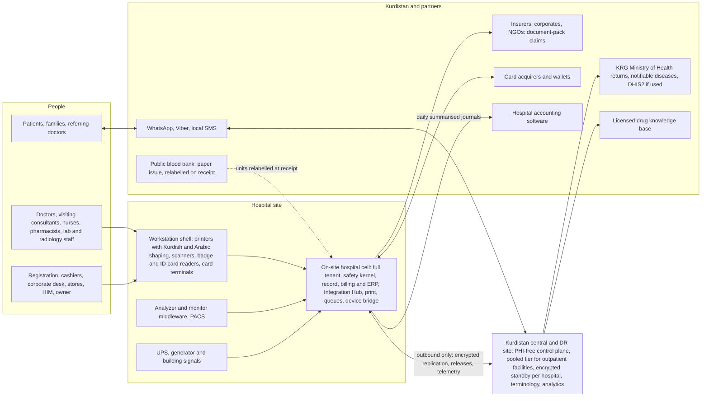
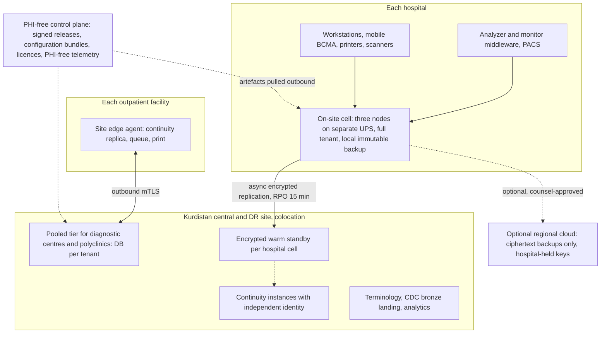
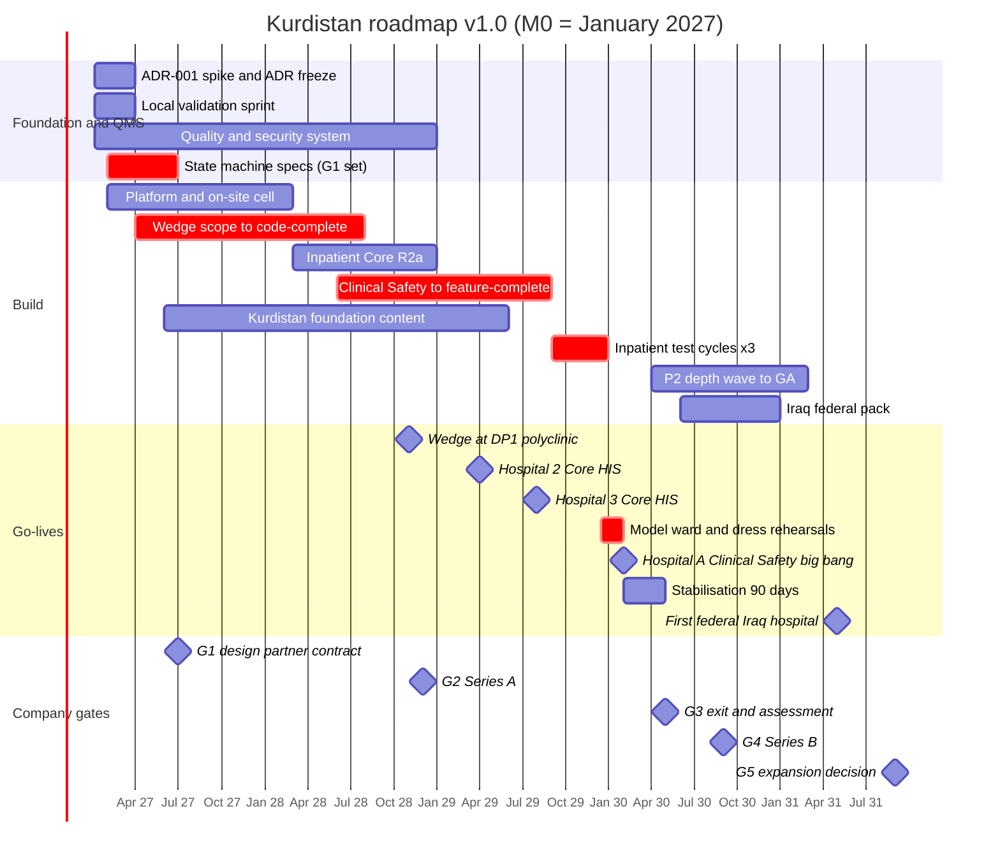

# Kurdistan Edition: A Top-Tier Hospital Management System for the Kurdistan Region of Iraq

## 0. Document control

| Field | Value |
|---|---|
| Document | Kurdistan edition of the Master Blueprint for the Hospital Management System (HMS): clinical core (HIS/EHR), clinical-operational ERP, revenue cycle and patient front door, re-planned for the Kurdistan Region of Iraq (KRI) |
| Version | 1.1 (Kurdistan edition), derived from `BLUEPRINT.md` v1.2.1. v1.1 applies the findings of two independent reviews of v1.0 (Appendix C) |
| Date | 17 October 2026 |
| Status | Planning baseline. Research and planning only; no code has been written. Every ADR stays "proposed" until its gate in §15 passes. |
| Evidence | The 16-report research pack (R01–R16), the Reconciliation Log (RL) and `BLUEPRINT.md` v1.2.1 (cited as "BP §n"). **No new research was done for this edition.** The pack contains nothing on Iraq or Kurdistan, so every Kurdistan-specific fact here is a local assumption tagged **[L]**, listed with a verification step in Appendix B, and checked in the M0–M3 local validation sprint (§19). |
| Calendar anchor | **M0 = January 2027**, the same as BP. M12 = Jan 2028, M24 = Jan 2029, M36 = Jan 2030, M60 = Jan 2032. |
| Precedence | For Kurdistan questions this edition wins over BP wherever Appendix A records a change. Anything this edition does not change is inherited from BP unchanged, including its evidence and reasoning. |
| Conventions | [E] our estimate. [I] our inference. [K]/[U] unverified items inherited from the pack. **[L] local assumption about the Kurdistan Region or Iraq from general knowledge, not from the pack; confirm before relying on it.** US$1 ≈ IQD 1,300 at the official rate [L]; market rates have run higher. |

**How to read this document.**
- **Part 0** is a three-minute summary written to be read aloud.
- §1 is the one-page answer and the 30 decisions (K-01…K-30). Each says whether it keeps, adapts or changes the matching BP decision (D-01…D-30).
- §2 is new: the Kurdistan facts the plan rests on, and what each means for the product.
- §3–§16 follow BP's structure (market, scope, safety, UX, architecture, data, integration, security, AI, billing, implementation, team and money, roadmap, go-to-market). §17–§19 cover KPIs, risks and what is still open.
- Appendix A maps every BP section to what changed. Appendix B is the register of [L] assumptions. Appendix C says how this edition was produced.

---

## Part 0. Read-aloud summary (about three minutes)

We studied the best hospital systems in the world, including Epic, Oracle, MEDITECH and InterSystems. We also studied open-source systems, international standards, patient-safety rules, and the lessons of hospital IT projects that failed. This plan turns that research into a system built for the Kurdistan Region.

What the best systems share is simple. Every department works from one patient record. Medicines are checked at every step: the doctor orders on screen, the pharmacist checks the order, and the nurse scans the patient's wristband and the medicine before giving it. Lab, radiology, pharmacy, billing and stock are connected, so every test and every item used is charged automatically. And the system keeps working when the internet or the power goes down.

Here is our plan for Kurdistan.

**Who it is for.** Private hospitals in Erbil, Sulaymaniyah, Duhok and Halabja come first, together with diagnostic centres and polyclinics. Public hospitals and the rest of Iraq come later.

**What we build first.**
- Registration and appointments, outpatient clinics, the lab and radiology orders.
- Pharmacy and stock.
- Billing in dinars and dollars: cash, deposits, packages, doctors' fees and insurance.

**Then the wards.**
- Doctors' electronic orders, pharmacist checks and barcode scanning at the bedside.
- Nursing, the emergency department, operating theatres and maternity.

**How we build it.**
- Kurdish, Arabic and English from day one.
- Every hospital runs its own local servers, so wards keep working through internet cuts and power cuts.
- A protected copy is kept off site.
- We use international standards, so we can connect to the Ministry of Health, insurers and other hospitals later.

**Safety.** The system itself enforces 21 safety rules. They cover the right patient, the right drug and the right dose, allergy checks and blood checks. Doctors and nurses test everything before it goes live, and an independent reviewer can stop a go-live.

**What we do not build.** Imaging storage, nurse-call systems, drug databases or our own AI models. We connect to good existing products instead.

**How we roll out.**
1. Start with one partner hospital group, beginning with its outpatient and diagnostic centre.
2. From spring 2029, other private hospitals start on the core system: registration, billing, pharmacy, stock and the lab.
3. About fifteen months after the outpatient centre, the partner's main hospital switches over completely, with the full medicine-safety loop, in one planned go-live with our team on site.
4. Then hospitals upgrade to the full safety loop one by one, and later we go to Baghdad and the rest of Iraq.

**Timing and money.**
- Building starts in January 2027.
- The first site goes live in late 2028.
- The first hospital runs on the core system in spring 2029.
- The first hospital with the full safety loop goes live in early 2030.
- The plan needs about 36 million US dollars of investment over five years.
- The team grows to about 120 people, most of them in Kurdistan.

**One honest point.** Kurdistan's private hospitals alone cannot pay back a top-tier system. It works only if we:
- grow into the rest of Iraq;
- win funded public-sector work; or
- later enter the Gulf.

There is also a slower, cheaper path. It costs about 20 million dollars and reaches the first hospital with the full safety loop about 16 months later.

**The biggest lesson** from failed projects around the world is that they fail on training, workflow and rushed go-lives, not on technology. So our people work inside the hospital, we train every user, and nothing goes live until the hospital is ready.

---

## 1. Executive summary

**The problem we solve.** Hospitals fail on the same things whatever the vendor:
- the wrong patient or the wrong dose;
- results nobody owns and alerts nobody reads;
- notes nobody can use, and systems that go dark (R10 §2, §5; BP §1).

Kurdistan adds problems of its own [L]:
- paper clinical records sitting beside basic billing and pharmacy programs;
- revenue and stock leakage between the ward, the pharmacy and the cashier;
- power and internet cuts;
- three working languages;
- patients who travel to Turkey, Iran, Jordan or India for care they do not trust at home.

**The bet.** Private hospitals in the Kurdistan Region need three things that no one sells together [I]. Most of these hospitals have 50–250 beds [L].
1. **Closed-loop safety:** CPOE, pharmacist verification, barcode medication administration (BCMA) and bedside transfusion checks. This is the same closed loop BP builds (R03 §21; R15 §5).
2. **Kurdistan workflows:**
   - Kurdish (Sorani and Badini), Arabic and English;
   - pay-first billing with deposits, packages and running bills;
   - dinars and dollars at the same till;
   - doctors' fees, plus corporate and insurer credit;
   - native stock control that charges what is consumed.
3. **A system that never goes dark:** clinical operations run on servers inside the hospital and do not depend on the internet. A protected copy is kept elsewhere in the Region, and the system is supported locally.

We sell **"safe at the bedside, built for Kurdistan"**. We prove it the way BP does: 21 server-side safety invariants and a clinician-signed safety case on every release (BP §5).

**Where.**
- **Kurdistan builds and proves.** Wave 1 is private hospitals plus diagnostic centres and polyclinics in the four governorates.
- **Federal Iraq scales.** Wave 2 opens at G4, with Baghdad first.
- **The public sector and the Gulf come later.** A funded public-sector pilot is possible after G3. Public programmes and the Gulf are options at G5. For the Gulf, BP's KSA and UAE packs are already specified (BP §4.2 R3–R4).
- **Why Iraq matters:** the Kurdistan market alone is too small to pay back a top-tier build (§3.3), so the plan is sized for Iraq.

**How we go live without hurting anyone.** Design partner #1 (DP#1) is a Kurdistan private hospital group. It has a main hospital of 100–250 beds (hospital A), ideally with a polyclinic or diagnostic centre beside it.

| Milestone | Month (date) |
|---|---|
| Outpatient, lab, radiology, pharmacy and billing **wedge** at DP#1's polyclinic or diagnostic centre (if DP#1 has none: Core HIS across hospital A at ≈M24, §13.1) | **M22** (Nov 2028) |
| First inpatient **Core HIS** (registration, ADT, billing, pharmacy, stores, lab; clinical orders still on paper) at Kurdistan hospital 2 | M27 (Apr 2029) |
| **Inpatient + ED big bang with the Clinical Safety tier** at hospital A | **M37** (Feb 2030; window M36–M39) |
| G3 exit: 90-day stabilisation and independent assessment | M40 |
| Series B (G4); Clinical Safety at hospital 2 | M44; M48 |
| First federal Iraq hospital (Baghdad) | **M52** (May 2031) |
| 12 hospitals and ≈56 diagnostic centres and polyclinics live; 5 hospitals on Clinical Safety | M60 (Jan 2032) |

**What it costs** (§14) [E].
- **Team:** 43 people at M4, 90 at the end of Year 1, 112 at Year 2 and 123 at Year 3, settling at 115 and 112 in Years 4–5. Most are in Erbil and Sulaymaniyah, with diaspora and remote seniors and nearshore engineers for capacity (BP had 305 by Year 5).
- **Build team:** 56 engineers at peak, against BP's 104. The Kurdistan MVP is **≈1,370 squad person-months (PM)**, ≈85% of BP's ≈1,610 (§4.1). Removing the India and Gulf rails saves less than it seems, because the on-site cell, three languages and the Kurdistan pack take their place.
- **Five-year money:** operating cost **US$31.8M** against revenue **US$2.0M**, for **US$29.8M cumulative net burn**.
- **Capital:** **US$36M of equity**, in four rounds:
  - seed US$7M;
  - G1 round US$7M;
  - Series A US$12M at G2;
  - Series B US$10M at G4.

  On top of that sits a **US$4M contingency**, pre-committed at G1 and callable only if the M12 hiring checkpoint fails or G2 or G4 slips beyond its window. Cash at the end of Year 5 is ≈US$6.2M, about 12 months of burn.
- **Breakeven:** not inside five years. At the Year-5 cost base (≈US$7.2M a year), breakeven needs ≈US$7–8M of annual revenue: ≈110 live hospitals plus ≈300 outpatient facilities. That is more than Kurdistan has (§3.3), so breakeven depends on federal Iraq, a funded public-sector programme or a Gulf market. That choice is made at G5.
- **Lean variant:**
  - ≈75 people and ≈US$19–20M of five-year operating cost;
  - wedge at ≈M29 and closed loop at ≈M53;
  - triggered if the seed closes below US$5M or the G1 round below US$5M (§14.6).

**What we will not do:**
- build PACS, alarm routing, nurse call, RTLS, a drug knowledge base, a blood-compatibility engine, speech or foundation models, a payment wallet or a national ID system;
- ship deterioration alarms without the safety case;
- fork code for any customer;
- put a hospital's clinical operations on an internet link it does not control;
- bid for public tenders before G5;
- build referral-commission features.

### The decisions that matter

"vs BP": **Kept** = BP's decision applies unchanged; **Adapted** = same decision, Kurdistan detail changed; **Changed** = replaced; **New** = no BP equivalent.

| ID | Decision | vs BP | Rationale | Reopen if |
|---|---|---|---|---|
| K-01 | **Beachhead:** private hospitals and groups in Kurdistan. **Design point:** a 100-bed private hospital (MVH-100, §3.1). **Commercial ICP:** 50–250 beds. **Outpatient tier:** diagnostic centres and polyclinics buy the outpatient and diagnostics product | Changed (D-01) | Kurdistan's private hospitals are smaller than BP's 150–400-bed ICP and its diagnostic centres are numerous [L]. One threshold everywhere (ADR-006) does not fit a market where most hospitals are under 150 beds | S15-K counts fewer than ≈3,000 private beds in Kurdistan or fewer than ≈10,000 in federal Iraq [E], or pricing interviews (S5-K) reject ≥US$40 per bed-month for the bundle |
| K-02 | **Proposition:** "safe at the bedside, built for Kurdistan". **The demo has two scripted encounters and a tour:** • **Outpatient:** OPD token → consult → lab → pharmacy → dual-currency bill. • **Inpatient:** CPOE → verify → BCMA → transfusion check → package bill. • **Outage tour:** cut the WAN and mains power on a ward, keep working, and show the off-site copy | Changed (D-02) | There are no national rails to build in [L]. Outages, leakage and language are the felt pains [I]. The closed loop is still the empty cell in the competitive matrix (R14 §8.2) | Two consecutive losses to a vendor showing live BCMA at a lower price |
| K-03 | **21 server-side safety invariants** (§5.1), enforced on every channel. Tenants may tighten them, never loosen them. **SI-20 restated:** usable PHI stays in the hospital's on-site cell and our Kurdistan DR site; anything off-site is ciphertext under hospital-held keys. The only exception is a per-tenant processor entry approved by the Safety Board (§10). Message bodies never carry clinical content. **SI-21 restated:** sensitivity labels cover HIV, mental health, reproductive and sexual health, gender-based violence, forensic/MLC and VIP records. India's PCPNDT rules are dropped | Adapted (D-03) | Safety failures sink programmes everywhere (R10 §5). The two restated invariants were written for Indian and Gulf law | Never relaxed; additions via the Safety Board |
| K-04 | **One integrated quality and security management system from M0.** Built to ISO 13485 / IEC 62304 / ISO 14971 practice plus ISO 27001. ISO 27001 certificate by ≈M24. ISO 13485 *certification* deferred until an export market needs it, with records kept export-ready. Chief CSO, Head of QA, CNIO and security lead in post by M3–M6 | Changed (D-04) | No registration pathway for stand-alone clinical software is known in Kurdistan or Iraq [L], although medicines and devices are regulated. The discipline is still the product. A "13485 island" would still turn shared services into SOUP (R15 §2.1) | Iraq or the KRG introduces software-as-a-medical-device registration, or a G5 export market is chosen |
| K-05 | **Regulatory Boundary Register stays the only switch** for a Tier 2 function. R15 (§5.1, §11 #2) and BP SI-18 already allow the status "not required". What is new in Kurdistan is the evidence behind it: with no registration regime, a written local opinion stands in for a regulator's ruling. **Activation needs:** • a written local opinion (KRG Ministry of Health and counsel) that no registration applies, or the registration itself; • our safety case; • the hospital's clinical-governance sign-off; • **independent-assessor concurrence for the first activation of each Tier 2 function, and of each major version, at any customer** (and for every activation at customers #1–3). **Opinion records:** • the Register stores each opinion's scope (function, intended purpose, version, jurisdiction); • an opinion expires after 24 months or on any change; • federal Iraq sites need a federal Ministry of Health opinion. **Insurance:** product-liability cover names every unregistered Tier 2 function. CE marking is not a precondition in Kurdistan. Every Tier 2 function has a pre-built fallback at first go-live | Adapted (D-05) | Feature toggles must not decide device questions (R15 §4–§5). Where no regulator reviews an activation, an independent assessor must | A regulator rules on a function, or Iraq/KRG introduces registration |
| K-06 | Tier 2 modules (NEWS2/PEWS/MEOWS, Dose Engine, screening presenter, transfusion verification, LIS interpretive rules) run as **separately versioned, process-isolated components** beside the core | Kept (D-06) | Keeps the orders/MAR kernel out of device scope and export-ready (BP §5.5) | — |
| K-07 | The rule-based **sepsis screen is Regulated Module #2 in P2** | Kept (D-07) | A device in most frameworks the pack covers: IIb in the EU, C in KSA (R15 §4.1–§4.2b) | — |
| K-08 | **Transfusion:** workflow and bedside verification with a two-person electronic witness in the MVP. Blood comes from public blood banks [L]; units without a usable barcode are relabelled with ours at receipt, under a blind double-entry control (§5.6). **No compatibility engine** | Adapted (D-08) | Harm sits at the bedside. The compatibility engine is IVD software in the EU and UK and a BECS device in the US (R15 §4.1, §5.2) | — |
| K-09 | **Pumps in P2:** one vendor, orders never commands, only once BCMA is ≥95%. **Never build:** alarm forwarding, nurse call, RTLS, PACS, a drug knowledge base, speech or LLM models, payment wallets, national ID systems | Kept + two items (D-09) | Regulated boundaries; network effects belong to specialists (R16 §2.3; R09 §9.3) | — |
| K-10 | **Quiet-by-default CDS:** alert tiers A–D; ≤8 interruptive alerts per 100 medication orders at go-live and ≤5 by month 12. The Leapfrog/ISMP category harness is our test set even without a local scheme | Kept (D-10) | Override rates of 46–96% (R03 §8.1) | — |
| K-11 | **Zero orphaned work:** every order, result, message, referral and letter has an owner and an SLA timer; `TaskOrphaned` alarms within 5 minutes | Kept (D-11) | The VA and Helseplattformen failure modes (R10 §3.3 #13, §4.8) | — |
| K-12 | IEC 62366-1 usability engineering, 15–20 users per group, with **Kurdish-first, Arabic-first and English-first users counted separately**. A >10% task-time regression blocks release. SUS/NEES are contract KPIs, never financing gates | Adapted (D-12) | Usability is safety (R10 §3.3; R15 §7.6) | — |
| K-13 | **ADR-001 Option A by default**, decided by BP's falsifiable spike, re-weighted for Kurdistan (§7.4): • new criterion **C9, on-site footprint (5):** the 300-bed day on a three-node on-site cell inside the hardware budget; • developer throughput C8: 10 → 15; • on-site restore C7: 5 → 10; • FHIR read C4: 10 → 5; • R6 cost C5: 15 → 10; • bundles C6: 10 → 5. Kotlin/JVM is the default runtime, with C# as the near-tie (ADR-002) | Adapted (D-13) | On-site deployment and a smaller team change what matters. The safety gate (C2, zero violations, weight 25) is unchanged (BP §7.5) | Option B passes C2 and beats A by ≥15 weighted points; or S18-K (M2) or the M6 hiring checkpoint shows JVM squads cannot be staffed (then C#) |
| K-14 | Event sourcing lite (journal-as-outbox); full event sourcing for medication aggregates only if the spike shows no cost | Kept (D-14) | RL #7 | Revert triggers in ADR-004 |
| K-15 | Canonical Model Versioning and a **projection compiler**: FHIR R4 now, R6 when a partner or market needs it, with no storage migration | Adapted (D-15) | Version-proof interoperability (RL #2, #13). No Kurdistan mandate sets an R6 date [L] | A partner or market mandates R6 |
| K-16 | **On-site hospital cell by default:** • every inpatient hospital runs the full tenant on a three-node on-site cluster, using the same signed artefacts as every other topology; • a **Kurdistan DR and central site** (colocation) holds replicas, the pooled tier for diagnostic centres and polyclinics, and central services; • the control plane is PHI-free; • off-site backups in a regional cloud only as ciphertext under hospital-held keys, and only after a written counsel opinion | Changed (D-16) | Power and internet reliability [L]; no hyperscale region in Iraq [L]; ECRI's "digital darkness" hazard (R04; R10). BP's own edge-cell trigger (WAN availability <99.9% or any outage over 1 h a month, ADR-025) would fire at most sites [I] | 12 months of measured WAN availability ≥99.95% with no shutdowns at contracted sites, plus an in-Region cloud with an acceptable SLA: then offer cloud-primary as an option |
| K-17 | **DR:** • on-site synchronous high availability: RPO 0, RTO ≤15 min by contract; • **site loss:** run from the Kurdistan DR site at RPO ≤15 min and RTO ≤4 h by contract. **This RPO holds only while replication is up.** • replication lag >15 min alarms the hospital; • the on-site backup sits in a separate fire compartment or building; • during an internet cut longer than 24 h, a daily encrypted removable backup is taken off site; • immutable backups and quarterly restore tests | Changed (D-17) | Price the SLA, engineer the SLO (BP §7.9) | DR site fails two consecutive restore tests |
| K-18 | **Downtime-first, strengthened.** Losing the internet has no clinical effect. Mains-power design is an RG1 prerequisite: • server-room UPS for ≥60 min plus a generator auto-start; • UPS at the pharmacy, ED, ICU, lab and nursing stations. Cellular clean kits and L4 paper packets remain | Adapted (D-18) | "Digital darkness" (R04 [87]); unsafe offline conflicts are avoided because the on-site cell is the single writer (SI-15) | A contracted site loses the on-site cell for >1 h twice in a quarter |
| K-19 | **MVP re-baselined for Kurdistan: ≈1,370 squad PM** [E]: • ≈1,290 PM to inpatient feature-complete; • R2.1 ≈80. **Changes from BP:** • India, KSA and UAE rails and accreditation packs are dropped; • the Dose Engine and antimicrobial stewardship move to P2, with control sets at go-live (an extended pharmacist double check for dosing, §5.6; a stewardship control set, §5.2); • RIS moves into the wedge; • the Kurdistan pack and the on-site cell are added (§4.1). BP's checkpoint and descope rules are kept | Changed (D-19) | One backlog, validated at checkpoints (BP §14.2) | Burn-up falls below a checkpoint target (RG1 buffer <10%, inpatient T-150 <100%, otherwise <95% of plan), or build FTE is below 28 at M6 or 45 at M12 |
| K-20 | **Wedge.** • **W1-K (preferred):** DP#1's polyclinic or diagnostic centre at M22. • **W2-K (if DP#1 has none):** Core HIS across hospital A at ≈M24, with clinical orders on paper until the M37 big bang. R2a is pulled forward to code-complete at M21, and a W2-K hazard analysis is signed before RG1 (§13.1) | Adapted (D-20) | Early production use and revenue, with no split inpatient record (R15 §10.3; RL #11) | DP#1 has neither a satellite nor appetite for a Core-first go-live |
| K-21 | **Inpatient big bang per site** at hospital A (M37), NICU/PICU included where present. Other hospitals take Core HIS first (from M27) and upgrade site-wide after G3 | Adapted (D-21) | Unit-by-unit BCMA and a mixed paper/electronic MAR are unsafe (R15 §10.3; RL #11) | — |
| K-22 | **Readiness gates, not dates.** A model ward; three-level rollback; an **independent go-live assessor** with a veto at RG3 and RG4 for customers #1–3; a sentinel event freezes new go-lives | Kept (D-22) | VA, Västra Götaland and Helseplattformen lessons (R10 §5, §10) | — |
| K-23 | **AI in P2, after G3.** No ambient AI in the MVP, because commercial speech recognition for Sorani and Badini is not proven [L]. **The first AI products (SKUs) are:** • source-cited English discharge drafts; • structuring of English dictation; • insurer document packs; • Kurdish and Arabic patient instructions from approved templates. Cross-border inference only with a counsel opinion and hospital approval | Changed (D-23) | AI breaks ties rather than winning deals (R14 §6.2). The inpatient MAR go-live is the cognitive-load peak [I] (BP D-23) | Two speech partners pass S8-K thresholds in Sorani and Iraqi Arabic |
| K-24 | **Two tiers, no partial loop:** • **Core HIS:** clinical orders on paper. • **Clinical Safety:** CPOE, verification, eMAR/BCMA and transfusion, activated site-wide only. **Core-first is the normal Kurdistan entry**, so BP's ≤30% Core-only cap is dropped. The target is ≥40% of live hospitals on Clinical Safety by M60 | Adapted (D-24) | A Core hospital keeps orders and the MAR entirely on paper, which is the status quo, not a partial loop (BP §19.2). Kurdistan buyers start from paper and price [L] | Core-first customers do not upgrade: fewer than 2 of the first 6 by M54 |
| K-25 | **Native clinical-operational ERP** (stores, consumption-to-charge, procurement-lite, privileges). GL export to the hospital's accounting software; **payroll always integrated** | Kept (D-25) | The supply-to-charge join is our edge (RL #3; R05 §9) | — |
| K-26 | **One owned Kurdistan pack** with a product manager, covering: • Ministry of Health reporting and identifiers; • names and calendars; • insurers and corporates; • payments, languages and statutory registers. An Iraq federal pack follows at G4 | Changed (D-26) | Country behaviour is data, not a fork (BP §2) | — |
| K-27 | Calendar M0 = January 2027; every external date mapped to an M-number with an owner | Kept (D-27) | — | — |
| K-28 | **Equity US$36M on gates** (seed 7, G1 7, Series A 12 at G2, Series B 10 at G4) plus a **US$4M pre-committed contingency**. Funding gates are commercial and safety-based, never a go-live date. **Lean variant** if the seed is below US$5M or the G1 round below US$5M | Changed (D-28) | Sized to a Kurdistan-and-Iraq market (§14). Henry (Japan), a full core for ≈100-bed hospitals, raised ≈US$38M and took 57 months to its first deployments (R12 §2.1) | Seed or G1 below the thresholds |
| K-29 | **Markets:** • **Wave 1:** Kurdistan private hospitals plus the outpatient tier. • **Wave 2:** federal Iraq private hospitals from G4, Baghdad first, through a Baghdad partner. • **Public sector:** only as a funded programme after G3, starting with one teaching-hospital pilot. • **Gulf or others:** at G5, reusing BP's packs | Changed (D-29) | Focus protects reference depth (RL #9) | Federal Iraq LOI not signed by M44: concentrate on Kurdistan public-sector and outpatient-tier growth |
| K-30 | **Delivery:** • all Kurdistan customers are delivered by our own staff until the academy certifies partners; • DP#1 is vendor-led at 4–8 FTE per concurrent project [E]; • from customer #2, a standard **Kurdistan foundation build**: Core HIS at 2–3 FTE over 5–6 months, and Clinical Safety upgrades at ≈1.5 FTE over 9–12 months [E]; • a Baghdad SI partner for federal Iraq; • an academy by M36 | Adapted (D-30) | Keeps the method ours (R10 §10.2; R12 §10.5) | Partner misses gates at two sites |

---

## 2. The Kurdistan context

This section is new. The research pack has no Iraq or Kurdistan content, so **every row below is a local assumption [L]** taken from general knowledge. Appendix B gives each one a verification step and an owner. The right-hand column is the design consequence. Where the assumption is wrong, the consequence is what changes.

| Area | What we assume [L] | What it means for the product |
|---|---|---|
| People and places | ≈6 million people in four governorates (Erbil, Sulaymaniyah, Duhok, Halabja) plus independent administrations. Large displaced and refugee populations live in and around camps | A small home market. Identity must work for people without the usual documents. NGO camp clinics are a niche, not a segment |
| Health system | The KRG Ministry of Health runs public hospitals and primary care through governorate Directorates of Health. Public care is free or nominally priced. Private hospitals, polyclinics, laboratories and diagnostic centres are concentrated in the cities and growing | The private sector buys first and fastest. The public sector is a later, funded programme (§3.2) |
| Doctors | Many specialists work in public hospitals by day and in private practice in the evening. Private hospitals depend on visiting consultants | Consultants decide adoption, so ordering must be fast on a phone or tablet. Doctors' fees and payouts are core billing objects |
| Payers | Private care is mostly self-pay, in dinars or dollars. Private insurance is thin. Corporate and NGO contracts, and international insurers for expatriate staff, pay for some care. Iraq's Health Insurance Law (No. 22 of 2020) exists. Federal rollout has reportedly begun, enrolling public employees and contracting private hospitals; whether and when it covers the Region is unclear | Pay-first billing (deposits, packages, running bills) is the core. Insurer and corporate credit is the second flow. BP's "scheme" abstraction is kept ready for national insurance, and the federal scheme adapter sits in the Iraq federal pack (§3.4, §12) |
| Medicine supply at the bedside | Families are often sent to buy prescribed medicines and consumables, at the hospital counter or outside, and hand them to nurses | A patient-supplied medicine workflow received by pharmacy. Payment rules must never delay time-critical doses (SI-12, §12.1) |
| Patient flows | Many patients travel abroad (Turkey, Iran, Jordan, Lebanon, India) for complex care | Private hospitals compete on trust. Safety evidence, quality data and written estimates sell |
| Hospital IT today | Paper clinical records. Billing, pharmacy and lab programs from local software houses or regional vendors. Few, if any, closed-loop deployments | Migration is mostly building master data, not converting records (§13.5). The bar for "better" is low; the bar for "trusted" is high |
| Power | Grid supply has improved, but cuts still happen. Hospitals rely on generators and UPS, and switchovers cause short blackouts at workstations | Clients must survive power blips (autosave, fast re-login). Power design is a readiness gate (RG1) |
| Internet | Fibre and 4G are widespread, but outages happen. Federal Iraq has imposed exam-time shutdowns most years since about 2015, typically 2–4 hours on exam mornings over several weeks. The KRG has ordered its own in several years, and protest-related blocks also occur | No clinical dependency on the WAN (K-16). Outpatient sites need a downtime protocol (§7.9). SMS during a shutdown needs an on-site gateway that does not use the internet (§9.1) |
| Cloud | No hyperscale cloud region inside Iraq. The nearest are in the Gulf (the pack covers the UAE and KSA regions, BP §7.9) | Usable PHI stays on site and in a Kurdistan DR site. Regional cloud is used only for ciphertext backups or PHI-free services, subject to counsel |
| Language | **Sorani Kurdish** (Arabic script, right-to-left) in Erbil, Sulaymaniyah and Halabja. **Badini** (Kurmanji) in Duhok, mostly written in Arabic script locally. Arabic is widely used. **English** is the language of medical training and clinical notes. Turkmen and Syriac communities | UI in English, Sorani and Arabic from day one. Patient outputs are in the patient's language; clinical terms stay English. Badini review of patient templates (§6.7) |
| Names and identity | Names run: given name + father's + grandfather's (+ family or tribal name). The mother's name is commonly recorded. Older people often have approximate birth dates. Iraq's Unified National Card is replacing older civil documents. Mobile numbers work as a practical identifier | EMPI capture, weighting and transliteration rules (§8) |
| Money | Dinars and US dollars both circulate; cash dominates. Cards and wallets (for example FIB, FastPay, ZainCash, Qi Card) are growing. Public salaries are moving into bank accounts. Official rate ≈IQD 1,300 per US$ since 2023. Since 2023 the Central Bank has pushed domestic transactions into dinars and restricted cash dollars, so whether hospitals (and we) may price, hold deposits and invoice in US dollars needs confirming (L-33) | Dual-currency cashiering, cash rounding, per-currency drawers, wallet and QR payment links. **IQD price lists by default**, with US dollars accepted at the posted rate where permitted. Reconciliation "to the dinar" (§12) |
| Law | **What is missing:** no comprehensive personal-data-protection law in force (a draft has been discussed); no known registration pathway for stand-alone clinical software; the medical-record retention period is unknown. **What exists:** regulation of imported medicines and devices (the federal Ministry of Health and Kimadia, and the KRG Ministry of Health); a national pharmacovigilance centre; constitutional privacy rights and professional confidentiality duties; a federal electronic signature and transactions law (No. 78 of 2012), whose applicability in the Region needs confirming. KRG and federal rules can differ | A contractual GDPR-grade privacy baseline (§10). Voluntary IEC 62304 and ISO 14971. Written local opinions before Tier 2 activation. Records are never auto-deleted |
| Accreditation | No mandatory national hospital accreditation drives IT purchases. Some private hospitals aim for international accreditation (JCI) | JCI pack first, plus KRG licensing and inspection checklists (§5.8) |
| Calendar | Gregorian calendar; Friday–Saturday weekend; Newroz (21 March), the Eids and Ramadan | Tenant calendars and calendar-aware SLA timers (kept from BP §6.7) |
| Security | Regional instability, with occasional attacks in the Region | Off-site DR, remote-capable operations and staff safety plans (§18) |
| Talent | Universities in Erbil, Sulaymaniyah, Duhok and Koya produce graduates, but few senior engineers have health-IT or JVM experience. A large Kurdish diaspora lives in Europe | A distributed team: Kurdistan hubs, diaspora and remote seniors, nearshore capacity and an academy (§14) |

**What carries over from the research unchanged.** The pack is global, and most of it does not depend on the country:
- the closed-loop logic and its KPIs (R03 §21; BP §5.2);
- the safety invariants and hazard log, and the Tier 1 / Tier 2 discipline (R11 §15; R15);
- the implementation evidence: failure cases, readiness gates, training and at-the-elbow ratios (R10);
- the architecture (R08; BP §7): domain-owned PostgreSQL, the bitemporal journal, the Integration Hub;
- the standards: HL7 v2, FHIR R4 façade, DICOM, LOINC, ICD-10 (R06);
- the build/partner map, including the never-build list (R02; R09 §9.3; R16 §2.3);
- the usability evidence (R10 §2);
- the revenue-cycle principles: one patient account, charges from clinical events, append-only ledger (R05).

**What does not apply.**
- India's, Saudi Arabia's and the UAE's national rails (ABDM, NHCX, PM-JAY, NPHIES, ZATCA, Malaffi, NABIDH).
- Their accreditation schemes (NABH, CBAHI, JAWDA), residency laws, device regulators (CDSCO, SFDA, the Emirates Drug Establishment) and tax and e-invoicing regimes.
- BP's pricing, market sizes and funding scale.

The table above replaces them.

---

## 3. Target market, ideal customer profile and entry sequencing

### 3.1 Ideal customer profile

| Attribute | Kurdistan private hospital (Wave 1) | Outpatient tier: diagnostic centre, lab, polyclinic (Wave 1) | Federal Iraq private hospital (Wave 2, from G4) | KRG public hospital (option after G3) |
|---|---|---|---|---|
| Entity | Private hospital or small group, often owned by doctors or a family [L] | Stand-alone diagnostic centre, laboratory or polyclinic | Private hospital in Baghdad first, then other cities | Teaching or general hospital, through a funded programme |
| Beds | 50–250 (design point **MVH-100**) | None (day-care beds at most) | 50–300 | 150–600 [L] |
| Profile [E/L] | **MVH-100:** • ≈80 ward beds and 6–10 ICU beds; • 0–6 NICU cots, 6–10 ED bays, 3–5 OTs; • 300–700 OPD visits a day; • 250–450 staff and 80–150 peak concurrent sessions | 100–600 visits a day. Lab and imaging: X-ray, ultrasound, and CT/MRI at larger centres | Similar to the Kurdistan hospital | Larger, with academic duties |
| Payer mix [L] | Self-pay 60–85%. Corporate, NGO and insurer credit 15–35%. Charity and discounts | Mostly self-pay | Similar, plus national health insurance where it has started | State budget |
| Buying committee [L] | Owner or managing director (often a senior doctor), finance manager, medical director, nursing director, pharmacy manager, lab director, IT lead | Owner or medical director, lab manager, radiologist | As Kurdistan, plus group CFO | Minister or Director General, Directorate of Health, hospital director, procurement committee, donor |
| Sales cycle [E] | 3–9 months for one site; 6–12 months for a group | 1–3 months | 6–12 months | 12–24 months or more |
| Avoid in Y1–3 | Public tenders; hospitals under 30 beds (offer the outpatient tier); academic sites as first go-lives | — | Before G4 | Before G3, and never without a funded budget line |

**One deployment rule replaces BP's 150-bed pooled-tier threshold.**
- **Any site with inpatients runs an on-site hospital cell.**
- **Sites without inpatients** run on the pooled tier at the Kurdistan DR and central site, with a site edge agent for printing, queues and continuity (§7.8).

ADR-006's pooled tier with FORCE row-level security is kept for the outpatient tier.

**Why hospitals under 150 beds are in scope here when they were not in BP.**
- **BP's reason for excluding them:** their annual contract value could not fund a closed-loop implementation (BP §3.1).
- **What changes in Kurdistan:**
  - a standard **Kurdistan foundation build**, adopted at ≥90%, lowers implementation cost;
  - Core HIS is the normal entry and upgrades come later (K-24), so small hospitals pay for Core first and fund the closed loop when they upgrade.
- **What does not change:** the closed loop stays site-wide or not at all.

### 3.2 Entry waves and go/no-go gates

| Wave | Market and route | Entry criteria (all must hold) | Go-live and gate | Kill or redirect trigger |
|---|---|---|---|---|
| **1** | **Kurdistan private hospitals.** DP#1 is a group with hospital A (100–250 beds), ideally with a polyclinic or diagnostic centre. A second Kurdistan candidate is taken to LOI as a backstop (risk 22) | Seed closed. DP#1 LOI by M2, with paid mobilisation from M3 and the re-dating clause (§13.3). Contract at G1 (M6). Named SMEs. Local legal opinions commissioned (S17-K) | Wedge M22; hospital 2 Core M27; hospital A Clinical Safety M37 | **G2 later than M29:** narrow to a Kurdistan "Core HIS + LIS + RIS + billing" product. No Clinical Safety build until refinanced. **Early warning:** the wedge RG1 has not passed by M25 |
| **1** | **Outpatient tier in Kurdistan:** diagnostic centres, laboratories, polyclinics | Wedge live (G2); reference visits from M24 | First outpatient-tier go-live ≈M27, then about one a month | Fewer than 6 outpatient-tier contracts by M33: re-price or re-package |
| **2** | **Federal Iraq private hospitals,** Baghdad first, through a Baghdad implementation and support partner | G3 exit (M40). Arabic-first UX verified with Baghdad users. Iraq federal pack scoped (≤40 PM). Partner diligence passed | First Iraq go-live M52 | No Iraq LOI by M44: concentrate on the Kurdistan outpatient tier and the public-sector pilot |
| Option | **KRG public sector:** one funded teaching-hospital pilot (Ministry budget, donor or development bank) | G3 exit; funded budget line; a procurement route compatible with our terms (5% penalty cap, data ownership, escrow) | Not before M48 | No funded pilot by G5: drop from the plan |
| Option (G5) | **The Gulf** (reuse BP's KSA and UAE packs, ≈167 PM) or another Arabic-speaking market | ≥10 live sites; Series B closed; investor appetite | Decision at G5 (M56) | — |

**Why public tenders wait.** Public tenders in the pack put eligibility walls in front of a lowest-price award. Rajasthan, for example, required ₹120 crore turnover, ISO 9001/27001/20000-1 and CMMI L3 (R14 §6.2–§6.4). A new vendor scores close to zero on experience, so it can bid only as the IP owner behind an integrator.

The Ghana LHIMS case adds a second lesson (R01 §7; BP §13.6). A vendor-run national system failed to digitise most of its ≈950 target facilities, and outages forced hospitals back to paper. It also suffered from deficient hardware procurement and from concerns about hosting in India, which the vendor disputes. It was discontinued. A Kurdistan public programme therefore starts with one funded, well-resourced pilot, never a Region-wide rollout.

### 3.3 Market size and what breakeven needs

**Sizing is not yet bottom-up**, exactly as in BP (BP §3.1). Workstream **S15-K (M0–M3)** produces three counts:
- Kurdistan's private hospitals and beds by governorate, from KRG Ministry licences;
- its diagnostic centres, laboratories and polyclinics;
- federal Iraq's private hospitals and beds.

From those counts it computes the ARR ceiling at realised prices. **Working assumptions until then [L]:**
- **Kurdistan private sector:** 50–80 private hospitals with ≈3,000–6,000 beds, plus 150–400 diagnostic centres, laboratories and polyclinics that would buy software.
- **Kurdistan public sector:** 70–110 public hospitals.
- **Federal Iraq:** 200–300 private hospitals with ≈4,000–20,000 beds. **Low confidence:** Iraqi private hospitals are numerous but small, so the total may be at the low end. S15-K's federal count is a G1 gate.

**What the whole market is worth at our list prices [E].** List prices are US$35 per bed-month for Core and US$55 for the bundle, and ≈US$300 a month per outpatient facility (§16.2).

| Segment | ARR at 100% share |
|---|---|
| Kurdistan private beds | ≈US$1.3–4.0M |
| Outpatient tier | ≈US$0.5–1.5M |
| Federal Iraq private beds | ≈US$1.7–13M |

**What breakeven needs.** At the Year-5 cost base (≈US$7.2M a year), breakeven needs ≈US$6M of subscription ARR plus services: ≈110 hospitals plus ≈300 outpatient facilities.
- **What that means in practice:** every private hospital in Kurdistan plus a quarter or more of federal Iraq's, or Kurdistan plus a public programme, or a Gulf market. If federal private beds are at the low end of the range, Iraq's private sector cannot get there alone; a public programme or a Gulf market becomes necessary.
- **Even after the build:** with the build team cut to a sustaining ≈20, breakeven still needs ≈US$4.5–5M of ARR, roughly 80 hospitals plus 250 facilities.
- **The honest conclusion:** Kurdistan can carry the product's proof but not its payback, so the plan is sized for Iraq and its G5 choices are real choices.

**Reopen K-01 if S15-K finds** fewer than ≈3,000 private beds in Kurdistan or fewer than ≈10,000 in federal Iraq. In that case the base case is not fundable as planned; switch to the Lean variant or the owner-operator model (§14.6).

### 3.4 Federal Iraq entry plan (Wave 2)

- **Partner:** shortlist Baghdad implementation and support partners by M38 and complete diligence by M42. The partner carries L1 support and part of the at-the-elbow staffing. We keep migration tooling, content and safety oversight.
- **People:** an Iraq general manager from M40 and a Baghdad office from M44, with Arabic-first clinical informatics hired from M42.
- **Product:**
  - **Iraq federal pack (≤40 PM):** federal Ministry of Health returns; the **federal health insurance scheme adapter**, planned in because rollout has reportedly begun [L]; federal practitioner registration fields.
  - **Language:** an Arabic-first UX review with Baghdad users.
  - **Identity:** the same national card handling as Kurdistan [L].
- **Hosting:** the on-site cell rule applies unchanged.

---

## 4. Product scope

### 4.1 One backlog, re-baselined for Kurdistan

**Starting point.** BP's backlog of record: R14 Appendix A as amended in BP §4.1, with 154 MVP / 47 P2 / 21 P3 features, 2,149 MVP engineer-weeks and ≈1,610 squad PM. The Kurdistan edition changes it only through this table.
- **Sizes:** S/M/L/XL = 3/8/20/50 engineer-weeks (R14 §3).
- **Conversion to person-months:** engineer-weeks × 0.72 (BP §4.1's ratio from R12), plus regulated-development overhead where stated.

| Change | Items | Effect | Why |
|---|---|---|---|
| **Drop national rails** (MVP) | INT-ABDM-01 (20), ACC-OPD-02 (3), RCM-NAT-02 (20), RCM-NAT-01 (20), INT-SEHE-01 (8), RCM-NAT-03 (8), INT-UAE-01 (20) | −99 eng-weeks | No Kurdistan equivalent [L]; R14 §3's market-gated list |
| **Drop BP's market additions** | MED-TNT-01 (SFDA RSD and Tatmeen, 8); RCM-GRP-01 (AR-DRG grouper, 8); NPHIES claim types (+8); DLT template governance (+4); DX-LAB-04's NABL upsizing (back to M, −12); Schedule H1/X and MRP/NLEM-DPCO checks inside the MED features | −40 | India-, KSA- or UAE-only |
| **Replace content, same size** | ACC-ID-02 → Iraqi identity documents; TRU-SEC-03 → ISO 27001 and local attestations; RCM-TAX-01 → Kurdistan receipt and tax rules (to confirm, Q-K6); CLN-QI-01 → JCI and KRG licensing indicators; MED-CS-01 → Iraqi narcotics registers; OPS-STAT-01 → KRG Ministry returns | 0 (48 kept) | R14 §3's "replace" list |
| **Re-scope and trim** | **RCM-SCH-01:** corporate credit billing stays in the MVP; its government-scheme part moves to P2 and is activated when national insurance reaches the Region. **DFD-REC-01:** report download stays; its national PHR push is dropped (no national PHR [L]) | −6 (the scheme and PHR parts, ≈3 eng-weeks each) [E] | R14 App. A: DFD-REC-01 includes report download, and RCM-SCH-01 includes corporate credit billing |
| **Statutory-register framework kept** | OPS-STAT-02 (L) with Kurdistan content: an MLC register with police-notification timestamps, narcotics registers, birth and death notifications, notifiable diseases, and DHIS2 export if the KRG uses it [L] | 0 | The framework is generic (R13 §11 #9) |
| **AI moves out of the MVP** | Discharge drafts (8) and AI gateway and control plane (20) → P2; AI-AMB-01 OPD ambient (8) → P3 | −36 MVP; +28 P2, +8 P3 | K-23 |
| **Two clinical items move to P2 behind control sets** | **MED-DOSE-01 Dose Engine (L) → P2**, with an extended fallback control set at go-live (§5.6). **CLN-AMS-01 stewardship (M) → P2**, with a stewardship control set (§5.2) | −28 MVP, +28 P2 | **Why:** a smaller team. **What BP did:** BP adopted the dosing fallback (round-2 issue V1) only for named sites, while a built engine awaited clearance, and only with pre-RG3 validation at each site. **What is new here:** running an extended version at every site until the engine ships (≈M50). It is controlled in §5.6 |
| **New Kurdistan features** (MVP) | **Language:** KRI-LOC-01 trilingual UI and outputs (M); KRI-LOC-02 Badini patient templates (S). **Identity:** KRI-ID-01 Iraqi identity and cross-script EMPI (L, +12 net over ACC-ID-02). **Billing and payments:** KRI-RCM-01 dual-currency cashiering (M); KRI-RCM-02 doctor-fee and payout ledger (M); KRI-PAY-01 card-terminal and wallet adapters (M). **Reporting and messaging:** KRI-STAT-02 DHIS2 export (S); KRI-MSG-01 Viber and local SMS gateways (S). **On-site cell, PLT-SITE-01 (48 total):** • PLT-OPS-02 on-site install, pulled from P2 (L); • offline-tolerant fleet management, licensing, certificates and updates (L); • on-site immutable backup and off-site replication (M). **Resilience:** PLT-PWR-01 power-loss resilience (M). **Pharmacy and blood:** MED-KRI-01 regional brand master and in-house unit-dose labels (M); DX-BB-KRI-01 blood-unit receipt and relabelling (S) | +120 | **Why:** §2. **Gaps in R05:** it has no payout ledger, and it lacks per-currency drawers, change given in the other currency and cash rounding (R05 §2.5 #7, #9). **On-site install:** R08 §14 #7 says to prove an on-prem and an edge install in year one |
| **Re-scoped, not re-sized** | PLT-UX-03 (RTL for Kurdish and Arabic; Hijri display optional); RCM-CSH-01 (dual currency builds on it); RCM-INS-01 (corporate, NGO and insurer credit; document-pack claims); DFD-PAY-01; MED-OPP-01 outpatient pharmacy POS (retail sale, Kurdistan pricing rules); RCM-COD-01 (WHO ICD-10, so no IHACPA or CPT licences); SPC-MAT-01; SPC-DTH-01; IMP-FND-01 (Kurdistan foundation build) | 0 | R14's "re-scope" list |

**Result in engineer-weeks:** 2,149 − 99 − 40 − 6 − 36 − 28 + 120 = **≈2,060 MVP engineer-weeks**, before the review-added control sets in the table below.

**In person-months the saving is larger.** BP's KSA and UAE activations (R3 ≈115 PM, R4 ≈52 PM) also contain shares of multi-market features (Arabic and Hijri hardening, KSA content, migration packs, customer-held keys, the CBAHI pack). Those shares do not show as separate features. So the release-level reconciliation below is the plan of record:

| Step | Squad PM [E] |
|---|---|
| BP MVP plan | 1,610 |
| KSA and UAE activations (R3, R4) removed | −167 |
| India rails, statutory content and certification work inside R1/R2 removed (ABDM, NHCX/PM-JAY, GST, DLT, H1/X and DPCO checks, NABL extras, Form F, PHR push, schemes, WASA and HTC preparation) | −90 |
| AI control plane, ambient and discharge drafts moved to P2 | −26 |
| Dose Engine and stewardship moved to P2 (fallback control set at go-live) | −26 |
| Regulated-development overhead reduced (no notified-body or registration files; IEC 62304-style rigour kept) | −15 |
| Platform simplification (one central site, no multi-cell sovereignty tooling, no customer-key HSM integration) | −25 |
| Kurdistan features (the +120 engineer-weeks above) | +86 |
| Arabic hardening carried over from R3, plus Kurdish script work beyond KRI-LOC-01 | +10 |
| Control sets added in review: Core transcription controls, stewardship control set, patient-supplied medicine workflow, KB 10× hard stop, pharmacist-cover alarm | +15 |
| **Kurdistan MVP** | **1,372 (≈1,370; ≈85% of BP)** |

**Why the saving is small.** The India and Gulf rails are replaced by things Kurdistan needs that BP did not:
- the on-site cell;
- three languages and cross-script identity;
- dual-currency cash handling;
- doctor payouts.

The platform, the closed loop and the safety discipline cost the same everywhere. AI coding tools save 15–20% on coding-heavy epics and 0% on validation-heavy ones (R12 §4.3). We keep BP's ×1.05 planning factor.

### 4.2 Every release is a go-live we can sell

| Release | Live | What the site runs | Sold as | Squad PM [E] |
|---|---|---|---|---|
| **R1 Wedge** | **M22** at DP#1's polyclinic or diagnostic centre. Code-complete M19 = RG1, with a ≥10% buffer. R1.1 drop ≈M25 | **Identity and access:** EMPI and registration with Iraqi identity rules; scheduling and OPD token queue; referral tracking with owned queues, plus the seam bridge to hospital A while it is on paper or legacy. **Clinical and diagnostics:** • OPD chart and orders; immunisation record; • outpatient pharmacy POS with narcotics registers; • native LIS core with analyzers via middleware, the critical-result service and a lab-quality pack (ISO 15189-aligned); • native RIS core with MWL/MPPS and a PACS link (bundled open-source viewer, non-diagnostic). **Billing:** patient accounting with deposits, packages, discounts, refunds and cashier shifts in IQD and USD; doctor-fee ledger; corporate and insurer credit. **Patient outputs:** trilingual receipts and reports; WhatsApp/SMS report release by OTP or expiring link. **Reporting:** MIS basics and KRG returns. **Platform:** the on-site cell (a stand-alone polyclinic uses the pooled tier with a site edge agent), Trust Plane, Integration Hub, downtime blocks. **R1.1 (≈M25):** wallet payment links, DHIS2 export, insurer document-pack automation, LIS autoverification v1 (manual validation until then), MIS breadth, queue display boards, FHIR SMART/Bulk/Subscriptions. Each has a manual path on go-live day | Core HIS (outpatient and diagnostics) | ≈560 by RG1 + ≈100 in R1.1 = **≈660** |
| **R2a Inpatient Core** | First live **M27** at Kurdistan hospital 2. Code-complete M24 (M21 if W2-K) | **Inpatient flow and billing:** ADT and bed board; inpatient billing with deposits, packages, running bills and discharge billing; OT scheduling and OT billing. **Pharmacy:** • inpatient pharmacy dispensing against transcribed paper orders, the status quo [L], under the **Core transcription control set**:   – only pharmacists transcribe, with an image of the signed paper order attached;   – drug-KB allergy, interaction and dose screening runs at transcription, with the §5.6 dosing double check;   – the ordering practitioner is mandatory, so result and task routing works;   – high-alert and paediatric orders get a second check;   – no MAR, schedule or "active medicines" view is built from transcribed orders, and the screen is labelled "dispensing record, not an order or MAR";   – transcribed orders are reconciliation input only at the upgrade;   – 50 transcribed orders are audited monthly; • the stewardship control set (§5.2); • receipt of patient-supplied medicines (§12.1). **Registers and resilience:** MLC register; birth and death notifications; ward census; downtime | Core HIS (hospital) | ≈85 (inside R2) |
| **R2b Clinical Safety** | **M37** at hospital A. Feature-complete M32 = T-150; code freeze M34 = RG1 | **Ordering and medication:** inpatient CPOE; pharmacist verification; eMAR and mobile BCMA with offline mode; the **Dose Engine fallback control set**, site-wide, NICU/PICU included where present. **Care areas:** nursing; ED; code documentation; OT WHO checklist; ICU flowsheet with nurse-validated vitals. **Safety modules:** bedside transfusion verification with relabelled units; NEWS2/PEWS/MEOWS on non-ICU wards where the Register allows. **Records:** discharge and med rec; results routing and critical results; the legal health record (manual ROI register until R2.1) | Clinical Safety tier | ≈540 (R2 total **≈625**) |
| **R2.1** | By M40 | Anaesthesia pre-assessment and intra-op/PACU record (lite; paper record until then); ICD-10 coding (manual coding sheet until then); validated ICU monitor feed; procurement-lite breadth and AP/AR; ROI workflow automation; governance-intake portal; secondary statutory returns. Each has a manual path on go-live day | — | ≈80 |
| **Iraq federal pack** | Code-complete M48; live M52 | Federal Ministry returns; Arabic-first content review; the federal health insurance scheme adapter (rollout reportedly begun [L]); federal practitioner registration fields | Iraq pack | ≤40 (inside P2 capacity) |
| P2 / P3 | P2 M38–M54 (GA wave M50) / P3 M52+ | §4.3 | Add-ons and depth | ≈400 / ≈190 |

**The split follows BP's logic (BP §4.2).**
- **The wedge carries the platform.** That is why it carries ≈48% of MVP effort and must stay narrow.
- **R2b holds most of the hazards and validation.** It therefore gets three integrated test cycles **on complete scope** and a model ward.
- **R2a is new.** Kurdistan hospitals buy Core first. Core keeps clinical orders and the MAR entirely on paper, so it is not a partial loop (K-24). The pharmacy's transcription of paper orders is the status quo [L], but hazard-logging alone is not a control. R2a therefore runs it under the Core transcription control set. The electronic dispensing record must never become a de facto MAR, which would be exactly the mixed paper/electronic set-up R10 warns against.
- **Nothing in R1.1 or R2.1 is a safety control or a statutory register,** and every item has a manual path on go-live day.

### 4.3 Module catalogue (Kurdistan)

**Phase key:**
- **MVP** = R1, R2 and R2.1, at M22–M40.
- **P2** = M38–M54, with the GA wave at M50.
- **P3** = M52+ or partner-led.

**Stance:** **B** build, **I** integrate, **P** partner or licence. R14 Appendix A's per-feature decision governs, as in BP §4.3.

| Domain | MVP | P2 | P3 | Stance |
|---|---|---|---|---|
| **Patient access, ADT, scheduling** | **Identity:** EMPI with reversible merge, MRN check digit and similar-name warnings; Kurdish, Arabic and Latin transliteration and Iraqi name parts (KRI-ID-01); identity documents (national card, residency card, passport, UNHCR and IDP papers) captured from the document; aliases, newborn naming, photo. **Flow:** ADT including leave; bed state machine; scheduling with the Friday–Saturday weekend and Kurdistan holidays; OPD token journey; referral intake and tracking | Transfer centre; kiosks; RTLS ingestion | Predictive discharge | B |
| **Clinical core** | Chart and banner ("NKA" distinct from "not assessed"; pregnancy status at ordering); coded problems and allergies; order sets; CPOE (all timing types, verbal read-back, no verbal orders for antineoplastics); results inbox with discharge queues; notes with copy-forward provenance; English clinical text with **patient instructions in Sorani, Badini or Arabic from approved templates**; med rec; I-PASS; HIM with legal health record; incidents; restraint timers; suicide screening; code status; immunisation | CDS Hooks/CQL; MCI mode; HAI surveillance; **antimicrobial stewardship** (CLN-AMS-01) | Specialty kits | B; drug KB **P** |
| **CDS and early warning** | Drug-KB adapter with local re-tiering and **regional brand mapping**; Leapfrog-category checks as a test harness; VTE; **NEWS2/PEWS/MEOWS (Regulated Module #1, non-ICU wards, nurse-validated observations)** | **Dose Engine** (Class C rigour); rule-based sepsis screen (Regulated Module #2); predictive deterioration from a partner, silent first | — | B; models **P** |
| **Nursing** | Assessments, flowsheets, I&O, charting by exception; Braden/Morse/delirium; care plans and shift worklists; wound photos; flowsheet field governance; paediatric weight-based rounding. **UI language per nurse** (Sorani, Arabic or English) with drug names and units always in Latin script | — | Nursing ambient (partner, only after S8-K); acuity-based staffing | B |
| **Pharmacy and medication** | **Formulary and checks:** formulary with LASA, tall-man and high-alert flags; ISMP display rules; verification. **Dispensing:** IP dispensing; **OP pharmacy POS with retail sale, dual currency and narcotics registers**; eMAR; **mobile offline BCMA**; infusion model; controlled drugs. **Brands and labels:** regional brand master with **in-house unit-dose barcode labels** (MED-KRI-01) | **Dose Engine**; pumps (one vendor); ADC (**I**); chemotherapy | IV compounding | B; pump gateway **I** |
| **Diagnostics** | **Shared:** shared order lifecycle; closed-loop critical-result service, **including external referring doctors** for outpatient-tier results (a gap in R04 §2.5). **Lab:** native LIS core with a lab-quality pack (EQA, rejection register, amended-report audit, TAT per test; ISO 15189-aligned). **Imaging:** native RIS core (in R1); PACS via DICOMweb/IID, with the open-source viewer labelled non-diagnostic | Microbiology with WHONET/GLASS export; POCT (**I**); ECG (**I**) | Anatomic pathology; imaging-AI orchestration | B; PACS and middleware **I** |
| **Transfusion** | T1 workflow and haemovigilance; **T2 bedside verification** with a two-person electronic witness; blood-unit receipt from public blood banks with relabelling (DX-BB-KRI-01) | Blood-centre inventory and ISBT 128 labelling (regulated track) | Compatibility engine: **never built** (licensed if ever needed) | B + I |
| **Devices** | Device gateway via middleware, with device–patient association and auto-dissociation; nurse validation of captured vitals | IHE ACM reporter/consumer | Alarm analytics | B + I; alarms **never built** |
| **Perioperative and critical care** | OT booking and lists; WHO checklist; intra-op record with implants and consumables to charge and stock; anaesthesia pre-assessment and intra-op/PACU record (lite, in R2.1); ICU flowsheet (validated monitor feed in R2.1) | Full AIMS; OR analytics; severity scores | Tele-ICU (**B+P**) | B |
| **Emergency** | Quick registration; configurable triage (one scale chosen per tenant); tracking board; stroke, STEMI and sepsis **pathway clocks** (workflow timers, not a device); **MLC register with police-notification timestamps** | MCI and disaster mode | Triage AI (partner only) | B |
| **Maternity and allied** | Labour and delivery record; newborn registration and mother–baby link; diet orders with religious preferences; **birth and death notifications on KRG forms** [L]; statutory-register framework (OPS-STAT-02) with Kurdistan content | Antenatal episode and WHO Labour Care Guide; NICU with human-milk tracking; oncology; rehab | Dialysis | B |
| **Revenue cycle** | **Account and charges:** patient account and ledger; charge router; tariffs and packages; deposits. **Cash:** **dual-currency cashiering**; discounts, charity and waivers with approval; **doctor-fee ledger**. **Credit and coding:** corporate, NGO and insurer contracts with pre-approval and document-pack claims; WHO ICD-10 coding (R2.1); receipt and tax rules as confirmed; denial queues | Government-scheme part of RCM-SCH-01 (Kurdistan, when national insurance arrives; the federal adapter is in the Iraq pack); AI coding and claim scrubbing (**P**) | Costing | B |
| **ERP, supply chain, workforce** | Stores, FEFO, consumption-to-charge; procurement-lite; AP/AR and GL export to the hospital's accounting software; staff master with typed practitioner identifiers (Kurdistan Medical Syndicate or Iraqi Medical Association registration, specialty certificates [L]) and privileges | Lite GL; CMMS; rostering; CSSD-lite (R04 §7.2) | — | B; **payroll/HCM always I** |
| **Quality and safety** | Accreditation-pack engine (JCI 8th edition first, KRG licensing and inspection checklists); incident and RCA workflow; safety dashboard; hazard log and Boundary Register | Evidence packs; EMRAM readiness reports | Federated benchmarking | B |
| **Analytics and AI** | Reporting replica (≤60 s) and report builder on the on-site cell; CDC bronze landing at the central site | **AI gateway and control plane; English discharge drafts; dictation structuring; insurer document packs; template-based patient instructions**; silver layer and OMOP | Ambient in Sorani or Badini only once partners pass S8-K | B; models **P** |
| **Patient and referrer front door** | WhatsApp, Viber and SMS without an account, using trilingual templates; booking and wallet payment links; report download by OTP or expiring link, logged in BALP audit | Patient app; teleconsultation; referrer portal with **no commission features** | Remote monitoring | B |
| **Interoperability** | HL7 v2 engine; FHIR R4 façade (IPA, SMART 2.2, Bulk, Subscriptions); IPS `$summary`; PDF/A plus FHIR documents from one source; KRG returns and notifiable diseases; DHIS2 export | Third-party CDS Hooks; Iraq federal pack | openEHR adapter | B |
| **Admin, configuration, implementation** | **Configuration:** scoped configuration; signed bundles; the Kurdistan pack; forms engine. **Content:** **Kurdistan foundation content** (formulary with regional brands, order catalogues, charge-master templates, trilingual forms). **Rollout tooling:** Migration Workbench with paper and local-billing packs; readiness and training tooling; **on-site cell installer and fleet console** | Extension SDK; privacy monitoring; academy | App marketplace | B |

**Explicitly excluded from the MVP:**
- **Clinical modules:** pump autoprogramming; the Dose Engine (the fallback control set runs instead); the compatibility engine; the AIMS device feed; microbiology; anatomic pathology; the sepsis screen; predictive models.
- **Products and channels:** the patient app; kiosks; native GL; AI products; government-scheme adapters.
- **Certifications:** CE marking and ISO 13485.

---

## 5. Clinical safety, quality and regulatory classification

### 5.1 The twenty-one safety invariants

BP §5.1 applies in full. Invariants are enforced in the domain layer for every channel: UI, API, mobile, interfaces, migration loaders, plugins and AI agents. Each has a hazard-log entry, property-based tests and a nightly scenario suite. They are vendor-locked: tenants may tighten them, never loosen them. The seeded hazards H1–H15 are unchanged (BP §5.1).

| SI | Invariant (short form; full text in BP §5.1) | Kurdistan note |
|---|---|---|
| 01 | At least two identifiers on every patient-affecting action, label, wristband, MAR entry and print; never room or bed | The name prints in the patient's script plus Latin transliteration; MRN plus date of birth (or the approximate-DOB flag) as the second identifier |
| 02 | No administration without an active verified order or a documented override; override reasons never defaulted | — |
| 03 | Every order reaches a terminal state; every task, result, message, letter and referral has an owner and an SLA; `TaskOrphaned` within 5 minutes | Seam messages to hospital A while it is on paper or legacy are owned tasks |
| 04 | Critical results go to a **named** recipient with read-back and a timed escalation chain | **Extended to external referring doctors** for outpatient-tier results (R04 §2.5 covers inpatient chains only) |
| 05 | One dated, sourced dosing weight; UCUM units; dose arithmetic only in the Dose Engine; hard stop at 10×/100× | **The Dose Engine is P2.** Until it is active at a site, the **extended fallback control set** in §5.6 applies at every Clinical Safety site, and at Core sites at transcription: • an independent pharmacist double check on every weight- or BSA-based dose, every high-alert infusion and every neonatal order; • a drug-KB result ≥10× the maximum dose is a Tier A hard stop; • pharmacist-cover alarms; • 24×7 pharmacist cover [L] as an RG1 obligation at Clinical Safety sites. NICU/PICU go live with the rest of the site, never later (BP §5.6) |
| 06 | Signed notes are immutable; amendments are versions; entered-in-error replaces delete | — |
| 07 | AI output stays `draft-ai` until a human signs it | Applies from P2 |
| 08 | Merges are reversible links; overlays are safety incidents; auto-merge precision ≥99.9% | Measured on a cross-script Kurdish/Arabic/Latin gold set (S14-K) |
| 09 | Med rec cannot complete while any item is undecided | — |
| 10 | Clinical time is distinct from system time; back-entry keeps original clinical times and is labelled | Back-entry after outages will be frequent; tooling and audit sized for it |
| 11 | Transfusion requires a wristband ↔ unit ↔ order ↔ sample match plus a two-person electronic witness | Units arrive from public blood banks and are relabelled with our barcode at receipt. A wrong relabel would make the bedside check confirm the wrong unit, so the relabel is controlled: • two-person blind double entry of unit number, ABO/Rh, product and expiry, taken from the original label and the issue note; • the original label is never covered; • the new label prints the unit number and ABO/Rh beside the barcode; • the bedside witness also confirms the unit number on the original label; • any mismatch quarantines the unit. Until T2 activation, the scripted two-person fallback applies |
| 12 | Bill clearance, deposits and pre-authorisation never block discharge or emergency care | Kurdistan hospitals commonly take deposits before elective admission [L]. That stays hospital policy, but no deposit rule can block an ED registration, an emergency order or a discharge order. **Extended in Kurdistan:** • No payment, deposit or counter rule may delay a verified time-critical inpatient dose: STAT and first doses, antimicrobials, insulin, anticoagulants, anticonvulsants. The dose is charged to the running bill. • Medicines bought by families [L] are received by pharmacy: identified, expiry-checked, relabelled to the patient and flagged "patient-supplied". Unverified outside medicines cannot be scanned for administration |
| 13 | High-alert medications require a documented independent double check | — |
| 14 | Hard stops come only from a governed list; the vendor-validated go-live baseline is interruptive from day 0 | — |
| 15 | Offline: no new prescribing without full CDS, no bed or OT allocation, no identifiers outside pre-allocated blocks, no controlled-drug stock movement; no last-writer-wins merges | Losing the internet does not make an on-site cell "offline". The rule governs losing the on-site cell itself, and edge-agent and mobile modes |
| 16 | The banner (photo, two identifiers, allergies, code status, isolation, dated weight) appears on every clinical screen, mobile view and print | Trilingual name display |
| 17 | Results pending at discharge go to owned queues | — |
| 18 | A Tier 2 function activates only where the Boundary Register allows | Kurdistan activation rule in K-05 |
| 19 | Every CDS rule and clinical-behaviour flag has a kill switch | — |
| 20 | No PHI or PHI-derived data leaves its residency boundary | **Restated:** usable PHI stays in the hospital's on-site cell and the Kurdistan DR site; anything off-site is ciphertext under hospital-held keys. **The only exception** is a per-tenant processor entry approved by the Safety Board, carrying: • a data processing agreement; • zero retention; • region pinning; • minimisation; • payload audit. P2 AI inference needs such an entry (§10). Message bodies carry no clinical content |
| 21 | Sensitivity labels and purpose-of-use are enforced at the policy enforcement point for every channel | **Restated:** • **labels:** HIV, mental health, reproductive and sexual health, gender-based violence, forensic/MLC and VIP records (public figures and officials); • each label has its own hazard entry and property tests; • results carrying these labels, and pregnancy tests, are never released by message (§9.2); • India's PCPNDT and MTP rules are dropped |

Every R03 §19 and R11 §15 item still maps to a hazard-log ID and an acceptance test (BP §5.1).

### 5.2 Closed loops and their live KPIs

As BP §5.2, with one difference: the full stewardship module (CLN-AMS-01) arrives in P2. **Until then, every site runs a stewardship control set:**
- restricted antimicrobials need an indication and an approver at order entry (Clinical Safety sites) or at transcription (Core sites);
- a mandatory 48–72 h time-out task goes to the prescriber;
- every antimicrobial order carries a stop or review date;
- a monthly DDD/DOT report comes from dispensing data;
- a hospital stewardship lead is named at RG1.

| Loop | Live KPI |
|---|---|
| Medication: prescribe → verify → dispense → BCMA → monitor | Patient and drug scan compliance; overrides by user and unit; STAT verification time; late doses; extended double-check completion (100%); pharmacist-cover alarms |
| Transfusion: consent → bedside-labelled sample → issue → two-person verification → vitals → reaction | Bedside scan rate; WBIT per 1,000 samples; relabel errors (0) |
| Diagnostics: order → specimen or exam → result → validate → critical read-back → acknowledgement | Critical results inside policy (including external referrers); unacknowledged abnormal results >7 days |
| Identity: captured from the document → probabilistic match → steward queue → reversible merge | Duplicates; overlays; cross-script match precision |
| Deterioration and handoff: validated observations → score → escalation task; I-PASS each shift | Escalation compliance at NEWS2 ≥5; I-PASS coverage |
| Revenue: clinical event → charge → bill or package → credit claim → settlement | Charge lag; unbilled consumption; cash-drawer variance by currency; deposit coverage ≥100% |
| Referral: referral created → owned queue → appointment or admission → acknowledgement → closure | Referrals closed within SLA; open referrals >14 days |

### 5.3 Clinical safety case and safety organisation

- **The operating model is DCB0129 for Tier 1,** with ISO 14971 files for Tier 2 and a DCB0160-style deployment case per hospital (R15 §6.1). R15 says to use DCB0129 as the global clinical-safety model "regardless" of market (R15 §1 #9). In Kurdistan, where no incumbent offers a per-release safety case [I], it is also something we sell (R15 §11 #9).
- **The hazard log is a product service:**
  - every story carries a safety-impact field;
  - CSO triage within 2 working days;
  - CI blocks promotion while any control lacks verification;
  - each release generates a safety case report and evidence pack (R15 §6.2).
- **People:**
  - a **Chief CSO** (a registered clinician) and a **Head of QA** by M3;
  - product CSOs: a pharmacist CSO by M9 and a nursing CSO by M24, giving one per 2–3 clinical squads once all five clinical squads are staffed (R15 §6.3);
  - lab and transfusion CSO duty held by the lab informaticist;
  - a safety champion per squad;
  - a **separate 90-day safety officer for each go-live** (R10 §4.3), drawn from the product CSOs and the Chief CSO.

  **Safety staffing:** ≈2 at M4, ≈3 at M12, ≈4 at M24 and M36 (§14.3). This is leaner than BP's ≈16, because there are no registration files to run and fewer squads. **Safety valve:** if more than 10% of CSO triages miss the 2-day target in a month, C1 and C2 promotion pauses until the backlog clears.
- **Customer CSOs.** Kurdistan hospitals rarely have one [L]. We train one per customer (a doctor or senior nurse) during implementation phase 1, and the contract names them.
- **Safety Board and independence:**
  - The Safety Board meets weekly and holds release veto. Any engineer can pull the andon.
  - A system-attributable sentinel event freezes all new go-lives until the CAPA closes.
  - A joint panel attributes sentinel events: our Chief CSO, the customer's CSO and an **external clinical-safety reviewer**. The reviewer is contracted internationally and works remotely and on site.
  - For customers #1–3 the same external reviewer, with the customer's CSO, is the **independent go-live assessor**, with a veto at RG3 and RG4.
- **Contractual safety schedule:** a shared hazard log; a safety case per release; a named customer CSO; safety notices in FSN format within 24 hours; a known-anomalies list; a kill switch per rule; an annual Safety Performance Report (R15 §6.4).
- **Vigilance:**
  - No vigilance route for clinical software is known in Kurdistan [L]; Iraq runs a national pharmacovigilance centre for medicines.
  - We run BP's post-market surveillance voluntarily, with PSUR-style annual reports per Tier 2 module.
  - We notify the KRG Ministry of Health of serious incidents if a channel exists (Q-K4).

### 5.4 Quality management system

- **Scope:**
  - one integrated quality and security management system for the whole company from M0;
  - built to ISO 13485 practice, with ISO 27001;
  - BP's tiers apply: Tier 0 billing/ERP, Tier 1 clinical core, Tier 2 regulated modules (BP §5.4).
- **Certification:**
  - **ISO 27001 by ≈M24.** It costs US$30–100K for the first cycle (R07 §3.3), and R07 calls it the "global lingua franca" (R07 §3.1). That oil companies, NGOs and insurers contracting hospitals will ask for it is our assumption [L].
  - **ISO 13485 certification is deferred** until an export market (G5) or a local regulation requires it. It costs a registrar US$20–60K plus US$10–30K a year (R15 §2.6), and the records are kept export-ready from day one.
- **Standards:** IEC 62304 (Class B-equivalent process for Tier 1, Class C for Tier 2); ISO 14971; IEC 62366-1; IEC 82304-1; IEC 81001-5-1 (R07 §2.6; R15 §2.2). An annual external audit of the safety management system (R15 §6.3).
- **Change classes (BP §5.4):** C0 continuous delivery; C1 flag off by default with CSO review; C2 batched quarterly regulated release. Content is a regulated artefact. New or locally modified CDS rules run silent for 2–4 weeks with replay; the vendor-validated baseline is interruptive from day 0 (BP §6.3).

### 5.5 Runtime segregation and the device boundary

Kept as BP §5.5:
- Tier 2 modules run as separately versioned, process-isolated components beside the core, with a deterministic fail-safe.
- Regulated display ships as Tier 2-owned UI components with render-integrity checks.
- There is no rules engine inside the device boundary, and static analysis fails the build if dose arithmetic appears outside the Dose Engine.

The reason holds in Kurdistan even without a regulator. It keeps the orders/MAR kernel out of device scope for any later export market, and it is the cleanest safety architecture.

### 5.6 Classification, activation and fallback in Kurdistan

Every row is a hypothesis, confirmed by written local opinion (KRG Ministry of Health and counsel) by **M9** through S16-K. The Boundary Register holds the answer, and K-05 sets the activation rule.

| Function | EU class (export reference) | Kurdistan status [L] | Activation | Fallback at first go-live |
|---|---|---|---|---|
| NEWS2/PEWS/MEOWS + escalation tasks (non-ICU wards) | IIa | No registration route identified for stand-alone software | Local opinion; safety case; summative usability with Kurdish-first, Arabic-first and English-first nurses; hospital sign-off; independent assessor (first activation and each major version at any customer; every activation at customers #1–3) | Electronic observation charting; nurse-calculated score; nurse-assigned escalation tasks; **observation frequency set by the nurse, never by a score** |
| Dose Engine (Class C reading) | IIa/IIb | As above | **P2** (≈M50). Activation is a C2 change, with ≥4 weeks of shadow running visible only to pharmacists. The NICU double check stays for 3 months after activation | **Extended fallback control set**, until the engine is active at the site: 1. a system-enforced independent pharmacist double check (BP §5.6) on every weight- or BSA-based dose at any age, every high-alert infusion and every neonatal order; 2. a drug-KB result ≥10× the maximum dose is a **Tier A hard stop**, with the KB output shown verbatim and no local arithmetic; 3. seeded adult and paediatric 10× and unit errors in every integrated test cycle; 4. an alarm if no pharmacist is logged in to the verification queue for >30 min, and pharmacist review within 4 h of any dose given before verification; 5. Core sites apply item 1 at transcription; 6. 24×7 pharmacist cover [L] is an RG1 obligation at Clinical Safety sites |
| DDI/allergy/dose-range screening presenter | IIa | Depends on the drug-KB vendor | Drug-KB contract with the vendor's written regulatory position, which may be "not registered" | KB screening shown verbatim |
| Bedside transfusion verification (T2) | Borderline | As above | As NEWS2. **Relabelling at receipt** uses two-person blind double entry from the original label and the issue note. The original label stays visible, and any mismatch quarantines the unit (SI-11) | Scripted two-person check: identifiers scanned and shown side by side; both electronic signatures required; no automated pass/fail; the witness confirms the unit number on the original label |
| LIS autoverification and interpretive rules | IVD if interpretive | As above | R1.1, after the local opinion | Manual technologist validation; delta and critical rules as flags only |
| Sweep candidates (VTE, Braden/Morse, critical-result escalation, imaging viewer) | Per sweep | Per sweep | Written triage by M9 (S16-K) | Prompts with clinician-chosen actions; viewer labelled non-diagnostic |
| Sepsis rules (P2) | IIb | — | P2, after Regulated Module #1 is live | Pathway clocks and a non-scoring checklist |
| Pump autoprogramming (P2) | IIb | Pump's class | Pump vendor's intended-use letter | Manual pump programming with BCMA scan |
| Alarm forwarding | Device | — | **Never built** | Integrate ACM platforms |
| AI documentation products (P2) | Likely non-device or Class I | — | Local opinion plus a cross-border counsel opinion before activation | Manual documentation |
| BCMA/eMAR | Non-device | — | Tier 1 | — |

**Rules that apply to every Tier 2 activation (K-05).**
- **Independent concurrence:** an independent assessor concurs with the first activation of each function, and with each major version, at any customer.
- **Opinion records:** the Register stores each local opinion's scope (function, intended purpose, version, jurisdiction). An opinion expires after 24 months or on any change.
- **Federal sites:** federal Iraq sites need a federal Ministry of Health opinion.
- **Insurance:** product-liability cover names each unregistered function.
- **Hardware:** S16-K also checks whether handhelds, scanners, pumps or the drug knowledge base need device registration, because medicines and devices are regulated in Iraq [L].

**Why device-grade rigour where no regulator asks.** There are three reasons:
- **Export:** BP's KSA and UAE packs at G5 need CE reliance for SFDA (R15 §2.6).
- **Buyers:** hospital due diligence and international accreditation look for it.
- **Hazards:** the hazards are identical wherever the software runs (R15 §1 #9).

### 5.7 Regulatory trap list

Kept from BP §5.7:
- **Clinical engines:** no blood-bank (BECS) or compatibility logic.
- **Alarms and scores:**
  - never in the primary alarm path;
  - predictive scores only from cleared partners, run silent first;
  - no score drives a care process unless it is in the Register.
- **AI documentation products:** compile clinician content with citations and block unsourced diagnosis or treatment.
- **Pumps:** get orders, never commands.
- **Dose maths** stays inside the Dose Engine.
- **The open-source imaging viewer** is non-diagnostic.

### 5.8 Accreditation traceability

The accreditation-pack engine models chapter → standard → measurable element → evidence query → KPI → manual fallback (R13 §11 #3). **Packs ship in this order:**
1. **JCI 8th edition**, by configuration (R13 §3.4: JCI "maps onto US-style features").
2. **KRG Ministry of Health licensing and inspection checklists** [L], obtained at M6.
3. **WHO Patient Safety Friendly Hospital Initiative** criteria, if the KRG uses them [L].
4. **Iraqi federal standards** at Wave 2 [L].

| Requirement | Feature | SI | Evidence produced |
|---|---|---|---|
| JCI IPSG.1 patient identification | EMPI; trilingual wristbands; BCMA | 01, 08, 16 | Scan compliance by unit; duplicate and overlay reports |
| JCI IPSG.2 critical results | Critical-result service, including external referrers | 04 | Timeliness and read-back log |
| JCI IPSG.3 high-alert medications | High-alert and LASA flags; double checks | 13 | Double-check completion |
| JCI IPSG.4 safe surgery | WHO checklist; site marking; time-out | — | Checklist completion |
| JCI IPSG.6 falls | Morse with care-plan prompts | 03 | Risk-assessment completion; falls per 1,000 bed-days |
| JCI MMU medication management | Verification; med rec; controlled-drug registers; extended dosing double check | 05, 09 | Med-rec completion; double-check completion |
| JCI MOI information management and continuity | Append-only record; legal health record; continuity drills | 06, 10, 15 | Record-review reports; drill reports with measured recovery |
| KRG licensing indicators [L] | Measure engine; statutory registers | — | Monthly returns |

---

## 6. UX and clinician-experience strategy

**Principle:** slow is unsafe, and noisy is unsafe. Only 38% of implementations "hit the mark", and 75% of clinicians who are dissatisfied at go-live are still dissatisfied two years later (R10 §2). Experience targets are release blockers. KLAS calls the Middle East its "model region", with the highest use of personalisation and the lowest EHR-attributed burnout (R10 §3.1). Kurdistan users will compare us with that bar, not with paper.

### 6.1 Role-based workspaces

| Workspace | Owned home queue | Signature tools |
|---|---|---|
| OPD consultant (often visiting) | Token-driven patient queue | One-screen visit; favourites and order chips; brand↔generic e-Rx with regional brands; **median documentation ≤90 s for a follow-up** [E] |
| Inpatient physician, including visiting consultants on evening rounds | Results, co-signs, orders to sign, consults, discharges due | **Tablet-first rounds;** order sets; verbal orders with read-back and co-sign timers; I-PASS; "changes since last note" |
| Nurse | Shift brain-sheet: due, overdue, PRN-eligible, changed, escalations | Mobile BCMA; charting by exception; validated vitals; NEWS2 tasks; UI language per nurse |
| Pharmacist (inpatient and outpatient retail) | Verification queue ranked by STAT and high-alert; OP sales | Extended double-check workflow (weight- or BSA-based, high-alert and neonatal doses); screening tiers; narcotics registers; STAT ≤15 min timer; unit-dose label printing |
| Lab / radiology (including outpatient-tier front desks) | Accession worklists, QC, critical calls | Analyzer status; read-back logger to internal and external doctors; RIS protocoling |
| Cashier | Deposits, top-ups, running bills, discount approvals, refunds | **Dual-currency drawer,** exchange-rate display, per-currency shift close, doctor-fee settlement |
| Corporate / insurer desk | Pre-approvals, credit limits, statements, ageing | Document packs; per-line payer/patient split; deduction reasons |
| Owner / managing director | Daily dashboard | Revenue and collections by currency; **unbilled consumption** (leakage); deposits outstanding; corporate receivables; occupancy; safety KPIs |
| HIM / quality / CSO | Deficiencies; merge steward queue; incidents; JCI KPIs | Hazard log; safety dashboard; evidence packs |

### 6.2 Clinical design system

As BP §6.2:
- one design system on accessible primitives (React Aria);
- keyboard-first, with a command palette;
- typo-tolerant brand↔generic search across regional brands;
- density modes; no stacked modals;
- identical sign and co-sign patterns everywhere.

**Defaults never select a dose, route or patient.** Clinical numerals are always Western digits, including on Kurdish and Arabic screens (R15 §7.7).

### 6.3 Alert-fatigue strategy

As BP §6.3:
- **Tiers:** A hard stop (≤20 rules); B interruptive with a reason required (≤8 per 100 medication orders at go-live, ≤5 by month 12); C inline passive; D pharmacist queue.
- **Go-live baseline:** the vendor-validated baseline is interruptive from day 0, because hospital A has no electronic order history to replay. New or locally modified rules run silent first.
- **Retirement:** rules with >90% override are reviewed, never auto-retired, and Tier A/B are exempt.
- **Harness:** the Leapfrog-category harness runs on customer content after every KB or content release.

### 6.4 Documentation burden

- **Notes are synthesis, not accumulation:** composed from structured data, with span-level provenance and copy-forward visibly marked (R10 §3.3 #10).
- **Languages:** clinical text is English, as in Kurdistan's medical training [L], and patient-facing text is in the patient's language.
- **A "Kurdistan" documentation profile, free of US billing norms.** On the same vendor, US clinicians spend 90.2 EHR minutes a day against 59.1 elsewhere (R10 §2).
- **Team inbox** with pools. In-basket AI is not a priority, because non-US message volume is about a third of US volume (R10 §1 #3).

### 6.5 Nursing first

- **Shift tools:** design around the shift, with a brain-sheet, worklists, and I-PASS/SBAR generated from the chart; chart by exception.
- **Flowsheet field governance as a product.** Mercy saved 32 minutes per nurse per day this way (R10 §2).
- **Device vitals are validated, not transcribed.**
- **Language:** nurses choose Sorani, Arabic or English for the UI. Drug names, doses and units stay in Latin script and Western digits on every language, so a nurse never translates a dose.
- **Training:** nursing training is sized for staff new to computers (§6.8).

### 6.6 Mobile

**One React Native app with two modes:**
- **Nurse mode:** BCMA, bedside specimen labels, vitals, photos.
- **Physician mode:** result acknowledgement, critical read-back, patient-context secure chat, tablet rounds.

**Security and offline rules:**
- The offline cache is encrypted.
- Administration is allowed only against orders verified before an outage (SI-15).
- Notifications carry no PHI.

**Devices:** shared ward devices are managed by MDM. Personal phones are common [L], so physician mode on a personal phone requires an MDM work profile.

### 6.7 Kurdish, Arabic and English as first-class languages

- **Three UI languages per user.** Each patient's preferred language for outputs is captured at registration. Clinical content (orders, results, notes) is English.
- **Right-to-left done properly:**
  - CSS logical properties;
  - bidi isolation tests for mixed strings, such as a Sorani name + English drug + dose + unit;
  - RTL screenshot diffs on every release (R13 §6; R15 §7.2, §7.7).
- **Sorani specifics [I]:**
  - Sorani letters beyond the Arabic set (پ چ ژ گ ڤ ڕ ڵ ۆ ێ ە) need font coverage, printer shaping, collation and search normalisation;
  - this includes Arabic versus Kurdish forms of ي/ی, ك/ک and ه/ە.
  - The pack has nothing on Kurdish script, so spike S7-K tests it on the target printers.
- **Badini:** patient templates are reviewed by Duhok staff. Whether any Latin-script Kurmanji output is needed is checked in S7-K [L].
- **Names (§8):**
  - four-part Iraqi names in Kurdish or Arabic script plus Latin transliteration;
  - search across scripts;
  - the mother's name as an identifying attribute;
  - the approximate-DOB flag.
- **Digits:** Western always for clinical numerals. Eastern Arabic-Indic digits are configurable for non-clinical numbers in patient-facing Kurdish and Arabic text (R13 GCC-03; R15 §7.7).
- **Calendar:**
  - Gregorian; a Friday–Saturday weekend; Kurdistan holidays (Newroz 21 March, the Eids and others) in tenant calendars, with calendar-aware SLA timers (BP §6.7).
  - **Ramadan mode** (fasting-aware medication timing templates) in P2.
- **Printing:**
  - Wristbands and labels shape Kurdish and Arabic text with printer firmware that supports shaping and UTF-8 (Zebra `^PA` with `^CI28`).
  - Otherwise the text is rasterised (`^GF`), with golden-image tests (R16 §9.1).
- **Localisation is a gate:**
  - clinician-reviewed translation;
  - **zero untranslated strings in clinical paths** (the Sundhedsplatformen lesson, R10 §3.3 #19);
  - a translation memory owned by the content team.
- **Culture:** chaperone documentation and guardian or co-signer consent at R2b. Same-gender clinician preference in scheduling in P2 (BP §6.7 had these for KSA).

### 6.8 Usability engineering, measurement and targets

As BP §6.8, with **Kurdish-first, Arabic-first and English-first users as separate summative groups** of 15–20 each, before every Tier 2 function and Tier 1 critical task. Release blockers: task time worse by >10%, or any new critical use error.

| Metric | Baseline | Target [E] |
|---|---|---|
| SUS physicians / nurses | Each site's own T-120 measurement (US baselines 45.9 / 57.6, R10 §2) | ≥68 / ≥72 at 12 months; ≥72 / ≥75 at 24 months; and at least baseline +10 |
| Login / tap-to-switch | KLAS calls 60 s "unacceptable" | ≤5 s / ≤2 s p95 |
| Screen / cold chart open p95 (on-site cell) | — | ≤1.0 s / ≤1.5 s, release blocker |
| Nurse documentation minutes per shift | Time-motion at T-120 | −20% at 12 months |
| Training | ≥11 h for the most satisfied users (R10 §4.7) | 6–11 h; up to 14 h for nurses new to computers; ≥95% completion; ≥85% proficiency |

---

## 7. Architecture and technology

**The architecture keeps BP's five jobs, with one replaced** (BP §7):
- keep safety-critical state transactional;
- make regulated code separable;
- make each new hospital a configuration task, not a code branch;
- keep central hosting at or below ≈12% of subscription revenue;
- **instead of** "run on any sovereign cloud a Gulf regulator allows": **run the whole hospital on site, safely, with exactly the same artefacts as the central site.**

R08 already supports this:
- On-prem and edge deployments use "the same signed artifacts" (R08 §1 #9, §12.1 #5; R16 §14.1).
- A modular monolith makes "on-prem and edge installs at a 2–3 node hospital cluster … far simpler" (R08 §4.1).
- R08 says to "prove an on-prem install and an edge install in the first year" (R08 §14 #7).

### 7.1 Architectural constitution

BP's ten rules apply (BP §7.1). Two are restated for Kurdistan, and the CI check behind rule 5 changes.

| # | Rule | CI enforcement |
|---|---|---|
| 5 | **The same signed artefacts run in every topology: on-site cell, central site and any future cloud.** No cloud-only service sits on the clinical path | Conformance suite on the on-site reference cell (three nodes, k3s/RKE2) and the central substrate from M9 |
| 9 | **Residency is a property of the cell.** Usable PHI never leaves the hospital's on-site cell and its Kurdistan DR standby; anything off-site is ciphertext under hospital-held keys | Egress tests on every release |

The other eight rules are unchanged:
1. One system of record per tenant.
2. Immutable, bitemporal clinical facts.
3. Strong consistency in the core.
4. FHIR and HL7 are generated projections.
5. *(restated above)*
6. Nothing fails silently.
7. Invariants, policy and audit sit below the API.
8. Configuration over code, with no forks.
9. *(restated above)*
10. AI proposes, humans dispose.

### 7.2 ADR register: what changes for Kurdistan

ADRs not listed keep BP's text (BP §7.2): 003 modular monolith; 004 ES-lite; 005 projection compiler; 013 Trust Plane; 014 native Integration Hub; 016 regulated-module segregation; 017 CDS; 019 clients; 020 configuration as code; 022 licence governance; 023 data platform; 024 care-team assignment.

| ADR | Kurdistan decision | Gate / freeze | Reopen if |
|---|---|---|---|
| 001 | **Core data:** Option A by default. The spike adds criterion **C9 (on-site footprint, 5)** and re-weights the others (§7.4): • C8 developer throughput 10 → 15; C7 on-site restore 5 → 10; • C4 FHIR read 10 → 5; C5 R6 cost 15 → 10; C6 bundles 10 → 5. Medplum stays a comparator. MediMind runs on it, under contract with a 25-hospital network in Georgia (first modules live; anchor customer on-prem; R02 §2.12). Medplum's single-database conflict with database-per-tenant (RL #1) matters less on single-hospital cells | Spike M0–M2; freeze M3 | Option B passes C2 and beats A by ≥15 weighted points |
| 002 | **Runtime:** Kotlin on JVM 21/25 by default; C#/.NET is the near-tie (R08 §12.5). Decided at M2–M3 on the actual founding team and the S18-K talent survey, because Kotlin skills are scarcer than Java (R08 §12.5) and senior JVM engineers are scarce in Kurdistan [L] | M3 | The founding team or S18-K shows .NET is the only stack we can staff at 50+ engineers |
| 006 | **Tenancy:** tenant = contracting enterprise. • **Single hospital:** runs on its own on-site cell. • **Multi-hospital group:** one tenant on a primary cell at its main hospital. Other hospitals connect over dual metro links with a site edge agent, **only if** 60 days of measured link availability show ≥99.95%. The window must include an exam-shutdown period, unless the links are private circuits that do not use the internet, and the test is repeated yearly. Otherwise the hospital gets its own cell and tenant, with identities cross-referenced (P2) until the multi-site edge cell (P3). • **Outpatient-tier facilities:** use the pooled tier with FORCE RLS at the central site | M2 | A group needs one record across sites whose links fail the test |
| 007 | **Cells become on-site hospital cells.** Around them sit a **Kurdistan central and DR site** and a PHI-free control plane. Substrate portability is proven in CI from M9: k3s/RKE2 on site; managed or self-run Kubernetes centrally | M2 | — |
| 008 | **Keys:** • per-tenant envelope keys with crypto-shredding; • on site, keys are held in a small HSM or a TPM-sealed KMS, escrowed at the DR site under dual control; • off-site copies are encrypted under hospital-held keys. BP's customer-KMS (HYOK) integration is not needed | M4 | A Kurdistan rule changes key custody |
| 009 | **Messaging:** journal-as-outbox unchanged, with **one event backbone everywhere**. Kafka in KRaft mode (three small brokers co-located on the three nodes) by default. If the C9 footprint test fails, the backbone everywhere becomes NATS JetStream, which R08 lists as "light, good for edge" (R08 §4.3) | M3 | C9 fails on reference hardware |
| 010 | **Workflow:** Temporal behind the workflow port, on Postgres persistence, running on site. No order or MAR state; no sub-second decisions | M2 | C9 fails, or an upstream licence changes |
| 011 | **Edge planes:** • **Plane B** (site edge agent) is merged into the on-site cell for hospitals. It remains a separate hardened appliance for outpatient-tier sites. • **Planes A and C** are unchanged | M3 | — |
| 012 | **Offline matrix:** • "Offline" now means losing the on-site cell (rare), or losing the central site for pooled-tier sites. • Mobile offline BCMA is unchanged. • Internet loss alone is not an offline state for a hospital | M6 | S9-K finds an uncovered conflict class |
| 015 | **Terminology:** • **Codes:** WHO ICD-10 (with WHO's commercial-use permission), LOINC, UCUM, ATC (WHOCC file licence), the regional drug master and local codes. • **SNOMED CT:** Snowstorm only if a licence is taken (Q-K9). Until then, the SNOMED Global Patient Set where useful. • **On-site cells** get terminology and drug-KB snapshots, so Snowstorm's Elasticsearch never runs on site | M3 | SNOMED licence taken |
| 018 | **AI gateway and control plane:** P2. Region pinning is limited to providers that counsel has approved. An on-site small-model option is evaluated. Zero retention; `draft-ai` state | P2 | — |
| 021 | **Delivery:** • weekly CD to the central site; • **a monthly on-site release train ("N")**, with C2 regulated changes quarterly; • on-site cells pull signed releases over an outbound channel, in staged rings:   – the reference cell for ≥7 days;   – a non-flagship site for ≥14 days;   – then all sites (DP#1 is never first); • a site may defer one train for a go-live, a mass-casualty event or a shutdown; • database migrations are written so that rollback to N-1 always works; • **signed offline media** (pinned keys, anti-rollback) for cells that cannot reach us; • **maximum drift N-1**, not BP's N-2; • licences, certificates and updates tolerate **≥90 days without call-home**, with no lockout | M3 | Any cell beyond N-1 for >45 days |
| 025 | **The edge cell becomes the default.** Each hospital's on-site cell is the full single-writer tenant. The **multi-site** edge cell (several cells writing for one tenant) stays P3, after a dedicated reconciliation hazard analysis | — | A group contract needs it |
| 026 (new) | **Power:** • separate UPS feeds per node, ≥60 minutes runtime and generator auto-start; • crash-safe storage (synchronous commit, battery-backed or power-loss-protected drives); • graceful shutdown below 10 minutes of UPS; • mains, generator and UPS status monitored as building signals; • clients autosave drafts and re-authenticate fast after a blip; • **time without the internet:** each cell has a GPS or stratum-1 NTP source; clock skew >1 s between nodes alarms, and any node more than 5 s out is blocked from clinical writes | M6 | Any data-loss event from power; any clinical write with clock skew >5 s |
| 027 (new) | **Fleet operations:** • outbound-only management channel; • **local break-glass for field engineers** when the internet is down:   – an on-site co-sign by the hospital IT lead or CSO;   – single-use sealed credentials, rotated after use;   – the operations plane only;   – a recorded session that the customer reviews within 5 working days; • spare-parts stock and remote-hands contracts per governorate; • hardware on the Kurdistan Supported Hardware List only | M9 | Any cell down >4 h awaiting hardware |
| 028 (new) | **Search:** • PostgreSQL full-text and trigram indexes in the product; patient search at ≤200 ms fits Kurdistan's scale [E]; • OpenSearch is kept only for central log and analytics search. This keeps one code path and drops a component that is hard to operate on site [I]. R08 rates talent risk (R08 §13 #17) | M3 | Patient search p95 >200 ms on the reference cell |

### 7.3 System context

The bounded-context map is unchanged (BP §7.4). The revenue context gains dual-currency cash handling and the doctor-fee ledger. RCM stays a downstream conformist, and the Hub stays the anti-corruption layer to every external format.

### 7.4 ADR-001: the core data decision, re-weighted for Kurdistan

The options are BP's (BP §7.5):
- **A:** our own FHIR-shaped domain model on PostgreSQL, one database per tenant, with HAPI libraries.
- **B:** a FHIR-native core (self-hosted Medplum or HAPI JPA).
- **A′:** A with HAPI JPA as the projection store.

**The spike** runs M0–M2 for 8 weeks with two teams of three (≈12 PM). Its workload is the R15 §7.4 "1,000-bed day" for C1–C3, and a **300-bed day** on reference on-site hardware for C9.

| # | Criterion | Weight (BP) | Pass threshold |
|---|---|---|---|
| C1 | Atomic order-sign: order + CDS override + verification task + MAR schedule + charge event | 15 (15) | p95 ≤300 ms at 3× peak |
| C2 | Safety invariants under 10⁶ randomised command sequences, including offline-BCMA conflict replays | 25 (25) | **Zero violations (hard gate)** |
| C3 | Bitemporal "what did the clinician see at 09:12" for a 30-day chart | 10 (10) | p95 ≤1.5 s |
| C4 | FHIR R4 read/search over the projection | 5 (10) | p95 ≤300 ms; lag p99 ≤5 s |
| C5 | R4→R6 cost from unchanged storage | 10 (15) | ≤15 engineer-days; zero storage migration |
| C6 | IPS `$summary` and a KRG return bundle from the same facts (M4–M6) | 5 (10) | 100% validator conformance |
| C7 | Single-tenant point-in-time restore of a 5-year, 150-bed tenant **on on-site hardware** (M4–M6) | 10 (5) | ≤4 h |
| C8 | Developer throughput: add a clinical fact type end to end | **15** (10) | ≤3 days |
| C9 | **On-site footprint:** the 300-bed day on a three-node cell (for example 3 × 32 cores, 128 GB, NVMe) with all components running | **5** (new) | p95 targets met at ≤60% CPU and memory headroom on the reference hardware |

**The decision rule is BP's.**
- A is the default.
- B replaces A only if it passes C2 and beats A by ≥15 weighted points.
- Whatever wins, the repository abstraction stays and ADR-001 freezes at M3.
- If C2 fails for both options, stop and redesign the order/MAR boundary.

**Kurdistan-specific triggers.** If C9 fails for Option A, the ADR-009 and ADR-010 fallbacks apply before any reopen: NATS JetStream for Kafka, and lighter workflow persistence. **Spike S9-K** (M4–M6) re-runs C2 and C9 on the real on-site cell with power-cut and WAN-cut injection.

### 7.5 Event model

Kept as BP §7.6:
- **Storage shapes:** relational aggregates, immutable facts, the bitemporal journal-as-outbox, and rebuildable read models.
- **Identifiers and time:** UUIDv7 identifiers, which are "merge-friendly across edge cells" (R08 §3.11); instants in UTC with the original offset.
- **Contracts:** CloudEvents with per-patient ordering; HL7 v2 and FHIR generated from domain events.
- **`TaskOrphaned`** is a first-class alarm.
- **Downtime numbers** (MRN, encounter and accession blocks) carry a site prefix.

### 7.6 Technology stack and licences

| Layer | Choice (licence) |
|---|---|
| Core | Kotlin, OpenJDK 21/25, Spring Boot + Modulith (Apache-2.0), or C#/.NET per ADR-002 |
| Data and events | PostgreSQL 17/18 on CloudNativePG; Kafka 4.x KRaft (Strimzi) + Debezium, or NATS JetStream per ADR-009; Temporal (MIT) |
| Health standards | HAPI FHIR structures, validator and v2 (Apache-2.0); Snowstorm only centrally and only with a SNOMED licence |
| Search, cache, IAM | PostgreSQL full-text and trigram (ADR-028); Valkey as cache only; Keycloak + OpenFGA (Apache-2.0) |
| Clients | React + React Aria; Tauri 2 shell; React Native |
| On-site substrate | k3s or RKE2; Argo CD in pull mode; OpenTelemetry to the central site |
| Central analytics | Iceberg, Trino, dbt Core, SQL-on-FHIR (Apache-2.0) |
| Imaging tier | dcm4chee (MPL-1.1) or an unmodified Orthanc container (GPLv3/AGPL with a source offer); OHIF viewer (MIT) |

**Licence policy is BP's (R02 §8.2).**
- **Allowlist:** Apache, MIT, BSD, ISC, MPL-2.0, LGPL, EPL.
- **GPL and AGPL** only as unmodified separate containers with source offers.
- **Denylist:** BSL and competing-use clauses.

On-site installs count as distribution under the GPL (R02 §1 #13, §8.2), and **every Kurdistan hospital is an on-site install**. So the unmodified-container rule is checked on every release. No AGPL observability stack runs on site; cells export telemetry to the central site.

### 7.7 Multi-tenancy and hospital groups

**Configuration chain** (BP §7.8): vendor foundation → Kurdistan pack → tenant → legal entity → facility → department → unit → user. The most specific setting wins unless a parent has locked it. Safety invariants and Tier 2 activation are vendor-locked.

**Group rules (ADR-006):** one group tenant on its primary cell, with qualifying hospitals linked by dual metro links. A **multi-entity, multi-currency ledger** runs from day one (R05 §9.2 #5).

### 7.8 Deployment topologies

| Topology | Hosting and rules | Phase |
|---|---|---|
| **On-site hospital cell** | **Hardware:** three nodes (or two plus a witness) on separate UPS feeds. **Software:** the full tenant (core, PostgreSQL with synchronous standby, event backbone, Temporal, Keycloak, Integration Hub, print, queue and device bridge, reporting replica), plus local terminology and drug-KB snapshots. **Backup and access:** an **on-site immutable backup target** (object-lock NAS) in a separate fire compartment or building; outbound-only management; co-signed local break-glass for field engineers (ADR-027). **Rationale:** during an internet cut the on-site copy is the only copy of new data, so it must itself be protected [I]. R08's edge cell is the reference design (R08 §6.2). **DP#1:** its group tenant runs on a cell installed at hospital A, burn-in tested by M18, before the wedge RG1 at M19, and live at M22. The polyclinic connects over metro links with a site edge agent | **MVP** |
| **Kurdistan central and DR site** | **Location and hosting:** colocation in Erbil or Sulaymaniyah, with a second site in the other city for the central services' own DR. Availability of suitable colocation is an assumption [L] (Q-K11). **Contents:** • the PHI-free control plane; • the **pooled tier** for outpatient facilities; • an encrypted **warm standby of every hospital cell**, replicated asynchronously (RPO ≤15 min contract); • central terminology and analytics; • the CI reference cell | Central M12; DR standbys M18 |
| **Site edge agent** | For outpatient-tier sites on the pooled tier: BP's hardened appliance with continuity replica, queue state, print spool and device bridge, outside the facility's Windows domain | **MVP** |
| **Continuity instance** | BP's read-only shadow with identity independent of the hospital's IdP. Hosted at the Kurdistan DR site for each hospital and used when the hospital's own estate is compromised | **MVP** (RG4 at hospital A) |
| **Regional cloud (optional)** | Ciphertext backups under hospital-held keys; PHI-free services (status page, documentation, CI runners); AI inference only per counsel opinion. The pack's Gulf regions (Azure UAE North, AWS me-central-1, AWS Bahrain, Azure Qatar Central) are candidates (R13 §7, §8.1) | P2, per Q-K2 |
| **Multi-site edge cell** | Several cells writing for one group tenant | P3 |

**On-site hardware per hospital [E]:**
- **Bill of materials:** three servers (16–32 cores, 128–256 GB RAM, NVMe), a pair of 10 GbE switches, an object-lock NAS, two online double-conversion UPS units with ≥60 minutes runtime, and rack and environmental monitoring.
- **Cost:** ≈US$35–70K for 50–250 beds, refreshed at year 5.
- **Who pays:** the hospital, or a lease through the hardware partner.
- **Sizing:** MVH-100 needs 80–150 concurrent sessions, and the cell is sized for 300 beds and 800 sessions.

### 7.9 Downtime and business continuity

| Layer | Failure | Mechanism | Objective |
|---|---|---|---|
| L0 | Node loss in the on-site cell | Three-node cluster with synchronous standby | RPO 0; RTO ≤5 min engineering, ≤15 min contract |
| L1 | **Internet or WAN loss**, including deliberate shutdowns | **For hospitals:** no clinical effect. • External channels (SMS/WhatsApp, wallets, replication, KRG returns) queue store-and-forward, sized for **≥7 days**. • Certificates and licences keep working for ≥90 days. • Field engineers use co-signed local break-glass. • Patient SMS goes out only through the per-site GSM/SMPP gateway, which does not use the internet. Critical messages go by voice call. **For outpatient-tier sites:** read-only continuity on the edge agent, downtime ID blocks and printed packets (BP L2). A second carrier does not help when the government cuts the internet, so these sites follow an **outpatient lab downtime protocol**: • analyser middleware holds and validates results; • paper reports carry downtime accession numbers; • critical results are phoned, with read-back logged on the edge agent, and back-entered within 4 h; • sites pre-stage on announced shutdown days; • sites exposed every day are offered a small on-site cell | **Hospitals:** none. **Outpatient sites:** continuity ≤2 min stale (engineering), ≤15 min (contract) |
| L1b | **Mains power loss** | Server-room UPS ≥60 min and generator auto-start; separate UPS per node; graceful shutdown below 10 minutes of UPS; UPS at pharmacy, ED, ICU, lab and nursing stations; clients autosave; generator transfer tested monthly | No data loss; clinical work continues at UPS-backed points |
| L2 | **Site loss** (fire, flood, theft, total hardware failure) | Promote the hospital's warm standby at the Kurdistan DR site. Clinicians connect over the internet or mobile data, with downtime procedures meanwhile. **During an internet cut the standby falls behind,** so the real recovery point equals the length of the cut: • replication lag >15 min alarms the hospital; • during a cut longer than 24 h, a daily encrypted removable backup goes off site; • the on-site backup target sits in a separate fire compartment | RPO ≤15 min while replication is up; RTO ≤4 h contract |
| L3 | **Ransomware or logical corruption,** at us or at the hospital | **Backups and rebuild:** • immutable backups on site and at the DR site, with ≥90 days of restore points; • clean-room rebuild. **Clinical access meanwhile:** • continuity instance with independent identity; • a cellular **clean kit** per unit (tablets and a printer); • the on-site cell is a hardened appliance outside the hospital's domain, as BP's site edge agent is (BP §7.9; R07 §6.3) | Tenant restore ≤24 h engineering; T0 ≤72 h contract; safe degraded operation for 4–6 weeks |
| L4 | Prolonged outage | Paper packets every 1–4 h; downtime forms; back-entry with valid time = paper time | SAFER contingency planning |

**Never offline:**
- new prescribing without full CDS;
- bed or OT-slot allocation;
- identifiers outside pre-allocated blocks;
- controlled-drug stock movement;
- identity merges (BP §7.10).

At an on-site hospital these apply only if the cell itself is lost.

**Drills:**
- monthly game days on the reference cell;
- quarterly restore tests per hospital;
- Code-Dark drills twice a year per unit;
- **planned WAN-loss drills** whenever internet shutdowns are announced in advance [L];
- an annual cyber-recovery exercise with one customer that includes the hospital-estate-down scenario.

### 7.10 NFR and SLO table

| Metric | Engineering SLO | Contractual SLA |
|---|---|---|
| T0 write paths (ADT, CPOE, eMAR/BCMA, results filing), measured at the on-site cell | 99.99% | **99.95% per month**, excluding hospital power and network beyond the hospital's contracted infrastructure obligations (R14 §6.5) |
| Read and continuity paths | 99.99% | 99.99% |
| In-cell RPO / RTO | 0 / ≤5 min | 0 / ≤15 min |
| Site-loss RPO / RTO (DR standby) | ≤5 min / ≤60 min | ≤15 min / ≤4 h |
| Cyber-recovery | Tenant restore ≤24 h | T0 ≤72 h |
| Planned downtime | 0 (major database upgrade ≤30 min a year) | 0 |
| BFF p95 / p99; warm screen / cold chart p95 | 300 / 800 ms; 1.0 / 1.5 s | Reported |
| Patient search; order sign with CDS; BCMA (p95) | 200 ms; 1.5 s; 500 ms | Reported |
| Pooled-tier core flows on a poor network | Usable at 1 Mbps / 300 ms RTT | — |
| HL7 end-to-end | p95 ≤5 s; zero silent drops; alarm at >5 min unacknowledged | Reported |
| Orphaned work | 0; alarm ≤5 min | >2 h with patient impact is a Level-3 rollback trigger |
| Critical patches | ≤7 days central; ≤14 days on site | Same |

**Service credits** are BP's (BP §7.11):
- 5% of the monthly fee below 99.95%, 10% below 99.9%, 25% below 99.5%;
- a termination right after three breaches in six months;
- aggregate penalties and credits capped at 5% of contract value.

The hospital's infrastructure obligations are written into the contract and verified at RG1: UPS, generator, network, server-room environment and a second WAN carrier for the outpatient tier.

### 7.11 Scalability and cost targets

- **Load tests:**
  - **Start dates:** the 300-bed day runs on reference on-site hardware in CI from M9 (C9), and the 1,000-bed day on the central pooled tier from M12.
  - **Gating:** any p95 regression blocks release.
- **Central site capacity:** pooled tier for up to 300 outpatient facilities; DR standbys for up to 40 hospitals before a second central cluster [E].
- **Central cost target (COGS):** DR standbys, pooled tier, monitoring and licences at **≤US$4 per bed-month** [E], ≈11% of Core list and ≈7% of the bundle. On-site hardware is the hospital's.
- **The drug-KB licence is the biggest early cost.** Its minimum is ≈US$50–150K a year [E] plus US$5–20 per bed per year (R12 §7.2), which until about 1,500 live beds is larger than the rest of COGS combined [I]. We therefore negotiate a regional start-up deal at G1, with the minimum stepping up as beds go live.

---

## 8. Data model

R11 is the specification: patient-centric, encounter-anchored, order-driven. FHIR is the vocabulary and the external contract, never the storage schema (BP §8). The aggregates, state machines and master-data sets are BP's. The Kurdistan changes are below.

| Aggregate | Kurdistan rules |
|---|---|
| **Patient, Identifier, Link** | **Identifier types:** • Iraqi Unified National Card number; older civil ID and nationality certificate; • Kurdistan residency card; passport (ICAO 9303 MRZ); • UNHCR registration and IDP documents; • hospital MRN with check digit [L]. **Capture** is from the document (barcode, MRZ or OCR), never the keyboard (R13 §11 #7), with identity verification recorded separately (R16 §8). **Mobile number** is contact data and a matching feature, not an identifier [L]. **Merges** are reversible links with the algorithm version |
| **Names** | Parts: given, father, grandfather, family or tribal name. The mother's full name is stored as an identifying attribute [L]. Scripts: Kurdish (Arabic script), Arabic and Latin, with transliteration variants stored and a display name per locale. R11 §3 supports multiple names and scripts but, on our reading, specifies no cross-script matching [I], so KRI-ID-01 adds it |
| **Birth date** | A date with a precision flag: exact, year only, or estimated (R11 §3; R08 allows year-only dates). Placeholder dates such as 1 January or 1 July carry low weight in matching [L] |
| **Practitioner, PractitionerRole** | **Typed identifiers [L]:** • syndicate number for doctors, pharmacists and nurses; • KRG or federal Ministry of Health practice licence; • board certificates: the Kurdistan Board, the Iraqi Board (Iraqi Council for Medical Specializations), the Arab Board, or a foreign board. **Hospital-level data:** privileges per hospital and a **visiting-consultant** flag. **Charges:** every charge carries the performing and ordering practitioner. That resolves the conflict between R05 §7 (provider on each charge) and R11 §11 (department only), and payouts need it |
| **Money** | Decimal amount with an ISO 4217 currency (IQD, USD). Cash rounding per tenant (for example to IQD 250 [L]). **Exchange-rate table:** effective-dated with source and timestamp. **Each payment records:** tendered currency, amount, rate, and change given (possibly in the other currency). **Ledger:** in the tenant's functional currency, with original amounts kept and FX differences posted to the GL export. **IQD price lists by default;** USD prices, deposits and contracts only where L-33 confirms they are allowed. R11 has no money type, and R05 lacks per-currency drawers, change given in the other currency and cash rounding (R05 §2.5 #7, #9), so these fill both gaps |
| **Doctor-fee ledger** | A payable sub-ledger per practitioner. **Rules:** percentage, fixed or package share. **Settlement:** cycles and statements. Never payroll. Exported to AP |
| **Statutory register entry** | Locked, append-only records with Kurdistan content: MLC with police-notification timestamps, narcotics registers, births, deaths, notifiable diseases. Corrections are addenda (OPS-STAT-02) |
| **Encounter, Bed, Order, Medication, Specimen, Result, Note, Account, Item, Consent, Audit** | As BP §8 and R11 |

**EMPI.**
- **Matching:**
  - Fellegi–Sunter with a document-number shortcut.
  - Kurdish and Arabic normalisation of character variants: ي/ی, ك/ک, ه/ە, alef forms, taa marbuta.
  - Transliteration dictionaries (Muhammad/Mohammed/Mihemed and similar).
  - Higher weight on the father's and grandfather's names, the mother's name and DOB precision. Normalisation follows R13 §6; the weighting is our inference [I], tuned in S14-K.
- **Special identities:**
  - alias pools for trauma, mass-casualty incidents and downtime;
  - distinct newborn naming ("Baby of [mother]"), which cut NICU wrong-patient orders by 36.3% (R03 §3.1).
- **Testing:** with dirty synthetic data, such as placeholder 01-01 birth dates, phones shared across a family and mixed-script duplicates (R15 §7.8).
- **Cutover targets:** duplicates <1%, **zero overlays**, ≥99.9% auto-merge precision on a 2,000-pair cross-script gold set (S14-K; R15 §9.3).

**State machines** (R11 §10), each with an owner squad and an approval gate:
- order, medication administration, specimen, encounter, bed and result by G1 (M6);
- appointment and credit claim by M9.

"Write the state-machine and invariant specs before any UI work" (R11 §17 #2).

**Terminology** (R06 §5; Q-K9):

| Code system | Kurdistan position |
|---|---|
| ICD-10 | WHO base version, for insurers and statistics. Commercial use needs WHO permission |
| ICD-11 | Dual coding if the KRG adopts it; ICD-11 is free |
| LOINC (seeded via LIVD), UCUM | Free |
| ATC | Electronic files need a WHOCC licence |
| SNOMED CT | Iraq is probably not a member [L], so it needs an MLDS affiliate licence, priced by World Bank income band and quoted on request. **Default until Q-K9 is decided:** the SNOMED Global Patient Set (free, English, no hierarchy) for coded exchange, local codes for the rest, and a licence only when CDS subsumption, a partner or an export market needs it |

Every coded element keeps the local code, standard code, display, original text and code-system version, because retrofitting this is "ruinous" (R06 §8).

**Drug coding.** There is no national drug file [L]. The **regional brand master** maps brand → clinical drug → generic and ATC → package GTINs → lot, plus the licensed drug-KB concept. Kurdistan's medicines come from many countries [L]. Several GTINs map to one orderable, and new products are scan-tested before use (R04 §5.1, §5.5). Coverage KPI: unmapped formulary ≤5% at T-90.

**Master data before go-live.** The 13 R11 §16 sets ship in Kurdistan form, each with a named owner. The **Kurdistan foundation content** supplies ≥90% of them:
- order catalogue;
- formulary with regional brands;
- lab definitions and analyser maps;
- charge-master and package templates;
- trilingual forms.

**FHIR projection:** R4 now; IPS `$summary`; R6 on demand. Finance, supply and formulary stay internal aggregates because those resources leave R6 core (RL #2, #13).

---

## 9. Interoperability and integration plan

**The native Integration Hub owns every interface** (RL #12):
- HL7 v2 2.3–2.8 with per-interface conformance profiles, per-patient ordering, MSH-10 idempotency, store-and-forward and replay;
- a FHIR R4 façade (IPA 1.1, SMART 2.2 with PKCE, Bulk `$export`, Subscriptions);
- DICOM MWL/MPPS, DICOMweb and IID;
- analyzers through middleware (ASTM/CLSI LIS01-02 for legacy, IHE LAW as the target);
- POCT through a data manager.

Every channel has an owner, ack state, an owned dead-letter queue alarmed at 5 minutes, and a replay console. **Zero silent drops.**

**R06 on HL7 v2:** "An HMS without a strong v2/MLLP engine cannot be sold anywhere" (R06 §1 #2).

**With no national exchange to connect to [L]** we follow R06's no-regret path:
- IPS 2.0.1 `$summary` from day one, "the most reusable artefact across borders";
- an OpenHIE-style point-of-service posture;
- a thin Kurdistan pack holding identifier URIs, endpoints, consent rules and residency policy (R06 §1 #14, §4.8, §7.4).

**MVP message baseline:** ADT, OML/ORM, ORU, SIU, DFT, MDM, RDE/RDS/RAS, MFN, VXU and REF/RRI; PDF/A plus FHIR documents from one source; ATNA/BALP logging (BP §9).

### 9.1 The Kurdistan pack (owned, with a product manager)

| Platform or partner | What | When | Note |
|---|---|---|---|
| KRG Ministry of Health returns [L] | Statistical returns from the indicator catalogue | R1 outpatient; R2a inpatient | Formats requested at M6, in hand by M12 (Q-K3) |
| Notifiable diseases [L] | From LIS results and diagnoses to the Directorate of Health's surveillance format | R1 | WHONET/GLASS export comes with microbiology in P2 (R04 §2.8) |
| DHIS2, if the KRG uses it [L] | Data-value sets through the DHIS2 Web API | R1.1 | R02: a must-have only where the ministry uses it (R02 §3.7) |
| Births and deaths [L] | Notification forms; death certificate with ICD-10 cause of death in the WHO format | R2a | KRG forms obtained by M12 |
| MLC and police notification [L] | Locked register with timestamps | R2a | — |
| Insurers, corporates, NGOs [L] | Pre-approval and claims by **document pack** (PDF plus structured summary) over email or portal. FHIR Claim when an insurer can take it | R1; automation in R1.1 | No national claims rail. Qatar's "insurer and TPA portals rather than a single national exchange" is the closest analogue in the pack (R05 §2.2) |
| Payments [L] | Semi-integrated card terminals; wallet and QR payment links. Example wallets: FIB, FastPay, ZainCash, Qi Card; partners chosen by M12 | R1; wallet links in R1.1 | No card number touches the HMS (R16 §7) |
| Messaging [L] | WhatsApp Business, Viber, local SMS gateways; a per-site GSM/SMPP gateway that does not use the internet | R1 | During a shutdown, SMS reaches patients only through the per-site gateway, and critical messages go by voice call [I]. Central adapters queue until the internet returns |
| Identity documents [L] | National card (barcode or OCR), residency card, passport MRZ. No online verification service is assumed | R1 | "Verify later" pattern (R16 §8) |
| Public blood banks [L] | Paper or label-based issue; units relabelled at receipt | R2b | No interface assumed |
| Reference laboratories | Send-outs over HL7 v2 or FHIR, with PDF fallback | R1 | — |
| Accounting software [L] | Daily summarised GL journals (CSV or API) with drill-back | R1 | Never line-level (R05 §3.1) |
| Iraq federal pack | Federal Ministry returns; the federal health insurance scheme adapter (rollout reportedly begun [L]) | M48 | ≤40 PM |

### 9.2 Devices, peripherals and facility systems

| Plane | MVP | P2 | Never |
|---|---|---|---|
| **A. Workstation shell** | **Printing:** silent wristband and label printing rendered per printer DPI, with **Kurdish and Arabic shaping** or a raster fallback and golden-image tests. Zebra needs firmware V60.14/V50.14+ for `^PA` shaping, `^CI28` UTF-8 and a font with the glyphs (R16 §9.1). **Scanning and capture:** HID-POS scanners preserving GS1 FNC1; document scan; camera; ID-card barcode and passport MRZ readers. **Login and signing:** badge tap-to-switch ≤2 s; on-glass signature | Signature pads | — |
| **B. On-site cell (hospitals) or site edge agent (outpatient tier)** | **Queues and printing:** queue state, ESC/POS token printers and RTL HTML signage; print spool. **Devices and payments:** analyzer and monitor bridge via middleware; semi-integrated card terminals; one VLAN per device class. **Building signals:** mains, generator and UPS status [I]; fridge temperature excursions quarantine blood units and vaccine lots (R16 §10). **Messaging during shutdowns:** a per-site GSM/SMPP gateway for SMS [I] | IHE ACM consumer; RTLS ingestion | Pneumatic tube |
| **C. Central adapters** | **Messaging:** WhatsApp, Viber and SMS. Phones are often shared within a family [L], so report release is tight: • release needs OTP to the registered mobile **plus** a knowledge check when the link is opened; • links are single-use and valid ≤72 h; • message bodies carry no clinical content; • SI-21-labelled results and pregnancy tests are never released by message; • every release is logged in BALP audit. **Other adapters:** wallet payment links; KRG returns; DHIS2 | IVR (same release rule) | An alarm, nurse-call or RTLS engine |

**Four rules carry over** (R16 §17):
- no card PAN ever touches the HMS;
- care-team assignment is a core domain and feeds nurse call;
- a **Kurdistan Supported Hardware List** applies, with in-country service from a hardware partner;
- messaging is passed through at cost plus a capped margin.

**The HMS is never in the primary alarm path.**

**Indicative hardware prices** (R16 §13.2; GCC estimates, to re-quote locally):

| Item | Price |
|---|---|
| Wristband printer | US$500–1,000 |
| BCMA handheld | US$1,000–2,000 |
| Kiosk | US$5,000–12,000 |
| Nurse-call interface (R16 §3.6) | US$5,000–25,000 per site |

Peripherals add 5–12% to project cost.

### 9.3 Certification roadmap

| Certification | Why | Target |
|---|---|---|
| ISO 27001 (+27701) | The "global lingua franca" (R07 §3.1); US$30–100K for the first cycle (R07 §3.3). Demand from oil companies, NGOs and insurers is assumed [L] | M24 |
| Independent penetration test | Universal MUST (R07 §5) | First by M14; then annual |
| Cyber and professional-indemnity insurance (US$2–5M through an international broker [L]) | Before the first production PHI | Bound before wedge RG4 (M21) |
| ISO 13485 | Export markets only | Deferred to a G5 decision |
| CE IIa for NEWS2 | Gulf entry by SFDA reliance | Only after a G5 Gulf decision |
| ISO 9001 and ISO 20000-1 (ours or an integrator's) | Public tenders, if pursued (R14 §6.3) | At G5, before any bid |
| ISO/IEC 42001 | AI management | M48 (with AI GA) |
| SOC 2 | Only if a buyer requires it | — |

---

## 10. Security, privacy and compliance

**Controls baseline: MUST at GA.**

R07 defines MUST as "release-blocking for GA in any market" (R07 §5). Every MUST therefore applies in Kurdistan except four US-only items: IA-4, CN-3, AP-1 and AI-1.

| Area | Controls |
|---|---|
| **Identity** | Federation with the hospital IdP; deprovisioning within minutes; phishing-resistant MFA for all remote, privileged and vendor access, never SMS codes; badge tap-and-go; badge plus PIN for co-signature, controlled drugs and break-the-glass; no shared accounts; identity checks before help-desk resets |
| **Authorisation** | A central RBAC/ABAC policy point on every API, print and export; access tied to a care relationship; sensitivity labels, including VIP and employee-as-patient; break-the-glass with a review queue; purpose-of-use on every access |
| **Consent** | Enforced at the policy point, not only in the UI |
| **Audit** | Who, what, when, where and why on every view, print and export; a hash-chained WORM store tenant admins cannot disable; free SIEM streaming; privacy-monitoring analytics |
| **Data protection** | AES-256 everywhere including backups; per-tenant keys with crypto-shredding; print watermarking; retention and legal-hold engine; no production PHI outside production |
| **Secure development** | IEC 81001-5-1; SBOM and VEX; a public vulnerability-disclosure policy; actively exploited flaws fixed ≤7 days centrally and ≤14 days on site; an annual penetration test |

**Kurdistan additions.**

*Physical and vendor access*
- **On-site cells:**
  - a locked server room with an access log and tamper alerts;
  - encrypted disks with keys sealed to the TPM and escrowed at the DR site;
  - no local admin accounts; remote wipe for a stolen node.
- **Vendor access:**
  - just-in-time privileged access with session recording;
  - **customer lockbox approval** of every vendor session;
  - a **customer-visible support-access log**;
  - field engineers' local break-glass for internet shutdowns. It needs an on-site co-sign by the hospital IT lead or CSO, uses single-use sealed credentials rotated after use, reaches only the operations plane, and is recorded for the customer to review within 5 working days (ADR-027).

*Insider risk and ransomware*
- **Insider and VIP risk:** a VIP sensitivity label for public figures and officials; break-the-glass reviewed within one working day; monthly access reports to the hospital's privacy lead.
- **Ransomware:**
  - immutable backups on site and at the DR site, with ≥90 days of restore points;
  - clean-room rebuild and quarterly restore tests;
  - an annual cyber-recovery exercise (R07 §6.3);
  - a published 72-hour T0 objective (R07 §9.1 #6).

*Breach notification, AI and claims*
- **Breach notification:** we notify the hospital within 24 hours of confirming a breach. No statutory clock is known [L], but playbooks are written so a future law needs only new clock values.
- **Never:** trackers on authenticated pages; PHI in logs, analytics or push notifications; PHI to an external LLM without a DPA and a counsel opinion; "HIPAA/GDPR certified" claims (R07 §9.4).

**Privacy baseline without a comprehensive law.** It is GDPR-grade by contract, following R07's model (R07 §1.2).
- **Roles:** the hospital is the controller and we are the processor. Our DPA lists sub-processors bound by the same terms.
- **Lawful basis:** health care under professional secrecy. Consent "is generally not the right basis for core clinical record-keeping". Messaging, research and secondary use are opt-in.
- **Patient rights:** access to the record; a patient-visible access log in P2; corrections by addendum, never overwrite.
- **Hospital tooling:** a DPIA kit for each hospital.
- **Consent registry:**
  - treatment consents (eConsent by performing clinician);
  - messaging consent per channel;
  - research opt-in;
  - an optional guardian or co-signer (R13 §6).
- **Residency:** usable PHI stays in Kurdistan. Ciphertext backups go offshore only with a counsel opinion and hospital approval. Offshore AI inference needs the same, plus a **per-tenant processor entry approved by the Safety Board** (data processing agreement, zero retention, region pinning, minimisation, payload audit). This is the only exception route to SI-20.

### 10.1 Medico-legal record

- **Legal health record (LHR):** defined per tenant (R07 §8.1).
- **Release of information:** request intake, identity and authority checks, redaction of sensitivity-labelled content, disclosure log and SLA timers. It runs on a manual register until R2.1.
- **Signatures:** simple electronic signatures with strong authentication and audit, plus a pluggable provider in case Iraqi law requires qualified signatures. Whether Law No. 78 of 2012 applies in the Region is Q-K5 [L].
- **Court evidence:** exports carry a hash, an audit trail and a certificate template, once local admissibility rules are confirmed (Q-K5).
- **Retention: never auto-delete.** Until Kurdistan's rules are confirmed we apply a **25-year floor**, the only verified regional figure (the UAE, R07 §8.2). Destruction needs a schedule, an approval and a legal-hold check, and a litigation hold overrides every schedule.

### 10.2 Watch list and recurring obligations

**No absolute regulatory dates are known for Kurdistan [L].** The DPO and counsel review this watch list quarterly:
- an Iraqi personal-data-protection law;
- Iraqi cybercrime legislation;
- rollout of the national health insurance law to the Region;
- KRG e-government or health-IT rules;
- KRG–federal jurisdiction over health data.

**If a law passes:** DPAs, notices and rights workflows are updated within 90 days.

| Recurring obligation | Cycle | Owner |
|---|---|---|
| ISO 27001 surveillance; recertification every 3 years | Annual | CISO |
| Independent penetration test | Annual | CISO |
| Restore test per hospital | Quarterly | SRE lead |
| Cyber-recovery exercise with a customer | Annual | CISO + COO |
| External audit of the safety management system | Annual | Chief CSO |
| Cyber and professional-indemnity insurance | Annual | CFO |
| Code-Dark drills per unit | Twice a year | Hospital + implementation lead |

---

## 11. Data, analytics and AI strategy

**Stance.** GenAI is table stakes and commoditising (R09 §0). In tenders it breaks ties rather than winning deals: Rajasthan gave AI 5 of 100 marks (R14 §6.2).
- **What we never build:** speech recognition, a foundation LLM, or black-box alerts.
- **How we never sell:** on "time saved" alone (R09 §9.3).
- **What changes in Kurdistan:**
  - the patient's spoken language is Sorani, Badini or Arabic;
  - the clinician writes in English;
  - commercial speech recognition covers "English, Spanish, Arabic, Hindi and regional languages", but not Kurdish (R09 §1.2).

### 11.1 Data platform

| Phase | Components |
|---|---|
| MVP | **On site:** read models (≤2 s) and a reporting replica (≤60 s), carrying MIS, JCI measures, KRG returns, safety telemetry and the **owner's dashboard** (revenue and collections by currency, unbilled consumption, deposits outstanding, corporate receivables). **Centrally:** encrypted CDC bronze landing per tenant, for migration staging, CDS replay and analytics |
| P2 | Silver layer; OMOP and SQL-on-FHIR as outputs; command-centre data |
| P3 | Opt-in benchmarking across hospitals, with hospitals as co-owners. **We never sell identifiable data** (R01 §12.3) |

### 11.2 AI features phased by risk

| Tier | Features | Phase | Rule |
|---|---|---|---|
| Platform | AI gateway (counsel-approved region pinning, zero retention, PHI minimisation, version pinning, kill switch; on-site small-model option); grounding service; control plane (registry, model cards, evaluation harness, monitoring, provenance); human-in-the-loop UX kit | **P2** (from ≈M42, after G3) | No model touches the database |
| AI-1 documentation | (1) **Source-cited English discharge-summary drafts**, with an omission checklist (diagnoses, discharge medications, follow-up, pending results) completed before sign-off. LLM summaries showed more errors in R09 §1.4. (2) **English dictation structuring:** the doctor dictates a short English summary after the consultation, and the draft is structured from it. This avoids Kurdish speech recognition entirely [I] | P2 | `draft-ai` until signed; per-sentence citations; unsourced diagnoses blocked |
| AI-1 patient language | **Patient instructions in Sorani, Badini or Arabic from a vetted template library.** AI may *suggest* a template; any new text is approved by a bilingual clinician before use (R09 §7.6; R10 §3.3 #19) | P2 | No free machine translation of clinical instructions |
| AI-0 operational | Insurer document-pack assembly; no-show outreach (equity-audited); capacity and length-of-stay forecasts | P2 | Drift and equity monitoring |
| Ambient | Arabic and English ambient for Arabic- or English-speaking consultations; **Sorani and Badini only after two partners pass S8-K** on omission, hallucination and edit distance (R09 §1.7) | P3 | Partners only |
| AI-3 device-grade | Predictive deterioration and sepsis from cleared partners, silent first | P3 | Classification record per feature |

**Every AI feature degrades cleanly** when providers are unreachable, including during internet shutdowns: it shows "unavailable" and the manual path continues [I].

### 11.3 Governance and guardrails

- **Control-plane requirements:** G1–G16 are MUST at AI GA (R09 §5.4); ISO/IEC 42001 by M48.
- **Evaluation:** sets in **English, Arabic and Sorani** gate every model or prompt release. Sentence-level figures from the literature (hallucination 1.47%, omission 3.45%; R09 §1.2) are a reference point only. They come from an ambient-scribe study by vendor-employed authors, not a validated floor for discharge drafts.
- **Oversight:** the Chief CSO chairs a monthly AI safety review, and every AI surface has one-click issue reporting with provenance (R15 §6.6).
- **Frameworks:** no Kurdistan AI framework is known [L], so we apply R09 §5.4's control-plane requirements G1–G16 as if one applied.
- **Never:** AI that auto-signs orders, files results or messages patients.

### 11.4 Build vs partner, and monetisation

- **We build:** the gateway, grounding service, control plane, HITL UX, evaluation harness and provenance.
- **We partner for:** speech, LLMs and predictive models. The gateway never hard-wires one vendor.
- **Pricing:**
  - AI is a priced add-on at **≥30% margin** (R12 §7.4), priced per drafted document or as a per-bed add-on [E];
  - **cost basis:** LLM and speech cost US$0.05–0.30 per encounter (R12 §7.4), so a fixed low price could fall below cost;
  - **the rule:** price ≥1.43× the unit cost measured in S8-K;
  - **indicative list:** ≈US$0.10–0.45 per drafted discharge summary, or US$3–6 per bed-month for the AI bundle, set after S8-K and validated in S5-K.
- **Claims discipline:** we promise burden reduction only within published effects, and every deployment measures its own ROI.

---

## 12. Revenue cycle and ERP strategy

**Principles.** BP's principles hold (R05 §0, §8–§9):
- One patient account with effective-dated rules.
- Charges come from clinical events through the charge router, and clinicians never type charges.
- An append-only ledger with reversals.
- **SI-12: money never blocks discharge or emergency care.**

**What a Kurdistan hospital owner buys [I]:**
- no leakage between ward, pharmacy and cashier;
- cash control across two currencies;
- faster, cleaner corporate and insurer collections.

**Build it early.** R11 says to build the charge router early "even for cash-only MVPs" (R11 §17 #6).

### 12.1 The Kurdistan billing pack

| Capability | Kurdistan design | Source or analogue |
|---|---|---|
| Billing model | **Pay-first, package-first.** • **Deposits:** set by package or bed category, with top-up alerts when the running bill crosses a threshold. • **Running bill:** day-wise, shown against the estimate, with room-class tariff multipliers. • **Packages:** inclusions, exclusions, length-of-stay limits, implant pass-through, overrun rules and a free revisit window. • **Refunds** and **cashier shifts** | R05 §2.5 #1–3, §7; BP §12.1 India column |
| Estimates | Written estimate with validity, patient share, and separate surgeon and anaesthetist fee lines; variance tracked | R05 §1.3, §7 |
| **Dual currency** | **Prices and payment:** **IQD price lists by default.** USD lists, deposits and contracts only where Central Bank rules allow (L-33). Payment in either currency at the posted rate; change given in either. **Rates:** an effective-dated exchange-rate table with source and timestamp. **Cash control:** per-currency drawers with denomination counts and shift close. **Deposits:** held in the tendered currency. **Ledger:** in the functional currency, with original amounts kept and FX differences posted to GL | R05 §2.5 #7, #9 and §3.1 cover multi-currency collection and shift close. R05 lacks per-currency drawers, change in the other currency and rounding, which are filled here [L] |
| Discounts, charity, waivers | Thresholds by role, amount and %; charity or Zakat funds; staff and VIP price lists; reason, approver and policy on every adjustment; audit reports | R05 §2.5 #4, #6 |
| **Doctor fees** | **Charging:** surgeon, anaesthetist and consultant fees as separate charge lines carrying the performing practitioner; package-share rules. **Paying out:** a payout ledger (payables, not payroll) with settlement cycles and statements. **No referral-commission feature** | Gap in R05 (§8.3 #8 names the need only); BP §12.1 ethics |
| Corporate, NGO and insurer credit | **Contract terms:** price lists per contract; eligibility letters; credit limits; co-pay. **Pre-approval:** SLA timers, with the clock paused while a query is open. **Billing:** per-line payer/patient/non-payable splits; deduction-reason codes; monthly statements; ageing per account. **Claims:** by document pack; denial root-cause queues | R05 §2.5 #5, §1.8; BP's TPA state machine generalised |
| Schemes | BP's "scheme" abstraction is kept ready for national health insurance when it reaches the Region (Law No. 22 of 2020 [L]). The federal scheme adapter, whose rollout has reportedly begun, sits in the Iraq federal pack | R13 §3.7 |
| Coding | WHO ICD-10 for insurers and statistics; ICD-11 dual coding when adopted; no DRG grouper | R06 §5 |
| Tax and receipts | Configurable. The current treatment of hospital services is confirmed with local tax counsel before R1 (Q-K6) | R13 IN-12 pattern |
| Payments | Cash first; semi-integrated card terminals; wallet and QR links; three-way reconciliation of receipts, terminal batches and acquirer or wallet files | R16 §7 |
| Pharmacy at the till | Outpatient retail sales with narcotics registers; price checks against KRG price lists if they exist [L] | MED-OPP-01 re-scoped |
| **Medicines bought by families [L]** | **Receipt:** inpatient medicines or consumables bought at the counter or outside are received by pharmacy, then identified, expiry-checked, relabelled to the patient and flagged "patient-supplied". Unverified outside medicines cannot be scanned for administration. **Payment never delays treatment:** no counter or deposit rule may delay a verified time-critical dose; it is charged to the running bill (SI-12) | §2; SI-12 extended |
| Credit patients | Guarantor (person or organisation) with credit status; payment plans; bad debt and charity tracked separately | R05 §1.9, §7 |

**Applies to everything:**
- Pre-approval is a first-class entity linked to orders, coverage, units and validity dates, and checked at claim build (R05 §1.2).
- Code sets and price lists are versioned by date of service as data.
- One contract engine produces estimates and a **re-pricing replay of 3–6 months of encounters before any tariff goes live** (R05 §1.8; R15 §8.2).

**Customer-operations KPIs [E]:**

| KPI | Target |
|---|---|
| Deposit coverage | ≥100% (R05 §6.1) |
| Charge lag | ≤2 days |
| Unbilled consumption | ≤0.5% of consumption value at 90 days |
| Cash-drawer variance | 0 per currency per shift |
| Corporate DSO | ≤60 days |
| Pre-approval packs complete at first submission | ≥95% |
| Clean claims | ≥85% |

### 12.2 ERP boundary

| Function | Stance | When |
|---|---|---|
| Item master, FEFO, indents, ward stock, **consumption-to-charge**, OT implants to charge and stock, pharmacy stores, controlled-drug registers | Native | MVP |
| Procurement-lite (PR → PO → GRN → 3-way match); consignment with bill-only PO on use; AP/AR; **daily summarised GL journals with drill-back** to the hospital's accounting software | Native / export | MVP |
| Staff master, credentialing and privileging (privileges gate order entry and OT booking), with typed practitioner identifiers | Native | MVP |
| Doctor-fee payables | Native sub-ledger, exported to AP | MVP |
| Lite GL (multi-entity, multi-currency), fixed assets, CMMS, basic rostering, CSSD-lite | Native | P2 |
| **Payroll/HCM and time and attendance** | **Always integrate** | P2 |
| Patient-level costing (resource IDs, timestamps and lots captured from day one) | Native | P3 |

**Resolving R05's open point:**
- **Patient-related corporate receivables** live in the HMS sub-ledger, with ageing per corporate account.
- **Non-patient receivables** (grants, rentals) live in the hospital's ERP or accounting system (R05 §3.1, §2.5 #5).

---

## 13. Implementation methodology and services model

**Principle: "Gates not dates; pilot the product, big-bang the hospital"** (R10 §10.2; R15 §10.3). Implementation is our second product. Programmes in low- and middle-income settings failed through four things (R10 §5.1):
- pilot proliferation;
- donor-driven design;
- "unreliable power and connectivity";
- staff turnover.

The lesson R10 draws is "offline-first design, low TCO, local partners, open standards". This plan is built on it.

### 13.1 Rollout model and the wedge

- **Big bang per site for inpatient clinical and revenue modules** (RL #11).
  - Unit-level piloting happens only as a **model ward**: 1–2 weeks of scripted shifts on the production build, with real staff and synthetic patients.
  - **BCMA is never rolled out live unit by unit.**
  - Phasing is allowed only for back-office modules, outpatients before inpatients where medication records do not interleave, self-contained units, and multi-site waves (R15 §10.3).
- **Two big bangs per hospital are normal in Kurdistan:**
  - Core HIS first (R1 + R2a);
  - Clinical Safety later (R2b), each site-wide with full readiness gates (K-24).
  - **Hospital A is the exception:** it takes inpatient Core and Clinical Safety in **one** big bang at M37, because DP#1's wedge runs at the polyclinic.
- **Wedge placement, in order of preference:**
  - **W1-K (planned):** DP#1's polyclinic or diagnostic centre, covering outpatients, lab, radiology, pharmacy and billing. With no inpatients, no inpatient record is split. But hospital A stays on paper or legacy until M37, so for ≈15 months there is an **outpatient seam**: referrals, admissions, results and the medication list cross two systems.
  - **W2-K (default if DP#1 has no satellite):** Core HIS across hospital A at ≈M24 (R1 + R2a), with clinical orders and the MAR on paper, then the Clinical Safety big bang at M37.
    - **Schedule:** R2a is pulled forward to code-complete at M21, which is this go-live's RG1. The burn-up can absorb it: ≈790 effective PM at M21 against ≈730 needed, including the 10% buffer (§14.2).
    - **Safety:** a **W2-K hazard analysis** is signed by DP#1's CSO before RG1. It covers the transcription seam and the Core transcription control set (§4.2).
    - **If the pull-forward fails:** W2-K moves to ≈M27, inside the G2 window only with the contingency.
  - **W3-K (last resort):** OPD-only at hospital A, with lab and imaging staying on legacy. This is BP's W2, with its order and result seam controls.
- **Seam hazard analysis for W1-K and W3-K.** It is completed before G1 and signed by DP#1's CSO before wedge RG1. Each control has a hazard-log entry (H15) and a test.
  - **(a) Group identity.** One group tenant and EMPI from day one.
    - If hospital A has an electronic ADT, it feeds our EMPI with its numbers as alternate identifiers (INT-SEAM-01).
    - If it is on paper, its admission desk gets a search-only EMPI client, so polyclinic patients keep one number and the M37 cutover becomes a link operation, not new registrations.
  - **(b) Referrals and transfers.** They run through owned queues (ACC-SCH-02). Every referral carries a printed and structured visit summary and active medication list. Hospital A's desk logs receipt, which counts as acknowledgement.
  - **(c) Results.** The polyclinic's LIS and RIS are restricted to the polyclinic's own patients until hospital A goes live. That way the CUH-style legacy-order → our lab → legacy-result path never exists (R10 §5.1; BP §13.1).
  - **(d) Medication list into inpatient med rec.** It travels with every admission referral. At M37 the polyclinic history is already in our record and enters med rec as reconciliation input only (SI-09).
  - **(e) Seam KPIs.** Unacknowledged referrals >24 h = 0; overlays = 0; a monthly seam hazard review with DP#1's CSO.
  - **(f) Span.** The seam ends at hospital A's M37 go-live.

### 13.2 Playbook

| Phase | DP#1 (vendor-led) | Core HIS from customer #2 (Kurdistan foundation build) | Clinical Safety upgrade | Gates and artefacts |
|---|---|---|---|---|
| 0–1 Contract and mobilise | 3–4 months | ≈1 month | ≈2 months | **Planning:** T-120 baselines (time-motion, SUS/NEES, KPIs); change-impact assessment; a named customer change lead; 5–15 customer analysts certified; a governance charter with a 30-day loop-closure rule. **Site:** **site infrastructure assessment** (below); blood-bank workflow discovery with the supplying public blood bank. **Data:** test extract from the existing billing or pharmacy system, or a master-data build plan for paper sites |
| 2 Validate foundation | 2–3 | ≈1 | 1–2 | ≥90% of Kurdistan foundation content adopted; the deviation log alarms above 10% |
| 3–4 Build and test | 5–7 | ≈2 | 3–4 | Three integrated test cycles on complete scope (two for Core); Leapfrog/ISMP suites on customer content; analyzer parallel run (the MediMind pattern, R14 §8.3); mocks; technical dress rehearsal on every device class |
| 5 Train and ready | Overlaps test | Overlaps | Overlaps | Role-based training in Kurdish, Arabic or English on the customer's own build; model ward 1–2 weeks (Clinical Safety); readiness surveys at T-120, T-60 and T-14 |
| 6–7 Go-live and stabilise | Weekend plus 90 days | Weekend plus 30–60 days | Weekend plus 90 days | 24×7 command centre for 2–4 weeks; at-the-elbow ratios (§13.4); safety dashboard from hour 0; daily safety huddle; dedicated safety officer for 90 days |
| 8 Optimise | Sprints at 3–6 and 12 months | Same | Same | SUS/NEES at 6, 12 and 24 months; annual nursing-documentation rationalisation |
| **Total** | **12–18 months**, paced by the build for DP#1 | **5–6 months** [E] | **9–12 months** [E] | Readiness gates RG1–RG4 |

**Mobilisation.** DP#1 signs an LOI at M2 with a **paid pre-contract mobilisation agreement**. A mobilisation team of three runs phases 0–1 from M3:
- the implementation lead (in post M2);
- a change manager (M3);
- the content lead, for the master-data plan.

DP#1's change lead and medical director are their counterparts. The full contract follows at G1 (M6).

**Change management** is a workstream on every project, not a training line. The GAO found the VA short on 8 of 8 change-management practices (R10 §4.11). **Kurdistan specifics [I]:**
- **Visiting consultants:** an engagement plan with named consultant champions, and training slots in the evening to fit dual practice.
- **Owners:** sponsorship from the owner, who usually decides alone [L].
- **Languages:** training materials in all three languages.
- **Readiness:** surveys feed RG3, which requires ≥80% "ready" by unit.

**Site infrastructure assessment (T-120)** (R10 §5.2 #6, §10.4 #10; R16 §17 #14).
- **Power:**
  - server-room UPS and generator auto-transfer test;
  - UPS at the pharmacy, ED, ICU, lab and nursing stations;
  - earthing.
- **Network:**
  - structured cabling;
  - a Wi-Fi heat-map with roaming tests at the bedside and in medication rooms;
  - one VLAN per device class.
- **Server room:** cooling, access control and fire suppression.
- **Devices:** an inventory against the Supported Hardware List.

Gaps become an **infrastructure remediation plan** that the hospital signs at RG1, verified by the technical dress rehearsal before RG3. Under-provisioned Wi-Fi and printers are a known go-live pitfall (R10 §10.4 #10).

**Go-live capacity plan** (R10 §4.9):
- OPD templates cut by 25–50% in week 1 and 10–25% in weeks 2–4;
- elective lists trimmed for week 1;
- a revenue-dip forecast, plus a customer cash buffer of about one month of collections;
- backfill budgets for SMEs and superusers.

### 13.3 Contractual readiness gates, rollback and scale-out

| Gate | Timing | Must be true |
|---|---|---|
| RG1 Build complete | T-90 | **Build:** • code frozen; Clinical Safety sites feature-complete since T-150; • foundation content ≥90% adopted; • Boundary Register status confirmed for every Tier 2 function and fallback set; • **extended Dose Engine fallback control set and 24×7 pharmacist cover [L] confirmed** (Clinical Safety sites; Core sites apply the double check at transcription); • stewardship lead named; Core transcription control set configured (Core sites). **Infrastructure obligations met:** • server-room UPS ≥60 min; generator auto-transfer tested; UPS at critical points; • **on-site cell installed, with burn-in, failover and power-cut tests passed**; • bedside Wi-Fi survey passed. **Site arrangements:** • blood-unit relabelling workflow agreed with the supplying blood bank; • tenant calendars configured; • seam controls live (W1-K/W3-K) |
| RG2 Integrated testing | T-45 | Mock 3 passed; scenario suites green; the 300-bed day at customer sizing on the installed cell within SLOs; deployment hazard log signed by the customer's CSO |
| RG3 Readiness | T-14 | **Rehearsals and training:** • dress rehearsal passed; • **technical dress rehearsal on every device class, including Kurdish and Arabic printing**; • training ≥95% complete and proficiency ≥85%; • readiness survey ≥80% "ready" per unit. **Drills:** • downtime drill passed, **including a WAN-cut drill and a mains-power-cut drill**; • **cash-drawer and dual-currency reconciliation drill passed**. **Safety state:** • zero open Sev-1; no unmitigated high-risk hazard; orphan queue at zero; • fallback control set validated for NICU/PICU and paediatric wards and signed by the Chief CSO; • statutory registers live (MLC, narcotics, births and deaths, notifiable diseases); • pharmacist-cover alarm tested; patient-supplied medicine workflow live; • command centre staffed; • **independent go-live assessor concurs** (customers #1–3) |
| RG4 Go/no-go | T-1 | Final delta load on time; safety dashboard live; continuity instance and clean kits ready; DR standby replicating within target; insurance bound; card terminals and wallet links tested; KRG return formats tested; **independent go-live assessor concurs** (customers #1–3) |

**Rollback has three levels:**
1. a feature flag;
2. workflow fallback to downtime procedures for a unit;
3. full fallback to paper or legacy, **allowed only within 72 hours** (R15 §10.2).

**Level-3 triggers:**
- orphaned items >2 h with patient impact;
- BCMA down >4 h across units;
- order-sign p95 >5× SLO for >4 h;
- a system-attributable sentinel event;
- while seams exist, unmatched results >0 for 1 hour;
- the on-site cell unavailable >4 h without DR promotion.

**Scale-out rules.** An **independent operational assessment** of hospital A runs at G3 exit (M40), before Clinical Safety goes live at any other hospital, and again at G4. Any system-attributable sentinel event freezes all new go-lives until the Safety Board closes the CAPA.

**DP#1 refund clause** (BP §13.3, scaled to Kurdistan).
- **The right:** DP#1 may terminate with a refund of prepaid implementation fees, plus up to 6 months of funded paper or legacy support (capped at US$50K [E]), if hospital A's Clinical Safety go-live (G3) has not happened by **M41** (plan + 4 months).
- **Re-dating:** the clock re-dates with the plan of record if hospital A is re-dated in writing at the M12 or M15 checkpoint, capped at +9 months (≤M50).
  - In return, the 50%-of-list period extends month for month, at a cost of ≈US$0.05–0.1M [E].
  - After M15 the clock extends only for readiness holds by the independent assessor or DP#1's CSO.
- **When it is agreed:** the clause is required at the M2 LOI.

### 13.4 Training and go-live staffing

| Item | Standard (R10 §4.3–§4.7) |
|---|---|
| Initial training | 6–11 h per clinician, role-based, on the customer's own build and in the user's language; up to 14 h for nurses new to computers [E]; ≥95% completion and ≥85% proficiency; staged over 90 days |
| Ongoing training | 3–5 h a year, in-product micro-learning |
| Trainers | 1 per 75–150 users |
| Superusers | 1 per 8–15 users per unit and shift, with protected, paid time |
| At-the-elbow support, week 1 | **Ratios:** 1 per 3–5 nurses and 1 per 2–4 providers. **For an MVH-100:** ≈12–20 people per day shift, mostly the customer's superusers plus a contracted floor-support surge (≈8 people for 2–4 weeks). **Cost:** ≈US$20–30K per inpatient go-live [E], vendor-paid for design partners and billed at cost to others |
| Command centre | 24×7 for 2–4 weeks, ≈3 seats × 4 people |
| Customer team | 5–15 certified analysts; physician and nurse builders at 0.2–0.5 FTE per service line; a billing lead from design until 6 months after go-live |
| Design-partner SMEs | CMIO 0.5, CNIO 1.0, pharmacist 1.0, nurses 2.0, lab 0.5, billing 1.0 FTE, with a **vendor-paid backfill stipend of US$40–80K a year** [E], scaled from R12's US$100–300K |

### 13.5 Data migration and cutover

**Most Kurdistan sites start from paper plus a local billing or pharmacy program [L].** For them, "migration" means six things:
- **Master-data build:** from the Kurdistan foundation content plus the hospital's own price lists, formulary, staff and services.
- **Patient-index seeding:** from the billing system's patient list and registers, with EMPI pre-match (duplicates <1%, **zero overlays**).
- **Opening balances:**
  - deposits and packages in each currency, reconciled **to the dinar**;
  - corporate receivables;
  - a wall-to-wall pharmacy count with **witnessed controlled-drug counts**.
- **Active inpatients at cutover** (R15 §9.4):
  - pharmacists pre-build orders 24–48 h ahead as "pending prescriber signature";
  - a hard MAR cut;
  - a "last given" banner for 24 h.
- **Paper charts:** recent patients' charts scanned to PDF/A with document references, plus a clinician chart-prep sprint 2–4 weeks before go-live (R15 §9.2).
- **Receivables run-off:** pre-cutover receivables run out on the old system for 6–12 months.

**Local billing systems.** Expect that "schema documentation [is] rarely available". In-house systems are "easiest technically, hardest semantically" (R15 §9.1, §9.8).
- **Tooling:** database or CSV connectors and a mapping studio, from the **Migration Workbench**.
- **G1 item:** a test extract from DP#1's system, or a signed master-data build plan if it is on paper (S13-K).
- **Archive:** the **Legacy Data Viewer** holds old billing-system records. A plain PDF dump is acceptable only for small clinics (R15 §9.6).

**Mocks and reconciliation** (R15 §9.5):
- **Mocks:** Mock 1 at T-120, Mock 2 at T-75 and Mock 3 at T-45, then the dress rehearsal at T-14.
- **The accounting identity must hold at 100%:** source = loaded + rejected (with reason) + intentionally excluded.
- **Critical fields have zero defects:** identifiers, allergies, active medications, blood group, code status and weight.

### 13.6 Lessons built in

| Programme | What happened | Our structural answer |
|---|---|---|
| VA EHRM (Oracle) | >11,000 orders to an unknown queue; 149 adverse events (R10 §5) | SI-03; `TaskOrphaned` alarm; orphans as a gate and a Level-3 trigger |
| Helseplattformen (Epic) | 16,000 unsent letters; NOK 6.7B against a 4.1B frame | Letters and referrals are owned tasks; fixed fees |
| Västra Götaland / Skåne | Halted after 3 days; SEK 657M exit | Readiness gates; model ward; planned 72 h fallback; independent assessment before scale-out |
| Sundhedsplatformen | Untranslated content; doctors fell back on Google Translate (R10 §3.3 #19) | Zero untranslated clinical strings in three languages as a gate; template library for patient text |
| Apotti | Wrong chemotherapy from an unclear menu | Pick-lists are IEC 62366 critical tasks |
| CUH / Pittsburgh | Lab result-matching failures; mortality 2.80% → 6.57% after a 6-day CPOE rollout | Results-closure suites; analyzer parallel run; polyclinic LIS restricted to its own patients during the seam |
| Ghana LHIMS | Failed to digitise most of ≈950 target facilities; outages forced paper; deficient hardware procurement; concerns about hosting in India, which the vendor disputes; discontinued (R01 §7) | On-site cells; infrastructure assessment as an RG1 item; continuity escrow with a named successor operator; contract-expiry controls |
| Low- and middle-income national EMRs | Pilot proliferation, donor-driven design, power and connectivity, turnover (R10 §5.1) | One funded public pilot only; offline-first; local partners; academy |
| MediMind (Georgia), a success pattern | On-prem anchor live with analyzers in parallel; a 25-hospital contract 13 months after the idea (self-reported, R12 §2.1) | Copy the analyzer cutover and the on-prem path, not the FHIR-as-core design |
| Henry (Japan), a sobering pattern | A full core for ≈100-bed hospitals: 57 months to first deployments, ≈US$38M raised (R12 §2.1) | Our 22-month wedge depends on a wedge that is narrow and on hiring discipline (§14.2) |

### 13.7 Delivery model, partners and customer success

- **All Kurdistan customers** are delivered by our own staff until the academy certifies partners (M36).
- **DP#1** is delivered by our best people, at 4–8 FTE per concurrent project.
- **From customer #2,** Core HIS runs on the standard Kurdistan foundation build, with 2–3 of our FTE per project for 5–6 months. Clinical Safety upgrades take ≈1.5 FTE over 9–12 months, plus field engineers for hardware [E].
- **The independent go-live assessor** still holds a veto at customers #1–3. Under K-05, it also concurs with the first activation of each Tier 2 function at any customer.
- **In federal Iraq,** a Baghdad partner leads and we embed ≈1.5 FTE per project.
- **Certification academy** for customer analysts, superusers and partner consultants, live by **M36**. Kurdistan universities feed graduates into analyst and engineering roles.
- **Customer success:**
  - a named executive sponsor per account;
  - quarterly safety, usability and value reviews;
  - the annual Safety Performance Report;
  - a public roadmap and status page;
  - an optimisation allowance in every contract (R10 §10.2).

---

## 14. Organisation, team and budget

### 14.1 Shape of the organisation

**Seven domain squads of six at peak (42 people)**, each owning a bounded context:
1. identity, ADT, scheduling and the Kurdistan identity model;
2. chart, notes, orders and CDS;
3. medications, pharmacy and eMAR/BCMA, with an embedded pharmacist;
4. nursing, ED, periop, ICU-lite and maternity;
5. diagnostics: LIS, RIS and transfusion;
6. revenue cycle and supply chain: the Kurdistan billing pack, dual currency, doctor fees, credit, stores and the front door;
7. **regulated modules and safety tooling:** Tier 2 modules, the hazard-log service, the Boundary Register, evidence packs and verification.

**A Platform Group of 14 builders**, run as an internal product, covers:
- the clinical fact platform and Trust Plane;
- **the on-site cell and fleet:** packaging, updates, backup, power resilience;
- the Integration Hub and Kurdistan pack tooling (KRG returns, DHIS2, payments, messaging);
- languages and the design system;
- the data platform.

**Build capacity is 56 at peak.** SRE and fleet operations are counted separately.

**Ratios** (R12 §5.2; R15 §6.3):

| Function | Ratio |
|---|---|
| Clinical informaticists | One per two squads, plus embedded pharmacists |
| QA | 1:5 embedded, plus a small central team |
| SRE and fleet operations | ≈1:15–25 of build engineers during the build, rising as on-site cells go live |
| Security | ≈2–3% of headcount |
| Content and localisation | 5–6 people for the regional brand master (medicines from many countries [L]) and translations |
| Product CSOs | One per 2–3 clinical squads once all five clinical squads are staffed (pharmacist CSO by M9, nursing CSO by M24); lab and transfusion duty held by the lab informaticist |
| Implementation | 4–8 FTE per vendor-led project; 2–3 per Core HIS project |
| Support | ≈5 FTE per 24×7 seat |
| R&D share | ≥60% of headcount during the build |

**Locations [E]:**
- HQ in Erbil and a hub in Sulaymaniyah, with a Duhok field office from Year 3 and a Baghdad office from M44.
- Diaspora and remote seniors are ≈10–15% of headcount.
- Nearshore contractors supply ≈15–20% of build capacity in Years 1–2, falling as local hires mature.
- The academy partners with Kurdistan universities [L] for graduates.

### 14.2 Capacity burn-up: does the plan fit the team?

**BP's method** (BP §14.2):
- **Formula:** effective PM = (gross PM − onboarding loss − booked spikes) × allocation share × 1.05.
- **Onboarding loss:** 1.5 PM per hire.
- **Allocation share:** 0.93 before the wedge go-live, 0.82 after it, 0.70 after hospital A, ≈0.60 at scale.

**Build FTE** ramps 10 (M0) → 19 (M3) → 32 (M6) → 43 (M9) → 50 (M12) → **56 from M15 to M37**, then tapers to 42 (M48) and 34 (M60).

**The ramp is unproven in Kurdistan's talent market [L].** It needs ≈3.5 hires a month from M1 to M15 [E], from a pool with few senior JVM or health-IT engineers. **Supports:**
- the distributed model (§14.1);
- a retained recruiting partner from M1;
- senior-heavy seed squads;
- S18-K.

**Controls:**
- checkpoints at M6 (≥28) and M12 (≥45);
- the US$4M contingency;
- the descope rules below.

| Checkpoint | Build FTE | Cumulative gross PM | Effective PM | Required [E] | Buffer | What must be done |
|---|---|---|---|---|---|---|
| M6 | 32 | 141 | ≈95 | ≈90 | +5% | Spike complete; core ADRs frozen; G1 state machines approved; platform specs |
| M12 | 50 | 402 | ≈315 | ≈295 | +7% | Wedge slice about half built; reference on-site cell running the 300-bed day; Kurdistan identity model done |
| M15 | 56 | 564 | ≈463 | ≈420 | +10% | Wedge slice ≈75% built |
| **M19** | 56 | 788 | ≈679 | **580** (wedge-critical 560 + inpatient chain 20) | **+17%** | **Wedge code-complete = RG1 (T-90)**; Mock 2 |
| M24 | 56 | 1,068 | ≈939 | ≈765 (+ R1.1, R2a and chain to date) | +23% | R2a code-complete (hospital 2 RG1); R1.1 ready for M25 |
| **M32** | 56 | 1,516 | ≈1,325 | **≈1,290** (R1 ≈660 + R2 ≈625) | +3% | **Inpatient feature-complete (T-150)**; test cycle 1 on complete scope |
| **M34** | 56 | 1,628 | ≈1,421 | ≈1,290 | **+10%** | **Code freeze = inpatient RG1 (T-90)**; the margin covers defects from cycles 1–2 |
| M40 | 56 → 52 | — | ≈1,690 | ≈1,370 (+ R2.1) | +23% | R2.1 live; P2 under way |

**Descope rules, agreed now** (BP §14.2).
- **Review points:** M10, M12, M15, M28 and M32.
- **Targets:**
  - a ≥10% buffer at both RG1s;
  - ≥100% of the T-150 requirement;
  - ≥95% of plan elsewhere.
- **Wedge second-line item:** report release over WhatsApp and Viber (printed release at the counter on go-live day).
- **Never descoped in the wedge:**
  - EMPI and the seam controls; referral tracking;
  - the Trust Plane and audit;
  - downtime blocks;
  - the critical-result service;
  - ledger integrity, including dual-currency drawers;
  - narcotics registers, and the KRG statutory items the wedge's services trigger.
- **Never descoped in the inpatient release:**
  - anything in the closed loop;
  - SI-01 to SI-21 and their fallback control sets;
  - the MLC register and birth and death notifications;
  - the downtime suite;
  - readiness tooling;
  - on-site cell resilience.
- **If the M28 or M32 projection is short,** go-live moves within its window (M36–M39). **We never compress test cycles or training.**

**After hospital A [E]:**
- **Demand:** R2.1 ≈80, P2 ≈400, the Iraq federal pack ≤40, P3 ≈190 and sustaining change ≈5 PM a month (≈115). That is ≈825 PM of desirable work from M37 to M60.
- **How P2 and P3 were re-derived from BP:**
  - **P2:** BP's 523 engineer-weeks, plus discharge drafts and the AI platform (28), the Dose Engine and stewardship (28) and the scheme part of RCM-SCH-01 (3). Minus PLT-OPS-02, pulled into the MVP (20), the national e-prescription interface (8) and the KSA and UAE P2 items (11). That gives 543 engineer-weeks, ≈400 PM with Dose Engine overhead.
  - **P3:** BP's 450 engineer-weeks, minus the US and EU items (150), with the openEHR adapter kept, and minus the compatibility engine, which is never built (50). Plus ambient (8). That gives 258 engineer-weeks, ≈190 PM.
- **Supply:** the tapering team at ≈60% allocation supplies ≈650 effective PM.
- **So:**
  - R2.1, P2 and the Iraq pack (≈520 PM) complete by ≈M54, with the P2 GA wave at M50 carrying the first half;
  - **P3 falls mostly after Year 5**.

### 14.3 Team composition by period (headcount at period end) [E]

| Function | M4 | Y1 end (M12) | Y2 end (M24) | Y3 end (M36) | Y4 end (M48) | Y5 end (M60) |
|---|---|---|---|---|---|---|
| Leadership (CEO, CTO, CPO, CMIO, CFO/COO; Iraq GM from M40) | 5 | 5 | 5 | 5 | 6 | 6 |
| Architecture and staff engineers | 2 | 3 | 3 | 3 | 3 | 3 |
| Build: domain squads + platform builders | 23 | 50 | 56 | 56 | 42 | 34 |
| SRE and on-site fleet operations | 1 | 2 | 4 | 6 | 7 | 8 |
| Security and privacy (security lead, DPO, AppSec) | 1 | 2 | 2 | 3 | 3 | 3 |
| Central QA, performance, safety regression | 0 | 2 | 3 | 3 | 3 | 3 |
| Clinical informatics (CNIO, pharmacists, nursing, lab and billing informaticists) | 3 | 5 | 6 | 6 | 6 | 6 |
| Content and localisation (brand master, translations, catalogues) | 1 | 5 | 6 | 6 | 5 | 5 |
| Clinical safety and quality (Chief CSO, Head of QA, product CSOs) | 2 | 3 | 4 | 4 | 4 | 4 |
| Product management and usability | 2 | 3 | 4 | 4 | 4 | 4 |
| Implementation and migration | 2 | 5 | 8 | 11 | 12 | 13 |
| Support and field engineering | 0 | 1 | 5 | 8 | 10 | 12 |
| Sales, partners, marketing | 0 | 2 | 3 | 4 | 5 | 6 |
| G&A | 1 | 2 | 3 | 4 | 5 | 5 |
| **Total** | **43** | **90** | **112** | **123** | **115** | **112** |

Average headcount by year: 54 / 101 / 117 / 119 / 113.

**Implementation is derived bottom-up from project concurrency [E]:**

| Point | FTE | Make-up |
|---|---|---|
| M4 | 2 | Implementation lead and change manager (the content lead runs master data) |
| M12 | 5 | Wedge 4; hospital A discovery 1 |
| M24 | 8 | Hospital A 4; hospital 2 Core 2; hospital 3 mobilisation 1; outpatient tier 1 |
| M36 | 11 | Hospital A go-live 5; hospitals 4–5 Core 3; outpatient tier 2; optimisation 1 |
| M48 | 12 | Three Core projects × 2; two upgrades × 1.5; Iraq 1.5 with the partner; outpatient tier 1.5 |
| M60 | 13 | Two Core projects × 2; two upgrades × 1.5; three Iraq projects × 1.5; outpatient tier 1.5 |

**Support is derived from rosters.** One 24×7 seat needs ≈5 FTE. The L1/L2 roster starts before the wedge go-live, and field engineers are added per governorate:

| Point | Support FTE | Make-up |
|---|---|---|
| M24 | 5 | Roster |
| M36 | 8 | Roster 5; field 3 |
| M48 | 10 | Roster 5; field 3; L3 and customer success 2 |
| M60 | 12 | Roster 5; field 4; L3 and customer success 3 |

### 14.4 Key-hire plan

| By | Hires |
|---|---|
| **G0 (M0)** | CEO, CTO, **CMIO**, chief architect, CPO, CFO/COO; two senior seed squads (including diaspora seniors); retained recruiting partner |
| **M1–M3** | **Chief CSO, Head of QA, CNIO, security lead/DPO, medication lead plus one pharmacist**; interim QA consultancy (to M6); usability lead; platform lead; content lead; **implementation lead (M2) and change manager (M3)**; third squad |
| M4–M9 | Squads 4–6; platform builders; **on-site cell and fleet lead**; product CSO (pharmacist); **named deputies** for the CMIO, CNIO, Chief CSO, chief architect and medication lead by M9 |
| M9–M15 | Squad 7; content team to 5; Kurdistan sales lead; support lead (M12) |
| M15–M30 | Nursing product CSO (by M24); 24×7 support roster (M20–M21, before the wedge go-live); field engineers; academy lead (M30) |
| M30+ | Iraq GM (M40); Baghdad partner manager; Arabic-first clinical informaticist for Baghdad (M42) |

### 14.5 Annual budget (base case, US$M) [E]

| | Y1 2027 | Y2 2028 | Y3 2029 | Y4 2030 | Y5 2031 | 5-yr |
|---|---|---|---|---|---|---|
| Headcount end / average | 90 / 54 | 112 / 101 | 123 / 117 | 115 / 119 | 112 / 113 | — |
| Loaded cost per FTE (US$K) | 50 | 46 | 44 | 43 | 43 | — |
| **Labour** | 2.70 | 4.65 | 5.15 | 5.12 | 4.86 | **22.48** |
| **Non-labour** (table below) | 1.18 | 1.66 | 1.89 | 2.17 | 2.37 | **9.27** |
| **Operating cost** | **3.88** | **6.31** | **7.04** | **7.29** | **7.23** | **31.75** |
| Hospitals live, end of year (Kurdistan / federal Iraq) | 0 / 0 | 0 / 0 (polyclinic live) | 2 / 0 | 7 / 0 | 10 / 2 | — |
| of which on Clinical Safety | 0 | 0 | 0 | 1 | 5 | — |
| Outpatient facilities live (incl. DP#1's polyclinic) | 0 | 1 | 10 | 30 | 56 | — |
| ARR, end of year | 0.00 | 0.00 | 0.10 | 0.39 | 0.76 | — |
| Subscription revenue | 0.00 | 0.00 | 0.05 | 0.24 | 0.57 | 0.86 |
| Services revenue | 0.06 | 0.07 | 0.14 | 0.32 | 0.53 | 1.12 |
| **Total revenue** | **0.06** | **0.07** | **0.19** | **0.56** | **1.10** | **1.98** |
| **Net burn** (cumulative) | 3.82 (3.82) | 6.24 (10.06) | 6.85 (16.91) | 6.73 (23.64) | 6.13 (29.77) | **29.77** |

**Loaded cost per FTE** is a blend [E][L], to be replaced by S18-K's survey:
- ≈75% Kurdistan-based staff at ≈US$28–38K loaded;
- ≈15% diaspora and remote seniors at ≈US$80–120K;
- ≈10% nearshore contractors at ≈US$40–60K in the build years, which is ≈15–20% of build capacity.

The blend gives ≈US$44K.

The early years are senior-heavy. R12's India rates (US$45–60K mid-level) are a ceiling reference (R12 §5.4).

**Non-labour detail (US$M) [E]:**

| Line | Y1 | Y2 | Y3 | Y4 | Y5 | Total |
|---|---|---|---|---|---|---|
| Central site, DR, CI and on-site reference-cell hardware | 0.20 | 0.30 | 0.35 | 0.40 | 0.45 | 1.70 |
| Licences: drug KB (minimum US$50–150K a year, R12 §7.2), terminology, tooling | 0.12 | 0.18 | 0.20 | 0.24 | 0.28 | 1.02 |
| Offices (Erbil, Sulaymaniyah; Duhok from Y3; Baghdad from Y4) | 0.12 | 0.18 | 0.22 | 0.30 | 0.34 | 1.16 |
| Recruiting and relocation (retained search, diaspora) | 0.25 | 0.20 | 0.12 | 0.10 | 0.10 | 0.77 |
| Travel | 0.08 | 0.12 | 0.15 | 0.20 | 0.22 | 0.77 |
| Legal, local counsel opinions, audits (ISO 27001 at US$30–100K, penetration tests), independent clinical-safety reviewer | 0.20 | 0.25 | 0.30 | 0.25 | 0.25 | 1.25 |
| Cyber and professional-indemnity insurance (from M21) | 0.00 | 0.06 | 0.08 | 0.10 | 0.10 | 0.34 |
| Usability research and clinician panels | 0.04 | 0.06 | 0.06 | 0.06 | 0.06 | 0.28 |
| Design-partner backfill stipends | 0.04 | 0.08 | 0.08 | 0.04 | 0.00 | 0.24 |
| Go-live surge (contracted at-the-elbow support) | 0.00 | 0.03 | 0.06 | 0.12 | 0.15 | 0.36 |
| Sales and marketing (events, demos, Baghdad entry) | 0.03 | 0.06 | 0.12 | 0.20 | 0.25 | 0.66 |
| Academy and university partnerships | 0.04 | 0.06 | 0.06 | 0.06 | 0.06 | 0.28 |
| Contingency (≈5%) | 0.06 | 0.08 | 0.09 | 0.10 | 0.11 | 0.44 |
| **Total** | **1.18** | **1.66** | **1.89** | **2.17** | **2.37** | **9.27** |

**Revenue assumptions [E]** (every date comes from the roadmap in §15):
- **Prices:**
  - Core US$35 and Clinical Safety +US$20 (bundle US$55) per operational bed-month; minimum US$2,500 per hospital-month;
  - outpatient facility ≈US$300 a month;
  - add-ons +10%; non-DP customers realise 90% of list;
  - uplift is not modelled.
- **Beds:** hospital A 150; other Kurdistan hospitals 80; federal Iraq hospitals 120.
- **DP#1:**
  - 50% of list in contract years 1–3 (M6–M41), then list −20%, locked for 7 years;
  - discounted implementation (US$30K polyclinic, US$60K hospital A) plus US$30K paid mobilisation.
- **Implementation fees:**
  - Core: US$600 per bed (minimum US$40K);
  - Clinical Safety upgrade: US$300 per bed (minimum US$20K);
  - outpatient facility: US$5K;
  - milestones 30/30/25/15, the last 15% being the month-12 outcome holdback; hardware is customer-paid.
- **Go-lives:**

  | Hospitals | Months |
  |---|---|
  | Kurdistan 2–3, Core | M27, M31 |
  | Hospital A, Clinical Safety | M37 |
  | Kurdistan 4–7, Core | M39–M46 |
  | Kurdistan 8–10, Core | M50–M56 |
  | Federal Iraq 1–2 | M52, M58 |
  | Clinical Safety upgrades (hospitals 2–5) | M48, M51, M54, M57 |

  Outpatient facilities go live about one a month from M27, rising to about two a month in Year 5.
- **What follows:** services are 57% of five-year revenue, and Year-5 ARR is US$0.76M.

**Versus BP and the pack's analogues.**
- **Versus BP:** BP plans 305 people, US$124.2M operating cost and US$100.8M net burn for 35 hospitals at Year 5. This plan uses ≈30% of BP's burn for a market we estimate at about a tenth of BP's [E].
- **The pack's analogues (R12 §2.1; R01 §3.4):**
  - **Henry (Japan):** a full core for ≈100-bed hospitals; ≈US$38M raised; 139 staff; 57 months to first deployments; 50+ facilities by July 2025.
  - **KareXpert (India):** ≈US$7M raised; ≈190 staff; 300–500+ hospitals claimed; Core breadth at Indian cost, with no public closed-loop evidence.
  - **Avelios (Germany):** a €30M Series A; ≈200 staff; 70+ hospitals in ≈5 years.

This plan sits between KareXpert's lean breadth and Henry's full-core investment.

### 14.6 Funding plan and runway

| Round | Gate (month) | Size | Use of funds | Proof points (readiness evidence, never a go-live date) |
|---|---|---|---|---|
| Seed | G0 (closes Q4 2026) | US$7M | Phase 0, spike, QMS, platform, on-site reference cell, DP#1 mobilisation | Founding team including the CMIO; DP#1 LOI; local legal opinions commissioned |
| **G1 round** | G1 (M6) | US$7M | Squad ramp to 7; implementation, safety and content ramps | DP#1 contract with test extract or master-data plan; core ADRs frozen; drug-KB contract and brand-mapping plan; written local opinions on residency, cross-border transfer and e-signatures (Tier 2 device opinions due M9); S15-K market count reported against the K-01 thresholds; build FTE ≥28 |
| **Contingency** (pre-committed by G1 investors) | Callable if the M12 checkpoint fails (build FTE <45), or if G2 or G4 slips beyond its window | US$4M, undrawn in the base case | Funds the re-dated plan | Checkpoint result; re-dated burn-up approved by the board |
| **Series A** | G2 (M23; window M22–M25) | US$12M | Inpatient build; hospital A; Core sales in Kurdistan | **Gate conditions:** wedge live through RG1–RG4 with independent concurrence; 30-day safety and financial metrics in policy. **Covenants, not conditions:** ISO 27001 on track; hospital 2 signed |
| **Series B** | G4 (M44; window M42–M46) | US$10M | Iraq entry; P2; scale | Hospital A stabilised on Clinical Safety (G3 exit plus independent assessment); ≥4 hospitals live; ARR ≥US$0.3M contracted; Baghdad partner signed |

**Total equity is US$36M, plus a US$4M contingency** that is undrawn in the base case (US$40M if called).

**Runway [E]:**
- **Before the Series A (M23):** cash ≈US$4.5M, about 8.6 months; with the contingency ≈16 months. That meets BP's rule of ≥9 months at every financing gate including committed facilities.
- **End of Year 3:** cash ≈US$9.1M.
- **Before the Series B (M44):** cash ≈US$4.6M, about 8 months; ≈15 months with the contingency.
- **End of Year 5:** cash ≈US$6.2M, about 12 months of Year-5 burn.

**Beyond Year 5.** Breakeven is not expected before about Year 9–10 without a G5 expansion. A further raise or strategic partnership at ≈M60–M66 (≈US$15–20M) is likely. **G5 chooses between:**
- (a) the Gulf with BP's packs, which needs ≈US$25–40M more;
- (b) a funded KRG or federal public programme;
- (c) Iraq-only consolidation on a sustaining cost base of ≈US$5.5M a year.

**Rules:**
- At most one strategic investor at ≤15%, with no exclusivity and no data rights. It could be a regional healthcare group, telecom, bank or development investor.
- Financing references readiness evidence, never a go-live date (R10 §10.4 #8).
- Customers receive an annual viability disclosure.

**Kill and pivot rules:**
- **G2 later than M29:** narrow to a Kurdistan "Core HIS + LIS + RIS + billing" product, with no Clinical Safety build until refinanced. An early warning fires if the wedge RG1 has not passed by M25. This is R12's own narrowing path (R12 §15 #15).
- **G3 go-live later than M40:** no new Clinical Safety contracts and no Iraq entry until hospital A is fixed.
- **Build FTE below 45 at M12:** re-date the gates and call the contingency.
- **Spike C2 fails for both options:** redesign before the squad ramp.
- **Any system-attributable sentinel event:** freeze new go-lives until the CAPA closes.

**Lean variant [E].** It is triggered if the seed closes below US$5M or the G1 round below US$5M.
- **Team:** build peak ≈32–34; ≈75 people at peak.
- **Money:** five-year operating cost ≈US$19–20M; equity ≈US$21M.
- **Dates:**
  - wedge ≈M29;
  - Core HIS hospitals from ≈M33;
  - Clinical Safety at hospital A ≈M53.
- **Breakeven:** needs ≈US$3.5–4M ARR, about 60 hospitals plus 200 facilities.

It is R12's "HIS core + LIS + RCM first" path, with the closed loop later.

**Owner-operator variant [I].** If the sponsor is a hospital group building for its own hospitals:
- **What changes:** drop most of sales and the outpatient tier; keep the full safety discipline; ≈60–80 people.
- **Cost:** ≈US$15–20M over four years for 3–6 of its own hospitals [E].
- **When it makes sense:** only if leakage recovery, safety and quality gains across the group's revenue cover the cost. The group can license the product later.

The pack's caution applies: Netcare called building its own system on a licensed engine its "highest risk project ever" (R01 §7).

### 14.7 Unit economics [E]

| Metric | Kurdistan 80-bed, Core | Kurdistan 80-bed, bundle | Outpatient facility | Federal Iraq 120-bed, Core | DP#1 |
|---|---|---|---|---|---|
| Subscription ACV at list | US$33.6K | US$52.8K | ≈US$3.6K | US$50.4K | 150-bed bundle at 50% ≈US$49.5K (to M41), then list −20% |
| Implementation fee | US$48K | +US$24K upgrade | US$5K | US$72K | US$30K + US$60K + US$30K mobilisation |
| Central COGS (DR, licences, monitoring) | ≤US$4 per bed-month (≈11%) | ≈7% | ≈US$40 a month | ≈11% | — |
| Services gross margin | 15–25% | 15–25% | ≈30% | 10–20% after the partner's share | Negative |
| CAC; payback on 75% contribution | US$10–20K; ≈5–10 months | Same | US$1–2K | US$20–40K; ≈6–13 months | — |

**Subscription gross margin stays low until ≈1,500 beds are live.** The drug-KB minimum and the central site are fixed costs. It runs ≈20–30% in Year 5 (≈1,100 live beds) and reaches ≥60% at ≈2,500 beds and ≥75% at scale.

**Invoicing and collections:** quoted in USD where Central Bank rules allow, otherwise in IQD (L-33); payable in IQD at the posted rate, annually or quarterly in advance. DSO target <60 days; IQD receipts are converted promptly (risk 19).

### 14.8 Sensitivity [E]

| Scenario | 5-yr revenue | Y5 ARR | Cumulative burn Y1–Y5 | Response |
|---|---|---|---|---|
| Base | 2.0 | 0.76 | 29.8 | — |
| Wedge and every go-live slip 6 months | ≈1.3 | ≈0.50 | ≈30.5 | Call the contingency at G2. Series A at the kill threshold (≈M29). DP#1's clock re-dated at the M15 checkpoint (concessions ≈US$0.05M) |
| Hiring ramp at 70% of plan (build peak ≈40) | ≈1.2 | ≈0.45 | ≈26.5 (lower cost) | The M12 checkpoint fails: re-date the gates (wedge ≈M26, hospital A ≈M44) and call the contingency |
| Realised price −25% | ≈1.65 | ≈0.57 | ≈30.1 | Minor inside 5 years; breakeven needs ≈30 more hospitals |
| Outpatient tier at half the volume | ≈1.75 | ≈0.66 | ≈30.0 | Re-package the outpatient tier |
| KRG public pilot funded (one 300-bed teaching hospital from M50 at US$20 per bed-month plus ≈US$0.3M implementation) | ≈2.35 | ≈0.83 | ≈29.4 | Upside; a Region-wide programme would change breakeven materially |
| Federal Iraq faster (6 hospitals by M60) | ≈2.3 | ≈0.94 | ≈29.4 | Needs Baghdad partner capacity |

**Inside five years** the plan is most sensitive to schedule and hiring and almost insensitive to price. **Beyond five years** it is dominated by market reach: the share of federal Iraq, any public-sector programme, and the G5 choice.

---

## 15. Roadmap and critical path

### 15.1 Company gates (each is a go/no-go and a funding trigger)

Funding gates are commercial and safety-based, and they reference readiness evidence, never a go-live date. Usability scores and certifications are contract KPIs or covenants, never conditions of our own financing (K-12, K-28).

| Gate | Target | Exit criteria | Unlocks |
|---|---|---|---|
| G0 | M0 | Seed closed; CTO, CMIO and chief architect in post; DP#1 LOI in progress; spike started; hazard log seeded; S15-K, S17-K and S18-K started | Phase 0 |
| G1 | M6 | **Commercial:** DP#1 contract (hospital A plus polyclinic), with paid mobilisation since M3; test extract or master-data plan. **Technical:** ADRs frozen except ADR-027 (fleet operations, M9); G1 state machines approved (order, MAR, specimen, encounter, bed, result). **Regulatory and content:** • drug-KB contract with the vendor's written regulatory position, plus the regional brand-mapping plan; • **written local opinions** on data residency, cross-border transfer, electronic signatures and USD pricing (S17-K); • Tier 2 device-status opinions requested, due M9 (S16-K). **Market:** S15-K market count reported against the K-01 thresholds, including the federal Iraq bed count. **Delivery:** seam hazard analysis; build FTE ≥28 | G1 round; squads to 7 |
| G2 | M23 (window M22–M25) | Wedge live after RG1–RG4 with the independent assessor's concurrence. **30-day metrics:** • zero system-attributable harm (joint panel); • orphans = 0; • critical results ≥95% in policy; • unacknowledged seam referrals >24 h = 0; • cash-drawer reconciliation 100% by currency | **Series A** |
| G3 | Go-live M37 (window M36–M39); exit M40 | Hospital A passes RG1–RG4 with independent concurrence. **90-day exit:** • BCMA ≥95%; • orphans = 0 for 30 consecutive days; • no system-attributable sentinel event; • revenue KPIs back to baseline against the dip forecast; • first independent operational assessment | Clinical Safety go-lives at other hospitals (upgrade projects may start after hospital A's go-live at M37); Iraq preparation; AI work starts |
| G4 | M44 (window M42–M46) | ≥4 hospitals live, including hospital A stabilised on Clinical Safety; ARR ≥US$0.3M contracted; Baghdad partner signed and a first Iraq contract or LOI; independent operational assessment | **Series B**; Iraq entry |
| G5 | M56 (window M54–M58) | ≥10 hospitals live, ≥4 on Clinical Safety; first federal Iraq hospital live; subscription ARR ≥US$0.6M; services ≤50% of trailing-12-month new-contract value | **Expansion decision:** Gulf with BP's packs, public programme, or Iraq consolidation. Public-sector readiness track |
| G6 | M66–M72 | ≥20 hospitals; ARR ≥US$1.5M; subscription gross margin ≥60% | Growth round or strategic partnership |

**Kill and pivot rules** are in §14.6.

### 15.2 Month-by-month milestones

| Month (date) | Milestones |
|---|---|
| M0 (Jan 2027) | **G0.** ADR-001 spike begins; QMS and ISMS kick-off with interim QA consultancy; hazard log seeded; S15-K market count, S17-K legal opinions and S18-K talent survey start |
| M1–M3 | **Team:** Chief CSO, Head of QA, CNIO, security lead/DPO, medication lead and pharmacist in post. **DP#1:** LOI (M2) with the re-dating clause; implementation lead (M2) and change manager (M3); **paid mobilisation starts (M3)**. **Workstreams:** S5-K pricing interviews start (M1); S19-K infrastructure survey of 5 hospitals, including pharmacist availability; S16-K classification sweep and S20-K drug-KB coverage test start (M3). **ADRs:** core ADRs frozen (M3); ADR-008 at M4, ADR-012 and ADR-026 at M6, ADR-027 at M9 |
| M4–M6 | S9-K on-site cell spike (C2 and C9 with power and WAN cuts; the ADR-009 event-backbone reopen test); S13-K DP#1 data extract; **G1 (M6)** and the G1 round |
| M9 | Reference on-site cell running the 300-bed day in CI; written local opinions on Tier 2 functions; appointment and credit-claim state machines approved |
| M12 (Jan 2028) | **Hiring checkpoint** (build FTE ≥45, else contingency and re-dated gates); central site live; payment and messaging partners chosen; KRG return formats in hand (requested at M6, Q-K3) |
| M14 | First independent penetration test |
| M18 | Wedge Mock 1 (T-120); infrastructure remediation at the polyclinic and hospital A's server room; **on-site cell installed at hospital A**, serving the polyclinic, with burn-in, failover and power-cut tests |
| **M19 (Aug 2028)** | **Wedge code-complete = RG1** (≥10% buffer); Mock 2 |
| M20 | Mock 3 and RG2 (the 300-bed day on the installed cell) |
| M21 | Wedge RG3 dress rehearsal; insurance bound; 24×7 support roster in post |
| **M22 (Nov 2028)** | **Wedge go-live** at DP#1's polyclinic or diagnostic centre |
| M23 | **G2: Series A** |
| M24 | R2a code-complete (hospital 2 RG1); ISO 27001 certificate (target); reference visits open |
| M25 | **R1.1 drop:** wallets, DHIS2, document-pack automation, LIS autoverification where the Register allows, MIS breadth, display boards, FHIR SMART/Bulk/Subscriptions |
| **M27 (Apr 2029)** | **Kurdistan hospital 2 Core HIS go-live**; first outpatient-tier customer live |
| M31 | Kurdistan hospital 3 Core HIS go-live |
| **M32 (Sep 2029)** | **Inpatient feature-complete (T-150)**; integrated test cycle 1 on complete scope |
| M33–M36 | Test cycles 1–3; hospital A Mocks 1–3 (T-120, T-75, T-45); **inpatient RG1 code freeze (M34)**; WAN-cut and power-cut drills; model ward and training (M35–M37) |
| **M37 (Feb 2030)** | **Hospital A inpatient + ED big bang with the Clinical Safety tier** |
| M39 | Kurdistan hospital 4 Core |
| M40 (May 2030) | **G3 exit**; independent operational assessment; R2.1 live; Iraq GM hired; Clinical Safety go-lives at other hospitals unlocked (upgrade projects started from M37) |
| M44 | **G4: Series B**; Baghdad office; Baghdad partner live |
| M48 (Jan 2031) | Clinical Safety at hospital 2; Iraq federal pack code-complete; first AI products and ISO/IEC 42001; ≈7 hospitals live |
| M50 | **P2 GA wave:** Dose Engine, stewardship, microbiology, maternity depth, full AIMS, patient app, lite GL, CMMS |
| **M52 (May 2031)** | **First federal Iraq hospital live** |
| M54–M58 | **G5** (target M56): expansion decision |
| M60 (Jan 2032) | 12 hospitals (5 on Clinical Safety) and ≈56 outpatient facilities live |

### 15.3 Gantt

### 15.4 Critical path and spikes

**Critical path:**
1. ADR-001 (M3).
2. State machines specified with pharmacists and nurses before any UI (M1–M6).
3. Wedge code-complete (M19) → wedge live (M22).
4. Inpatient feature-complete (M32).
5. Three test cycles on complete scope (M32–M36), with RG1 code freeze at M34.
6. Model ward and training (M35–M37).
7. Go-live at M37.

**Near-critical:**
- the hiring ramp (checkpoints M6 and M12);
- the Kurdistan foundation content and the regional brand master (content team at 5 by M12; unmapped formulary ≤5% at T-90);
- on-site cell resilience (S9-K, C9);
- the written local opinions (M9);
- the drug-KB contract (M6);
- KRG return formats (M6–M12);
- infrastructure remediation at DP#1 before RG1.

| Spike | When | Question it answers |
|---|---|---|
| S1 | M0–M2 | ADR-001 A vs B vs A′ on C1–C3, C5, C8 and C9 (§7.4); C6 and C7 at M4–M6 |
| S2 | M1–M3 | Medication event sourcing, inside S1 |
| S5-K | M1–M5 | Pricing interviews with 15 buyers (10 Kurdistan private hospitals, 3 outpatient-tier owners, 2 federal Iraq private hospitals) → price sheet v1.0 |
| S7-K | M3–M4 | Sorani, Badini and Arabic on target wristband and label printers (shaping, fonts, golden images) → Kurdistan Supported Hardware List |
| S8-K | ≈M40–M44 | Speech and ambient partners on Sorani, Badini and Iraqi Arabic: omission, hallucination, edit distance, cost |
| S9-K | M4–M6 | On-site cell: offline-BCMA conflict model; C2 and C9 re-run with power-cut and WAN-cut injection; Kafka vs NATS JetStream |
| S13-K | M4–M6 | DP#1's existing billing or pharmacy data: test extract, or a master-data build plan for paper sites |
| S14-K | M8 | Cross-script Kurdish/Arabic/Latin EMPI accuracy on a 2,000-pair gold set |
| S15-K | M0–M3 | Bottom-up market count: Kurdistan private hospitals, beds and outpatient facilities; federal Iraq private hospitals and beds |
| S16-K | M3–M9 | Function-level classification sweep of all MVP features, with written local opinions |
| S17-K | M0–M4 | Legal opinions pack: data protection and cross-border transfer; electronic signatures and records; retention; tax on hospital services; whether hospitals and we may price, take deposits and invoice in USD (L-33); company and employment set-up |
| S18-K | M0–M2 | Talent and salary survey: Kotlin/JVM vs C# availability; loaded costs |
| S19-K | M1–M3 | Site infrastructure survey of 5 hospitals: power, UPS, generator transfer, network, Wi-Fi, server rooms; 24×7 pharmacist availability; how families' purchased medicines reach the ward |
| S20-K | M3–M6 | Drug-KB vendors against DP#1's formulary: regional brand coverage, Arabic content, licence terms |

---

## 16. Go-to-market, pricing, packaging and partnerships

### 16.1 Motion

- **Expansion path:** anchor (DP#1) → reference sites (the polyclinic from M24; hospital A from M41, after its assessment) → Kurdistan private hospitals, Core first → the outpatient tier → Baghdad.
- **Clinician-to-clinician selling.** The CMIO or CNIO joins every qualified deal. The demo is the two scripted encounters plus the outage tour (K-02).
- **Owner-to-owner selling [I].** DP#1's leakage and cash-control evidence sells to owners: unbilled consumption, drawer variance, deposit coverage.
- **Quality as marketing [I].** Our safety evidence and JCI readiness help hospitals win back patients who now travel abroad.
- **Bookings [E]:**

  | Year | Hospitals contracted | Outpatient facilities contracted |
  |---|---|---|
  | Y1 | 1 (DP#1: polyclinic + hospital A) | — |
  | Y2 | 2 | — |
  | Y3 | 4 | ≈12 |
  | Y4 | 5 | ≈22 |
  | Y5 | 6 | ≈30 |

- **References:** a published safety-case summary; KLAS participation from three live sites (R14 §7.1).
- **Tenders:** none before G5 (§3.2).
- **Honest price messaging.** We cost more than local billing software. We sell on 10-year TCO, recovered leakage and safety, never on parity with commodity products.

### 16.2 Price sheet v1.0 (validated by S5-K before publication) [E]

| Item | Kurdistan and federal Iraq (US$, 5-year term) |
|---|---|
| **Core HIS:** access, OPD and queue, ADT, billing (packages, deposits, dual currency, doctor fees, credit), pharmacy dispensing and OP retail, LIS, RIS, stores, MIS, KRG returns, front door, JCI pack, continuity. Inpatient clinical orders stay on paper | **US$30–40** per operational bed-month (plan US$35) |
| **Clinical Safety tier:** CPOE and CDS, pharmacist verification, eMAR/BCMA, the Dose Engine fallback set (the engine itself from P2), nursing, ED, OT and anaesthesia (lite), ICU-lite, transfusion verification, NEWS2 where activated, HIM. **Activated site-wide only** | +US$15–25 (plan +US$20) |
| **Bundle list** | **US$45–65** (plan US$55) |
| Minimum per hospital | US$2,500 a month |
| Outpatient facility (diagnostic centre, laboratory, polyclinic) | US$150–600 a month by size (plan ≈US$300) |
| AI add-ons (P2) | ≥1.43× the unit cost measured in S8-K (≥30% margin). Indicative ≈US$0.10–0.45 per drafted discharge summary, or US$3–6 per bed-month |
| Implementation (fixed fee) | US$500–700 per bed, minimum US$40K (plan US$600). Clinical Safety upgrade US$250–350 per bed, minimum US$20K. Outpatient facility ≈US$5K |
| On-site cell | Hardware customer-paid (≈US$35–70K) or leased through the hardware partner; the managed service is included in the subscription |
| Outcome holdback | 15% of the implementation fee, released at month 12 against: • SLOs met; orphans = 0; • BCMA ≥95% (Clinical Safety sites); • SUS ≥ baseline +10, provided the customer met its training and backfill duties; • revenue KPIs back to baseline against the agreed dip forecast |
| Platform and API | No fee for basic FHIR read, Bulk export or Subscriptions |
| Currency and billing | Quoted in USD where Central Bank rules allow, otherwise in IQD (L-33); payable in IQD at the posted rate; annually or quarterly in advance |

**Discount governance:** DP#1 per the term sheet; customers #2–#10 up to 15% off; anything deeper needs CEO approval.

### 16.3 Transparent 10-year TCO for a 100-bed Kurdistan hospital on the bundle [E]

| Component | 10-year cost |
|---|---|
| Subscription (US$55, 3% capped uplift) | ≈US$0.76M |
| Fixed implementation | ≈US$0.06M (+≈US$0.03M upgrade if Core first) |
| Migration and master-data build | US$0.01–0.02M |
| On-site cell hardware plus one refresh | ≈US$0.05M + ≈US$0.04M |
| Peripherals (wristband and label printers, scanners, BCMA handhelds, card terminals) plus refresh (R16 §13.2) | ≈US$0.04M + ≈US$0.02M |
| Network, Wi-Fi, UPS for critical points, second ISP link | US$0.06–0.12M |
| Messaging pass-through | US$0.01–0.02M |
| Customer internal cost: project team, SME backfill, training time (R10 §9.1: 20–35% of TCO) | US$0.30–0.45M |
| Go-live productivity and revenue dip (R10 §9.1: 5–20%) | US$0.05–0.10M |
| **Total** | **≈US$1.4–1.7M (≈US$14–17K per bed)** |

**The vendor-paid portion** (subscription, implementation, migration) is ≈US$0.83–0.87M, about **US$8.5K per bed over ten years**.
- **Against Charité:** about an eighth of Charité's ≈€65K per bed (R01 §9).
- **Against ezCaretech:** ≈1.7× ezCaretech's ≈US$5K per bed one-time price in KSA (R01 §4).

So we never claim parity with commodity vendors.

### 16.4 Contract terms and design-partner term sheet

**Standard terms** (R12 §12.3; R15 §6.4; BP §16.4):

| Area | Terms |
|---|---|
| Term and payment | 5–7-year term; CPI-linked uplift capped at 3–5%; payment milestones 30/30/25/15 tied to readiness gates; the final 15% is the month-12 outcome holdback |
| SLA and penalties | SLA and service credits per §7.10; **aggregate penalties and credits capped at 5% of contract value**; uncapped penalties refused (R14 §6.5) |
| Support severity | **Sev-1:** response ≤15 min, 24×7; workaround ≤4 h. **Sev-2:** response ≤1 h; workaround ≤1 business day. **Sev-3:** response ≤1 business day |
| Hospital obligations | **Infrastructure schedule:** UPS, generator, network, server room |
| Breach and liability | Breach notice within 24 hours of confirmation; liability capped at 12 months' fees, with a 2–3× super-cap for data breach |
| Continuity | Tri-party **source escrow plus continuity escrow**: images, IaC, runbooks, configuration bundles, data exports, and step-in rights for on-site cells and the DR site. A **named successor operator** able to run the stack (a Kurdistan or regional IT partner; whether one exists is an assumption [L]), plus a funded run-off reserve of 6–12 months of central operations from the Series B (the Ghana LHIMS lesson) |
| Exit and data | Free FHIR Bulk and full database export at any time and at exit; 90–180 days of transition assistance; a 12-month renewal notice; an annual viability disclosure |

**Design-partner term sheet** (R12 §9.2, scaled):
- **Price:** 50% off list in contract years 1–3, then list −20%, locked for 7 years.
- **Fees:** a discounted fixed implementation (US$30K polyclinic, US$60K hospital A) plus paid mobilisation (US$30K, from M3).
- **People:** named SMEs with a vendor-paid backfill stipend (US$40–80K a year).
- **IP:** stays ours; the hospital keeps a perpetual right to content it authored.
- **Upside for DP#1:** 0.5–2% warrants vesting at G3/G4, or a share of our licence revenue from referrals of other hospitals. Never a commission on patients.
- **References:** up to 6 reference visits a year.
- **Refund-and-exit right:** refund plus capped legacy support if hospital A's Clinical Safety go-live misses M41. It re-dates with the plan of record at M12/M15, capped at ≤M50. After M15 it extends only for readiness holds. **Required at the M2 LOI** (§13.3).
- **Continuity:** the terms survive a change of control on either side.
- **Data:** no model training on PHI without explicit approval.

### 16.5 Partnerships (non-exclusive)

| Category | Partner type | Model |
|---|---|---|
| Hardware and network | A Kurdistan IT integrator with in-country service in each governorate (servers, UPS, Wi-Fi, peripherals) [L] | Hardware on partner paper; Supported Hardware List; 60-day firmware notice (R16 §15) |
| Colocation | A Kurdistan data-centre operator in Erbil and Sulaymaniyah [L] | Contract; facility aligned to ISO 27001 |
| Connectivity | ISPs and mobile operators: fibre plus 4G backup [L] | Customer-paid |
| Payments | Banks, acquirers and wallets [L] | Pass-through; three-way reconciliation |
| Messaging | WhatsApp Business provider; Viber; local SMS aggregators [L] | Pass-through at cost plus a capped margin |
| Drug knowledge base | A vendor with Arabic content and regional brand coverage. R13 §8.3 names FDB, Lexicomp and Micromedex "with Arabic content" | Licence with regional start-up pricing |
| Diagnostics and devices | Analyzer middleware; PACS partner plus an open-source tier | Customer-paid or referral |
| Federal Iraq | Baghdad implementation and support partner | Subcontract; certified by our academy |
| Universities | Kurdistan universities [L] | Graduates, internships, academy |
| Clinical safety | An international clinical-safety reviewer (independent assessor) | Retainer |

### 16.6 Competition, displacement and moat

| Competitor | Strong where | Weak where | How we win |
|---|---|---|---|
| Local software houses (billing, pharmacy, lab programs) [L] | Price; relationships; Kurdish and Arabic | No closed loop; little safety discipline; thin integration | Leakage evidence; migration kit; safety case; trilingual quality |
| Regional HIS vendors (Indian, Turkish, Jordanian, Egyptian, Lebanese) [L] | Breadth; price; Arabic. Indian vendors already export (KareXpert has 15+ overseas sites, R01 §5.5) | Kurdish; local support; no public BCMA evidence among Indian and GCC suites (R14 §8.2) | Kurdish-first; on-site resilience; local field support; the closed loop |
| Global suites (Oracle, InterSystems, Epic) | Depth; brand | Price; localisation; no local delivery (R14 §6.1, §8.1) | A closed loop at Kurdistan prices, delivered by a local team |
| Open source (OpenMRS/Bahmni, Odoo-based, CARE) | Free; NGO familiarity | No inpatient closed loop at scale; steward risk; forks lag upstream (R02 §2.1, §2.3, §10.1) | Reuse ancillary open source as separate services only; never fork a legacy HIS (R02 §10.1 #1) |
| Paper | No licence cost | Leakage, errors, no data | The owner's dashboard and the safety case |

**The moat:**
- the Kurdistan foundation content and the regional brand master;
- trilingual clinical UX;
- the on-site cell and fleet operations;
- the safety case and per-site safety evidence;
- implementation methodology and the academy;
- live references in Kurdistan and Baghdad.

---

## 17. KPIs and success metrics

| Area | KPI | Target |
|---|---|---|
| Product | T0 write availability at the on-site cell (SLA / SLO); read and continuity | ≥99.95% / 99.99%; 99.99% |
| | Chart open; order sign with CDS; BCMA (p95) | ≤1.5 s; ≤1.5 s; ≤500 ms |
| Platform and engineering | Custom code branches per tenant; on-site cells on N or N-1 of the monthly release train | 0; 100% (alarm beyond N-1 for >45 days) |
| | Foundation-content adoption; deviation log | ≥90% at RG1; <10% |
| | On-site cell data-loss events; cell unavailable >1 h | 0; ≤1 per site-year |
| | DR standby replication lag (p99) | ≤15 min |
| | DORA: deploy frequency / lead time / change-failure rate / MTTR | Weekly / <7 days / <10% / <60 min |
| | Releases with a complete evidence pack; CSO triage time | 100%; ≤2 working days |
| Clinical safety | Orphaned work items | 0; alarm ≤5 min; Level-3 trigger >2 h |
| | BCMA patient and drug scan compliance | ≥95% at 90 days; ≥98% at 12 months; 100% unit coverage |
| | Extended double-check completion (weight- or BSA-based, high-alert and neonatal doses, until the Dose Engine) | 100% |
| | Verification queue without a logged-in pharmacist for >30 min; doses given before verification reviewed within 4 h | 0; 100% |
| | Time-critical doses delayed by payment or counter rules | 0 |
| | Bedside transfusion verification; WBIT; relabel errors | ≥98%; trending to 0; 0 |
| | Critical results within policy, including external referring doctors | ≥95% |
| | NEWS2 ≥5 escalations reviewed within policy | ≥90% |
| | Interruptive medication alerts per 100 orders | ≤8 at go-live; ≤5 at 12 months |
| | EMPI duplicates / overlays; cross-script auto-merge precision | <1% / 0; ≥99.9% |
| | Statutory registers (MLC, narcotics, births, deaths, notifiable diseases) | 100% within required times |
| | System-attributable sentinel events | 0 |
| Adoption | SUS physicians / nurses against each site's T-120 baseline | ≥68 / ≥72 at 12 months; ≥ baseline +10 |
| | Untranslated strings in clinical paths, across three languages | 0 |
| | CPOE share of inpatient orders at Clinical Safety sites | ≥85% at 12 months (R03 §20); ≥70% at 90 days |
| | Nurse documentation time | −20% at 12 months |
| Operational | Go-lives passing RG1–RG4; Code-Dark, WAN-cut and power-cut drills | 100%, zero date-forced; 2 per unit per year |
| | Restore tests | Quarterly, passed |
| | Charge lag; unbilled consumption; cash-drawer variance; deposit coverage | ≤2 days; ≤0.5%; 0 per currency per shift; ≥100% |
| | Pre-approval packs complete at first submission; clean claims; corporate DSO | ≥95%; ≥85%; ≤60 days |
| Commercial | Hospitals live at end of Y3 / Y4 / Y5; outpatient facilities | 2 / 7 / 12; 10 / 30 / 56 |
| | Clinical Safety share of live hospitals at M60 | ≥40% |
| | ARR at end of Year 5 | US$0.76M |
| | Cash runway | ≥9 months (including committed facilities) at every financing gate |
| | Central COGS per bed-month | ≤US$4 |

---

## 18. Risk register

L = likelihood, I = impact (H high, M medium, L low, C critical).

| # | Risk | L/I | Mitigation | Owner | Trigger |
|---|---|---|---|---|---|
| 1 | Reference-site failure at hospital A. If DP#1 has one hospital, it is its flagship by definition | M/C | Model ward; RG1–RG4; independent assessor veto; 72 h fallback; funded at-the-elbow support | COO + CMIO | Any RG3 item red at T-14 |
| 2 | System-attributable patient harm | L–M/C | 21 invariants and fallback control sets; scenario suites; Safety Board veto; joint attribution panel; kill switches; sentinel freeze | Chief CSO | Sentinel event; orphan >2 h |
| 3 | **The market is too small or too slow:** Kurdistan cannot carry payback | H/C | Iraq as Wave 2; outpatient tier; funded public pilot; G5 options; S15-K by M3; Lean or owner-operator variants | CEO | S15-K below the K-01 thresholds; fewer than 6 hospital contracts by M36 |
| 4 | Funding gap before G2 or G4 | M/C | Pre-committed contingency; staged rounds; one strategic investor; Lean variant | CFO | Runway <9 months at a gate |
| 5 | **Hiring ramp misses:** senior JVM and health-IT talent is scarce in Kurdistan [L] | H/H | Distributed team; retained search; diaspora and nearshore; academy; ADR-002 C# option; checkpoints that re-date gates rather than compress testing | CTO | Build FTE <28 at M6 or <45 at M12 |
| 6 | Attrition of trained staff to oil, NGOs, telecoms or abroad [L] | M/H | Equity for key staff; career paths; competitive senior pay; named deputies; knowledge capture | COO | Attrition >15% a year |
| 7 | Ransomware at us or at a hospital | M/C | Trust Plane; phishing-resistant MFA; immutable backups on site and at the DR site; continuity instance; clean kits; drills | CISO | Failed quarterly restore; actively exploited flaw unpatched >7 days centrally or >14 days on site |
| 8 | On-site cell failure or neglect (hardware, power, heat, theft) | M/H | Three nodes on separate UPS; monitoring; spares per governorate; remote hands; DR standby; ADR-026 and ADR-027 | SRE lead | Cell unavailable >1 h twice in a quarter at a site |
| 9 | Hospital infrastructure below its obligations (power, generator, Wi-Fi, server room) | H/H | T-120 assessment; remediation plan signed at RG1; SLA carve-outs; hardware partner | Implementation lead | Any RG1 infrastructure item red |
| 10 | Internet shutdowns or long outages | H/M | On-site cells (no clinical effect); store-and-forward ≥7 days; a per-site GSM/SMPP gateway for SMS, with voice calls for critical messages; licences tolerate ≥90 days offline; co-signed local break-glass; outpatient lab downtime protocol; daily removable off-site backup during long cuts | CTO | Outage >24 h at pooled-tier sites; DR replication lag >24 h |
| 11 | Silent integration failure (the VA pattern) | M/C | Owned queues; ack state; 5-minute alarms; replay | Hub lead | Any unowned message |
| 12 | Unsafe offline or edge conflict | M/C | Single writer per hospital; never-offline list; command revalidation; multi-site edge cell deferred to P3 | Chief CSO | Reconciliation queue >24 h |
| 13 | Scope overruns capacity | M/H | Plan built backwards from the gates; ≥10% buffers at both RG1s; descope rules; date windows | CPO | Projection below a checkpoint target |
| 14 | Foundation content or the regional brand master slips | H/H | Content team at 5 by M12; brand-mapping project with a coverage KPI; S20-K before the KB contract | CMIO | Unmapped formulary >5% at T-90; content <70% at T-120 |
| 15 | **Visiting consultants reject CPOE** (dual practice, short evening rounds) [L] | H/H | Tablet-first rounds; order sets; verbal orders with read-back and co-sign timers; consultant champions; evening training; owner sponsorship | CMIO | CPOE share of inpatient orders <70% at 90 days |
| 16 | BCMA workarounds or nurse rejection (imported drugs without usable barcodes) | M/H | In-house unit-dose labels; reliable scanners; override reasons never defaulted; unit dashboards; medicines bought by families received and relabelled by pharmacy, never scanned unverified (§12.1) | CNIO | Unit scan rate <90% for 2 weeks; any unverified outside medicine administered |
| 17 | Alert fatigue recreated by local configuration | M/H | Alert budgets; silent mode for new rules; harness on customer content | CMIO | >8 interruptive alerts per 100 orders at 30 days |
| 18 | Cutover errors: double dose, lost deposits, wrong currency balances | M/H | Pharmacist pre-build; "last given" banner; reconciliation to the dinar per currency | Implementation lead | Mock 3 <100% reconciled |
| 19 | **FX, dollar rules and collections:** the dinar was devalued in Dec 2020 (≈1,182 → 1,450 per US$) and revalued in Feb 2023 (1,300), and the parallel rate runs above the official one [L]. Central Bank rules may restrict USD pricing (L-33). Also cash handling and slow corporate payers | M/H | USD pricing where allowed, otherwise IQD price lists with effective-dated rates; invoices in advance; IQD converted promptly; DSO tracked per customer; treasury holds ≥6 months of costs in USD | CFO | DSO >60 days; IQD move >10% in a quarter; a Central Bank rule change on dollar transactions |
| 20 | Legal and regulatory change: data protection, cybercrime, health insurance rollout, device rules, KRG–federal jurisdiction | M/H | Quarterly watch list; GDPR-grade baseline already in place; export-ready QMS; local counsel | DPO | A draft law advances; a regulator notice |
| 21 | Public-sector payment and political risk: budget disputes have delayed public salaries and payments [L] | H/M | Private first; public work only when funded; milestones paid in advance; no public tenders before G5 | CEO | Any public payment >90 days late |
| 22 | **Single design-partner dependency:** DP#1 withdraws, is sold or delays | M/C | A second Kurdistan candidate taken to LOI; change-of-control clauses; the re-dating clause (§13.3); a backstop customer by M24 | CEO | LOI not signed by M2, or signed without the re-dating clause; SME commitments missed for 2 months |
| 23 | Regional competitors cut prices or add BCMA | M/M | Compete on Kurdish-first UX, on-site resilience, the safety case and local support; capped uplift | Sales lead | Two losses on price |
| 24 | Vendor-viability doubts about a young local vendor | H/H | Source and continuity escrow with a named Kurdistan successor; free export; annual viability disclosure; strategic investor | CEO | ≥2 losses citing size |
| 25 | Security or conflict events in the Region | L–M/H | DR site in the other city; remote-capable work; insurance; staff safety plans | COO | Incident affecting an office or site |
| 26 | Corruption or procurement-integrity pressure | M/H | No public tenders before G5; transparent pricing; no referral commissions; anti-bribery policy and training; partner due diligence | CEO + counsel | Any request for an improper payment |
| 27 | Drug-KB licence cost or regional coverage | M/H | Regional start-up pricing; the brand master as our own asset; coverage test before contract | Medication lead | KB cost >15% of subscription revenue after Year 4; coverage <90% at contract |
| 28 | Key-person loss (CMIO, CNIO, Chief CSO, chief architect, medication lead) | M/H | Named deputies by M9; ADRs; vesting | CEO | Any resignation |
| 29 | Open-source licence or governance change in a critical dependency | M/H | Dependency scorecard; ports; unmodified containers on site | CTO | Upstream licence or steward change |
| 30 | On-site cells drift beyond N-1 | M/M | Monthly release train pulled in staged rings; signed offline media; rollback-safe migrations; telemetry; contract terms | COO | Any cell beyond N-1 for >45 days |
| 31 | Localisation underestimated (Sorani letters, Badini, printers, three-language content) | M/H | S7-K; translation memory; content staffed separately; zero-untranslated gate | CPO | Untranslated strings >0 at RG3; printer failures in S7-K |
| 32 | Seam failure during W1-K (identity overlay, orphaned referral, medication list lost) | M/H | Seam hazard analysis; search-only EMPI client at hospital A; owned referral queues; polyclinic LIS restricted to its own patients | Implementation lead + Chief CSO | Any overlay; a referral unacknowledged >24 h |

---

## 19. Open questions and the local validation sprint

### 19.1 The local validation sprint (M0–M3)

This edition rests on the [L] assumptions in Appendix B. **Before any money is committed against them,** six workstreams start in the first three months, each with a named owner and a written result. Most report by M3; the legal pack reports by M4 and the pricing interviews by M5:
1. **S15-K market count:** CEO.
2. **S5-K pricing interviews:** CPO.
3. **S17-K legal opinions pack:** counsel and DPO.
4. **S18-K talent and salary survey:** CTO and CFO.
5. **S19-K site infrastructure survey:** implementation lead.
6. **Meetings with the KRG Ministry of Health** on reporting formats, licensing checklists, device opinions and any vigilance channel: Kurdistan pack PM and Chief CSO.

Any result that breaks a K-decision's "reopen if" condition goes to the board before G1.

### 19.2 Decisions still required

| # | Question | By | Default if unanswered |
|---|---|---|---|
| Q-K1 | DP#1's identity. Does it have a polyclinic or diagnostic centre? Is hospital A on paper or an electronic ADT? | M2–M6 | W2-K: Core HIS across hospital A at ≈M24 |
| Q-K2 | Cross-border rules. May encrypted backups or PHI-free services use a regional cloud? May AI inference run offshore with consent and minimisation? | M4 (S17-K) | No PHI offshore in any form until a counsel opinion; Kurdistan DR site only |
| Q-K3 | KRG Ministry return formats, notifiable-disease rules, DHIS2 use, birth and death forms | Requested M6; in hand M12 | Build the framework; formats loaded as configuration when received |
| Q-K4 | Device status of NEWS2, transfusion verification, LIS autoverification and the Dose Engine; any vigilance channel | M9 (S16-K) | Treat all as devices; fallback control sets at go-live; voluntary post-market surveillance |
| Q-K5 | Electronic signatures and records. Does Law No. 78 of 2012 apply in the Region? Are electronic records admissible? What retention periods apply? | M4 | Simple e-signatures with strong authentication and audit; never auto-delete; 25-year floor |
| Q-K6 | Tax treatment of hospital services and of our software sales; receipt rules; company and investment set-up | M4 | Configurable tax engine; counsel opinion before R1 |
| Q-K7 | Kotlin vs C# (ADR-002) and real loaded costs | M3 | Kotlin; blended costs as §14.5 |
| Q-K8 | Drug-KB vendor with regional brand coverage and Arabic content; licence terms | M6 | Best-coverage vendor; the brand master stays our asset |
| Q-K9 | SNOMED CT. Is Iraq a member, what does an MLDS licence cost, and does CDS need subsumption? | M6 | Global Patient Set plus local codes; no licence until needed |
| Q-K10 | Payment, wallet and messaging partners (WhatsApp Business, Viber, SMS) | M12 | Card terminals plus one wallet; WhatsApp and SMS |
| Q-K11 | Colocation operators for the central and DR sites: power, security, connectivity | M9 | Two operators in two cities |
| Q-K12 | Is there any national ID verification service or card SDK? What are the MRZ and barcode formats? | M9 | Capture from the document; verify later |
| Q-K13 | National health insurance (Law No. 22 of 2020): federal rollout has reportedly begun. When does it reach the Region, and what are its rails? | Watch; M24 | Scheme abstraction ready; federal adapter in the Iraq pack; no Kurdistan adapter until the scheme arrives |
| Q-K14 | Public blood bank workflows: labels, ISBT 128 use, issue documentation | M12 | Relabel at receipt |
| Q-K15 | Which accreditation targets Kurdistan buyers value; KRG licensing checklists | M6 | JCI pack first |
| Q-K16 | Baghdad partner and federal entry route; federal vs KRG rules for software vendors | M40 | Partner-led entry |
| Q-K17 | Badini output: Arabic script only, or Latin script for some patients? | M4 (S7-K) | Arabic script |
| Q-K18 | Funding sources for a public-sector pilot (KRG budget, donors, development banks) | G3 | No public work without funding |
| Q-K19 | Under current Central Bank rules, may hospitals and we price, hold deposits and invoice in US dollars? | M4 (S17-K) | IQD price lists, with US dollars accepted at the posted rate |

### 19.3 What this edition deliberately leaves to G5

- Gulf entry, reusing BP's KSA and UAE packs (≈167 PM), with the regulatory work they imply (CE IIa for NEWS2, then SFDA reliance).
- ISO 13485 certification timing.
- The multi-site edge cell for groups whose links fail the ADR-006 test.
- Ambient AI in Sorani and Badini.

---

## Appendix A. Change map from `BLUEPRINT.md`

### A.1 Section map

| BP section | This edition | Change |
|---|---|---|
| §0 Document control | §0 | Adds the [L] tag and the precedence rule |
| — | Part 0 | New read-aloud summary |
| §1 Summary; D-01…D-30 | §1; K-01…K-30 | **Kept:** 9 (K-06, K-07, K-09, K-10, K-11, K-14, K-22, K-25, K-27). **Adapted:** 11 (K-03, K-05, K-08, K-12, K-13, K-15, K-18, K-20, K-21, K-24, K-30). **Changed:** 10 (K-01, K-02, K-04, K-16, K-17, K-19, K-23, K-26, K-28, K-29) |
| §2 Vision and positioning | §2 Kurdistan context (new); positioning in §1 and §16.6 | Replaced |
| §3 Market and waves | §3 | Changed: ICP, waves, sizing, Iraq entry |
| §4 Scope | §4 | Re-baselined to ≈1,370 PM; releases R1, R1.1, R2a, R2b, R2.1; Core transcription and stewardship control sets |
| §5 Safety and QMS | §5 | Kept, except: SI-20 and SI-21 restated; classification by local opinion; ISO 13485 certification deferred |
| §6 UX | §6 | Adapted: three languages; new workspaces; nurse UI language |
| §7 Architecture | §7 | Changed: on-site cells; ADR changes; NFRs |
| §8 Data model | §8 | Adapted: identity, names, DOB precision, money, doctor fees, terminology |
| §9 Interoperability | §9 | Changed: the Kurdistan pack replaces national rails |
| §10 Security and compliance | §10 | Adapted: privacy by contract; watch list; physical security of cells |
| §11 Data and AI | §11 | Changed: AI moves to P2; language constraints |
| §12 RCM and ERP | §12 | Changed: Kurdistan billing pack |
| §13 Implementation | §13 | Adapted: two big bangs per hospital; migration from paper; infrastructure gates |
| §14 Team and budget | §14 | Changed: 112 FTE at Year 5; US$31.8M opex; US$36M equity |
| §15 Roadmap | §15 | Changed: wedge M22; hospital A M37; Iraq M52 |
| §16 Go-to-market | §16 | Changed: prices, TCO, partners, competitors |
| §17–§19 | §17–§19 | Adapted |

### A.2 Kurdistan deviations from BP, argued

| # | BP position | Kurdistan position | Argument |
|---|---|---|---|
| KDV-1 | Sovereign cloud cells with a site edge agent; on-prem from P2 (D-16, BP §7.9) | On-site hospital cell by default; Kurdistan DR site; regional cloud only for ciphertext (K-16) | No in-country hyperscaler [L]. Power and internet reliability [L]. BP's own edge-cell trigger (ADR-025) would fire at most sites. R08 supports identical on-prem artefacts (R08 §1 #9, §6) |
| KDV-2 | Edge cell only in P3 (ADR-025) | The single-hospital edge cell is the default; the multi-site edge cell stays P3 | Same as KDV-1. The single writer per hospital keeps SI-15 intact |
| KDV-3 | ISO 13485 certificate by M15 (D-04) | Same discipline from M0; certification deferred to a G5 export decision | No device regulator to submit to [L]. Records stay export-ready |
| KDV-4 | Core-only deals ≤30% of bookings (D-24) | Core first is the normal entry; target ≥40% of hospitals on Clinical Safety by M60 | Core is not a partial loop (BP §19.2). Kurdistan buyers start from paper and price [L] |
| KDV-5 | Dose Engine and stewardship in the MVP | **Both in P2.** • An extended dosing fallback control set (§5.6) runs at go-live: all weight- or BSA-based, high-alert and neonatal doses double-checked; a KB ≥10× hard stop; pharmacist-cover alarms. • A stewardship control set (§5.2) also runs | **Why:** a smaller team. **What BP did:** adopted the dosing fallback (V1) only for named sites, while a built engine awaited clearance. **What is new:** running an extended version everywhere until ≈M50, with added controls |
| KDV-6 | OPD ambient at the wedge (D-23) | AI products in P2. Ambient in P3: Arabic and English first; Sorani and Badini only after S8-K | Kurdish is not among the ambient languages (R09 §1.2). Cross-border inference is legally unclear [L] |
| KDV-7 | On-prem installs N-2 (ADR-021) | A monthly on-site release train. Cells stay on N or N-1, with staged rings (DP#1 never first), rollback-safe migrations and signed offline media | On-site is the default product, not an exception, so drift is a fleet-wide safety risk |
| KDV-8 | Pooled tier for <150-bed hospitals from P2 (ADR-006) | Any inpatient site gets an on-site cell; the pooled tier serves outpatient facilities | Most Kurdistan hospitals are under 150 beds [L]. Inpatient care must survive WAN loss |
| KDV-9 | OpenSearch in the stack | PostgreSQL search in the product (ADR-028) | On-site footprint and operations skills; one code path |
| KDV-10 | RIS outside the wedge (BP R1) | RIS core inside the wedge | Diagnostic centres with imaging are a core Kurdistan segment [L]. R04 says build RIS (R04 §8.2) |
| KDV-11 | ICP of 150–400 beds (D-01) | 50–250 beds, design point MVH-100 | Kurdistan hospital sizes [L] |
| KDV-12 | Retention per jurisdiction (BP §10.2) | Never auto-delete, with a 25-year floor until local rules are confirmed | Only verified regional figure (UAE, R07 §8.2) |
| KDV-13 | DP#1 refund clock M32, capped at US$0.25M (BP §13.3) | M41 (plan + 4 months), capped at US$50K, with BP's re-dating mechanism | Scaled to the Kurdistan plan and prices |
| KDV-14 | SNOMED free in launch markets (BP §7.7) | Global Patient Set plus local codes until a licence is needed (Q-K9) | Iraq is probably not a SNOMED member [L]; fees apply by income band (R06 §5) |
| KDV-15 | SI-12: money never blocks discharge or emergency care | Extended: • no payment, deposit or counter rule may delay a verified time-critical inpatient dose; • medicines bought by families are received and relabelled by pharmacy and never scanned unverified | Pay-first practice and families buying medicines [L] create harm paths BP's markets did not show in the same way |
| KDV-16 | Core tier with paper orders (D-24); transcription only hazard-logged | Core transcription control set (§4.2): pharmacist-only transcription with the order image attached, KB screening, mandatory orderer, no de facto MAR, monthly audit | Core-first is the normal entry in Kurdistan (K-24), so the transcription seam runs at many sites for years |

---

## Appendix B. Kurdistan assumption register [L]

Every [L] item in this edition rests on one of these assumptions. None of them comes from the research pack. Each is verified in the local validation sprint or by the date shown.

| # | Assumption | Used in | How to verify | Owner | By |
|---|---|---|---|---|---|
| L-1 | ≈6 million people in four governorates | §2, §3.3 | KRG statistics and the 2024 census | CEO | M3 |
| L-2 | 50–80 private hospitals with ≈3,000–6,000 beds; 150–400 outpatient facilities; 70–110 public hospitals | §3.3 | S15-K: KRG licence lists and a field survey | CEO | M3 |
| L-3 | Federal Iraq has 200–300 private hospitals with ≈4,000–20,000 beds (low confidence; the hospitals are numerous but small) | §3.3, K-01 | S15-K: federal Ministry data. A G1 gate | CEO | M3 |
| L-4 | Private care is mostly self-pay; insurance is thin; corporate and NGO contracts pay for some care | §3.1, §12 | S5-K interviews; three hospital finance reviews | CFO | M5 |
| L-5 | Iraq's Health Insurance Law No. 22 of 2020 exists. Federal rollout has reportedly begun (public employees enrolled, private hospitals contracted); applicability in the Region is unclear | §2, §3.4, §12 | S17-K counsel; federal Health Insurance Authority | Counsel | M4 |
| L-6 | Specialists commonly practise in both sectors; private hospitals depend on visiting consultants | §2, §6, §18 | S5-K; DP#1 workflow study | CMIO | M5 |
| L-7 | Many patients travel abroad for complex care | §1, §16 | Buyer interviews | CPO | M5 |
| L-8 | Paper clinical records sit beside local billing, pharmacy and lab programs | §2, §13.5 | S19-K survey of 5 hospitals | Implementation lead | M3 |
| L-9 | Power cuts happen; generators and UPS are common | §2, §7 | S19-K | CTO | M3 |
| L-10 | Internet outages happen. Federal Iraq has imposed exam shutdowns most years since ≈2015 (typically 2–4 h on exam mornings for weeks); the KRG has ordered its own in several years; protest-related blocks also occur | §2, §7, §9 | ISP outage history; S19-K | CTO | M3 |
| L-11 | No hyperscale cloud region exists inside Iraq | §2, §7 | Provider check | CTO | M2 |
| L-12 | Language pattern: Sorani, Badini (in Arabic script locally), Arabic, and English for clinical text | §2, §6 | S7-K; review by Duhok staff | CPO | M4 |
| L-13 | Iraqi name structure; the mother's name in records; approximate birth dates; the Unified National Card | §2, §8 | S14-K gold set from DP#1 data; civil-document review | Identity squad lead | M8 |
| L-14 | Official rate ≈IQD 1,300 per US$ since 2023; dollars widely used; cash dominant; wallets growing | §0, §2, §12 | Central Bank of Iraq publications; bank partners | CFO | M3 |
| L-15 | No comprehensive data-protection law is in force; a draft has been discussed | §2, §10 | S17-K | DPO | M4 |
| L-16 | No registration pathway for stand-alone clinical software. Medicines and devices are regulated (federal Ministry and Kimadia; KRG Ministry), and a national pharmacovigilance centre exists | §2, §5 | S16-K local opinions, including whether handhelds, scanners, pumps or the drug KB need registration | Head of QA | M9 |
| L-17 | Federal Law No. 78 of 2012 covers electronic signatures and transactions; applicability in the Region unclear | §10.1 | S17-K | Counsel | M4 |
| L-18 | The medical-record retention period is unknown | §10.1 | S17-K | Counsel | M4 |
| L-19 | No mandatory national accreditation drives IT purchases; JCI is an aspiration | §5.8 | KRG Ministry; buyer interviews | Chief CSO | M6 |
| L-20 | Friday–Saturday weekend; Newroz, the Eids and other holidays | §6.7 | KRG calendar | CPO | M3 |
| L-21 | Few senior JVM or health-IT engineers locally; a large diaspora abroad | §2, §14 | S18-K | CTO | M2 |
| L-22 | Loaded costs: ≈US$28–38K for local staff; ≈US$80–120K for remote seniors; ≈US$40–60K for nearshore | §14.5 | S18-K | CFO | M2 |
| L-23 | Public blood banks supply hospitals; units may lack usable barcodes | §5, §9 | Visits to two governorate blood banks | Lab informaticist | M12 |
| L-24 | KRG return and notifiable-disease formats exist; DHIS2 may be used | §9.1 | KRG Ministry meetings | Kurdistan pack PM | M6 |
| L-25 | Medicines come from many countries, with variable barcodes | §8, §12 | DP#1 formulary analysis (S20-K) | Medication lead | M6 |
| L-26 | Wallets and payment providers (e.g., FIB, FastPay, ZainCash, Qi Card) and messaging habits (WhatsApp, Viber) | §9.1 | Partner meetings | Kurdistan pack PM | M12 |
| L-27 | Regional instability, with occasional attacks in the Region | §2, §18 | Security advisory | COO | Ongoing |
| L-28 | Public-sector payments have been delayed by budget disputes | §18 | Market review | CFO | M6 |
| L-29 | Hospitals take deposits before elective admission | §5.1 (SI-12) | DP#1 policy review | CFO | M5 |
| L-30 | Practitioner identifiers: syndicate numbers for doctors, pharmacists and nurses; KRG or federal practice licences; the Kurdistan, Iraqi (Iraqi Council for Medical Specializations), Arab or foreign boards | §8 | Syndicates; KRG Ministry | CMIO | M6 |
| L-31 | Competitors are local software houses and regional HIS vendors | §16.6 | S5-K; market scan | Sales lead | M5 |
| L-32 | Whether KRG drug price lists exist and apply at the pharmacy till | §12.1 | KRG Ministry | Medication lead | M6 |
| L-33 | Whether hospitals (and we) may price, hold deposits and invoice in US dollars under current Central Bank rules, which since 2023 push domestic transactions into dinars | §2, §8, §12, §14.7, §16.2 | S17-K counsel; bank partners (Q-K19) | CFO + counsel | M4 |
| L-34 | Families are often sent to buy prescribed medicines and consumables and hand them to nurses | §2, §5.1 (SI-12), §12.1 | S19-K ward observation at 5 hospitals | CNIO | M3 |
| L-35 | Hospitals can provide 24×7 pharmacist cover for verification | §5.6, §13.3 | S19-K | Medication lead | M3 |
| L-36 | A Kurdistan or regional IT partner able to run the stack exists to act as successor operator | §16.4 | Partner diligence | COO | M24 |
| L-37 | Colocation with adequate power, security and connectivity exists in Erbil and Sulaymaniyah | §7.8 | Site visits (Q-K11) | CTO | M9 |

---

## Appendix C. How this edition was produced

- **Inputs.**
  - `BLUEPRINT.md` v1.2.1, read in full.
  - The 16 research reports, read in six passes: R01 with R02; R03 with R04; R05 with R11; R06, R07, R13 and R15; R08, R09, R10 and R16; R12 with R14.
  - Each pass extracted the same five things:
    - universal content to keep;
    - market-specific content to drop or replace;
    - analogues useful for Kurdistan;
    - planning numbers;
    - every mention of Iraq, Kurdistan, the wider region, Arabic, Kurdish or right-to-left.

  The pack contains **no** Iraq or Kurdistan content.
- **Method.**
  - Keep everything universal.
  - Replace each India-, Saudi- or UAE-specific item with a Kurdistan equivalent, or record that none is needed.
  - Re-plan capacity, team, money and dates with BP's own logic: backwards from the gates, with buffers at RG1, onboarding loss and allocation shares.
  - Record every departure from BP as a K-decision (§1) and, where argued, a KDV (Appendix A).
- **Constraints.**
  - No new research was done, at the user's request.
  - Kurdistan facts are local assumptions tagged [L] and listed in Appendix B.
  - **Nothing has been verified locally yet.**
- **Review (v1.1).** Two independent reviewers read v1.0 in full. Neither did web research.
  - **Consistency review.** It re-added every budget, team, burn-up, runway and TCO table, checked every date against M0 = January 2027 and checked every internal reference. It found 19 defects plus minor ones, including:
    - the on-site cell installed after the RG1 that needs it;
    - birth and death registers missing from Core HIS sites;
    - ambient AI placed in two phases;
    - an infeasible W2-K date;
    - safety headcount stated three ways;
    - Part 0 contradicting §1.
  - **Fidelity, realism and safety review.**
    - **Citations:** it checked about 75 citations against the pack and corrected overstated ones.
    - **Kurdistan assumptions:** it flagged risky ones, such as federal Iraq bed counts, dollar pricing under Central Bank rules, shutdown frequency, medicine and device regulation, and the federal insurance rollout.
    - **Safety gaps:** it found 15 gaps created by the adaptation. They led to:
      - an extended dosing fallback;
      - the Core transcription and stewardship control sets;
      - blood relabelling controls;
      - patient-supplied medicines;
      - recovery points during internet cuts;
      - the release train;
      - co-signed break-glass;
      - an outpatient lab downtime protocol;
      - an SI-20 exception route;
      - message-release rules;
      - a time source on site.
  - **Result:** all findings were applied in v1.1. Where a fix added effort, it was costed (+15 PM of control sets, R2.1 ≈80 PM) or offset by moving items with manual paths (the anaesthesia record and ICD-10 coding moved to R2.1).
- **Status.**
  - BP went through three judges, three critics and two verified revision rounds. This edition has had the two reviews above but no design panel.
  - Before decisions are taken on it, two further reviews are recommended:
    - a design-panel review of this edition;
    - a review by local experts: a Kurdistan hospital CFO, a KRG Ministry of Health official, a local IT integrator, and a practising clinician.
  - Together with the M0–M3 local validation sprint, these would turn the [L] assumptions into evidence.
