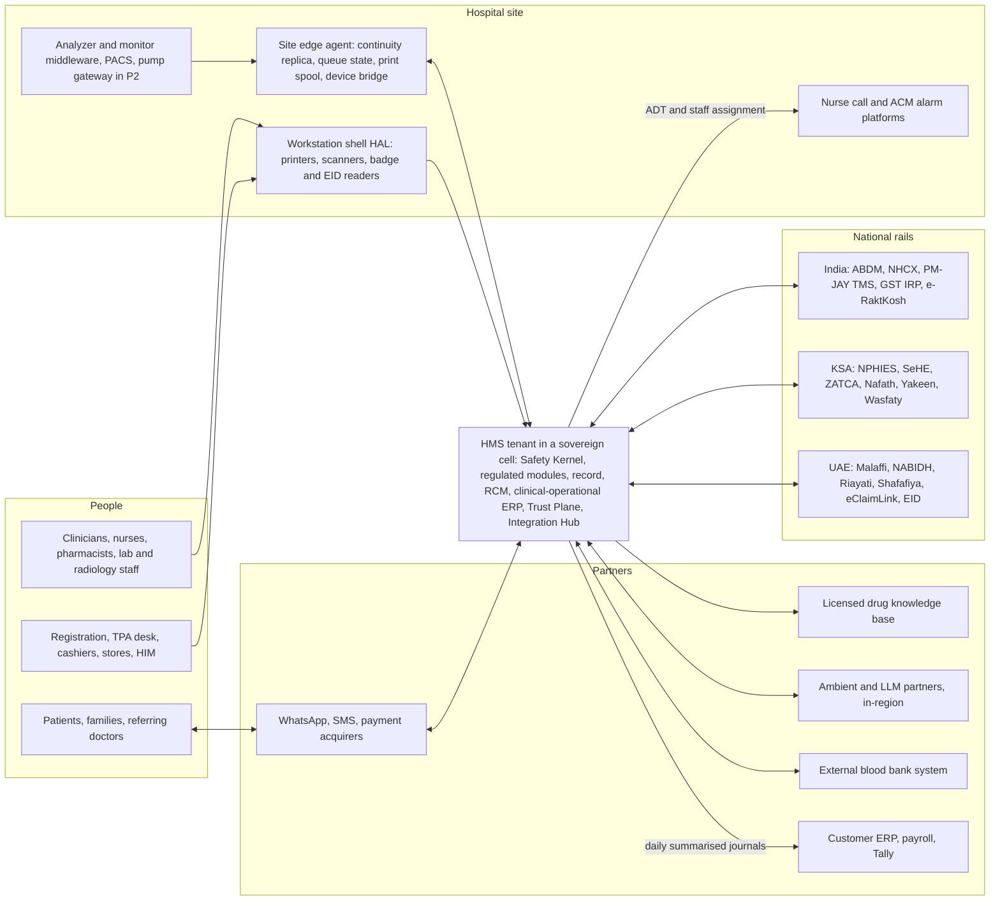
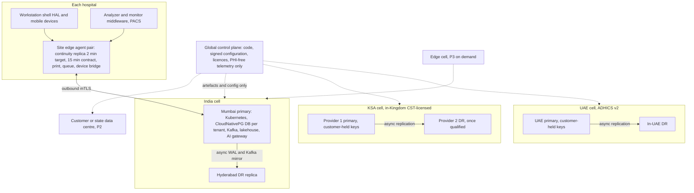
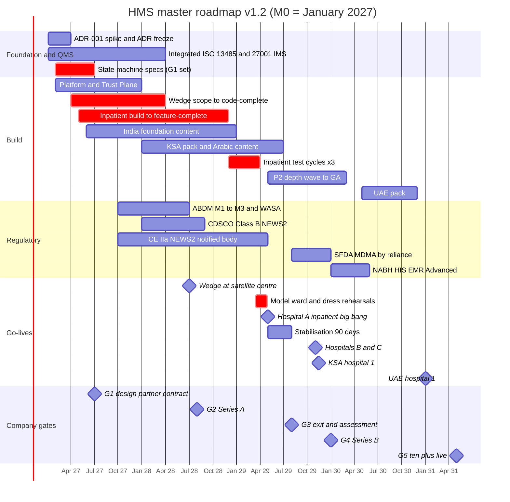

# Master Blueprint: A World-Class Hospital Management System for India and the Gulf

## 0. Document control

| Field | Value |
|---|---|
| Document | Master Blueprint for the Hospital Management System (HMS): clinical core (HIS/EHR), clinical-operational ERP, revenue cycle and patient digital front door |
| Version | 1.2.1 (authoritative; revision rounds 1 and 2 plus a post-panel fix for issue V3, see Appendix D). It supersedes v1.1, v1.0 and proposals A, B and C in `research/blueprint-drafts/`. |
| Date | 16 October 2026 |
| Status | Approved planning baseline. It is research and planning only; no code has been written. Every ADR stays "proposed" until its gate in §15 passes. |
| Calendar anchor | **M0 = January 2027.** The seed closes in Q4 2026. M12 = Jan 2028, M24 = Jan 2029, M36 = Jan 2030, M60 = Jan 2032. §10 maps absolute regulatory dates to M-numbers. |
| Evidence | The 16-report research pack (R01–R16), GLOSSARY and the Reconciliation Log (RL). Where a report conflicts with RL, RL wins unless Appendix C records an argued deviation. Revision round 1 used two web fetches, both for KSA cloud-region status (issue A14; §7.9). Revision round 2 used none. Everything else comes from the pack. |
| Model | v1.1 re-planned capacity, schedule, headcount and cash on one month-level model (§14). v1.2 adjusts that model in place (burn-up buffers, the wedge mobilisation team, the pre-G3 hiring cap, the ramp contingency and the G2 kill threshold); its figures replace every earlier figure. |
| Conventions | [E] = our estimate. [I] = our inference. [K]/[U] = unverified items inherited from the pack. US$1 ≈ ₹88 ≈ SAR 3.75 ≈ AED 3.67 (R12). |

**How to read this document.**
- §1 is the one-page answer plus the decisions that matter. Each decision has an ID, a rationale, evidence and a trigger that would reopen it.
- §2–§4 cover market and product. §5–§6 cover safety and clinician experience. §7–§12 cover the platform, data, rails and money flows.
- §13–§16 cover delivery, team, money, dates and go-to-market. §17–§19 cover metrics, risks and what is still open.
- Appendix A traces each section to the research. Appendix B explains how this blueprint was produced. Appendix C is the deviation register against RL and the pack. Appendix D is the revision log.

**Report reference key.**

| Ref | Report | Ref | Report |
|---|---|---|---|
| R01 | Global vendor landscape | R09 | AI, analytics and digital front door |
| R02 | Open source and platforms | R10 | Implementation and UX lessons |
| R03 | Clinical modules and workflows | R11 | Canonical domain model |
| R04 | Diagnostics, pharmacy and devices | R12 | Build programme and business plan |
| R05 | Revenue cycle, ERP and operations | R13 | Beachhead pack: India, KSA, UAE |
| R06 | Interoperability standards | R14 | Requirements catalogue, MVP, RFP crosswalk |
| R07 | Security, privacy and regulation | R15 | Clinical safety, QMS, validation, migration |
| R08 | Architecture and technology | R16 | Facility, peripheral and hardware integrations |
| RL #n | Reconciliation Log item n | — | "R08 §12.6" means report 8, section 12.6 |

---

## 1. Executive summary

**The problem we solve.** Hospitals fail on the same things whatever the vendor: the wrong patient, the wrong dose, results nobody owns, alerts nobody reads, notes nobody can use, and systems that go dark. In the US, physicians rate their EHRs at a SUS of 45.9 and nurses at 57.6. Each SUS point is worth roughly 2–3% lower odds of burnout (R10 §2; these are US survey baselines, and Indian and Gulf targets are set against each site's own T-120 baseline, §6.8). The famous failures were failures of safety, ownership of work and readiness, not of feature count: the VA's unowned order queue (149 adverse events), Helseplattformen's 16,000 unsent letters, and Västra Götaland's three-day halt and SEK 657M exit (R10 §5; RL #15, #17).

**The bet.** Private hospitals and groups of 150–400 beds in India and Saudi Arabia need two things no vendor sells together (R14 §8.2; R01 §10–§12):
- **closed-loop safety**: CPOE, pharmacist verification, barcode medication administration (BCMA) and bedside transfusion checks;
- **local rails and billing**: ABDM, NHCX/TPA, PM-JAY, NPHIES, ZATCA, pay-first packages and a native supply chain.

Local suites win on checklists and price but show no public BCMA evidence. Epic, Oracle and InterSystems have depth but are weak on regional billing and price. We sell **"closed loop at local prices, with the rails built in"**, and we prove it with 21 server-side safety invariants and a clinician-signed safety case on every release.

**Where.** India builds and proves the product. Saudi private groups pay for it: at our own list prices a GCC hospital is worth about 6.6–7.1× the ACV of an Indian one (US$504K against US$71–77K; R12 §11 uses US$30 per bed-month and gets 6.4×). The UAE follows as Wave 1b (RL #9).

**How we go live without hurting anyone.** Design partner #1 (DP#1) is an Indian NABH-accredited group with at least three hospitals and a satellite OPD/diagnostic centre. v1.1 re-plans the dates so that code is complete before the gates and test cycles that need it (§14.2).

| Milestone | Month (date) |
|---|---|
| Outpatient, lab and billing **wedge** at DP#1's satellite centre: no inpatient record is split, and the outpatient seams with the group's legacy hospitals are hazard-logged (§13.1) | **M18** (Jul 2028) |
| **Inpatient + ED big bang** at a non-flagship 150–250-bed group hospital (hospital A) | **M28** (May 2029; window M27–M30) |
| Hospitals B and C (the NABH certification cohort) as one multi-site wave | M34 |
| First KSA hospital, through an in-Kingdom hosting and integration partner, after hospital A's independent assessment | **M34** (Nov 2029) |
| NABH HIS/EMR Advanced certification | **M40** (window M38–M42) |
| First UAE hospital | M48 |
| Ten live hospitals | M44; G5 at M50–M54 |

**What it costs** (§14).
- **Team:** 53 people at M4 (including the four-person wedge mobilisation team in post from M3), 175 at the end of Year 1, 238 at Year 2 and 305 at Year 5. Headcount is capped at 260 until G3 exit. Delivery, support, safety and SRE headcount is derived bottom-up from project concurrency and three sovereign 24×7 rosters.
- **Five-year money:** opex US$124.2M against revenue US$23.4M, for **US$100.8M cumulative net burn**. Burn peaks at US$24.8M in Year 3 and falls to US$19.4M in Year 5.
- **Hospitals live:** 0 / 0 (satellite live) / 4 / 15 / 35 at the ends of Years 1–5, taken from the roadmap.
- **Capital:** **US$144M of equity**: seed US$14M; G1 round US$20M; Series A US$40M at G2; Series B US$50M at G4; growth round US$20M at G6, planned in the base case. On top of that sit a US$10M venture-debt facility (signed at G2, drawn at G3 exit, repaid by M72, interest ≈US$2.75M); a pre-committed US$8M insider bridge, undrawn in the base case, as slip insurance before the Series A; and a **US$30M ramp contingency**, pre-committed by the G1 insiders and callable only if the M12 hiring checkpoint fails, because the pack holds no evidence that our hiring ramp is achievable (§14.2). Equity would be US$174M if the contingency were called. Pre-G3 spend is **above R12's Base case**, not Lean (§14.6). v1.0's US$97M plan finished inpatient code inside its own test cycles and left ≈3 months of cash at G2. It also left delivery, support and safety headcount understated and debt service unmodelled.
- **Breakeven:** monthly breakeven at about M90 (mid-Year 8) at ≈US$32M ARR, with ≈29,000 beds live, ≈15,000 of them in the GCC. The first cash-positive year is Year 9. Peak cumulative net burn is ≈US$126M.

**What we will not do:** build PACS, alarm routing, nurse call, RTLS, a drug knowledge base, a blood-compatibility engine or speech and foundation models; ship unregulated deterioration alarms; fork code for any customer; sign penalty-free SLAs above 99.95%; or make usability scores or notified-body dates conditions of our own financing.

### The decisions that matter

| ID | Decision | Rationale | Evidence | Reopen if |
|---|---|---|---|---|
| D-01 | Beachhead: private hospitals and groups, design point a 200-bed "minimum viable hospital" (MVH, 150–300 beds); commercial ICP 150–400 beds; India + KSA in Wave 1, UAE in Wave 1b | Under-served on price by Epic and on depth by local suites; GCC ACV ≈6.6–7.1× India at our prices | R14 §2; R12 §10–§11; RL #4, #9 | The M0–M3 SAM/SOM study (S15) finds fewer than ≈45,000 reachable GCC private ICP beds (3× the ≈15,000 live GCC beds breakeven needs), or a GCC ARR ceiling below ≈US$75M at realised prices (§3.1) |
| D-02 | Proposition "closed loop at local prices, rails built in". Every demo is one scripted encounter: CPOE → verify → BCMA → transfusion check → NHCX/NPHIES claim, followed by a "sovereignty tour" | It is the empty cell in the competitive matrix | R14 §8.2, §11 #3 | Two consecutive losses to a local vendor showing live BCMA |
| D-03 | **21 server-side safety invariants** (§5.1), enforced on every channel. Tenants may tighten them, never loosen them. SI-05 and SI-11 depend on Tier 2 components; until those components are cleared, each runs as a hazard-logged, CSO-signed fallback control set (§5.6) | Safety failures sink programmes; UI-only rules are bypassed | R03 §19; R11 §15; R15 §6 | Never relaxed; additions via the Safety Board |
| D-04 | **One company-wide ISO 13485 + ISO 27001 management system from M0**; certificate by M15. Chief CSO, Head of QA/RA, CNIO, CISO and DPO in post by M3 | A "13485 island" turns shared services into SOUP; CE takes 24–30 months from QMS start | R15 §2.1, §2.6; R07 §9.2 | — |
| D-05 | A **Regulatory Boundary Register** (function × market × intended purpose × class × status) is the only thing that can activate a Tier 2 function for a tenant. Every Tier 2 function has a named non-device fallback at each first go-live | These functions are devices in most launch markets; feature toggles must not decide | R15 §4–§5, §11 #2; R13 §4.7 | A regulator confirms "not a device" for a function in a market |
| D-06 | Tier 2 modules (NEWS2/PEWS/MEOWS, Dose Engine, screening presenter, transfusion verification, LIS interpretive rules) run as **separately versioned, process-isolated components co-located with the core**, with an IEC 62304 class-propagation analysis | An in-process Class C module would pull the orders/MAR kernel into device scope | R15 §2.3; R13 §11 #6 | Latency forces in-process deployment: then notified-body pre-submission agreement by M6 |
| D-07 | The rule-based **sepsis screen is Regulated Module #2 in P2**, with its own registration plan; retrospective replay on reference-site data from G3; live silent running only with a written regulatory and ethics opinion | No launch market can clear it before about M36; QMS capacity goes to NEWS2 and the Dose Engine first | R14 §4 #4; R15 §4.2b, §5.1; RL #6 (interim) | A market rules guideline-only sepsis rules non-device |
| D-08 | Transfusion workflow and bedside verification in the MVP; external blood bank or e-RaktKosh interfaced; **no compatibility engine before Phase 3** | Harm sits at the bedside; the compatibility engine is IVD-class everywhere | R15 §5.2; RL #5 | — |
| D-09 | Pumps in P2: one vendor, **orders never commands**, only after BCMA ≥95%. **Never build** alarm forwarding, nurse call, RTLS, PACS, the drug knowledge base or speech/LLM models | Regulated boundaries; network effects belong to specialists | R15 §5.3, §4.2i; R16 §2.3; R09 §9.3 | — |
| D-10 | **Quiet-by-default CDS:** alert tiers A–D; ≤8 interruptive alerts per 100 medication orders at go-live and ≤5 by month 12; a Leapfrog-category harness on customer content. A **vendor-validated go-live baseline** (Tier A and Tier B rules validated on the Leapfrog/ISMP harness and on multi-site or synthetic replay, CSO-signed) is interruptive from day 0. Silent-first running and replay apply only to new or locally modified rules (§6.3) | Override rates of 46–96%; a first inpatient site has no electronic order history to replay | R10 §2; R03 §8, §21.3; R15 §7.3, §8.2 | Leapfrog 2027 rules penalise non-interruptive guidance |
| D-11 | **Zero orphaned work:** every order, result, message, referral and letter has an owner and an SLA timer; `TaskOrphaned` alarms within 5 minutes | The VA and Helseplattformen failure mode | R10 §3.3 #13; R08 §13 | — |
| D-12 | IEC 62366-1 usability engineering with 15–20 users per group, Arabic-first and English-first counted separately; a >10% task-time regression blocks release. SUS/NEES are **contract KPIs, never financing gates** | Usability is safety; financing must not hang on metrics the customer co-controls | R10 §3.3; R15 §7.6; judges' override | — |
| D-13 | **ADR-001 Option A:** domain-owned PostgreSQL per tenant, FHIR-shaped JSONB facts, generated R4 façade, HAPI libraries, Kotlin/JVM, decided by a falsifiable 8-week spike with a zero-violation safety gate | Transactional invariants, R6 churn, country projections | RL #1; R08 §3.11, §4.6; R06 §7.1 | Option B passes the safety gate and beats A by ≥15 weighted points |
| D-14 | Event sourcing lite (journal-as-outbox) everywhere; **full event sourcing for medication aggregates only if the spike shows no latency or schedule cost**, frozen at M3 | The MAR is naturally an event log, but schema evolution and erasure are real costs | RL #7; R08 §3.5 | Revert triggers in ADR-004 |
| D-15 | Canonical Model Versioning plus a **projection compiler**: R4 now, R6 beta by M24, with no storage migration; nothing canonical on resources leaving R6 core | Version-proof interoperability for 20 years | RL #2, #13; R06 §3.2; R11 §0 | A launch-market IG mandates R6 earlier |
| D-16 | **Sovereign cells:** PHI-free global control plane; KSA in-Kingdom on a CST-licensed provider; UAE to ADHICS v2; keys under customer control in KSA and UAE (TRU-KEY-01 in the MVP); substrate-portability CI on managed and vanilla Kubernetes from M9 | Residency is a purchase gate. Per the provider survey of 31 Jul 2026, Google `me-central2` (via CNTXT) and Oracle Jeddah/Riyadh are GA in-Kingdom. AWS's first Saudi region is announced for Dec 2026 and Azure Saudi Arabia East targets Q4 2026; neither was GA at that date | R13 §5.1, §8.1, §11 #4; R07 §9.1; external check (A14) | — |
| D-17 | **KSA DR:** qualify a second in-Kingdom region or provider (Oracle Jeddah↔Riyadh, Google + Oracle, or AWS KSA once GA, each subject to CST class and NCA ECC/CCC verification at M2–M3) to meet RL #8 cross-region targets. Until a failover test passes, contract a disclosed, priced exception. **Decide by M12**; failover-test the second site before KSA RG4. If none is ready, contract an explicit "no cross-region DR; immutable in-Kingdom restore ≤72 h" exception | Price the SLA, engineer the SLO | RL #8; R13 §4.5, §8.1; R14 §11 | Second provider qualified |
| D-18 | **Downtime-first:** site edge agent with a continuity replica ≤2 min stale (engineering) and ≤15 min (contract), offline BCMA and downtime blocks in the MVP; dual-carrier diverse WAN as an RG1 prerequisite; a cloud-hosted read-only continuity instance with identity independent of the customer IdP. The multi-writer edge cell is P3, demand-triggered | ECRI 2026 hazard #2 "digital darkness"; unsafe offline conflicts are rated Medium/Critical | R04 [87]; R10 §2, §5; R07 §6.1–§6.3; R08 §13; R14 §9.3 | A contracted site measures WAN availability <99.9%, or any outage over 1 h in a month |
| D-19 | MVP = R14 catalogue re-baselined to **154 MVP / 47 P2 / 21 P3** features (2,149 engineer-weeks), planned at **≈1,610 squad person-months**. That figure includes ≈65 PM of regulated-development overhead. It is checked month by month against the hiring ramp, with onboarding and wedge-support deductions, ≥10% buffers at both RG1s and pre-agreed descope rules | One backlog; validation is the binding constraint | R14 §3–§5; R12 §3.2, §4; R15 §2 | Burn-up falls below a checkpoint's target (RG1 buffer <10%, inpatient T-150 <100%, 95% of plan elsewhere), or build FTE is below 36 at M6 or 80 at M12 |
| D-20 | **Wedge at a satellite OPD/diagnostic centre, R12 §3.3 scope plus the statutory and seam items it triggers**: registration and OPD queue, referral tracking, OPD chart, outpatient pharmacy with statutory registers, LIS core with the NABL pack, patient accounting with TPA/NHCX/PM-JAY, ABDM M1–M3. Paid mobilisation is agreed at the M2 LOI and starts at M3, run by our four-person mobilisation team (§13.2). Five sub-functions follow in an R1.1 drop at ≈M21 so the wedge-critical slice keeps a ≥10% buffer at RG1 (§4.2, §14.2) | Early production PHI and revenue with **no inpatient seam; the outpatient seams (identity, referral, results, med list) are hazard-logged and controlled** (§13.1) | R12 §3.3; R15 §10.3; R10 §5.2 #7; RL #11 | DP#1 has no satellite: fallback W2/W3 in §13.1 |
| D-21 | Inpatient big bang per site at non-flagship hospital A (M28); hospitals B and C follow together at M34 as the **NABH certification cohort**; NABH Advanced planned at M40 on a certified release line (§5.8) | NABH requires MoUs with three hospitals running the certified version, plus testing and NC closure; certification is per product version | R13 §3.3; R12 §9.1; RL #11 | NABH confirms satellite or wedge sites count |
| D-22 | **Readiness gates, not dates.** A 1–2-week model ward; three-level rollback, with full legacy fallback only within 72 h. An **independent go-live assessor (external clinical-safety reviewer plus the customer's CSO) holds a veto at RG3 and RG4** for customers #1–3. A joint panel attributes sentinel events. An independent operational assessment runs before hospital B. Financing tranches are tied to readiness evidence, not go-live dates. Any system-attributable sentinel event freezes new go-lives until the CAPA is closed | VA, VGR and Helseplattformen lessons; date pressure from financing is a documented failure cause | R10 §5.2 #1, §10.2, §10.4 #8; R15 §10 | — |
| D-23 | AI control plane in the MVP. **OPD ambient switches on at the wedge about 90 days after go-live** for each consultant who completes 2 h of training, once spike S8 passes on DP#1's actual consultation languages (including code-mixed English). Both AI SKUs sit in the Boundary Register with per-market written opinions before activation. Inpatient, discharge and nursing drafts wait for the 90-day inpatient stabilisation. AI is a priced add-on at ≥30% margin, priced per encounter in India | OPD consultants decide Indian adoption; the inpatient MAR go-live is the cognitive-load peak | R09 §9; R10 §2, §4.10; R14 §4 #11; R15 §4.1 | Omission or hallucination rates above thresholds |
| D-24 | **Two tiers, no partial loop.** Core HIS (paper clinical orders) and Clinical Safety (CPOE + verification + eMAR/BCMA + transfusion), with a hard configuration invariant: no inpatient CPOE in any unit unless eMAR/BCMA is live there, and activation is a site-wide big bang, NICU/PICU included (under the Dose Engine fallback control set where the engine is not cleared, §5.6). Core-only deals ≤30% of bookings. India list ₹2,100–3,000 per bed-month; implementation ₹60 lakh–1.3 crore | Price beats safety depth in mid-market RFPs, but a mixed electronic/paper MAR is dangerous | R14 §8.4; R03 §21.2; R12 §12; judges | Pricing interviews (M2–M6) reject the band |
| D-25 | Native clinical-operational ERP (stores, consumption-to-charge, procurement-lite, privileges); GL export in the MVP and lite GL in P2; **payroll/HCM always integrated** | The supply-to-charge join is our edge; payroll is regulated and local | RL #3; R05 §9.1; R14 §4 #7 | — |
| D-26 | National rails ship as **owned country packs with product managers and SLAs**; a production claims round-trip is a G4 item | Rails decide elimination | R13 §11 #2; R14 §8.4 | — |
| D-27 | Calendar M0 = January 2027; every absolute regulatory date mapped to an M-number with an owner | Deadlines are absolute; a slipped anchor silently breaks them | R07 §9.2; judges | — |
| D-28 | Equity US$144M on a month-level cash model. A G1 round plus a pre-committed insider bridge gives ≥9 months of runway at the planned G2. The Series A plus the G1 round reach G4 + 6 months without debt. Venture debt is modelled with interest and amortisation, and the G6 growth round is planned in the base case. A US$30M ramp contingency, pre-committed at G1, funds R12's slower hiring ramp if the M12 checkpoint fails. Headcount is capped at 260 until G3 exit (sized to the sovereign rosters and go-live delivery the plan needs before M31) and at 285 until G4; this is **not** R12's Lean plan. Funding gates stay commercial and safety-based | The G3→G4 funding gap is R12's critical risk; v1.0 left ≈3 months of cash at G2 | R12 §6, §8.2, §13, §14 | Seed below US$12M or G1 round below US$16M: Lean variant (§14.6) |
| D-29 | Markets per RL #9. KSA through a certified in-Kingdom partner with step-in rights; if DP#2 is not signed by M22, the UAE becomes the first Gulf market. Wave 2 chosen at G5 from Indonesia, Kenya or another SE Asian market; smaller GCC states only against a signed, funded customer | Focus protects reference depth | RL #9; R12 §10; R13 §7 | — |
| D-30 | Delivery: customers #1–3 vendor-led at 6–10 FTE per concurrent project; then one certified SI per country in India (we embed ≈1.5 FTE per project); GCC prime contractor with local subcontractors carrying 40% of fees (we field ≈3.5 FTE per project). Headcount is derived bottom-up from project concurrency (§14.3). Interim partner certification by M20; academy live by M30 | Keeps the methodology ours; services ≤60% of revenue in Y5 and ≤40% by Y7 | R12 §5.2, §10.5; R10 §10.2 | Partner gate misses at two sites |

---

## 2. Vision, product thesis, positioning and differentiation

**Vision.** The hospital system that nurses and doctors would choose for themselves, because it is fast and quiet and catches the errors that hurt patients, at the price of a local HIS, on a record the hospital can trust, keep, move and extend for decades.

**Product thesis: three pillars on a table-stakes base.**
1. **Closed loop by construction.** Identity → order → verify → dispense → administer → monitor → result → acknowledge, with no transcription step and no unowned hand-off (R03 §21.4).
2. **Clinician time respected.** High-PPV interruptions only; notes composed from structured data; nursing charting by exception; p95 screen transitions ≤1.0 s as a release blocker (R10 §3.3; R08 §12.6).
3. **Safety and sovereignty you can audit.** A per-release safety case, a hazard log the customer can see, accreditation evidence generated from use, customer-held keys and a customer-visible support-access log (R15 §6; R13 §5.1).

**Table stakes, built natively** (R14 §8.4): national rails at live references, module breadth (native LIS, RIS and pharmacy), pay-first and package billing, a native supply chain, in-country cells and Arabic RTL. R14 ranks the factors that actually win mid-market RFPs: rails first, checklist breadth second, price third, and closed-loop depth ninth. So the pillars differentiate only once the table stakes are met.

**Why the incumbents' moat does not bind us.** R08 §1 concludes that incumbents win on content, configuration and integration breadth, not database technology. We therefore compete on speed and cost of localisation (a country pack is data, not a fork), of configuration and upgrade (evergreen weekly delivery), and of integration (rails as owned products).

| Competitor | Strong where | Weak in our segment | How we win |
|---|---|---|---|
| **Epic** | One record; Foundation content; closed loop; AI inside the EHR; 16 years Best in KLAS (R01 §10.1) | Price (Charité ≈€65K per bed over 10 years, R01 §9); regional billing not implemented and "not always localized" (R14 §6.1); no ERP | A closed loop with native NPHIES/NHCX and an ERP join at roughly a third of Charité's 10-year vendor cost per bed in the GCC, and under a tenth in India (§16.3) |
| **Oracle Health** | Gulf installed base; EHR + Fusion ERP bundles | New EHR still ambulatory-only, no acute GA by 16 Oct 2026; VGR termination; sale rumours (R01 §2) | Evergreen single code base ("no rewrite, ever"); in-Kingdom team; Millennium migration pack |
| **MEDITECH, Dedalus** | US community hospitals; DACH | Little India/GCC presence; DACH Best in KLAS only 73.5 (R01 §2–§3) | Not regional rivals; DACH only via a partner |
| **InterSystems TrakCare/IntelliCare** | 600+ hospitals in 29 countries (vendor claim, RL #20); CE IIa EHR | KLAS ME: weak end-user experience and billing (R14 §8.1) | SUS/NEES evidence; regional billing; our own CE IIa module (NEWS2) |
| **IQVIA HIS** | Saudi MoH clusters; Best in KLAS ME/Africa 82.0 | Implementation and training complaints (R14 §6.1) | Implementation methodology as product; private groups first |
| **ezCaretech** | Stage 7 heritage; ≈US$5K per bed one-time at Care Med (R01 §4) | Brand and scale in the region | **Not on price.** Our KSA vendor-paid 10-year cost is ≈US$23K per bed, about 4× theirs in subscription alone (§16.3). We justify a higher TCO with closed-loop safety evidence, NPHIES/ZATCA depth, in-Kingdom operations and evergreen delivery. They are a named price risk in §16.6 and spike S5 |
| **Indian locals** (KareXpert, Insta, Akhil, Suvarna, Athma) | Breadth, ABDM, NABH Advanced, ₹800–1,000 per bed-month | No public closed-loop BCMA evidence; 20–40% renewal hikes (R14 §8.2; R12 §12.1) | Closed loop, safety case, capped uplift, migration kit; sold on TCO at 2.1–3.75× their price |
| **GCC locals** (Balsam, ATS CareWare) | Price, Arabic, NPHIES | Tertiary depth | Closed loop, ZATCA, denial analytics |
| **Open source** (OpenMRS/Bahmni, CARE, Medplum) | Free; LMIC public sector | No inpatient closed loop at scale; steward risk (R02 §6) | Reuse ancillary OSS as separate services |

**Why buyers switch now.**
- **India:** NABH 6th edition (639 objective elements, 105 Core) makes two identifiers (COP.1.b), reconciliation (MOM.4.e) and documented early-warning effectiveness (AAC.5.a) assessable (R13 §3.1). IRDAI's 1-hour cashless and 3-hour discharge rules and NHCX's push through Aarogya Setu 2.0 punish manual TPA desks (R13 §3.5–§3.8).
- **KSA:** 98% of 128 Saudi IT leaders rate NPHIES/SeHE interoperability critical or high, and vendors without working integrations "may be eliminated" (R14 §6.1). ZATCA Phase 2 is live.
- **UAE:** Malaffi connection is a licence-renewal condition, and ADHICS v2 sets the strictest residency regime in the region (R13 §5.1).
- **Everywhere:** renewal shocks, chain M&A, Oracle's platform uncertainty and TrakCare's usability scores open doors. We remove the fear of switching with fixed-fee implementation, free FHIR Bulk and database export, escrow and a Legacy Data Viewer (R12 §12.3; R15 §9.6).

---

## 3. Target market, ideal customer profile, beachhead and market-entry sequencing

### 3.1 Ideal customer profile

| Attribute | India (Wave 1) | KSA (Wave 1) | UAE (Wave 1b) |
|---|---|---|---|
| Entity | NABH-accredited private hospital or chain of 3–15 sites; PE platforms | Private group of 2–10 hospitals under NPHIES/SBS and ZATCA pressure | Abu Dhabi private hospital, then Dubai |
| Beds per site | 150–400 (design point MVH-200) | 200–500 | 150–400 |
| MVH-200 profile (R14 §2) | ~150 ward beds, 20 ICU, 8–10 NICU/PICU, 15–20 ED bays, 6–8 OTs; 800–1,500 OPD visits a day; 1,000–1,400 staff; 350–500 peak concurrent sessions | 500–1,000 OPD visits a day | As KSA |
| Payer mix | Cash 35–50%; TPA/insurer 30–45%; government schemes 10–25% | NPHIES private insurance 55–70%; cash 15–30% | Daman/Thiqa and private insurance |
| Buying committee (R12 §10.2) | Promoter/MD, CFO, medical director, nursing head, TPA desk, NABH coordinator | CEO, CFO, CIO, CMIO, revenue-cycle head, DPO; Big Four advisers | As KSA, plus DoH/DHA compliance |
| Sales cycle (R12 §10.3) | 4–9 months single site; 9–15 months chain | 9–18 months | 9–18 months |
| Avoid in Y1–3 | State tenders (₹120 Cr turnover wall, CMMI, L1 award, IP vesting); direct sales to sites under 150 beds (pooled tier from P2) | Public clusters without an RHQ | Government mega-deals |

Academic medical centres join only as clinical-content advisers, never as go-live sites, because academic go-lives inflate scope (R12 §9.1). **Hospitals under 150 beds are served from P2 through a pooled small-hospital tier** (ADR-006; one threshold everywhere, with the FORCE-RLS design sized for it), because their ACV cannot yet fund a closed-loop implementation. R12 is itself inconsistent here (§7.3 says below 100 beds; §10.5 says 50–150 beds); we use 150 beds to match the ICP floor (DV-1).

**India builds and proves; the GCC pays.** India gives loaded engineers at US$45–60K, NABH certification and high-volume test beds. The GCC gives ACVs of about US$504K against about US$71–77K in India at our own prices (≈6.6–7.1×; R12 §11's US$79K assumes US$30 per bed-month). **Covenant:** the GCC supplies at least 60% of ARR by Year 5. If it is below 50% at G5, we cut costs or re-price (R12 §15 #3). Our base model has the GCC at 84% of Year-5 ARR (§14.5).

**Sizing is not yet bottom-up.** Neither the pack nor any proposal quantifies the serviceable market. **Workstream M0–M3 (S15):** count 150–400-bed private hospitals and groups, and their beds, in India (NABH listings, state registries), KSA (CHI/MoH licences) and the UAE (DoH/DHA), and compute the ARR ceiling at our realised prices. **Breakeven depends on GCC beds, not total beds.** One live GCC bed-year is worth ≈US$1,690 of ARR and one Indian bed-year ≈US$330. The base case breaks even with ≈29,000 live beds, of which ≈15,000 are in the GCC (§14.6). D-01 reopens if the study finds fewer than ≈45,000 reachable GCC private ICP beds (≥3× the GCC need, so breakeven does not assume implausible share) or a GCC ARR ceiling below ≈US$75M.

### 3.2 Entry waves and go/no-go gates

| Wave | Market and route | Entry criteria (all must hold) | Go-live and gate | Kill or redirect trigger |
|---|---|---|---|---|
| **1** | **India.** DP#1: an NABH group of ≥3 hospitals plus a satellite OPD/diagnostic centre; a second Indian candidate is taken to LOI as a backstop (risk 27) | Seed closed; DP#1 LOI by M2 with a paid pre-contract mobilisation agreement (M3); contract at G1 (M6); named SMEs; India cell; ABDM sandbox | Wedge M18; hospital A inpatient M28; B and C together M34 | G2 later than M27 → narrow to an India "HIS core + LIS + RCM" product (R12 §15; threshold inside the bridge-funded runway of ≈M28, with an early warning if wedge RG1 has not passed by M23; §14.6, DV-21) |
| **1** | **KSA private.** DP#2: a group of 2–6 hospitals, through an NPHIES-certified in-Kingdom integration and hosting partner with step-in rights | KSA entity M9–M12; DP#2 LOI M12, contract M18; partner diligence passed; CST-licensed cell | KSA cell M28; NPHIES production round-trip M32; first go-live M34 (after hospital A's independent assessment at M31) | No DP#2 contract by M22 → the UAE becomes the first Gulf market |
| **1b** | **UAE.** Abu Dhabi private hospital, then Dubai | Selling opens at G3 exit (M31) on hospital A evidence; a signed customer before any cell build (**deadline M35**, so the 12–15-month playbook fits); UAE cell meets ADHICS v2 Service Provider controls; Malaffi onboarding ≥2 months ahead | UAE cell M38–M44; first go-live M48 | No UAE contract by M38 → defer the pack |
| **2** | **One of** Indonesia, Kenya or another SE Asian market (RL #9); **DACH only through a German partner** | ≥10 live sites; Series B closed; subscription ARR ≥US$5M and services ≤50% of trailing-12-month new-contract value; country pack ≤120 PM | Decision at G5 (M50–M54); entry about M56 | Flip to a GCC extension only with a funded anchor customer |
| Opportunistic | Oman, Bahrain, Qatar, Kuwait | Built only against a signed, funded customer, reusing the KSA/UAE packs (R13 §7 is a quick scan, not a requirements pack) | — | — |
| **3** | EU, UK, Australia, Canada candidates | No-regret engineering only: IPS, EHDS-shaped logging, a DCB0129-style safety case (RL #9); no certification spend before M36 | Decision at G6 | — |
| **US** | Phase 3 go/no-go | ONC limited to the 19 criteria HTI-5 retains plus the 7 it revises; HITRUST; Da Vinci (RL #9) | Not before M48 | — |

**India before the UAE, contrary to R13 §1 #15.** RL #9 wins, and the economics agree. R13's evidence (no GA AWS or Azure region in KSA at the time, blocked portals, a partner needed) changes **how** we enter KSA, not whether.

**KSA entry plan** (R12 §10.4; R13 §4):
- **Entity and people:** KSA entity by M9–M12; Riyadh delivery team from M18; 30–40% Saudi nationals in the entity by Y3, because SCE-accredited engineering roles must be 30% Saudi from 30 Jun 2026 (R12 §5.3).
- **Partner:** shortlist NPHIES-certified integrators with CST hosting by M10; diligence (spike S12) at M9–M12; contract with **step-in rights** and a knowledge-transfer plan so we build our own NPHIES skill.
- **Hosting:** in-Kingdom CST-licensed provider, including backup and DR (§7.9).
- **RHQ:** private groups need no regional HQ. The RHQ decision is documented at M18, before any public bid. The default is "no", because a firm without an RHQ wins public tenders only as the sole compliant bid or at least 25% below the next bid (R12 §10.4). Local-content (LCGPA) and Nitaqat plans are part of the public-sector readiness track (§9.3).

---

## 4. Product scope

### 4.1 One backlog of record, re-baselined

R14 Appendix A (214 features, 140 MVP / 54 P2 / 20 P3, 1,875 engineer-weeks) is loaded into the tracker unchanged, then amended only through this table. Any later change to an MVP tag needs product-council sign-off (R14 §11 #1).

| Change | Items | Effect (eng-weeks) | Why |
|---|---|---|---|
| P2 → MVP | CLN-DOC-02 copy-forward provenance; IMP-GOV-01 governance intake; TRU-BCP-05 Code-Dark drill tooling and SAFER workbook | +14 | Note trust, visible loop closure, and the downtime drill that gates go-live |
| Upsize (no new IDs) | TRU-REG-01 L→XL: the QMS plus the **Regulatory Boundary Register** as a product service. TRU-REG-02 M→L: **hazard-log service and Release Evidence Pack generator**. IMP-RDY-01 M→L: model-ward, UAT and deployment-safety kits. IMP-MIG-01 L→XL: the 12-part Migration Workbench | +84 | R15 §6.2, §8.4, §9.8. Upsizing existing IDs avoids double-counting R14's own TRU-REG items |
| New MVP | **MED-DOSE-01** shared Class C Dose Engine (L); **PLT-EDGE-01** site edge agent, plane B (L) | +40 | R15 §4.2c, §11 #4; R16 §3, §14 |
| Split | AI-DAT-02 → **02a** CDC bronze landing in object storage (MVP, M) + **02b** silver layer, OMOP and SQL-on-FHIR (P2, M) | MVP +8; P2 −12 | CDC is cheap on day one and feeds migration staging and silent replay (R08 §14; R15 §9.8 #2) |
| Split | DX-BB-03 → **03a** blood-centre inventory and ISBT 128 labelling (P2, L) + **03b** compatibility engine (P3, XL, IVD-grade) | P2 −30; P3 +50 | R15 §5.2: compatibility is the highest-class function in every framework |
| Kept in P2 | CLN-CDS-06 rule-based sepsis screen (Regulated Module #2) | — | D-07; §5.6 |
| P2 → MVP (v1.1) | **TRU-KEY-01** per-tenant KMS (R1) and BYOK/HYOK (R3 KSA activation); **ACC-SCH-02** referral intake and order-to-completion tracking (R1; SI-03 promises every referral an owner); **CLN-AMS-01** antimicrobial stewardship (R2; NABH IPC.2.f is Core); **RCM-GRP-01** Grouper SPI with AR-DRG shadow billing (R3 KSA activation) | +32 (4 × M) | §10 makes per-tenant and customer-held keys MUST at GA, and R13 AE-06 is L0 (A12, X15). Referral seam (C1). NABH Core OE (C3). KSA AR-DRG direction (A11) |
| New MVP (v1.1; catalogue gaps in R14) | **CLN-IMM-01** immunisation administration and history: lot from stores, BCMA scan, VXU and FHIR Immunization, ABDM ImmunizationRecord (M; R1 OPD, BCMA scan in R2). **OPS-STAT-02** statutory-register framework: locked records and per-state export formats; BMW bar-coding and Form IV; IHIP/Nikshay notification from LIS results (R1); CRS birth/death within 21 days and MCCD (R2) (L). **INT-SEAM-01** group seam bridge to legacy hospitals: alternate identifiers from legacy ADT, REF/ADT/MDM, ORM/OML/ORU with ack state (M; R1). **MED-TNT-01** pharmaceutical track-and-trace: SFDA RSD dispense reporting (R3) and UAE Tatmeen (R4) from GS1 DataMatrix scans in plane A and the stores ledger (M; market-gated) | +44 | R06 §8, §4.5; R11 §6; R03 §13.3 (C15). R13 §9 IN-26/28–31 and §10 checklist (C2). R10 §5.2 #7 (C1, X4). R13 SA-14, AE-14 are L0 (C8, A13) |
| Upsize (v1.1) | **DX-LAB-04** M→L: NABL pack (PT/EQAS, sample-rejection register, per-test NABL scope flag controlling the symbol on reports, amended-report audit, TAT per test). **CLN-DOC-04** M→L: legal health record per tenant, release-of-information workflow, pluggable signature providers, court-evidence certificate, retention schedules (§10.2) | +24 | R13 §3.4, IN-38 (C9); R07 §8 (C17) |
| Explicit additions inside existing IDs (v1.1) | DLT template governance and OTP/expiring-link PHI release (DFD-MSG-01, +4); tenant weekend/holiday calendars and calendar-aware SLA timers (PLT-UX-03/PLT-CFG-02, +4); NPHIES pharmacy, dental and institutional claim types, FDI codes and prescription authorisation (KSA pack, +8); R03 §19 / R11 §15 acceptance items (pregnancy status at ordering, ISMP display rules, tall-man lettering, "NKA vs not assessed", similar-name warnings, MRN check digit, code-sheet documentation, no verbal orders for antineoplastics, paediatric rounding and corrected age, MRI-safety screening, device auto-dissociation, +12); Schedule H1/X register and MRP/NLEM-DPCO price checks at the OP pharmacy POS (inside MED features) | +28 | R16 §4.2–§4.3 (C25); R13 GCC-06 is L0 (C14, A17); R13 SA-03 (C8); R03 §19; R11 §15; R04 §11 #8, #11 (C16); R13 IN-28, §3.11 (C2) |
| Conditional | DX-LAB-06 ISO 15189 document control moves P3 → P2 if G1 confirms the satellite lab is NABL-accredited | 0 until G1 | C9 |

**Result: 154 MVP / 47 P2 / 21 P3 features (222 IDs); 2,149 MVP engineer-weeks; P2 523; P3 450.** A dependency check confirms that no MVP feature depends on a P2 or P3 feature.

**From engineer-weeks to squad person-months.** R14's T-shirt sizes count happy-path feature coding. R12's 1,055–1,645 PM add embedded QA, design, hardening, three integrated test cycles and validation-heavy epics that do not compress (R12 §3.2, §4.2). R12's midpoint (1,350 PM) against R14's 1,875 engineer-weeks for a comparable MVP gives a ratio of 0.72. Applied to our 2,149 engineer-weeks, that gives ≈1,547 PM. R12's estimate assumed **no** ISO 13485/IEC 62304 design controls (R12 §15 #10), so we add an explicit **regulated-development overhead of ≈65 PM**: +15% on Tier 1 epics (≈225 PM base), +40% on Tier 2 modules (≈50 PM base), and ≈10 PM to build and validate the pre-built fallbacks. **The MVP plan is ≈1,610 squad PM.** AI coding tools save 15–20% on coding-heavy epics and **0%** on validation-heavy ones: orders, MAR, LIS, Dose Engine and country packs (R12 §4.3). R12's coding-heavy epics are ≈29% of its MVP, so the planning factor is **×1.05**, not ×1.07. §14.2 shows this against the hiring ramp month by month.

### 4.2 Every release is a go-live we can sell

| Release | Live | What the site runs | Sold as | Features | Squad PM [E] |
|---|---|---|---|---|---|
| **R1 Wedge** | M18, satellite OPD/diagnostic centre (wedge-critical slice code-complete M15 = RG1, with a ≥10% buffer; R1.1 drop ≈M21) | EMPI and registration with alternate identifiers from the group's legacy ADT; scheduling and OPD token queue with ABDM Scan-and-Share; **referral tracking with owned queues** and the seam bridge to legacy hospitals (§13.1); OPD chart and orders (Form F gate on obstetric USG orders); immunisation record; outpatient pharmacy POS with **Schedule H1/X register and MRP/NLEM-DPCO checks**; native LIS core with analyzers via middleware, critical-result service and the **NABL pack**; IHIP/Nikshay notification from LIS results; BMW register; patient accounting, tariffs, packages, deposits; TPA/NHCX/PM-JAY claims; GST; ABDM M1–M3 (HFR-registered bridge); WhatsApp/SMS with DLT templates and OTP/expiring-link report release; MIS basics (statutory, NABH/NABL and daily-operations reports). Platform, Trust Plane with per-tenant KMS, Integration Hub, downtime blocks and continuity viewer as needed. **R1.1 drop (≈M21, after go-live and before ambient activation):** the AI control plane and FHIR SMART/Bulk/Subscriptions, plus five sub-functions moved out of the wedge-critical slice now, each with a manual path on go-live day: LIS autoverification v1 (manual technologist validation, the §5.6 fallback, runs until then), schemes beyond PM-JAY/TPA (manual desk), MIS breadth, UPI collect and payment links (stand-alone UPI QR and card terminals), and OPD queue display boards and token notifications (printed tokens) | Core HIS (clinic and diagnostics) | 67 live (five with sub-functions completing in R1.1), plus 30 partly exercised (mostly platform) (≈900 eng-weeks, 42% of MVP effort) | ≈665 (incl. ≈18 regulated overhead): ≈560 wedge-critical by RG1, ≈105 in R1.1 |
| **R2 Inpatient closed loop** | M28, hospital A (feature-complete M23 = T-150; code freeze M25 = RG1) | ADT and bed board; inpatient CPOE; pharmacist verification; eMAR and mobile BCMA with offline mode; Dose Engine (or its fallback control set, site-wide including NICU/PICU, §5.6); antimicrobial stewardship; nursing; ED; code documentation; OT, WHO checklist and anaesthesia record; ICU flowsheet with nurse-validated vitals; bedside transfusion verification; NEWS2/PEWS/MEOWS where cleared (non-ICU wards); RIS (with MRI-safety screening) and PACS launch; discharge and med rec; CRS/MCCD; legal health record (ROI requests on a manual register until R2.1); coding | Clinical Safety tier | 148 of 154 (all except the six KSA- and UAE-gated features) | ≈696; cumulative ≈1,361 |
| **R2.1 Hospital A completion** | By M31 (go-live + 90 days; back-office and self-contained-unit phasing under R15 §10.3) | Validated ICU monitor feed; procurement-lite and AP/AR breadth; booking and payment links; note bloat indicator; AI discharge-draft build (activated at G3 exit). **Moved here now (v1.2), each with a manual path on go-live day:** governance-intake portal (the command-centre issue log carries intake and the 30-day loop-closure rule until then) and secondary statutory returns (≈20 PM); release-of-information workflow automation and the court-evidence certificate generator (manual ROI register and signed certificates; ≈8 PM) | — | Inside the 148 | ≈82 |
| **R3 KSA activation** | Code-complete M30; live M34 | NPHIES end to end (incl. pharmacy, dental and institutional claim types, FDI codes, prescription authorisation), SeHE, ZATCA Phase 2, Nafath/Yakeen, ICD-10-AM/SBS, **AR-DRG Grouper SPI with shadow billing**, **SFDA RSD dispense reporting**, **BYOK/HYOK keys**, tenant weekend/holiday calendars verified, CBAHI pack, Arabic/Hijri hardening, KSA foundation content, Millennium/TrakCare migration packs | KSA pack (bundled) | 4 gated + activations | ≈115 |
| **R4 UAE activation** | M48 | Malaffi/NABIDH/Riayati, Shafafiya/eClaimLink, EID reader, **Tatmeen and DDC/DoH drug codes**, ADHICS controls, CPT/DDC, UAE PASS | UAE pack (bundled) | 2 gated + activations | ≈52 |
| P2 / P3 | P2 work M28–M44, GA wave M38 / P3 M40+ | §4.3 | Add-ons and depth | 47 / 21 | ≈380 / ≈325 |

**What the split shows.** The wedge carries 42% of MVP effort because it needs most of the platform, and that is why it must stay narrow. Inpatient scope is smaller in code but holds most of the hazards and validation, so it gets three integrated test cycles **on complete scope** and a model ward (R15 §7, §10.3). RIS, procurement-lite and the WhatsApp booking flows ship with R2 or R2.1, not R1. R2.1 holds only back-office items and self-contained device feeds. Nothing in it splits a medication record, and every R2.1 item has a working paper or manual path on go-live day. The wedge's R1.1 drop follows the same rule: no safety control and no statutory register is in it.

### 4.3 Module catalogue

Phase key: **MVP** = what the MVH-200 needs to sign and go live (R1 at M18, R2/R2.1 at M28–M31, R3/R4 market activations); **P2** = M28–M44 with the GA wave at M38; **P3** = M40+ or partner-led. Stance: **B** build, **I** integrate, **P** partner or licence. **The domain-level stance is a summary only. R14 Appendix A's per-feature build/integrate/partner decision governs.** The exceptions inside "B" domains are: nursing ambient AI-NUR-01 (**P**); AI coding RCM-AI-01 (**P**); tele-ICU SPC-ICU-03 (**B+P**); teleconsultation DFD-TEL-01 (**B+I**); POCT DX-POC-01, ECG/cardiology DX-CRD-01 and ADC/robots MED-ADC-01 (**I**); Grouper SPI RCM-GRP-01 (**I**, groupers licensed); TRU-KEY-01 (**B+I**, external KMS/HSM).

| Domain | MVP | P2 | P3 | Stance |
|---|---|---|---|---|
| **Patient access, ADT, scheduling** | EMPI with reversible merge, MRN check digit and similar-name warnings; national-ID plug-ins (ABHA, Nafath/Yakeen; EID in 1b); alternate identifiers from legacy ADT (group seam); aliases, newborn naming, photo; ADT incl. LOA; bed state machine with EVS; scheduling with tenant weekend/holiday calendars; OPD token journey; ABDM Scan-and-Share; **referral intake and order-to-completion tracking (ACC-SCH-02)** | Transfer centre; kiosks; RTLS event ingestion (R16 §16) | Predictive discharge | B |
| **Clinical core** | Chart and banner ("NKA" distinct from "not assessed"; pregnancy status visible at ordering); coded problems and allergies; order sets; CPOE (all timing types, verbal read-back, no verbal orders for antineoplastics); results inbox with discharge queues; notes with **copy-forward provenance**; bilingual AVS; med rec (with the outpatient med-list hand-off); I-PASS; HIM with legal health record and ROI; incidents; restraint timers; suicide screening (CLN-BH-01); code status and **code-sheet documentation**; **antimicrobial stewardship (CLN-AMS-01: restricted-antimicrobial approval, time-outs, DOT/DDD)**; **immunisation (CLN-IMM-01)** | CDS Hooks/CQL; MCI mode; HAI surveillance; code-event orchestrator (R16 §4.4) | Specialty kits | B; drug KB **P** |
| **CDS and early warning** | Drug-KB adapter with local re-tiering; Leapfrog-category checks; telemetry and harness; VTE; **NEWS2/PEWS/MEOWS (Regulated Module #1; intended purpose limited to non-ICU wards with nurse-validated observations)** | **Rule-based sepsis screen (Regulated Module #2)**; predictive deterioration from a cleared partner, silent first | — | B; models **P** |
| **Nursing** | Assessments, flowsheets, I&O, charting by exception; Braden/Morse/delirium; care plans and shift worklists; wound photos; flowsheet field governance; paediatric weight-based rounding and corrected age | Nursing ambient to flowsheets (AI-NUR-01, **P**) | Acuity-based staffing | B |
| **Pharmacy and medication** | Formulary with LASA, tall-man and high-alert flags; ISMP display rules (no trailing zeros, no naked decimals); verification; IP dispensing; OP POS with **Schedule H1/X and NDPS registers and MRP/NLEM-DPCO price checks**; eMAR; **mobile offline BCMA**; infusion model; controlled drugs; **Dose Engine (Tier 2)**; track-and-trace (**SFDA RSD** in R3, **UAE Tatmeen** in R4; MED-TNT-01) | Pumps (one vendor); ADC (**I**); chemotherapy; national e-Rx | IV compounding | B; pump gateway **I** |
| **Diagnostics** | Shared order lifecycle; closed-loop critical-result service; **native LIS core** (accessioning, analyzers, validation, autoverification v1, QC, send-outs) with the **NABL pack** (PT/EQAS, rejection register, per-test scope flag, amended-report audit, TAT per test); **native RIS core** (protocoling, MRI-safety screening with incident capture, MWL/MPPS, actionable findings, Form F gate on obstetric USG); PACS via DICOMweb/IID with a bundled OSS tier positioned as **non-diagnostic** (a cleared partner viewer for reporting); device auto-dissociation on discharge or transfer | Microbiology; POCT (**I**); dose capture; ECG integration (**I**); ISO 15189 document control if the satellite is NABL-accredited | Anatomic pathology; imaging-AI orchestration | B; PACS and middleware **I** |
| **Transfusion** | T1 workflow and haemovigilance; **T2 bedside verification** with two-person electronic witness; licensed blood-bank system or e-RaktKosh interface (RG1 criterion, §13.3) | 03a blood-centre inventory and ISBT 128 labelling (non-US, regulated track) | 03b compatibility engine (IVD-grade) | B + I |
| **Devices** | Device gateway via middleware with device–patient association and auto-dissociation; nurse validation of captured vitals | IHE ACM reporter/consumer | Alarm analytics; SDC plug-and-play | B + I; alarms **never built** |
| **Perioperative and critical care** | OT booking and lists; WHO checklist; intra-op record with implants and consumables to charge and stock; anaesthesia pre-assessment and intra-op/PACU record; ICU q1h flowsheet (validated monitor feed in R2.1) | Full AIMS; OR analytics; severity scores (APACHE II/SOFA) | Tele-ICU (SPC-ICU-03, **B+P**) | B |
| **Emergency** | Quick registration; configurable triage (ESI/CTAS/MTS/ATS); tracking board; stroke/STEMI/sepsis **pathway clocks** (workflow timers, not a device); boarding view; MLC register with police-intimation timestamps | MCI/disaster mode; Hajj/Umrah surge mode (KSA) | Triage AI (partner only) | B |
| **Maternity and allied** | Labour and delivery record; newborn registration, birth doses and mother–baby link; diet orders; death certificate and MCCD; **statutory-register framework (OPS-STAT-02)**: locked MLC, PCPNDT Form F, MTP restricted register, NDPS, Schedule H1/X, BMW and CRS records with per-state export formats | Antenatal episode and WHO Labour Care Guide; NICU with human-milk tracking; oncology; rehab | Dialysis | B |
| **Revenue cycle** | Patient account and ledger; charge router; tariffs and packages; deposits; tax and e-invoicing; pre-auth and claims; NHCX/PM-JAY/TPA; NPHIES (all claim types incl. pharmacy, dental, institutional; FDI codes); UAE e-claims (1b); coding; **Grouper SPI with AR-DRG shadow billing in R3**; denials; schemes (§12) | AI coding (RCM-AI-01, **P**); claim scrubbing | Costing; US RCM | B; groupers **I** |
| **ERP, supply chain, workforce** | Stores, FEFO, consumption-to-charge; procurement-lite; AP/AR and GL export; staff master with typed practitioner identifiers (HPR, SCFHS/PRN, DoH/DHA licence) and privileges (§12.2) | Lite GL; CMMS; rostering; ERP connectors; UDI; CSSD | — | B; **payroll/HCM always I** |
| **Quality and safety** | Accreditation-pack engine (NABH 6th + DHS; CBAHI with KSA); incident and RCA workflow; safety dashboard; hazard log and Boundary Register | JAWDA; EMRAM readiness reports; accreditation evidence packs | Federated benchmarking | B |
| **Analytics and AI** | Reporting replica (≤60 s) and report builder; CDC bronze landing; AI gateway and control plane; OPD ambient (≥2 partners); discharge-summary drafts | Silver layer and OMOP; chart summary; result explanations; command-centre data | In-basket AI; predictive discharge | B; models **P** |
| **Patient and referrer front door** | WhatsApp/SMS without an account (DLT-registered templates in India); booking and payment links; report download by OTP to the registered mobile or an expiring link, logged in BALP audit; national PHR push (ABHA app; Sehhaty where available) | Full patient app with UAE PASS login; teleconsultation (DFD-TEL-01, **B+I**); Seha Virtual Hospital referral and Sehhaty appointment/sick-leave exchange; CRM; referrer portal with **no commission features** | RPM; hospital-at-home | B; national apps **I** |
| **Interoperability** | HL7 v2 engine; FHIR R4 façade (IPA, SMART 2.2, Bulk, Subscriptions); PDF/A + CDA/FHIR documents from one source; ABDM M1–M3 (incl. ImmunizationRecord); notifiable-disease reporting (IHIP/Nikshay; OPS-STAT-01); SeHE; UAE HIEs (gated) | IPS `$summary`; wider public-health reporting | openEHR adapter; EHDS components; ONC via partner | B |
| **Admin, configuration, implementation** | Scoped configuration; signed bundles; country packs; forms engine; foundation content; Migration Workbench; readiness, training and telemetry tooling; status page; **per-tenant KMS with crypto-shredding (R1) and BYOK/HYOK (R3)** | Extension SDK; on-prem/state-DC install; privacy monitoring; partner academy | Edge cell; app marketplace | B |

**Explicitly excluded from the MVP:** pump autoprogramming, the compatibility engine, the full AIMS device feed, the full patient app, kiosks, microbiology, anatomic pathology, native GL, the sepsis screen, predictive models, and US/EU certification.

---

## 5. Clinical safety, quality and regulatory classification

### 5.1 The twenty-one safety invariants

Invariants are enforced **in the domain layer for every channel**: UI, API, mobile, interfaces, migration loaders, plugins and AI agents (R11 P11; R03 §19). Each has a hazard-log entry, property-based tests on its state machine and a nightly scenario suite (R15 §7.2–§7.3). They are locked at vendor level in the configuration chain, so tenants may tighten them but never loosen them. Seeded hazards (R15 §2.4): H1 wrong patient; H2 wrong drug, dose, route or time; H3 missed or late result; H4 delayed escalation; H5 orphaned work; H6 data loss or corruption; H7 unavailability; H8 wrong blood; H9 alarm not delivered; H10 AI error accepted; H11 cutover double dose; H12 identity overlay; H13 privacy egress; **H14 unlawful disclosure of a restricted or sensitivity-labelled record** (for example fetal sex, MTP records); **H15 cross-system seam failure** (identity, referral, order/result or med list across our system and a legacy one; §13.1).

**Full checklist traceability.** Every item in R03 §19 and R11 §15 maps to a hazard-log ID and an acceptance test in the TRU-REG-02 service, whether or not it is promoted to a numbered invariant. R03 §19 asks that "each item should become a testable acceptance criterion with a traceability ID". Items carried as acceptance criteria rather than SIs include: pregnancy status visible at ordering; ISMP display rules (no trailing zeros, no naked decimals) and tall-man lettering (SI-05 family); "NKA" distinct from "not assessed" in the banner, similar-name warnings and an MRN check digit (SI-01/SI-16 family); code-sheet documentation (R2); suicide screening (CLN-BH-01); no verbal orders for antineoplastics; paediatric rounding and corrected age; RIS MRI-safety screening with incident capture; and device auto-dissociation on discharge or transfer (R04 §11 #8, #11). The R16 §4.4 code-event orchestrator is P2.

| SI | Invariant | Enforced in | Hazard |
|---|---|---|---|
| 01 | At least two identifiers on every patient-affecting action, label, wristband, MAR entry and print; never room or bed | Identity service; print templates | H1 |
| 02 | No administration without an active verified order or a documented override. Override reasons are never defaulted, and every override is reportable | MAR aggregate | H2 |
| 03 | Every order reaches a terminal state. Every task, result, message, letter and referral has an owner and an SLA. Unowned work raises `TaskOrphaned` within 5 minutes | Task engine | H5 |
| 04 | Critical results go to a **named** recipient (picker, never free text), with read-back and a timed escalation chain | Critical-result service | H3 |
| 05 | One dated, sourced dosing weight; UCUM units; no unit-less doses; **dose arithmetic only in the Dose Engine**; hard stop at 10×/100× deviation. **Activation-dependent:** until the Dose Engine is cleared for a tenant, the fallback control set applies. It requires a mandatory, system-enforced, documented independent pharmacist double check on every weight-based paediatric and neonatal dose, plus KB dose ranges shown as presentation. NICU and PICU go live with the rest of the site under this control set, never later and never on paper (D-24; RL #11), and the control set is validated before each site's RG3 (§5.6) | Dose Engine or fallback; static analysis in CI | H2 |
| 06 | Signed notes are immutable. Amendments are versions, addenda are links, entered-in-error replaces delete, and the signed rendering is hashed | Clinical journal | H6 |
| 07 | AI output stays `draft-ai` until a human signs it. AI never signs orders, files results or messages patients | AI control plane | H10 |
| 08 | Merges are reversible links propagated downstream (A40/`Patient.link`). Overlays are safety incidents. Auto-merge precision ≥99.9% | EMPI | H12 |
| 09 | Med rec cannot complete while any item is undecided | Med-rec aggregate | H2 |
| 10 | Clinical time is distinct from system time. Back-dating is privileged and audited. Back-entry keeps original clinical times and is labelled | Bitemporal journal | H6 |
| 11 | Transfusion requires a wristband ↔ unit ↔ order ↔ sample match plus a two-person electronic witness; a mismatch is a hard stop. **Activation-dependent:** until T2 is cleared, the fallback is a scripted two-person bedside check. Each identifier is scanned and displayed side by side for both witnesses, and administration cannot be documented without both electronic witness signatures. There is no automated pass/fail | Transfusion verification (T2) or fallback | H8 |
| 12 | Bill clearance, deposits and pre-authorisation never block discharge or emergency care | RCM ↔ ADT boundary | H4 |
| 13 | High-alert medications require a documented independent double check | MAR; formulary | H2 |
| 14 | Hard stops come only from a governed list. Every interruptive rule has an owner, evidence, a measured PPV and a review-by date. The vendor-validated go-live baseline (Tier A/B) is interruptive from day 0. New or locally modified rules run silent first. Tier A/B rules are never retired on override rate alone (§6.3) | CDS registry | H4 |
| 15 | Offline there is no new prescribing without full CDS, no bed or OT allocation, no identifiers outside pre-allocated blocks and no controlled-drug stock movement. Offline commands are revalidated by the server; no last-writer-wins or CRDT merges on clinical state | Offline matrix; command handler | H2, H6 |
| 16 | The banner (photo, two identifiers, allergies, code status, isolation, dated weight) appears on every clinical screen, mobile view and print. One patient context per window; identity is re-verified at signing if the context changed within the last 60 s | Design-system shell | H1 |
| 17 | Results pending at discharge, and results for discharged patients, go to owned queues | Results routing | H3 |
| 18 | A Tier 2 function activates for a tenant only where the Boundary Register says "cleared" or "not required". Configuration toggles cannot override it | Boundary Register service | — |
| 19 | Every CDS rule and clinical-behaviour flag has a kill switch; safety-relevant changes default to off | Flag service | H4 |
| 20 | No PHI or PHI-derived data (telemetry, prompts, de-identified analytics in UAE/KSA, support sessions) leaves its residency cell | Trust Plane; AI gateway; egress tests | H13 |
| 21 | Sensitivity labels and purpose-of-use are enforced at the policy enforcement point for **every channel**: UI, API, print, exports, HIE, AI grounding and analytics. In Indian tenants, fetal sex can never be captured or displayed (PCPNDT), and MTP records are restricted-access with break-the-glass review. Each rule has its own hazard entry and property tests (R11 §15 #12, P12; R07 §9.1 #2; R13 §3.10). Added in v1.1 through the Safety Board | Trust Plane policy enforcement point; grounding service; print and export services | H14 |

We do **not** impose one open chart per workstation: SAFER 2025 dropped that recommendation and an RCT found no reduction in wrong-patient orders (R03 §3; R10 §2). SI-16 uses the cheaper defences that work.

### 5.2 Closed loops and their live KPIs

| Loop | Steps, each a first-class timed event | Live KPI |
|---|---|---|
| Medication | Prescribe (Dose Engine, screening) → verify → dispense → BCMA (pump channel in P2) → monitor and PRN reassessment | Patient and drug scan compliance; overrides by user and unit; STAT verification time; late doses |
| Transfusion | Consent → bedside-labelled sample (WBIT detection) → issue → two-person verification → vitals timers → reaction → haemovigilance | Bedside scan rate; WBIT per 1,000 samples |
| Diagnostics | Order → specimen or exam → result → autoverify or validate → critical read-back → acknowledgement → amended-result notice | Critical results inside policy; unacknowledged abnormal results >7 days |
| Identity | Captured from the card → probabilistic match → steward queue → reversible merge | Duplicates; overlays; retract-and-reorder per 100K orders |
| Deterioration and handoff | Validated observations → score with components → frequency → escalation task; I-PASS each shift | Escalation compliance at NEWS2 ≥5; I-PASS coverage |
| Revenue | Clinical event → charge → bill or package → pre-auth/claim → remittance → denial queue | Charge lag; DNFB; first-pass acceptance |
| Referral and transfer (incl. the group seam) | Referral created → owned queue → appointment or admission (ours or legacy, via INT-SEAM-01) → acknowledgement → closure letter to the referrer | Referrals closed within SLA; open referrals >14 days; unacknowledged seam messages >1 h |
| Antimicrobial stewardship | Restricted-antimicrobial order → approval → 48–72 h time-out → de-escalation decision | Approval TAT; time-out compliance; DOT/DDD per 1,000 patient-days |

### 5.3 Clinical safety case and safety organisation

- **DCB0129 is our operating model for Tier 1, globally.** One hazard log feeds DCB0129, the ISO 14971 files for Tier 2, and each customer's DCB0160-style deployment case (R15 §6.1).
- **The hazard log is a product service** (TRU-REG-02): every story carries a safety-impact field; "possible" or "yes" routes to CSO triage within **2 working days**; CI blocks promotion while any hazard control lacks verification; each release generates a Clinical Safety Case Report and a Release Evidence Pack (safety case, SBOM/VEX, tests, regulatory impact); customers receive DCB0160-style deployment and UAT kits (R15 §6.2, §8.4).
- **People:** Chief CSO and Head of QA/RA by M3, with interim QA/RA consultancy for M0–M6; one product CSO per 2–3 clinical squads (including pharmacist, lab/transfusion and nursing CSOs); market CSOs for India (M15) and the GCC (M24); a safety champion per squad; a regulatory engineer per regulated module; an annual external audit (R15 §2.6, §6.3, §11 #18). Staffing is ≈4 at M4, ≈12 at M12 and ≈16 at M24 (§14.3).
- **Safety Board.** Weekly, chaired by the Chief CSO, with release veto for Tiers 1 and 2. **Any engineer can pull the andon to stop a release on safety grounds.** A system-attributable sentinel event **freezes all new go-lives until the Board closes the CAPA**. **Independence:** a joint panel decides whether a sentinel event is system-attributable. It is made up of our Chief CSO, the customer's CSO and an external clinical-safety reviewer, so we do not adjudicate our own G2/G3 gate evidence. For customers #1–3, an **independent go-live assessor** (the external reviewer plus the customer's CSO) holds a veto at RG3 and RG4 (§13.3; R10 §10.4 #8).
- **Contractual safety schedule** (R15 §6.4): a shared hazard log; a vendor safety case per release; a named customer CSO; safety notices in FSN format within **24 hours** of confirmation; a public known-anomalies list; a kill switch per CDS rule and flag; and an annual **Safety Performance Report** per customer.
- **One Safety Event pipeline** carries safety tickets, telemetry anomalies, one-click AI-issue reports (with model, prompt and sources) and security incidents (R15 §6.6). Post-market surveillance and vigilance run per market (R15 §6.4–§6.5):

  | Market / output | Procedure | Owner | Deadline |
  |---|---|---|---|
  | India | Materiovigilance Programme of India (MvPI) adverse-event reporting and CDSCO lifecycle monitoring for NEWS2 (and the Dose Engine if a device) | Head QA/RA + India market CSO | Procedure approved before the CDSCO licence (target M20) and in use at hospital A (M28) |
  | KSA | SFDA NCMDR reporting | Head QA/RA + GCC market CSO | Before SFDA MDMA activation (M31–M36) and before KSA site 1 (M34) |
  | UAE | Emirates Drug Establishment reporting (route [U], R15 §3) | Head QA/RA | Before UAE site 1 (M48) |
  | EU (CE) | MDR Art. 87 timelines (15/10/2 days) and FSCA/FSN | PRRC | From the CE certificate (target M28) |
  | Every Tier 2 module | PSUR-style report: annually for Class IIb/C functions and at least every 2 years for IIa/B | Regulatory engineer per module | First report 12 months after first clinical activation |

### 5.4 Quality management system

- **Scope.** One integrated management system for the whole company: an ISO 13485 backbone with ISO 27001/27701. No "13485 island", because shared services would otherwise become SOUP to re-qualify on every release (R15 §2.1). Stage 1 audit by M12; certificate target **M15**. That is the outer edge of R15 §2.6's 9–15 months, so it is an operating milestone feeding CDSCO and CE, not a financing condition. R15 §11 #18's US$0.5–1.0M covers only "the QMS, the first CE IIa and two local registrations". Our plan has more registrations (CDSCO NEWS2 and Dose Engine; T2/LIS opinions and possible filings; SFDA NEWS2, Dose Engine and T2; sepsis CE IIb and CDSCO C; UAE EDE; notified-body surveillance), so the regulatory line is costed registration by registration at **≈US$2.2M over five years** (§14.5).
- **Tiers** (R15 §2.3):

  | Tier | Scope | Rigour |
  |---|---|---|
  | 0 | Billing, ERP, HR, BI | Standard SDLC |
  | 1 | ADT/EMPI, CPOE, eMAR/BCMA, results routing, downtime | DCB0129 safety case per release; IEC 62304 Class B-equivalent process; IEC 82304-1; CSO sign-off |
  | 2 | NEWS2/PEWS/MEOWS, Dose Engine, screening presenter, transfusion verification, LIS interpretive rules; later sepsis and pumps | Full design controls; ISO 14971; IEC 62366-1; post-market surveillance; Class B or C |

- **Change classes** (R15 §8.3): C0 continuous delivery; C1 flag defaulted off, CSO review, scenario suites; C2 batched quarterly regulated release with a regulatory impact assessment. AI model changes only inside an authorised PCCP. **C1 and C2 changes carry an accreditation-impact field.** Any change touching a NABH HIS/EMR Core function on the certified release line triggers a NABH notification step before activation (§5.8; R13 §3.3).
- **Content is a regulated artefact.** It ships as signed bundles. The vendor-validated CDS go-live baseline is validated on the Leapfrog/ISMP harness and on multi-site or synthetic replay before release. New or locally modified rules run silent for 2–4 weeks and replay against up to 90 days of orders where electronic orders exist; a first inpatient site has none. Tariffs re-price 3–6 months of encounters before activation. Drug-KB content releases are regression-replayed like code (R15 §8.1–§8.2).
- **Standards.** IEC 62304:2006+A1:2015, structured to map onto Edition 2 Levels I/II (forecast 26 Oct 2028 = M21; gap analysis at M22). A PRRC and an EU authorised representative are named before the CE IIa submission.

### 5.5 Runtime segregation and the device boundary

The architecture itself is part of the safety case.
- **Decomposition.** The IEC 62304 software-system decomposition separates the Tier 1 "Safety Kernel" (orders, medications, MAR, results, tasks) from Tier 2 modules.
- **Process isolation.** Each Tier 2 module is a separately versioned, process-isolated component **co-located with the core** (a sidecar on the same node): a pure-function, schema-versioned API; a deterministic fail-safe on timeout (fail to "unavailable, manual check required", never to "pass"); its own SBOM, SOUP list and release train. A local call costs milliseconds, well inside the 500 ms CDS and BCMA budgets (R08 §12.6).
- **Class propagation.** A documented segregation and class-propagation analysis shows the kernel stays Class B. **Whatever the latency result, we seek notified-body pre-submission feedback on the segregation argument by M6.**
- **Device boundary.** The boundary includes **display of regulated outputs and creation of escalation tasks**, not just the calculation. To stop that pulling the shared UI shell and the Tier 1 task engine into device scope (and off weekly delivery), **regulated display ships as separately versioned UI components owned by the Tier 2 module**. These components carry integrity checks on rendered values (hash of the module's output compared with what is drawn) and run on the module's own release train. Escalation-task creation goes through a narrow, versioned task API whose contract is part of the Tier 2 verification. The CPOE and MAR screens host those components but do not compute or reformat regulated values. This is documented in the class-propagation analysis.
- **Intended purposes are written for the minimum class.** NEWS2 "calculates and displays the score and components from nurse-validated discrete observations on non-ICU wards … and creates escalation tasks according to the hospital's configured policy". Nothing "detects" or "predicts" (R15 §5.1). ICU use, which R15 §4.1 places at IIb for continuous surveillance, is excluded from the intended purpose.
- **No rules engine inside the device boundary.** Tier 2 calculators are native, guideline-verbatim modules with 100% boundary-value tests. CQL is used only for measures, KPIs and non-device CDS. This is the single rule. ADR-017 is aligned to it and can reopen only through a notified-body-agreed change.
- **Static analysis in CI** fails the build if dose arithmetic appears outside the Dose Engine.

### 5.6 Classification, activation and fallback per market

Every cell is a hypothesis to confirm by written opinion by **M6** (India) and **M14** (KSA) (R15 §4.1). The Boundary Register holds the answer. The fallback is what a tenant runs until the function is cleared. Each fallback is pre-built and tested, hazard-logged and signed by the Chief CSO. Where a fallback removes an automated protection, it is replaced by a named manual control set; it is never simply left off (SI-05, SI-11).

**Function-level classification sweep (by M6).** The Register is not limited to the named Tier 2 list. All 154 MVP features go through the same written-opinion triage by M6 (spike S16), using the same device logic that made NEWS2 a device (R15 §4.2a: a risk score "to trigger care processes" is MDSW). The sweep adds the following to the Register as candidates: VTE risk with prophylaxis prompts (CLN-CDS-08); Braden/Morse scores with care-plan triggers (NUR-FLW-02); the critical-result timed escalation chain (SI-04, against SFDA MDS-G27's "CDSS that monitors data in real time and generates alerts", R13 §4.7); ICU use of NEWS2 (excluded from the intended purpose); and the bundled OSS imaging viewer (R07 treats only non-diagnostic display as non-device). Each candidate either gets a written "not a device" rationale or joins the Tier 2 track with a fallback.

| Function | EU | KSA (SFDA) | India (CDSCO) | Registration plan | Fallback at hospital A (M28) and KSA site 1 (M34) |
|---|---|---|---|---|---|
| NEWS2/PEWS/MEOWS + escalation tasks (non-ICU wards) | IIa | Device, B | Likely B [I] | CDSCO Class B filed M12, licence target M20. CE IIa: QMS from M0, NB agreement M9, certificate M28 (window M26–M32). SFDA MDMA by reliance M31–M36 | Electronic observation charting; nurse-calculated score; nurse-assigned escalation tasks; **observation frequency set by the nurse, never driven by a score**. KSA site 1 runs this fallback until MDMA |
| Dose Engine (Class C reading) | IIa/IIb | B–C | B/C [I] | Written CDSCO opinion M6; if a device, file at M12 with licence target M22 (before hospital A). SFDA pre-submission by M9. CE (IIa/IIb) added to the NB scope after NEWS2, certificate target ≈M36. SFDA by reliance ≈M40 | **Fallback control set:** pharmacist-verified dosing with KB dose ranges shown as presentation only; a **mandatory documented independent double check on every weight-based paediatric and neonatal dose**, system-enforced (verification cannot complete until the pharmacist records an independently calculated dose and attests that it matches the order; a mismatch returns the order to the prescriber; the system itself does no dose arithmetic); 24×7 on-site pharmacist verification cover for paediatric and neonatal orders as an RG1 customer obligation; the SI-13 nurse double check on high-alert infusions. **NICU and PICU activate with the rest of the site under this set** (D-24; RL #11), so there is no paper↔electronic MAR seam on transfer. The set is **validated before RG3** at every site where the engine is not cleared: seeded 10×/100× and unit errors on neonatal and paediatric orders in all three integrated test cycles; night-shift NICU/PICU scripts in the model ward; a summative IEC 62366 evaluation with NICU/PICU pharmacists and nurses; Chief CSO sign-off; independent-assessor concurrence. That covers hospital A if CDSCO has not cleared the engine by M22, hospitals B and C, KSA site 1 (SFDA ≈M40) and every later site until clearance. Live KPIs: double-check completion 100%, intercepted dose errors, STAT neonatal verification time. Calculators switch on when cleared |
| DDI/allergy/dose-range screening (screening presenter) | IIa | Likely B | Likely B | Purpose: "presentation and local tiering of vendor screening results". At G1 we need the KB contract plus the vendor's **written regulatory position per market, which may be "not registered"**, and our own registration plan for the presenter (CDSCO filing with the Dose Engine if a device; SFDA pre-submission M9). Liability is allocated in the contract | KB-vendor screening shown verbatim under the vendor's own status |
| Bedside transfusion verification (T2) | Borderline | [U] | [U] | Written opinion M6 (India), M14 (KSA). If a device: CDSCO filing M12, licence target M22; SFDA pre-submission M9; CE with the Dose Engine | **Fallback control set:** scripted two-person bedside check with each identifier scanned and shown side by side for both witnesses; administration cannot be recorded without both electronic witness signatures; no automated pass/fail |
| LIS autoverification and interpretive rules (DX-LAB-03) | IVD software if interpretive | "Interpretive LIMS" is a device (MDS-G27) | Function-specific [S] | Opinions with the transfusion memos | Manual technologist validation of all results; delta/critical rules as flags only |
| Sweep candidates (VTE, Braden/Morse, critical-result escalation, imaging viewer) | Per sweep | Per sweep | Per sweep | Written triage M6; any "device" result joins the Tier 2 track | VTE and Braden/Morse as documented prompts with clinician-chosen actions; escalation chain per hospital policy; OSS viewer labelled non-diagnostic with a cleared partner viewer for reporting |
| Sepsis rules (P2) | IIb | C | C [I] | Design controls after ISO 13485 (M15); CDSCO Class C central route and CE IIb planned from M24; activation ~M38+ where cleared | ED and ward sepsis pathway clocks and a non-scoring screening checklist (workflow, not a device) |
| Pump autoprogramming (P2) | IIb (drives a device) | Pump's class | Hardware class | One vendor; vendor intended-use letter; memo per market | Manual pump programming with BCMA scan |
| Alarm forwarding | Device | C | C | **Never built** | Integrate ACM platforms (Vocera, Ascom, Spok) |
| AI documentation assistant (OPD ambient SKU and discharge-draft SKU) | Likely non-device or Class I (R15 §4.1; the NHS AVT treats summarising products as likely Class I) | Device if it suggests a diagnosis | MD only with a medical purpose; imported models need validation in representative Indian populations [S] | **Both SKUs are in the Boundary Register with per-market written opinions before activation** (India before the wedge ambient switch-on at ≈M21; KSA before any GenAI is enabled in-Kingdom; UAE [U]). Intended purpose: "compile clinician-documented content with citations". Unsourced diagnoses or treatments are blocked; sourced content is allowed with per-sentence citations | Ambient off; manual documentation |
| BCMA/eMAR | Non-device | Non-device | Likely excluded | Tier 1; dose arithmetic delegated | — |

UAE device rules are [U] since services moved to the Emirates Drug Establishment (R15 §3), so we plan on CE reliance. **Why the strictest reading for NEWS2:** MDCG 2019-11 rev.1 qualifies a near-identical score as medical device software, and SFDA names real-time alerting CDSS as a device (R15 §4.2a). A looser build would drag the whole product into MDMA (R13 §4.7). **KSA disclosure:** KSA quotes and contracts list the Boundary Register status of the Dose Engine, T2 and NEWS2 at signature, and which fallback control sets apply until SFDA clearance, because R15 §2.6 notes that a CE certificate effectively gates KSA for regulated modules.

### 5.7 Regulatory trap list (encoded as review checklist items)

- No BECS or compatibility logic until the P3 IVD-grade product. Blood-unit quarantine routes through the external blood-bank system until a native module exists (R16 §10; RL #5).
- Never build alarm forwarding, nurse call or RTLS. The HMS is never in the primary alarm path, and there are no device-stream deterioration alarms (R16 §2.3; RL #6).
- Predictive deterioration and sepsis scores come only from cleared partners, run silent first and are locally calibrated (R09 §2).
- The AI documentation SKUs compile clinician-documented content with citations and block **unsourced** diagnosis and treatment suggestions, which are an SFDA device trigger (R15 §4.2j). Both SKUs sit in the Boundary Register.
- Pump integration sends orders, never commands, to one vendor's gateway, and only once BCMA is ≥95% (R15 §5.3).
- Dose maths stays inside the Dose Engine (§5.5). Regulated values are rendered only by the Tier 2 module's own UI components.
- No score drives a care process unless it is in the Register: VTE, Braden/Morse, critical-result escalation and NEWS2 frequency scheduling are all reviewed in the M6 sweep.
- The bundled OSS imaging tier is non-diagnostic. Diagnostic reporting uses a cleared partner viewer.

### 5.8 Accreditation traceability

The accreditation-pack engine models chapter → standard → objective element (OE) → evidence query or attestation → KPI (numerator, denominator, sampling) → manual fallback (R13 §11 #3). The HIS computes the numerators and denominators. Manual entry is the minimum fallback.

Packs ship in this order:
1. NABH 6th edition (639 OEs; 32 general and 18 departmental KPIs) and NABH Digital Health Standards (182 OEs).
2. NABH HIS/EMR V12.1 (171/166 OEs), used as our own certification suite.
3. CBAHI, once the current edition is confirmed and the manual purchased (R13 §4.6 leaves the edition [U]).
4. JAWDA (UAE).
5. JCI 8th edition (configuration).
6. Joint Commission NPGs as a secondary pack (RL #9).

| Requirement | Feature | SI | Evidence produced |
|---|---|---|---|
| NABH AAC.2.b UHID; JCI IPSG.1; DoH EID read at every visit | EMPI; ID plug-ins | 01, 08 | Duplicate, overlay and EID-read reports |
| NABH COP.1.b two identifiers | Wristbands; BCMA | 01, 16 | Scan compliance by unit |
| NABH AAC.5.a early-warning effectiveness | Regulated Module #1 or its fallback; escalation tasks | 03, 18 | Escalation response times |
| NABH AAC.6.f/g, AAC.7.f; JCI IPSG.2 critical results | Critical-result service | 04 | Timeliness and read-back log |
| NABH MOM.3/4/9; JCI MMU | High-alert and LASA flags; med rec; verbal-order timers; controlled-drug registers | 09, 13 | Med-rec completion; co-sign ageing |
| **NABH IPC.2.f (Core)** antimicrobial stewardship | CLN-AMS-01 restricted-antimicrobial approval, time-outs, DOT/DDD dashboards (R2) | 03 | Query: restricted orders with approval ÷ all restricted orders; approval TAT; DOT/DDD per 1,000 patient-days by unit and month |
| **NABH AAC.7.a (Core)** imaging legal compliance (PCPNDT) | Form F gate on obstetric USG orders (R1 OPD orders, R2 RIS scheduling); monthly Form F report; 2-year retention; fetal-sex block (SI-21) | 21 | Query: obstetric USG exams with a completed Form F ÷ all obstetric USG exams (target 100%); monthly report submission log |
| **NABH COP.2.c (Core)** medico-legal cases | MLC register with police-intimation timestamps and a locked record (OPS-STAT-02; ED/ADT) | 06, 21 | Query: MLC cases with intimation timestamp ÷ MLC cases; median registration-to-intimation time; access log on locked MLC records |
| NABL 112 / ISO 15189 (satellite and hospital labs, if accredited) | NABL pack in DX-LAB-03/04: PT/EQAS, rejection register, scope flag, amended-report audit, TAT per test | 04, 06 | PT/EQAS performance; rejection rate by reason; amended reports with audit trail; TAT by test against policy |
| NABH PRE.4/PRE.6 consent and estimates | eConsent by performer; estimate engine | 12 | Consent audit; estimate variance |
| NABH IMS.3/5/6/7; CBAHI MOI/MR | Append-only record; retention; record-review sampler (~5% quarterly) | 06, 10 | Record-review reports |
| NABH IMS.1.e; JCI MOI contingency | Continuity viewer; drills | 15 | Drill reports with measured RTO |
| NABH PSQ.3; JAWDA | Measure engine | — | Monthly and quarterly submissions |
| NABH DHS Core OEs | Product-side: digital UHID, digital sample ID, credential management, digital payments, predefined charges, archive. Hospital-side (power backup, anti-virus, IT policy, IT budget, external-storage restriction): evidence templates only | — | DHS evidence pack. Hospital-level controls are the hospital's to meet, not "met by configuration" |

**NABH HIS/EMR Advanced** needs ABDM M1–M3, a valid WASA audit and MoUs with three hospitals running the certified version, then 50–100 hours of NESTA testing and up to 90 days to close non-conformities (R13 §3.3). Our cohort is DP#1's hospitals A (M28), B and C (M34, one wave). With ABDM M3 at the wedge (M18), NESTA testing at M36–M37 and NC closure, the certificate lands at **M40 (window M38–M42)**. We ask NABH by M6 whether the satellite wedge site counts; if it does, the date can move earlier.

**Certified release line.** NABH certification is per product version, valid for 2 years with no surveillance audits, and Core-function changes must be notified (R13 §3.3). That conflicts with weekly CD unless managed. We therefore certify a **major version** as the certified release line. Its NABH Core-function behaviour is frozen for the 2-year cycle, and weekly C0 changes do not alter Core-function behaviour. Every quarterly activation is mapped against the NABH Core OEs. Any C1/C2 change touching a Core function goes through the NABH notification step (§5.4) before activation at certified sites, and the three MoU hospitals stay on the certified line. Renewal falls at ≈M64 (certificate + 24 months) on the then-current major version (§10.1 recurring obligations). We confirm by M6, alongside the satellite question, how NABH treats evergreen SaaS versions.

---

## 6. UX and clinician-experience strategy

**Principle: slow is unsafe, and noisy is unsafe.** Only 38% of implementations "hit the mark", and 75% of clinicians dissatisfied at go-live are still dissatisfied two years later (R10 §2). We get one chance, so experience targets are release blockers.

### 6.1 Role-based workspaces

Each workspace opens on a "what needs me now" queue fed by the task engine. No queue is unowned.

| Workspace | Owned home queue | Signature tools |
|---|---|---|
| OPD consultant | Token-driven patient queue | One-screen visit; favourites and order chips; brand↔generic e-Rx; multilingual ambient draft. **Median documentation ≤90 s for a follow-up visit** [E] |
| Inpatient physician | Results, co-signs, orders to sign, consults, discharges due | Command palette; order sets; I-PASS; "changes since last note"; cited discharge draft |
| Nurse | Shift brain-sheet: due, overdue, PRN-eligible, changed, escalations | Mobile BCMA; charting by exception; validated vitals; NEWS2 tasks |
| Pharmacist | Verification queue ranked by STAT and high-alert | Dose Engine view; screening tiers; controlled-drug register; STAT ≤15 min timer |
| Lab / radiology | Accession worklists, QC, critical calls | Analyzer status; autoverification review; read-back logger; RIS protocoling |
| Bed manager / EVS | Bed board; pending admissions; cleaning jobs | Bed state machine with isolation-aware cleaning |
| Cashier / TPA desk | Deposits; pre-auth clocks; queries; rejections | Package tracker; document packs; deduction reasons; NPHIES/NHCX status |
| HIM / quality / CSO | Deficiencies; merge steward queue; incidents; accreditation KPIs | Hazard log; safety dashboard; OE evidence |

### 6.2 Clinical design system

- **Foundations:** one design system on accessible primitives (React Aria); keyboard-first; a command palette; typo-tolerant brand↔generic search; density modes; no stacked modals; identical sign and co-sign patterns everywhere (R10 §3.3).
- **Defaults never select a dose, route or patient.** Weight-based vs direct dosing mode is always visible. Clinical numerals are always Western digits, including in Arabic screens (R15 §7.7).
- **Wrong-patient defences** follow SI-16: persistent banner with photo, a visual cue on context switch, identity re-verification at signing, and retract-and-reorder monitoring.

### 6.3 Alert-fatigue strategy

| Tier | What | Governance | Budget [E] |
|---|---|---|---|
| A: hard stop | Absolute contraindications only (intrathecal vincristine, MAOI + triptan, 10×/100× dose) | Governed list | ≤20 rules |
| B: interruptive, reason required | Level-1 DDIs, true severe allergies, high-alert dose limits, fatal routes | Owner, PPV, review-by date. **Vendor-validated baseline rules are interruptive from day 0**; new or locally modified rules run silent 2–4 weeks plus replay first | **≤8 per 100 medication orders at go-live; ≤5 by month 12** |
| C: inline passive | Guidance inside order sets and the composer | Content committee | Must stay visible (Leapfrog's 2027 scrutiny of non-interruptive alerts) |
| D: pharmacist queue | Minor DDIs, duplicates, renal adjustment | Pharmacy | Verification TAT |

**Go-live baseline.** At hospital A, and at any Core → Clinical Safety upgrade, prior inpatient orders were on paper, so there is no electronic history to replay and no local PPV. Silent-first running there would switch off medication-safety alerts at the highest-risk moment. The **vendor-validated go-live baseline** consists of the Tier A and Tier B rules that pass the Leapfrog/ISMP harness on the customer's content and multi-site or synthetic replay. It goes live interruptive from day 0 with Chief CSO and customer-CSO sign-off. Silent-first and replay apply only to rules a customer adds or modifies.

**Portfolio rules:**
- Rules with >90% override are auto-flagged for **review**, not retirement (R03 §20). Tier A and Tier B rules are exempt from override-based retirement, because typical override rates for drug–allergy (46–95%), DDI (56–96%) and dose (82–97%) alerts are high even when the alert is right (R03 §8). Rules are judged by override appropriateness (sampled chart review) and harm-weighted PPV. Any retirement needs CSO sign-off and a silent shadow period.
- A quarterly alert-burden review per customer.
- The Leapfrog-category harness runs on **customer content** after every KB or content release. It must catch ≥60% of serious-error scenarios (target 80%), with **zero interruptions on the should-not-alert set** (R15 §7.3; R03 §7.5).

### 6.4 Documentation burden

- **Notes are synthesis, not accumulation:** composed from structured data first; span-level provenance (typed, template, copied, imported, AI, migrated); copy-forward visibly marked; a "changes since last note" diff; a soft length budget with a bloat indicator (R10 §3.3 #10).
- **Jurisdiction documentation profiles,** so US billing norms do not shape Indian or Gulf notes. On the same vendor, US clinicians spend 90.2 EHR minutes a day against 59.1 elsewhere (R10 §2).
- **Team-based inbox** with pools and rules-based routing. In-basket AI is P3, because non-US message volume is about a third of US volume (R14 §4 #11).
- **Ambient AI** (≥2 partners; English, Arabic, Hindi and regional languages) per §11.2.

### 6.5 Nursing first

- **Design around the shift:** brain-sheet, worklists, and I-PASS/SBAR generated from the chart.
- **Charting by exception** against unit norms.
- **Flowsheet field governance as a product:** every field is tagged regulatory, quality measure or local preference, with "who reads this field" lineage and one-click retirement. Mercy saved 32 minutes per nurse per day, and Wooster removed 96 fields (R10 §2).
- **Device vitals are validated, not transcribed.** Only validated values feed NEWS2 and CDS (R04 §6).
- **Annual nursing-documentation rationalisation** is written into every contract.

### 6.6 Mobile

One React Native app: nurse mode (BCMA, bedside specimen labels, vitals, photos) and physician mode (result acknowledgement, critical read-back, patient-context secure chat). The offline cache is encrypted, administration is allowed only against orders verified before the outage (SI-15), and notifications carry no PHI.

### 6.7 Accessibility, multilingual and Arabic as a first-class clinical language

- **Accessibility:** WCAG 2.2 AA with a published VPAT. Redundant Entry and Accessible Authentication (badge or passkey) matter clinically (R14 §9.5).
- **Arabic** (R13 §6; R14 §9.4; R15 §7.7):
  - RTL via CSS logical properties, with bidi isolation tests for mixed strings (Arabic name + English drug + dose + unit);
  - Umm al-Qura Hijri displayed beside Gregorian; stored as UTC;
  - Arabic four-part names with transliteration-aware search and EMPI, weighting father's name and DOB against common-first-name false matches;
  - bilingual PDF/A from one structured source;
  - wristbands rasterised where printer firmware cannot shape the script (R16 §9).
- **Gulf workflows.**
  - **At first go-live (L0):** per-tenant weekend and holiday calendars (the KSA weekend is Friday–Saturday; the UAE weekend is Saturday–Sunday) and calendar-aware SLA timers for scheduling templates, pre-auth clocks, escalation, orphan alarms and rosters. These are in the platform MVP (PLT-UX-03/PLT-CFG-02) and are an RG1 check for KSA and UAE sites (R13 §9 GCC-06, §6; R14 §9.4).
  - **In the R3 KSA activation (L1, commercially expected):** chaperone documentation, guardian or co-signer consent, gender-separated queue and ward rules, and gender-aware nurse assignment (R13 §6, GCC-04).
  - **Within 6 months of the first KSA go-live (R13 L1):** same-gender clinician preference scheduling and Ramadan mode (suhoor/iftar eMAR templates, fasting-risk template; GCC-04/05).
  - **P2:** Hajj/Umrah surge mode (R13 §6); Seha Virtual Hospital referral and tele-ICU interfaces and Sehhaty appointment and sick-leave exchange (SA-15, L2); UAE PASS login with the patient app (R13 §5.4).
- **Localisation is a gate:** clinician-reviewed translation and **zero untranslated strings in clinical paths** (the Sundhedsplatformen lesson; R10 §3.3 #19). India uses an English clinical UI with Hindi and regional languages for patient-facing outputs, and wristbands tested in at least four Indic scripts.

### 6.8 Usability engineering, measurement and targets

- **Telemetry:** the seven Sinsky metrics per 8 scheduled hours, clicks per top-50 task, latency per screen and site. It is **always paired with in-product micro-surveys**, because telemetry explains only r² = 0.03 of NEES (R10 §2).
- **Formative testing** every sprint with a standing clinician panel.
- **Summative testing** to IEC 62366-1 / NISTIR 7804 with 15–20 participants per group, Arabic-first and English-first counted separately, before every Tier 2 function and Tier 1 critical task. **Critical-task list:** patient selection; weight-based and high-alert ordering; BCMA override; transfusion check; NEWS2 escalation; critical-result acknowledgement; discharge med rec (R15 §7.6).
- **Release blockers:** task time worse by >10%, or any new critical use error.

| Metric | Baseline | Target [E] |
|---|---|---|
| SUS physicians / nurses | US baselines 45.9 / 57.6 (Melnick et al., R10 §2). India and GCC baselines are each site's own T-120 measurement | ≥68 / ≥72 at 12 months; ≥72 / ≥75 at 24 months, and at least baseline +10 at each site |
| NEES physicians / nurses (KLAS scale) | Averages 23.4 / 47.3; Pinnacle 60 / 75 | Above average at 12 months; ≥40 / ≥60 at 24 months; Pinnacle as a stretch at the reference site by M48 |
| Login / tap-to-switch | KLAS calls 60 s "unacceptable" | ≤5 s / ≤2 s p95 |
| Screen / cold chart open p95 | 47% find their EHR slower than expected | ≤1.0 s / ≤1.5 s, as a release blocker |
| Nurse documentation minutes per shift | Time-motion at T-120 | −20% at 12 months (stretch −25%) |
| Physician after-hours EHR time | Go-live + 30 days | −20% at 12 months |
| Training | ≥11 h for the most satisfied users (R10 §4.7) | 6–11 h; ≥95% completion; ≥85% proficiency |

SUS and NEES are measured with in-product micro-surveys at 6, 12 and 24 months. They feed the implementation holdback and quarterly reviews, never our financing gates (D-12, D-28).

---

## 7. Architecture and technology

The architecture has five jobs: keep safety-critical state transactional; make regulated code separable; run on any sovereign cloud a Gulf regulator allows; make each new hospital and country a configuration task, not a code branch; and keep hosting at or below 12% of subscription revenue.

### 7.1 Architectural constitution

Ten rules, each enforced by a CI check or fitness test (extending R08 §12.1):

| # | Rule | CI enforcement |
|---|---|---|
| 1 | One system of record per tenant; everything else is derived and rebuildable | Read-model rebuild test from the journal |
| 2 | Clinical facts are immutable and bitemporal; corrections are new versions | Schema linter: no UPDATE/DELETE on fact tables |
| 3 | Strong consistency in the clinical core; eventual consistency only at the edges | Modulith/Packwerk boundary checks; no cross-module transactions outside the kernel |
| 4 | The domain model is the truth; FHIR, HL7 v2 and national formats are generated projections | Projection round-trip and IG-validator tests |
| 5 | The same signed artefacts run in every topology; no cloud-only health API on the critical path | Conformance suite on two Kubernetes substrates from M9 |
| 6 | Nothing fails silently: every message, task and order has an owner, a timer and an alarm | Chaos tests assert alarms within 5 min |
| 7 | Safety invariants, policy and audit sit below the API, so every channel is equal | Property-based tests run through UI, API, mobile, interface and loader adapters |
| 8 | Configuration over code, promoted like code; extend through events and effects, never forks | Branch-per-tenant detector; signed-bundle verification |
| 9 | Sovereignty is a property of the cell: PHI and anything derived from it never leave it | Egress tests on every release |
| 10 | AI proposes, humans dispose; agents use public APIs, never the database | Database-credential scanner; `draft-ai` state tests |

### 7.2 ADR register

| ADR | Decision | Gate / freeze | Reopen if |
|---|---|---|---|
| 001 | **Core data:** Option A (§7.5); Medplum is a spike comparator and reference only | Spike M0–M2; freeze M3 (RL #1) | Option B passes C2 and beats A by ≥15 weighted points |
| 002 | **Runtime:** Kotlin on JVM 21/25, Spring Boot + Modulith; C#/.NET is a near-tie (R08 §12.5), decided by founding-team composition | M1–M3 | Founding team is predominantly .NET |
| 003 | **Modular monolith plus satellites.** Orders, Medications and MAR share one transactional boundary; RCM, Hub, AI gateway, analytics and documents are satellites; containerised modules satisfy tender "microservices" wording (R14 §4 #9) | M1 | Boundary violations rising for 2 sprints |
| 004 | **Event model:** ES-lite journal-as-outbox (RL #7) in three layers; full event sourcing for medication aggregates only if the spike shows no cost (§7.6) | M3 | Revert triggers in §7.6 |
| 005 | **Canonical Model Versioning + projection compiler**; bounded FHIR writes become commands; finance API on R6-core resources only (RL #2, #13) | M3 | A launch-market IG mandates R6 earlier |
| 006 | **Tenancy:** tenant = contracting enterprise; DB per tenant in shared cells; pooled tier for **<150-bed** hospitals (P2) with FORCE RLS and no BYPASSRLS roles, sized for that threshold (R08 §13) | M2 | A national deal crosses the Citus thresholds (§7.12) |
| 007 | **Sovereign cells** with a PHI-free global control plane; substrate portability (managed EKS and vanilla RKE2 + CloudNativePG + Strimzi) proven in CI from M9 | M2 | — |
| 008 | **Keys (TRU-KEY-01, MVP):** per-tenant envelope keys with crypto-shredding (R1). In KSA and the UAE, keys under customer control in an external KMS/HSM, with revocation and audited access (R3). The application unwraps data keys at runtime under a **data-key caching/lease policy** with its own hazard analysis, so a short customer-KMS outage does not stop the tenant. Customer obligations cover KMS high availability and recovery time; there is an SLA carve-out for customer-KMS outages, documented key-recovery and escrow procedures (lost keys mean lost data) and joint key-recovery drills | M4 | DoH/SFDA guidance changes custody rules |
| 009 | **Messaging:** Kafka 4.x (KRaft), Debezium outbox, CloudEvents, Apicurio schema registry, keyed by patient; no hidden dead-letter topics | M2 | — |
| 010 | **Workflow:** Temporal (MIT) for discharge, pre-auth, claims, migration and cutover; never order or MAR state, never sub-second decisions; Camunda 8.6+ rejected on licence. Temporal has a single corporate steward, so workflows are written against a **workflow-port abstraction**, with a fork-readiness plan under ADR-022 | M2 | Upstream licence or governance change |
| 011 | **Edge integration planes:** A shell HAL, B site edge agent, C cloud adapters; each integration in the lowest plane that meets its downtime need (R16 §2.1) | M3 | — |
| 012 | **Offline and downtime safety matrix** entered in the hazard log (SI-15; R08 §6.3). The offline-BCMA conflict model stays open after the M3 freeze until spike S9 (M4–M6) re-runs C2 on the edge agent | M6 | S9 finds any conflict class the matrix does not cover |
| 013 | **Trust Plane:** Keycloak + OpenFGA; mandatory Policy and Audit SDKs for all data access (R07 §9.1) | M2 | — |
| 014 | **Native Integration Hub** owns every interface; OIE or the customer's engine optional for site transforms under a patch-lag policy (RL #12) | M3 | — |
| 015 | **Terminology:** Snowstorm for SNOMED, HAPI for LOINC/ICD/national code systems; licence-entitlement service; code sets and groupers versioned by date of service as data (R13 §11 #5) | M3 | — |
| 016 | **Regulated-module segregation** (§5.5), the Boundary Register and the single Dose Engine | M2 | NB pre-submission rejects the segregation argument |
| 017 | **CDS:** drug-KB adapter; DMN for non-device decision tables on an Apache-2.0 engine (the Apache KIE/Drools DMN engine is the candidate [I], confirmed in the ADR-022 dependency scorecard); native deterministic Tier 2 calculators. CQL from P2 for measures, KPIs and non-device third-party CDS only. **No rules engine (CQL or DMN) inside the device boundary** (§5.5). Spike S11 (≈M20, before P2 CQL work) sizes CQL latency and SOUP burden for non-device paths | M4 | A notified-body-agreed change to the device boundary |
| 018 | **AI gateway and control plane:** in-region inference, zero retention, `draft-ai` state; no database access for models (R09 §9.1) | M4 | — |
| 019 | **Clients:** React/TypeScript with one design system; Tauri 2 shell with the HAL; React Native mobile | M2 | — |
| 020 | **Configuration and content as code:** signed bundles BUILD → TEST → TRAIN → PROD; three-way merges; no customer branches | M2 | — |
| 021 | **Delivery:** weekly CD, quarterly feature activation, zero planned downtime, N-2 on-prem | M3 | — |
| 022 | **Licence and dependency governance** (§7.7) | M1 | Upstream licence change |
| 023 | **Data platform:** replica and CDC bronze landing in the MVP; silver, OMOP, SQL-on-FHIR in P2 | M4 | — |
| 024 | **Care-team assignment** uses ES-lite (resolves R16's RL #7 flag) | M6 | — |
| 025 | **Edge cell** is P3, only for a contracted site with measured WAN availability <99.9% or any outage over 1 h in a month (despite dual-carrier WAN), after a dedicated reconciliation hazard analysis | P3 | Trigger met |

### 7.3 System context

### 7.4 Bounded-context map

```mermaid
flowchart TB
  subgraph TRUST["Trust Plane"]
    IAM["Identity and access"]
    POL["Policy, consent, sensitivity labels"]
    AUD["Audit BALP, hash-chained"]
    KEY["Keys and residency"]
  end
  subgraph ACCESS["Patient access and flow"]
    EMPI["EMPI and national ID"]
    SCHED["Scheduling and OPD queue"]
    ADT["Encounters, ADT, beds, location history"]
  end
  subgraph KERNEL["Safety Kernel: one transactional boundary, Tier 1"]
    ORD["Orders and CPOE"]
    MED["Medications, pharmacy, eMAR, BCMA"]
    RES["Results and critical-result service"]
    TASK["Tasks and owned queues"]
  end
  subgraph REG["Regulated modules: Tier 2, process-isolated sidecars, own release train"]
    DOSE["Dose Engine"]
    EWS["NEWS2, PEWS, MEOWS"]
    SCR["Screening presenter"]
    TXV["Transfusion verification"]
    LAR["LIS interpretive rules"]
  end
  subgraph REC["Clinical record"]
    NOTE["Notes and documents"]
    FLOW["Nursing flowsheets"]
    SPEC["ED, periop, ICU, maternity"]
  end
  subgraph DX["Diagnostics"]
    LIS["LIS core"]
    RIS["RIS core"]
  end
  subgraph KNOW["Knowledge"]
    CDS["CDS and alert registry"]
    CONT["Content and country packs"]
    TERM["Terminology and licences"]
    BREG["Regulatory Boundary Register"]
  end
  subgraph FIN["Revenue and clinical-operational ERP"]
    RCM["Account, charge router, claims"]
    INV["Supply chain and stores"]
    GL["GL export or lite GL"]
  end
  subgraph EDGES["Edges"]
    HUB["Integration Hub and country adapters"]
    AIG["AI gateway and control plane"]
    ANA["Replica, lakehouse, measures"]
    FD["Front door engine"]
  end
  EMPI --> ADT --> KERNEL
  SCHED --> ADT
  ORD --> MED
  ORD --> LIS
  ORD --> RIS
  LIS --> LAR
  LIS --> RES
  RIS --> RES
  MED --> DOSE
  ORD --> SCR
  FLOW --> EWS --> TASK
  MED --> TXV
  RES --> TASK
  CDS --> ORD
  CONT --> CDS
  BREG -.->|"activates"| REG
  TERM --> KERNEL
  KERNEL -->|"clinical events"| RCM
  MED -->|"stock movements"| INV
  RCM --> GL
  INV --> GL
  HUB <--> ADT
  HUB <--> RES
  HUB <--> RCM
  KERNEL -->|"CDC"| ANA
  AIG -->|"draft-ai proposals"| NOTE
  REC --> FD
  TRUST -.-> KERNEL
  KERNEL -.->|"every PHI access"| AUD
```

RCM is a downstream conformist behind per-country anti-corruption layers, and the Hub is the anti-corruption layer to every external dialect (R08 §12.4).

### 7.5 ADR-001: the core data decision, made falsifiable

**Options.** **A:** our own FHIR-shaped domain model on PostgreSQL, one database per tenant, with HAPI libraries. **B:** a FHIR-native core (self-hosted Medplum or HAPI JPA) behind a repository abstraction. **A′:** A, but with HAPI JPA as the projection store instead of generated projection tables.

**Spike (M0–M2, 8 weeks, two teams of four).** The workload is the R15 §7.4 "1,000-bed day": 1,000 inpatients, 3,000 OPD visits, 300 ED arrivals, 20,000 orders, 25,000 administrations, 15,000 results, ~300,000 messages, with a 3× peak between 07:00 and 09:00. **Scope is trimmed to what 16 PM can answer before the freeze:** C1–C3, C5 and C8 decide ADR-001 at M3. C2 includes offline-BCMA conflict replays generated in-process. C6 (national bundles) and C7 (5-year restore) run at M4–M6, once NPHIES and ABDM specialists and the KMS design exist. Spike S9 re-runs C2 against the real edge agent at M4–M6. **Reopen rule:** if C6, C7 or S9 fails against Option A by a margin that would have changed the decision, ADR-001 reopens before the squad ramp to 12 (G1). The spike's 16 PM are booked explicitly in the capacity plan (§14.2).

| # | Criterion | Weight | Pass threshold |
|---|---|---|---|
| C1 | Atomic order-sign: order + CDS override record + verification task + MAR schedule + charge event | 15 | p95 ≤300 ms server time at 3× peak |
| C2 | Safety invariants under 10⁶ randomised property-based command sequences, **including offline-BCMA conflict replays** | 25 | **Zero violations (hard gate)** |
| C3 | Bitemporal "what did the clinician see at 09:12" for a 30-day inpatient chart | 10 | p95 ≤1.5 s |
| C4 | FHIR R4 read/search over the projection; projection lag | 10 | p95 ≤300 ms; lag p99 ≤5 s |
| C5 | R4→R6 cost: project R6 Encounter and the reorganised MedicationRequest/Dosage from unchanged storage | 15 | ≤15 engineer-days; zero storage migration |
| C6 | NPHIES messaging bundle and ABDM HI bundle from the same facts (run M4–M6) | 10 | 100% validator conformance |
| C7 | Single-tenant point-in-time restore of a 5-year, 300-bed tenant with per-tenant keys (run M4–M6) | 5 | ≤4 h |
| C8 | Developer throughput: add a clinical fact type end to end (storage, API, projection, audit, tests) | 10 | ≤3 days |

**Decision rule.** A is the default. B replaces A only if it passes C2 **and** beats A by ≥15 weighted points. A′ is adopted only if generated projection tables miss C4 or C8. Whatever wins, the repository/port abstraction stays and ADR-001 freezes at **M3**. **Kill trigger:** if C2 fails for both options, we stop and redesign the order/MAR boundary before the squad ramp (G1 slips).

**Why we expect A.** R6 moves the finance and supply resources out of core and reorganises dosage (RL #2, #13), so an R4-native store would need a data migration within five years. FHIR has no workflow states such as a pharmacist verification queue (R08 §13). Medplum's single-database Projects conflict with database-per-tenant (RL #1). R02's "translation smell" warning is met by storing stable facts (Observation, Condition, AllergyIntolerance, QuestionnaireResponse) FHIR-shaped, so their projection is near-identity; translation is concentrated where FHIR is weakest.

### 7.6 Event model

**Storage shapes per tenant database** (R08 §3.11): **A** relational aggregates with FK and exclusion constraints; **B** immutable facts with `valid_period`, `recorded_at`, author, attester, source (`ai-draft`, `device`, `migrated`) and supersedes-id; **C** the bitemporal journal, written in the same transaction as the state change, acting as both outbox and write-audit trail; **D** rebuildable read models pushed over SSE. Identifiers are UUIDv7; instants are stored in UTC with the original offset; every row carries `tenant_id` and `facility_id`.

| Layer | What it is | Guarantees |
|---|---|---|
| 1. Clinical journal | One append-only row per state change (aggregate, patient, valid time, recorded time, actor, on-behalf-of, device, reason, payload, previous version) | Same transaction as the change; never updated |
| 2. Domain events | The public contract: CloudEvents 1.0 envelopes; schemas in Apicurio; backward-compatible evolution only; 12-month deprecation window | Debezium → Kafka keyed by patient, so each patient's events stay ordered; at-least-once; consumers idempotent |
| 3. Integration messages | HL7 v2, FHIR, NPHIES, ABDM and others, generated by the Hub from domain events | Per-patient ordering (A08 never overtakes A01); MSH-10 idempotency; ack state per message; replay |

Domain events map 1:1 to v2 and FHIR triggers (R11 §14), for example `PatientMerged/Unmerged`, `EncounterMoved`, `OrderVerified`, `MedicationAdministered/Overridden`, `SpecimenRejected`, `ResultAmended/Acknowledged`, `CriticalResultEscalated`, `ChargeGenerated`, `StaffAssignmentChanged`, `IdentityVerified` and `PaymentReconciled`. **`TaskOrphaned` is a first-class alarm.** The event catalogue is a published product surface (R11 §17 #3). Undeliverable messages land in owned queues that alarm after 5 minutes.

**Medication event sourcing (decided at M3 inside the spike).** The default is ES-lite (RL #7). We adopt full event sourcing for the MedicationOrder and MedicationAdministration aggregates only if the spike shows BCMA p95 ≤500 ms and order-sign ≤1.5 s, schema-evolution and erasure tooling ≤8 engineer-weeks, and no added time on the M3–M23 critical path. Replay as a safety-case test oracle is the prize (R11 §17 #2). **Revert triggers:** tooling >8 engineer-weeks; BCMA p95 >500 ms; upcasting >20% of the medication squad's capacity; any C1 miss.

### 7.7 Technology stack and licences

| Layer | Choice (licence) |
|---|---|
| Core | Kotlin, OpenJDK 21/25, Spring Boot + Modulith (Apache-2.0; GPLv2+CE for the JDK) |
| Data and events | PostgreSQL 17/18 on CloudNativePG; Kafka 4.x (Strimzi) + Debezium + Apicurio; Temporal (PostgreSQL licence, Apache-2.0, MIT) |
| Health standards | HAPI FHIR structures, validator and v2; Snowstorm (Apache-2.0; SNOMED free in IN/SA/AE). cqframework CQL from P2 |
| Search, cache, IAM | OpenSearch; Valkey as cache only; Keycloak + OpenFGA (Apache-2.0, BSD-3) |
| Clients | React + React Aria; Tauri 2; React Native/Expo (MIT/Apache-2.0) |
| Analytics | Iceberg, Trino, dbt Core, SQL-on-FHIR, OMOP (Apache-2.0) |
| Operations | Kubernetes, Helm, Argo CD, OpenTofu, OpenTelemetry, Prometheus (Apache-2.0/MPL-2.0). Grafana/Loki (AGPL) only in our SaaS operations, unmodified, never shipped on-prem |
| Imaging tier | dcm4chee (MPL-1.1) or an unmodified Orthanc container (GPLv3/AGPL, with source offer); OHIF (MIT) |
| Optional | Eclipse OIE (MPL-2.0) for site transforms, under the patch-lag policy |

**Policy** (R02 §8.2): allowlist Apache, MIT, BSD, ISC, MPL-2.0, LGPL, EPL. GPL/AGPL only as unmodified separate containers with source offers (on-prem installs count as distribution). Denylist: BSL, competing-use and AI-ingestion clauses. Licence scanning runs in CI. Excluded: Camunda 8.6+, Redpanda (BSL), Mirth ≥4.6 (closed), any cloud-only FHIR service (Azure API for FHIR retired 30 Sep 2026), and Medplum components in the product. A dependency scorecard rates steward, funding, cadence, bus factor and licence history. **Flagged exposures:**
- **Snowstorm depends on Elasticsearch** (R02; R08 §12.5). On-prem and state-DC installs would ship Elasticsearch, whose licence (AGPL, SSPL or ELv2 depending on version) is not on our allowlist for modification. Snowstorm's Elasticsearch runs as an unmodified AGPL-licensed container with a source offer, recorded in the licence register. We evaluate an OpenSearch-compatible alternative before the first on-prem install (M36).
- **Temporal** has a single corporate steward, so R08 risk 9's "foundation-governed dependencies" mitigation does not apply. ADR-010's workflow-port abstraction and fork-readiness plan cover it.
- **Keycloak, OpenFGA and Strimzi** are foundation-hosted but sit on the critical path. The same upstream-licence-change trigger applies (risk 29).
- The **DMN engine** is named in ADR-017 and scored like any other dependency. Every release ships an SBOM/VEX and signed artefacts under IEC 81001-5-1 and NIST SSDF, behind a public vulnerability-disclosure policy (R07 §9.1 #8).

### 7.8 Multi-tenancy and hospital groups

- **Tenant = the contracting enterprise:** one record, one EMPI and its own keys per group. An Indian group lives in the India cell; a Saudi group in the KSA cell.
- **Group Connect:** affiliated spokes run inside the host tenant, separated by legal entity, policy and consent (R01 §12.3).
- **Configuration chain:** vendor foundation → country pack → tenant → legal entity → facility → department → unit → user. The most specific setting wins unless a parent has `locked` it. **Safety invariants and Tier 2 activation are vendor-locked** (R08 §5).
- **Multi-entity, multi-currency, multi-tax ledger** from day one, posting daily summarised journals to the customer's ERP (R05 §9.2).

### 7.9 Deployment topologies

| Topology | Hosting and rules | Phase |
|---|---|---|
| **India cell** | AWS Mumbai primary, Hyderabad DR (or Azure India if the M2–M3 cost spike favours it); synchronous standby; CERT-In 6 h reporting; **logs kept in India for at least one year** (180 days meets CERT-In; DPDP Phase III requires one year from 13 May 2027, R07 §1.4) | M10 (wedge M18) |
| **KSA cell** | In-Kingdom CST-licensed provider through our partner. Per the provider survey of 31 Jul 2026, Google `me-central2` (via CNTXT only) and **Oracle Jeddah and Riyadh** are GA, each with a single availability domain. **AWS's first Saudi region is announced for December 2026**, and Azure Saudi Arabia East targets Q4 2026 (external check, A14; the pack predates these dates). stc/center3 is [K]. The CST class and NCA ECC/CCC status of each option is verified at M2–M3. Primary, backup and DR all in-Kingdom; NCA ECC/CCC alignment; no non-Saudi telemetry. An AWS KSA region would also give substrate parity with the India cell | M28 (built M22–M28) |
| **UAE cell** | Azure UAE North (3 AZs), AWS `me-central-1` or Core42; ADHICS v2: UAE-only primary, backup and DR, customer-held keys, UAE-resident support with JIT access and recording | M38–M44 |
| **Customer or state data centre** | Same signed artefacts on RKE2 or OpenShift, co-managed, N-2 versions | P2 (M36) |
| **Site edge agent** | Active/standby pair of VMs (4 vCPU, 16 GB, 200 GB SSD each) or, preferably, a **hardened appliance outside the hospital's Windows domain**; continuity replica, queue state, print spool, device and analyzer bridge; outbound mTLS only; **never the only copy of clinical state** (R16 §5, §14) | **MVP** |
| **Continuity instance** | Cloud-hosted read-only "shadow" per tenant, in a separate account and region inside the residency boundary, with **identity independent of the customer's IdP** (pre-provisioned break-glass identities; FIDO keys held offline at the site) (R07 §6.3 #5(b)) | **MVP** (with RG4 at hospital A) |
| **Edge cell** | 3 nodes; local single writer for its encounters, beds and stock | P3, demand-triggered |

**Gulf cross-region DR.** RL #8 requires cross-region RPO ≤5 min and RTO ≤60 min, and this must be met inside each Gulf country (R13 §8.1).
- **KSA:** the pack verifies only Google via CNTXT (R13 §8.1). The July 2026 provider survey adds Oracle Jeddah and Riyadh as GA, and AWS is due in December 2026. That opens two-region (Oracle Jeddah↔Riyadh) and two-provider (Google + Oracle, or AWS once GA) options, so spikes S4 and S12 test them and the decision moves **from M18 to M12**. The interim second site (for example, partner colocation running the RKE2 substrate, or an Oracle region) is **named and failover-tested before KSA RG4**, and qualifying a second provider is an exit criterion for the M28 KSA cell. Until a failover test passes, KSA contracts carry a **disclosed, priced exception**: in-region RPO 0 / RTO ≤15 min, and cross-site RPO ≤15 min / RTO ≤4 h. If no second site is ready at RG4, the contract states an explicit, priced exception instead: **"no cross-region DR; immutable in-Kingdom restore ≤72 h"**. Backups stay in-Kingdom in every case.
- **UAE:** UAE Central is restricted for DR. Spike S12 (M24) confirms whether it can be used, or whether a second in-UAE provider is needed. The same exception rules apply until then.

### 7.10 Downtime and business continuity

| Layer | Failure | Mechanism | Objective |
|---|---|---|---|
| L0 | Node or AZ loss | Synchronous quorum standby; multi-AZ Kubernetes and Kafka | RPO 0; RTO ≤5 min (engineering), ≤15 min (contract) |
| L1 | Region loss | Async replicas, WAL archive, Kafka mirroring, warm standby | ≤5 min / ≤60 min; KSA and UAE exception until a second in-country region qualifies |
| L2 | Hospital WAN loss | **Prevention first:** dual-carrier, diverse-path WAN with automatic failover (SD-WAN where available) is an RG1 prerequisite, with ≥60 days of measured availability before RG3. **Site edge agent** holds an encrypted, streamed read-only replica: census, active orders, MAR, allergies, last 72 h of notes and results; local wristband, label and MAR-packet printing; downtime MRN/encounter/accession blocks; queue state. Mobile BCMA works against orders verified before the outage. **Unit rule against a hybrid MAR:** after 30 minutes of WAN loss (configurable down, never up), the whole unit switches to the printed downtime MAR packet as the single MAR of truth. New paper orders go only onto that packet, and electronic BCMA stops for the unit until back-entry reconciles it (valid time = paper time) | Continuity data ≤2 min stale (engineering), ≤15 min (contract) |
| L3 | Ransomware or logical corruption, **at us or at the customer** | Point-in-time restore from immutable object-lock storage in an isolated account; clean-room rebuild. **If the customer's own estate is down** (AD, LAN, edge VMs inside their blast radius), clinicians use the cloud-hosted read-only continuity instance. Its identity is independent of the customer IdP, with pre-provisioned break-glass identities and FIDO keys held offline. Each unit has a cellular-connected **"clean kit"** (tablets and a printer) that prints L4 paper packets without the hospital LAN (R07 §6.1, §6.3 #5(b)). The edge agent is a hardened appliance outside the hospital domain | Tenant restore ≤24 h (engineering); T0 ≤72 h (contract); safe degraded operation for 4–6 weeks of customer-estate loss |
| L4 | Prolonged outage of 4–6 weeks | Paper packets every 1–4 h; downtime forms; **back-entry with valid time = paper time and recorded time = now, labelled** | SAFER contingency planning |

**Never offline:** new prescribing without full CDS; bed or OT-slot allocation; identifiers outside pre-allocated blocks; controlled-drug stock; identity merges (central only) (R14 §9.3; R08 §6.3).

**Drills:** monthly game days; quarterly DR and restore tests; **Code-Dark drills twice a year per unit**; an annual full cyber-recovery exercise with at least one customer that **includes the customer-estate-down scenario** (IdP, LAN and edge VMs unavailable; continuity instance and clean kits in use) (R07 §6; R15 §7.5).

### 7.11 NFR and SLO table (RL #8 canonical, plus clinical SLOs)

| Metric | Engineering SLO | Contractual SLA |
|---|---|---|
| T0 write paths (ADT, CPOE, eMAR/BCMA, results filing) | 99.99% | **99.95% per month** |
| Read and continuity paths | 99.99% | 99.99% |
| T1 ancillary (LIS, pharmacy, RIS, OT) / T2 business / T3 analytics | 99.95% / 99.9% / 99.5% | 99.9% / 99.9% / 99.5% (R14 §9.2) |
| In-region RPO / RTO | 0 / ≤5 min | 0 / ≤15 min |
| Cross-region RPO / RTO | ≤5 min / ≤60 min | Same, except the disclosed KSA/UAE exception (§7.9) |
| Cyber-recovery | Tenant restore ≤24 h | T0 ≤72 h |
| Planned downtime | 0 (major DB upgrade ≤30 min/yr) | 0 |
| BFF p95 / p99; warm screen / cold chart p95 | 300 / 800 ms; 1.0 / 1.5 s | Reported |
| Patient search; order sign with CDS; BCMA (p95) | 200 ms; 1.5 s (≤500 ms per CDS service, fail open with a banner except hard stops); 500 ms, including on WAN loss | Reported |
| Boards / reporting replica / lakehouse freshness | ≤2 s / ≤60 s / ≤15 min | — |
| FHIR projection lag p99 / domain-event lag p99 | ≤5 s / ≤2 s | — |
| HL7 end-to-end | p95 ≤5 s; zero silent drops; alarm at >5 min unacknowledged | Reported |
| Orphaned work | 0; alarm ≤5 min | >2 h with patient impact is a Level-3 rollback trigger |
| Critical patches | ≤7 days SaaS; ≤14 days on-prem | Same |
| Core flows on a poor network | Usable at 1 Mbps / 300 ms RTT | — |

**Service credits** (re-based to RL #8; replaces R12's 99.9% bands): 5% of the monthly fee below 99.95%; 10% below 99.9%; 25% below 99.5%. Termination right after three breaches in any six months. Measured at the application monitor, excluding customer power and network, and excluding unavailability caused by an outage of a **customer-held KMS/HSM** beyond the agreed data-key lease (ADR-008). **We do not sign penalty-free bands above 99.95% without pricing the risk** (R14 §11). Aggregate penalties and credits are capped at 5% of contract value (§16.4).

### 7.12 Scalability and cost targets

- 20K sessions per cell and 8K per tenant database (the MVH-200 needs 350–500).
- 3K transactions/s sustained per tenant, 10K burst; 2K HL7 messages/s per cell; 50M patients per tenant.
- The **1,000-bed day runs in CI from M6** and on both substrates from M9. Any p95 regression blocks release. Load tests run at 3× the largest customer.
- **Citus** sharding by patient (never splitting one patient's record) is evaluated before any bid above 100M patients in a tenant or 100K encounters a day (R14 §9.7).
- **Cells** hold 10–20 hospitals of about 250 beds (R12 §7.3).
- **Hosting caps (hosting only, excluding licences):** India ≤US$3.2 per bed-month (12% of the ~US$27 blended India list price); GCC ≤US$15 per bed-month; ≤12% of subscription revenue overall at scale (R12 §7.3 puts hosting alone at US$2.5–4 in India and US$10–18 in the GCC). An M2–M3 cost spike validates them.
- **Licences are tracked separately.** The drug-KB minimum alone (US$50–150K a year, R12 §7.2) is ≈US$6–18 per bed-month across the ≈700 Indian beds live at the end of Year 3. So **hosting + licences** follows R12 §11's path: ≈15–22% of subscription revenue early, falling to ≤12% at scale. The subscription gross-margin path in §14.7 reflects this.

---

## 8. Data model

R11 is the specification: **patient-centric, encounter-anchored, order-driven**. FHIR is the vocabulary and the external contract, never the storage schema.

| Aggregate | Key rules |
|---|---|
| Patient (EMPI), Identifier, Link | Identifier lists `{system, value, type, period, assigner}` with typed national IDs and deterministic precedence: EID, Saudi ID/Iqama, passport, ABHA, Aadhaar (vaulted; last 4 digits shown). **Legacy MRNs from group hospitals not yet live are held as alternate identifiers** (typed by facility), fed from their ADT, so later cutovers become link operations, not new registrations (§13.1). Arabic/English name parts; Hijri DOB from the card. Merges are reversible links with the algorithm version |
| Practitioner, PractitionerRole | Typed practitioner identifiers with period and assigner: **HPR ID** (India, linked in ABDM bundles), **SCFHS registration and NPHIES practitioner identifier type "PRN"** (KSA), **DoH/DHA licence** (UAE), plus council registration. Privileges link to the role. Carried in every national projection (R06 §4.5; R13 §4.1, §3.2) |
| Immunization | Vaccine code, lot (from the stores ledger), expiry, site, route, dose number, performer, consent, registry-reporting status; projected as VXU, FHIR Immunization and the ABDM ImmunizationRecord HI type (R11 §6; R06 §4.5, §8) |
| Encounter + LocationHistory | **Location history is the single source of truth** for census, patient-days and bed charges. Rich R4-style states plus "discharged-not-closed". Diagnosis rank kept for DRG |
| Bed, room, unit | One authority per bed; PG exclusion constraints prevent double occupancy; internal state + reason maps to coarser HL7 table 0116 codes |
| Order + Tasks | One aggregate; every fulfilment step is a Task; medication orders add pending-verification → verified |
| MedicationOrder / Administration | Own dose model independent of FHIR `Dosage`; Dose Engine calculation ID; event-sourced only per ADR-004 |
| Specimen / Result | Logistics states (ordered → labelled → collected → in transit → received → resulted); every correction notifies the orderer and everyone who acknowledged the earlier version |
| Note / Observation | Hashed signed rendering; segment provenance; device streams summarised, never one row per datapoint; scores store components, total and calculation version |
| Account, ledger, charge, package, deposit, pre-auth, claim | Internal aggregates; append-only double-entry ledger with reversals; effective-dated tariffs; per-line payer/patient/non-payable split |
| Item, lot, stock, PO, GRN | FEFO; lot/UDI on consumption-to-charge; controlled-drug registers |
| Consent, sensitivity label, AuditEvent | Append-only; consent and labels enforced at the policy enforcement point on every channel (SI-21); audit cannot be disabled by tenant admins |
| Statutory register entry | Locked, append-only records (MLC, Form F, MTP, NDPS, Schedule H1/X, BMW, CRS) with per-state export formats; corrections are addenda (OPS-STAT-02) |
| Supply chain, assets and workforce (R11 §12) | Item master (GTIN, UDI-DI, UoM, chargeable flag and CDM link), stock/lot (FEFO, consignment), requisition and transfer, PO/GRN/invoice with 3-way match, implant instance (UDI, recall status), biomedical asset (CMMS, calibration), roster, and credential/privilege. All are internal aggregates because these FHIR resources leave R6 core |
| Cross-cutting records (R11 §13) | AuditEvent (every read, write, print, export, break-the-glass), Provenance (incl. AI agent and model version), Communication, Task, List, Binary/DocumentReference, terminology and definitional content (versioned and promotable), topic Subscriptions, device metrics |

**State-machine register.** R11 §17 #2: "Write the state-machine and invariant specs before any UI work. They are the safety case and the test oracle." All eight R11 §10 machines have an owner squad and an approval gate:

| Machine (R11 §10) | Owner squad | Approved by | Gate |
|---|---|---|---|
| Order / service request (§10.2) | 3 Orders | Pharmacist and nurse panel + CSO | G1 (M6) |
| Medication administration (§10.3) | 4 Medications | Pharmacist and nurse panel + CSO | G1 (M6) |
| Specimen (§10.4) | 6 Diagnostics | Lab CSO | G1 (M6) |
| Encounter (§10.1) | 1 Identity/ADT | Nurse panel + HIM + CSO | G1 (M6) |
| Bed (§10.6) | 1 Identity/ADT | Nurse panel + bed manager | G1 (M6) |
| Result (§10.5) | 6 Diagnostics | Lab CSO + physician panel | G1 (M6) |
| Appointment (§10.7) | 1 Identity/ADT | OPD panel | M9 |
| Claim (§10.8) | 8 Patient accounting | RCM lead + KSA/India pack PMs | M9 |

**EMPI.** Fellegi–Sunter matching with a national-ID shortcut, Arabic normalisation, transliteration dictionaries, and DOB plus father's-name weighting (R13 §11 #7). Capture is from the card (EID chip, Yakeen, ABHA QR), not the keyboard. Alias pools cover trauma, MCI and downtime; newborn names are distinct. Cutover targets: duplicates <1%, **zero overlays**, a 1,000–2,000-pair gold set, auto-merge precision ≥99.9% (R15 §9.3).

**Terminology.** Snowstorm for SNOMED CT; HAPI for LOINC (seeded via LIVD), UCUM, ICD-10/10-AM/10-CM, SBS, ATC and national drug codes (SFDA, Dubai Drug Code, DoH). A licence-entitlement service tracks CPT/CDT (UAE) and IHACPA (KSA) rights per tenant. National terminology servers are mirrored locally. ICD-10 (billing) and ICD-11 (statistics) dual coding is supported. Every coded element keeps the local code, standard code, display, original text and code-system version (R06 §7.3).

**Bitemporal record.** Effective, recorded and transaction times are separate. Entered-in-error replaces delete. An "as-was" view answers "what did the clinician see" for medico-legal review and CDS replay. Migrated data carries `migrated` provenance with its original times. DOB is a date; Hijri is rendering only (R11 P2, P10).

**FHIR projection policy.**
- R4 (4.0.1) is the contract now; every launch-market IG is R4 (R06 §2).
- R5 only through backports (Subscriptions).
- **R6** (publication expected 2027) runs in CI from publication; a beta second projection by **M24**, within R06 §3's "2027–28" window; production GA by M30, or earlier if a launch-market IG adopts R6. No storage migration (spike C5).
- Bounded FHIR writes (Appointment, QuestionnaireResponse, DocumentReference, device/patient Observation, Consent, Task) become domain commands (R06 §7.1).
- Nothing canonical is built on resources leaving R6 core. National dialects (NPHIES deviations, NHCX envelopes) are country-pack projections only.

**Master data before go-live.** The 13 R11 §16 sets (enterprise structure, users and privileges, order catalogue, lab definitions and analyser maps, imaging catalogue, formulary, order sets and templates, CDM and packages, payer master and TPA rules, classifications, terminologies, item master, interface endpoints) ship as validated, importable templates in the Migration Workbench, each with a named owner.

---

## 9. Interoperability and integration plan

**The native Integration Hub owns every interface** (RL #12):
- HL7 v2 2.3–2.8 with per-interface conformance profiles; per-patient ordering; MSH-10 idempotency; store-and-forward with replay; MLLP/TLS; v2-to-FHIR IG mappings only;
- FHIR R4: IPA, SMART 2.2 with PKCE, Bulk `$export`, topic Subscriptions;
- DICOM MWL/MPPS, DICOMweb and IID; CLSI AUTO16/IHE LAW and ASTM for analyzers via middleware;
- national plug-ins; X12 only in a US phase.

Every channel has an owner, visible ack state, an owned dead-letter queue alarmed at 5 minutes, and a replay console. **Zero silent drops.** National conformance suites (ABDM sandbox, NPHIES, Malaffi) run in CI. Channel templates ship for Rhapsody, InterSystems and Cloverleaf, so customers can keep an existing engine (R06 §7.2).

**MVP message baseline:** ADT, OML/ORM, ORU, SIU, DFT, MDM, RDE/RDS/RAS, MFN, **VXU** (immunisation, R06 §8) and **REF/RRI** (referrals, including the group seam bridge INT-SEAM-01); PDF/A plus CDA/FHIR documents from one source; ATNA/BALP logging. **P2:** IPS 2.0.1 and third-party CDS Hooks.

### 9.1 National platforms (owned country packs, each with a product manager and an SLA)

| Market | Platform | When | Lead time / note |
|---|---|---|---|
| India | **ABDM registries and onboarding:** HFR registration per facility (the HFR ID is the HIP ID; the satellite registers as its own HIP); HPR linkage of every practitioner in the staff master (ERP-HR-01); HTC demo; production credentials with the bridge registered in HFR (R06 §4.5; R13 §3.5 steps 7–8) | HFR IDs for the satellite by M12 and hospitals A–C before their RG1; HTC demo ≈M16 | WASA (CERT-In-empanelled auditor) completes by M17; HTC demo before production credentials |
| India | ABDM V3 M1–M3 + Scan-and-Share (M3 HIU included at the wedge, matching R13 IN-04 L0) | **M1–M3 at wedge (M18)** | 3–6 months plus the WASA audit; M3 is a NABH prerequisite (R13 §3.5) |
| India | NHCX (eligibility, pre-auth, claim, communication, payment notice); PM-JAY TMS; TPA portals; CGHS/ECHS/ESIC credit billing | NHCX and PM-JAY at wedge (M18); CGHS/ECHS/ESIC by M28 | NHCX needs an HFR ID, ABDM M1 with WASA, an **HTC demo before NHA/TCS/NRCeS/GIC, sandbox certification and a participant ID** with the provider role (R13 §3.6). Sandbox access requested at M12, certification by M16 |
| India | GST e-invoice (IRP); e-RaktKosh (functional fit as a hospital blood-bank system verified before reliance, §13.3); IHIP/Nikshay notifiable-disease and TB notification from LIS results; CRS birth/death within 21 days | Wedge; e-RaktKosh, CRS M28 | Per-day room-rent GST test; state-specific IHIP/CRS formats in OPS-STAT-02 |
| KSA | NPHIES end to end (eligibility → prior auth → claim → communication → payment reconciliation), **including pharmacy, dental and institutional claim types, FDI tooth codes and prescription authorisation** (the last still in the NPHIES PDF documentation, outside the IG); Saudi FHIR deviations isolated in the pack; SBS version control; NPHIES practitioner identifier "PRN" | Pack code-complete M30; production round-trip M32 (a **G4 item**) | Certification 2–4 months through the partner; a non-conformant SBS version reportedly loses access (R13 §4.1). Certification steps and mandated SBS version are Q13 |
| KSA | ZATCA Phase 2 (UBL 2.1, CSID, QR, hash chain); Nafath/Yakeen; SeHE; **SFDA RSD dispense reporting** (2D DataMatrix scanned at dispense; MED-TNT-01; SA-14, L0 for sites with a pharmacy); Wasfaty (L1) | M30–M34; RSD live at KSA site 1 (M34); Wasfaty M40 | ZATCA CSID onboarding takes weeks; Yakeen/Nafath commercial onboarding has a lead time (R16 §8; Q20); RSD onboarding via SFDA with GS1 scanning already in plane A |
| KSA (P2) | Seha Virtual Hospital referral and tele-ICU interfaces; Sehhaty appointments, records and sick leave (SA-15, L2) | P2 GA wave (M38) | Specifications are Q14 |
| UAE | Malaffi (EID chip read at every visit; legal name per EID); NABIDH (v2/CDA/FHIR/IHE; EMRAM ≥ stage 2); Riayati (L2); Shafafiya; eClaimLink; DoH PBM fields; **Tatmeen** track-and-trace and DDC/DoH drug codes (AE-14, L0); UAE PASS for patient-app login (P2) | UAE pack M40–M47; Tatmeen live at UAE site 1 (M48) | Malaffi onboarding ≈2 months before licence; Dubai stays on 2021 code sets with v3.5 staged, because GC 02-2026 deferred the switch (R13 §5.2); NABIDH conformance process (Q18) confirmed before the UAE signature |

### 9.2 Devices, peripherals and facility systems (R16)

| Plane | MVP | P2 | P3 / never |
|---|---|---|---|
| **A. Shell HAL** | Silent ZPL wristbands and labels rendered server-side per printer DPI, with Arabic/Indic raster fallback and golden-image tests; HID-POS scanners preserving GS1 FNC1; document scan; camera; badge tap-to-switch ≤2 s; on-glass signature; EID and Aadhaar offline-QR readers | Signature pads; passport MRZ; Imprivata where the customer has it | — |
| **B. Site edge agent** | Continuity replica; OPD queue state, ESC/POS token printers, HTML signage; print spool; analyzer and monitor bridge via middleware; semi-integrated card terminals; one VLAN per device class | IHE ACM consumer; RTLS ingestion (room-level certainty only for clinical automation); cold-chain quarantine | Pneumatic tube; BMS context points |
| **C. Cloud adapters** | WhatsApp/SMS with **TRAI DLT registration of headers and templates** governed in DFD-MSG-01 (India); PHI release over messaging or IVR only after knowledge-based checks (DOB plus MRN) **and** OTP to the registered mobile, or via an expiring link, with every release logged in BALP audit (R16 §4.2–§4.3); dynamic UPI QR with webhooks; Pine Labs/Razorpay; Network International and a mada acquirer; Nafath/Yakeen | CTI/IVR (same PHI-release rule); secure messaging (1–2 vendors) | **Never** an alarm, nurse-call or RTLS engine |

Four further rules (R16 §17): **no card PAN ever touches the HMS** (three-way reconciliation of receipts, terminal batches and acquirer files); care-team assignment is a core domain and feeds nurse call; each market has a Supported Hardware List, fulfilled by SI partners on their paper; messaging is passed through at cost plus a capped margin. **The HMS feeds ADT and staff assignment to nurse-call and ACM platforms and consumes their acknowledgements, but is never in the primary alarm path.**

### 9.3 Certification roadmap

| Certification | Market | Target |
|---|---|---|
| SOC 2 Type I → Type II (observation window from the India cell going live at M10) | All | M9 → M18 |
| ISO 27001 (+27701/27017/27018) | All | M12–M15 |
| ISO 13485 (operating milestone, not a financing condition) | All | Stage 1 M12; certificate M15 |
| Cyber and technology E&O insurance (US$5–10M) | All | Bound before wedge RG4 (M17) |
| WASA (CERT-In-empanelled audit) and CERT-In Safe-to-Host; HFR registration; HTC demo; NHCX sandbox certification and participant ID | IN | **WASA complete ≤M17**; HTC demo ≈M16; NHCX certification by M16 |
| ABDM M1–M3 | IN | **M18 (wedge)** |
| CDSCO Class B (NEWS2; Dose Engine and T2 if devices) | IN | Filed M12; licence targets M20 (NEWS2) and M22 (Dose Engine/T2) |
| NABH HIS/EMR Advanced (certified release line) | IN | M40 (window M38–M42) |
| CST-hosted cell; NCA ECC/CCC mapping; NPHIES certification | SA | M28; M30; M32 |
| CE IIa (NEWS2) → SFDA MDMA by reliance | EU → SA | M28 → M31–M36 |
| ADHICS Service Provider controls; Malaffi/NABIDH conformance | AE | Within 6 months of onboarding; M47 |
| ISO/IEC 42001 | All | M36 |
| **Public-sector readiness**, triggered at G5 before any state or public bid: CMMI L3, ISO 9001 and ISO 20000-1 (ours or held by the SI partner; R14 §6.3 makes them pass/fail); MeitY empanelment (STQC audit) of the India cell before the first state bid; PPP-MII class declaration; UAE ICV certificate; KSA LCGPA local-content and Nitaqat plans (R07 §3.3; R12 §10.4; R13 SA-16) | IN, SA, AE | Plan at G5 (M50–M54); certificates before the first bid (≈M60) |
| HITRUST, ONC (19 retained + 7 revised HTI-5 criteria), DCB0129 registration, whole-EHR CE | US/UK/EU | Only after a market decision (≥M48) |

SOC 2 Type II lands at M18, not R14's M12, because R14 assumed an India go-live at M12 that RL #10 rejects. R12 §7.1 already places Type II at M15–M18 (Appendix C). **These are first-issue targets only.** Renewals, surveillance and recertifications are owned in the recurring-obligations table (§10.1).

---

## 10. Security, privacy and compliance roadmap

**Controls baseline (MUST at GA; R07 §5, §9.1; R14 §9.6).**
- **Trust Plane:** identity; policy (RBAC + ABAC + care relationship + sensitivity labels + purpose-of-use + consent at the enforcement point); audit; keys; residency; retention and legal hold; de-identification. **No module touches a data store without the Policy and Audit SDKs** (R07 §9.1 #1: retrofitting segmentation and audit is the industry's most expensive mistake).
- **Identity:** phishing-resistant MFA with no exceptions (passkeys/FIDO2/smartcard; no SMS OTP for privileged users); help-desk identity checks for resets; badge tap-and-go; badge plus PIN for co-signature, controlled drugs and break-the-glass; SSO/SCIM to the customer's IdP.
- **Vendor access:** just-in-time privileged access with session recording; **customer lockbox approval** of every vendor access; a **customer-visible support-access log**; in-country support rosters in KSA and the UAE with zero standing access from abroad (R13 §5.1). This includes **in-Kingdom L3/SRE/DBA on-call from the KSA cell's first PHI (M28–M30)** and a UAE equivalent from M44. India-based SREs cannot touch those cells. Each 24×7 roster needs ≈5–6 FTE (§14.3); the KSA partner can carry L1 under step-in rights.
- **Audit:** BALP AuditEvents for 100% of PHI reads and writes in a hash-chained WORM store that tenant admins cannot disable; free SIEM streaming; a 1-year patient access report in ≤5 s; privacy monitoring and a patient-visible access log in P2.
- **Data protection:** AES-256 at rest, TLS 1.2+ in transit; per-tenant envelope keys with crypto-shredding; customer-held keys in KSA and the UAE (ADR-008); print watermarking; bulk-export anomaly detection; no production PHI outside production.
- **Break-the-glass** with reason capture, privacy-office notification and a review queue, including Malaffi's "break the seal".
- **Secure SDLC:** IEC 81001-5-1 + NIST SSDF; SBOM/VEX and signed artefacts; public VDP; CVE Numbering Authority by M30; critical/KEV patches ≤7 days on SaaS; scans every 6 months; annual penetration tests, the first by M11. **Cyber and technology E&O insurance of US$5–10M is bound before the wedge's RG4 (M17)**, before the first production PHI go-live, and is an RG4 item (R12 §15 #13).
- **Incident playbooks with regulatory clocks**, run jointly with each customer: CERT-In 6 h (India); DPDP immediate notice to the Data Protection Board plus a **detailed report within 72 h** (India, from 13 May 2027); PDPL 72 h to SDAIA (KSA); ADHICS/DoH and Federal Law 2/2019 duties (UAE); NIS2 and GDPR clocks on EU entry. As processor we notify the customer within 24 h of confirming a breach (§16.4; R07 §3.2, §6.3 #11).
- **Never:** trackers on authenticated pages; PHI in logs, analytics or push notifications; PHI to an external LLM without a DPA and residency compliance; "HIPAA/GDPR certified" claims (R07 §9.4).

**Consent and residency.**
- **India:** ABDM consent artefacts and DPDP purposes. We integrate with consent managers; we do not become one. **Hospitals are the data fiduciaries and we are their processor.** Our DPA carries contractual notification clocks (breach notice within 24 h of confirmation) and retention, erasure-with-legal-hold and log-retention duties (≥1 year in India) that let the hospital meet DPDP Phase III.
- **KSA:** PDPL with in-Kingdom processing, a DPO and registration; 72-hour breach notice.
- **UAE:** DoH-mandated Malaffi sharing even without consent, with access removal within 24 hours on request; Federal Law 2/2019 Art. 13 localisation and ≥25-year retention.
- **No PHI-derived telemetry, analytics or prompt leaves a UAE or KSA cell.** GenAI runs there only on in-region inference with in-region logging, or stays off (R13 §11 #12; SI-20).

### 10.1 Obligations timeline (absolute dates mapped to M-numbers, each with an owner)

| Date | M | Obligation | Action | Owner |
|---|---|---|---|---|
| In force | — | KSA PDPL (72 h); UAE Law 2/2019; CERT-In 6 h and 180-day logs; NABH 6th edition; IRDAI 1 h/3 h; Saudization 30% for SCE engineering roles (from 30 Jun 2026); SFDA MDS-G27; CDSCO MDSW guidance (21 Jul 2026) | Built into cells, packs and hiring before first PHI (wedge Mock 1, M14) | DPO; CPO; COO |
| 13 Nov 2026 | M−2 | DPDP Rule 4 (consent-manager registration opens) | Consent-manager integration plan by M6 | DPO |
| Watch (proposal Jan 2026) | — | **Possible DPDP acceleration** to 12 months (13 Nov 2026), at least for Significant Data Fiduciaries. Large groups such as DP#1 may be designated SDFs. Not notified as of R07's 20 Sep 2026 review, so 13 May 2027 stays operative (R07 §1.4) | If notified: DPA templates, notices and rights workflows ready ≤90 days after notification; SDF support pack (DPIA, audit evidence) for DP#1 | DPO |
| 13 May 2027 | M4 | **DPDP substantive duties** (₹250 crore maximum penalty) | DPA templates, notices, rights workflows; **breach reporting playbook (immediate notice plus a detailed report to the Board within 72 h)**; **log retention ≥1 year in India**; retention and erasure with legal hold. Ready for DP#1 contracting and complete before first PHI | DPO |
| May 2027 | M4 | ADHICS v2 revision due | Re-map before the UAE cell design (M30) | CISO |
| ~Jul 2027 | M6 | US HIPAA Security Rule final (target) | Already designed to the NPRM (MFA, 72 h restore); US out of scope | CISO |
| 2027 (expected) | M0–M11 | FHIR R6 publication | R6 projection in CI; beta by M24 | Interop lead |
| Dec 2027 | M11 | EU AI Act Annex III; EU CRA full obligations | EU entry only; SBOM/VDP already in place | CISO |
| ~2028 [S] (rollout date unconfirmed) | M12–M23 | KSA private-sector AR-DRG rollout (R13 §4.2, SA-04 L1) | **RCM-GRP-01 Grouper SPI in the R3 KSA activation** (code-complete M30) with shadow billing from KSA site 1 (M34). We monitor CHI notices monthly. If CHI confirms a mandatory date before M34, the grouper is pulled forward into the KSA pack build | KSA pack PM |
| 2 Aug 2028 | M19 | EU AI Act Annex I (AI in medical devices) | Applies only to EU deployments of partner ML models (Wave 3+); NEWS2 is a deterministic score | Head QA/RA |
| 26 Oct 2028 (forecast) | M21 | IEC 62304 Edition 2 | Gap analysis at M22; mapping to Levels I/II already in place | Head QA/RA |
| 26 Mar 2029 | M26 | EHDS Group 1 | Wave 3 only; IPS and EHDS-shaped logging are no-regret work | Interop lead |
| 30 Jun 2030 | M41 | MHRA stops accepting CE marks for MDR devices | UK decision not before M36 | Head QA/RA |
| Mar 2031 | M50 | EHDS Group 2 | Wave 3 only | Interop lead |

US dates (HIPAA final, SCRIPT 2023011 on 1 Jan 2028, CMS payer APIs) matter only after a US go decision, not before M48.

**Recurring obligations** (certifications are not one-off milestones):

| Obligation | Cycle | First renewal | Owner |
|---|---|---|---|
| WASA / Safe-to-Host audit by a CERT-In-empanelled agency (R13 IN-05) | Annual; a lapsed Safe-to-Host certificate carries tender penalties of ₹1 lakh/week (R14 §6.3) | M29 | CISO |
| CERT-In-empanelled penetration test and audit | Annual | M23 | CISO |
| ABDM M1–M3 and NHCX sandbox recertification on spec change | Annual or on NHA notice (R15 §7.2) | M30 | India pack PM |
| NPHIES recertification and SBS version conformance | Annual or per CHI notice (R15 §7.2; R13 §4.1) | M44 | KSA pack PM |
| NABH HIS/EMR certificate renewal plus **Core-function change notifications** on the certified release line | 2 years; notifications per C1/C2 change (§5.4, §5.8) | ≈M64 | Head QA/RA |
| ISO 27001 surveillance and ISO 13485 surveillance | Annual; recertification every 3 years | M24 / M27 | CISO / Head QA/RA |
| SOC 2 Type II | Annual report | M30 | CISO |
| ADHICS independent audit (R13 AE-05) | Annual | ≈M56 | CISO + UAE GM |
| NCA ECC/CCC compliance attestation (KSA cell) | Annual | M42 | CISO + KSA GM |
| CDSCO licence, CE certificate and SFDA MDMA surveillance; PSURs | Per regulator; PSUR annually for IIb/C, at least every 2 years for IIa/B | M40 (first CE surveillance and first PSUR, 12 months after NEWS2 activation at hospital A) | Head QA/RA |
| Cyber and E&O insurance | Annual | M29 | CFO |

### 10.2 Medico-legal record

R07 §8 requires more than "retention and legal hold". We define the following.
- **Legal health record (LHR) per tenant:** the official record disclosed on request and used in litigation, defined in configuration and kept separate from operational metadata (R07 §8.1).
- **Release of information:** CLN-DOC-04's ROI log becomes a full workflow covering request intake, identity and authority checks, scope, redaction of sensitivity-labelled content (SI-21), disclosure log, fees and SLA timers (R07 §8.5).
- **Pluggable signature providers per market:** Aadhaar eSign and DSC (IT Act s.3/3A) in India; KSA Electronic Transactions Law providers; UAE Federal Decree-Law 46/2021 trust services (R07 §8.3) [U for exact provider lists].
- **Court-evidence certificate generator** for the Bharatiya Sakshya Adhiniyam 2023 admissibility certificate, used for court requests including MLC records (R07 §8.3; R13 IN-25).
- **Per-jurisdiction retention schedules:** India (IMC Regulations 3 years; MLC records until disposal of the case); UAE ≥25 years (Federal Law 2/2019); KSA period unverified (Q23). **The default is never auto-delete.** Destruction needs a schedule, an approval and a legal-hold check. Litigation hold overrides every schedule (R07 §8.2, §8.4; R13 IN-19).

---

## 11. Data, analytics and AI strategy

**Stance.** GenAI is table stakes and commoditising (R09 §0). In our segment AI breaks ties rather than winning deals: Rajasthan's tender gave it 5 of 100 marks (R14 §6.2). We win by owning context, workflow and governance, not models. We never build speech recognition or a foundation LLM, never ship black-box alerts, and never sell on "time saved" alone (R09 §9.3).

### 11.1 Data platform

| Phase | Components |
|---|---|
| MVP | Operational read models (≤2 s); a reporting replica (≤60 s) carrying MIS, the accreditation measure engine (NABH/CBAHI/JAWDA numerators and denominators) and safety telemetry; **CDC from the journal into bronze Iceberg storage**, so the history needed for migration staging, silent-mode replay and AI grounding exists from day one (R08 §14) |
| P2 | Silver conformed layer; semantic layer; OMOP 5.4 and SQL-on-FHIR as outputs, never the operational model; text-to-SQL only over the governed semantic layer; command-centre data layer (R09 §3) |
| P3 | Opt-in federated benchmarking with health systems as co-owners. **We never sell identifiable data** (R01 §12.3) |

One indicator catalogue drives MIS, accreditation KPIs and statutory returns (R05 §5). In KSA and the UAE no PHI-derived data leaves the cell, even de-identified (R13 §11 #4).

### 11.2 AI features phased by risk

| Tier | Features | Phase and activation | Rule |
|---|---|---|---|
| Platform | AI gateway (region pinning, zero retention, PHI minimisation, version pinning, cost and latency budgets, fallback, kill switch); grounding service (permission-filtered, source-cited bundles honouring segmentation and break-the-glass); control plane (registry, model cards, evaluation harness, monitoring, provenance, AI safety events); one human-in-the-loop UX kit | MVP | No model touches the database; agents use public APIs only |
| AI-1 documentation assistant (SKU in the Boundary Register) | **Multilingual OPD ambient** (EN/HI/AR and regional; ≥2 partners) | Built in the MVP; control plane completes after the wedge go-live. **Switched on at the wedge site about 90 days after go-live (≈M21)**, per consultant, after a 2-hour training gate, once the per-market written opinion is in the Register and spike S8 passes on omission, hallucination and edit-distance thresholds in **DP#1's actual consultation languages, including code-mixed English**. Only where per-encounter unit economics meet the margin floor (§11.4) | `draft-ai` until signed; intended purpose "compile clinician-documented content with citations"; unsourced diagnoses and treatments blocked; recording consent; edit telemetry |
| AI-1 (SKU in the Boundary Register) | Source-cited discharge-summary drafts; later chart summary, nursing ambient to flowsheets, templated result explanations | Discharge drafts built in R2.1, **activated after the 90-day inpatient stabilisation** (G3 exit, M31); the rest P2 | **Per-sentence citations to the chart; omission checklist (diagnoses, discharge medications, follow-up, pending results) completed before sign-off.** LLM discharge summaries showed 2.91 vs 1.82 errors per summary in R09 §1.4, so a summary cannot be signed while any omission-checklist item is open |
| AI-0 operational | Pre-auth and claim document-pack assembly; claim scrubbing; denial prediction; capacity and LOS forecasts; no-show outreach (equity-audited, never overbooking first) | P2 | Drift and equity monitoring |
| AI-2 revenue suggestion | AI coding with confidence routing, grouper preview and a coding-integrity monitor | P2 | Human coder signs; audit sampling; coding-intensity shift tracked |
| AI-3 device-grade | Predictive deterioration and sepsis (cleared partners, silent first, local calibration, alerts per nurse per shift); imaging-AI orchestration; ED triage | P2–P3, partners only | Classification record per feature; PCCP for any model change |
| Deferred | In-basket drafts (no draft ever for chest pain, suicidality or critical results); order suggestions from conversation; customer low-code agents | P3 | Only once governance is enforced in the product |

**Why OPD ambient goes early and inpatient AI waits.** OPD consultants seeing 60–100 patients a day decide Indian adoption, and the OPD carries no MAR-learning load; R10 §4.10's caution concerns adding AI during a new-MAR go-live. Benefit depends on training: ambient users' NEES ranges from 46.7 to 89.7, and fewer than 25% feel adequately trained (R10 §2).

### 11.3 Governance and guardrails

- **Control-plane items G1–G16 are MUST at GA** (R09 §5.4); G17–G26 by M30; ISO/IEC 42001 by M36. Model cards are kept whatever happens to HTI-5.
- **Evaluation sets in Arabic and Hindi** gate every model or prompt release on omission rate, hallucination rate and edit distance. Sentence-level baselines from the literature (hallucination 1.47%, omission 3.45%; R09 §1.7) are the floor to beat, not the target.
- **Monitoring:** usage and abandonment, edit distance and share of draft retained, time-in-note, AI safety events, coding-distribution shift, override rates, latency and cost per encounter (budget US$0.05–0.30; R12 §7.4).
- **The Chief CSO chairs a monthly AI safety review.** One-click issue reporting with provenance sits on every AI surface (R15 §6.6).
- **Residency:** GenAI is off in KSA and the UAE unless both inference and logging are in-region (R13 §11 #12).
- **Per-market AI compliance map.** The control plane (registry, model cards, evaluation reports, monitoring, provenance) generates each market's artefacts, and they are complete before AI activation in that market:

  | Market | Framework | Artefacts | Before |
  |---|---|---|---|
  | India | ICMR ethical guidelines for AI in healthcare; SAHI strategy and BODH benchmarking (Feb 2026); CDSCO MDSW guidance for any medical-purpose function (R09 §5.1; R13 §3.5) | Model cards, Indian-population evaluation reports, BODH submission where offered, Boundary Register opinion | Wedge ambient activation (≈M21) |
  | KSA | SDAIA AI ethics principles; SFDA MDS-G10 (AI/ML) and MDS-G27 for device-grade functions (R09 §5.1; R13 §4.7) | Ethics assessment, MDS-G10 dossier for anything with a medical purpose, in-region inference and logging evidence | Any GenAI activation in-Kingdom |
  | UAE | Abu Dhabi DoH AI policy (R13 AE-17, M); ADHICS offshore rules | DoH AI governance artefacts; in-region inference evidence | Any GenAI activation in the UAE |
  | All | ISO/IEC 42001 (M36); model cards kept regardless of HTI-5 | AIMS records | — |
- **Never:** AI that auto-signs orders, auto-files results or auto-messages patients; unsourced diagnosis or treatment suggestions in the documentation SKUs.

### 11.4 Build vs partner, and monetisation

- **We build:** the gateway, grounding service, control plane, HITL UX kit, evaluation harness, provenance, templates and telemetry.
- **We partner for:** speech, LLMs, ambient engines, deterioration models and imaging models (R09 §9.3). The gateway never hard-wires one LLM vendor.
- **Pricing:** AI is a priced add-on at **≥30% margin** (R12 §7.4), modelled by segment. **India OPD ambient is priced per encounter**, not per clinician-month. Indian consultants see 60–100 patients a day (≈1,500–2,500 encounters a month), and at the US$0.05–0.30 per-encounter cost budget a flat ₹2,500–4,000 per clinician-month (≈US$28–45) would be 1.6–26× below variable cost. India list is therefore ≈₹4–8 per encounter with a monthly minimum, or a per-clinician fee with an encounter cap [E]. An **India cost target of ≈US$0.01–0.02 per encounter** is a partner-selection criterion in spike S8, and OPD activation at any site depends on meeting it. GCC ambient: US$150–250 per clinician-month at GCC volumes, within the US$150–600 enterprise range (R12 §7.4). AI-RCM is either ₹150–250 per bed-month or a **gain-share: 15% of the verified reduction in TPA deductions and denials against a 6-month baseline, capped at 1× subscription**.
- **Claims discipline:** we promise burden reduction within published effects, about −10% time-in-note and −16 minutes of documentation per 8 scheduled hours (R09 §2), and every deployment instruments its own ROI.

---

## 12. Revenue cycle and ERP strategy

**Principles** (R05 §0, §8–§9):
- **One patient account** with effective-dated rules (tariffs, contracts, groupers, edits, taxes) delivered as signed country packs on one code base.
- **Charges come from clinical events via the charge router**, traceable to the source event. Clinicians never type charges.
- An append-only ledger, everything effective-dated so claims can be re-graded as of the date of service, and diagnosis rank kept for DRG.
- **SI-12: money never blocks discharge or emergency care.** Pre-auth clocks escalate to the TPA desk, not to clinicians.
- In India the CFO buys three things: fewer TPA deductions, no consumable leakage, faster cashless discharge.

### 12.1 Per-market billing packs

| Capability | India (wedge M18) | KSA (live M34) | UAE (live M48) |
|---|---|---|---|
| Billing model | **Pay-first, package-first:** deposits and top-ups, running bill, room-class tariff multipliers, packages with exclusions and overrun rules, free revisit window, discount approvals, refunds, cashier shifts | Insurance-first plus self-pay deposits | Insurance-first; federal co-pay rules |
| Payer flow | **TPA cashless state machine:** pre-auth → query (clock paused while the query is open) → approval → enhancements → final bill → discharge authorisation → settlement → appeal; document-pack objects; **per-line payer / patient / non-payable splits; deduction-reason codes** (R13 §3.8) | NPHIES eligibility, prior auth, claims, communication, payment reconciliation; professional, institutional, pharmacy and dental claim types with FDI tooth codes; prescription authorisation; Saudi FHIR deviations isolated in the pack (R13 §4.1, SA-03) | Shafafiya XML and eClaimLink; DoH PBM dose/frequency fields |
| Schemes | One "scheme" abstraction (package master, eligibility, pre-auth, document checklist, claim format, rate master): PM-JAY (~1,900 HBP packages [K]), CGHS/ECHS/ESIC, state schemes | Government and corporate credit | Thiqa; corporate |
| Coding | ICD-10; scheme package codes | ICD-10-AM + SBS (IHACPA licence); **AR-DRG shadow billing via the Grouper SPI (RCM-GRP-01) in the R3 KSA activation**, live at KSA site 1 (M34). The ~2028 rollout date is [S]; CHI notices are monitored monthly and the grouper is pulled forward if a mandatory date lands earlier | ICD-10-CM; CPT/CDT (licensed); IR-DRG (licensed via the same Grouper SPI); Dubai 2021 code sets with v3.5 staged |
| Tax and e-invoicing | Line-level GST (SAC/HSN, OP/IP/day care, room rent >₹5,000/day test, ITC flag); B2B e-invoice; GSTR-1/3B; Tally XML | ZATCA Phase 2; 15% VAT with the nationality rule [K] | UAE VAT treatment of healthcare services (including any zero-rating) **to be confirmed with tax counsel before the UAE pack is built**; the pack does not cover it |
| Payments | Dynamic UPI QR, cards, payment links | mada, cards, SoftPOS | N-Genius, AANI |
| Drug regulation at the till | Schedule H1/X and NDPS registers at OP sale; MRP ceiling and NLEM/DPCO price checks (R13 IN-28, §3.11) | SFDA RSD dispense reporting from 2D DataMatrix scans (SA-14) | Tatmeen track-and-trace; DDC/DoH drug codes (AE-14) |
| Ethics | Doctor revenue share on collected revenue net of TPA deductions (TDS s.194J). **No referral-commission feature** (R13 §11 #8) | — | — |

**Applies to every pack:**
- Pre-authorisation is a first-class entity linked to orders, coverage, units and validity dates, and is checked at claim build (R05 §1.2).
- Claims run on multiple channel routes, with offline queueing for national platforms, idempotent submissions and full message archives. There is no single-clearinghouse dependency.
- **Denial root causes feed back** into registration, pre-auth rules and documentation through owned work queues with SLA timers.
- **Code sets and groupers are versioned by date of service as data**, and every version switch is tested in CI. Dubai cancelled a code-set switch two weeks before go-live (R13 §5.2).
- One contract engine produces estimates (NABH PRE.6), expected-reimbursement variance and a **re-pricing replay of 3–6 months of encounters before any tariff goes live** (R05 §1.8; R15 §8.2).

**Customer-operations KPIs.** The IRDAI 1-hour and 3-hour clocks are insurer obligations (R13 §3.5). So the hospital-side KPIs are pre-auth submission completeness and time-to-submit, with insurer decision times tracked as evidence. Targets: complete pre-auth packs ≥95% at first submission; median time-to-submit ≤30 min [E]; NPHIES first-pass acceptance ≥95%; TPA deductions −25% at 12 months; DNFB ≤4 days; charge lag ≤2 days; clean claims >85%, rising toward 95% (R05 §6.1).

### 12.2 ERP boundary (RL #3, phased per R14 §4 #7)

| Function | Stance | When |
|---|---|---|
| Item master, FEFO, indents, ward stock, **consumption-to-charge**, OT implants to charge and stock; pharmacy stores; controlled-drug registers | Native | MVP |
| Procurement-lite (PR → PO → GRN → 3-way match); AP/AR; **daily summarised GL journals with drill-back** (never line-level) to Tally, Zoho, SAP B1, Odoo or Dynamics | Native / export | MVP |
| Staff master, credentialing and privileging (privileges gate order entry and OT booking), with **typed practitioner identifiers**: HPR ID linked through ABDM (India; NABH DHS OEs require HFR/HPR use, R13 §3.2), SCFHS registration and the NPHIES "PRN" identifier (KSA), DoH/DHA licence (UAE). These are carried into ABDM, NPHIES and UAE projections | Native | MVP |
| Lite GL (multi-entity, multi-currency) and fixed assets; CMMS; basic rostering with acuity; UDI/consignment; CSSD, linen | Native | P2 |
| Enterprise ERP connectors (SAP S/4, Oracle Fusion, Workday, Dynamics) | Integrate | P2 |
| **Payroll/HCM and time and attendance** (including AEBAS import for teaching hospitals) | **Always integrate** | P2 |
| Patient-level costing (resource IDs, timestamps and consumed lots captured from day one) | Native | P3 |

The source of truth is decided per master-data object (R05 §3.8).

---

## 13. Implementation methodology and services model

**Principle: "Gates not dates; pilot the product, big-bang the hospital"** (R10 §10.2; R15 §10.3). Implementation is our second product. Epic's moat is its Foundation System plus certified customer analysts (R01 §10.1), and we rebuild that for partners.

### 13.1 Rollout model and the wedge

- **Big bang per site** for all inpatient clinical and revenue modules (RL #11). The first inpatient site is a well-resourced, **non-flagship** hospital (hospital A). Unit-level piloting happens only as a pre-production **model ward**: 1–2 weeks of scripted shifts on the production build with real staff and synthetic patients. **BCMA is never rolled out live unit by unit.** Phasing is allowed only for ERP and back-office modules, outpatients-before-inpatients where medication records do not interleave, self-contained units, and multi-site waves (R15 §10.3).
- **Wedge placement**, in order of preference:
  - **W1 (planned):** DP#1's **satellite OPD/diagnostic centre**. It has no inpatients, so **no inpatient record is split**. But hospitals A–C stay on legacy until M28 and M34, so for 10–16 months satellite patients are referred, admitted, reconciled and given UHIDs across two systems. That is a **group-level outpatient seam** (R10 §5.2 #7, §10.4 #9).
  - **W2 (default if DP#1 has no usable satellite, Q2):** an OPD-only wedge at hospital A (registration, OPD chart, OP pharmacy, OP billing/TPA, ABDM), with **all lab and imaging staying on legacy** until the inpatient big bang. OPD orders go to the legacy LIS/RIS and results must come back to our chart.
  - **W3 (last resort):** a same-site wedge including the LIS. HL7 reconciliation of inpatient orders from legacy is added to the controls below.
- **Seam hazard analysis for W1 and W2, completed before G1 and signed by DP#1's CSO before wedge RG1.** Each control has a hazard-log entry (H15) and a test:
  - **(a) Group UHID strategy.** One group tenant and EMPI from day one (§7.8). The legacy hospitals' ADT (A01/A04/A08/A40) feeds our EMPI through INT-SEAM-01, and legacy MRNs are held as typed alternate identifiers. Satellite registration searches the group EMPI first. Hospital A–C cutovers therefore become link operations rather than new registrations, so migration cannot create overlays (SI-08; target zero overlays).
  - **(b) Referral and transfer interfaces.** Satellite↔hospital referrals run through ACC-SCH-02 (pulled into R1) and REF/RRI, ADT and MDM messages (or FHIR ServiceRequest/DocumentReference) to the legacy system. Each message has ack state, an owned queue and an SLA timer (SI-03). Every referral and admission carries the visit summary and active med list.
  - **(c) Orders and results across the seam (W2; W1 only if the satellite ever handles group samples).** OPD → legacy LIS/RIS orders go as ORM/OML with ack state. ORU results come back into our results inbox, matched by placer order number and alternate identifier. Critical results are phoned by the legacy lab **and** routed through our named-recipient service (SI-04). **Level-3 trigger: "unmatched results >0 for 1 hour."** For W1, the satellite LIS is **contractually restricted to its own patients' orders until hospital A goes live**, so the CUH-style legacy order → our LIS → legacy result path never exists (R10 §5.1; R15 §9.4).
  - **(d) Outpatient med list into inpatient med rec.** The satellite's active OPD med list travels with every admission referral (MDM/PDF plus a structured list). Legacy inpatient teams reconcile it using a scripted cross-system med-rec step. At each hospital's cutover, the satellite's history is already in our record, and its med list enters our med-rec aggregate as reconciliation input only (SI-09; R15 §10.3).
  - **(e) Seam KPIs and gates.** Unacknowledged or unmatched seam messages >1 h = 0; referral queue ageing; overlays = 0; monthly seam hazard review with DP#1's CSO. The controls stay until hospital C is live.
  - **(f) Shorter span.** Hospitals B and C go live as **one multi-site wave at M34** (v1.0 had M26 and M29), so the group runs mixed for 6 months after hospital A instead of 7. Whatever seam remains is hazard-logged.
- **Upgrading Core HIS to Clinical Safety** at any site is itself a site-wide big bang with full readiness gates (D-24).

### 13.2 Playbook

| Phase | Customers #1–3 (vendor-led, 6–10 FTE per concurrent project) | #4+ (certified partner leads; our QA and safety staff embedded) | Gates and artefacts |
|---|---|---|---|
| 0–1 Contract and mobilise | 4–5 months | 2–3 months | Baselines at T-120 (time-motion, SUS/NEES, KPIs); budget including backfill **and the productivity and revenue dip**; **change-impact assessment**; named customer **change lead**; **10–25 customer analysts certified before build**; clinician-led governance charter with a 30-day loop-closure rule; incumbent data extract tested and data-return terms signed (§13.5); **blood-centre software discovery** in pre-sales. If the legacy HIS bundles the blood-bank module, the customer procures a licensed blood-bank system (or e-RaktKosh once its crossmatch, issue and quarantine fit is verified), and we budget the interface. A blood centre is never left on a switched-off legacy HIS (hazard H8) |
| 2 Validate foundation | 3–4 | 2–3 | ≥80% foundation content adopted; deviation log alarms above 20%; **site infrastructure assessment at T-120** (below) |
| 3–4 Build and test | 6–8 | 4–6 | Three integrated test cycles **on complete scope**; Leapfrog/ISMP suites on **customer content**; 1,000-bed day at customer sizing; analyzer parallel run (the MediMind pattern, R14 §8.3); mocks 1–3; **technical dress rehearsals on every device class** (devices, printers, scanners, badge readers, interfaces, security) |
| 5 Train and ready | Overlaps test | Same | 6–11 h role-based training on the customer's own build; model ward 1–2 weeks; 2–3 dress rehearsals; **readiness surveys at T-120, T-60 and T-14** feeding RG3 |
| 6–7 Go-live and stabilise | Weekend plus 90 days | 60–90 days | 24×7 command centre for 2–4 weeks; at-the-elbow ratios (§13.4) with a funded surge budget; safety dashboard from hour 0; daily safety huddle; dedicated safety officer for 90 days; **go-live capacity plan** (below) |
| 8 Optimise | Sprints at 3–6 and 12 months; ambient activation; SUS/NEES at 6/12/24 months; annual nursing rationalisation | Same | 30-day governance loop closure |
| **Total** | **12–18 months** | **12–15 months**, falling to 9–12 months for <150 beds from about customer #10 (≈M50) | Readiness gates RG1–RG4 |

**The wedge timeline fits the playbook.** DP#1 signs an LOI at M2 with a **paid pre-contract mobilisation agreement**. Phases 0–1 (governance charter, analyst selection and certification, baselines, change-impact assessment, incumbent extract) start at M3. **They are run by a dedicated mobilisation team of four, in post by M3:** the implementation lead (in post M2); a vendor change manager (governance charter, change-impact assessment, T-120 baseline plan); a clinical-workflow consultant (customer analyst selection and certification); and a data-migration analyst (the incumbent test extract and spike S13, a G1 item). DP#1's change lead and CMIO are their counterparts. No build-squad time is used, and our CMIO, CNIO and pharmacists stay on the M1–M6 state-machine work on the critical path. The implementation team grows to ≈8 by M9 (§14.3–§14.4); the earlier hiring adds ≈US$0.14M to Year 1 (§14.5). The full contract follows at G1 (M6), and the wedge goes live at M18: 15 months from mobilisation, inside the 12–18-month band. Hospital A runs M6–M28 (22 months, reusing the wedge's foundation build). B and C run as one wave from M20 to M34. KSA site 1 runs from the DP#2 contract at M18 to M34.

**Change management** is a workstream on every project, not a training line (R10 §5.2 #2, §4.11: the GAO found the VA short on 8 of 8 change-management practices). It has: a named customer change lead and a vendor change manager per project; a change-impact assessment per role and unit in phase 1; ADKAR-style readiness surveys at T-120, T-60 and T-14, with RG3 requiring ≥80% "ready" by unit; leader and physician-champion engagement plans; and a communications plan.

**Site infrastructure assessment (T-120)** (R10 §5.2 #6, §10.4 #10; R16 §17 #14):
- We publish a **network requirements document**.
- Per ward: Wi-Fi heat-map with roaming tests at the bedside and in medication rooms; device, scanner, printer and badge-reader inventory against the Supported Hardware List.
- VLAN segmentation per device class; UPS for network, printers and edge appliances; end-user device age; and **dual-carrier diverse WAN**.
- Gaps become an infrastructure remediation plan, which the customer signs at RG1 and which is verified by the technical dress rehearsal before RG3.

**Go-live capacity plan** (R10 §4.2 phase 6, §4.9):
- OPD templates reduced by 25–50% in week 1 and 10–25% in weeks 2–4. At an 800–1,500-visit-a-day OPD this is scheduled with the customer.
- Elective surgical lists are trimmed for week 1.
- We provide a **revenue-dip forecast** (DNFB, charge lag and denials rise for 1–3 months) and agree a **customer cash buffer** of about one month of collections.
- Backfill budgets cover SMEs and superusers.

The outcome holdback's revenue clause measures recovery to baseline at day 90, which matches R10's own revenue-cycle KPI ("return to baseline within 90 days"). It is assessed against this pre-agreed forecast (§16.2).

### 13.3 Contractual readiness gates, rollback and scale-out

R15 §10.1 calls these G1–G4. We label them **RG1–RG4** to avoid confusion with the company gates G0–G6 in §15.

| Gate | Timing | Must be true |
|---|---|---|
| RG1 Build complete | T-90 | **Code frozen.** Inpatient sites: feature-complete since T-150, so integrated test cycle 1 ran on complete scope. Outpatient-only wedge: code-complete at RG1 for everything live on go-live day (the R1.1 drop follows after go-live with manual paths until then, §4.2); **where the Dose Engine is not cleared, 24×7 on-site pharmacist verification cover for paediatric and neonatal orders** (§5.6); foundation content ≥80% adopted; interfaces unit-tested; Boundary Register status confirmed for every Tier 2 function and fallback control set; **infrastructure remediation plan signed**; **dual-carrier diverse WAN in place and bedside Wi-Fi survey passed**; **for inpatient sites, a licensed blood-bank system (third-party, or e-RaktKosh once its fit is verified) in place and interfaced**; tenant weekend/holiday calendars and calendar-aware SLA timers configured and tested (KSA and UAE sites); seam controls (§13.1) live and tested while any group site remains on legacy |
| RG2 Integrated testing | T-45 | Mock 3 passed; scenario suites green; 1,000-bed day at customer sizing within SLOs; deployment hazard log signed by the customer's CSO |
| RG3 Readiness | T-14 | Dress rehearsal passed; **technical dress rehearsal passed on every device class**; training ≥95% complete and proficiency ≥85%; change-readiness survey ≥80% "ready" per unit; downtime drill passed (including the WAN-loss unit rule); ≥60 days of measured WAN availability; zero open Sev-1 and no unmitigated high-risk hazard; orphan queue at zero; command centre staffed; **where the Dose Engine is not cleared, its fallback control set validated for NICU/PICU and paediatric wards and signed by the Chief CSO** (§5.6); **Indian sites: statutory registers live** (MLC, Form F, Schedule H1/X, NDPS, BMW, CRS, IHIP/Nikshay) (R13 §10); **independent go-live assessor concurs** (customers #1–3) |
| RG4 Go/no-go | T-1 | Final delta load on time; safety dashboard live; continuity instance and clean kits ready; payer and HIE connectivity verified in production: **India** HFR bridge registered, ABDM M1–M3 production credentials, NHCX participant ID and production role assigned; **KSA** NPHIES, SeHE, ZATCA, and **RSD live** for sites with an outpatient pharmacy; **UAE** Malaffi/NABIDH and **Tatmeen live**; KSA second DR site failover-tested, or the explicit DR exception contracted (§7.9); cyber and E&O insurance bound; **independent go-live assessor concurs** (customers #1–3) |

**Independent go/no-go.** For customers #1–3, the independent go-live assessor (an external clinical-safety reviewer plus the customer's CSO) can veto RG3 and RG4. A joint panel attributes sentinel events (§5.3). Financing milestones reference readiness evidence (RG1 code-complete, RG3 readiness), never a go-live date (§14.6), so no financing clock can force a date (R10 §10.4 #8).

**Rollback has three levels:** (1) a feature flag; (2) workflow fallback to downtime procedures for a unit; (3) full fallback to legacy, **allowed only within 72 hours**, with legacy kept warm and a back-entry team ready. **Level-3 triggers:** orphaned items >2 h with patient impact; BCMA down >4 h across units; order-sign p95 >5× SLO for >4 h; a system-attributable sentinel event; payer connectivity blocking admissions for >24 h (R15 §10.2); while group seams exist, unmatched results >0 for 1 hour (§13.1).

**Scale-out rules.** An **independent operational assessment** of hospital A runs at G3 exit (M31), before hospitals B and C and KSA site 1 go live, and again at G4 (R10 §10.2). Any system-attributable sentinel event freezes all new go-lives until the Safety Board closes the CAPA (§5.3). **DP#1 may terminate with a refund** of prepaid fees, plus up to 6 months of funded legacy extension (capped at US$0.25M [E]), if the inpatient go-live (G3) has not happened by **M32** (R12 §9.2). That is 4 months after the planned date. The clock moves in two pre-agreed ways, so it cannot force a date:
- **Re-dating with the plan of record.** If the board re-dates hospital A at the M12 hiring checkpoint or the M15 wedge-RG1 checkpoint (§14.2), the clock moves with it and stays "plan of record + 4 months". The total move is capped at **+9 months (clock ≤M41)**, and the re-dated plan must be issued in writing at that checkpoint. DP#1's consent is given in the term sheet in return for two concessions. First, the 50%-of-list price period extends month for month with the slip. Second, we fund DP#1's legacy maintenance for the re-dated months, inside the same US$0.25M cap. Together these cost ≈US$0.3–0.4M [E] in either slip case (§14.8). After M15 the clock moves only for a readiness hold.
- **Readiness holds.** The clock extends month for month while hospital A is held at a readiness gate by the independent assessor or DP#1's own CSO.

If DP#1 will not pre-agree the re-dating clause, the §14.8 slip and R12-ramp rows carry the full exposure instead. That means refunding prepaid implementation fees (≈US$0.1–0.2M [E]), funding the legacy extension up to its US$0.25M cap, and probably losing DP#1, with risk 27's backstop taking over. The clause is therefore a must-have at the M2 LOI, not a negotiable extra.

### 13.4 Training and go-live staffing

| Item | Standard (R10 §4.3–§4.7) |
|---|---|
| Initial training | 6–11 h per clinician, role-based, on the customer's own build; ≥95% completion and ≥85% proficiency; staged over 90 days with check-ins at 30/60/90 days |
| Ongoing training | 3–5 h a year, in-product micro-learning |
| Trainers | 1 per 75–150 users |
| Superusers | 1 per 8–15 users per unit and shift, with protected time |
| At-the-elbow support, week 1 | 1 per 3–5 nurses; 1 per 2–4 providers. For an MVH-200 that is ≈25–40 people per day shift, staffed mainly by the customer's superusers plus a **contracted floor-support surge** (≈15 people for 2–4 weeks). The surge is budgeted per inpatient go-live: ≈US$50K India, ≈US$150K GCC. It is vendor-paid for design partners and billed at cost to other GCC customers (§14.5) |
| Command centre | 24×7 for 2–4 weeks |
| Change management | Customer change lead plus vendor change manager per project; readiness surveys at T-120/-60/-14 (§13.2) |
| Customer team | 10–25 certified analysts; physician and nurse builders at 0.2–0.5 FTE per service line; a revenue-cycle lead from design until 6 months after go-live |
| Design-partner SMEs | CMIO 0.5, CNIO 1.0, pharmacist 1.0, nurses 2.0, lab 0.5, RCM 1.0 FTE, with a **vendor-paid backfill stipend of US$100–300K a year** (R12 §9.2) |

**Staffing check for the M34 cluster.** Three vendor-led inpatient big bangs (hospitals B and C, and KSA site 1) fall in M34, two months before the G4 they feed. They are staffed as follows [E]:
- **Two events, not three.** B and C are one multi-site wave with one group command centre in India. KSA site 1 is a separate in-Kingdom event. The two go-lives are **at least two weeks apart inside M34** (B and C first), so our clinical-informatics leads, the Chief CSO and the squad on-call rota carry one hypercare peak at a time (R10 §4.4: support teams are reused across waves).
- **Own delivery staff:** ≈20 of the ≈30 implementation FTE in post at M31–M34 (B+C ≈12; KSA site 1 ≈8 plus the partner's staff), inside the pre-G3 cap of 260 (§14.3).
- **Command centres:** each runs 24×7 for 2–4 weeks with ≈4 seats (applications, medications/BCMA, integration and devices, revenue) at ≈4 people per seat, so ≈16 people per event. They come from the project team, informatics, L3 support and a squad on-call rota; squad time comes out of the 30% stabilisation allocation in §14.2. The KSA command centre is staffed in-Kingdom by the Riyadh delivery team, the KSA-resident roster (in post from M30) and the partner's L1.
- **At-the-elbow:** customer superusers plus ≈15 contracted floor-support staff per hospital, ≈45 across B, C and KSA site 1. This sits in the Year-3 go-live surge line (US$0.30M: hospitals A, B and C at ≈US$50K each and KSA site 1 at ≈US$150K; §14.5).
- **Safety:** a dedicated safety officer for 90 days per event (R10 §4.3): the India market CSO for B+C and the GCC market CSO for KSA site 1, with product CSOs as deputies.
- **Independent assessor:** two separate engagements (India and KSA), contracted by M28 so that each assessor follows its build from Mock 1 (T-120 = M30). Costed in the compliance-audit line.
- **If either event's RG3 is not green,** it moves within the G4 window. G4 (M36, window M35–M38) needs hospital A, one of B or C, and one live GCC site.

### 13.5 Data migration and cutover

**The Migration Workbench is a product** (R15 §9.8): source connectors including an **ABDM FHIR-bundle importer**; lakehouse staging; a mapping studio with incumbent packs; **EMPI pre-match** (duplicates <1%, zero overlays, ≥99.9% auto-merge precision on a 1,000–2,000-pair gold set); idempotent loaders through domain APIs with `migrated` provenance; reconciliation dashboards; opening-balance tools; a pharmacy count app; an active-order conversion assistant; a Temporal cutover orchestrator; the **Legacy Data Viewer** as the default archive; and an ABDM care-context mapper.

**ABDM bundles alone are not a migration.** M2 is the HIP (sharing) milestone and M3 the HIU (consuming) milestone. Bundles cover only linked care contexts, so the ABDM importer is always paired with SQL or report extracts (R13 §3.5; R15 §9.1). Pack order: ABDM + SQL (India), then Millennium, then TrakCare.

**Mocks and reconciliation** (R15 §9.5):

| Event | Timing | Exit criteria |
|---|---|---|
| Mock 1 | T-120 | ≥95% of records load; mapping gaps listed |
| Mock 2 | T-75 | ≥99.5% load; **every reject has a reason code**; 30–50 charts reviewed by clinicians |
| Mock 3 | T-45 | Timed within the cutover window with 25% headroom; 100% reconciled; HIM and finance sign-off |
| Dress rehearsal | T-14 | Full runbook including delta loads, interfaces, printing and the financial cutover |

The accounting identity **source = loaded + rejected (with reason) + intentionally excluded** must hold at 100%. Critical fields (identifiers, allergies, active meds, blood group, code status, weight) have zero defects; others <0.5%.

**The four dangerous cutover items are scripted, owned and signed off** (R15 §9.4):
1. **Active inpatient medications:** pharmacists pre-build orders 24–48 h ahead as "pending prescriber signature"; a hard MAR cut; a **"last given" banner for 24 h**; home meds are reconciliation input only, never active orders.
2. **Deposits and packages:** reconciled **to the paisa or halala**, with package-by-package sign-off.
3. **Pharmacy opening balances:** a wall-to-wall GS1 count with **witnessed controlled-drug counts**.
4. **ABDM care contexts:** loaded as legacy contexts in a legacy-context register (R15 §9.7), with the HIP bridge re-pointed and **never re-linked**. R15 §9.7 found no official NHA guidance on vendor changes [U], so this control depends on **written NHA confirmation of the bridge-change procedure, obtained by M12 and before the wedge's RG1** (Q21). Without it, the wedge proceeds with no care contexts re-pointed, and legacy contexts stay with the old bridge until NHA confirms.

ED results in flight are reconciled every 30 minutes for 6 hours. Pre-cutover AR runs out on legacy for 6–12 months. ZATCA's hash chain restarts in the new system after a Mock-3 sandbox test. Migration is sold at a fixed price.

**Proving the incumbent extract early.** Incumbent export capabilities are "mostly not publicly documented", and most Indian incumbents are SaaS (R15 §9.1). So **a test extract from DP#1's actual incumbent, plus signed data-return and schema-support terms, is a G1 (M6) item** for the satellite and hospitals A–C, not a T-6-month item. For later customers, data-return terms are fixed at contract. **If an incumbent blocks extraction**, the fallback has a defined scope and cost: ABDM bundles for linked care contexts; report and PDF extracts into the Legacy Data Viewer; and clinician abstraction of the critical fields (active problems, allergies, active medications, blood group, code status, weight) for current inpatients and recent outpatients. That is ≈₹10–20 lakh of abstraction effort per 200-bed site [E], priced as a change to the fixed migration fee.

### 13.6 Lessons built in

| Programme | What failed | Our structural answer |
|---|---|---|
| VA EHRM (Oracle) | Unknown queue: >11,000 orders undelivered, 149 adverse events; lifecycle estimate ~US$37B (R01, R10); contract just under US$27B (RL #15) | SI-03; `TaskOrphaned` alarm; orphans as a gate and a Level-3 trigger |
| Helseplattformen (Epic) | 16,000 unsent letters; combined scope; NOK 6.7B against a 4.1B frame (RL #17) | Letters are owned tasks; hospital-only scope; fixed fees |
| Västra Götaland / Skåne | Halted after 3 days; SEK 657M exit; Skåne declined to implement | Readiness gates; model ward; planned 72 h fallback; independent assessment before scale-out |
| Sundhedsplatformen | Untranslated content; 62% of physicians dissatisfied | Zero untranslated clinical strings as a gate |
| Apotti | Wrong chemotherapy from an unclear menu | Pick-lists are IEC 62366 critical tasks |
| CUH / Pittsburgh | Lab result-matching failures; mortality 2.80% → 6.57% after a 6-day CPOE rollout | Results-closure suites; analyzer parallel run; time-critical pathway scenarios; satellite LIS restricted to its own patients while group hospitals are on legacy (§13.1) |
| Ghana LHIMS (vendor-run national EHR) | Discontinued when its contract expired in Dec 2024; outages forced hospitals back to paper; deficient hardware procurement; concerns about hosting in India (R01 §12) | Site infrastructure assessment and remediation plan as an RG1 item; in-region cells; SaaS-continuity escrow with a named successor operator and a funded run-off reserve (§16.4); contract-expiry controls (12-month renewal notice, transition assistance, data return) |

### 13.7 Delivery model, partners and customer success

- **Customers #1–#3** are delivered in-house by our best people. **From #4**, one certified SI per country leads in India. It books the services; we retain migration tooling, content and QA/safety oversight, with ≈1.5 of our FTE embedded per project. In the GCC we stay **prime contractor with local subcontractors** carrying ≈40% of the fee, and we field ≈3.5 FTE per project. That cost appears in our budget (§14.5). At most one deeply integrated SI per country in Years 1–3 (R12 §10.5).
- **Certification academy** for customer analysts, principal trainers, superusers and partner consultants. The academy lead is hired at M15. **Interim partner certification** (shadowing on the wedge and hospital A plus a practical exam) runs **by M20**, so the SI for the first partner-led Indian hospital (contract ≈M27, live M40) is certified before it starts. The full academy is live by **M30**. Partners must pass certification before leading a go-live.
- **Customer success:** a named executive sponsor per account; a public roadmap and an independent status page; quarterly safety, usability and value reviews; the annual Safety Performance Report; an optimisation allowance in every contract (R10 §10.2).

---

## 14. Organisation, team and budget

### 14.1 Shape of the organisation

**Fourteen domain squads of six at peak** (engineers, embedded QA/SDET, designer), each owning a bounded context: (1) identity, ADT and scheduling; (2) chart and documentation; (3) orders, CPOE and CDS; (4) medications, with two embedded pharmacists; (5) nursing and ED; (6) diagnostics; (7a) periop and anaesthesia; (7b) ICU and maternity; (8) patient accounting and claims; (9) supply chain and sub-ledger; (10) India pack, statutory registers and front door; (11) KSA/UAE packs and localisation; (12) **regulated modules and safety tooling** (Tier 2 modules, hazard-log service, Boundary Register, evidence packs); (13) **verification and design-control evidence** for Tier 1 and Tier 2 (the regulated-development overhead in §4.1 made explicit). Squads 7b and 13 are the v1.1 additions (+12 build FTE from M9).

**A Platform Group run as an internal product** with its own roadmap, SLAs and golden-path tooling: clinical fact platform; Trust Plane; cells/SRE/DevEx; Integration Hub and country-pack tooling; data and AI platform. R12 buried this work inside domain squads; we make it explicit because it must last 20 years. **Builders and SRE are counted separately**: SRE is held at 1:8–10 of build engineers and includes the in-country on-call the KSA and UAE cells require.

**Ratios** (R12 §5.2; R15 §2.6, §6.3, §11 #18): one informaticist per two squads plus embedded pharmacists; QA 1:5 embedded plus a central team; SRE 1:8–10; security about 4% of headcount; **content 10–12 for India during the MVP build plus KSA content from M12** (R14 §3, §11 #10); one product CSO per 2–3 clinical squads and one regulatory engineer per regulated module; **implementation 6–10 vendor FTE per concurrent vendor-led project, ≈1.5 per partner-led Indian project and ≈3.5 per GCC project**; **≈5–6 FTE per 24×7 support seat per sovereign roster**; R&D ≥60% of headcount during the build. Cutting informatics is the false economy behind Mesalvo-style failures (R12 §15 #6).

### 14.2 Capacity burn-up: does the plan fit the team?

v1.0 finished inpatient code one month before go-live, after RG1 and inside the test cycles. v1.1 plans backwards from the gates. **The wedge-critical slice is code-complete at the wedge RG1 (T-90) with a ≥10% capacity buffer. Inpatient scope is feature-complete at T-150, so integrated test cycle 1 runs on complete scope, and code freezes at RG1 (T-90) with a ≥10% capacity buffer reserved for defects from cycles 1–2.**

**Build capacity** = domain squads + Platform Group builders (SRE excluded). It ramps from 12 FTE at M0 to 24 at M4, 40 at M6, 76 at M10, 90 at M12 and **104 from M17** (14 squads + 20 builders). After G4 it tapers to 86 by M48 and 78 by M60.

**The ramp is unproven, so its failure case is funded.** R12's realistic ramp (12→70 squad FTE over M4–M18) gives ≈45 at M12. Ours needs 90 at M12, about twice that, and is ≈50% above R12 at M18. The pack holds no evidence that this is achievable. R12 sizes "~90 squad engineers by M12" only as the precondition of its Aggressive variant (R12 §6.2), whose named risk is execution sprawl, and none of the builders in R12 §2.1 discloses a comparable ramp. Our supports are reasons, not evidence: the larger seed and G1 round, India-first hiring in the deepest HIS talent pool (R12 §5.3), two in-house recruiters plus a retained search partner from M1, and senior-heavy seed squads. The recruiting load is ≈15 hires a month from M4 to M12 [E]. So:
- the ramp is checked at M6 (≥36 build FTE) and M12 (≥80);
- a partial shortfall (80–89 at M12) moves hospital A by ≈1 month per 10% under the descope rules below;
- if the M12 checkpoint fails, the gates re-date on the measured ramp, at worst to the R12-ramp schedule (wedge ≈M23, hospital A ≈M37; §14.8), and the **US$30M ramp contingency**, pre-committed by the G1 insiders at G1, is called (§14.6).

**Effective PM** = (gross PM − onboarding loss − booked spikes) × allocation share × 1.05.
- **Onboarding loss:** each hire produces at 50% for their first 3 months (≈1.5 PM per hire; ≈130 PM across the ramp).
- **Booked spikes:** ADR-001 S1 16 PM at M0–M2, plus ≈2 PM a month of other engineering spikes M3–M12.
- **Allocation share:** 0.93 before the wedge go-live; **0.82 from the wedge go-live** (18% to wedge production support, defects and hypercare); 0.70 after hospital A (30% stabilisation); ≈0.60 at scale.
- **AI factor ×1.05:** R12's coding-heavy epics are ≈29% of scope at 15–20% saving.
- **KSA pack work (R3, ≈115 PM) is booked in the required column** month by month from M12 through M30, not counted as inpatient capacity: ≈15 PM by M15, ≈55 by M23, ≈72 by M25 (≈8.6 PM a month from M24), 115 by M30.

| Checkpoint | Build FTE that month | Cumulative gross PM | Effective PM | Required by plan [E] | Buffer | What must be done |
|---|---|---|---|---|---|---|
| M6 | 40 | 162 | 105 | 100 | +5% | Spike complete; ADRs frozen; all eight state machines in the G1 set approved (§8); fact platform and Trust Plane specs |
| M10 | 76 | 406 | 287 | 275 | +4% | India cell live; OPD and LIS end to end in sandbox; ABDM M1 sandbox |
| M12 | 90 | 579 | 426 | 410 | +4% (projects +10% at M15) | Wedge-critical slice about two-thirds built; KSA pack starts |
| **M15** | 100 | 871 | 690 | **625** (wedge-critical slice ≈560 after the ≈45 PM move to R1.1 + inpatient chain ≈50 + KSA pack ≈15) | **+10%** (+11% with the second-line wedge descope) | **Wedge-critical slice code-complete = wedge RG1 (T-90)**; Mock 2 |
| **M23** | 104 | 1,701 | 1,419 | **1,416** (R1 665 + R2 696 after the ≈28 PM move to R2.1 + KSA pack booked to date ≈55) | 0% (+0.2%: at plan, no margin) | **Inpatient feature-complete (T-150)**; integrated test cycle 1 starts on complete scope |
| **M25** | 104 | 1,909 | 1,598 | **1,433** (adds KSA pack ≈17 booked in M24–M25) | **+11.5%** | **Code freeze = inpatient RG1 (T-90)**; the margin covers defects from cycles 1–2 |
| M30 | 104 | 2,429 | 1,985 | ≈1,560 (adds R2.1 ≈82 and the rest of R3 ≈43, booked month by month) | +27% | R3 KSA code-complete; R2.1 live at hospital A by M31; P2 build under way |

**Moved now, not on a trigger.** The wedge's five R1.1 sub-functions (≈45 PM: LIS autoverification v1 ≈12, schemes beyond PM-JAY/TPA ≈10, MIS breadth ≈10, UPI collect and payment links ≈7, OPD display boards and token notifications ≈6 [E]) leave the wedge-critical slice, and the inpatient deferrable items (governance-intake portal and secondary statutory returns ≈20 PM; ROI workflow automation and the court-evidence certificate generator ≈8 PM [E]) move to R2.1 (§4.2). Each keeps a manual path on go-live day. Total MVP effort is unchanged; the work moves to after the go-live it no longer blocks.

**Descope rules, agreed now.** We review at M10, M12, M15, M20 and M23. Each checkpoint has a target, and a projection below it fires the rule: a **≥10% buffer at the wedge RG1** (M10, M12, M15) and at the inpatient RG1 (M20, M23); **≥100% of the T-150 requirement** for inpatient feature-complete (M20, M23); and ≥95% of plan at any other checkpoint. (A flat 95% rule would let T-150 pass at 98% of plan, which is not feature-complete.)
- **Wedge:** the second-line item is electronic report release by WhatsApp OTP/expiring link (≈6 PM; printed release at the counter on go-live day), which moves to R1.1. RIS is not in R1, so it is not on this list. **Never descoped:** EMPI and the group-UHID seam controls, referral tracking, Trust Plane and audit, downtime blocks, critical-result service, ledger integrity, the TPA state machine, ABDM M1–M3, and **the statutory registers the wedge's services trigger** (Schedule H1/X and NDPS, MRP/DPCO checks, Form F gating, BMW, IHIP/Nikshay notification). If the wedge is still short at the M12 checkpoint, it moves to M19; G2's window (M18–M21) absorbs this.
- **Inpatient:** every deferrable item has already moved: the ≈28 PM above, and the bigger v1.0 list (AI discharge-draft build, booking and payment links, bloat indicator, Millennium/TrakCare packs) with the validated ICU monitor feed and procurement-lite breadth, into R2.1 and R3. Nothing else can move without touching the closed loop, so T-150 is planned at 0% margin and the date window is the lever. **Never descoped:** anything in the closed loop, SI-01 to SI-21 and their fallback control sets, CRS/MCCD, stewardship, the downtime suite, readiness tooling. If the M20 or M23 projection is short, go-live moves within its window to M29–M30 (each month adds ≈90 effective PM). The DP#1 clock is M32, extendable while a gate holds. **We never compress test cycles or training.**

**After hospital A (A27).** Planned post-go-live backlog, all in effective PM:

| Item | Effective PM |
|---|---|
| R2.1 | ≈82 |
| R3 remainder (M29–M30) | ≈17 |
| P2 | ≈380 |
| R4 UAE | ≈52 |
| P3 | ≈325 |
| One Wave 2 country pack | ≤120 |
| National-spec and regulatory change (≈10 PM/month) | ≈320 |
| IEC 62304 Ed.2, R6 GA and certified-release-line maintenance | ≈40 |
| **Total, M28–M60** | **≈1,340** |

At ≈40% of capacity for stabilisation and sustaining across 35 live hospitals, the tapered team supplies ≈1,860 effective PM. That lets the **P2 GA wave move to M38**, and leaves a ≈28% reserve for specialty kits demanded by GCC tertiary buyers and Wave 3 no-regret work. This reserve is the first lever if the G5 covenant fails. Squads taper from 14 to 12 by M48 and 11 by M60 through attrition, not backfill.

### 14.3 Team composition by period (headcount at period end) [E]

| Function | M4 | Y1 end (M12) | Y2 end (M24) | Y3 end (M36) | Y4 end (M48) | Y5 end (M60) |
|---|---|---|---|---|---|---|
| Leadership (CEO, CTO, CPO, CFO/COO, CMIO) | 5 | 6 | 7 | 8 | 8 | 8 |
| Architecture and staff engineers | 4 | 6 | 7 | 7 | 6 | 6 |
| Domain squads (count) | 18 (3) | 72 (12) | 84 (14) | 84 (14) | 72 (12) | 66 (11) |
| Platform Group builders | 6 | 18 | 20 | 20 | 14 | 12 |
| SRE/DevEx, incl. in-country on-call (KSA from M28, UAE from M44) | 1 | 6 | 10 | 14 | 15 | 16 |
| Security and privacy (CISO, DPO, AppSec, GRC) | 2 | 5 | 8 | 9 | 10 | 11 |
| Central QA, performance, safety regression | 0 | 3 | 6 | 6 | 6 | 7 |
| Clinical informatics (CNIO, medication lead, pharmacists, nurse/lab/RCM informaticists) | 4 | 8 | 11 | 11 | 12 | 12 |
| Content factory and localisation (India 10 by M9; KSA from M12; UAE from M40) | 2 | 12 | 16 | 16 | 17 | 17 |
| Clinical safety and QA/RA (Chief CSO, Head QA/RA, QA/RA, product and market CSOs, regulatory engineers); interim consultancy M0–M6 | 4 | 12 | 16 | 17 | 17 | 18 |
| Product management and usability research | 2 | 5 | 8 | 9 | 9 | 10 |
| Implementation and migration (bottom-up, below) | 4 | 14 | 24 | 40 | 52 | 60 |
| Support and customer success (three sovereign 24×7 rosters, below) | 0 | 2 | 10 | 22 | 32 | 38 |
| Sales, partners, marketing | 0 | 2 | 5 | 8 | 11 | 13 |
| G&A | 1 | 4 | 6 | 9 | 10 | 11 |
| **Total** | **53** | **175** | **238** | **280** | **291** | **305** |

Average headcount by year: 88 / 217 / 259 / 286 / 298.

**Implementation is derived bottom-up from project concurrency.** It is projects in flight × own FTE per project by market and delivery model:
- **M4 = 4:** the wedge mobilisation team running phases 0–1 since M3: implementation lead (M2), change manager, clinical-workflow consultant and data-migration analyst (§13.2).
- **M9 ≈8:** wedge 7 (mobilised since M3) and hospital A discovery 1–2.
- **M12 = 14:** wedge 7, hospital A 6, migration workbench 1.
- **M24 = 24:** hospital A 9, B+C wave 6 (ramping), KSA site 1 7 (the partner adds staff), wedge optimisation and migration 2.
- **M36 = 40:** stabilisation of B+C and KSA site 1 10; KSA sites 2–3 10; ≈5 partner-led Indian projects × 1.5 = 8; ≈2 GCC non-DP projects × 3.5 = 7; UAE site 1 mobilising 3; hospital A optimisation 2.
- **M48 = 52:** ≈12 Indian partner-led projects × 1.5 = 18; ≈7 GCC projects × 3.5 = 25; UAE 6; central 3.
- **M60 = 60:** ≈14 × 1.5 = 21; ≈9 × 3.5 = 32; central 7.

GCC subcontractors carry ≈40% of non-DP GCC fees (COGS in §14.5).

**Support is derived from rosters.** One 24×7 seat needs ≈5 FTE (8,760 h ÷ ≈1,800 productive h).
- **India L1/L2 roster:** 6 from the wedge (hired M16–M17).
- **KSA-resident roster:** 6 from the KSA cell's first PHI (M30), with partner L1 under step-in rights.
- **UAE-resident roster:** 6 from M44.
- On top: L3 product-support engineers and customer success (1 per ≈5 accounts).

That gives 10 (M24), 22 (M36), 32 (M48) and 38 (M60). In-Kingdom and in-UAE SRE/DBA on-call sits in the SRE line.

**Versus R12** (Appendix C DV-9): R12 plans ≈345 FTE at Year 5 for 55 hospitals; we plan 305 for 35. Ours is higher in Years 1–2 (175/238 against R12's 100/165) because of the regulated scope, the explicit Platform Group and the bottom-up delivery and safety lines. It is lower in Year 5 because fewer hospitals are live and Indian delivery is partner-led.

**Hiring caps and the profile that is costed.** Headcount is capped at **260 until G3 exit (M31)** and at 285 until G4 (M36). The pre-G3 cap is sized to the hires the plan needs before M31, so it never blocks them. From 238 at M24, the ≈20 hires to M31 are:
- implementation +6, to ≈30, for the three vendor-led go-lives at M34 (§13.4) and KSA site 2 mobilisation;
- the KSA-resident support roster, +6 at M30, and the in-Kingdom SRE/DBA, +3 from M28. Both are legal prerequisites for KSA PHI;
- +5 across sales (VP Sales GCC), clinical safety (KSA go-live safety support), security (NCA ECC/CCC compliance), product (KSA pack PM) and G&A. The GCC market CSO (M24) is already inside the 238.

Month-end headcount therefore runs 238 (M24) → ≈250 (M28) → ≈258 (M31) → ≈271 (M34) → 280 (M36). **The Year-3 average of this capped profile is 259, the figure costed in §14.5.** What the cap holds back until G3 exit is expansion that depends on hospital A's evidence: the UAE GM (M34) and UAE delivery team, non-DP GCC project teams, and sales, support and G&A growth for new accounts. Squads stay at 84 until the post-G4 taper.

**Locations** (R12 §5.3): India 70% → 58%; KSA 8% → 17%, with 30–40% Saudi nationals in the KSA entity by Y3; UAE 2% → 7% from Y4 (ADHICS resident support and SRE); EU about 5% (security, regulatory, clinical safety, CE work).

### 14.4 Key-hire plan

| By | Hires |
|---|---|
| **G0 (M0)** | CEO, CTO, **CMIO**, chief architect, CPO, CFO/COO; two seed squads; retained recruiting partner |
| **M1–M3** | **Chief CSO, Head of QA/RA, CNIO, CISO, DPO, medication lead plus two pharmacists**; interim QA/RA consultancy (to M6); usability lead; platform lead; content-factory lead; third squad (R07 §9.2 Phase 0; R15 §11 #1); **implementation lead (M2) and the wedge mobilisation team (change manager, clinical-workflow consultant, data-migration analyst) by M3** (§13.2) |
| M4–M9 | Squads 4–9; wedge delivery team from 4 to ≈8 by M9; QA/RA to 6 by M6; product CSOs (pharmacist; lab/transfusion; nursing); regulatory engineers (one per Tier 2 module); India content team to 10 by M9; **named deputies** for CMIO, CNIO, Chief CSO, chief architect and medication lead |
| M9–M15 | **KSA GM** and entity (M9); **NPHIES specialists** (M10–M15); KSA content and Arabic clinical informaticists through a graduate pipeline (from M12); squads 10–14 (all fourteen by M17); hospital A delivery team; 24×7 support lead (M13); academy lead (M15); India market CSO (M15); VP Sales India |
| M15–M30 | India 24×7 roster (M16–M17); Riyadh delivery team (from M18); GCC market CSO (M24); KSA-resident SRE/DBA (M28) and support roster (M30); VP Sales GCC |
| M30+ | UAE GM (M34); UAE delivery team (M36); UAE-resident support roster and SRE (M44) |

### 14.5 Annual budget (base case, US$M)

| | Y1 2027 | Y2 2028 | Y3 2029 | Y4 2030 | Y5 2031 | 5-yr |
|---|---|---|---|---|---|---|
| Headcount end / average | 175 / 88 | 238 / 217 | 280 / 259 | 291 / 286 | 305 / 298 | — |
| Loaded cost per FTE (US$K; R12 §5.4) | 85 | 80 | 77 | 75 | 75 | — |
| **Labour** | 7.4 | 17.4 | 19.9 | 21.4 | 22.4 | **88.5** |
| **Non-labour** (table below) | 2.6 | 5.2 | 7.0 | 9.3 | 11.6 | **35.7** |
| **Operating cost** | **10.0** | **22.6** | **27.0** | **30.7** | **34.0** | **124.2** |
| Hospitals live, end of year (India / GCC) | 0 / 0 | 0 / 0 (satellite live) | 3 / 1 | 9 / 6 | 20 / 15 | — |
| ARR, end of year | 0.0 | 0.03 | 0.4 | 3.1 | 9.2 | — |
| Subscription revenue | 0.0 | 0.0 | 0.1 | 1.4 | 6.5 | 8.0 |
| Services revenue | 0.0 | 0.3 | 2.0 | 5.0 | 8.1 | 15.4 |
| **Total revenue** | **0.0** | **0.3** | **2.2** | **6.4** | **14.5** | **23.4** |
| **Net burn** (cumulative) | 10.0 (10.0) | 22.3 (32.3) | 24.8 (57.1) | 24.3 (81.4) | 19.4 (100.8) | **100.8** |

5-year totals are computed from unrounded monthly figures. Year 1 includes ≈US$0.14M for the wedge mobilisation team hired by M3 (§13.2; average headcount 87.6). Year 3 is costed on the capped hiring profile in §14.3, whose average is 259. Venture-debt interest (≈US$0.5M in Y3, ≈US$1.2M in Y4, ≈US$0.8M in Y5) and principal repayments (M43–M72) are financing items, shown in §14.6.

**Non-labour detail (US$M):**

| Line | Y1 | Y2 | Y3 | Y4 | Y5 | Total |
|---|---|---|---|---|---|---|
| R12 §7.6 lines scaled to our headcount and hospital ramp (cloud, security and compliance audits, content and terminology licences incl. drug KB, insurance from M17, legal and entities, offices, recruiting incl. retained search, travel, sales and marketing, AI partners) | 2.00 | 4.20 | 5.20 | 6.30 | 7.60 | 25.30 |
| QMS, notified body, registrations, costed per function × market (CDSCO NEWS2, Dose Engine, T2; CE IIa then IIa/IIb; SFDA NEWS2, Dose Engine, T2; sepsis CE IIb and CDSCO C; UAE EDE; NB surveillance; interim QA/RA consultancy) | 0.45 | 0.50 | 0.50 | 0.45 | 0.30 | 2.20 |
| Usability lab and research panels | 0.05 | 0.10 | 0.10 | 0.10 | 0.10 | 0.45 |
| Design-partner backfill stipends (R12 §9.2) | 0.10 | 0.40 | 0.40 | 0.05 | 0.00 | 0.95 |
| GCC subcontractor COGS (40% of non-DP GCC implementation fees) | 0.00 | 0.00 | 0.54 | 1.80 | 3.06 | 5.40 |
| KSA partner revenue share (25% of first-term subscription, first five KSA hospitals) | 0.00 | 0.00 | 0.01 | 0.25 | 0.54 | 0.80 |
| Go-live surge, at-the-elbow floor support at design-partner sites (non-DP GCC surge is billed at cost) | 0.00 | 0.00 | 0.30 | 0.30 | 0.00 | 0.60 |
| **Total** | **2.60** | **5.20** | **7.05** | **9.25** | **11.60** | **35.70** |

**Revenue assumptions** (every hospital date comes from the roadmap in §15):
- **India:** blended list US$27 per bed-month (bundle midpoint ₹2,550 with ~15% of beds on Core-only); 220 beds average; non-DP realised at 90% of list; add-ons +12%; 4% annual uplift.
- **GCC:** US$140 per bed-month in KSA and US$160 in the UAE (ADHICS premium); 300 beds; realised 90%; add-ons +12%.
- **Design partners** pay 50% of list in contract years 1–3 (DP#1 to M42, DP#2 to M54), then list −20%, locked for 7 years.
- **Implementation:** India ₹60 lakh–1.3 crore (realised ≈US$110K). DP#1 pays a discounted ≈₹40 lakh (≈US$45K) per hospital and for the satellite. From customer #4 the SI books Indian services and we retain ≈25%. GCC at US$2.5K per bed (inside R12's US$1.5–3K band), DP#2 at 50%. Milestones 30/30/30/10 (contract / mid-build / go-live / month 12).
- **Go-lives:** India 3 in Y3, 6 in Y4 and 11 in Y5. GCC 1 in Y3, 5 in Y4 (KSA DP#2 sites 2–3 plus three non-DP) and 9 in Y5 (incl. two UAE). Implementation capacity (§14.3) is sized to this.
- **Time to cash:** first cash at M3 (wedge mobilisation fee); first subscription at M18 (wedge); first GCC cash at M18 (DP#2 contract).
- **Implication:** the GCC supplies 84% of Year-5 ARR. Services are 55% of revenue in Year 5, falling below 40% in Year 7.

**Versus R12** (2/10/28/55 hospitals; US$69M burn): our hospital counts (0/0/4/15/35) come from a dated roadmap whose code is complete before its gates. Partner shares, subcontract COGS, a bottom-up delivery line, sovereign support rosters, regulated-development overhead and the explicit Platform Group are all in the budget. We are slower and about **US$32M more expensive over five years** (US$100.8M). One failed reference site would cost more.

### 14.6 Funding plan and runway

| Round | Gate (month) | Size | Use of funds | Proof points (readiness evidence, never a go-live date) |
|---|---|---|---|---|
| Seed | G0 (closes Q4 2026) | US$14M | Phase 0, spike, QMS, platform, DP#1 co-design and mobilisation | Founding team incl. CMIO; DP#1 LOI; spike plan |
| **G1 round** (insider-led) | G1 (M6) | US$20M | Squad ramp to 12 then 14; implementation, safety, content and SRE ramps | DP#1 contract (≥3 hospitals + satellite) with incumbent test extract; ADRs frozen; drug KB contract with written regulatory position; written regulatory opinions and classification sweep; burn-up on plan at M6 |
| **Insider bridge** (pre-committed at G1, convertible into the Series A) | Callable from M15 if the Series A has not closed | US$8M, undrawn in the base case | Slip insurance: funds the plan to ≈M28, so G2 can land as late as the M27 kill threshold (8 months after plan) | Wedge RG1 passed (code-complete) |
| **Ramp contingency** (pre-committed by the G1 insiders at G1; converts into the Series A) | Callable only if the M12 hiring checkpoint fails (build FTE <80) | US$30M, undrawn in the base case | Funds the R12-ramp case: gates re-dated on the measured ramp (at worst wedge ≈M23, hospital A ≈M37) and the longer path to a Series B at ≈M45 (§14.8) | M12 checkpoint result; re-dated burn-up plan approved by the board |
| Series A | G2 (M19; window M18–M21) | US$40M; with the G1 round, reaches G4 + 6 months without debt | MVP completion; hospital A; KSA cell and partner; NABH cohort | Wedge live (RG1–RG4 passed with independent assessor concurrence) and DP#1 safety metrics in policy for its first 30 days. **Covenants, not conditions:** SOC 2 Type I, ISO 27001, ISO 13485 Stage 1, DP#2 signed by M22, ≥5 qualified accounts incl. 1 GCC |
| Venture debt | Signed at G2; drawn at G3 exit (M31) if runway <18 months, which the model shows it will be | US$10M; 12 months interest-only then 30-month amortisation; ≈12% → interest ≈US$2.75M; repaid by M72 | Bridge G3 → G4 | Stabilised inpatient site; contracted ARR ≥US$1M |
| Series B | G4 (M36; window M35–M38) | US$50M | Scale to ~35 hospitals by Y5; P2 GA; academy; UAE | 3+ live inpatient hospitals incl. **1 live in the GCC**; GCC production claims round-trip; ARR ≥US$1.5M contracted (≥US$0.4M live); independent assessment |
| **Growth round** (planned in the base case) | G6 (M66–M72) | US$20M | Path to breakeven with a ≈US$15M cash floor | ARR ≥US$12M; subscription GM ≥65% |

**Total equity US$144M, plus US$10M of debt (repaid), a US$8M bridge facility and a US$30M ramp contingency (both undrawn in the base case; equity would be US$174M if the contingency were called).** Peak cumulative net burn is ≈US$126M at the end of Year 8, plus ≈US$2.75M of interest.

**Runway** (month-level model):
- **Cash at the end of M18 is ≈US$11.5M** (≈5.7 months). With the committed US$8M bridge that is ≈**9.7 months at the planned G2**. On the seed and G1 round alone, cash lasts to ≈M24, and with the bridge to ≈M28. The G2 kill threshold is therefore set at **M27**, just inside the bridge-funded runway. A 6-month wedge slip (G2 at M25) stays inside it and is survivable without new investors. That holds only because the term sheet re-dates DP#1's M32 refund clock with the plan of record (hospital A M34 → clock M38), at a cost of ≈US$0.3–0.4M in DP#1 concessions (§13.3, §16.4). Without that clause the slip would also expose us to DP#1's refund-and-exit right. A G2 later than M27 triggers the narrowing pivot (Kill/pivot, below).
- The Series A process starts at M13 on build burn-up evidence, takes a term sheet on wedge RG1 (M15) and RG3 (M17.5) evidence, and closes at G2.
- At G3 exit (M31), cash is ≈US$35M including the debt draw, ≈17 months of runway; without the debt it would be ≈12 months, below R12's 15-month warning line. That is why the draw is modelled, not optional.
- The Series A plus the G1 round reach ≈M44 without debt (G4 + 8 months). After the Series B, cash is ≈US$74M at M36.
- At the end of Year 5, cash is ≈US$25M, about 21 months of forward burn. The G6 growth round (US$20M) keeps the trough at ≈US$15M around M89.
- **Monthly breakeven comes at ≈M90 (mid-Year 8) at ≈US$32M ARR, with ≈29,000 beds live, ≈15,000 of them in the GCC.** Year 9 is the first cash-positive year.

**Breakeven by market mix** (ARR per live bed-year ≈US$1,690 in KSA and ≈US$330 in India):

| Mix at ≈US$32M ARR | GCC beds | India beds | Total live beds |
|---|---|---|---|
| Base (GCC ≈85% of ARR) | ≈15,000 | ≈14,000 | ≈29,000 |
| GCC beds −25% | ≈11,500 | ≈38,000 | ≈49,500 |
| India only | 0 | ≈97,000 | ≈97,000 (not plausible) |

This is why D-01's reopen trigger is stated in reachable GCC beds (§3.1).

**Rules** (R12 §13.3, §15):
- One GCC and one Indian strategic investor at Series A or B, each ≤10–15%, with no exclusivity, information rights over rival hospitals or data rights.
- **Pre-G3 spend is above R12's Base case** (cumulative burn to M24 US$32.3M against R12 Base US$21.25M), and investors are told so. "Lean until G3" in v1.0 was inaccurate. Before G3 the only hold-back is the hiring cap at 260, which holds back expansion hiring but not the sovereign rosters or go-live delivery (§14.3).
- **Seed variants (US$8–14M).** With the US$20M G1 round, a US$10M seed lasts to ≈M22 without the bridge, 3 months after the planned G2. A US$8M seed lasts to ≈M25 only if the bridge is drawn. Below US$12M we either enlarge the G1 round by the shortfall or switch to the Lean variant at G1.
- **Lean variant** (triggered if the seed closes below US$12M without a matching G1 top-up, or the G1 round below US$16M): India-first, 10 squads, partner-led delivery from customer #3, KSA from Year 4 (R12 §6.2's Lean shape). R12 sizes Lean at US$45–50M of capital on its own scope. On our regulated scope we estimate ≈US$60–70M, with a first inpatient go-live around M32–M34 [E].
- **Kill/pivot:** G2 later than M27 → narrow to an India "HIS core + LIS + RCM" product. R12 §15 #15 sets its trigger 3 months after its own G2 window (M12–M15 → M18); ours sits 6 months after our window (M18–M21) because the pre-committed bridge funds the plan to ≈M28 (DV-21). A pivot decided at M27 has little runway left, so an **early warning** fires if wedge RG1 has not passed by M23 (which puts G2 after M27): the board then prepares the narrowed plan and its financing in parallel. G3 go-live later than M31 → stop GCC expansion and fix the reference site. Build FTE below 80 at M12 → re-date the gates and call the ramp contingency. Spike C2 fails for both options → redesign before the squad ramp.
- **Customers receive an annual viability disclosure** (runway, funding, escrow and run-off reserve status).

### 14.7 Unit economics per segment and cohort [E]

| Metric | India 220-bed (#4+) | GCC 300-bed (#4+) | Design-partner cohort (#1–3) | Target |
|---|---|---|---|---|
| Subscription ACV at list | ≈US$77K bundle (₹2,550) + add-ons | ≈US$504K (US$140) + add-ons | 50% of list in contract years 1–3, then −20% | GCC ≥60% of ARR by Y5 |
| Implementation fee | ₹60 lakh–1.3 crore (US$68–148K); ~25% retained when SI-led | US$450–900K (US$1.5–3K per bed; plan US$2.5K) | DP#1 ≈US$45K per hospital; DP#2 50% | — |
| Services gross margin | 30–40% on the retained share | 15–20% after 40% subcontract COGS (go-live surge billed at cost) | Negative to ~0% (we carry go-lives #1–3) | 10–20% blended by Y5 |
| Hosting (cap, hosting only) | ≤US$3.2 per bed-month (≤12%) | ≤US$15 (≤11%) | Same | ≤12% at scale |
| Hosting + licences | ≈15–22% of subscription early (drug-KB minimum), ≤12% at scale (R12 §11) | ≈11–15% early, ≤11% at scale | Same | ≤12% at scale |
| CAC; payback on 65% subscription GM (R12 §11) | US$40–80K; 9–19 months | US$150–300K; 5–11 months | — | CAC ratio ≤1.0 by Y6; payback ≤24 months blended |
| Subscription gross margin | — | — | — | ≈50% Y4 → ≈60% Y5 → ≥70% by Y7 → ≥78% steady state |
| NRR / logo churn | — | — | — | ≥115% / <3% |
| DSO and FX | INR, billed annually in advance; natural hedge on the India cost base | USD/SAR/AED, quarterly in advance | — | DSO <90 days (risk 28) |

### 14.8 Sensitivity

Every row is re-run on the month-level model. "Cash-out" is the month cash goes negative on the base funding events with no management response, using only the capital committed by that point. v1.2 adds the Year-1 mobilisation team to every row (+US$0.1M).

| Scenario | 5-yr revenue | Y5 ARR | Cumulative burn Y1–Y5 | Peak cumulative burn | Cash-out without response | Response |
|---|---|---|---|---|---|---|
| Base | 23.4 | 9.2 | 100.8 | 126 (Y8) | None | — |
| Wedge and every go-live slip 6 months | 15.4 | 6.6 | 106.9 | 147 | M28 on seed + G1 + bridge (G2 moves to M25, inside the M27 kill threshold) | Call the bridge; Series A at M25; Series B at M42; growth round ≈US$40M (≈+US$20M capital). Hospital A at M34 also trips the G3 rule (go-live later than M31): no new GCC contracts beyond DP#2's sites until G3 exit. DP#1's refund clock is re-dated at the M15 checkpoint to M38 (§13.3), so DP#1 cannot exit for this slip; the concessions (≈US$0.3M [E]) are not in the row totals |
| R12 hiring ramp (wedge ≈M23, hospital A ≈M37) | 12.4 | 5.3 | 109.2 | 158 | ≈M28 on seed + G1 + bridge | The M12 checkpoint fails: call the US$30M ramp contingency and re-date the gates. G2 ≈M24 is inside the M27 kill threshold, which stays fixed because cash sets it; the G3 threshold moves with the re-dated gates. Series A at G2; Series B ≈M45. DP#1's refund clock is re-dated at the M12 checkpoint to ≈M41, the +9-month cap (§13.3); the concessions (≈US$0.4M [E]) are not in the row totals. If hospital A then slips past M37 for build reasons, DP#1 can exit (risk 27). The Lean variant applies only if the contingency is not honoured |
| GCC non-DP wins halved | 15.0 | 6.7 | 106.6 | >200 (no breakeven by Y11) | M82 | Covenant breach at G5: cut to a Lean cost base and re-price. Not fundable as planned |
| GCC non-DP wins −75% | 10.8 | 5.1 | 109.5 | >250 | M77 | India-first Lean pivot |
| India realised price −20% | 23.2 | 9.0 | 100.9 | 128 | None | Minor: India is the proof market |
| KSA DP#2 slips 12 months (GCC ramp shifted 12 months) | 11.7 | 5.0 | 109.1 | 161 | M46 if the Series B waits for a GCC live site (≈M46) | UAE-first per D-29; G4 = "1 live in the GCC"; a ≈US$10M insider bridge or a first Series B tranche at M40 on 3 live Indian hospitals plus signed GCC contracts |

The model is most sensitive to GCC wins, to DP#2 timing and to go-live slippage, and almost insensitive to Indian price. That is why the GCC entry plan, the KSA partner and readiness discipline sit on the critical path. A GCC share near 40% is effectively the Lean, India-first plan.

---

## 15. Roadmap and critical path

### 15.1 Company gates (each is a go/no-go and a funding trigger)

Funding gates are commercial and safety-based, and they reference readiness evidence, never a go-live date. Usability scores, NABH certification, CE marking and ISO 13485 certificates are contractual KPIs, operating milestones or covenants, never conditions of our own financing (D-12, D-28).

| Gate | Target | Exit criteria | Unlocks |
|---|---|---|---|
| G0 | M0 | Seed closed; CTO, CMIO and chief architect in post; DP#1 LOI in progress; spike started; hazard log seeded | Phase 0 |
| G1 | M6 | DP#1 contract (≥3 hospitals + satellite), with paid mobilisation running since M3; **test extract from DP#1's incumbent plus signed data-return and schema-support terms**; ADRs frozen (M3; ADR-012 open until S9); **drug KB contract plus the vendor's written regulatory position per market (which may be "not registered") and our own registration plan for the screening presenter**; written CDSCO opinions and the function-level classification sweep (S16); the G1 state machines approved (order, MAR, specimen, encounter, bed, result; §8); seam hazard analysis for W1/W2 complete (§13.1); satellite NABL status confirmed; build FTE ≥36 | G1 round and pre-committed bridge; squad ramp to 12, then 14 |
| G2 | M19 (window M18–M21) | Wedge live after passing RG1–RG4 with the independent assessor's concurrence, and **DP#1 safety metrics in policy for its first 30 days**: zero system-attributable harm (joint panel), orphans = 0, critical results ≥95% in policy, seam messages unmatched >1 h = 0. ISO 13485, SOC 2, ISO 27001, DP#2 and pipeline are **Series A covenants**, not gate conditions | **Series A**; venture-debt facility signed |
| G3 | Go-live M28 (window M27–M30); exit M31 | Hospital A passes RG1–RG4 with independent concurrence. 90-day exit: BCMA ≥95%, orphans = 0 for 30 consecutive days, no system-attributable sentinel event, revenue KPIs back to baseline against the pre-agreed dip forecast; first independent operational assessment | Hospitals B and C and KSA site 1; hiring above 260; venture-debt draw; inpatient AI activation |
| G4 | M36 (window M35–M38) | 3+ live inpatient hospitals incl. **1 live in the GCC** (KSA site 1 at M34, or UAE site 1 on the D-29 path); GCC production claims round-trip (NPHIES, or Shafafiya/eClaimLink); ARR ≥US$1.5M contracted (≥US$0.4M live); independent operational assessment | **Series B**; partner-led delivery at scale |
| G5 | M52 (window M50–M54) | ≥10 live; NABH HIS/EMR Advanced; UAE live; **subscription ARR ≥US$5M and services ≤50% of trailing-12-month new-contract value (TCV)**; first EMRAM Stage 6 validation scheduled | Wave 2 decision; public-sector readiness track; P2 complete |
| G6 | M66–M72 | 2–3 Stage 6/7 reference sites; ARR ≥US$12M; subscription gross margin ≥65% | Planned growth round (US$20M); Wave 3 / US decision |

v1.0's G5 test of "services ≤60% of trailing-12-month revenue" would have failed on the plan's own numbers (services are 78% of revenue in Year 4 and 55% in Year 5). It is replaced by an ARR floor plus a services share of new bookings.

**Kill and pivot rules:** G2 later than M27 → narrow to an India "HIS core + LIS + RCM" product (the threshold sits inside the bridge-funded runway of ≈M28; early warning if wedge RG1 has not passed by M23; §14.6). G3 go-live later than M31 → stop GCC expansion. Spike C2 fails for both options, or the C6/C7/S9 reopen rule fires → redesign the order/MAR boundary before the squad ramp. Build FTE below 80 at M12 → re-date the gates on the measured ramp and call the US$30M ramp contingency (§14.2, §14.6). Any system-attributable sentinel event → freeze new go-lives until the CAPA closes. GCC below 50% of ARR at G5 → cut cost or re-price (R12 §15).

### 15.2 Month-by-month milestones

| Month (date) | Milestones |
|---|---|
| M0 (Jan 2027) | **G0.** ADR-001 spike begins; QMS and ISMS kick-off with interim QA/RA consultancy; hazard log seeded; SAM/SOM study and pricing interviews start |
| M1–M3 | Chief CSO, Head QA/RA, CNIO, CISO, DPO, medication lead + 2 pharmacists in post; DP#1 LOI (M2); implementation lead (M2) and wedge mobilisation team of three (M3) in post; **paid wedge mobilisation starts (M3)**; hosting-cost (incl. KSA options) and PG18 spikes; **ADRs frozen (M3)**; notified body selected |
| M4 (May 2027) | DPDP substantive duties in force: notices, DPAs, rights workflows, 72 h breach playbook and ≥1-year India log retention ready; 3 squads |
| M6 (Jul 2027) | **G1** and the G1 round. Drug KB contract with written regulatory positions; India regulatory opinions and classification sweep; DP#1 incumbent test extract; 1,000-bed day running in CI; price sheet v1.0 from interviews; notified-body pre-submission feedback on segregation; NABH asked about the satellite and about certified-release treatment |
| M9 | SOC 2 Type I; two-substrate conformance in CI; KSA GM hired, entity formation; notified-body agreement for NEWS2 CE IIa; SFDA pre-submission (Dose Engine, T2, screening presenter); appointment and claim state machines approved |
| M10–M12 | India production cell live (SOC 2 Type II window opens); first penetration test (M11); WASA audit starts; ISO 13485 Stage 1 and ISO 27001 (M12); **M12 hiring checkpoint** (build FTE ≥80, else the ramp contingency and re-dated gates); CDSCO NEWS2 filing, plus Dose Engine and T2 if devices (M12); DP#2 LOI (M12); **KSA DR decision (M12)**; written NHA confirmation of the bridge-change process (M12); HFR IDs and NHCX sandbox access |
| M13 | Series A process starts on build burn-up evidence |
| M14 | Wedge Mock 1 (T-120); site infrastructure assessment done |
| **M15 (Apr 2028)** | **Wedge code-complete = RG1** (wedge-critical slice, ≥10% buffer); ISO 13485 certificate (target); Mock 2; bridge callable if needed |
| M16–M17 | NHCX sandbox certification and HTC demo (M16); India 24×7 roster in post; wedge Mock 3 and RG2 (M16.5); WASA complete (≤M17); cyber and E&O insurance bound (M17); **wedge RG3 dress rehearsal (M17.5)** |
| **M18 (Jul 2028)** | **Wedge go-live** at DP#1's satellite centre; ABDM M1–M3 and NHCX in production; DP#2 contract; SOC 2 Type II; RHQ decision |
| M19 | **G2: Series A**; venture-debt facility signed |
| M20 | CDSCO NEWS2 licence target; interim partner certification running; spike S11 (CQL, non-device paths) |
| M21 | **R1.1 drop live at the wedge** (AI control plane, FHIR SMART/Bulk/Subscriptions, LIS autoverification where cleared, further schemes, MIS breadth, UPI and payment links, OPD display boards); OPD ambient switched on per consultant at the wedge (≈90 days after go-live), after the Register opinion, S8 and training; IEC 62304 Ed.2 forecast |
| M22 | CDSCO Dose Engine/T2 licence target (if devices); KSA cell build starts |
| **M23 (Dec 2028)** | **Inpatient feature-complete (T-150)**; integrated test cycle 1 begins on complete scope |
| M24–M27 | Integrated test cycles 1–3; hospital A Mocks 1–3 (T-120, T-75, T-45); **inpatient RG1 code freeze (M25)**; downtime and WAN-loss drills; model ward and training (M26–M28); R6 projection beta (M24); UAE Central DR question settled (S12, M24) |
| **M28 (May 2029)** | **Hospital A inpatient + ED big bang**; KSA cell live (second DR site qualified or exception contracted); CE IIa certificate (target) |
| M30 | R3 KSA pack code-complete (NPHIES incl. all claim types, AR-DRG grouper, RSD, HYOK); KSA-resident support roster; R6 GA |
| M31 (Aug 2029) | **G3 exit**; independent assessment; R2.1 live at hospital A; discharge drafts switched on; venture debt drawn; UAE selling opens |
| M32 | NPHIES production round-trip (G4 item); DP#1 refund clock (re-dated with the plan of record at M12/M15, cap +9 months; extendable while a gate holds) |
| **M34 (Nov 2029)** | **Hospitals B and C (one wave): the NABH cohort is complete. KSA hospital 1** at least two weeks later (regulated modules in fallback control sets, NICU/PICU included; RSD live; staffing check in §13.4). First pump vendor at hospital A (go-live + 6 months), once BCMA ≥95% |
| M31–M36 | SFDA MDMA by reliance (window) turns NEWS2 on in KSA; UAE contract deadline (M35) |
| **M36 (Jan 2030)** | **G4: Series B**; NESTA testing (M36–M37); on-prem/state-DC install available; ISO/IEC 42001 |
| M38 (Mar 2030) | KSA site 2; **P2 GA wave**: microbiology, full AIMS, maternity/NICU, lite GL, CMMS, patient app with UAE PASS, RTLS ingestion, SVH/Sehhaty; sepsis activation where cleared; UAE cell build (M38–M44) |
| **M40 (May 2030)** | **NABH HIS/EMR Advanced (window M38–M42)**; first partner-led Indian hospital; Wasfaty |
| M44 | Ten hospitals live; UAE-resident roster |
| **M48 (Jan 2031)** | **First UAE hospital** (Tatmeen live); ≈15 hospitals live; earliest US/UK decision |
| M50–M54 | **G5** (target M52); Wave 2 decision; public-sector readiness plan; first EMRAM Stage 6 validation |
| M60 (Jan 2032) | ≈35 hospitals live |
| M64 | NABH certificate renewal on the certified release line |
| M66–M72 | **G6**; planned growth round |

### 15.3 Gantt

### 15.4 Critical path and spikes

**Critical path:** ADR-001 (M3) → state machines specified with pharmacists and nurses before any UI (M1–M6) → wedge code-complete (M15) → wedge live (M18) → inpatient feature-complete (M23) → three inpatient test cycles on complete scope (M23–M27), code freeze at RG1 (M25) → model ward and training (M26–M28) → go-live M28 (R12 §8.1). **Near-critical:**
- the hiring ramp (checkpoints M6 and M12; unproven, so its failure case is funded by the ramp contingency, §14.2);
- India foundation content (XL, the usual slipper, R14 §10; content team at 10 by M9);
- ABDM M3/WASA/HTC (a NABH and NHCX dependency);
- the CDSCO licences (fallback control sets ready);
- the drug-KB contract and Indian brand mapping (M6; unmapped formulary ≤5% at T-90);
- the NHA bridge-change confirmation (M12);
- the KSA partner, cell and second DR site (M12–M28).

| Spike | When | Question it answers |
|---|---|---|
| S1 | M0–M2 | ADR-001 A vs B vs A′ on the 1,000-bed day, criteria C1–C3, C5, C8 (§7.5); C6 and C7 run M4–M6 under the reopen rule |
| S2 | M1–M3 | Medication event sourcing, inside S1 (§7.6) |
| S3 | M2 | PG18 temporal features with ORM and migration tooling |
| S4 | M2–M3 | Hosting cost per bed in India, KSA and UAE against the caps (§7.12), including the KSA options: Google via CNTXT, Oracle Jeddah/Riyadh dual region, and AWS KSA once GA (CST class and NCA ECC/CCC status) |
| S5 | M2–M6 | Pricing interviews with 15 ICP buyers (10 India, 5 GCC) → price sheet v1.0, including ezCaretech-anchored GCC buyers and per-encounter ambient pricing |
| S6 | M2–M6 | CDSCO/SFDA classification of NEWS2, Dose Engine, transfusion verification and LIS rules; pre-submissions |
| S7 | M3–M4 | Arabic and four Indic scripts on target wristband printers → Supported Hardware List |
| S8 | M8–M12 | Ambient partners on **DP#1's actual consultation languages, including code-mixed English, plus Arabic**: omission, hallucination, edit distance, and cost per encounter against the India target (≈US$0.01–0.02) → partner selection |
| S9 | M4–M6 | Offline BCMA conflict model on the real edge agent; re-runs C2 and closes ADR-012 |
| S10 | M6–M8 | Parallel-run analyzer cutover |
| S11 | ≈M20 | CQL engine latency and SOUP burden for non-device paths, just before P2 CQL work (ADR-017) |
| S12 | M9–M12; M24 | Saudi partner diligence (CST hosting, NPHIES walkthrough and certification steps, Q13); in-Kingdom second DR site incl. Oracle dual region and AWS KSA (decision M12); UAE Central for DR |
| S13 | M4–M6 | Test extract and ABDM-bundle plus SQL import from **DP#1's actual incumbent** (a G1 item), then the generic NABH-incumbent pack |
| S14 | M8 | Arabic/Indic EMPI accuracy on a 2,000-pair gold set |
| S15 | M0–M3 | Bottom-up SAM/SOM for India, KSA and UAE, reported as reachable GCC private ICP beds and GCC ARR ceiling (§3.1) |
| S16 | M3–M6 | Function-level classification sweep of all 154 MVP features with written triage (§5.6) |

---

## 16. Go-to-market, pricing, packaging and partnerships

### 16.1 Motion

- **Expansion path:** anchor (DP#1) → reference (hospitals A–C, NABH Advanced) → groups (chains of 3–15) → **Group Connect** spokes at 60–70% of list, with a 10–20% revenue share to the host (R01 §11). Land with Core HIS or the bundle; expand through beds, the Clinical Safety tier, AI and spokes.
- **Clinician-to-clinician selling.** The CMIO or CNIO joins every qualified deal. **The demo is one scripted encounter** on live telemetry: CPOE → verification → BCMA → transfusion check → the same encounter's NHCX/NPHIES pre-auth and claim; analyzer → critical-result read-back; OPD token → consult → bill → pharmacy in under 4 minutes. Then the **sovereignty tour**: key custody, the customer-visible support-access log, and the continuity viewer during a simulated WAN cut.
- **Bookings (hospitals contracted, from the model):** Y1 4 (DP#1: satellite + hospitals A–C), Y2 3 (DP#2 group), Y3 13, Y4 22, Y5 ~27. Pipeline coverage 3×; win rate ≥30% against local vendors. Sales cycles: India 4–15 months, GCC private 9–18 (R12 §10.3).
- **Reference programme:** the wedge takes OPD/lab reference visits from M21. Hospital A takes reference visits from M34, after the independent assessment at M31. Also: a published safety-case summary; KLAS participation from three live sites; case studies on deductions, denials and BCMA compliance.
- **Tenders:** Indian state tenders not before G5, and then as the IP-owner OEM behind an SI, with the state-data-centre install ready (R14 §11). The **public-sector readiness track** (CMMI L3, ISO 9001/20000-1, MeitY empanelment of the India cell, PPP-MII, UAE ICV, KSA LCGPA/Nitaqat) starts at G5 and must be complete before the first bid (§9.3). KSA public bids only after a documented RHQ decision.
- **Honest price messaging:** our India bundle is 2.1–3.75× commodity HMS pricing (₹800–1,000 per bed-month; R12 §12.1). We sell on 10-year TCO, outcomes and capped uplift, never on a "≤2×" claim.

### 16.2 Price sheet v1.0 (validated by spike S5 before list publication)

| Item | India (per operational bed-month, 5-year term) | GCC (US$) |
|---|---|---|
| **Core HIS:** access, OPD/queue, ADT, billing/packages/TPA/NHCX/schemes, pharmacy dispensing, LIS, RIS, stores, MIS, ABDM, front door, accreditation packs, continuity viewer. Inpatient clinical orders stay on paper | ₹1,100–1,500 | US$80–110 |
| **Clinical Safety tier:** CPOE + CDS, pharmacist verification, eMAR/BCMA, Dose Engine, nursing, ED, OT/anaesthesia, ICU, transfusion verification, NEWS2 where cleared, HIM. **Activated site-wide only** | +₹700–1,000 | +US$30–45 |
| **Enterprise:** Group Connect hub, lakehouse, ERP connectors, costing | +₹300–500 | +US$10–15 |
| **Bundle list** | **₹2,100–3,000 (≈US$24–34)** | **US$120–170** (KSA ~US$140; UAE ~US$160 for the ADHICS premium) |
| Minimum per hospital | ₹1.25 lakh a month | US$15K a month |
| Clinic or diagnostics facility (no beds) | ₹8,000–12,000 per provider-month | US$250–400 per provider-month |
| Ambient AI / AI-RCM | **≈₹4–8 per encounter with a monthly minimum, or per clinician with an encounter cap** [E; validated by S5/S8] / ₹150–250 per bed-month or gain-share | US$150–250 per clinician-month / US$8–12 or gain-share |
| Implementation (fixed fee); migration (fixed scope) | **₹60 lakh–1.3 crore** for 100–400 beds; migration per source system | US$1.5–3K per bed (plan US$2.5K); go-live floor-support surge billed at cost |
| Outcome holdback | 15% of the implementation fee, released at month 12 against SLOs met, orphans = 0, BCMA ≥95%, SUS ≥ baseline +10 (given the customer met its training and backfill duties), and revenue KPIs back to baseline by day 90 measured against the **pre-agreed dip forecast** (§13.2; R10's own revenue-cycle KPI is return to baseline within 90 days) | Same |
| Pooled small-hospital tier (<150 beds, from P2) | Core HIS on the pooled tier (ADR-006); priced per bed with the ₹1.25 lakh minimum | Opportunistic |
| On-prem / state data centre (from M36) | 85% of SaaS list + 15% co-managed operations fee | Same |
| Platform and API | **No fee** for basic FHIR read, Bulk export or Subscriptions | Same |

**Discount governance:** design partners per the term sheet (§16.4); customers #2–#10 up to 15% off; anything deeper needs CEO approval. **Core-only deals are capped at ≤30% of bookings**, and "closed loop" claims are made only for Clinical Safety sites.

### 16.3 Transparent 10-year TCO (illustrative, list prices, 4% CPI-capped uplift) [E]

| Component | India 200-bed hospital | KSA 300-bed hospital |
|---|---|---|
| Subscription, bundle | ≈₹6.9 crore (US$0.79M) at ₹2,400 | ≈US$6.05M at US$140 |
| Fixed implementation | ≈₹80 lakh (US$0.09M) | ≈US$0.75M (US$2.5K per bed) |
| Migration, fixed scope | ₹15–30 lakh | US$0.10–0.25M |
| Hosting, drug-KB royalty, SNOMED, IHACPA | Included in subscription | Included |
| Peripheral hardware BOM, on SI paper (5–12% of project cost; R16 §13) | ≈₹70–80 lakh plus a ~₹40 lakh refresh | ≈US$0.15–0.2M plus ~US$0.1M refresh |
| Network and end-user device upgrades, customer-paid (ward Wi-Fi, second WAN carrier, workstations, tablets; from the T-120 infrastructure assessment) | ≈₹50 lakh–1 crore | ≈US$0.4–0.8M |
| Messaging pass-through, capped margin | ₹30–60 lakh | ≈US$0.03–0.05M |
| Go-live floor-support surge | Included (design partner) or ≈₹45 lakh | ≈US$0.15M, billed at cost |
| Customer internal cost: project team, SME backfill, training time (R10 §9: internal labour is 20–35% of TCO) | ₹2.7–4.5 crore | US$2.1–3.0M |
| Go-live productivity and revenue dip: OPD template cuts, DNFB and denial rise for 1–3 months (R10 §4.9, §9.1: 5–20% of TCO) | ≈₹70 lakh–1.5 crore | ≈US$0.5–1.0M |
| **Total** | **≈US$1.5–2.0M (≈US$7.5–10K per bed)** | **≈US$10.3–12.4M (≈US$34–41K per bed)** |

Internal cost is ≈20–27% of TCO in both columns, inside R10's range. Customer-side infrastructure (peripherals plus network and devices) is ≈12–13% in India and ≈6–9% in KSA. R10 §9.1's 10–15% includes hosting, which our subscription covers.

The vendor-paid portion (subscription, implementation, migration) is about US$4.5K per bed in India and US$23K per bed in KSA over ten years, against Charité's ≈€65K per bed (R01 §9). That is under a tenth in India and about a third in the GCC. **It is about 4× ezCaretech's ≈US$5K per bed one-time Care Med price in KSA** (R01 §4), so we never claim cost parity with ezCaretech. Design partners get a 7-year price lock.

### 16.4 Contract terms and design-partner term sheet

**Standard terms** (R12 §12.3; R15 §6.4):
- 5–7-year term with CPI-linked uplift capped at 3–5%; payment milestones 30/30/30/10 tied to readiness gates.
- SLA and service credits per §7.11. **Aggregate penalties and service credits are capped at 5% of contract value**; we refuse uncapped penalties (R14 §6.5).
- **Support severity SLAs:**

  | Severity | Definition | Response | Workaround | Resolution target |
  |---|---|---|---|---|
  | Sev-1 | Patient-safety impact or a T0 path down at a site | ≤15 min, 24×7 | ≤4 h | Root cause and fix ≤5 days; CAPA if safety-relevant |
  | Sev-2 | Major function degraded, workaround exists | ≤1 h, 24×7 | ≤1 business day | ≤10 business days |
  | Sev-3 | Minor defect or request | ≤1 business day | — | Next scheduled release |

- **Breach notification:** as processor we notify the customer **within 24 hours of confirming** a personal-data breach, with the detail each market's statutory clock needs. **Joint incident playbooks** list those clocks: CERT-In 6 h; DPDP immediate plus a 72 h detailed report; PDPL 72 h; UAE DoH/ADHICS duties (R07 §3.2 #2, §6.3 #11).
- Liability capped at 12 months' fees, with a 2–3× super-cap for data breach and no cap for fraud or wilful misconduct.
- **Tri-party source escrow plus SaaS-continuity escrow**, released on insolvency, cessation of support or uncured breach, and verified annually. The continuity escrow holds IaC, signed images, runbooks, configuration bundles, data exports and **step-in rights to the tenant's cloud accounts and key-custody procedures**. A **named successor operator** (the KSA partner in-Kingdom; the Indian SI partner in India) is contracted to run the cells, and a **funded run-off reserve of 6–12 months of hosting** is held as restricted cash from the Series B. Source code alone does not keep a multi-tenant SaaS running (the Ghana LHIMS lesson, §13.6).
- **Free FHIR Bulk and full database export** at any time and at exit, with 90–180 days of transition assistance; data-return rights fixed at contract; the Legacy Data Viewer; a 12-month renewal notice before contract expiry.
- **Customer-held keys (KSA, UAE):** the customer operates its KMS/HSM to agreed availability and recovery-time obligations, joins annual key-recovery drills, and accepts the SLA carve-out for KMS outages beyond the data-key lease (ADR-008).
- In-country subprocessors with change notice; the clinical-safety schedule (§5.3); an annual viability disclosure; no fee for basic FHIR APIs.

**Design-partner term sheet** (R12 §9.2):
- 50% off list in Years 1–3, then list −20%, locked for 7 years.
- A discounted fixed implementation fee (DP#1 ≈₹40 lakh per hospital; DP#2 50% off).
- Named SMEs with a vendor-paid backfill stipend.
- Product IP stays ours; the hospital keeps a perpetual right to content it authored.
- 0.5–2% warrants vesting at G3/G4, or a 5–10% referral share.
- Up to 6 reference visits a year.
- Paid pre-contract mobilisation from the LOI (DP#1 wedge, from M3).
- **Refund and up to 6 months' funded legacy extension (capped at US$0.25M) if the inpatient go-live (G3) has not happened by M32.**
  - The clock re-dates with the plan of record if hospital A is re-dated in writing at the M12 or M15 checkpoint. It stays "plan of record + 4 months", with a cumulative cap of +9 months (≤M41).
  - In return, the 50%-of-list period extends month for month and we fund legacy maintenance for the re-dated months (§13.3).
  - After M15 the clock extends only month for month while hospital A is held at a readiness gate by the independent assessor or DP#1's CSO.
  - This re-dating clause is required at the M2 LOI.
- **Change of control and continuity:** if either party changes control, the term sheet, price lock, SME commitments and the three-hospital NABH MoUs survive. DP#1 commits to MoUs for the NABH cohort.
- No model training on PHI without explicit approval.

### 16.5 Partnerships (non-exclusive)

| Category | Partner type [K shortlists] | Model |
|---|---|---|
| KSA integration and hosting | NPHIES-certified integrator with CST hosting (e.g., Elm, solutions by stc, MIS, Lean, Waseel) for the first 2–3 deals | 25% of first-term subscription or subcontract; **step-in rights**; knowledge transfer |
| Cloud | AWS/Azure India; in KSA, Google via CNTXT, Oracle Jeddah/Riyadh, AWS KSA once GA (announced for Dec 2026) or stc; Azure UAE North or Core42 | Co-sell; marketplace fee 3–5% |
| Indian SI (one in Y1–3) | Tier-1 or mid-tier SI, from customer #4; OEM route into state tenders after G5 | SI books services; certified by our academy |
| Gulf integrator | One per country, as our subcontractor | Rate card (subcontract COGS in §14.5) |
| Content and AI | Drug KB with Arabic and Indian brand coverage and its own regulatory status; ≥2 ambient engines; in-region LLM hosting | Pass-through at ≥30% margin |
| Diagnostics and devices | Analyzer and monitor middleware; OSS PACS tier plus a commercial PACS partner; one pump vendor (P2); Vocera, Ascom or Spok for ACM | Customer-paid or referral |
| Payments, identity, hardware | Pine Labs, Razorpay, Network International, a mada acquirer; UIDAI L1 devices; EID toolkit; hardware SIs | Pass-through; hardware on partner paper |
| Payers and TPAs | Top-25 Indian payers; KSA insurers | Pre-auth and denial pilots; joint case studies |

### 16.6 Displacement, competitive response and moat

| Target or threat | Signal | Our response |
|---|---|---|
| Indian local HIS at renewal | 20–40% uplift notices | Closed loop + NABH Core OEs + IRDAI timers + capped uplift; switching kit (ABDM + SQL importer, fixed-price migration, analyzer parallel run, Legacy Data Viewer) |
| GCC local vendors | NPHIES denial pain; ZATCA | Denial analytics, ZATCA, Arabic-first UX, in-Kingdom operations; DB extract packs and NPHIES archive replay |
| Millennium/TrakCare renewals at private groups | Platform-discontinuity fear | 10-year TCO, ERP join, evergreen code base; Millennium and TrakCare migration packs |
| **Indian locals add BCMA** | A competitor demo shows live BCMA | Compete on what is hard to copy: the per-release safety case, Boundary Register and QMS, the NABH Advanced cohort, implementation methodology and content; publish reference outcomes |
| **Oracle, IQVIA or InterSystems discount EHR+ERP bundles in the GCC** | Two bundle losses | Stay in private groups; in-Kingdom team and sovereignty tour; NPHIES-native billing; faster gated go-lives; Millennium migration pack |
| **ezCaretech prices KSA private deals at ≈US$5K per bed one-time** (Care Med, R01 §4) | A buyer anchors on their price | Do not match it. Sell the closed-loop safety evidence, NPHIES/ZATCA depth, in-Kingdom operations and evergreen delivery; offer a phased Core-first entry; test the anchor in S5 pricing interviews with GCC buyers. If two GCC losses cite price against ezCaretech, review GCC packaging at the next price-sheet revision |
| Epic moves down-market via Community Connect | A private group signs as a spoke | Regional billing, ERP join and price; Group Connect for our own hubs |

**The moat, beyond "closed loop":** foundation content and a country-pack factory (≤120 PM per new market); certified rails at live references (ABDM M3, NHCX, NPHIES, ZATCA, Malaffi); NABH Advanced and CE IIa for NEWS2; Group Connect network effects; the switching kit and Legacy Data Viewer; implementation methodology as product (academy, readiness tooling, migration workbench); and safety telemetry and evidence that accumulate per site.

---

## 17. KPIs and success metrics

| Area | KPI | Target |
|---|---|---|
| Product | T0 write availability (SLA / SLO); read and continuity | ≥99.95% / 99.99%; 99.99% |
| | Chart open; order sign with CDS; BCMA (p95) | ≤1.5 s; ≤1.5 s; ≤500 ms |
| Platform and engineering | Custom code branches per tenant; tenants on current SaaS release | 0; 100% within 7 days |
| | Foundation-content adoption; deviation log | ≥80% at RG1; <20% |
| | New country-pack cost | ≤120 PM |
| | DORA: deploy frequency / lead time / change-failure rate / MTTR | Weekly / <7 days / <10% / <60 min |
| | Releases with a complete evidence pack; CSO triage time | 100%; ≤2 working days |
| Clinical safety | Orphaned work items | 0; alarm ≤5 min; Level-3 trigger >2 h |
| | BCMA patient and drug scan compliance | ≥95% at 90 days; ≥98% at 12 months; 100% unit coverage |
| | Bedside transfusion verification; WBIT | ≥98%; trending to 0 |
| | Critical results within policy (named recipient) | ≥95%; 100% CAP-complete documentation |
| | NEWS2 ≥5 escalations reviewed within policy | ≥90% |
| | Interruptive medication alerts per 100 orders | ≤8 at go-live; ≤5 at 12 months; rules with >90% override **reviewed** within a quarter (Tier A/B exempt from override-based retirement; retirement needs CSO sign-off and a silent shadow period) |
| | Seam integrity while group hospitals are on legacy | Unmatched or unacknowledged seam messages >1 h = 0; referrals closed within SLA ≥95% |
| | Statutory registers (Indian sites) | 100% of MLC, Form F, H1/X, NDPS, BMW, CRS and notifiable-disease events registered within their legal clocks |
| | Leapfrog-category harness on customer content | ≥60% caught (target 80%); 0 on should-not-alert |
| | EMPI duplicates / overlays; retract-and-reorder | <1% / 0; falling from the 90-day baseline |
| | System-attributable sentinel events | 0 |
| Adoption | SUS physicians / nurses (against each site's T-120 baseline; 45.9/57.6 are US figures) | ≥68 / ≥72 at 12 months; ≥72 / ≥75 at 24 months; ≥ baseline +10 |
| | NEES | Above KLAS average at 12 months; ≥40 / ≥60 at 24 months |
| | Nurse documentation time; physician after-hours EHR time | −20% (stretch −25%); −20% at 12 months |
| Operational | Go-lives passing RG1–RG4; Code-Dark drills | 100%, zero date-forced; 2 per unit per year |
| | Continuity freshness; restore tests | ≤15 min (≤2 min engineering); quarterly, passed |
| | Revenue after go-live | DNFB ≤4 days and charge lag ≤2 days by day 90; clean claims >85% |
| | Pre-auth packs complete at first submission; NPHIES first-pass acceptance; TPA deductions | ≥95%; ≥95%; −25% at 12 months |
| Commercial | Hospitals live Y2–Y5; ARR Y5 | 0 (satellite live) / 4 / 15 / 35; US$9.2M |
| | GCC share of ARR; Core-only share of bookings | ≥60% (re-price if <50% at G5; base case 84%); ≤30% |
| | NRR; churn; services share; subscription GM | ≥115%; <3%; ≤60% in Y5 and ≤40% by Y7; ≈60% in Y5 and ≥70% by Y7 |
| | Cash runway | ≥9 months (incl. committed facilities) at every financing gate; ≥15 months at G3 exit |
| | Hosting share of subscription (hosting only); hosting + licences; CAC payback; DSO | ≤12% at scale; 15–22% early falling to ≤12%; ≤24 months; <90 days |

---

## 18. Risk register

L = likelihood, I = impact (H high, M medium, L low, C critical).

| # | Risk | L/I | Mitigation | Owner | Trigger |
|---|---|---|---|---|---|
| 1 | Reference-site failure at hospital A | M/C | Non-flagship site; satellite wedge first; model ward; RG1–RG4; 72 h fallback; funded at-the-elbow support | COO + CMIO | Any RG3 item red at T-14 |
| 2 | System-attributable patient harm | L–M/C | 21 invariants and fallback control sets; scenario suites; Safety Board veto; independent go-live assessor; joint attribution panel; kill switches; sentinel freeze | Chief CSO | Sentinel event; orphan >2 h |
| 3 | Funding gap before G2 or between G3 and G4 | M/C | G1 round plus a pre-committed US$8M bridge (≥9 months at G2; G2 kill threshold M27 inside the bridge-funded runway); US$30M ramp contingency pre-committed at G1 for the R12-ramp case; Series A plus G1 reach G4 + 6 months without debt; debt modelled and drawn at G3 exit; growth round planned; month-level cash model reviewed monthly | CFO | Runway (incl. committed facilities) <9 months at any gate or <15 months at G3 exit |
| 4 | Ransomware at us or a customer | M/C | Trust Plane; phishing-resistant MFA; immutable isolated backups; continuity viewer; drills | CISO | Failed quarterly restore; KEV unpatched >7 days |
| 5 | Silent integration failure (the VA pattern) | M/C | Owned queues; ack state; 5-minute alarms; replay | Hub lead | Any unowned message |
| 6 | Unsafe offline or edge conflict | M/C | Single writer; append-only facts; command revalidation; never-offline list; edge cell deferred to P3 | Chief CSO | Reconciliation queue >24 h |
| 7 | Wedge or inpatient scope overruns capacity | M/H | Plan backwards from gates (feature-complete at T-150); ≥10% buffers at both RG1s; onboarding and wedge-support deductions; regulated overhead booked; deferrable items moved to R1.1/R2.1 now; burn-up checkpoints; date windows | CPO | Projection below a checkpoint target: RG1 buffer <10%, inpatient T-150 <100%, otherwise <95% of plan |
| 8 | Foundation content or validation slips | H/H | Content factory; scope freeze at G1; content readiness inside RG1 | CMIO | Content <70% at T-120 |
| 9 | No CDSCO licence by M20 (NEWS2) or M22 (Dose Engine/T2) | M/H | Opinions at M6; filing at M12; pre-built, hazard-logged fallback control sets | Head QA/RA | Not granted by M19 / M21 |
| 10 | CE IIa slips, delaying SFDA | M/H | QMS from M0; NB agreement M9; KSA goes live in fallback | Head QA/RA | NB review not started by M18 |
| 11 | NABH cohort or date slips | M/H | Three-hospital DP#1 with MoU commitments in the term sheet; ABDM M3 at the wedge (M18); certified release line; ask NABH about the satellite and evergreen versions by M6; second Indian customer as backstop | CPO | B+C wave later than M36 |
| 12 | Alert fatigue recreated by local configuration | M/H | Budgets; silent mode; harness on customer content | CMIO | >8 per 100 orders at 30 days |
| 13 | BCMA workarounds or nurse rejection | M/H | Reliable hardware; no default reasons; named dashboards; charting by exception; field governance | CNIO | Unit scan <90% for 2 weeks; nurse SUS <60 at 90 days |
| 14 | Cutover double dose, lost deposits or re-linked ABDM contexts | M/H | Pharmacist pre-build; "last given" banner; paisa/halala reconciliation; never re-link | Implementation lead | Mock 3 <100% reconciled |
| 15 | Residency breach (ADHICS, PDPL, DPDP) | L/H | PHI-free control plane; resident support; customer-held keys; egress tests | DPO | Any egress-test failure |
| 16 | Saudi partner under-delivers, or no second in-Kingdom DR provider | M/H | Diligence; step-in rights; own NPHIES skill; substrate portability; Oracle dual-region and AWS KSA options; disclosed DR exception, or the explicit "no cross-region DR; restore ≤72 h" exception | KSA GM / CTO | Certification >2 months late; no second site qualified by M12 or failover-tested by KSA RG4 |
| 17 | No KSA design partner #2 | M/H | Make the UAE the first Gulf market; G4 defined as "1 live in the GCC" | CRO | M22 passes without a DP#2 contract |
| 18 | Vendor-viability doubts | H/H | Source escrow plus SaaS-continuity escrow (IaC, images, runbooks, step-in to cloud accounts), a named successor operator and a funded 6–12-month run-off reserve; free export; strategics; annual viability disclosure; references | CEO | ≥2 losses citing size |
| 19 | Design-partner scope creep or customisation | H/H | One code base; governed deviations; council sign-off | CPO | Deviation log >20% |
| 20 | Indian price compression | H/M | Sell outcomes; minimum fees; Core tier; GCC margin | CRO | Average discount >25% |
| 21 | Device-boundary creep or class propagation | M/H | Process isolation; Tier 2-owned display components; narrow task API; static checks for dose maths; function-level classification sweep; AI SKUs in the Register; NB pre-submission feedback by M6 | Head QA/RA | Dose maths outside the engine; unsourced-content leak >0.1%; a sweep candidate found acting on care without a Register entry |
| 22 | AI error accepted into the record; coding-intensity scrutiny | M/H | `draft-ai`; citations; S8 evaluation gate; edit telemetry; audit sampling | CMIO | Omission rate over threshold |
| 23 | Drug KB lacks regional coverage or regulatory status | M/H | Dual evaluation; KB contract plus a written regulatory position (possibly "not registered") by M6; our own presenter registration plan; a funded Indian-brand-to-ingredient mapping project with a coverage KPI | Medication lead | Unmapped formulary >5% at T-90 |
| 24 | National spec churn (NPHIES/SBS, ABDM, Dubai codes) | H/M | Effective-dated packs; version switches tested in CI; owned rails PMs | CPO | <90 days' notice of change |
| 25 | Key-person loss (CMIO, CNIO, Chief CSO, chief architect, medication lead) | M/H | Named deputies by M9; ADRs; vesting; two pharmacists | CEO | Any resignation |
| 26 | Arabic informatics hiring and Saudization | H/M | Early entity; graduate pipeline; partner staff | COO | Time-to-fill >90 days |
| 27 | Single design-partner dependency: DP#1 withdraws, is acquired, or delays | M/C | Take two Indian design-partner candidates to LOI; change-of-control and continuity clauses (§16.4); NABH MoU commitments; contract a second Indian customer by M18 as backstop for the three-hospital NABH MoUs; impact on G2/G3 funding modelled (a 6-month slip puts G2 at M25, inside the M27 kill threshold, and is funded by the bridge; a longer slip triggers the India-narrow pivot, §14.6, §14.8). **DP#1's M32 refund-and-exit right** is defused for our own slips by the term-sheet clause that re-dates the clock with the plan of record at M12/M15 (cap +9 months, ≈US$0.3–0.4M of concessions). Without the clause, both §14.8 slip rows would carry the refund (≈US$0.1–0.2M), the capped legacy extension (US$0.25M) and the probable loss of DP#1 and the NABH cohort (§13.3) | CEO | DP#1 change-of-control notice; SME commitments missed for 2 months; LOI not signed by M2 or signed without the re-dating clause; hospital A forecast beyond the re-dated clock |
| 28 | FX and collections: INR depreciation against a USD-raised balance sheet; GCC and TPA DSO | M/H | India billed annually in advance; INR cost base as a natural hedge; GCC quarterly in advance; DSO tracked per customer; treasury policy holds 12 months of INR costs in INR (R12 §14 #15) | CFO | DSO >90 days; INR move >10% in a quarter |
| 29 | Open-source licence or governance change in a critical dependency (Temporal, Keycloak, OpenFGA, Strimzi, Snowstorm's Elasticsearch; precedents Redis, Camunda, Mirth) | M/H | ADR-022 dependency scorecard; workflow-port abstraction; fork-readiness plans; unmodified-container policy for copyleft components (R08 §13 #9) | CTO | Upstream licence or steward change announced |
| 30 | On-prem and state-DC installs drift beyond N-2 | M/M | N-2 policy in contract; upgrade tooling and telemetry; co-managed operations fee; critical patches ≤14 days (R08 §13 #13) | COO | Any on-prem site beyond N-2 for >60 days |
| 31 | Localisation effort underestimated (Arabic clinical content, Wave 2 packs) | M/H | Country-pack factory; content staffed separately per market; pack cost tracked against the ≤120 PM target (R08 §13 #16) | CPO | A country pack forecast >120 PM |
| 32 | Hiring ramp misses (build FTE); the ramp is ≈2× R12's at M12 and unevidenced in the pack | M/H | Retained search partner; senior-heavy seed squads; India-first hiring; checkpoint rules re-date the gates rather than compress testing; US$30M ramp contingency pre-committed at G1 funds the R12-ramp schedule (§14.2, §14.6) | CTO | Build FTE <36 at M6 or <80 at M12 |
| 33 | Group-level seam failure while hospitals are on legacy (identity overlay, orphaned referral or result, med list lost) | M/H | Seam hazard analysis (§13.1); alternate identifiers; owned referral queues; satellite LIS restricted to its own patients; Level-3 trigger on unmatched results; B and C in one wave | Implementation lead + Chief CSO | Any seam message unmatched >1 h; any overlay |

---

## 19. Open questions, spikes and decisions still required

### 19.1 Decisions still required

| # | Question | By | Default if unanswered |
|---|---|---|---|
| Q1 | ADR-001 outcome; Kotlin vs C#; medication event sourcing | M3 | Option A; Kotlin; ES-lite |
| Q2 | Design partner #1 identity; does it have a usable satellite centre (and is its lab NABL-accredited; does it do obstetric USG)? | M2–M6 | Wedge option W2 (OPD-only, all diagnostics on legacy) **with the §13.1 seam controls** (order/result ack state, named-recipient critical results, unmatched-result Level-3 trigger) |
| Q3 | Does NABH count a satellite or wedge-only site among the three? | M6 | No; cohort = hospitals A, B, C |
| Q4 | CDSCO class of the Dose Engine, transfusion verification, LIS rules and the sweep candidates; SFDA route without a reference approval (pre-submission M9); UAE EDE route | M6 / M14 / M30 | Treat all as devices; fallback control sets at go-live; CE reliance |
| Q5 | Drug-KB vendor with SFDA/DDC/Indian brand coverage, and its written regulatory position per market | M6 | Contract with the best-coverage vendor; a written position of "not registered" is acceptable alongside our own presenter registration plan; brand-mapping project funded |
| Q6 | Saudi hosting and integration partner; second in-Kingdom DR region or provider (Oracle dual region, Google + Oracle, AWS KSA once GA) | M12 / M12 | Google via CNTXT or Oracle, plus a disclosed DR exception (or the explicit "restore ≤72 h" exception) |
| Q7 | Hindi/Arabic ambient partners passing S8 | M12 | English-only ambient until two pass |
| Q8 | KSA RHQ for public work | M18 | No |
| Q9 | Current CBAHI edition; KFSHRC's 2024–26 platform (RL #18) | M12 | Buy the manual; treat KFSHRC as unknown |
| Q10 | UAE VAT treatment of healthcare services; ADHICS May-2027 revision; CPT/CDT/IR-DRG licence costs | M30 | Counsel opinion before the UAE pack |
| Q11 | DHIS status after Mar 2026; NHCX mandate timing (R13 §12) | M12 | Plan without DHIS income |
| Q12 | Wave 2 market; US entry after HTI-5 is final | G5 / ≥M48 | Indonesia [I]; no US entry |
| Q13 | NPHIES vendor certification steps and the currently mandated SBS version (R13 §12; §4.1: a non-conforming SBS version loses access) | M12 via S12 | Use the partner's certified stack and its SBS version; our pack certifies on top |
| Q14 | Wasfaty, SeHE/NHIC, SVH and Sehhaty specifications and onboarding | M20 (before the R3 build peaks) | The partner's existing adapters; Wasfaty at M40 (L1), SVH/Sehhaty in P2 |
| Q15 | NCA ECC-2/CCC-2 control text applicable to the KSA cell | M12 | Map to the published ECC controls through the partner's compliance team; full CCC mapping before the M28 cell |
| Q16 | NHCX IG version in force and the PM-JAY-via-NHCX timeline | M12 | Build to the current NHCX IG; keep the PM-JAY TMS route until NHA mandates NHCX |
| Q17 | UAE Ministerial Decision 51/2021 exceptions to health-data localisation | M30 (UAE cell design) | Strictest reading: no offshore processing or support access |
| Q18 | NABIDH conformance process and timeline (Dubai) | Before the UAE signature (≤M35) | Abu Dhabi first; Dubai only after NABIDH steps are confirmed in writing |
| Q19 | Current JAWDA manual and KPI definitions | M36 | Buy with the first Abu Dhabi customer; JAWDA pack ships with R4 |
| Q20 | Yakeen/Nafath commercial terms and onboarding lead time (R16 §18) | M18 | Through the KSA partner's existing agreement |
| Q21 | Official NHA process for an HIP bridge change and existing care contexts (R15 §12) | M12, in writing, before the first migration | Legacy-context register (R15 §9.7); no care contexts re-pointed until NHA confirms; cutover item 4 depends on it |
| Q22 | ICP EID toolkit licence terms (R16 §18) | M36 | Through the hardware SI partner; EID read required at UAE RG1 |
| Q23 | KSA medical-record retention period (R07 §8.2: "verify") | M24 | Never auto-delete; apply at least the UAE's 25-year floor until confirmed |

### 19.2 Judge recommendations adopted only in part, and why

- **Sepsis timing (buyer: build in the MVP, silent, activate at G3+90).** We follow the engineer-regulator, R14 §4 #4 and R15 §4–§5 (RL #6's named follow-up): Regulated Module #2 in P2. Its device class (C in India and KSA, IIb in the EU) means no launch market clears it before about M36, and silent running on live patients needs a regulatory and ethics opinion. The buyer's goals are met otherwise: NEWS2 escalation evidence for NABH AAC.5.a, sepsis pathway clocks in the MVP, and retrospective replay on reference-site data from G3.
- **Packaging (buyer: Core tier only for facilities without beds).** We follow the investor and engineer-regulator. A Core hospital keeps inpatient orders and MAR entirely on paper, which is the status quo, not a partial loop. The site-wide activation invariant removes the hazard the buyer guarded against; the ≤30% Core-only cap and "closed loop" claims only at Clinical Safety sites keep the headline honest.
- **Ambient timing (engineer-regulator: all ambient after stabilisation).** We follow the buyer and investor for the OPD only; inpatient and discharge drafts wait for stabilisation, where the cognitive-load concern applies.
- **KSA DR.** Both positions are adopted: pursue the second provider, and contract the disclosed exception until it is failover-tested.
- **Wave 2 (engineer-regulator: keep GCC states as a G5 option).** RL #9 is kept; smaller GCC states are opportunistic extensions against a signed, funded customer.

### 19.3 Must-include coverage

Every must-include item from the three judges is addressed in the section indicated by Appendix A. One item is satisfied as a commissioned workstream rather than as numbers: the **bottom-up SAM/SOM** (§3.1, spike S15). Neither the pack nor any proposal contains the data, and inventing it would breach the evidence rule. The plan states the decision it feeds: whether ≥45,000 reachable GCC private ICP beds (3× the ≈15,000 live GCC beds breakeven needs) and a GCC ARR ceiling ≥US$75M exist.

---

## Appendix A. Traceability matrix

| Blueprint section | Primary research sources |
|---|---|
| §1–§2 Summary, thesis, positioning | R01 §2–§4, §9–§12; R10 §2, §5; R12 §0, §11; R14 §1, §6.1, §8; R15 §1; RL #1–#11, #15–#20 |
| §3 Market, ICP, waves | R01 §11–§12; R12 §9–§11, §15; R13 §1, §4.8, §7, §10; R14 §2, §6; RL #4, #9 |
| §4 Scope and catalogue | R14 §3–§5, §10, App. A; R03 §2, §21; R04 §8, §11; R05 §9; R12 §3.3, §4; R16 §16; RL #3–#5 |
| §5 Safety, QMS, classification, accreditation | R15 §2–§8, §10–§11; R03 §8, §19–§21; R04 §3, §6, §11; R07 §2, §9; R11 §15, P12; R13 §3.1–§3.4, §3.10, §4.6–§4.7, §9; RL #5, #6 |
| §6 UX | R10 §2–§4, §10; R03 §7–§8; R13 §6; R14 §9.1, §9.4–§9.5; R15 §7.6–§7.7; R16 §9 |
| §7 Architecture | R08 §3–§13; R02 §4.7, §8–§10; R06 §3, §7; R07 §6, §9.1; R13 §5.1, §8.1, §11; R14 §9; R16 §2, §14; RL #1, #7, #8, #12, #13 |
| §8 Data model | R11 §0–§17; R06 §3.2, §7.1–§7.3; R13 §11 #5, #7; R15 §9.3; RL #2, #13 |
| §9 Interoperability | R06 §3–§8; R13 §3.5–§5.4, §8.2; R16 §3–§17; R14 §8.4; RL #12 |
| §10 Security and compliance | R07 §1, §1.4, §3, §5–§6, §8, §9; R13 §3.10, §4.5, §5.1, §9; R14 §6.3, §9.6; R06 §4.5; RL #8, #14 |
| §11 Data and AI | R09 §1–§9; R08 §11, §14; R10 §2, §4.10; R12 §7.4; R13 §11 #12; R15 §4.2j, §6.6 |
| §12 RCM and ERP | R05 §1–§9; R13 §3.6–§3.9, §4.1–§4.4, §5.1–§5.2; R11 §11–§12; R14 §4 #7; RL #2, #3 |
| §13 Implementation | R10 §4–§6, §4.9, §9, §10; R15 §9–§10; R12 §9, §10.5; R13 §10; R14 §8.3; R16 §17; R01 §12 (LHIMS); RL #10, #11, #15, #17 |
| §14 Team, budget, funding | R12 §3–§7 (incl. §3.2 ramp, §4.3 epics, §5.1–§5.2 ratios), §11, §13–§15; R15 §2.6, §6.3, §11 #18; R07 §9.2; R10 §9; R14 §3 |
| §15 Roadmap | R12 §3, §8; R14 §10; R13 §3.3, §8.2; R15 §2.6 |
| §16 GTM and pricing | R12 §9–§12; R14 §6, §8.4, §11; R16 §13, §15, §17; R01 §9, §11, §12.3 |
| §17–§18 KPIs and risks | R03 §20; R04 §10; R05 §6; R10 §10.3; R12 §11, §14; R08 §13; R15 §6, §12 |
| §19 Open items | R13 §12; R15 §12; R12 §16; R14 open items; RL follow-ups |

## Appendix B. How this blueprint was produced

A design panel wrote three competing proposals: **A** (market and business first), **B** (clinical safety and product first) and **C** (platform and architecture first). Three judges (a hospital buyer, an investor and an engineer-regulator) scored each on seven criteria out of 10.

| Criterion (sum of three judges) | A | B | C |
|---|---|---|---|
| Research fidelity | 21 | 23 | 20 |
| Clinical safety | 19 | 27 | 20 |
| Commercial viability | 24 | 15 | 16 |
| Technical soundness | 21 | 21 | 26 |
| Feasibility | 16 | 18 | 17 |
| Completeness | 27 | 26 | 24 |
| Differentiation | 21 | 25 | 22 |
| **Total** | **149** | **155** | **145** |
| Judge rankings | Investor's first | Buyer's and engineer-regulator's first | Engineer-regulator's second |

**Proposal B is the skeleton.** Its 20 invariants (21 since v1.1), quiet-by-default CDS, nursing-first design, safety organisation, contractual safety schedule, accreditation traceability, regulatory fallbacks and gate structure are kept. **Grafted from C:** the falsifiable ADR-001 spike, Canonical Model Versioning and the projection compiler, the architectural constitution, the three-layer event model, the L0–L4 downtime design, substrate-portability CI, the disclosed KSA DR exception, the satellite-site wedge, the Platform Group, platform and DORA KPIs, the pooled tier with FORCE RLS, on-prem pricing and the sovereignty tour. **Grafted from A:** the three-hospital NABH cohort, the M0 = January 2027 anchor, a consistent India implementation fee, AI-RCM gain-share, RL #8 service credits with a termination right, the per-market billing-pack table and customer-operations KPIs, the displacement playbook, Group Connect economics, hosting caps and the pricing spike, the OPD-consultant workspace, release-to-feature mapping, and market triggers and covenants.

**Judge overrides applied:** narrow wedge scope at a satellite site with seam rules; R12's G4 with usability and certification removed from financing gates; Series A sized to G4 + 6 months; RL #9 Wave 2; runtime segregation of Tier 2 modules; native Tier 2 calculators with CQL kept out of the regulated path; the edge cell at P3; ES-lite as default; Tier 2 fallbacks with written KB status; LIS autoverification in the Boundary Register; one patient context per window instead of per session; partner shares and subcontract COGS in the budget; an integrated model with hospitals taken from the roadmap.

**Factual errors corrected:** B's "≤2× their price" and "a tenth of Epic's price"; the ₹15–60 lakh fee (from R12 §12.2); B's M30–M32 NABH date, team/budget mismatch and uncontracted KSA DR; A's three hospitals in Year 2, M3-bundle claim, DHS "met by configuration", 5% UAE VAT, insurer-side IRDAI KPI and one-context-per-session rule; C's R12-copied revenue, unflagged R6-at-M48, C# rejection, CISO-at-M6, ICP extension, sepsis "device in every market" and VA-cost attribution; the "98% elimination gate" overstatement; KFSHRC as a current fact.

## Appendix C. Deviation register (against RL and pack positions)

| # | Pack position | Our position | Argument |
|---|---|---|---|
| DV-1 | RL #4 (interim): MVH 100–300 beds; basic patient app in the MVP. R12 §7.3: pooled tier below 100 beds | MVH 150–300 beds (design point 200), commercial ICP to 400; **pooled small-hospital tier for <150 beds from P2** (one threshold in §3.1, ADR-006 and §16.2); app in P2, with WhatsApp, links and PHR push in the MVP | R14 superseded RL #4's interim scope; under 150 beds cannot yet fund a closed loop (R12 §10.1); R12 is internally inconsistent (§7.3 <100; §10.5 50–150) |
| DV-2 | RL #6 (interim): rule-based sepsis screen in v1 | Regulated Module #2 in P2 | R15 (RL's named follow-up) and R14 §4 #4; device class C/IIb; §19.2 |
| DV-3 | R12 §3.3: wedge at the inpatient hospital, M12–M14 | Wedge at a satellite site (W1) at M18; W2/W3 fallbacks | Honours RL #11 and R15 §10.3: **no inpatient seam; the outpatient seams (identity, referral, results, med list) are hazard-logged and controlled** (§13.1; R10 §5.2 #7) |
| DV-4 | R12 §9.2: vendor funds go-live #1 | Design partners pay a discounted fixed fee; we pay the backfill stipend | Paying partners commit staff; earlier cash |
| DV-5 | R12 §12.2: ₹2,400–3,700 bundle; ₹15–60 lakh implementation; Clinical Plus add-on | ₹2,100–3,000 bundle; ₹60 lakh–1.3 crore implementation; Clinical Safety tier with the site-wide activation invariant | R12's fee contradicts its own US$150K assumption; price validated by S5 |
| DV-6 | R12 §12.3: 99.9% SLA and credit bands | RL #8 SLA; credits 5/10/25% at 99.95/99.9/99.5% | RL wins; R12 was not reconciled |
| DV-7 | RL #8: cross-region ≤5 min / ≤60 min everywhere | Disclosed, priced KSA/UAE exception until a second in-country provider is failover-tested | Only one verified in-Kingdom hyperscaler path (R13 §8.1) |
| DV-8 | R12 §7.1: ISO 13485 and MDR in Year 4+ | ISO 13485 by M15; CE IIa for NEWS2 by about M28 | RL #5 and R15 require a QMS; CE is the reliance route into SFDA |
| DV-9 | R12: ~140 FTE at M18 and **~345 FTE at Year 5**; 11 squads; US$69M five-year burn; US$80–90M capital (Base) | 14 squads plus an explicit Platform Group with separate SRE; **175/238/280/291/305 FTE** at Years 1–5; US$100.8M five-year burn; US$144M equity (plus a US$30M ramp contingency, undrawn in the base case) | Higher early: regulated-development overhead, a build ramp sized to finish code before the gates, and bottom-up implementation, safety and sovereign-support lines (§14.2–§14.3). Lower at Year 5 (305 vs 345, a gap of ≈40): 35 vs 55 hospitals live and partner-led Indian delivery |
| DV-10 | R12: 2/10/28/55 hospitals; G4 ARR ≥US$1.5M; G4 incl. a KSA site | 0/0/4/15/35 from our dated roadmap; G4 ARR measured as contracted (≥US$0.4M live); **G4 = 1 live in the GCC** | No date-driven go-lives; code complete before gates; the plan's first KSA site lands at M34 |
| DV-11 | R14: India go-live M12, KSA M15; SOC 2 Type II by M12. R12: first inpatient go-live M20–M24 | Wedge M18, inpatient M28, KSA M34; SOC 2 Type II M18 | RL #10; R12 §3, §7.1. R12's M20–M24 assumed code could finish during testing; our burn-up (§14.2) puts inpatient feature-complete at T-150 = M23, with realistic onboarding, wedge-support and regulated-overhead deductions |
| DV-12 | R14: CLN-DOC-02, IMP-GOV-01, TRU-BCP-05 in P2; lakehouse P2 | MVP; CDC bronze landing in the MVP | Note trust, visible governance and drill gates; R08 §14 |
| DV-13 | RL #4 / R14: native blood centre P2 | Inventory and labelling in P2; compatibility engine P3, IVD-grade | R15 §5.2 |
| DV-14 | R07 §9.2: CRA reporting and AI Act steps in relative phases | Absolute dates mapped to M-numbers (§10.1); EU duties only on EU entry | Deadlines are absolute |
| DV-15 | R06 §3: R6 side by side in 2027–28 | R6 in CI from publication; beta M24; GA M30 or on IG demand | Keeps the 2027–28 window without diverting MVP capacity |
| DV-16 | R12 §5.2: informaticists 1:2 squads | Kept, plus embedded pharmacists, a usability team and a Regulated Modules squad | R10 §3; R15 §6.3 |
| DV-17 | R12 §3.2: squads ramp from ≈12 FTE at M4 to ≈70 at M18 | Build FTE 24 at M4, 90 at M12, 104 from M17 | Funded by the larger seed and G1 round; India-first hiring; checkpoints at M6 and M12 re-date the gates if missed. The pack holds no evidence for a ramp this fast (R12 sizes ≈90 squad engineers at M12 only for its Aggressive variant, §6.2), so the R12-ramp case (hospital A ≈M37) is funded by a US$30M ramp contingency pre-committed at G1 (§14.2, §14.6) |
| DV-18 | R12 §6.2: "fund Base, operate to Lean until G3" | Pre-G3 spend is above R12's Base case; only the hiring cap at 260 is held back before G3 | Stated openly to investors (§14.6); the cap covers the sovereign rosters and go-live delivery needed before M31 and holds back expansion (§14.3); a true Lean variant is defined with its own trigger |
| DV-19 | R12 §7.4: India ambient ₹2,500–5,000 per clinician-month (v1.0 used ₹2,500–4,000) | Per-encounter pricing with a minimum or an encounter cap | R12's own budget of US$0.05–0.30 per encounter at 1,500–2,500 OPD encounters a month puts a flat price below variable cost; R12 §15 #11 already says to "keep the economics per encounter" (§11.4) |
| DV-20 | R14 Appendix A: TRU-KEY-01, CLN-AMS-01, ACC-SCH-02 and RCM-GRP-01 in P2; no immunisation, statutory-register framework, seam bridge or track-and-trace features | All in the MVP (§4.1) | GA-mandatory keys (R13 AE-06 L0); NABH IPC.2.f Core; referral ownership (SI-03); KSA AR-DRG direction; R13 L0 statutory and track-and-trace items; catalogue gaps |
| DV-21 | R12 §15 #15: narrow to India "HIS core + LIS + RCM" if G2 slips beyond M18, 3 months after R12's G2 window (M12–M15) | G2 later than M27, 6 months after our window (M18–M21) and 8 months after the planned M19, with an early warning if wedge RG1 has not passed by M23 | The pre-committed US$8M bridge funds the plan to ≈M28, so a 6-month slip (G2 at M25) is a funded re-dating, not a pivot. The early warning stops the pivot decision being taken with no runway left (§14.6) |
| DV-22 | R12 §9.2: refund of prepaid fees plus capped, vendor-funded legacy extension if G3 is not met by M26 | Clock at M32 (planned hospital A M28 + 4 months). It re-dates with the plan of record at the M12/M15 checkpoints (cumulative cap +9 months, ≤M41) in return for an extended 50%-of-list period and funded legacy maintenance. After M15 it extends only for readiness holds | R12's M26 assumed code could finish during testing; our burn-up dates hospital A at M28. Without re-dating, the plan's own §14.8 slip rows (hospital A M34 and ≈M37) would trigger DP#1's exit and lose the NABH cohort (issue V3; §13.3, §16.4) |

## Appendix D. Revision log

### Round 1 (v1.1, 16 October 2026)

Each review issue was checked against R01–R16 and RL before it was applied. Two web fetches (A14) confirmed the KSA cloud-region facts. The capacity, headcount, budget, funding and sensitivity figures were rebuilt on one month-level model, and every dependent number and date in the document was updated to match.

| Issue | Change (sections) |
|---|---|
| C1 | Seam hazard analysis for W1 and W2 before G1, items (a)–(f): group UHID with legacy ADT as alternate identifiers; referral/transfer interfaces with owned queues; W2 order/result ack state, named-recipient critical results and the "unmatched results >0 for 1 h" Level-3 trigger; outpatient med-list hand-off. ACC-SCH-02 into R1; INT-SEAM-01 added; D-20, DV-3, Q2 restated; H15 and risk 33 (§13.1, §4.1, §4.2, §5.1, §5.2, §8, §18, §19.1, App. C) |
| C2 | OPS-STAT-02 statutory-register framework; H1/X, MRP/NLEM-DPCO, Form F gate, BMW and IHIP/Nikshay in R1; CRS/MCCD in R2; all on the never-descoped list; "statutory registers live" in RG3 for Indian sites (§4.1–§4.3, §12.1, §13.3, §14.2, §17) |
| C3 | CLN-AMS-01 into R2; §5.8 rows for IPC.2.f, AAC.7.a and COP.2.c with evidence queries; stewardship loop KPI (§4.1, §4.3, §5.2, §5.8) |
| C4 | HFR per facility (satellite as its own HIP), HPR linkage, HTC demo, NHCX sandbox certification and participant ID in §9.1/§9.3; RG4 items; typed practitioner identifiers (HPR, SCFHS/PRN, DoH/DHA) in the data model, staff master and projections (§8, §9.1, §9.3, §12.2, §13.3) |
| C5 | SI-21 (sensitivity labels and purpose-of-use on every channel; fetal-sex block; MTP restricted record) with hazard H14 (§5.1, §8; 20 → 21 invariants throughout) |
| C6 | Recurring-obligations table with owners (WASA, NABH renewal ≈M64 and Core-change notifications, ADHICS, ISO/SOC 2, CERT-In audits, NPHIES/ABDM recertification, insurance); NABH certified release line; notification step in C1/C2 change classes (§5.4, §5.8, §9.3, §10.1) |
| C7 | India log retention ≥1 year; DPDP 72 h detailed breach report and retention/erasure-with-legal-hold in the M4 row and playbooks; fiduciary/processor note (§7.9, §10, §10.1) |
| C8 | SFDA RSD in R3 and Tatmeen in R4 via MED-TNT-01; NPHIES pharmacy/dental/institutional claim types, FDI codes and prescription authorisation; RSD/Tatmeen in RG4 (§4.1–§4.3, §9.1, §12.1, §13.3) |
| C9 | NABL pack in DX-LAB-03/04 (R1); satellite NABL status confirmed at G1; DX-LAB-06 conditional move to P2; §5.8 row (§4.1–§4.3, §5.8, §15.1) |
| C10 | Site infrastructure assessment at T-120; RG1 remediation plan; RG3 technical dress rehearsal on every device class; network and end-user device line in the TCO (§13.2, §13.3, §16.3) |
| C11 | Change-management workstream (change lead, change-impact assessment, readiness surveys feeding RG3); go-live capacity plan with OPD template cuts, revenue-dip forecast and customer cash buffer; dip line in the TCO; holdback clause tied to the dip forecast. **Partly declined:** the 90-day revenue clause is kept, because R10's own revenue-cycle KPI is "return to baseline within 90 days" and its 1–3-month dip is consistent with that (§13.2, §13.4, §16.2, §16.3) |
| C12 | Implementation and support rebuilt bottom-up (project concurrency × FTE per project by model; three sovereign 24×7 rosters); §14.5–§14.8 re-run; the gap to R12's ≈345 FTE recorded in DV-9 (§14.3, App. C) |
| C13 | Q13–Q22 added with owners, deadlines and defaults (NPHIES certification/SBS, Wasfaty/SeHE/SVH/Sehhaty, NCA ECC-2/CCC-2, NHCX IG and PM-JAY timing, MD 51/2021, NABIDH, JAWDA, Yakeen/Nafath, NHA bridge change, ICP toolkit) (§19.1) |
| C14 | Tenant weekend/holiday calendars and calendar-aware SLA timers moved into the platform MVP and RG1 for KSA/UAE; citation corrected to L0; only Ramadan mode and same-gender scheduling stay in the post-go-live window (§4.1, §6.7, §13.3) |
| C15 | CLN-IMM-01 (lot from stores, BCMA scan, VXU, FHIR Immunization, ABDM ImmunizationRecord) as a catalogue gap; VXU in the v2 baseline; Immunization aggregate (§4.1–§4.3, §8, §9) |
| C16 | Commitment that every R03 §19 and R11 §15 item maps to a hazard-log ID and acceptance test; listed items placed in features; code-event orchestrator in P2 (§4.1, §4.3, §5.1) |
| C17 | §10.2 medico-legal record: LHR per tenant, ROI workflow, pluggable signature providers, court-evidence certificate, retention schedules (never auto-delete); Q23 KSA retention (§10.2, §4.1, §19.1) |
| C18 | Per-market AI compliance map (ICMR/SAHI/BODH, SDAIA/MDS-G10, DoH AI policy) generated from the control plane before activation (§11.3) |
| C19 | 24 h processor breach notice; Sev-1/2/3 response and workaround table; 5% aggregate penalty and credit cap; joint incident playbooks with statutory clocks (§7.11, §10, §16.4) |
| C20 | Chaperone, guardian consent, gender-separated queues and gender-aware assignment in R3; Hajj/Umrah surge, SVH/Sehhaty and UAE PASS in P2 (§4.3, §6.7, §9.1) |
| C21 | Public-sector readiness row (CMMI L3, ISO 9001/20000-1, MeitY empanelment, PPP-MII, ICV, LCGPA/Nitaqat) triggered at G5 (§3.2, §9.3, §16.1) |
| C22 | State-machine register for all eight R11 §10 machines with owner squad and gate (encounter, bed and result by G1; claim and appointment by M9); R11 §12–§13 summary rows (§8, §15.1) |
| C23 | Statement that R14 per-feature decisions govern, with the exceptions listed; RTLS aligned to P2 (§4.3) |
| C24 | Risks 28–31 (FX/DSO, OSS licence change, on-prem N-2 drift, localisation) with owners and triggers (§18) |
| C25 | DLT template governance in DFD-MSG-01; OTP/expiring-link rule for report download and IVR PHI release, logged in BALP (§4.1, §4.2, §4.3, §9.2) |
| C26 | Vigilance table per market (MvPI, NCMDR, EDE, EU) and PSUR per Tier 2 module, with owners and deadlines (§5.3, §10.1) |
| A1 | Plan re-built backwards from the gates: wedge code-complete at RG1 (M15) for go-live M18; inpatient feature-complete at T-150 (M23), code freeze at RG1 (M25), go-live M28; +12 build FTE from M9; scope moved to R2.1/R3 now (§1, §4.2, §14.2, §15) |
| A2 | G1 round US$20M plus a pre-committed US$8M bridge give ≈9.8 months at the planned G2; G2 redefined (wedge live + 30-day safety metrics; certifications and DP#2 as covenants); the 6-month-slip row is shown as survivable with the bridge (§14.6, §14.8, §15.1) |
| A3 | AI factor ×1.05 from R12's epic split; spikes and KSA pack work booked explicitly; buffers re-stated (§4.1, §14.2) |
| A4 | Implementation ramp from M6 (≈8 by M9, 14 by M12) and Years 1–2 re-costed (§14.3, §14.5) |
| A5 | SRE counted separately at 1:8–10 (6/10/14/15/16) and costed (§14.1, §14.3) |
| A6 | "Lean until G3" dropped; pre-G3 spend stated as above R12's Base; Lean variant defined with its trigger; DV-18 (§1, D-28, §14.6, App. C) |
| A7 | Venture debt modelled (US$10M, drawn M31, interest ≈US$2.75M, repaid by M72); growth round planned in the base case; total equity US$144M (§1, §14.5, §14.6) |
| A8 | ISO 13485 removed from the G2 conditions (Stage 1 is a covenant); certificate kept as an operating milestone (§5.4, §9.3, §14.6, §15.1) |
| A9 | G5 criterion changed to subscription ARR ≥US$5M plus services ≤50% of trailing-12-month new-contract value; G5 at M52 (§3.2, §15.1) |
| A10 | G4 = 1 live in the GCC; the DP#2-slip row re-computed with a GCC-ramp shift and a funding response (§14.6, §14.8, §15.1) |
| A11 | RCM-GRP-01 Grouper SPI into the R3 KSA activation with shadow billing at KSA go-live; obligation row restated with CHI monitoring (§4.1, §10.1, §12.1) |
| A12 | TRU-KEY-01 into the MVP (KMS in R1, HYOK in R3); BYOK removed from P2 (§4.1, §4.3, ADR-008) |
| A13 | Same fix as C8, plus lead times in §9.1 and RG4 checks |
| A14 | D-16, §7.9 and §16.5 re-worded with the verified facts (AWS KSA announced for Dec 2026; Azure targeting Q4 2026; Oracle Jeddah/Riyadh and Google GA per the 31 Jul 2026 survey); AWS KSA and Oracle dual region added to S4/S12; DR decision moved from M18 to M12 |
| A15 | ezCaretech row restated (not on price; ≈4× in subscription); price-risk row in §16.6; S5 pricing interviews (§2, §16.3, §16.6, §15.4) |
| A16 | One threshold: pooled tier for <150 beds, aligned in §3.1, ADR-006, §16.2 and DV-1 |
| A17 | Same fix as C14 |
| A18 | ABDM M3 pulled into the wedge (M18), so no deviation is needed; WASA complete ≤M17 stated separately (§9.1, §9.3) |
| A19 | One CQL rule (no rules engine inside the device boundary; reopen only through an NB-agreed change); S11 moved to ≈M20 (§5.5, ADR-017, §15.4) |
| A20 | RIS removed from the wedge descope list (§14.2) |
| A21 | Hosting cap separated from licences; time-phased hosting + licences path and the subscription GM path (§7.12, §14.7, §17) |
| A22 | The blueprint's own prices give ≈US$71–77K and ≈6.6–7.1×; R12's 6.4× labelled as R12's (§1, §3.1, D-01) |
| A23 | Customer internal cost raised to the R10 range (₹2.7–4.5 crore; US$2.1–3.0M) and totals re-computed (§16.3) |
| A24 | SUS 45.9/57.6 labelled as US baselines; targets relative to each site's T-120 baseline (§1, §6.8, §17) |
| A25 | ECRI 2026 citation moved to R04 [87] and R10 §2/§5 (D-18) |
| A26 | DPDP acceleration watch row with DPO owner (§10.1) |
| A27 | Post-hospital-A backlog documented (≈1,350 PM); P2 GA moved to M38; squads taper after G4 and Years 3–5 are re-costed (§14.2, §14.3) |
| A28 | Paid pre-contract mobilisation from the M2 LOI; wedge at M18 (15 months from mobilisation) (§3.2, §13.2, §16.4) |
| A29 | UAE contract deadline M35; first UAE go-live M48; G5 aligned (§3.2, §15) |
| X1 | ≥9 months of runway at G2 incl. the committed bridge; G2 trimmed to wedge live plus safety metrics; Series A process from M13 on burn-up and RG1 evidence; seed/G1 Lean trigger; sensitivity rebuilt with cash-out months (§14.6, §14.8, §15.1) |
| X2 | Burn-up re-run with an evidenced ramp and checkpoints, onboarding loss, a wedge-support deduction, KSA work booked separately and a ≥10% buffer at RG1; hospital A re-baselined to M28 and the DP#1 clock to M32 (extendable); ICU monitor feed moved to R2.1 (§14.2, §13.3, §16.4) |
| X3 | SI-05 and SI-11 restated as activation-dependent, with CSO-signed fallback control sets; dated CDSCO/CE/SFDA plans for the Dose Engine and T2; SFDA pre-submission M9; KSA disclosure; NICU/PICU activation rule (§5.1, §5.6) |
| X4 | Same fix as C1; B and C as one wave at M34 (§13.1) |
| X5 | Bottom-up delivery model; go-live surge budget; interim partner certification by M20; hospitals live per year re-derived (§13.4, §13.7, §14.3, §14.5) |
| X6 | Vendor-validated go-live baseline interruptive from day 0; silent-first only for new or locally modified rules; SI-14, D-10, §5.4 and §6.3 amended |
| X7 | Explicit regulated-development overhead (≈65 PM) and fallback build effort; MVP re-baselined to ≈1,610 PM (§4.1, §4.2, D-19) |
| X8 | Safety and QA/RA staffed to R15's ratios (≈4/12/16 at M4/M12/M24, consultancy M0–M6); regulatory line costed per registration at ≈US$2.2M (§5.3, §5.4, §14.3, §14.5) |
| X9 | Support per 24×7 country roster; in-Kingdom SRE/DBA from M28 and UAE from M44; partner L1 option (§10, §14.3) |
| X10 | Function-level classification sweep by M6 (S16); VTE, Braden/Morse, critical-result escalation, ICU NEWS2 and the imaging viewer in the Register; NEWS2 restricted to non-ICU wards; nurse-set fallback frequencies; OSS imaging non-diagnostic (§4.3, §5.5–§5.7) |
| X11 | Both AI SKUs in the Boundary Register with written opinions before activation; intended purpose "compile clinician-documented content with citations"; per-sentence citations and omission checklist; S8 on DP#1's languages incl. code-mixed English (§5.6, §5.7, §11.2, D-23) |
| X12 | Regulated display as separately versioned Tier 2 UI components with render-integrity checks; narrow versioned task API; NB pre-submission feedback by M6 whatever the latency result (§5.5) |
| X13 | KPI changed to "reviewed within a quarter"; Tier A/B exempt from override-based retirement; appropriateness and harm-weighted PPV; CSO sign-off and silent shadow before retirement (§6.3, §17) |
| X14 | Interim second site named and failover-tested before KSA RG4; explicit "no cross-region DR; immutable in-Kingdom restore ≤72 h" exception if none; second-provider qualification an exit criterion for the KSA cell (§7.9, D-17, §13.3) |
| X15 | TRU-KEY-01 in R3 before KSA PHI; customer KMS availability obligations; data-key lease policy with hazard analysis; SLA carve-out; joint key-recovery drills; claim reworded (ADR-008, §7.11, §16.4) |
| X16 | Cloud read-only continuity instance with independent identity and offline break-glass FIDO keys; cellular clean kits; edge agent as a hardened appliance outside the domain; customer-estate-down drill (§7.9, §7.10) |
| X17 | Dual-carrier diverse WAN and bedside Wi-Fi survey as RG1 prerequisites; ≥60 days of WAN measurement before RG3; unit downtime-MAR rule after 30 minutes; edge-cell trigger tightened (§7.10, ADR-025, D-18, §13.3) |
| X18 | Risk 27 (DP#1 dependency) with a second LOI candidate, change-of-control clauses and a backstop customer by M18; G2/G3 funding effect quantified (§3.2, §16.4, §18) |
| X19 | Independent go-live assessor veto at RG3/RG4 for customers #1–3; joint sentinel-attribution panel; financing tied to readiness evidence; DP#1 clock extensions pre-agreed (§5.3, §13.3, §14.6, §15.1, §16.4, D-22) |
| X20 | G1 needs only the KB contract plus a written position (possibly "not registered") and our presenter registration plan; brand-mapping project with a coverage KPI (§5.6, §15.1, §18, Q5) |
| X21 | Blood-centre software discovery in pre-sales; RG1 criterion for a licensed blood-bank system; e-RaktKosh fit verified before reliance (§4.3, §9.1, §13.2, §13.3) |
| X22 | DP#1 incumbent test extract and data-return terms as a G1 item; written NHA bridge-change confirmation by M12 and before wedge RG1; costed fallback if extraction is blocked (§13.5, §15.1, Q21) |
| X23 | India ambient priced per encounter (or capped); India cost target as an S8 criterion; OPD activation contingent on unit economics (§11.4, §16.2, DV-19) |
| X24 | S15 trigger restated in reachable GCC private beds and ARR ceiling; breakeven by market mix; DP#2-slip sensitivity re-run with the GCC ramp shifted (§3.1, D-01, §14.6, §14.8) |
| X25 | SaaS-continuity escrow (IaC, images, runbooks, step-in to cloud accounts), named successor operator, funded run-off reserve; Ghana LHIMS lesson with hardware-readiness and contract-expiry controls (§13.6, §16.4, §18) |
| X26 | Same fix as C6's certified release line; NABH asked by M6 how evergreen SaaS versions are treated (§5.8) |
| X27 | Content staffed to ≈10–12 for India by M9, with KSA content separately from M12; content readiness tracked against RG1 (§14.1, §14.3, §14.4) |
| X28 | S1 trimmed to C1–C3, C5, C8; C6/C7 and S9 at M4–M6 with an explicit reopen rule; ADR-012 kept open until S9 (§7.5, ADR-012, §15.4) |
| X29 | Snowstorm's Elasticsearch dependency on the licence register; Temporal workflow-port abstraction and fork readiness; Apache-2.0 DMN engine named in ADR-017 (§7.2, §7.7, risk 29) |
| X30 | Cyber and E&O cover bound before wedge RG4 (M17) and made an RG4 item (§9.3, §10, §13.3) |

**Declined in full:** none. One sub-point of C11 was declined, as recorded above.

### Round 2 (v1.2, 16 October 2026)

Each issue was checked against the pack before it was applied: R12 §2.1, §3.2, §5, §6.1–§6.2, §8.2 and §15 #15 (ramp, funding and kill rule); R15 §2.3 and §10.3 and RL #11 (Class C dose calculators, allowed phasing, no unit-by-unit BCMA); R10 §4.3–§4.4 (go-live roles and reuse of support teams across waves). No web fetches were used. Every changed number was updated wherever it appears.

| Issue | Change (sections) |
|---|---|
| A2 | Option (a) adopted. G2 kill threshold moved from M24 to **M27**, just inside the bridge-funded runway (≈M28). It is stated the same way in §3.2, §14.6 and §15.1, with an early warning if wedge RG1 has not passed by M23 (which would put G2 after M27). The 6-month-slip row (G2 M25) and the R12-ramp row (G2 ≈M24) are now labelled as inside the threshold. The slip row also records that hospital A at M34 trips the G3 rule (no new GCC contracts beyond DP#2's sites until G3 exit). Bridge use-of-funds and risk 27 restated; DV-21 records the departure from R12 §15 #15's 3-month margin (§3.2, §14.6, §14.8, §15.1, §18, App. C) |
| X2 | (1) The pack holds no evidence for the ramp (R12 sizes ≈90 squad engineers at M12 only for its Aggressive variant, §6.2), so §14.2 says so plainly. The R12-ramp case's ≈US$30M is carried as a **US$30M ramp contingency**, pre-committed by the G1 insiders and callable only if the M12 checkpoint fails. It appears in §1, D-28, the §14.6 round table and totals (equity US$174M if called), §14.8, §15.1–§15.2, §15.4, risks 3 and 32, DV-9 and DV-17. (2) Wedge buffer: ≈45 PM of sub-functions (LIS autoverification v1, schemes beyond PM-JAY/TPA, MIS breadth, UPI and payment links, OPD display boards) moved now to an **R1.1 drop at ≈M21**, each with a manual path on go-live day. The M15 requirement falls to 625 against 690 effective PM, a **+10%** buffer (+11% with a second-line descope of WhatsApp report release). (3) The ≈20 PM inpatient deferrables, plus ≈8 PM of ROI workflow automation and the court-evidence certificate generator, moved to R2.1 now, not on a trigger. R2 becomes ≈696 and R2.1 ≈82; the T-150 checkpoint is 1,419 against 1,416 (0%, at plan). Descope triggers became checkpoint-specific: RG1 buffer <10%, T-150 <100%, otherwise <95%. (4) R3 is booked month by month through M30 (≈15/55/72/115 PM at M15/M23/M25/M30). The M25 requirement becomes 1,433, a **+11.5%** RG1 buffer. The post-hospital-A backlog was re-totalled to ≈1,340 PM with a ≈28% reserve (§4.2, D-19, D-20, §13.3, §14.2, §15.2, §18) |
| A28 | Option 1 adopted. The implementation lead (M2) and a three-person mobilisation team (change manager, clinical-workflow consultant, data-migration analyst) are in post by M3 and run phases 0–1; no build or informatics time is used. M4 headcount 49 → 53. Year 1 re-costed: average headcount 88 (87.6), labour US$7.4M, opex US$10.0M (+≈US$0.14M). Downstream: five-year opex US$124.2M, cumulative net burn US$100.8M, burn to M24 US$32.3M, cash at M18 ≈US$11.5M (≈9.7 months with the bridge), and each sensitivity row +US$0.1M (§1, D-20, §13.2, §14.3–§14.6, §14.8, §15.2, DV-9) |
| V1 | Option (a) adopted, so no deviation is needed. NICU and PICU activate with the rest of the site under the Dose Engine fallback control set. The independent pharmacist double check is now system-enforced (verification cannot complete without a documented, independently calculated matching dose; the system does no dose arithmetic). 24×7 on-site pharmacist verification cover is an RG1 customer obligation. The set is validated before RG3 (seeded 10×/100× and unit-error scenarios in all three test cycles, NICU/PICU night-shift model-ward scripts, summative IEC 62366 evaluation, Chief CSO sign-off, independent-assessor concurrence) instead of being "proven over 90 days at hospital A". The sites and dates it covers are stated (hospital A if CDSCO has not cleared the engine by M22; B and C; KSA site 1, where SFDA is ≈M40; later sites until clearance). No paper↔electronic MAR seam remains (SI-05, §5.6, D-24, §4.2, §13.3, §15.2) |
| V2 | Pre-G3 cap raised from 240 to **260**, sized to the ≈20 hires needed before M31: implementation +6 for the M34 go-lives and KSA site 2 mobilisation; KSA-resident roster +6 (M30); in-Kingdom SRE/DBA +3 (M28); +5 across sales, safety, security, product and G&A. The month-end profile is shown (238 → ≈250 at M28 → ≈258 at M31 → ≈271 at M34 → 280 at M36). Its Year-3 average is 259, the figure already costed, so Year-3 cost is unchanged and now matches the profile that applies. Added a staffing check for the M34 cluster: B+C as one wave with one command centre and KSA site 1 at least two weeks later; ≈20 own delivery FTE; ≈16-person command centre per event; ≈45 contracted at-the-elbow staff inside the US$0.30M Year-3 surge line; market CSOs as 90-day safety officers; two independent-assessor engagements contracted by M28; fallback within the G4 window. Updated in D-28, §14.3, §14.6, §15.1, DV-18, the §15.2 M34 row and the Gantt (§13.4, §14.3, §14.5) |

**Declined in full:** none.

### Post-panel fix (v1.2.1, 16 October 2026)

The round-2 verifier left one major issue open. The maintainer fixed it directly against R12 §9.2 and §14.8, with no web fetches.

| Issue | Change (sections) |
|---|---|
| V3 | DP#1's M32 refund clock now re-dates with the plan of record when hospital A is re-dated in writing at the M12 or M15 checkpoint, with a cumulative cap of +9 months (≤M41). In return, the 50%-of-list period extends month for month and we fund legacy maintenance for the re-dated months, capped at US$0.25M [E]. The cost is ≈US$0.3–0.4M [E] per slip case. After M15 the clock extends only for readiness holds. The clause is required at the M2 LOI. Both §14.8 slip rows now state the re-dated clock: M38 for the 6-month slip and ≈M41 for the R12 ramp. Their concessions are kept outside the row totals. The exposure without the clause is costed: refund ≈US$0.1–0.2M, legacy extension up to US$0.25M, and probable loss of DP#1 and the NABH cohort. Risk 27, the 'survivable' sentence in §14.6 and the M32 roadmap row were updated, and DV-22 was added (§13.3, §14.6, §14.8, §15.2, §16.4, §18, App. C) |
