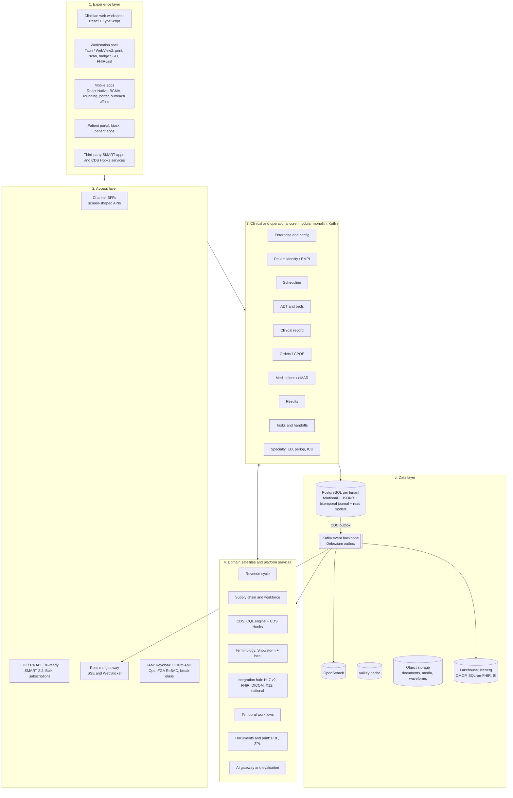
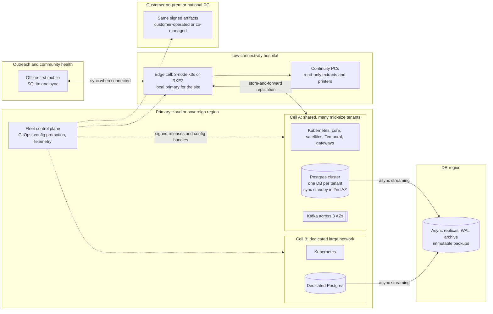
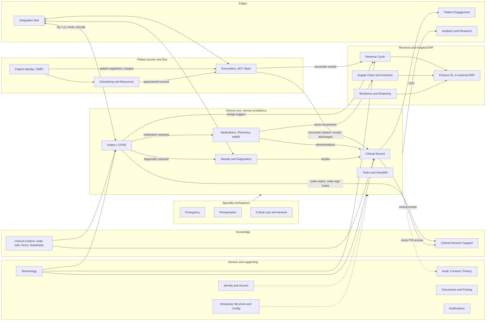

# 08 — System Architecture & Technology: How the Top Systems Are Built, and a Reference Architecture for Our HMS

**Research date:** 2026-10-16 · **Track:** System architecture & technology · **Status:** Research input. This is not a decision record; the recommendations below need ADRs before they become decisions.
**Companion documents:** `11-canonical-domain-model.md` (state machines, event catalogue, safety invariants), `02-open-source-and-platforms.md`, `01-global-vendor-landscape.md`.

**How to read this document**
- `[n]` is a numbered source in §16.
- *(I)* marks my own architectural reasoning from the sourced facts.
- *(K)* marks industry knowledge I could not re-verify against a primary source in this pass. Treat *(K)* items as needing confirmation before anyone relies on them.
- **Method note.** The web-search quota shared by this session's agents ran out after about 11 searches. Most of the evidence therefore comes from about 70 direct fetches of primary sources: vendor developer sites and newsrooms, HL7/IHE/openEHR specifications, open-source repositories, regulator pages, and cloud documentation. Several primary pages returned 403/404 (NHS Digital DCB0129, ISO/IEC 62304, the Infosys Oracle white paper, NetApp's Epic guide). Gaps are flagged where they matter. Epic and Oracle say little in public about their internals, so claims about them lean on secondary sources and carry that caveat.
- **Pass-2 verification (2026-10-16).** About 30 claims were re-checked against primary sources. Several *(K)* items are now confirmed, and some facts were corrected: the Västra Götaland outcome, the status of Oracle's acute-care launch, the Cerner 10-K benchmark context, the Redis licence sequence and the ORBIS market claim. Sources [95]–[105] were added. Each check is recorded in the verification log at the end of the document.

---

## 1. Executive summary

1. **The durable incumbents share one core pattern: a single transactional, patient-centric database per customer.** Epic Chronicles runs on InterSystems IRIS, with M/MUMPS heritage [1][7]. Millennium runs on Oracle DB [19]. VistA runs on M/FileMan [31]. TrakCare runs on IRIS [33]. Each pairs that database with a separately isolated relational reporting tier: Clarity and Caboodle for Epic [1], the Data Repository for MEDITECH [29], the ODS for Millennium [19]. Copy that combination of single source of truth plus isolated reporting. Do not copy their proprietary languages.
2. **The incumbents' moat is content, configuration and integration breadth, not database technology.** That means Epic's Foundation-style reference build, order sets and flowsheets, the Bridges HL7 v2 engine [8], and hundreds of FHIR APIs [1][9]. A new entrant wins on cost and speed of configuration, upgrade and integration.
3. **The market is replatforming, so 2026 is a credible entry window.** Oracle built a new EHR natively on OCI rather than refurbishing Millennium. Ambulatory shipped in August 2025 and acute care is promised for 2026. As of August 2026 the new EHR was still ambulatory-only [96], and this pass found no reported acute go-live by mid-October 2026. Oracle has not disclosed the database or internal design. It lost 56 US acute hospitals in 2025, falling to 21.9% of hospitals, while Epic reached 43.7% of hospitals and 56.9% of beds (KLAS figures via [15]) [13][14][15]. Epic moved its desktop client to Hyperdrive, a Chromium-based enterprise browser with a native plugin layer [2][3], and now ships native AI: Art, Emmie and Agent Factory [10][11][12]. MEDITECH moved from MAGIC to web-based Expanse, which is offered on-prem or as a service on Google Cloud [25][26][27].
4. **Build the clinical core as a modular monolith, not microservices.** The core covers identity, ADT/beds, orders, medications/eMAR, results and the clinical record. Run it on one PostgreSQL database per tenant, with module boundaries enforced by tooling [52][53]. Add a few satellite services where scaling, isolation or regulatory needs genuinely differ: integration, CDS, terminology, documents/print, AI and analytics. Splitting orders, meds and MAR across networked services gives up the transactional consistency patient safety depends on *(I)*.
5. **Use a deliberate hybrid data architecture, mostly inside PostgreSQL:**
   - relational tables for invariants (beds, orders, MAR, scheduling, billing);
   - typed, FHIR-shaped JSONB for flexible clinical content;
   - an append-only, bitemporal clinical journal that serves as history, write-audit and transactional outbox [49][50][51];
   - CQRS read models for worklists and tracking boards;
   - OpenSearch for search;
   - an Iceberg lakehouse that publishes OMOP CDM and SQL-on-FHIR views [55][62].
6. **Use FHIR as the external contract, not the internal transactional schema.** Expose FHIR R4 today (US Core, IPS, national IGs), designed so R6 can follow. R6 status: 6.0.0-ballot5 was the 2nd full ballot (17 Jul 2026), and the CI build is 6.0.0-snapshot1 (15 Oct 2026). Another ballot is certain, and publication is expected in 2027 [54][106]. *(Reconciled 2026-10-16: earlier text said "first full ballot", taken from stale wording on the CI ballot-intro page; see `06` §3.2.1.)* Store FHIR JSON natively only where the resource fits the domain. Medplum and Aidbox show that FHIR-on-Postgres works well for apps [37][40]. A hospital order/MAR engine needs invariants and workflow states that FHIR resources do not express *(I)*.
7. **Take openEHR's ideas, not necessarily its stack.** The ideas worth taking: a stable reference model plus clinician-authored templates, versioned compositions and contributions with who/when/why audit, and indelibility [43]. Offer openEHR/AQL interoperability for markets that want it. Better already pairs an openEHR clinical repository with a FHIR operational repository [36].
8. **Multi-tenancy should be cell-based:**
   - tenant = contracting enterprise;
   - one PostgreSQL database per tenant inside shared "cells" (deployment stamps);
   - pooled row-level security only for a small-clinic tier [70];
   - one EMPI and one longitudinal patient record per enterprise across facilities;
   - a typed configuration inheritance chain: vendor foundation → country pack → tenant → legal entity → facility → department → unit.
9. **Ship the same signed artifacts to every deployment model:** public SaaS, sovereign cloud, on-prem, a site **edge cell** (local primary) for low-connectivity hospitals, offline-first mobile for outreach, and read-only business-continuity copies at every hospital. Never run multi-writer active-active on clinical state. Use a single writer per tenant, a synchronous in-region standby (RPO ≈ 0) and an asynchronous DR region (RPO ≤ 5 min, RTO ≤ 60 min).
10. **Offline is a clinical-safety problem, not a sync-library choice.**
    - Safe offline: append-only facts such as vitals, notes and administrations against already-verified orders.
    - Not safe offline: allocating scarce shared resources (beds, theatre slots, identifiers, controlled-drug stock) and new prescribing without full interaction context.
    - Do not use last-writer-wins or CRDT auto-merge on clinical state. Validate commands on reconnect and route anything that fails to a human reconciliation queue *(I)*.
11. **The desktop needs a thin native workstation shell around the web app.** Epic itself states that browser `window.print()` is "insufficient" for wristbands and labels, and it built a native plugin layer into Hyperdrive [2]. We need silent ZPL printing, scanner, badge-tap and smart-card support, plus SMART/FHIRcast embedding [57][58].
12. **Recommended stack:**
    - Kotlin/JVM (Spring Boot + Spring Modulith) for the core, because the HL7 ecosystem is JVM-heavy: HAPI, the CQL engine, Snowstorm, EHRbase [44][63][64];
    - TypeScript/React for all UI and the plugin SDK;
    - PostgreSQL, with CloudNativePG on Kubernetes [71];
    - Kafka 4.x with a Debezium outbox [51][72];
    - Temporal (MIT) for long-running processes [65][66];
    - Keycloak plus OpenFGA for IAM/ReBAC [68][69];
    - OpenSearch, Valkey, Snowstorm, CQL + CDS Hooks, OpenTelemetry, OpenTofu/Helm/Argo CD.

    C#/.NET is an equally defensible core choice.
13. **License-proof the dependency graph.**
    - Redis moved to a source-available RSALv2/SSPL dual licence in March 2024, then added AGPLv3 as an option with Redis 8 in May 2025 [74].
    - Camunda 8.6+ (October 2024) needs a paid production license [67].
    - Mirth Connect went closed-source from v4.6 (2025) and was forked as Open Integration Engine [76][97].
    - Microsoft retired Azure API for FHIR on 30 Sep 2026 (its own docs say "deprecated"). That date has passed [80].

    Prefer foundation-governed, permissively licensed components, and keep any cloud-managed health API behind our own interface.
14. **Safety and compliance shape the architecture.**
    - Segregate potential-SaMD components (dose calculators, interaction checking, early-warning scores) into separately versioned modules with their own IEC 62304 lifecycle. *(Reconciled 2026-10-16 with `03`, `07` and `09`. v1 ships NEWS2/PEWS as transparent published-score calculators on nurse-entered vitals with escalation tasks. They are versioned in this regulated-module track and released first in non-US markets. Sepsis screening is non-interruptive and rule-based, and it shows its inputs. v1 has no automated continuous alarms from device streams, and US deployments use cleared partners. Per-market classification is pending.)*
    - Keep a DCB0129 hazard log tied to the backlog [94].
    - Design for contingency per the SAFER Guides [85].
    - Audit every PHI access per IHE BALP [61].
    - Produce SBOMs and signed builds. EU CRA reporting starts 11 Sep 2026 and its main obligations apply on 11 Dec 2027 [88].
    - Be ready for EHDS certification. Key parts of the Regulation apply from March 2029 for the first priority categories (patient summaries, ePrescriptions), with images, lab results and discharge reports following in March 2031 [87].
15. **Design for AI from the start.** Every AI-generated note, order or message is a draft that carries Provenance and needs explicit human sign-off. Agents call the same scoped APIs as apps. All model traffic goes through an AI gateway with offline and online evaluation. Abridge describes this evaluation pattern [92], and Epic's Agent Factory turns agent building into a product [10].

---

## 2. How the incumbents are actually built

### 2.1 Epic

**Core database (Chronicles).**
- Chronicles is Epic's operational database. It is a hierarchical key-value store built on MUMPS (M), not a relational database [1].
- Data is organized into master files, one per record type (patient, encounter, order, and so on) [1][7].
- Chronicles ran on InterSystems Caché for decades. Epic began moving to InterSystems IRIS with the August 2020 release, which InterSystems announced on 13 October 2020 [1][95].
- The structure follows how clinical data naturally nests: patient → encounters → orders, notes and results. "Each data element is stored at a known address within the hierarchy" [7].
- Customization is "configuration-driven rather than schema-driven". Customers cannot redesign the data model [7].
- *(K)* Master files are identified by three-letter "INI" codes (EPT for patients, ORD for orders, and so on). Records have time-stamped "contacts". Items can be single-response, multiple-response or "over-time". In effect, valid-time modeling is built into the data dictionary.

**Deployment shape.**
- Epic runs one patient-centric operational database per customer environment.
- The production server is the single read/write node. Failover servers share its storage for HA, and mirror servers provide read-only copies for reporting and DR [6]. This comes from a secondary source that cites NetApp's Epic architecture guide; I could not fetch the original.
- InterSystems' own press release of 13 October 2020 gives the scale across all Epic customers: about 2.5 million concurrent users and roughly 1.8 billion database accesses per second [95]. *Pass 2: now confirmed against the primary source.* These are 2020 figures, and no newer primary number was found.
- Epic states that more than 325 million patients have an Epic record [4]. Wikipedia cites a July 2024 Becker's piece for that figure, so it may now be higher. Kaiser Permanente runs 40 hospitals and 610 medical offices for 12.9 million members, as of 30 June 2026 [93].
- Market position: KLAS figures for 2025 give Epic 43.7% of US acute-care hospitals and 56.9% of beds, after a net gain of 77 hospitals (via [15]).

**Reporting tier.**
- **Clarity** is a relational copy of Chronicles on SQL Server or Oracle. A nightly ETL reshapes the hierarchical data into normalized tables [1].
- **Caboodle** is the curated, dimensional enterprise data warehouse downstream of Clarity. It can blend in non-Epic data [1].
- **Cogito** is the analytics umbrella, covering Reporting Workbench and SlicerDicer [4].
- **Cosmos** is a de-identified dataset pooled across customers. Today it covers 310 million patients, 2,358 hospitals and 52.5K clinics, and it has supported 250 publications [5].
- The architectural rule is that heavy analytics never touch the production OLTP database [1].

**Integration.**
- **Bridges** is "Epic's core messaging infrastructure" for HL7 v2 [8], and every v2 interface flows through it [1].
- **Interconnect** is the web-services layer that hosts the FHIR endpoints [1].
- fhir.epic.com lists DSTU2, STU3 and R4 resources, CDS Hooks (R4 and STU3), Bulk Data, and OAuth 2.0 backend clients [9].
- App Orchard has been replaced by Showroom and its Connection Hub [1][9].

**Clients.**
- **Hyperspace** was the Windows client, delivered over Citrix or as a thick client.
- **Hyperdrive** replaced it. Epic calls it "a secure, Epic-specific web browser" with a "Windows-native plugin infrastructure that enables integrations with other products" [2]. It runs on an embedded Chromium-based browser [3].
- Epic's Enterprise Browser Printing specification says plainly that "the standard web printing surface (window.print()) is insufficient." It lists the missing pieces as silent printing, tray selection, raw-data passthrough and printer enumeration [2].
- Rollout: Hyperdrive opened for testing in November 2021 and for broad use in May 2022. Builder and analyst tools lagged and still needed Hyperspace [3].
- Hyperdrive "won't need to be upgraded at the same time health systems upgrade to a new version of Epic" [3]. In other words, client cadence is deliberately decoupled from server cadence.
- Mobile and bedside apps are Haiku, Canto and Rover [1].

**Release and configuration model.**
- Epic "ships versions on a rolling schedule, and customers upgrade on their own timeline" [1]. Guidance refers to named versions such as "May 2022" and "May 2023" [3].
- *(K)* Since about 2020, Epic has released quarterly versions with special updates (SUs) in between.
- *(K)* Customers start from the **Foundation System**, Epic's maintained reference build of content and configuration. They are pushed to stay close to it so upgrades stay cheap.
- Hosting options are on-prem, Epic-hosted or public cloud. Cogito Cloud runs on Azure, but the core clinical system is not described as cloud-native [1].

**AI direction, 2025–26.**
- **Art** drafts clinical documentation. In the Ergo Visit pilot, record summaries link each point to its source note, and Art drafts notes and orders for the clinician to review [11].
- **Emmie** is the patient-facing assistant in MyChart [12].
- **Agent Factory** is "Epic's platform for health systems to build, monitor, and evaluate AI agents". Early-adopter training starts in October 2026, with broad availability planned for 2027 [10].
- *(I)* For a new HMS, AI is now an architectural concern (provenance, draft states, evaluation, tool APIs), not a bolt-on.

### 2.2 Oracle Health: Millennium and the new EHR

**Millennium.**
- Classic three tiers: Oracle database, middleware and client [19].
- Cerner's 2005 10-K described "a single healthcare architecture" spanning clinical and financial data. Its scale figures came from England's Choose and Book system, which "handled about 2.8 million service requests per hour, and the database managed 5,000 SQL executions per second." That was testing of the Millennium Web Experience architecture, not a general Millennium benchmark [20]. *(Pass 2: context corrected.)*
- All Millennium software reads and writes the database through **CCL**, a fourth-generation language "patterned after SQL" and expressed in Discern Explorer [18]. CCL also customizes PowerChart [19].
- **MPages** embed custom HTML/JS workflows in PowerChart [21].
- Millennium is usually hosted centrally by Cerner/Oracle [21].
- *(K)* Rows carry standard audit columns (UPDT_DT_TM, UPDT_ID, UPDT_CNT, UPDT_TASK). That records who and when at row level, but it is not full bitemporal history.

**The new Oracle Health EHR.**
- Previewed in October 2024 as "built from the ground up" on OCI, with AI embedded throughout [13].
- Launched for ambulatory care in August 2025 as "an entirely new EHR, built in the cloud for the Agentic AI era." Its native agents "work as a unified, orchestrated system", the AI layer is open, and navigation can be voice-driven [14].
- ONC certification came in December 2025. Acute care is promised for 2026, which KLAS calls a "pivotal proofpoint" year [15][16].
- **Status check, pass 2.** On 12 August 2026, Healthcare Dive reported the new EHR was "currently only available to ambulatory providers in the U.S." Oracle still planned to "launch the new EHR for the acute care market this year" [96]. This pass found no public report of an acute-care go-live by 16 October 2026. Oracle's September 2026 inpatient AI announcements ship inside the existing "Oracle Health Foundation EHR" [105]. Secondary coverage identifies that product as the former Millennium, but the press release does not say so.
- **Oracle has not publicly named the database or described the internal architecture.** MedCloudInsider explicitly found no database identified [15].
- An Infosys white paper describes a "semantic data layer", conversational interfaces and agentic automation, with Millennium customers migrating over time [17]. The paper itself was not retrievable (403); this comes from a search snippet.
- *(I)* It almost certainly uses Oracle Database and OCI managed services, but there is no primary confirmation.
- Market context: Oracle lost 56 US acute hospitals in 2025, leaving it with 21.9% of hospitals (down from 22.9%) and 20.4% of beds. Epic gained 77 hospitals and reached 43.7% of hospitals [15].
- Sweden: Västra Götaland region (VGR) **paused** its Millennium rollout in November 2024, days after go-live, over problems that put patients at risk [22]. It then abandoned the system. Swedish press coverage found by search, but not fetched, says the regional board decided in December 2025 not to reintroduce Millennium and to procure a modular record instead. On 27 August 2026 it terminated the Oracle contract, paying a special termination fee of about SEK 657 million. About SEK 3.8 billion had been spent on Millennium in total [102]. *(Pass 2: corrected. The earlier "permanently halted in November 2024" compressed a pause in 2024 and a termination in 2025–26.)*
- VA: deployments largely stopped in 2023 and resumed in 2026. Four Michigan sites went live on 11 April, four Ohio/Kentucky sites on 6 June and three Indiana sites on 22 August. That makes **11 of the 13 2026 sites live as of 22 Aug 2026**, with Anchorage and Cleveland scheduled for 24 Oct 2026 [23][24][107][108]. In August 2026 VA added three option-year periods and $17B to the Oracle contract, raising its total value to just under $27B [108]. *(Reconciled 2026-10-16: earlier text said "8 of 13", which predated the Indiana go-live.)*
- A VA OIG report (#22-01137-204, 14 July 2022) found that the new EHR sent thousands of orders to "an undetectable location, or unknown queue" instead of their intended destination. That caused 149 patient-harm events. Oracle Cerner had not told VA end users that the queue existed [101]. *(Pass 2: now confirmed; previously (K).)* This is the standard cautionary tale for integration design: every message and order must land somewhere visible, be acknowledged, and raise an alarm when it does not.

### 2.3 MEDITECH
- **MAGIC** ran all code on a central server, with clients acting as dumb terminals. **Client/Server** used the same language but ran it on Windows PCs [25].
- Both were built on proprietary operating systems and languages. They were "stable and needed few resources" but were seen as "text-heavy and rigid" [25].
- Version 6.0 (M-AT) was announced in 2006. **Expanse** launched on 27 February 2018 as a web and mobile EHR [25]. ONC listings show that Expanse grew out of the 6.x codebase: "MEDITECH Expanse (6.16)", then 2.1 and 2.2 [28].
- Expanse runs on-prem or as MEDITECH-as-a-Service on Google Cloud. It ships certified FHIR R4 (US Core 6.1.0), SMART App Launch and Bulk Data alongside HL7 v2 [26].
- Reporting uses a SQL Server Data Repository [29]. Data-migration vendors deal with MUMPS-related file types [30].
- *(K, unconfirmed)* 6.x/Expanse application code is often said to use a proprietary language called "Focus". A targeted pass-2 search found no source that names "Focus". Public material describes Expanse applications as split across the **NPR** and **M-AT** platforms, so treat "Focus" as unsubstantiated.
- HCA completed 34 hospitals in its first two US divisions (Capital and North Florida) on cloud-hosted Expanse in August 2026, replacing MEDITECH MAGIC. That brought HCA to 72 Expanse hospitals across the US and UK. It standardized order sets and nursing flowsheets across divisions, and about 182 hospitals are in eventual scope [27]. The HCA article does not name the cloud provider.
- *(I)* HCA is strong evidence that standardized content plus cloud hosting is what lets large networks scale.

### 2.4 VistA
- An "onion" architecture with "a single shared database that all applications use" at the center. It is written in M/MUMPS, running on Caché at the VA and on GT.M as the open-source engine, and has "over 180 clinical, financial, and administrative applications" [31].
- FileMan supplies the data dictionary and database API. The Kernel and RPC Broker connect clients. Delphi component libraries (KDC, FMDC) underpin the CPRS GUI [31].
- A documented decay mode: applications bypass the FileMan API and write directly to globals, so the data dictionary stops matching the data [32].
- Open-source derivatives include WorldVistA, OpenVistA, vxVistA and Astronaut. OSEHRA, the steward organization, shut down in February 2020 [31].
- *(I)* VistA shows both sides of the design. A shared M database with a metadata dictionary can last 40 years. But weak enforcement of the data-access layer, and code split across VA, DoD (CHCS) and IHS (RPMS) [31], lets drift accumulate.

### 2.5 InterSystems TrakCare / HealthShare
- TrakCare is "built on the foundation of InterSystems IRIS for Health".
- It is "fully web-based and mobile first", with "a single code base" and "a single user interface".
- InterSystems EHRs (TrakCare/IntelliCare): 600+ hospitals, 29 countries, 100M+ patients (vendor claim). The product page says TrakCare itself is "deployed in 29 countries" and "pre-configured to meet local market requirements" [33]. *(Reconciled 2026-10-16: the 600+ hospitals and 100M+ patients figures cover InterSystems EHRs collectively, not TrakCare alone; see `01` §5.1.)*
- "All TrakCare data is available via API", including FHIR and SMART [33].
- *(I)* Of all the incumbents, this is the closest analogue to what we want: one codebase sold internationally with localization packs.

### 2.6 Dedalus ORBIS, Cambio COSMIC, Better
- **ORBIS U** is "a feature-rich EPR system with more than 68 integrated clinical modules", installed in over 1,000 European hospitals and the leader in Germany and France. Its architecture is not published [34].
- **Cambio COSMIC** is the leading Nordic EHR. It offers "a unified patient record regardless of organisational boundaries" for regional providers, alongside Cambio CDS and device connectivity [35]. *(K)* Cambio has contributed substantially to openEHR's Guideline Definition Language.
- **Better** is an openEHR platform vendor and the most instructive hybrid:
  - clinical data sits in an openEHR repository queried with AQL;
  - demographics, identity, scheduling, referrals and workflows sit in a FHIR operational repository;
  - low-code app building, field-level access control and audit are built in;
  - hosting can be Better-hosted, customer cloud or on-prem;
  - Better cites 40M+ records, 1,000+ institutions and 30+ countries [36].

### 2.7 Modern platforms worth learning from
- **Medplum:** TypeScript across the stack (Node/Express and React), PostgreSQL for storage, Redis for jobs and caching, deployment via AWS CDK, Terraform or Helm, and an on-prem "agent" for local connectivity. Licensed Apache-2.0 [37]. "Bots" are Lambda-like functions triggered by FHIR Subscriptions, cron, webhooks or custom operations [38]. "Projects" are hard isolation boundaries, with read-only "linked projects" for shared content [39].
- **Aidbox:** one Postgres table per FHIR resource type. Each holds a `resource jsonb` column and a `txid` version from a global sequence, and a `_history` twin keeps every prior version [40]. Multi-tenancy follows the organization hierarchy: parents see nested organizations, siblings are isolated [41].
- **HAPI FHIR JPA:** stores resource bodies as (optionally gzipped) CLOBs in one table, with separate search-index tables [42].
- **Canvas Medical SDK:** Python plugins run "in a sandboxed process directly on the Canvas instance". They respond to events by returning **effects**, which the core then applies. Data access is read-only through views [48]. This is an excellent pattern for protecting invariants.
- **OpenMRS O3:** an app shell loads frontend modules through Webpack Module Federation. An extension system provides cross-module UI slots, and import-map overrides support development [46][47]. Its classic data model is a concept dictionary plus generic `obs` rows per encounter [45].

### 2.8 Incumbent architecture analysis table

| System | Core store / language | Client tech | Integration | Reporting / analytics | Deployment | Durable strengths | Pain points |
|---|---|---|---|---|---|---|---|
| **Epic** | Chronicles: hierarchical M on InterSystems IRIS; Caché before 2020 [1] | Hyperdrive: Chromium-based enterprise browser with native plugins [2][3]; Haiku/Canto/Rover [1] | Bridges (v2), Interconnect (web services/FHIR), CDS Hooks, Bulk [1][8][9] | Clarity (nightly ETL), Caboodle (EDW), Cosmos [1][5] | One DB per customer; on-prem, Epic-hosted or public IaaS [1][6] | Single source of truth; deep foundation content; integrated breadth; strict reporting isolation | Proprietary M stack and scarce skills; cost; large build/upgrade teams; analytics a day stale |
| **Oracle Millennium** | Oracle DB; CCL 4GL [18][19] | PowerChart; MPages in HTML/JS [21] | Millennium Gateway (FHIR/REST), HL7 v2 [21] | ODS/HealtheIntent, CCL reports [19] | Mostly centrally hosted [21] | Relational, SQL-like access; centralized operations | Ageing client; failed rollouts in Sweden and early VA [22][23]; being superseded |
| **Oracle Health EHR (new)** | Not disclosed; "built from the ground up" on OCI [13][15] | Web, voice, AI agents [14] | FHIR R4 | Oracle Health Data Intelligence [13] | OCI SaaS | Clean-sheet, agentic design | Ambulatory-only as of Aug 2026, with acute care still promised for 2026 [15][96]; opaque |
| **MEDITECH Expanse** | 6.x/M-AT lineage, proprietary [25][28] | Web/mobile [25] | HL7 v2; FHIR R4/SMART/Bulk [26] | Data Repository on SQL Server [29] | On-prem or MaaS on Google Cloud [26] | Cost-efficient; fits community hospitals; HCA scale-out [27] | Proprietary stack; estate spread across MAGIC, C/S and 6.x |
| **VistA** | M/MUMPS + FileMan [31] | CPRS (Delphi components) [31] | RPC Broker; HL7 | Corporate data warehouse *(K)* | Per-site instances | Free; lasted 40 years; built with clinicians | Forks; FileMan bypass [32]; dated UI; being replaced |
| **TrakCare** | IRIS for Health [33] | Web, mobile-first [33] | IRIS/HealthShare interoperability; FHIR/SMART [33] | IRIS analytics *(K)* | Hosted or on-prem; 29 countries [33] | Single codebase with multi-country localization | Proprietary platform licensing; smaller ecosystem |
| **ORBIS U** | Not disclosed [34] | Desktop and mobile [34] | "Common standards" [34] | — | On-prem/hosted *(K)* | 68+ modules; Dedalus calls it the leading EPR in Germany and France [34] | Architecture not public |
| **COSMIC** | Not disclosed [35] | Web/mobile [35] | Opening up its platform [35] | COSMIC Insight [35] | Regional deployments | Unified record across organizations | Concentrated in the Nordics |

### 2.9 What made them durable, and what hurts

**Patterns to copy:**
1. One logical, patient-centric transactional store per customer, with immediate read-your-writes [1][6][31]. Clinicians can trust what they just entered.
2. Reporting and analytics physically isolated from OLTP [1][19][29].
3. Behavior driven by metadata and configuration (master files, the FileMan dictionary) rather than schema changes [7][31].
4. Vendor-maintained foundation content that customers adapt: Epic's Foundation System *(K)* and HCA's standardized order sets [27].
5. One integrated suite covering clinical, financial and departmental work [20][33].
6. A central interface engine with acknowledgement semantics (Bridges' asynchronous ACK interfaces [8]).

**Pain points to avoid:**
1. Proprietary languages and runtimes (M, CCL, MAGIC) shrink the talent pool [18][25][31].
2. Monolithic upgrades consume customer staff. Epic decoupled the client from server upgrades to ease this [3].
3. Nightly ETL leaves analytics a day stale [1].
4. Thick clients delivered over Citrix [3].
5. Governance forks, as with VistA [31].
6. Opaque routing failures at go-live (VA, Sweden) [22][23].
7. Customer customizations that harden into forks and inflate upgrade cost *(I)*.

---

## 3. Data architecture options

### 3.1 Relational, normalized clinical model
Explicit tables (encounter, service_request, medication_administration, bed_assignment and so on) with foreign keys and constraints.
- **Strengths:** the database enforces invariants. For example, a bed cannot have overlapping occupants (exclusion constraints), and an administration must reference a verified order. Tooling is mature and SQL reporting is straightforward.
- **Weaknesses:** every new clinical data element needs a schema migration, which fits thousands of flowsheet rows and form fields badly.
- **Exemplar:** Millennium [19].

### 3.2 EAV / observation-centric
OpenMRS's concept dictionary plus `obs` rows ("many observations per Encounter") [45].
- **Strengths:** a new data element is just a new concept, with no migration. That suits form-heavy global-health deployments.
- **Weaknesses:** queries are pivot-heavy, typing is weak, constraints move into application code, and "everything is an obs" blurs meaning (an order is not an observation).
- *(I)* Use this pattern only inside a strongly typed concept catalog for flowsheets. Epic's flowsheet rows appear to be essentially that *(K)*.

### 3.3 Document/JSON: FHIR resources in Postgres JSONB
Examples: Aidbox's table per resource with a history twin [40], Medplum on Postgres [37], HAPI's CLOB plus index tables [42].
- **Strengths:**
  - resources have a standard shape and APIs come almost free;
  - history tables give versioning;
  - SQL on FHIR v2 ViewDefinitions flatten resources into analytics tables, running in memory or in the database [55].
- **Weaknesses:**
  - the database does not enforce invariants that span resources;
  - FHIR models *exchange*, not workflow. MedicationRequest status, for example, has no notion of a pharmacist verification queue;
  - the standard keeps moving (R6 is in ballot [54]);
  - national profiles diverge;
  - JSONB indexes bloat.

### 3.4 openEHR two-level modeling
- Only the Reference Model (RM) is implemented in software. Archetypes (in ADL) and templates carry the clinical content, authored by domain experts [43].
- Queries use AQL.
- Change control is built in. Every commit is a **Contribution**: a change set of Versions, audited with user, timestamp, reason and an optional signature. Records are **indelible**, with deletion handled logically through versioning. The **Composition** is "the committal unit of the EHR" [43].
- EHRbase implements RM 1.1.0 and ADL 1.4 on the JVM, with PostgreSQL 15+ (16 recommended), exposing the openEHR REST API and AQL. It is Apache-2.0 licensed. The current README requires Java 25 [44]. *(Pass 2: confirmed. The README does not mention Spring Boot, so that detail is (K).)*
- **Strengths:** semantic durability, clinician governance of content, and a lifelong record.
- **Weaknesses:** a small talent pool, AQL performance tuning, and no coverage of operational domains (scheduling, billing). This is why Better pairs it with FHIR [36].

### 3.5 Event sourcing
The system stores immutable events and derives state from them.
- **Strengths:** perfect history, replay, and natural "chart as of time T" queries.
- **Weaknesses:**
  - complexity;
  - evolving event schemas over time;
  - tension with erasure and rectification duties (crypto-shredding is the usual workaround *(K)*);
  - read models are mandatory;
  - most teams are unfamiliar with it.

Events can carry both an actual date and a record date [49]. *(I)* **Recommendation: event sourcing "lite".** Keep current-state tables, and write an append-only journal row in the same transaction. That journal is also the outbox [50][51]. Consider full event sourcing only for order and MAR aggregates, where the lifecycle *is* the business logic.

**Cross-report note (reconciled 2026-10-16): event sourcing.** The definition here and in §3.11 is the pack standard. `09` (§0 #15, §6.2, §9.1 #1) used "event-sourced clinical core", and `03` §21.4 promised an "event-sourced clinical timeline". Both now say **"bitemporal append-only clinical journal with CDC to the lakehouse"**. That meets their real need, which is fresh, trustworthy, time-stamped context for AI, analytics and regulated clocks, without committing the whole core to full event sourcing. `11` §17 #5 ("or event sourcing for key aggregates") means the order/MAR exception, decided by ADR.

### 3.6 CQRS read models
Denormalized, rebuildable projections for ED and OR tracking boards, bed boards, pharmacy verification queues, nursing task lists and results inboxes. They are fed by journal events and pushed to clients over SSE. They are disposable: if one is corrupted, rebuild it from the journal.

### 3.7 Temporal and bitemporal modeling
Bitemporal modeling separates **actual (valid) time** from **record time**. Actual history can be revised retroactively; record history is append-only [49]. Clinical medicine needs this constantly:
- vitals taken at 08:00 but charted at 10:30, or back-entered after downtime;
- an amended lab result;
- an allergy marked entered-in-error;
- a corrected weight that invalidates earlier dose calculations;
- the medico-legal question "what did the doctor see at 09:12 when they signed that order?"

Fowler cautions that bitemporality adds complexity and is only worth it where actual and record history diverge [49]. The clinical record is exactly that case.
- *Implementation (I):* `valid_period` (tstzrange) plus `recorded_at`, superseded-version chains, and exclusion constraints, for example for no overlapping bed occupancy.
- PostgreSQL 18 (released 25 Sep 2025) adds temporal constraints: `WITHOUT OVERLAPS` for `PRIMARY KEY` and `UNIQUE`, and `PERIOD` for foreign keys, applied to the last specified range column [98]. *(Pass 2: confirmed in the PG 18 release notes; previously (K).)* These are new features, so test planner and tooling support, including ORM and migration tools, before relying on them.

### 3.8 OMOP CDM (research)
The current version is **v5.5**; v5.4 was the previous one. Standardized vocabularies are central, and the Data Quality Dashboard must be run before a site joins an OHDSI network study [62]. Treat OMOP as an analytics **output**, never as the operational model.

### 3.9 Lakehouse (analytics)
Change data capture feeds Iceberg tables on object storage. dbt builds models, Trino, Spark or DuckDB query them, and the lakehouse publishes SQL-on-FHIR views [55], OMOP [62] and BI marts. Cloud-native alternatives a customer may require include Google's Healthcare API export to BigQuery [81] and HealthLake's SQL access [82].

### 3.10 Data-architecture comparison

| Option | Shines at | Weak at | Exemplars | Our use |
|---|---|---|---|---|
| Relational normalized | Invariants, transactions, operational queries | Schema churn for clinical content | Millennium [19] | **Yes:** ADT, beds, scheduling, orders, MAR, inventory, billing |
| EAV / obs | Rapid new data elements | Typing, queries, semantics | OpenMRS [45] | **Limited:** flowsheet values inside a typed concept catalog |
| FHIR JSONB documents | Standards-shaped content, fast APIs, history | Cross-resource invariants, workflow semantics, version churn | Aidbox [40], Medplum [37], HAPI [42] | **Yes:** observations, conditions, allergies, questionnaire responses, documents |
| openEHR two-level | Clinician-governed semantics, versioned compositions, lifelong record | Talent, operational domains, AQL tuning | EHRbase [44], Better [36] | **Borrow ideas** (templates, contributions, indelibility); openEHR API as an optional adapter |
| Event sourcing (full) | Perfect history, replay | Complexity, schema evolution, erasure | — | **Lite:** journal + outbox; full ES only for order/MAR aggregates (decide by ADR) |
| CQRS read models | Boards, worklists, fast reads | Eventual consistency | — | **Yes** |
| Bitemporal | Corrections, late entry, medico-legal reconstruction | Complexity | [49] | **Yes, mandatory** for clinical facts |
| OMOP CDM | Federated research | Not operational | OHDSI [62] | **Analytics output** |
| Lakehouse | Scalable analytics, ML | Latency vs OLTP | — | **Yes**, fed by CDC within minutes |

### 3.11 Recommendation: one PostgreSQL database per tenant, four storage shapes

| Shape | Contents | Key rules |
|---|---|---|
| **A. Operational relational** | Enterprise structure, beds, encounters/ADT, appointments, service requests, medication orders, dispenses, administrations, charges, inventory | FK and exclusion constraints; optimistic concurrency (version / ETag); state machines per `11-canonical-domain-model.md` §10 |
| **B. Clinical fact and document store** | Typed JSONB, FHIR-shaped where natural (Observation, Condition, AllergyIntolerance, QuestionnaireResponse, Composition/DocumentReference); generated columns for indexed keys; concept catalog mapped to LOINC/SNOMED | Never updated in place. Status lifecycle runs preliminary → final → amended/corrected/entered-in-error. Every fact carries `valid_period`, `recorded_at`, author, attester, source (user, device, interface or **AI draft**), and supersedes-id |
| **C. Clinical journal (bitemporal, append-only)** | One row per state change: tenant, facility, aggregate type/id, patient, event type, valid time, recorded time, actor, on-behalf-of, device, reason, payload, previous version | Written in the same transaction as A/B. It is the outbox, read by Debezium [51], and the write-audit trail. Reads are audited separately to an append-only audit store per IHE BALP [61] |
| **D. Read models** | Board and worklist tables, patient-summary projection, census | Rebuildable from C; pushed via SSE |

Off-Postgres stores: OpenSearch (search), object storage (documents, media, print outputs, waveforms), lakehouse (analytics), and Valkey (ephemeral cache and sessions only, never the system of record).

Cross-cutting rules *(I)*:
- Use time-ordered UUIDv7 identifiers. They are merge-friendly across edge cells, and PostgreSQL 18 generates them natively with `uuidv7()` [98].
- Store instants as UTC plus the original offset. Store date-only and partial values as local dates; year-only dates of birth are common in some markets.
- Every row carries `tenant_id` and `facility_id`, even within a per-tenant database, as defense in depth and to allow later consolidation.

---

## 4. System decomposition

### 4.1 Modular monolith vs microservices for an EHR

| Force | Microservices | Modular monolith | Why it matters in a hospital |
|---|---|---|---|
| **Consistency** | Sagas and eventual consistency | Local ACID transactions | Signing an order must atomically persist it, record CDS overrides, create a pharmacy verification task, recompute the MAR schedule and emit charge events. Saga compensation is dangerous because you cannot "un-administer" a dose *(I)* |
| **Latency** | Chart open fans out to 10–20 services | In-process aggregation | The chart summary touches identity, encounter, problems, allergies, meds, results, orders, tasks and vitals |
| **Team topology** | Independent deploys | Module ownership enforced by tooling | Shopify runs about 2.8M lines of Ruby as components with ownership and Packwerk enforcement, and extracts services only for clear reasons such as read-heavy storefront or card vault isolation [52]. Spring Modulith verifies module structure, tests modules in isolation and observes them at module level [53] |
| **Deployability** | Many artifacts | One artifact plus a few satellites | On-prem and edge installs at a 2–3 node hospital cluster are far simpler |
| **Extraction later** | — | Modules talk through interfaces and domain events, so a module can be extracted later | Preserves future options |

**Recommendation: a modular core with satellites.**
- **Core deployable (Kotlin, one database per tenant, separate schema per module):** Enterprise & Configuration, Patient Identity/EMPI, Scheduling, Encounters/ADT/Beds, Clinical Record, Orders, Medications/eMAR, Results, Tasks & Handoffs, and specialty workspaces (ED, perioperative, critical care). Module rule: a module never reads another module's tables. It calls the module's API or consumes its events.
- **Satellites (separate deployables):**
  - Revenue Cycle and Supply Chain/Workforce: eventually consistent, batch-heavy, country-specific;
  - Integration Hub;
  - CDS service (CQL + CDS Hooks);
  - Terminology;
  - Documents & Print;
  - Search indexer;
  - Notifications;
  - AI Gateway;
  - Analytics pipeline;
  - Patient-portal BFF;
  - Temporal workers.

### 4.2 Bounded contexts (summary; the full map is in §12.4)

| Context | Core aggregates | Consistency class | Deployable |
|---|---|---|---|
| Identity & Access | User, role, credential, care-team membership | Strong | IAM (Keycloak + OpenFGA) |
| Enterprise Structure & Config | Org/facility/location tree, setting, config change set | Strong | Core |
| Patient Identity / EMPI | Patient, identifier, link/merge | Strong | Core |
| Scheduling & Resources | Slot, appointment, resource, waitlist | Strong per resource | Core |
| Encounters / ADT / Beds | Encounter, movement, bed assignment | Strong | Core |
| Clinical Record | Observation, condition, allergy, note/composition, flowsheet | Strong (per patient) | Core |
| Orders / CPOE | Service request, order set instance | Strong | Core |
| Medications & Pharmacy | Medication request, verification, dispense, administration | Strong (with Orders) | Core |
| Results & Diagnostics | Diagnostic report, specimen, result | Strong | Core (+ integration to LIS/RIS/PACS) |
| Tasks & Communication | Task, handoff, message | Strong | Core |
| Clinical Decision Support | Rule/library, card, override | Stateless + audit | CDS satellite |
| Clinical Content | Order-set, form, flowsheet and print templates (versioned) | Strong (versioned) | Core (content service) |
| Terminology | CodeSystem, ValueSet, ConceptMap | Read-mostly | Terminology satellite |
| Revenue Cycle | Account, charge, claim, remittance | Eventual | RCM satellite |
| Supply Chain, Assets, Workforce | Item, stock, PO, roster | Eventual (stock reservations strong locally) | ERP satellite |
| Audit, Consent, Privacy | Audit event, consent, disclosure | Append-only | Audit store |
| Integration | Channel, message, ack | At-least-once + idempotent | Integration Hub |
| Patient Engagement | Portal account, proxy, message | Eventual | Portal BFF |
| Analytics & Research | Marts, OMOP, cohorts | Eventual (minutes) | Lakehouse |

### 4.3 Event-driven integration
- **Outbox.** The journal (§3.11 C) is the outbox. A message is published if and only if the transaction commits, and it avoids two-phase commit. The relay can duplicate messages, so **consumers must be idempotent** [50].
- **Relay.** Debezium's outbox event router routes by `aggregatetype` to a topic and keys by `aggregateid` to preserve per-partition ordering [51]. *(I)* Key clinical streams by patient ID so all of a patient's events stay ordered.
- **Broker.** Apache Kafka 4.x in KRaft mode, without ZooKeeper. 4.0 shipped on 18 March 2025 and 4.3.0 on 22 May 2026. The latest patch releases are 4.3.1 (June 2026) and 4.2.2 (September 2026) [72].
  - Alternatives:
    - Redpanda: Kafka API in a single binary. Its core is under the source-available Business Source License 1.1, which prohibits offering it as a commercial streaming or queuing service and converts to Apache-2.0 four years after each release [99].
    - NATS JetStream: light, good for edge.
    - Pulsar: built-in multi-tenancy and geo-replication, but operationally heavier.
- **Contracts.** CloudEvents envelope, a schema registry, backward-compatible evolution only, and contract tests per consumer.
- **No silent failures (lesson from the VA "unknown queue" [101]).** Every inbound and outbound message has an acknowledgement state. Undeliverable messages land in a **visible, owned work queue** with paging alarms, never in a hidden dead-letter topic.

### 4.4 Workflow and orchestration engines
- **Temporal.** Durable execution "whether that takes a second or a year". Workflows are deterministic code; side effects go in activities with configurable retries. It supports timers lasting months, signals and queries, and worker versioning. It is self-hostable on PostgreSQL, MySQL, Cassandra or SQLite, and has SDKs for Java, Go, TypeScript, .NET and other languages [65]. The server is MIT-licensed [66].
- **Use Temporal for:** discharge orchestration (med reconciliation sign-off, summary, follow-up bookings, transport, final billing), referral lifecycles, prior authorization, claim submission and remittance matching, interface replay, bulk export, and legacy data-migration pipelines.
- **Do not use it for:** the order or MAR state machines (keep those in the domain model, in the same transaction) or sub-second clinical decisions.
- **BPMN.** Camunda 8.6 (released 8 October 2024) and later need a production license for Zeebe, Operate, Tasklist, Optimize, Identity and Camunda connectors. 8.5 was the last release under the old terms [67]. Flowable is an Apache-2.0 BPMN/CMMN/DMN engine [100]. jBPM is also an Apache-2 alternative *(K)*. *(I)* Offer clinicians a constrained "care pathway / task template" designer that compiles to our own task engine, rather than exposing raw BPMN.

### 4.5 Rules engines and CDS
- **CQL** is HL7's language for clinical logic. The reference translator and engine (cqframework) are built in Kotlin and Java, with a JavaScript build [63]. Use CQL for clinical rules, quality measures and order-set applicability.
- **CDS Hooks 2.0.1** (STU 2 Release 2, trial use) lists hooks including `patient-view`, `order-select`, `order-sign`, `order-dispatch`, `encounter-start`, `encounter-discharge`, `appointment-book`, `medication-refill`, `allergyintolerance-create` and `problem-list-item-create`. `medication-prescribe` and `order-review` are deprecated. Responses are cards (info / warning / critical) with suggestions and override reasons, plus prefetch templates and a feedback endpoint. Services "SHOULD respond quickly (on the order of 500 ms)" [56]. *(I)* Our own CDS should use the **same hook points**, so first- and third-party CDS are symmetric, and override and feedback analytics drive alert-fatigue governance.
- **Drug knowledge** (interactions, dose ranges) comes from licensed national or commercial knowledge bases behind an adapter *(K)*. This component is the most likely to be regulated as a medical device (§10).
- **Operational rules** (billing edits, scheduling constraints) use DMN-style decision tables, versioned as configuration.

### 4.6 FHIR façade vs FHIR-native core

| | FHIR-native core (FHIR store is the database) | FHIR façade over a domain model |
|---|---|---|
| Speed to first API | Very fast [37][40] | Slower: mappings must be written |
| Transactional invariants and workflow states | Weak, enforced in app code | Strong, enforced in schema and domain |
| FHIR version churn (R4 → R6) and national profiles | Core is coupled to them | Absorbed in the mapping layer |
| Who does it | Medplum, Aidbox, cloud FHIR services [80][81][82] | Epic, Oracle, MEDITECH (APIs over proprietary cores) [1][21][26] |

**Recommendation *(I)*:** FHIR-first API, domain-first core, and native FHIR JSON storage where the resource fits (§3.11 B).
- Build the façade with HAPI FHIR structures and the official validator.
- Generate a CapabilityStatement per tenant and country pack.
- Support SMART App Launch 2.2 (EHR launch, standalone launch, backend services, v2 scopes) [57], Bulk Data 3.0 [60], topic-based Subscriptions via the R5 backport [59], and FHIRcast for context sync [58].
- Track the R6 ballot [54].
- Medplum (Apache-2) [37] could accelerate non-core apps such as outreach or the portal, but must never become a second source of truth.

**Cross-report note (reconciled 2026-10-16): core data architecture.** `02` originally recommended a FHIR-R4-native core (self-hosted Medplum, TypeScript, or HAPI FHIR JPA) and "never translate at the core". This report, `06` §7.1 and `11` §0 recommend a domain-owned core with FHIR as the external contract. The reconciled ADR-001 posture follows this section and §3.11:
- domain aggregates in PostgreSQL, one database per tenant, which Medplum's shared-database Projects model does not provide;
- typed, FHIR-shaped JSONB for clinical facts;
- a generated FHIR R4 projection/façade for reads, `$export`, IPS and Subscriptions, with writes through domain commands;
- the HAPI structures, validator and v2 libraries;
- Kotlin/JVM.

Medplum is a reference design and an optional component source (UI kit, on-prem agent pattern). `02` §10.1 keeps a 6–8 week load and safety spike comparing both options on a 1,000-bed workload; its results feed ADR-001 before it is frozen. `09` and `10` now say "FHIR-first external/partner API".

---

## 5. Multi-tenancy and enterprise hierarchy

**Hierarchy: model separate axes, not one tree *(I)*.**

| Axis | Levels | FHIR anchor |
|---|---|---|
| Organizational | Tenant (contracting enterprise, which may be a ministry) → Legal entity (tax/billing) → Facility → Department / service line | Organization.partOf |
| Physical | Campus → Building → Floor → Unit/Ward → Room → Bed/Bay | Location.partOf |
| Clinical service | Specialty services, clinics, programs | HealthcareService |
| Financial | Cost centers, billing entities, payer contracts | (ERP) |
| Care relationships | Care teams, treatment relationships | CareTeam |

Aidbox's organization tree shows one workable scoping model: parents see nested organizations, siblings are isolated, and "shared" resources are read-only to children [41].

**Patient index.**
- One EMPI and one longitudinal record per tenant across all facilities, in line with Epic's single database per organization [6] and COSMIC's record "regardless of organisational boundaries" [35].
- Facility MRNs are identifiers on the golden record. Matching is tuned per locale: multiple scripts, transliteration, national IDs.
- Merges and unmerges are journaled, reversible operations.
- Across tenants (HIEs, national MPIs), use IHE PIXm/PDQm or national APIs *(K)*.
- Segregate sensitive data (behavioral health, HIV, VIPs, adolescent confidentiality) through **policy** (ReBAC/ABAC + consent), not separate databases.

**Isolation models.**

| Model | Isolation | Ops cost | Notes | Our use |
|---|---|---|---|---|
| Pooled tables + `tenant_id` + Postgres RLS | Logical | Lowest | Default-deny with no policy; owners and `BYPASSRLS` roles bypass unless `FORCE ROW LEVEL SECURITY` is set; FK and unique checks bypass RLS (covert channel); policies with sub-selects can race [70] | Small-clinic SaaS tier only |
| Schema per tenant | Logical+ | Medium | Catalog bloat at scale | Not recommended |
| **Database per tenant in a shared cell** | Strong logical; per-tenant backup/restore and keys | Medium (needs fleet migration tooling) | Mirrors Epic's one-DB-per-customer model [6]; easy extraction to a dedicated or on-prem cell | **Default** |
| Dedicated cell | Physical | Higher | Large networks, data-residency contracts | Large tenants |
| Customer-operated deployment | Full | Customer + us | Sovereign or on-prem mandates | Where required |

Medplum's "Projects" are hard boundaries [39], and Aidbox scopes data by organization [41]. Both show the pooled approach works for apps. For a hospital system of record, we prefer database-level isolation *(I)*.

**Configuration inheritance *(I)*.**
- Settings are typed and schema-validated in a registry.
- Scope chain: **Vendor foundation → Country pack → Tenant → Legal entity → Facility → Department → Unit (→ User preference)**.
- Resolution is most-specific-wins unless a parent marks the setting `locked`.
- Every change belongs to a versioned, approved **change set**, modeled on openEHR Contributions [43].
- An effective-configuration resolver is cached and invalidated by events.
- Tooling covers diff, impact analysis and config tests.

**Per-country localization packs (versioned, signed) contain:**
- terminology bindings (ICD-10-WHO/CM/AM/GM, ICD-11, SNOMED CT national editions, LOINC, national drug codes);
- national FHIR IGs and CapabilityStatements;
- identifier validators;
- name and address formats;
- calendars and holidays;
- languages;
- claims and e-invoicing adapters;
- tax rules;
- statutory reports;
- retention and consent rules;
- drug-knowledge connectors;
- default content (order sets and forms adapted to local practice).

TrakCare's "pre-configured to meet local market requirements" shows that commercial demand exists [33].

---

## 6. Deployment models

### 6.1 Deployment-model matrix

| Model | Target customer | Data residency | Who operates | Upgrade cadence | HA/DR | Connectivity tolerance | Key risks |
|---|---|---|---|---|---|---|---|
| **A. Multi-tenant SaaS (public cloud cells)** | Single hospitals, mid networks | Region-pinned cells | Us | Continuous, behind flags; quarterly activation windows | Multi-AZ sync + async DR region | Needs a reliable WAN; continuity PCs required | Blast radius (mitigated by cells); residency rules |
| **B. Dedicated cloud cell** | Large networks | Region or customer subscription | Us (customer tenancy possible) | Same as A, with scheduled windows | Same as A | Same as A | Cost |
| **C. Sovereign / in-country cloud** | Ministries, regulated markets | In-country, possibly air-gapped | Us or a local partner | Quarterly | In-country DR pair | Varies | Feature gaps in local clouds; staffing |
| **D. On-prem (customer DC)** | Mandated by policy or connectivity | Customer DC | Customer, co-managed by us | Quarterly; N-2 versions supported | Customer's two DCs or DC + cloud DR | High | Skill and patching drift; slow upgrades |
| **E. Hybrid edge (site edge cell + central cloud)** | Low-connectivity hospitals in a network | Local primary; central copy | Us (remote GitOps) | Ring-deployed with central | Local HA + central backup | **Works through WAN loss** | Replication conflicts (designed out; see 6.3) |
| **F. Offline-first device** | Outreach, community health workers, mobile clinics | Device-encrypted subset | Us | App-store cadence | Device → edge/cloud sync | Disconnected for days | Stale data; device loss |

- *(I)* Run **Kubernetes everywhere**: managed EKS/AKS/GKE/OKE in cloud; RKE2, OpenShift or Talos on-prem *(K)*; k3s at the edge *(K)*.
- Run PostgreSQL on Kubernetes through CloudNativePG: streaming replication, automated failover, synchronous "zero data loss replicas", and continuous backup to object storage with PITR [71].
- Sovereign building blocks: AWS European Sovereign Cloud and Dedicated Local Zones [83]. The AWS page links a January 2026 launch announcement for the European Sovereign Cloud. Air-gapped offerings from other hyperscalers *(K)*; in-country providers.

### 6.2 Edge cell design (low-connectivity hospitals) *(I)*
- **Hardware:** a 3-node cluster (or 2 nodes plus a witness) running the full core for that site, plus Postgres, single-node Kafka/KRaft, OpenSearch and a local copy of the terminology and drug-knowledge snapshot.
- **Ownership:** the site is **home** (single writer) for its encounters, beds, local scheduling and local stock.
- **Replication:** asynchronous to central over a store-and-forward link (outbox → Kafka mirror) for enterprise views, analytics and backup.
- **Identifiers:** site-issued UUIDv7 identifiers, and site-prefixed human-readable MRNs and accession numbers.
- **Enterprise operations:** EMPI merges and cross-site transfers run centrally, are propagated as commands, and are accepted by the home site.
- **Local CDS:** runs on a local drug-knowledge snapshot, with its version recorded on every check.

### 6.3 Offline-first clients and conflict resolution
- **Tooling:**
  - PowerSync replicates Postgres to client SQLite (including web). Writes are queued and uploaded to *your* backend API, which keeps "full control over logic for applying writes" [78].
  - The Android FHIR SDK provides offline-capable FHIR storage and Structured Data Capture for mobile-first apps [79].
- **Conflict policy *(I)*:**
  1. Clinical facts are append-only, so two vitals sets cannot conflict.
  2. State transitions sync as **commands** and are re-validated server-side. A dose given offline against an order discontinued meanwhile is accepted as fact (it happened) and raised to the clinician and pharmacist.
  3. Identity creations offline use temporary IDs and go to a reconciliation queue.
  4. CRDTs are acceptable for draft note text and UI preferences, **not** for orders, medication state or identity.

**What can and cannot safely be done offline:**

| Activity | Edge cell (local primary) during WAN loss | Disconnected mobile / laptop | Conditions |
|---|---|---|---|
| View chart | Yes (full for site) | Scoped cache only | Staleness banner showing last-sync time |
| Record vitals, notes, assessments | Yes | Yes | Append-only; valid time captured; attestation |
| Barcode med administration (BCMA) | Yes | Conditional | Only against orders verified before disconnect; show order snapshot time |
| New medication orders | Yes (local CDS + knowledge snapshot) | **No** (protocol or standing orders only, otherwise paper downtime) | Interaction checks need the complete med list and allergies |
| Register new patient | Yes (site EMPI partition) | Temporary ID | Merge queue on reconnect |
| Bed assignment | Yes, site beds | **No** | One authority per bed |
| Cross-site transfer / enterprise bed board | Degraded (read-only) | No | — |
| Shared-resource scheduling (OR, MRI) | Yes if resource is site-local | No | — |
| Release results to patients | Deferred | No | — |
| Controlled-drug dispensing | Yes with local cabinet integration | No | Reconciliation report |
| Charge capture | Yes | Yes | Claims submitted later |
| Identity merges | No (central) | No | — |
| AI features | Only if a local model is deployed | No | Fall back gracefully |

### 6.4 HA/DR and business continuity

| Failure | Mechanism | RPO | RTO |
|---|---|---|---|
| Node / AZ loss | Postgres synchronous quorum standby; multi-AZ Kubernetes and Kafka | 0 | ≤ 5 min (automated; engineering target). Contractual ≤ 15 min per §12.6 *(reconciled 2026-10-16)* |
| Region loss | Async replicas, WAL archive, Kafka mirroring; warm standby compute | ≤ 5 min (target 1) | ≤ 60 min |
| Logical corruption / ransomware | PITR from WAL in **immutable** (object-lock) storage in a separate account | Point before the event | Tenant restore ≤ 24 h (engineering target); T0 cyber-recovery ≤ 72 h contractual; continuity mode throughout |
| Hospital WAN loss (cloud-hosted site) | Read-only continuity copies and printers on each unit | n/a | Immediate (read-only) |
| Hospital WAN loss (edge site) | Local primary continues | 0 locally | 0 |

- **Single writer per tenant (home region).** Active-active applies only to stateless tiers and read models. Multi-master clinical writes create conflicts that no algorithm can safely resolve *(I)*.
- **Business continuity copies.** *(K)* Epic's Business Continuity Access (BCA) model, with downtime PCs holding periodically refreshed reports (census, MAR, active orders, allergies), is the industry norm. We should provide:
  1. Encrypted, continuously refreshed per-unit extracts plus local printing.
  2. A read-only "continuity viewer" on a local replica.
  3. Downtime forms and a **back-entry workflow** in which recorded time is now and valid time is when it happened. Bitemporality pays for itself here.
- Map all of this to the ONC SAFER Guides [85]. The 2025 edition has eight guides:
  - High Priority Practices;
  - Organizational Responsibilities;
  - Contingency Planning;
  - System Management;
  - Patient Identification;
  - CPOE with Decision Support;
  - Test Results Reporting and Follow-Up;
  - Clinician Communication.

---

## 7. Performance and scale

**Response-time budget *(I)*.** Clinicians perceive anything over about 1 s as friction (industry convention *(K)*). The budget is:
- network RTT ≤ 100 ms;
- BFF server time p95 ≤ 300 ms;
- render ≤ 300 ms;
- which gives **p95 ≤ 1 s warm screen loads**.

CDS Hooks calls fit the spec's roughly 500 ms per service [56].

**Concurrency and volume estimates *(I)*, used for sizing, to be validated in pilots.**

| Item | Estimate | Basis |
|---|---|---|
| Concurrent users, 1,000-bed academic center | ~4,000–8,000 peak | Staffing ratios; shift overlap |
| Cell design capacity | 20,000 sessions | Several large tenants per cell |
| Inpatient flowsheet values, 500 beds, hourly, 10 params | ~120K rows/day, ~44M/yr | 500 × 24 × 10 |
| ICU validated numerics, 50 beds, 1/min, 8 params | ~576K/day, ~210M/yr | 50 × 1,440 × 8 |
| Waveforms (ECG at hundreds of Hz) | GB per bed per day | **Not in OLTP.** Object or time-series store, indexed by metadata |
| Imaging | PB scale | **Stays in PACS/VNA.** HMS holds ImagingStudy references and DICOMweb links (cloud DICOM services scale to petabytes [80][81]) |

**Techniques.**
- **One round trip per screen:** BFFs return screen-shaped payloads, with precomputed patient-summary projections (§3.11 D).
- **Partitioning:** high-volume tables (observations, journal, audit) partitioned by time, with tenant ID leading index keys.
- **Connection pooling:** PgBouncer.
- **Read replicas:** for heavy reads.
- **Caching:** reference data (terminology, configuration, formulary) cached in process and invalidated by events. Patient data is cached only briefly and encrypted.
- **Search:** OpenSearch with ICU, phonetic and transliteration analyzers for multilingual patient search *(K)*, and full-text search over documents. Exact lookups stay in Postgres.
- **Real time:** a WebSocket/SSE gateway fed by read-model change events. SSE suits one-way boards (ED, bed, OR, pharmacy queues), with freshness ≤ 2 s.
- **Three-tier reporting isolation:**
  1. Operational read models in OLTP.
  2. Operational reports on a streaming replica, the equivalent of Epic's reporting mirror [6].
  3. Analytics in the lakehouse within ≤ 15 min, versus nightly ETL at the incumbents [1].
- **Mega-tenants (national scale, 100M+ patients):** evaluate distributed Postgres sharded by patient (Citus *(K)*) or a dedicated cell per region. Never shard a single patient's record.
- **Load testing:** Synthea-generated populations [84] at three times the largest customer's volume, with a scripted "day-in-the-life" of a 1,000-bed hospital (ADT bursts at 07:00 and 19:00 shift change, morning lab result floods, medication passes at 09:00 and 21:00).

---

## 8. Frontend and UX technology

**Web vs desktop vs native.**
- **Web (React/TypeScript)** is the single primary UI.
- A **workstation shell** (Tauri 2 using WebView2 on Windows, or a .NET WebView2 host) adds silent and raw printing, scanners, badge and smart-card SSO, local device bridges, kiosk lock-down and SMART/FHIRcast embedding. That is the capability set Epic built into Hyperdrive [2][3].
- **Pure browser mode** remains for remote or BYOD use, with reduced device features.
- **Mobile:** React Native (Expo) with native modules for enterprise scanners and secure storage. It shares TypeScript domain and validation logic with the web. Use native Kotlin only on rugged Android devices where vendor SDKs demand it *(I)*.

**Micro-frontends vs monorepo SPA.** OpenMRS O3 uses Module Federation micro-frontends with an extension system [46][47]. That suits a community where many implementers ship modules independently. *(I)* For a single-vendor commercial product, use a **monorepo SPA** for first-party modules (one design system, consistent performance and accessibility) plus **module-federated extension slots** for trusted partner and customer plugins. Untrusted third-party apps run as **sandboxed SMART apps** (iframe or separate window) synchronized with FHIRcast [58].

**Clinical design system.**
- Density modes (compact and comfortable).
- Keyboard-first: command palette, shortcuts, predictable tab order, and text macros.
- A persistent patient banner with two identifiers, a photo, allergies and isolation status.
- Tiered alerts: interruptive only for high-severity, otherwise passive. Override reasons are captured per CDS Hooks [56].
- Colour is never the sole carrier of meaning, palettes are colour-blind-safe, contrast is at least 4.5:1, and numbers are typeset safely: no trailing zeros, always a leading zero (ISMP convention *(K)*).
- **WCAG 2.2 AA** compliance. 2.2 adds Focus Not Obscured, Dragging Movements, Target Size Minimum (24×24 px), Consistent Help, Redundant Entry and Accessible Authentication [89]. Redundant Entry and Accessible Authentication matter especially in clinical workflows.

**Internationalization.**
- ICU MessageFormat with CLDR data.
- RTL (Arabic, Hebrew, Urdu) through CSS logical properties, with bidi isolation for mixed-script values such as Latin drug names inside Arabic UI.
- Locale-specific digits, but doses are always unambiguous.
- **Calendars:** store ISO-8601 UTC and display Hijri (Umm al-Qura), Buddhist/Thai, Persian or Ethiopian dates alongside Gregorian where the locale requires it *(K)*.
  - Use `Intl` calendar support, which varies by engine and should be checked at runtime [91].
  - The JS **Temporal** API handles calendars and time zones natively but is not yet Baseline across browsers, so polyfill it [90].
- **Names:** multiple representations per person (script and transliteration), ordering rules (family-first, patronymics, mononyms).
- Addresses per country.
- UCUM units with local display conventions *(K)*.

**Printing, scanning, authentication and voice.**
- **Printing:** server-side ZPL templates per printer DPI, and PDF forms. Delivery goes through the shell or a site print agent with raw passthrough, because `window.print()` is insufficient [2].
- **Barcodes:** GS1 DataMatrix parsing (GTIN, lot, expiry, serial) for medications and implant UDI; specimen and wristband symbologies; detection of keyboard-wedge scanner input *(K)*.
- **Authentication:** badge tap (RFID/NFC) plus PIN for fast user switching, FIDO2/passkeys, national smart cards where mandated (for example NHS Smartcards, German eHBA *(K)*), and two-factor EPCS where required.
- **Voice:** ambient-scribe and voice-command integration through the AI gateway. Oracle's new EHR treats voice as primary navigation [14].

---

## 9. Extensibility and configurability

**Four extension tiers *(I)*.**

| Tier | Who | Mechanism | Guardrails |
|---|---|---|---|
| 1. Configuration | Analysts and builders | Forms/flowsheets (FHIR Questionnaire/SDC-compatible), order sets, rules (CQL), worklists, print templates, security | Typed, validated, versioned, tested |
| 2. Low-code | Super-users | Form builder, expression language (FHIRPath/CQL), care-pathway/task templates (§4.4) | Sandboxed expressions; no raw DB access |
| 3. Server plugins | Partners, customer IT | Out-of-process sandboxed plugins (WASM or isolate runtime) receiving **events** and returning **effects** that the core validates and applies, modeled on Canvas [48] and Medplum Bots [38] | Effects pass domain invariants; resource quotas; signed packages |
| 4. External apps | Third parties | SMART on FHIR 2.2 [57], CDS Hooks [56], FHIRcast [58], Bulk FHIR [60], Subscriptions/webhooks [59] | App review, scopes, a marketplace in the style of Epic's Showroom [1][9] |

**Versioned configuration and environment promotion.**
- Configuration lives as data in the database but is exported as **signed, diffable bundles**.
- Bundles promote through **BUILD → TEST → TRAIN → PROD** (plus a PLAY sandbox).
- Promotion is gated by automated configuration tests: order sets reference valid orderables, CQL compiles, forms render, print templates fit their labels.
- Vendor foundation content is semantically versioned. Tenant overlays are rebased with **three-way merges** at each upgrade. This is how we keep the Epic-Foundation benefit *(K)* without the burden of merging forks by hand.

**Avoiding customization forks.**
- One codebase and no customer branches.
- Extension only through declared extension points.
- Per-tenant feature flags through an OpenFeature-style API *(K)*.
- Published deprecation windows for extension APIs.

---

## 10. Engineering practices for safety-critical health software

**Regulatory segmentation in the architecture.**
- Most HMS functions (ADT, scheduling, billing) are generally not medical devices *(K)*. Some CDS functions can be.
- FDA's current final CDS guidance is dated **January 2026** (docket FDA-2017-D-6569). It clarifies which CDS functions are excluded from the device definition under section 520(o)(1)(E) [86]. *(K)* It replaces the September 2022 final guidance; the FDA page does not say so itself.
- EU MDR Rule 11 classifies most diagnostic and therapeutic decision software as at least Class IIa *(K)*.
- *(I)* Therefore, isolate **potential-SaMD components** as separately versioned modules with their own IEC 62304 lifecycle, ISO 14971 risk file, SOUP (third-party software) list and release notes: dose calculators, drug-interaction and dose-range checking, early-warning scores, and AI diagnostic suggestions. The rest of the product can then release continuously.
- The ISO/IEC pages were not retrievable, so confirm the current IEC 62304 edition status.

**Clinical safety case.**
- In England, DCB0129 (manufacturer) and DCB0160 (deploying organization) require a clinical risk management plan, a hazard log, a clinical safety case report and a named Clinical Safety Officer [94]. That page was not retrievable; these requirements are from domain knowledge *(K)*.
- *(I)* Link every backlog item to hazards, generate the safety case per release, and apply the same discipline globally. It also satisfies EHDS's pre- and post-market compliance framework for EHR systems. The EHDS entered into force on 26 March 2025. Key parts apply from March 2029 (patient summaries, ePrescriptions) and March 2031 (images, lab results, discharge reports) [87]. The Commission page does not give separate dates for EHR-system self-certification, so confirm the Article 105 application dates in the Regulation text *(K)*.

**Testing strategy.**
- Unit and property-based tests for state machines (orders, MAR, encounters).
- Module tests, as with Spring Modulith's `@ApplicationModuleTests` [53].
- Testcontainers integration tests against real Postgres, Kafka and OpenSearch.
- **Contract tests** for every REST and event consumer, and for HL7 v2 message profiles.
- FHIR validation with the HL7 validator, and certification test kits (for example Inferno for ONC *(K)*).
- End-to-end clinical scenario tests in Playwright.
- **Synthetic data:** Synthea generates FHIR, C-CDA and CSV via disease modules [84]. Add locale-specific synthetic names, scripts and identifiers.
- Performance, chaos and DR drills.
- Summative usability testing for device-class modules (IEC 62366-1 *(K)*).

**Change delivery.**
- **Feature flags:** clinical behavior changes default to **off** and activate per tenant within scheduled windows. Kill switches exist for every new CDS rule.
- **Zero-downtime schema changes:** expand/contract migrations, online index builds, background backfills, backward-compatible event schemas, blue/green for stateless tiers, and major Postgres upgrades via logical replication.
- **SaaS upgrades:** weekly continuous delivery dark-launched behind flags, plus a **quarterly feature activation** aligned with customer training.
- **On-prem and sovereign upgrades:** the same images every quarter, with **N-2** supported versions at most, and operator-automated upgrade runbooks.
- Decouple the client shell from server versions, as Epic did with Hyperdrive [3].

**Observability and SRE.**
- OpenTelemetry traces across browser → BFF → core → Postgres → Kafka → interfaces.
- **Clinical SLOs:** chart-open p95, order-sign p95, BCMA scan-to-verify p95, ADT end-to-end latency, results-to-inbox latency, interface queue age, continuity-extract freshness.
- PHI-free telemetry using tokenized IDs.
- Error budgets.
- Incident severity mapped to patient-safety impact, with a post-incident clinical safety review.

**Security by design.**
- STRIDE threat modeling plus LINDDUN for privacy *(K)*; zero trust.
- TLS everywhere, AES-256 at rest, per-tenant keys with BYOK/HSM options.
- Break-the-glass access with retrospective review.
- **Audit of every PHI read and write**, using IHE BALP's FHIR AuditEvent patterns (v1.1.4) [61], with patient-facing access reports and snooping detection.
- Immutable backups.
- SBOMs and signed images.
- The EU CRA entered into force on 10 Dec 2024. Actively exploited vulnerabilities must be reported from **11 Sep 2026**, a date that has now passed, and the main obligations apply from **11 Dec 2027** [88].
- ISO 27001, SOC 2 and HITRUST as market requirements *(K)*.

**Data migration from a legacy HIS.**
- Extract from legacy sources: database dumps, HL7 history, C-CDA, FHIR Bulk.
- Stage the data in the lakehouse.
- Map terminology with ConceptMaps.
- Run EMPI deduplication **before** load.
- Reconcile with counts, checksums and clinician sample review.
- Run at least three mock conversions.
- Archive non-migrated history in a read-only legacy viewer, a mature vendor category [30].
- Use the Temporal-orchestrated pipelines from §4.4.

---

## 11. Designing for AI from the start

The 2026 bar is set by Epic's Art, Emmie, Ergo Visit and Agent Factory [10][11][12] and by Oracle's agent-orchestrated EHR [14]. Architectural requirements *(I)*:
1. **AI gateway:** tenant policies, model registry and routing, PHI minimization, prompt and output logging as audit artifacts, and cost controls.
2. **Grounded retrieval with citations:** every summary claim links to its source fact or note, as Ergo Visit does [11].
3. **Draft states everywhere:** AI-generated notes, orders and patient messages are *proposals*. In the order and note state machines they are a first-class `draft-ai` state with Provenance recording the model and version. Only a human signature activates them.
4. **Agents use public APIs:** agents call the same SMART-scoped FHIR and domain APIs as apps, never the database. They are subject to the same audit.
5. **Evaluation harness:** offline evaluation (blinded clinician review, LLM judges validated against clinician annotations), staged rollout, and online monitoring from explicit feedback and from the edits clinicians make, following Abridge's published approach [92].
6. **Regulatory triage:** each AI feature is classified against FDA CDS criteria [86] and the EU frameworks before release.

---

## 12. Recommended reference architecture and technology stack

### 12.1 Architectural principles
1. One system of record per tenant. Everything else is derived.
2. Clinical facts are immutable and bitemporal. Corrections are new versions.
3. Strong consistency inside the clinical core; eventual consistency at the edges.
4. FHIR is the external contract; the domain model is the internal truth.
5. Same artifacts everywhere: cloud, sovereign, on-prem, edge.
6. Nothing fails silently: every message, task and order has an owner and an alarm.
7. Configuration over code, versioned and promoted like code.
8. Extend through events and effects, never through forks.
9. Compliance evidence (hazards, audit, SBOM) is a build output.
10. AI proposes; humans dispose.

### 12.2 Layered architecture



ASCII fallback:

```
+---------------------------------------------------------------------------------+
| EXPERIENCE  Web SPA | Workstation shell | Mobile (RN) | Portal | SMART apps      |
+---------------------------------------------------------------------------------+
| ACCESS      BFFs | FHIR API (SMART/Bulk/Subs) | Realtime SSE/WS | IAM+ReBAC      |
+---------------------------------------------------------------------------------+
| CORE (modular monolith, one deployable, one DB per tenant, schema per module)   |
|  Enterprise/Config | EMPI | Scheduling | ADT/Beds | Clinical Record | Orders    |
|  Medications/eMAR  | Results | Tasks | Specialty workspaces                     |
+---------------------------------------------------------------------------------+
| SATELLITES  RCM | ERP | CDS (CQL/Hooks) | Terminology | Integration Hub |       |
|             Temporal | Docs/Print | AI Gateway | Search indexer | Notifications |
+---------------------------------------------------------------------------------+
| DATA  Postgres (A relational, B JSONB facts, C journal/outbox, D read models)    |
|       Kafka | OpenSearch | Valkey | Object store | Lakehouse (Iceberg/OMOP)    |
+---------------------------------------------------------------------------------+
| PLATFORM  Kubernetes | CloudNativePG | GitOps (Argo CD) | OpenTofu | OTel | KMS  |
+---------------------------------------------------------------------------------+
```

### 12.3 Deployment topology



### 12.4 Bounded-context map



Relationship notes *(I)*:
- Orders and Medications form a **shared transactional boundary**: same deployable and database, separate modules.
- Revenue Cycle is a **downstream conformist** to clinical events through an anti-corruption layer per country's claims model.
- Integration Hub is an **anti-corruption layer** between external dialects (HL7 v2, national APIs) and the canonical model.
- Terminology and Enterprise Config are **open-host services** used by everyone.
- The detailed aggregates and events are in `11-canonical-domain-model.md` §10 and §14.

### 12.5 Technology stack recommendation

| Layer | Recommendation | Alternatives considered | Why | Risks / mitigations |
|---|---|---|---|---|
| Core language/framework | **Kotlin on JVM 21/25 LTS; Spring Boot + Spring Modulith** [53] | C#/.NET (strong; Firely SDK and Microsoft FHIR server *(K)*); TypeScript/Node (Medplum proves viability [37]); Java; Go | JVM hosts the HL7 ecosystem: HAPI FHIR/v2, CQL engine [63], Snowstorm [64], EHRbase [44]; virtual threads; long-term maintainability; global talent pool | Kotlin skills are scarcer than Java (Java interop mitigates); Spring complexity (keep conventions tight) |
| Frontend | **TypeScript, React, Vite, TanStack Query/Router; design system on accessible primitives (e.g., React Aria *(K)*)** | Angular (popular in European HIS *(K)*); Vue; Next.js (portal only) | Largest ecosystem; shares code with React Native; mature accessibility primitives | Framework churn (pin versions; own the design system) |
| Desktop shell | **Tauri 2 (WebView2 on Windows) or .NET WebView2 host** | Electron (bundled Chromium; heavier) | Silent/raw printing, devices, SSO; mirrors Hyperdrive's approach [2][3] | Windows estate variance (MSI/Intune packaging) |
| Mobile | **React Native (Expo) + native modules; offline via SQLite sync** [78] | Flutter; Kotlin Multiplatform; Android FHIR SDK for outreach [79] | One TypeScript skill set; code sharing | Enterprise scanner SDKs (native bridges) |
| OLTP database | **PostgreSQL 17/18; CloudNativePG on Kubernetes** [71]; managed Postgres where allowed | Oracle DB, SQL Server, InterSystems IRIS (incumbent-proven, licensed); YugabyteDB/CockroachDB (distributed) | Relational + JSONB + RLS [70] in one open engine; runs everywhere including edge | Single-node write ceiling (cells, per-tenant DBs; evaluate Citus for national tenants) |
| Event backbone | **Apache Kafka 4.x (KRaft)** [72] + **Debezium outbox** [51] | Redpanda; NATS JetStream (edge); Pulsar; RabbitMQ | Industry standard, ordering per key, ecosystem | Ops complexity (operators; managed Kafka where allowed) |
| Workflow | **Temporal (MIT)** [65][66] | Camunda 8 (production license from 8.6 [67]); Flowable; cloud step functions (lock-in) | Durable long-running processes in code; Postgres persistence option | Determinism discipline; versioning (use worker versioning [65]) |
| CDS / rules | **CQL engine (cqframework)** [63] + **CDS Hooks 2.0** [56]; DMN decision tables for operational rules | Drools only; bespoke rules | Standards-portable clinical logic; symmetric with third-party CDS | CQL performance (precompile ELM, cache) |
| Terminology | **Snowstorm** (SNOMED CT, FHIR terminology API) [64] + own FHIR terminology for local codes; Ontoserver option *(K)* | HAPI terminology; commercial servers | Used by SNOMED International's own browser [64] | Elasticsearch dependency (track OpenSearch compatibility) |
| FHIR layer | **Own FHIR façade on HAPI FHIR structures and validator**; JSONB-native storage for fitting resources | FHIR-native core on Medplum [37] / Aidbox [40]; HAPI JPA [42]; cloud FHIR services [80][81][82] | Keeps domain invariants; absorbs version churn | Mapping effort (codegen; conformance tests) |
| Integration | **Native Integration Hub** (MLLP/HL7 v2, FHIR, DICOM MWL/MPPS, X12, national gateways) + **Open Integration Engine** (MPL-2.0; v4.6.0 released in 2026 [104]) for site transforms [76]. OIE is optional and governed by a patch-lag policy. On 16 Oct 2026 v4.6.0 (9 Jul 2026) was still its latest release, with the Sep 2026 CVE fixes unreleased. *(Reconciled 2026-10-16: `02` §9 and `06` §7.2 now match this hybrid.)* | Rhapsody, InterSystems Health Connect, Iguana *(K)*; Mirth Connect (closed-source from v4.6 [76][97]) | Core interfaces owned and supportable; customers can keep their engine | Breadth of national adapters (build per country pack) |
| Search | **OpenSearch** (Linux Foundation) [75] | Elasticsearch (license history *(K)*); Postgres FTS | Fuzzy, phonetic, multilingual patient search; documents | Index consistency (CDC-driven, rebuildable) |
| Cache | **Valkey** (BSD, Linux Foundation) [73] | Redis 8 (AGPL option [74]) | License stability | Never store system-of-record data in cache |
| IAM / authorization | **Keycloak** (OIDC, SAML, LDAP/AD federation; CNCF incubating; 26.x) [68] + **OpenFGA** ReBAC [69] + policy-as-code | Zitadel, Ory; customer IdPs (Entra ID/Okta) federated | Hospital IdP federation; care-relationship authorization | Keycloak upgrade cadence; ReBAC model design |
| Analytics | **Iceberg lakehouse + Trino/Spark + dbt; OMOP CDM 5.4/5.5** [62]; **SQL-on-FHIR ViewDefinitions** [55] | Snowflake, Databricks, BigQuery, Fabric per customer | Open formats, portable on-prem and cloud | Data-engineering headcount |
| Observability | **OpenTelemetry → Prometheus/Grafana/Loki/Tempo** | Datadog, Dynatrace | Vendor-neutral, works on-prem | PHI leakage into logs (redaction in collectors) |
| Infrastructure | **Kubernetes; OpenTofu/Terraform; Helm; Argo CD GitOps; signed images + SBOM** | Pulumi; Flux | Identical delivery to SaaS, sovereign, on-prem, edge | Kubernetes skills at customer sites (appliance-style edge, remote GitOps) |
| Secrets / keys | Vault-compatible secret store or cloud KMS; HSM for signing keys *(K)* | — | Per-tenant keys, BYOK | Key-loss runbooks |
| Testing | Kotest/JUnit, Testcontainers, Playwright, Pact-style contracts, Synthea [84], HL7 validator, Inferno *(K)* | — | Safety evidence as build output | Test-data realism across locales |
| AI | Thin in-house **AI gateway** + evaluation harness; pluggable models | Vendor-locked AI stacks | Provenance, policy, evaluation [92] | Model churn; regulatory classification [86] |

**Why Kotlin rather than the alternatives *(I)*.** TypeScript end-to-end (Medplum's choice [37]) gives one language and a fast team. But the deepest HL7 tooling (v2 parsing, FHIR validation, the CQL engine, SNOMED tooling, openEHR) is JVM-native [44][63][64], and a hospital core is long-lived, CPU-heavy domain logic where static typing and the JVM's runtime maturity pay off. C#/.NET is a near-tie and may be the better choice if the founding team is .NET-native or the first markets are Microsoft-centric. Go is excellent for infrastructure and agents but weak on HL7 libraries. **Decide by team composition and record it in ADR-001.**

### 12.6 Non-functional requirements (recommended targets)

*Reconciled 2026-10-16: this is the pack's **single NFR table**. `07` §6.2 (T0 tier) and `10` §10.1 #1 now reference it rather than publishing their own numbers. Where a target has two values, the **engineering target** is what we build and test to, and the **contractual** value is what the SLA commits.*

| Category | Metric | Target | Notes |
|---|---|---|---|
| Availability | Clinical core write paths (ADT, CPOE, eMAR/BCMA, results filing) per tenant, monthly | **Contractual SLA ≥ 99.95%** (≤ ~22 min/month); **internal SLO 99.99%** | Edge cells and continuity copies cover the residual |
| Availability | Read paths and continuity paths (chart read, MAR read, downtime viewer) | **99.99%** | Read replicas, continuity copies |
| Availability | Planned downtime for routine releases | **0** | Expand/contract migrations; major DB upgrades ≤ 30 min/yr off-peak |
| Latency | BFF server time per screen | p95 ≤ 300 ms; p99 ≤ 800 ms | Measured at gateway |
| Latency | Screen load (warm) / chart open (cold) | p95 ≤ 1.0 s / ≤ 1.5 s | Real-user monitoring |
| Latency | Patient search type-ahead | p95 ≤ 200 ms | OpenSearch |
| Latency | Order sign including CDS | p95 ≤ 1.5 s; each CDS service ≤ 500 ms [56] | Timeouts fail open with a visible banner, except hard-stop rules |
| Latency | BCMA scan → verification | p95 ≤ 500 ms; works at edge during WAN loss | — |
| Freshness | Tracking/bed boards | ≤ 2 s from commit | SSE |
| Freshness | Reporting replica / lakehouse | ≤ 60 s / ≤ 15 min | vs nightly at incumbents [1] |
| Integration | HL7 ADT end-to-end | p95 ≤ 5 s; **zero silent drops**; unacknowledged > 5 min raises an alarm | Visible owned queues |
| DR | RPO / RTO in-region | 0 / ≤ 5 min engineering target; ≤ 15 min contractual | Sync quorum |
| DR | RPO / RTO cross-region | ≤ 5 min / ≤ 60 min | Warm standby |
| DR | Ransomware / cyber-recovery | Tenant restore ≤ 24 h engineering target; **T0 cyber-recovery RTO ≤ 72 h contractual** (`07` §6.2); continuity mode meanwhile | Immutable backups, isolated account. The HIPAA Security Rule NPRM (published 6 Jan 2025) proposes 72-hour restoration of critical systems and data. As of Oct 2026 it is **still not final**; OMB's 2026 agenda targets July 2027 [103] |
| Scale | Concurrent sessions | 20K per cell; 8K per tenant DB | Load-test at 3× largest customer |
| Scale | Records per tenant | 50M patients (dedicated cell); > 100M via sharding evaluation | — |
| Scale | Writes per tenant | 3K tx/s sustained; 10K burst | Shift-change and lab bursts |
| Scale | Interface throughput | 2K HL7 msg/s per cell sustained | — |
| Data | Retention | Per country pack (often 10–30+ years; paediatric extensions) *(K)* | Tiered storage |
| Security | Authentication | MFA for remote/privileged; badge + PIN on shared workstations; FIDO2; EPCS where applicable | — |
| Security | Encryption | TLS 1.2+ (1.3 preferred); AES-256 at rest; per-tenant keys; BYOK | — |
| Security | Audit | 100% of PHI reads and writes (BALP) [61]; 1-year patient access report ≤ 5 s | Append-only audit store |
| Security | Vulnerabilities | Critical patches ≤ 7 days SaaS / next on-prem hotfix ≤ 14 days; CRA reporting from 11 Sep 2026 [88] | SBOM per release |
| Accessibility | WCAG | 2.2 AA [89] | Automated + manual audits |
| Client | Network tolerance | Core flows usable at 1 Mbps / 300 ms RTT | Low-connectivity markets |

---

## 13. Risks and mitigations

| # | Risk | Likelihood / impact | Mitigation |
|---|---|---|---|
| 1 | **Scope explosion.** An HMS is dozens of products | High / High | Sequence by market wedge; integrate with existing LIS/PACS/ERP before replacing them; strict module roadmap |
| 2 | Incumbent content depth (order sets, flowsheets, reports) cannot be matched quickly | High / High | Content factory with clinician editors; importers for customers' existing content; country foundation packs |
| 3 | Modular monolith decays into a ball of mud | Medium / High | Spring Modulith verification in CI [53]; Packwerk-style rules [52]; per-module ownership; no cross-schema SQL |
| 4 | Postgres single-writer ceiling for mega-tenants | Low-Med / High | Cells; per-tenant DBs; partitioning; Citus evaluation spike before any national deal |
| 5 | Bitemporal and journal complexity slows teams | Medium / Medium | A platform library hides the mechanics; patterns documented; full ES only where justified |
| 6 | FHIR version and national-profile churn | High / Medium | Façade plus codegen; profile packs per country; R6 tracking [54] |
| 7 | Silent integration failures at go-live (the VA "unknown queue": 149 patient-harm events [101]) | Medium / Critical | Ack-state everywhere, owned queues, alarms, replay; interface contract tests; go-live war-room dashboards |
| 8 | Offline/edge conflicts produce unsafe data | Medium / Critical | Single-writer ownership; append-only facts; command revalidation; reconciliation queues; hazard-logged |
| 9 | OSS license rug-pulls (Redis 2024, Camunda 8.6 in 2024, Mirth 4.6 in 2025 [74][67][97]) | Medium / Medium | Foundation-governed deps (Valkey, OpenSearch, Kafka, Keycloak) [73][75][68]; abstraction layers; SBOM license scanning |
| 10 | Cloud managed-service deprecation (Azure API for FHIR retired 30 Sep 2026 [80]) | Medium / Medium | Own the FHIR layer; cloud services only behind interfaces |
| 11 | Regulatory reclassification (CDS/AI becomes SaMD) | Medium / High | Segregated SaMD modules with a 62304 lifecycle; FDA CDS guidance mapping [86]; EU MDR assessment |
| 12 | Ransomware / security breach (in early 2025 attackers breached legacy Cerner servers and sought a ransom [22]) | Medium / Critical | Zero trust, immutable backups, isolated recovery, continuity copies, tabletop drills |
| 13 | On-prem customers lag upgrades and drift | High / Medium | N-2 support policy; operator-automated upgrades; same artifacts; contract terms |
| 14 | Performance at low-bandwidth sites | Medium / High | Edge cells; one round trip per screen; payload budgets; 1 Mbps testing |
| 15 | AI errors in drafted notes/orders | Medium / High | Draft-only states; provenance; evaluation harness [92]; kill switches |
| 16 | Localization underestimated (calendars, scripts, names, claims) | High / Medium | Country packs as products with owners; i18n from day one; RTL test suite |
| 17 | Talent (Kotlin, healthcare domain, SRE) | Medium / Medium | JVM is mainstream; domain academy; clinical informaticists embedded in teams |
| 18 | Configuration sprawl recreates forks | Medium / High | Foundation + overlay with three-way merge; configuration tests; deprecation policy |

---

## 14. Implications for our build

1. **Write ADR-001 to ADR-010 now** covering: core language (Kotlin vs C#), modular monolith, Postgres per tenant, bitemporal journal-as-outbox, FHIR façade strategy, Kafka, Temporal scope, IAM (Keycloak + OpenFGA), the desktop shell, and the offline policy.
2. **Build the "clinical fact platform" first:** the journal, bitemporal versioning, entered-in-error and amendment semantics, provenance, and BALP audit. Every module depends on it, and it is very expensive to retrofit.
3. **Treat the Orders + Medications + eMAR transactional boundary as sacred.** Design these state machines with pharmacists and nurses, following the companion domain model, before writing UI.
4. **The Integration Hub is a day-one product, not plumbing.** Ship ADT, orders, results, scheduling, charges and MDM interfaces with ack-state visibility and replay. Customers judge us on go-live integration.
5. **Ship the workstation shell early.** It covers printing (ZPL wristbands and labels), scanners, badge SSO and SMART/FHIRcast hosting. Hospitals cannot go live without wristbands.
6. **Design the configuration system as a product:** typed registry, inheritance chain, change sets, signed bundles, promotion pipeline, foundation plus overlays. This is where incumbents are expensive and we can win.
7. **Build cell-based SaaS and the edge cell from the same Helm/GitOps artifacts.** Prove an on-prem install and an edge install in the first year, not as an afterthought.
8. **Define the offline/downtime safety matrix (§6.3) in the hazard log.** Build continuity copies, downtime printing and back-entry workflows before the first inpatient go-live.
9. **Use FHIR R4 for external APIs now and keep the mapping layer generated and tested,** so R6 and national profiles become configuration rather than a rewrite.
10. **Isolate potential-SaMD logic** (dose checking, interaction checking, early-warning scores, AI suggestions) into separately versioned, validated modules from the first commit. For v1 early-warning scope, see the reconciled note in §1 #14.
11. **Take AI-native scaffolding as MVP scope:** AI gateway, draft states, provenance, evaluation harness. Retrofitting provenance onto every clinical write is far harder than building it in.
12. **Adopt license hygiene as policy:** foundation-governed dependencies, SBOM, and license scanning in CI. No hard dependency on any cloud-only health API.
13. **Build performance in from the start:** a "1,000-bed day-in-the-life" Synthea-based load test in CI from month six, with p95 budgets as build gates.
14. **Make localization packs owned products with roadmaps,** starting with two contrasting markets (for example one LTR/Gregorian and one RTL/Hijri) to force the abstractions early.
15. **Plan analytics as CDC → lakehouse from day one** (minutes, not nightly). Publish OMOP and SQL-on-FHIR views as product features. Analytics freshness is a visible differentiator against Clarity-style nightly ETL [1].

---

## 15. Uncertainty register (verify before relying)

| Claim | Status |
|---|---|
| Epic internals: INI codes, contacts, "over-time" items, quarterly cadence, Foundation System, BCA | *(K)*: consistent with secondary sources, not primary-verified here (still open after pass 2) |
| InterSystems figures of ~2.5M concurrent users and ~1.8B DB accesses/s across Epic customers | **Confirmed (pass 2)** in InterSystems' press release of 13 Oct 2020 [95]; these are 2020 figures |
| Oracle Health new EHR database and internal design | **Not publicly disclosed** [15]; Oracle Database is an inference |
| Oracle new EHR acute-care availability | Ambulatory-only as of 12 Aug 2026 [96]; no acute go-live found by 16 Oct 2026 (pass 2). Re-check before relying on it |
| MEDITECH "Focus" language for 6.x/Expanse | Unconfirmed; a pass-2 search found no source. Public material refers to the NPR and M-AT platforms |
| VA OIG "unknown queue" (2022) details | **Confirmed (pass 2):** report #22-01137-204, 14 Jul 2022, 149 harm events [101] |
| Mirth Connect closed-source version and timing | **Confirmed (pass 2):** closed-source from v4.6, per NextGen [97]. The March 2025 announcement date and 4.5.2 as the last open-source release come from secondary sources |
| PostgreSQL 18 temporal keys (`WITHOUT OVERLAPS` / `PERIOD`) | **Confirmed (pass 2)** in the PG 18 release notes [98] |
| IEC 62304 edition status; DCB0129 current text | Primary pages not retrievable (403); still open |
| HIPAA Security Rule NPRM status (72-hour restore) | **Updated (pass 2):** still a proposed rule in Oct 2026; final rule targeted for July 2027 [103] |
| Västra Götaland / Millennium outcome | **Corrected (pass 2):** paused Nov 2024; contract terminated 27 Aug 2026 with a fee of about SEK 657M [102] |
| Concurrency and volume estimates in §7 | *(I)*: validate with pilot customers |

---

## 16. Sources

1. Medblocks — "Epic EHR: A Complete Guide to Architecture, FHIR APIs, and Integration." https://medblocks.com/blog/epic-ehr-guide
2. Epic (open.epic) — Hyperdrive and Enterprise Browser specifications. https://open.epic.com/Hyperdrive
3. uPerform — "Preparing staff for the transition to Epic Hyperdrive" (Nov 2022). https://www.uperform.com/blog/preparing-staff-for-the-transition-to-epic-hyperdrive/
4. Wikipedia — Epic Systems. https://en.wikipedia.org/wiki/Epic_Systems
5. Epic Cosmos — homepage statistics. https://cosmos.epic.com/
6. Unanswered.io — "Epic EHR Database: Chronicles & InterSystems Technology" (secondary; cites NetApp's Epic architecture guide). https://unanswered.io/guide/epic-systems-database-technology
7. Mindbowser — "Epic Chronicles: How It Powers Real-Time Clinical Workflows." https://www.mindbowser.com/epic-chronicles-the-backbone-of-epic-ehr-data-architecture/
8. Epic (open.epic) — HL7v2 interface specifications (Bridges). https://open.epic.com/Interface/HL7v2
9. Epic on FHIR — fhir.epic.com. https://fhir.epic.com/
10. Epic — "At Agent Factory Build-A-Thon, Health Systems Create Their Own AI Agents" (Sep 2026). https://www.epic.com/epic/post/at-agent-factory-build-a-thon-health-systems-create-their-own-ai-agents/
11. Epic — "Ochsner Health First to Use Epic's Ergo Visit" (Aug 2026). https://www.epic.com/epic/post/ochsner-health-first-to-use-epics-ergo-visit/
12. Epic — Newsroom (Emmie, Art, 2026). https://www.epic.com/epic/newsroom
13. Oracle — "Oracle Unveils Next-Generation EHR" (29 Oct 2024). https://www.oracle.com/news/announcement/oracle-unveils-next-generation-ehr-2024-10-29/
14. Oracle — "Oracle Ushers in New Era of AI-Driven Electronic Health Records" (13 Aug 2025). https://www.oracle.com/news/announcement/oracle-ushers-in-new-era-of-ai-driven-electronic-health-records-2025-08-13/
15. MedCloudInsider — "Oracle Health's Cloud-Native EHR Rebuild Faces Its Proving Year" (29 Jul 2026). https://medcloudinsider.com/articles/2026/07/29/oracle-health-cloud-native-ehr-rebuild.aspx
16. HyperFRAME Research — "Oracle Introduces a New Generation of AI-powered Electronic Health Records" (Aug 2025). https://hyperframeresearch.com/2025/08/15/oracle-introduces-a-new-generation-of-ai-powered-electronic-health-records/
17. Infosys — "Oracle Health EHR: AI-native, cloud-ready, interoperable" (white paper; 403 during research, cited via search snippet). https://www.infosys.com/oracle/insights/documents/oracle-health-ehr.pdf
18. Wikipedia — Cerner CCL. https://en.wikipedia.org/wiki/Cerner_CCL
19. Boris Tyukin — "Healthcare Analytics with Cerner: Part 1 – Data Acquisition." https://boristyukin.com/healthcare-analytics-with-cerner-part-1-data-acquisition/
20. Cerner Corp. — Form 10-K FY2005 (SEC). https://www.sec.gov/Archives/edgar/data/0000804753/000095013705003217/c93199e10vk.htm
21. Taction Software — "Oracle Health (Cerner) Integration: APIs and CareAware." https://www.tactionsoft.com/blog/cerner-oracle-health-integration-guide/
22. Wikipedia — Cerner (incl. Västra Götaland rollout problems and stop, Nov 2024; its cited DN source says "paused"; 2025 breach). https://en.wikipedia.org/wiki/Cerner
23. Healthcare Dive — "VA deploys Oracle EHR at four Michigan medical centers" (Apr 2026). https://www.healthcaredive.com/news/veterans-affairs-va-medical-centers-michigan-oracle-ehr/817470/
24. Healthcare Dive — "VA deploys Oracle EHR to 4 medical centers in Ohio, Kentucky" (Jun 2026; via search result). https://www.healthcaredive.com/news/va-deploys-oracle-ehr-four-medical-centers-ohio-kentucky/822348/
25. Wikipedia — Meditech. https://en.wikipedia.org/wiki/Meditech
26. Nirmitee — "MEDITECH Expanse: Modules, APIs and Integration (2026)." https://nirmitee.io/blog/meditech-expanse-guide/
27. HIT Consultant — "MEDITECH Completes Expanse Implementation Across 34 Hospitals in HCA Healthcare's First Two U.S. Divisions" (16 Sep 2026). https://hitconsultant.net/2026/09/16/meditech-completes-expanse-ehr-implementation-34-hospitals-hca-healthcare-divisions/
28. MEDITECH — 2023 Real World Testing Plan, Expanse (via search result). https://home.meditech.com/en/d/regulatoryresources/otherfiles/2023realworldtestingplan1expanse2.pdf
29. Acmeware — Data Repository Network (via search result). https://acmeware.com/data-repository-network
30. Harmony Healthcare IT — MEDITECH data migration and archiving. https://www.harmonyhit.com/systems-software/meditech-ehr-data-migration-archiving/
31. Wikipedia — VistA. https://en.wikipedia.org/wiki/VistA
32. SAM.gov — VistA architecture notice (FileMan bypass; via search result). https://sam.gov/opp/326e71c24874a08ac4c8897e3eff1722/view
33. InterSystems — TrakCare. https://www.intersystems.com/products/trakcare/
34. Dedalus — ORBIS U. https://www.dedalus.com/global/en/our-offer/products/orbis-u/
35. Cambio — COSMIC. https://www.cambiogroup.com/our-solutions/cambio-cosmic/
36. Better — Better Platform. https://www.better.care/better-platform
37. Medplum — GitHub repository (README). https://github.com/medplum/medplum
38. Medplum — Bots documentation. https://www.medplum.com/docs/bots
39. Medplum — Projects documentation. https://www.medplum.com/docs/access/projects
40. Health Samurai — Aidbox database schema. https://www.health-samurai.io/docs/aidbox/database/database-schema.md
41. Health Samurai — Aidbox organization-based hierarchical access control. https://www.health-samurai.io/docs/aidbox/access-control/authorization/scoped-api/organization-based-hierarchical-access-control.md
42. HAPI FHIR — JPA server architecture. https://hapifhir.io/hapi-fhir/docs/server_jpa/architecture.html
43. openEHR — Architecture Overview (BASE). https://specifications.openehr.org/releases/BASE/latest/architecture_overview.html
44. EHRbase — GitHub repository. https://github.com/ehrbase/ehrbase
45. OpenMRS — Data Model (wiki). https://openmrs.atlassian.net/wiki/display/docs/Data+Model
46. OpenMRS — openmrs-esm-core (O3 frontend core). https://github.com/openmrs/openmrs-esm-core
47. OpenMRS — openmrs-esm-patient-chart. https://github.com/openmrs/openmrs-esm-patient-chart
48. Canvas Medical — SDK documentation. https://docs.canvasmedical.com/sdk/
49. Martin Fowler — "Bitemporal History." https://martinfowler.com/articles/bitemporal-history.html
50. Chris Richardson — "Pattern: Transactional outbox." https://microservices.io/patterns/data/transactional-outbox.html
51. Debezium — Outbox Event Router. https://debezium.io/documentation/reference/stable/transformations/outbox-event-router.html
52. Shopify Engineering — "Under Deconstruction: The State of Shopify's Monolith." https://shopify.engineering/shopify-monolith
53. Spring — Spring Modulith (v2.1.1). https://spring.io/projects/spring-modulith
54. HL7 — FHIR R6 continuous-integration build (6.0.0-snapshot1, 15 Oct 2026). Its ballot-intro page still carries the stale "first full ballot" wording; see [106]. https://build.fhir.org/
55. HL7 — SQL on FHIR v2 (ViewDefinition). https://build.fhir.org/ig/FHIR/sql-on-fhir-v2/
56. HL7 — CDS Hooks 2.0.1. https://cds-hooks.hl7.org/
57. HL7 — SMART App Launch 2.2.0. https://hl7.org/fhir/smart-app-launch/
58. HL7 — FHIRcast. https://fhircast.org/
59. HL7 — Subscriptions R5 Backport IG 1.1.0. https://hl7.org/fhir/uv/subscriptions-backport/
60. HL7 — Bulk Data Access IG 3.0.0. https://hl7.org/fhir/uv/bulkdata/
61. IHE — Basic Audit Log Patterns (BALP) 1.1.4. https://profiles.ihe.net/ITI/BALP/
62. OHDSI — OMOP Common Data Model (v5.5 current). https://ohdsi.github.io/CommonDataModel/
63. cqframework — Clinical Quality Language (translator and engine). https://github.com/cqframework/clinical_quality_language
64. SNOMED International — Snowstorm terminology server. https://github.com/IHTSDO/snowstorm
65. Temporal — "Understanding Temporal." https://docs.temporal.io/evaluate/understanding-temporal
66. Temporal — server repository (MIT License). https://github.com/temporalio/temporal
67. Camunda — "Licensing update for Camunda 8 Self-Managed" (Apr 2024). https://camunda.com/blog/2024/04/licensing-update-camunda-8-self-managed/
68. Keycloak — project homepage (CNCF incubating; 26.8.1). https://www.keycloak.org/
69. OpenFGA — project homepage (CNCF incubating). https://openfga.dev/
70. PostgreSQL 18 documentation — Row Security Policies. https://www.postgresql.org/docs/current/ddl-rowsecurity.html
71. CloudNativePG — project homepage. https://cloudnative-pg.io/
72. Apache Kafka — project blog (4.0–4.3 releases). https://kafka.apache.org/blog
73. Valkey — project homepage (BSD; 9.1.2). https://valkey.io/
74. Redis — "Redis is now available under the AGPLv3 open source license" (May 2025). https://redis.io/blog/agplv3/
75. OpenSearch Software Foundation (Linux Foundation). https://opensearch.org/foundation/
76. Open Integration Engine — "An open source fork of the now closed-source Mirth Connect." https://github.com/OpenIntegrationEngine/engine
77. NextGen — Mirth Connect repository (historic MPL-2.0 code). https://github.com/nextgenhealthcare/connect
78. PowerSync — homepage. https://www.powersync.com/
79. Google — Android FHIR SDK repository. https://github.com/google/android-fhir
80. Microsoft Learn — "What is Azure Health Data Services?" (Feb 2026; Azure API for FHIR deprecated 30 Sep 2026). https://learn.microsoft.com/en-us/azure/healthcare-apis/healthcare-apis-overview
81. Google Cloud — Cloud Healthcare API introduction. https://docs.cloud.google.com/healthcare-api/docs/introduction
82. AWS — HealthLake. https://aws.amazon.com/healthlake/
83. AWS — European digital sovereignty (European Sovereign Cloud, Dedicated Local Zones). https://aws.amazon.com/compliance/europe-digital-sovereignty/
84. MITRE — Synthea synthetic patient generator. https://synthetichealth.github.io/synthea/
85. ASTP/ONC — SAFER Guides (2025 edition). https://www.healthit.gov/topic/safety/safer-guides
86. FDA — Clinical Decision Support Software guidance (final, Jan 2026). https://www.fda.gov/regulatory-information/search-fda-guidance-documents/clinical-decision-support-software
87. European Commission — European Health Data Space Regulation (EHDS). https://health.ec.europa.eu/ehealth-digital-health-and-care/european-health-data-space-regulation-ehds_en
88. European Commission — Cyber Resilience Act. https://digital-strategy.ec.europa.eu/en/policies/cyber-resilience-act
89. W3C — Web Content Accessibility Guidelines (WCAG) 2.2. https://www.w3.org/TR/WCAG22/
90. MDN — Temporal (JavaScript). https://developer.mozilla.org/en-US/docs/Web/JavaScript/Reference/Global_Objects/Temporal
91. MDN — Intl.Locale.prototype.getCalendars(). https://developer.mozilla.org/en-US/docs/Web/JavaScript/Reference/Global_Objects/Intl/Locale/getCalendars
92. Abridge — "Customer Facing Evaluations: AI Evaluation at Abridge." https://tech.abridge.com/blog/ai-evaluation-at-abridge
93. Kaiser Permanente — Fast Facts (Jun 2026). https://about.kaiserpermanente.org/who-we-are/fast-facts
94. NHS England (Digital) — DCB0129 Clinical Risk Management: its Application in the Manufacture of Health IT Systems (page returned 403 during research; requirements stated from domain knowledge). https://digital.nhs.uk/data-and-information/information-standards/governance/latest-activity/standards-and-collections/dcb0129-clinical-risk-management-its-application-in-the-manufacture-of-health-it-systems
95. InterSystems — "InterSystems IRIS Data Platform Adopted by Epic for Its New Generation of High Performance, Scalability, and Architecture Flexibility" (press release, 13 Oct 2020). https://www.intersystems.com/news/intersystems-iris-data-platform-adopted-by-epic-for-its-new-generation-of-high-performance-scalability-and-architecture-flexibility/
96. Healthcare Dive — "Oracle launches AI-driven patient portal" (12 Aug 2026; states the new EHR is "currently only available to ambulatory providers in the U.S."). https://www.healthcaredive.com/news/Oracle-launches-AI-driven-patient-portal/827656/
97. NextGen Healthcare — Mirth Connect downloads page ("Starting with Mirth Connect version 4.6, we're moving to a single, closed-source, proprietary license"). https://www.nextgen.com/solutions/interoperability/mirth-integration-engine/mirth-connect-downloads
98. PostgreSQL — Release 18 release notes (25 Sep 2025; temporal constraints, `uuidv7()`). https://www.postgresql.org/docs/18/release-18.html
99. Redpanda Data — Business Source License 1.1 (repository licence file). https://raw.githubusercontent.com/redpanda-data/redpanda/dev/licenses/bsl.md
100. Flowable — flowable-engine repository (Apache-2.0; BPMN, CMMN, DMN). https://github.com/flowable/flowable-engine
101. VA Office of Inspector General — "The New Electronic Health Record's Unknown Queue Caused Multiple Events of Patient Harm," Report #22-01137-204 (14 Jul 2022). https://www.vaoig.gov/reports/national-healthcare-review/new-electronic-health-records-unknown-queue-caused-multiple
102. SVT Nyheter Väst — "Klart: VGR säger upp Millennium för 657 miljoner kronor" (27 Aug 2026). https://www.svt.se/nyheter/lokalt/vast/klart-vgr-sager-upp-millenium-for-657-miljoner-kronor
103. HIPAA Journal — "Final Rule Implementing HIPAA Security Rule Updates Edges Closer" (20 Mar 2026; July 2026 update citing OMB's 2026 Regulatory Agenda target of July 2027). https://www.hipaajournal.com/final-rule-implementing-hipaa-security-rule-updates-edges-closer/
104. Open Integration Engine — GitHub releases (v4.6.0). https://github.com/OpenIntegrationEngine/engine/releases
105. Oracle (via PR Newswire) — "Oracle Health Clinical AI Agent Helps Nurses Alleviate Documentation Burden and Streamline Care" (14 Sep 2026; "Embedded directly into Oracle Health Foundation EHR"). https://www.prnewswire.com/news-releases/oracle-health-clinical-ai-agent-helps-nurses-alleviate-documentation-burden-and-streamline-care-302876694.html
106. HL7 — FHIR R6 Ballot (2nd Full Ballot), 6.0.0-ballot5, ballot notes ("Welcome to the second full ballot of FHIR Release 6"; "There is certain to be another ballot after this"), fetched 2026-10-16 during reconciliation. https://hl7.org/fhir/6.0.0-ballot5/ballot-intro.html
107. US Department of Veterans Affairs — EHR Deployment Schedule (page dated 15 Sep 2026; Indiana 22 Aug 2026; Anchorage and Cleveland 24 Oct 2026), fetched 2026-10-16. https://digital.va.gov/ehr-modernization/ehr-deployment-schedule/
108. Washington Technology — "VA deploys new EHR at 3 Indiana-based medical facilities" (24 Aug 2026; 11 hospitals in 2026; three option years and a $17B boost to just under $27B), fetched 2026-10-16. https://www.washingtontechnology.com/contracts/2026/08/va-deploys-new-ehr-3-indiana-based-medical-facilities/415611/
109. Companion reports used in the 2026-10-16 reconciliation: `02` §9/§10.1, `03` §21, `06` §3.2.1/§7.1–7.2, `07` §6.2/§9.1, `09` §0/§9.1, `10` §10.1, `11` §17; see `RECONCILIATION-LOG.md`.

---

## Verification log (pass 2, 2026-10-16)

| Claim | Verdict | Source | Note |
|---|---|---|---|
| Azure API for FHIR retired 30 Sep 2026 | Confirmed | [80] | Microsoft's page says "deprecated ... September 30, 2026". The date has passed, and wording elsewhere now says "retired" |
| EU CRA: reporting from 11 Sep 2026; main obligations from 11 Dec 2027 | Confirmed | [88] | Entry into force 10 Dec 2024 added |
| EHDS obligations phase in from 2029 | Confirmed (refined) | [87] | In force 26 Mar 2025; first priority categories Mar 2029; images, labs and discharge reports Mar 2031. The EC page gives no separate EHR-certification date |
| FDA CDS guidance final, January 2026 | Confirmed | [86] | Docket FDA-2017-D-6569; page current as of 29 Jan 2026 |
| Camunda 8.6+ needs a production licence; 8.5 the last under old terms | Confirmed | [67] | 8.6 released 8 Oct 2024; affected components listed |
| Redis "moved to SSPL then AGPL" | Corrected (refined) | [74] | RSALv2/SSPL dual licence from Mar 2024; AGPLv3 added as an option with Redis 8 (1 May 2025) |
| Mirth Connect went closed-source | Confirmed | [97], [76] | From v4.6 (NextGen). The Mar 2025 announcement date and 4.5.2 as the last OSS release are secondary (search) |
| Kafka 4.0 Mar 2025; 4.3 May 2026 | Confirmed | [72] | 4.0.0 on 18 Mar 2025; 4.3.0 on 22 May 2026; latest patch 4.2.2 on 29 Sep 2026 |
| Keycloak 26.8.1, CNCF incubating | Confirmed | [68] | 26.8.1 released 13 Oct 2026 |
| Valkey BSD, Linux Foundation, 9.1.2 | Confirmed | [73] | — |
| Spring Modulith 2.1.1; verification, module tests, observability | Confirmed | [53] | — |
| Oracle lost 56 US acute hospitals in 2025, 21.9% share; Epic +77 | Confirmed | [15] | KLAS via MedCloudInsider. Added Epic 43.7% of hospitals and 56.9% of beds; Oracle 20.4% of beds (22.9% of hospitals the prior year) |
| Oracle new EHR: acute care in 2026 | Updated | [96], [15] | Still ambulatory-only on 12 Aug 2026. Two pass-2 searches found no acute go-live by 16 Oct 2026 |
| Oracle new EHR database not disclosed | Confirmed | [15] | — |
| Oracle new EHR ONC certification Dec 2025 | Confirmed | [15] | Month only |
| Oracle's current inpatient product branded "Oracle Health Foundation EHR" | Confirmed (name only) | [105] | The release does not say "formerly Millennium"; that equivalence is secondary |
| Epic Cosmos: 310M patients, 2,358 hospitals, 52.5K clinics, 250 publications | Confirmed | [5] | — |
| Epic: >325M patients with an Epic record | Confirmed (as an Epic claim) | [4] | Underlying citation dated Jul 2024 |
| Kaiser: 40 hospitals, 610 offices, 12.9M members | Confirmed | [93] | Data as of 30 Jun 2026 |
| Epic Agent Factory: training Oct 2026, broad availability 2027 | Confirmed | [10] | Post dated 15 Sep 2026 |
| Epic Ergo Visit / Art: summaries link to source notes; drafts notes and orders | Confirmed | [11] | Post dated 18 Aug 2026 |
| Epic moved to IRIS with August 2020 release | Confirmed | [1], [95] | — |
| InterSystems: ~2.5M concurrent users, ~1.8B DB accesses/s across Epic customers | Confirmed (was unverified) | [95] | Primary press release of 13 Oct 2020; 2020 figures |
| Clarity nightly ETL; Caboodle; Bridges; Interconnect; App Orchard replaced by Showroom; Cogito Cloud on Azure | Confirmed | [1] | Secondary (Medblocks) |
| Hyperdrive: testing Nov 2021, broad May 2022, Chromium, upgrades decoupled | Confirmed | [3] | — |
| Epic: `window.print()` "insufficient"; native plugin infrastructure | Confirmed | [2] | — |
| Cerner 10-K: 2.8M service requests/h and 5,000 SQL exec/s "test" | Corrected | [20] | The figures describe England's Choose and Book system (Millennium Web Experience), not a generic benchmark |
| Västra Götaland "permanently halted" Millennium in Nov 2024 | Corrected | [102], [22] | Paused Nov 2024; contract terminated 27 Aug 2026 with a fee of about SEK 657M; SEK 3.8bn spent. The Dec 2025 board decision is from search only |
| VA resumed in 2026: 4 Michigan sites (Apr), 4 Ohio/Kentucky (Jun) | Confirmed; **updated (reconciliation 2026-10-16)** | [23], [24], [107], [108] | 3 Indiana sites went live 22 Aug 2026, so 11 of 13 2026 sites are live. Anchorage/Cleveland are scheduled for 24 Oct 2026. Aug 2026 contract modification: three option years and +$17B, total just under $27B |
| VA OIG 2022 "unknown queue" | Confirmed (was K) | [101] | Report #22-01137-204, 14 Jul 2022; 149 harm events. The ">11,000 orders" figure was seen only in search snippets, so the text says "thousands" |
| MEDITECH Expanse launched 27 Feb 2018; 6.0 announced 2006 | Confirmed | [25] | — |
| MEDITECH 6.x/Expanse "Focus" language | Still unverified | Search (no source) | No source found; public material refers to the NPR and M-AT platforms |
| HCA: 34 hospitals on Expanse in Aug 2026; ~182 in scope | Confirmed | [27] | Added the total of 72 Expanse hospitals (US+UK). The article does not name Google Cloud |
| VistA: >180 applications; OSEHRA shut Feb 2020 | Confirmed | [31] | OSEHRA ceased operations 14 Feb 2020 |
| TrakCare: 29 countries, >600 hospitals, 100M+ patients; IRIS for Health | **Corrected (reconciliation 2026-10-16)** | [33] | The page gives 600+ hospitals, 29 countries and 100M+ patients for "InterSystems EHR" collectively (TrakCare/IntelliCare). The TrakCare-specific claim is "deployed in 29 countries" |
| ORBIS U: 68+ modules, >1,000 hospitals; "leads DACH and France" | Corrected | [34] | Dedalus says "leading EPR system in Germany and France". There is no DACH claim |
| Better: openEHR + FHIR repositories; 40M+ records, 1,000+ institutions, 30+ countries | Confirmed | [36] | — |
| Medplum: Apache-2.0; TypeScript/Node/React/Postgres/Redis; on-prem agent | Confirmed | [37] | CDK and Terraform confirmed; a `charts` folder exists, but Helm is not stated explicitly |
| EHRbase: RM 1.1.0, ADL 1.4, PG 15+ (16 recommended) | Confirmed (updated) | [44] | Now requires Java 25; Apache-2.0 |
| PostgreSQL 18 temporal keys (`WITHOUT OVERLAPS` / `PERIOD`) | Confirmed (was K) | [98] | PG 18 released 25 Sep 2025; native `uuidv7()` also added |
| OMOP CDM v5.5 is current; DQD required before network studies | Confirmed | [62] | No release date on the page |
| FHIR R6 in first full ballot (Oct 2026) | **Corrected (reconciliation 2026-10-16)** | [54], [106] | Ballot 5 (17 Jul 2026) is labelled "2nd Full Ballot". The CI ballot-intro page (6.0.0-snapshot1, 15 Oct 2026) still says "first full ballot", which is stale. Another ballot is "certain"; publication is expected in 2027 (`06` §3.2.1) |
| CDS Hooks 2.0.1 STU 2; ~500 ms guidance | Confirmed (refined) | [56] | The hook list is broader than the three named; two hooks are deprecated |
| SMART App Launch 2.2.0 | Confirmed | [57] | STU 2.2 |
| Bulk Data Access 3.0.0 | Confirmed | [60] | STU 3, based on R4 |
| Subscriptions R5 Backport 1.1.0 | Confirmed | [59] | STU |
| IHE BALP 1.1.4 | Confirmed | [61] | Dated 31 Oct 2025 |
| SAFER Guides 2025 edition: eight guides | Confirmed | [85] | All eight now listed in §6.4 |
| JS Temporal API not yet Baseline | Confirmed | [90] | MDN: "Limited availability" |
| Temporal server MIT-licensed | Confirmed | [66] | — |
| Shopify: ~2.8M lines of Ruby, Packwerk, storefront and card vault extracted | Confirmed | [52] | — |
| Redpanda source-available licence | Confirmed (was K) | [99] | BSL 1.1; converts to Apache-2.0 after 4 years |
| Flowable Apache-2 | Confirmed (was K) | [100] | jBPM is still (K) |
| OpenFGA CNCF incubating | Confirmed | [69] | — |
| HIPAA Security Rule NPRM 72-hour restoration | Updated | [103] | Still proposed in Oct 2026; final rule targeted for Jul 2027 (OMB agenda). The 72-hour wording is from secondary sources because the HHS fact sheet returned 403 |
| Oracle Health 2025 breach | Confirmed (refined) | [22] | Attackers breached legacy Cerner servers in late Jan 2025 and sought a ransom |
| AWS European Sovereign Cloud available | Confirmed (partial) | [83] | The page links a Jan 2026 launch announcement |
| Epic INI codes, contacts, quarterly cadence, Foundation System, BCA | Still unverified | — | No public primary source; remains (K) |
| IEC 62304 edition status; DCB0129 text | Still unverified | — | Primary pages not retried in pass 2 (403 in pass 1) |
