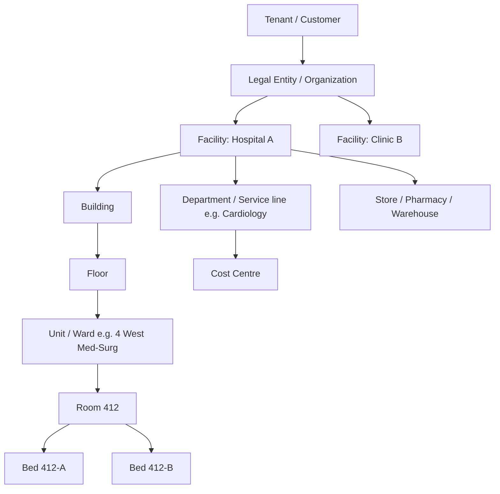
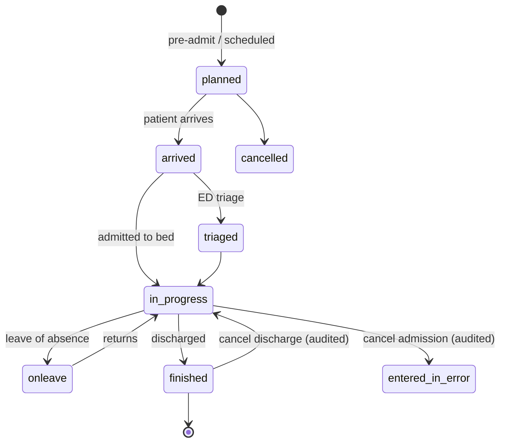
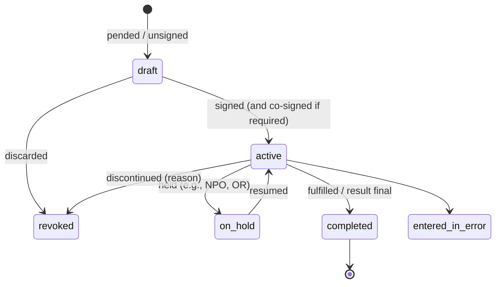

# 11 — Canonical Domain Model for a Top-Tier HMS

> Track: core data/domain model (design specification, not code).
> Basis: HL7 FHIR R4 (4.0.1, the most widely deployed release) with notes where R5 (5.0.0, published 26 Mar 2023 and still the "current published version" [1]) differs, plus notes where the **R6 ballot** (6.0.0-ballot5, labelled "2nd Full Ballot", generated 17 Jul 2026; CI build 6.0.0-snapshot1, 15 Oct 2026 [2][3]) moves or changes resources this model relies on. Also HL7 v2.x event semantics, openEHR modelling principles, and patterns used by mature hospital systems. Sources are listed at the end; claims added or checked in verification pass 2 carry bracketed source numbers.
> Status date: 2026-10-16. Companion documents: `03-clinical-modules-and-workflows.md`, `05-revenue-cycle-erp-operations.md`, `06-interoperability-standards.md`, `08-architecture-and-technology.md`.

---

## 0. Executive summary

- **The model is patient-centric, encounter-anchored and order-driven.** Almost every clinical and financial fact hangs off a *Patient*, happens inside an *Encounter* (or *EpisodeOfCare*), and most work is triggered by an *Order* (request) and closed by an *Event* (result, administration, procedure, charge).
- **Use FHIR as the *vocabulary* of the domain, not necessarily as the storage schema.** FHIR resources give us internationally recognised names, cardinalities, and value sets; our internal aggregates can be richer (e.g., an "Order" aggregate holding request + tasks + status history) and are projected to FHIR at the API edge.
- **Every clinical fact must answer:** who (subject, performer, author), what (coded + original text), when (*clinically effective* time vs *recorded* time), where (location/organisation), why (reason/indication), how sure (status/verification), and from where (provenance). This is non-negotiable for medico-legal defensibility.
- **Never destroy clinical data.** Corrections create a new version with a reason; erroneous records become `entered-in-error`; patient merges are reversible links, not deletes. Persist full version history (bi-temporal: valid-time + transaction-time).
- **Identifiers are lists, not fields.** Patients, practitioners, organisations, orders, specimens, and accounts carry multiple identifiers, each qualified by a namespace (`system`) and type (MRN, national ID, insurance member ID, accession number, placer/filler order number).
- **Codes are lists too.** A `CodeableConcept` carries the local code + standard codes (SNOMED CT, LOINC, ICD-10/11, RxNorm/ATC/dm+d) + original text. Never force a clinician's words into a code without keeping the words.
- **The enterprise hierarchy is first-class**: Tenant → Legal entity → Facility → Building → Floor → Unit/Ward → Room → Bed, plus Departments/Service lines and Cost centres. Nearly every configuration and security rule is scoped to some node of this tree.
- **State machines are the backbone of safety.** Encounter, Order, Medication administration, Specimen, Bed, Appointment, Claim each have an explicit, audited lifecycle; illegal transitions are rejected by the domain layer, not the UI.
- **Domain events (internal) map 1:1 to interoperability triggers (external).** `PatientAdmitted` ⇄ HL7 v2 ADT^A01 ⇄ FHIR Encounter status change + Subscription notification. Designing the event catalogue early makes integration cheap later.
- **Finance is a projection of clinical activity**, not a separate universe: charges are generated from signed orders, completed procedures, administered drugs, bed-days and supplies used, then rolled into Accounts → Invoices/Claims.
- **FHIR R6 makes this design mandatory, not optional.** The R6 ballot moves 33 immature resources out of core into "incubator" IGs, including `ChargeItem`, `ChargeItemDefinition`, `Invoice`, `InventoryItem`, `InventoryReport`, `SupplyRequest`, `SupplyDelivery`, `DeviceUsage` and `EncounterHistory` [2][3]. `ClinicalImpression` and `MedicationKnowledge` are also missing from the R6 core build [3][17]. Model these concepts internally and project them to FHIR only at the edge (see §11 and §12).
- **Cross-report note (reconciled 2026-10-16): storage posture.** `02` originally recommended a FHIR-R4-native core (self-hosted Medplum or HAPI FHIR JPA, "never translate at the core"). The pack's ADR-001 posture now follows this document, `06` §7.1 and `08` §3.11/§4.6:
  - domain aggregates and state machines in PostgreSQL, one database per tenant;
  - clinical facts stored as typed, FHIR-shaped JSONB;
  - a generated FHIR R4 projection/façade for reads, `$export`, IPS and Subscriptions, with writes through domain commands;
  - HAPI structures, validator and v2 libraries embedded.

  Medplum is a reference design and an optional component source, not the system of record. A 6–8 week load and safety spike comparing the two options on a 1,000-bed workload (`02` §10.1) gates the final ADR. `09` and `10` now say "FHIR-first external/partner API".

---

## 1. Modelling principles (the "constitution")

| # | Principle | Why it matters | Concrete rule |
|---|---|---|---|
| P1 | **Patient-centric, encounter-anchored** | Billing, legal record, and clinical context all depend on "which visit?" | Every clinical record has `subject` (Patient) and, where applicable, `encounter`. Records outside an encounter (e.g., problem list, allergies, home meds) are *patient-level*. |
| P2 | **Separate clinical time from system time** | Late documentation, downtime back-entry and corrections are routine | Store `effective[x]` (when it was true/happened), `recorded`/`authored` (when entered), and the DB transaction time. Display effective time; audit both. |
| P3 | **Immutable history** | Medico-legal record; investigations; reproducibility of CDS decisions | Updates create versions. `entered-in-error` replaces deletes. Merges are links. Keep the "as-was" view reconstructible at any point in time. |
| P4 | **Status is explicit** | Distinguish draft vs final vs amended vs cancelled | Every record type has an enumerated status with an allowed-transition table (see §10). |
| P5 | **Coded + text** | Analytics/CDS need codes; clinicians need nuance | `CodeableConcept` = {local code, standard code(s), display, original text}. Bind to value sets per field. |
| P6 | **Units are coded** | Dose and lab errors kill patients | All quantities carry UCUM units; dosing weight is explicit and versioned; unit conversion only via a terminology service. |
| P7 | **Identifiers qualified by namespace** | Multi-facility, multi-country, interfaces | `Identifier = {system, value, type, period, assigner}`. Uniqueness enforced per `system`. |
| P8 | **Provenance everywhere** | Data arrives from devices, interfaces, AI, patients | Each record has `source` (user/device/interface/AI model/patient) and an optional `Provenance` record (who, on behalf of, signature, agent software version). AI-generated content is labelled as such until a human verifies it. |
| P9 | **Scoped configuration** | One codebase, many hospitals/countries | Configuration objects (order sets, forms, price lists, rules) are versioned, scoped to a node of the enterprise tree, inherited downward, and promoted through environments. |
| P10 | **Time zones and calendars** | Multi-country, DST, Hijri/Thai calendars | Store instants in UTC with facility time zone; store dates-of-birth as dates (no time zone); render in local calendar. |
| P11 | **Patient safety invariants live in the domain layer** | UI can be bypassed by APIs, interfaces, mobile | E.g., "no administration without an active, verified order unless override reason recorded" is enforced server-side for all channels. |
| P12 | **Privacy labels on data** | Sensitive data segmentation (HIV, mental health, reproductive, substance use, VIP, employee-patients) | Records carry `meta.security` labels; access decisions combine role, care relationship, labels, consent. |

---

## 2. Enterprise structure (tenancy & locations)

| Entity | FHIR R4 | Key attributes | Notes |
|---|---|---|---|
| Tenant | (none; platform concept) | data-residency region, deployment, licensing, locale pack | Hard isolation boundary for data and keys. |
| Organization | `Organization` | identifiers (tax ID, license no., national facility registry ID e.g. India HFR), type (prov, dept, ins, pay), partOf | Used for legal entities, departments, payers, referring orgs. |
| Facility / Unit / Room / Bed | `Location` (physicalType: si/bu/lvl/wa/ro/bd; the code system also has wi wing, co corridor, ca cabinet, area etc. [23]), `partOf` | operational status (bed: **C**losed/**H**ousekeeping/**O**ccupied/**U**noccupied/**K** Contaminated/**I**solated per HL7 v2 table 0116; I and K were added in v2.2 [5]), gender restriction, isolation capability, telemetry capable, level of care, cost centre | Bed status is a separate state machine (see §10.6). In R4, `Location.operationalStatus` is a `Coding` with a *preferred* binding to v2-0116, and `Location.status` (active/suspended/inactive) is general availability only, not bed state [4]. |
| Healthcare service | `HealthcareService` | specialty, available times, referral method, eligibility | Drives scheduling and referral routing. |
| Department / service line | `Organization` (type=dept) | specialty, head, cost centre | |
| Cost centre / GL segment | (ERP, not FHIR) | GL code, budget owner | Mapped from Location/Department for charge & cost allocation. |
| Store / inventory location | `Location` (+ ERP) | store type (central, pharmacy, ward stock, OR), par levels | |

**Design rule:** keep *physical* (Location) and *organisational* (Organization/Department) hierarchies separate but cross-referenced; a ward belongs physically to a building but organisationally to a department and financially to a cost centre.

---

## 3. People, roles and accounts

| Entity | FHIR R4 | Key attributes | Notes |
|---|---|---|---|
| Patient | `Patient` | identifiers (MRN per facility, enterprise ID, national ID, passport), names (multiple, with use: official/usual/maiden/alias; multiple scripts e.g. Arabic + Latin), gender + sex-for-clinical-use (extension `patient-sexParameterForClinicalUse` from the HL7 Extensions Pack; based on R5 but also listed for R4/R4B; draft, FMM 1 [6]) + gender identity, birthDate (+ estimated flag), deceased, addresses, telecom, language + interpreter needed, marital status, religion/ethnicity where lawful, photo, links (replaced-by/replaces/seealso) | Newborns, unknown/unidentified ("Trauma Alpha"), and John/Jane Doe need special registration flows. |
| Related person | `RelatedPerson` | relationship (NOK, guardian, proxy, guarantor, emergency contact), contact, legal authority | Proxy access for portal; guarantor for billing. |
| Person (identity link) | `Person` | links to Patient/Practitioner/RelatedPerson records of the same human | Employee-patients; staff also being patients triggers privacy rules. |
| Practitioner | `Practitioner` | identifiers (license/registration no., national provider ID e.g. NPI/HPR), qualifications, languages | Separate from user account. |
| Practitioner role | `PractitionerRole` | organisation, locations, specialty, *clinical privileges*, availability, endpoints | A doctor can hold several roles across facilities. |
| Care team | `CareTeam` | patient-specific team members and roles | Basis of "care relationship" access control and notifications. |
| User account | (IAM) | login, MFA, roles/permissions, security group, linked Practitioner/Employee | Never conflate user with practitioner (locums, students, scribes, interfaces). |
| Employee | (HR) | position, grade, department, contract, credentials, competencies | Feeds rostering and credentialing. |

### 3.1 Patient identity (EMPI) sub-model
- **Identifier assignment**: MRN generated per facility or enterprise (configurable); enterprise person ID always present.
- **Match candidates**: `{patientA, patientB, score, algorithm/version, status: possible|confirmed-same|confirmed-different, reviewer}`.
- **Merge** = survivor + `replaced-by` link + re-pointing of active references **as a logged, reversible operation** (unmerge must restore). Emit `PatientMerged` (⇄ HL7 ADT^A40) and `PatientUnmerged`.
- **Newborn linkage**: mother–baby link (`RelatedPerson`/`Patient.link`, plus encounter linkage) for mother–baby couplet care and billing.
- **Unknown patient**: temporary identity with a later merge to real identity.

---

## 4. Patient access: scheduling, referrals, queues

| Entity | FHIR R4 | Key attributes |
|---|---|---|
| Schedule | `Schedule` | actor(s): practitioner/room/device/team, planning horizon, service types |
| Slot | `Slot` | start/end, status (busy/free/busy-unavailable/busy-tentative/entered-in-error [13]), overbook flag, visit type |
| Appointment | `Appointment` | status (proposed → pending → booked → arrived → fulfilled; cancelled; noshow; checked-in; waitlist; entered-in-error — the 10 R4 codes [13]), participants (patient, practitioner, location, equipment), service type, reason, priority, linked referral (`basedOn` ServiceRequest), cancellation reason |
| Appointment response | `AppointmentResponse` | participant accept/decline |
| Referral | `ServiceRequest` (category = referral) | from/to, urgency, reason, attachments, authorisation status |
| Waitlist entry | `Appointment` (status=waitlist) or custom aggregate | constraints (provider, time windows), priority, auto-offer rules |
| Queue token (OPD) | custom aggregate (+ `Encounter`/`Appointment` link) | token number, service point, status (waiting/called/in-service/done/skipped), call count, estimated wait |
| Surgical case request | `ServiceRequest` + `Appointment` | procedure(s), surgeon, anaesthesia type, duration estimate, equipment, implants, pre-op requirements |

---

## 5. Encounters, episodes and the ADT timeline

| Entity | FHIR R4 | Key attributes |
|---|---|---|
| Episode of care | `EpisodeOfCare` | condition focus (pregnancy, oncology regimen, dialysis programme), managing org, care manager, period |
| Encounter | `Encounter` | **class** (AMB ambulatory, EMER emergency, IMP inpatient, OBSENC observation, SS short stay, HH home health, VR virtual), **type** (visit type), **status** (R4: planned/arrived/triaged/in-progress/onleave/finished/cancelled/entered-in-error/unknown [7]; R5 simplifies to planned/in-progress/on-hold/discharged/completed/cancelled/discontinued/entered-in-error/unknown [8], and R6 keeps the R5 set [9]), statusHistory, classHistory (e.g., ED → inpatient; R4 only, see R5/R6 deltas below), participants with roles (attending, admitter, referrer, consultant), period, reasonCode, diagnosis (with role: admission/billing/discharge + rank), **hospitalization** (admit source, re-admission flag, diet/special arrangements, discharge disposition, destination), **location history** (location + status + period — this *is* the bed-occupancy timeline), serviceProvider, account(s), partOf (sub-encounters e.g. OR visit within an admission) |
| ADT event log | (event store) | event type (admit, transfer, discharge, leave of absence, cancel-admit, pending admit, swap beds, update), effective time, recorded time, user, reason — maps to HL7 v2 A01–A62 |
| Triage record | `Observation`(s) + `Encounter.priority` | acuity scale (ESI 1–5, Manchester, CTAS, ATS), chief complaint (coded), vitals, triage nurse, time |
| Leave / pass | Encounter status `onleave` (R4) + location period; R5/R6: status `on-hold` + `subjectStatus` = `on-leave` [8] | |

**R5/R6 deltas for Encounter (mapping changes, not internal schema changes)** [7][8][9][10]:
- **class**: R4 = one `Coding` (1..1, extensible binding to v3 ActEncounterCode: AMB, EMER, FLD, HH, IMP, ACUTE, NONAC, OBSENC, PRENC, SS, VR). R5/R6 = `CodeableConcept` 0..* (preferred binding), so an encounter can carry several classes.
- **statusHistory / classHistory** were removed in R5. The new `EncounterHistory` resource replaces them. R6 then moves `EncounterHistory` out of core into the patient-administration incubator [2][9]. Keep the status/class/location history in our own event store and project it to whichever FHIR shape the target version supports.
- **hospitalization → admission** (R5/R6). The R6 `admission` backbone holds only preAdmissionIdentifier, origin, admitSource, reAdmission, destination and dischargeDisposition [9]. `dietPreference`, `specialCourtesy` and `specialArrangement` sat under `hospitalization` in R4 [7] and are no longer under it.
- **arrived / triaged / onleave** are no longer `status` values in R5/R6. They move to the new `subjectStatus` element (arrived, triaged, receiving-care, on-leave, departed). `finished` splits into `discharged` (clinically complete, administrative work pending) and `completed`.
- **reasonCode/reasonReference** become `reason` (use + `CodeableReference` value). `diagnosis` becomes condition + use, and the R4 `rank` element is gone. Keep rank and principal/secondary sequencing internally because DRG grouping needs it.
- R6 marks Encounter **normative**, so the R5-style status set is the long-term target [9].

**Key rule:** *the encounter's location history is the single source of truth for bed occupancy, census, patient-days, and bed-day charging.* Census reports, bed boards, isolation tracking and room-charge generation must all derive from it — never from separate tables that can drift.

---

## 6. The clinical record

| Concept | FHIR R4 | Notes / key attributes |
|---|---|---|
| Problem list item | `Condition` (category=problem-list-item) | clinicalStatus (active/recurrence/relapse/inactive/remission/resolved; recurrence/relapse are children of active, remission/resolved children of inactive), verificationStatus (unconfirmed/provisional/differential/confirmed/refuted/entered-in-error) [13], onset/abatement, severity, body site, SNOMED CT + ICD mapping |
| Encounter diagnosis | `Condition` (category=encounter-diagnosis) + `Encounter.diagnosis` (role, rank) | Principal vs secondary; POA (present-on-admission) indicator in US; drives DRG grouping |
| Allergy / intolerance | `AllergyIntolerance` | type (allergy/intolerance), category (food/medication/environment/biologic), criticality, code (substance or class), reactions (manifestation, severity), verification. **"No known allergies" is an explicit assertion, distinct from "not yet assessed".** |
| Vital signs / measurements | `Observation` (category=vital-signs) | LOINC codes, UCUM units, method, device, body position, *validated-by-nurse* flag for device-captured values |
| Flowsheet row | `Observation` (+ template definition) | Flowsheet = configurable grid of Observation definitions (`ObservationDefinition`) grouped by template |
| Assessment / score | `Observation` or `RiskAssessment` | NEWS2, Braden, Morse, GCS, pain scores — store components + total + calculation version |
| Structured form | `Questionnaire` / `QuestionnaireResponse` | Admission assessments, checklists (WHO Surgical Safety Checklist), consents with structured fields |
| Clinical note | `Composition` (sections) + `DocumentReference` | note type (LOINC document ontology), author(s), status (R4: preliminary/final/amended/entered-in-error [13]), attestation/co-signature, addenda, sharing restrictions, *source attribution* (typed, dictated, ambient-AI-drafted, copied-forward segments) |
| Procedure | `Procedure` | code (SNOMED/ICD-10-PCS/CPT/OPCS-4/local), performer(s) with role, period, body site, outcome, complications, implants (`focalDevice`), linked report |
| Care plan / goals | `CarePlan`, `Goal`, `CareTeam` | nursing care plans, interdisciplinary plans, discharge goals |
| Clinical impression | `ClinicalImpression` | assessment summary, differential. **Version note:** R5 FMM 1 [12]. ClinicalImpression is not in the R6 core build. The R6 ballot lists its R6-cycle successor, `ClinicalAssessment`, among resources moved to incubator IGs [2][3][17]. Store assessments as notes (Composition) + Conditions internally and treat this resource as optional. |
| Family history | `FamilyMemberHistory` | |
| Immunisation | `Immunization` | vaccine code (CVX/SNOMED), lot, site, route, dose number, VIS/consent, reporting to registry |
| Flags / banners | `Flag` | fall risk, isolation (contact/droplet/airborne), DNR/code status, violence risk, MRSA/CRE carrier, VIP, interpreter needed |
| Advance directive / code status | `Consent` (R4 scope=adr; R4 scope codes are adr/research/patient-privacy/treatment [13]) + `Observation`/`Flag` for code status | Must be visible in banner; time-stamped; reviewable. R5 deletes `Consent.scope` (merged into `category`), and R5 says advance directives are still being worked on, with only privacy fully modelled [14]. Keep our own advance-directive / code-status model. |
| Consent (treatment, research, data sharing) | `Consent` | scope (R4 only), category, policy (R5: `policyBasis`), provisions (actors, purpose, data classes, period), signature/witness, source document. R5 also renames patient→subject and performer→grantee, and adds grantor/manager/controller [14]. |
| Media / clinical photos | `Media` (R4) / `DocumentReference` or `Observation` (R5: Media removed [11]) | body site, consent, de-identification |

### 6.1 Notes: the legal record problem
- Notes are **composite documents**: typed text + inserted data (vitals, labs, meds) + templates + signatures. Inserted data must be stored either as a *snapshot* (what the author saw) or as references with as-of time; the signed rendering must be reproducible exactly (store a rendered, hashed copy at signature).
- **Amendment** = new version, reason, and visible "amended" marker; **addendum** = new linked note; **retraction** = `entered-in-error` with reason; original remains accessible to authorised reviewers.
- Track **copy-forward provenance** at segment level to fight note bloat and support audits.

---

## 7. Orders (requests) and fulfilment

### 7.1 Request types

| Order kind | FHIR R4 resource | Fulfilment events |
|---|---|---|
| Lab test / panel | `ServiceRequest` (category=laboratory) | `Specimen` → `Observation` + `DiagnosticReport` |
| Imaging | `ServiceRequest` (category=imaging) | `ImagingStudy` + `DiagnosticReport` |
| Procedure / nursing / therapy | `ServiceRequest` | `Procedure`, `Observation`, `Task` |
| Consult / referral | `ServiceRequest` (category=consult/referral) | `Encounter` + note |
| Medication | `MedicationRequest` | `MedicationDispense` → `MedicationAdministration` |
| Diet / nutrition | `NutritionOrder` | tray tickets, intake |
| Device / equipment | `DeviceRequest` | `DeviceUseStatement` (R4) → `DeviceUsage` (R5 rename [11]; moved out of core to an incubator in R6 [2]), supply |
| Blood product | `ServiceRequest` (transfusion) + product request | `BiologicallyDerivedProduct`, crossmatch result, transfusion administration record |
| Admission / transfer / discharge order | `ServiceRequest` (category=ADT) | ADT events on `Encounter` |
| Order set / protocol | definition: `PlanDefinition` + `ActivityDefinition`; instance: `RequestGroup` (R4) → `RequestOrchestration` (R5 rename, FMM 4 [11][12]; still in the R6 core build [3]) | Generates multiple linked requests sharing a `groupIdentifier` |

### 7.2 Common order attributes
`identifier` (placer order number, filler order number / accession number), `basedOn`/`replaces` (for modifications), `groupIdentifier` (requisition/order set instance), `status` (draft/active/on-hold/revoked/completed/entered-in-error/unknown [13]), `intent` (proposal/plan/directive/order/original-order/reflex-order/filler-order/instance-order/option [13]), `priority` (routine/urgent/asap/stat), `code`, `orderDetail`, `quantity`, `occurrence` (incl. `Timing` for recurring), `asNeeded`, `requester` (+ on-behalf-of for verbal/telephone orders with read-back flag and co-sign due-by), `performerType/performer`, `locationCode`, `reasonCode/reasonReference` (indication — required for many meds and imaging appropriateness), `insurance` (coverage for this order), `supportingInfo`, `specimen`, `bodySite`, `note`, `patientInstruction`, `relevantHistory` (status history via `Provenance`).

*R5 mapping note* [15]: R5 merges `reasonCode`/`reasonReference` into `reason` (`CodeableReference`) and `locationCode`/`locationReference` into `location` (`CodeableReference`). It also restructures `orderDetail` into `parameterFocus` + `parameter` (code + value[x]) and adds `focus`. `asNeeded[x]` (boolean or CodeableConcept) is unchanged. These are projection changes only; the internal order aggregate does not change.

### 7.3 Fulfilment as tasks
Use `Task` to represent each actionable step (collect specimen, verify medication order, schedule imaging, perform nursing intervention). Worklists (pharmacy verification queue, phlebotomy collection list, nursing task list, radiology protocol queue) are *read models* over open Tasks filtered by role, location and due time.

---

## 8. Diagnostics (lab, pathology, imaging, blood bank)

| Concept | FHIR R4 | Key attributes |
|---|---|---|
| Specimen | `Specimen` | accession identifier, barcode, type (SNOMED), container, collection (collector, time, method, body site, fasting status), received time, condition (hemolysed, clotted), parent specimen (aliquots), processing steps, status (available/unavailable/unsatisfactory/entered-in-error [13]; the FHIR status describes the specimen, not its logistics. The collected/in-transit/received workflow in §10.4 is internal) |
| Result | `Observation` | LOINC code, value[x] with UCUM unit, reference range (age/sex-specific, versioned), interpretation (H/L/HH/LL/A/AA, critical), method, device/analyser, performer, status (registered/preliminary/final/amended/corrected/cancelled/entered-in-error/unknown; `corrected` is a child of `amended` [13]), `derivedFrom`, `hasMember` (panels; R6 adds an `organizer` element for panels, out for ballot comment [3]) |
| Report | `DiagnosticReport` | code (panel/report type), status, results, conclusion (+ coded), presentedForm (PDF), performer, resultsInterpreter, imagingStudy, effective & issued times |
| Microbiology | `Observation` tree: culture → isolate/organism → susceptibility panel (antibiotic + MIC/zone + S/I/R interpretation) | Supports cumulative antibiograms and stewardship |
| Critical result communication | `Communication` + `Task` | who was notified, when, read-back, escalation chain — an accreditation requirement |
| Imaging study | `ImagingStudy` | Study Instance UID, accession, modality, series/instances count, endpoint (DICOMweb/WADO), started, procedure code |
| Pathology case | `DiagnosticReport` + `Specimen` hierarchy (part → block → slide) | synoptic report fields (CAP/ICCR), digital slide references |
| Blood component | `BiologicallyDerivedProduct` | ISBT 128 donation ID + product code, ABO/Rh, expiry, status, location. Still in the R6 core build. The R5-new `BiologicallyDerivedProductDispense` moves to an incubator in R6 [2][3], so model blood issue/dispense internally. |
| Transfusion | `Procedure` or `MedicationAdministration`-like record | two-person verification, start/stop vitals, reactions (haemovigilance) |

---

## 9. Medications (closed-loop)

| Concept | FHIR R4 | Key attributes |
|---|---|---|
| Medication product | `Medication` (+ formulary item) | code (RxNorm/dm+d/ATC/GTIN/NDC/local), form, ingredients with strength (numerator/denominator with UCUM), manufacturer, batch (lot, expiry), high-alert flag, look-alike/sound-alike (LASA) flag, controlled-substance schedule |
| Formulary item | custom + `MedicationKnowledge` | formulary status, restrictions (e.g., ID-approval antibiotics), default dosing, preferred dispensing forms, cost, stock locations. **Version note:** `MedicationKnowledge` is FMM 1 in R5, which also adds `FormularyItem` (FMM 0) [12]. Neither is in the R6 core: R6 moves `FormularyItem` to an incubator [2], and `MedicationKnowledge` is absent from the R6 build [3][17]. The formulary must be an internal aggregate. |
| Prescription / medication order | `MedicationRequest` | `dosageInstruction` (Timing, route, site, method, dose & rate — ranges for titration), `asNeeded` + indication, max dose per period, duration, dispense request, substitution allowed, *verification status by pharmacist*, reason, dosing weight & height used, renal function used, indication |
| Pharmacist verification | `Task` + `Provenance` / status extension | verifier, time, interventions, clinical notes |
| Dispense | `MedicationDispense` | quantity, days supply, lot/expiry, dispensing location (central/ADC/ward stock), prepared-by/checked-by, compounding details (IV, TPN, chemo) |
| Administration (eMAR) | `MedicationAdministration` | status (in-progress/not-done/on-hold/completed/entered-in-error/stopped/unknown [13]), statusReason (held, refused, NPO, patient off unit), effective time, actual dose & rate, route/site, performer, **barcode scan evidence** (patient wristband + product scanned or override reason), witness (high-alert/controlled), pump association, linked request |
| Home / outside meds | `MedicationStatement` | source (patient, pharmacy claims, outside record), adherence. **Version note:** R5 keeps the name `MedicationStatement` (FMM 4) [12]; a ballot-era rename to "MedicationUsage" did not survive into R5 final [K]. R6 keeps it in core but heavily reorganises dosage, which affects MedicationRequest, MedicationDispense, MedicationStatement, Dosage and Timing. R6 also adds explicit support for "no medications known" [3]. Keep the internal dose model independent of the FHIR `Dosage` datatype. |
| Medication reconciliation | custom aggregate (+ `List`) | per transition (admission/transfer/discharge): each med → continue/modify/hold/stop/new with reason, reconciled-by, time |

**Safety invariants (server-enforced):**
1. An administration links to an active order (or documented override/emergency reason).
2. Patient identity is confirmed with ≥2 identifiers (wristband barcode = MRN + name/DOB).
3. Product scanned matches ordered product/dose within tolerance, otherwise a hard stop or a soft stop with a documented reason, depending on policy.
4. High-alert medications require independent double-check where policy says so.
5. Dose-range, allergy, interaction and duplicate checks happen at order time and are re-checked at verification and administration.

---

## 10. Core state machines

### 10.1 Encounter (inpatient example, R4 terms)

*R5/R6 projection of the same internal states* [8][9]: planned → `planned`. arrived / triaged → `in-progress` (or `planned`, by local convention) with `subjectStatus` = arrived / triaged. in_progress → `in-progress` (subjectStatus receiving-care). onleave → `on-hold` + subjectStatus on-leave. finished → `discharged` (patient left, coding and charging still open), then `completed` once administratively closed. A started-but-abandoned visit → `discontinued`. The internal machine should keep the richer R4-style states *plus* a "discharged-not-closed" sub-state, so both versions can be projected without loss. R5 does not define how to map arrived/triaged onto `status`, so the line above is our convention, not an HL7 rule.

### 10.2 Order (service request)

Medication orders add a *pending verification → verified* sub-state before dispensing (unless override for emergency/first dose).

### 10.3 Medication administration (per scheduled dose)
`scheduled (due)` → `in-progress` (infusion started) → `completed` | `not-done` (held/refused/missed with reason) | `stopped` | `entered-in-error`. Late doses flagged by configurable windows (e.g., ±30/60 min; time-critical meds tighter).

### 10.4 Specimen
`ordered` → `label printed` → `collected` (collector, time, scanned wristband) → `in transit` → `received` (lab) → `in process` → `resulted` → `stored`/`disposed`; branches: `rejected` (reason: unlabelled, haemolysed, insufficient) → recollect task generated.

### 10.5 Result
`registered` → `preliminary` → `final` → (`amended` | `corrected`) ; `cancelled` ; `entered-in-error`. Every correction notifies the ordering clinician and anyone who acknowledged the earlier version.

### 10.6 Bed
`available (clean)` → `reserved/assigned` → `occupied` → `dirty (patient left)` → `cleaning in progress` → `available`; side branches `blocked` (isolation/maintenance/staffing, with reason) and `closed`.
*Projection to HL7 v2 table 0116 / FHIR `Location.operationalStatus`* [4][5]: available → **U** Unoccupied. reserved/assigned → **U**, plus the pending-admit/transfer event (0116 has no "reserved" code). occupied → **O**. dirty and cleaning-in-progress → **H** Housekeeping. blocked for isolation → **I** Isolated. blocked for contamination → **K** Contaminated. closed, and blocked for maintenance or staffing → **C** Closed. 0116 is coarser than the internal machine, so the internal state plus reason is authoritative. Each change emits ADT^A20 [16].

### 10.7 Appointment
`proposed` → `pending` → `booked` → `checked-in`/`arrived` → `fulfilled`; `cancelled` (by whom, why, late-cancel flag), `noshow`, `waitlist`.

### 10.8 Claim (generic)
`draft` → `scrubbed/edits passed` → `submitted` → `acknowledged` → `adjudicated` (paid/partially paid/denied) → `appealed`/`resubmitted` → `closed`; pre-authorisation follows a parallel `requested → approved/partially approved/denied/pended` lifecycle.

---

## 11. Finance (revenue cycle) model

| Concept | FHIR R4 | Key attributes |
|---|---|---|
| Coverage | `Coverage` | payer, plan/product, member/subscriber ID, relationship, priority/order (primary/secondary), period, network, co-pay/deductible info, authorisation requirements |
| Eligibility check | `CoverageEligibilityRequest/Response` | ⇄ X12 270/271 (US), NPHIES eligibility (Saudi), NHCX (India) |
| Pre-authorisation | `Claim` (use=preauthorization) + `ClaimResponse` | ⇄ X12 278, Da Vinci PAS (US), NPHIES prior auth, PM-JAY pre-auth |
| Account (patient/guarantor account) | `Account` | guarantor(s), coverages, encounter(s) linked, balance, status, type (inpatient, outpatient, package, corporate) |
| Price list / tariff | `ChargeItemDefinition` (+ payer contract rules) — *R5 FMM 1; moved out of R6 core* [2][12] | price by payer/plan/class (e.g., ward class: general/semi-private/private), effective periods, package definitions, discounts |
| Charge | `ChargeItem` — *R5 FMM 1; moved out of R6 core* [2][12] | code (CDM item; maps to CPT/HCPCS/revenue code/national code), quantity, unit price, performing & ordering department, service date, source event (order/procedure/administration/bed-day/supply), override reason, status (planned/billable/not-billable/aborted/billed/entered-in-error/unknown [13]) |
| Invoice / bill | `Invoice` — *R5 FMM 0; moved out of R6 core* [2][12] | line items, taxes (VAT/GST), discounts, payer splits, status (draft/issued/balanced/cancelled/entered-in-error [13]) |
| Claim | `Claim` (use=claim) | type (institutional/professional/pharmacy), diagnoses (sequenced, POA), procedures, DRG/case-mix group, items, attachments ⇄ X12 837I/837P, NPHIES Claim bundle, national formats |
| Remittance / payment | `ClaimResponse`, `PaymentReconciliation`, `PaymentNotice` | ⇄ X12 835; allocations to lines; adjustments (CARC/RARC codes in US) |
| Patient payment / deposit / refund | custom ledger + `PaymentReconciliation` | method (cash, card, UPI, mobile money, bank transfer), receipt no., cashier session |
| Adjustments / write-offs | ledger transactions | reason, approver, policy |
| Case-mix grouping | custom (grouper output) | DRG/HRG/AR-DRG/G-DRG code, version, weight, LOS trim points, outlier status |

**Design rules:**
- Charges are *generated from clinical events* by a rules engine (charge router) with full traceability back to the source event, plus manual charge entry for exceptions.
- **Single patient account view**: hospital and professional charges, deposits, payer and patient responsibility in one ledger.
- Country differences live in **adapters** (claim formats, grouping, tax) and **configuration** (tariffs, contracts), not forks of the core model.

**FHIR R6 note: model billing internally and project to FHIR only at the edge** (verified 2026-10-16 [2][3][18]):
- Both the R6 ballot (6.0.0-ballot5, 17 Jul 2026) and the current CI build (6.0.0-snapshot1, 15 Oct 2026) list **`ChargeItem`, `ChargeItemDefinition` and `Invoice`** among the 33 resources moved out of the core specification into incubator IGs. The list also includes `Contract`, `InsurancePlan`, `InsuranceProduct`, `EnrollmentRequest` and `EnrollmentResponse` [2][3]. `ChargeItem` has no page in the R6 CI build [3]. The `ChargeItemDefinition.$apply` operation is also moved out [3].
- The payer-exchange resources **stay in R6 core**: `Account`, `Claim`, `ClaimResponse`, `Coverage`, `CoverageEligibilityRequest/Response`, `ExplanationOfBenefit`, `PaymentNotice` and `PaymentReconciliation` [3]. `Account` and `Claim` are marked **Normative** in the CI build [18]. The R6 Claim still lists substantive changes since the previous ballot, for example `diagnosis.diagnosis` and `procedure.procedure` become `CodeableReference` and `prescription` becomes `request` [18].
- **Recommendation.** The charge master, price lists/tariffs, packages, charges, invoices, deposits, the patient/guarantor ledger and adjustments are **internal aggregates** with their own lifecycle (the rows above give the R4 vocabulary as naming guidance only). Project them at the edge to (a) national claim IGs such as NPHIES (FHIR R4 [22]), NHCX, Da Vinci PAS, or X12 837/835 for payer exchange, and (b) R4 `ChargeItem`/`Invoice` or the R6 incubator equivalents only when a partner or national IG actually requires them. Do not persist FHIR `ChargeItem`/`Invoice` JSON as the system of record. This matches `06-interoperability-standards.md`, which flags the same R6 move. *(Reconciled 2026-10-16: `05` §3.8, §7 and §9.2 and `02` §9 now follow this rule. FHIR finance names are naming guidance and edge projection only, and the external financial API uses only the R6-core payer resources listed above plus national IGs.)*

---

## 12. Supply chain, assets and workforce (ERP-adjacent)

| Concept | FHIR / standard | Key attributes |
|---|---|---|
| Item master | (ERP; R5 `InventoryItem`, FMM 0 [12]; moved out of R6 core to an incubator [2]) | item code, GS1 GTIN, UDI-DI for devices, UoM conversions (box→each), category, chargeable flag + CDM link, implant flag, lot/serial tracking, storage conditions |
| Stock / lot | ERP + `InventoryReport` (R5, FMM 0 [12]; moved out of R6 core [2]) | store, bin, lot, serial, expiry (FEFO), quantity, consignment flag |
| Requisition / transfer | `SupplyRequest` / `SupplyDelivery` (R5 FMM 1 [12]; both moved out of R6 core [2]) | from/to store, items, approval |
| Purchase order / goods receipt / vendor invoice | ERP | 3-way match |
| Implant / device instance | `Device` | UDI (DI + PI), lot/serial, expiry, implanted-in (Procedure.focalDevice), recall status |
| Biomedical asset | `Device` + CMMS | asset tag, location, maintenance schedule, calibration, service history, connectivity (for MDI) |
| Shift / roster | (Workforce) | unit, role, skill mix, hours, ratios, acuity-based requirement |
| Credential / privilege | (Workforce/Medical staff office) | licence number + expiry, board certification, privileges per procedure, competency (`VerificationResult`, which is sometimes used for credential verification, also moves out of R6 core [2]) |

**Version note:** every FHIR supply-chain resource this section names (`InventoryItem`, `InventoryReport`, `SupplyRequest`, `SupplyDelivery`, plus `Transport` and `DeviceDispense`) is in an R6 incubator, not R6 core [2][3]. Of the device/supply family, only `Device`, `DeviceDefinition`, `DeviceRequest`, `DeviceMetric`, `DeviceAssociation` and the new `DeviceAlert` remain in core [3]. The item master, stock ledger and requisitions must therefore be internal ERP aggregates, with FHIR projections being optional.

**Cross-report note (reconciled 2026-10-16): ERP scope.** The pack's native-vs-integrate split is `05` §9.1:
- **Native:** item master, stock, requisitions, point-of-use, pharmacy stores, CMMS/biomedical assets, acuity data and basic rostering, plus lite procurement and GL for emerging-market tenants.
- **Integrate:** payroll/HCM, enterprise GL and full procure-to-pay where the customer runs an ERP.

The shift/roster and credential rows above are therefore native for basic rostering and privileging enforcement. Payroll and HR master data come from the integrated HCM where one exists.

---

## 13. Cross-cutting records

| Concept | FHIR R4 | Notes |
|---|---|---|
| Audit event | `AuditEvent` | every read/write/print/export/break-the-glass; IHE ATNA/BALP compatible; tamper-evident store |
| Provenance | `Provenance` | authorship, signatures, transformations, AI agent identity + model version |
| Communication | `Communication`, `CommunicationRequest` | secure messages, patient messages, critical-result calls, notifications |
| Task | `Task` | universal work item for worklists and inboxes |
| List | `List` | worklists, reconciliation snapshots, "my patients" |
| Binary / attachment | `Binary`, `DocumentReference` | scanned documents, PDFs, images (object storage + hash) |
| Terminology | `CodeSystem`, `ValueSet`, `ConceptMap`, `NamingSystem` | served by the terminology service |
| Definitional content | `PlanDefinition`, `ActivityDefinition`, `Questionnaire`, `ObservationDefinition`, `SpecimenDefinition`, `Library` (CQL), `Measure` | the configurable clinical content, versioned and promotable |
| Subscription | `Subscription` (R4B/R5 topic-based; R4 servers use the Subscriptions R5 Backport IG [K]) | event notifications to apps/partners. `Subscription`, `SubscriptionTopic` and `SubscriptionStatus` all remain in R6 core [3]. |
| Device metrics | `Device`, `DeviceMetric`, `Observation` | MDI data |

---

## 14. Domain-event catalogue (internal events ⇄ external triggers)

| Domain event | Emitted by | HL7 v2 equivalent | FHIR exposure | Typical consumers |
|---|---|---|---|---|
| PatientRegistered / PatientUpdated | Identity | ADT^A04 / A08 / A28 / A31 | Patient create/update | EMPI, billing, lab, RIS, portal |
| PatientMerged / PatientUnmerged | Identity | ADT^A40 (merge by patient identifier list) / *no standard unmerge trigger*: A37 "unlink" only reverses an A24 "link" [16]. Unmerge usually needs A47 (change identifier list) / A08 corrections or site-specific handling, agreed per interface [K] | Patient.link | all downstream systems |
| AppointmentBooked / Rescheduled / Modified / Cancelled / NoShow | Scheduling | SIU^S12 / S13 / S14 / S15 / S26 [16] | Appointment | reminders, RIS, billing |
| PatientArrived / CheckedIn | Access | ADT^A04 (registration) or ADT^A10 (patient arriving, tracking); SIU^S14 (appointment modification) carrying the updated filler status [16]. *Corrected: S12 is a new booking, not a status update* | Encounter arrived (R4) / subjectStatus arrived (R5/R6) | queue, nursing |
| EncounterAdmitted | ADT | ADT^A01 | Encounter in-progress (IMP) | bed mgmt, dietary, pharmacy, billing, LIS/RIS |
| PatientTransferred | ADT | ADT^A02 | Encounter.location | bed mgmt, nursing, pharmacy |
| PatientDischarged | ADT | ADT^A03 | Encounter finished (R4) / discharged (R5/R6) | billing, EVS (bed dirty), portal, HIE |
| AdmissionCancelled / DischargeCancelled | ADT | ADT^A11 / A13 | Encounter status | all |
| OrderSigned / Modified / Discontinued | Orders | ORM^O01 (marked *deprecated* in HL7 v2 table 0003 but still common in the installed base) / OML^O21 (lab) / OMG^O19 (general) / OMI^O23 (imaging, v2.5+) / OMP^O09 (pharmacy order) / RDE^O11 (pharmacy encoded order) [16] | ServiceRequest / MedicationRequest | LIS, RIS, pharmacy, billing, CDS |
| MedicationVerified / Dispensed | Pharmacy | RDS^O13 | MedicationDispense | ADC, eMAR |
| MedicationAdministered / NotGiven | eMAR | RAS^O17 | MedicationAdministration | billing, CDS, pump |
| SpecimenCollected / Received / Rejected | LIS | OML / SSU^U03 (specimen status update), OUL^R22 (specimen-oriented observation) [16] | Specimen | LIS, nursing |
| ResultPreliminary / Final / Corrected | LIS/RIS | ORU^R01 | Observation / DiagnosticReport | inbox, CDS, portal, HIE |
| CriticalResultCommunicated / Acknowledged | Results | (ORU + ACK workflow) | Communication / Task | quality, audit |
| ImagingStudyAvailable | RIS/PACS | ORU / OMI; DICOM MPPS | ImagingStudy | viewer, reporting |
| NoteSigned / Amended | Documentation | MDM^T02 / T08 | Composition / DocumentReference | HIM, coding, HIE, portal |
| ChargeCreated / Credited | Charging | DFT^P03 (post detail financial transaction; DFT^P11 from v2.5) [16] | ChargeItem (R4/R5 only; outside R6 core [2]), otherwise internal API | billing, GL |
| ClaimSubmitted / Adjudicated | RCM | (X12 837 / 835) | Claim / ClaimResponse | AR, GL |
| BedStatusChanged | Bed mgmt | ADT^A20 (bed status update) [16] | Location.operationalStatus (v2-0116 codes [4][5]) | EVS, command centre |
| ConsentRecorded / Revoked | Consent | (CON segment; v2 has no dedicated consent trigger. In v2.7.1 CON is an optional segment in MDM T01–T11 [19]) | Consent | data sharing, research |
| BreakTheGlassAccess | Security | — | AuditEvent | privacy office |

HL7 v2 trigger codes and meanings in this table were checked against HL7 v2 table 0003 (event type) [16]. These include A01/A02/A03/A04/A08/A11/A13/A20/A28/A31/A40, S12/S15/S26, O11/O13/O17/O19/O21, R01, T02/T08 and P03; ADT events run A01–A62 [16]. Leave of absence is A21/A22, pending admit A14, pre-admit A05, and bed swap A17.

Implementation pattern (see doc 08): domain events are written atomically with the state change (transactional outbox), published on an event bus, and translated by the integration layer into HL7 v2 / FHIR / national formats.

---

## 15. Patient-safety invariants checklist (domain-level)

1. **Positive patient identification**: two identifiers at every specimen collection, medication administration, transfusion, procedure; wristband barcodes encode a stable identifier.
2. **Banner integrity**: allergies (including "NKA" vs "not assessed"), code status, isolation, weight (with date), and critical flags are always visible and always current.
3. **Weight & height provenance**: dosing weight is explicit (measured/stated/estimated, date), and weight-based doses reference the weight used.
4. **Order–result closure**: every order eventually has a result, a cancellation, or an explicit "not performed" status; unacknowledged results escalate.
5. **Critical value loop**: critical results require documented communication to a responsible clinician within policy time, with read-back.
6. **Wrong-patient prevention**: one active patient context per window/session; retract-and-reorder metrics monitored; patient photo in banner where available.
7. **Merge safety**: merges reversible; downstream systems notified; results never silently re-attached without review.
8. **Unit safety**: UCUM everywhere; no trailing zeros/leading-decimal display errors (ISMP); tall-man lettering for LASA drugs.
9. **Time safety**: recorded vs effective times; late-entry labelling; daylight-saving transitions handled for scheduled meds.
10. **Downtime integrity**: back-entered data flagged as downtime entries with original paper times.
11. **AI output labelling**: AI-drafted content is marked and requires human sign-off before entering the legal record.
12. **Sensitive data segmentation**: security labels respected across UI, API, exports, print and HIE.

---

## 16. Minimum master-data and reference-data sets (what must exist before go-live)

| Reference set | Source | Owner |
|---|---|---|
| Enterprise structure (facilities→beds), departments, cost centres | Customer | Ops / Finance |
| Users, roles, security classes, practitioner directory & privileges | Customer HR / Medical Staff Office | IAM / MSO |
| Order catalogue (lab, imaging, procedures, nursing, diet) with codes (LOINC, SNOMED, local) | Customer + content packs | Clinical content team |
| Lab test definitions, reference ranges, specimen definitions, analyser mappings | Lab | LIS team |
| Imaging procedure catalogue + modality mapping | Radiology | RIS team |
| Drug database + formulary + dispensing locations | Licensed drug knowledge base + Pharmacy | Pharmacy informatics |
| Order sets, documentation templates, flowsheets, questionnaires | Content packs + clinical committees | CMIO/CNIO |
| Charge Description Master / price lists / packages / payer contracts | Finance | Revenue integrity |
| Payer/insurer master, plan codes, TPA rules | Finance | Patient access |
| Diagnosis/procedure classifications (ICD-10/11 national version, procedure codes) | WHO / national bodies | HIM/Coding |
| Terminologies (SNOMED CT national edition, LOINC, UCUM, ATC) | Licensors | Terminology service |
| Item master / vendors / stores / par levels | Supply chain | Materials management |
| Interface endpoints and code maps | Integration team | Integration |

---

## 17. Implications for our build

1. **Adopt FHIR R4 as the canonical external vocabulary now; keep a path to R5/R6.** Most national mandates in 2026 still profile R4. Verified examples: US Core 9.0.0 on FHIR 4.0.1 [20], AU Core 2.0.0 on 4.0.1 [21], and the NPHIES Financial Services IG 1.0.0 on 4.0.1 [22]. UK Core, ABDM/NRCES and SATUSEHAT are also R4-based [K; not re-fetched in pass 2]. Model internally so that R5/R6 changes (Encounter status simplification and `subjectStatus`, `RequestOrchestration`, the R6 dosage reorganisation) are mapping changes, not schema rewrites. R6 is still in ballot. 6.0.0-ballot5 (17 Jul 2026) was labelled the 2nd full ballot, and the ballot notes say "there is certain to be another ballot after this", so R5 remains the current published version [1][2][3]. **Do not build on FHIR resources that R6 moves out of core**: `ChargeItem`, `ChargeItemDefinition`, `Invoice`, `InventoryItem`, `InventoryReport`, `SupplyRequest`, `SupplyDelivery`, `DeviceUsage`, `EncounterHistory`, `FormularyItem`, `Contract`, `InsurancePlan` [2][3]. The same applies to `ClinicalImpression` and `MedicationKnowledge`, which are absent from the R6 build [3][17]. Treat all of them as optional edge projections of internal aggregates.
2. **Write the state-machine and invariant specs (sections 10 and 15) before any UI work.** They are the safety case and the test oracle; they also make the clinical-safety documentation (DCB0129, IEC 62304 risk files) much easier. (NHS England opened a national review of DCB0129/DCB0160, with consultation from 29 Jun to 11 Sep 2026. No outcome had been found as of 2026-10-16, so the current versions still apply [24, S].)
3. **Design the event catalogue (section 14) as a product surface.** It feeds integration (HL7 v2/FHIR), analytics (CDC/lakehouse), command-centre dashboards, AI triggers and audit, all from one place.
4. **Make the enterprise hierarchy and scoped, versioned configuration first-class from day one.** Retrofitting multi-facility or multi-country support is one of the most expensive mistakes in this market.
5. **Bi-temporal, append-only storage for clinical facts** (or event sourcing for key aggregates) is worth the complexity: it gives you audit, reproducibility of CDS decisions, downtime back-entry and medico-legal defensibility. *(Reconciled 2026-10-16: the pack standard is `08` §3.5/§3.11 "event sourcing lite". Current-state tables plus a bitemporal append-only journal are written in the same transaction, and the journal doubles as the outbox, with CDC to the lakehouse. "Event sourcing for key aggregates" means only the order/MAR aggregates, decided by ADR. `03` and `09` now use this wording.)*
6. **Finance derives from clinical events.** Build the charge router early (even for cash-pay MVP markets). It's the bridge that makes a "single patient account" possible and is a major differentiator against bolt-on billing systems. The charge/invoice model must be ours: FHIR R6 no longer carries `ChargeItem`/`Invoice` in core, so FHIR finance resources are edge projections only (see §11 R6 note) [2][3].

---

## Sources

Tag legend used in pass 2: bracketed numbers = sources below; **[K]** = background knowledge, not re-verified against a primary source in this pass; **[S]** = secondary source or search-result summary only.

1. HL7 FHIR, Publication (Version) History — R5 5.0.0 (26 Mar 2023) "the current published version". https://hl7.org/fhir/history.html
2. HL7 FHIR R6 Ballot (2nd Full Ballot), 6.0.0-ballot5, ballot notes (generated 17 Jul 2026) — 33 resources moved to incubator IGs. https://hl7.org/fhir/6.0.0-ballot5/ballot-intro.html
3. HL7 FHIR CI build 6.0.0-snapshot1 (15 Oct 2026): ballot notes and resource list. https://build.fhir.org/ballot-intro.html ; https://build.fhir.org/resourcelist.html (also: https://build.fhir.org/chargeitem.html, /medicationknowledge.html and /clinicalimpression.html return 404)
4. HL7 FHIR R4 Location (operationalStatus = Coding, preferred binding to v2-0116; status active/suspended/inactive). https://hl7.org/fhir/R4/location.html
5. HL7 v2 Table 0116 Bed Status (C, H, I, K, O, U). https://hl7.org/fhir/R4/v2/0116/index.html
6. HL7 FHIR Extensions Pack, Patient Sex Parameter For Clinical Use. https://hl7.org/fhir/extensions/StructureDefinition-patient-sexParameterForClinicalUse.html
7. HL7 FHIR R4 Encounter and EncounterStatus value set. https://hl7.org/fhir/R4/encounter.html ; https://hl7.org/fhir/R4/valueset-encounter-status.html
8. HL7 FHIR R5 Encounter, encounter-status code system, encounter-subject-status value set. https://hl7.org/fhir/R5/encounter.html ; https://hl7.org/fhir/R5/codesystem-encounter-status.html ; https://hl7.org/fhir/R5/valueset-encounter-subject-status.html
9. HL7 FHIR CI build (R6) Encounter — Normative; R5 status set; admission backbone; EncounterHistory link to admin incubator. https://build.fhir.org/encounter.html
10. HL7 v3 ActEncounterCode value set (AMB, EMER, FLD, HH, IMP, ACUTE, NONAC, OBSENC, PRENC, SS, VR). https://hl7.org/fhir/R4/v3/ActEncounterCode/vs.html
11. HL7 FHIR R5 change history — renames DeviceUseStatement→DeviceUsage and RequestGroup→RequestOrchestration; removed Media ("use DocumentReference or Observation"), DocumentManifest, CatalogEntry; added InventoryItem, InventoryReport, EncounterHistory, FormularyItem, Transport etc. https://hl7.org/fhir/R5/history.html
12. HL7 FHIR R5 resource list with maturity levels. https://hl7.org/fhir/R5/resourcelist.html
13. HL7 FHIR R4 value sets: appointmentstatus, slotstatus, condition-clinical, condition-ver-status, observation-status, specimen-status, medication-admin-status, request-status, request-intent, composition-status, consent-scope, chargeitem-status, invoice-status. https://hl7.org/fhir/R4/valueset-appointmentstatus.html (and sibling `valueset-*.html` pages)
14. HL7 FHIR R5 Consent (scope deleted and merged into category; renames). https://hl7.org/fhir/R5/consent.html
15. HL7 FHIR R5 ServiceRequest. https://hl7.org/fhir/R5/servicerequest.html
16. HL7 v2 Table 0003 Event Type (trigger events, versions, deprecation flags). https://hl7.org/fhir/R4/v2/0003/index.html
17. Firely (W. Weistra), "FHIR R6 is coming. What changes, what moves, and what to do now", 25 Jun 2026 — ClinicalImpression, MedicationKnowledge, EvidenceReport "did not make the cut"; 13 incubators. https://fire.ly/blog/fhir-r6-data-modeling/ [S]
18. HL7 FHIR CI build (R6) Account and Claim pages — both Normative; Claim balloter notes. https://build.fhir.org/account.html ; https://build.fhir.org/claim.html
19. HL7 v2.7.1 Chapter 9 (CON segment §9.7.1, optional in MDM T01–T11; no dedicated consent trigger). https://www.hl7.eu/HL7v2x/v271/std271/ch09.html
20. HL7 US Core IG 9.0.0 (STU 9), based on FHIR 4.0.1. https://hl7.org/fhir/us/core/
21. HL7 Australia AU Core 2.0.0, based on FHIR 4.0.1. https://hl7.org.au/fhir/core/
22. CHI/NPHIES Healthcare Financial Services IG 1.0.0 (NPHIES_FS), based on FHIR 4.0.1 (3 Dec 2025). https://portal.nphies.sa/ig/
23. HL7 location-physical-type code system (si, bu, wi, wa, lvl, co, ro, bd, ve, ho, ca, rd, area, jdn). https://hl7.org/fhir/R4/codesystem-location-physical-type.html
24. NHS England, "National review of clinical risk management standards DCB0129 and DCB0160: supporting information" (29 Jun 2026; consultation to 11 Sep 2026) — via search result; page body did not render for fetch. https://www.england.nhs.uk/long-read/national-review-of-clinical-risk-management-standardsdcb0129-and-dcb0160-supporting-information/ [S]
25. Companion reports used in the 2026-10-16 reconciliation: `02` §9/§10.1 (FHIR-native alternative and spike), `05` §3.8/§7/§9.1/§9.2, `06` §7.1, `08` §3.5/§3.11/§4.6; see `RECONCILIATION-LOG.md`. The R6 ballot-5 incubator list and the R5 maturity levels ([2], [12]) were re-fetched on 2026-10-16 and confirmed.

---

## Verification log (pass 2, 2026-10-16)

| Claim | Verdict | Source | Note |
|---|---|---|---|
| FHIR R4 = 4.0.1; R5 = 5.0.0 | Confirmed | [1] | R5 published 26 Mar 2023 and still "current published version" on hl7.org. |
| R4 Encounter.status = planned/arrived/triaged/in-progress/onleave/finished/cancelled/entered-in-error/unknown | Confirmed | [7] | Exact 9 codes. |
| R5 Encounter.status = planned/in-progress/on-hold/discharged/completed/cancelled/discontinued/entered-in-error/unknown | Confirmed | [8][9] | R6 CI build keeps the same 9 codes and marks Encounter Normative. Added §5 "R5/R6 deltas" and §10.1 projection. |
| Encounter class (R4 vs R5) | Confirmed / expanded | [7][8][10] | R4: Coding 1..1, extensible v3 ActEncounterCode (AMB, EMER, IMP, OBSENC, SS, HH, VR all valid). R5/R6: CodeableConcept 0..*. Added. |
| statusHistory/classHistory (doc listed as Encounter attributes) | Corrected (version-qualified) | [8][2][9] | Removed in R5 (replaced by EncounterHistory), and EncounterHistory moves to an incubator in R6. Flagged as R4-only. |
| "Leave/pass = Encounter status onleave" | Corrected (version-qualified) | [8] | R4 only. R5/R6 use status on-hold + subjectStatus on-leave. |
| R5 RequestGroup → RequestOrchestration | Confirmed | [11][12][3] | R5 rename, FMM 4; still in R6 core build. |
| R5 InventoryItem / InventoryReport exist | Confirmed | [11][12] | Both new in R5 at FMM 0. **Both moved out of R6 core** [2]. Added notes in §12. |
| Media removed in R5 → DocumentReference | Confirmed / refined | [11] | R5 says "use DocumentReference or Observation". Row updated. |
| MedicationStatement name in R5 | Confirmed | [12][3] | R5 keeps MedicationStatement (FMM 4), and it stays in R6 core with reorganised dosage. The ballot-era "MedicationUsage" rename history is [K]. |
| DeviceUseStatement (R4) name | Corrected (version note added) | [11][2] | R5 renames it DeviceUsage; R6 moves DeviceUsage to an incubator. |
| HL7 v2 table 0116 bed status C/H/O/U/K/I | Confirmed | [5] | I and K added in v2.2. R4 Location.operationalStatus is a preferred binding to v2-0116 [4]. Added an internal→0116 mapping in §10.6. |
| Location physicalType codes si/bu/lvl/wa/ro/bd | Confirmed | [23] | Code system has 14 codes. |
| Slot and Appointment status codes (R4) | Confirmed | [13] | Exact match. |
| Condition clinicalStatus / verificationStatus codes | Confirmed | [13] | Hierarchy noted. |
| Observation status codes | Confirmed (completed) | [13] | Added `unknown`; `corrected` is a child of `amended`. |
| Specimen / MedicationAdministration / Composition status codes | Confirmed | [13] | Exact match. |
| ServiceRequest intent list | Corrected (incomplete) | [13] | Added `directive` and `option`; status list added. |
| ChargeItem status list | Corrected (incomplete) | [13] | Added `unknown`. |
| Invoice status list | Corrected (incomplete) | [13] | Added `entered-in-error`. |
| Consent scope=adr | Confirmed (R4) / version note | [13][14] | R5 deletes Consent.scope (merged into category), and advance directives are not fully modelled in R5. |
| sexParameterForClinicalUse "R5 extension" | Confirmed / refined | [6] | Extensions Pack extension `patient-sexParameterForClinicalUse`, draft FMM 1; also listed for R4/R4B. |
| R6 removes ChargeItem/Invoice (financial) from core (claim from doc 06) | Confirmed (partly), with nuance | [2][3][18] | ChargeItem, ChargeItemDefinition, Invoice, Contract, InsurancePlan, InsuranceProduct and EnrollmentRequest/Response move to incubator IGs. **But** Account, Claim, ClaimResponse, Coverage, CoverageEligibility*, EOB, PaymentNotice and PaymentReconciliation stay in core (Account and Claim Normative). Added an R6 note to §11 recommending an internal billing model with edge projection. |
| R6 effect on other resources used by this doc | Confirmed | [2][3][17] | Out of R6 core: SupplyRequest, SupplyDelivery, DeviceUsage, EncounterHistory, FormularyItem, BiologicallyDerivedProductDispense, VerificationResult, Transport. ClinicalImpression and MedicationKnowledge are absent from the R6 build (Firely: "did not make the cut"; ClinicalAssessment is listed as moved to an incubator). Still in core: RequestOrchestration, MedicationStatement, BiologicallyDerivedProduct, Subscription/SubscriptionTopic, ObservationDefinition, SpecimenDefinition, Task, Account. |
| R6 status / timing | Confirmed | [1][2][3] | 6.0.0-ballot5 = "2nd Full Ballot" (17 Jul 2026), and the CI build is 6.0.0-snapshot1 (15 Oct 2026). Ballot notes say another ballot is certain. The CI ballot-intro page still says "first full ballot" (probably stale text). |
| HL7 v2 triggers A01/A02/A03/A04/A08/A11/A13/A20/A28/A31/A40; range A01–A62 | Confirmed | [16] | A62 = cancel change consulting doctor (highest ADT). |
| PatientUnmerged ⇄ "A37 unlink" | Corrected | [16] | A37 reverses an A24 link, not an A40 merge. v2 has no standard unmerge trigger; the handling advice is [K]. |
| PatientArrived ⇄ "SIU^S12 status" | Corrected | [16] | S12 = new booking. Arrival is better expressed with ADT^A04/A10 or SIU^S14 (modification). |
| ORM^O01 / OML^O21 / OMG^O19 / RDE^O11 / RDS^O13 / RAS^O17 / ORU^R01 / MDM^T02/T08 / DFT^P03 / SIU^S12/S15/S26 | Confirmed | [16] | ORM^O01 is flagged *deprecated* in table 0003. Added OMI^O23, OMP^O09, SSU^U03, OUL^R22 and DFT^P11. |
| CON segment for consent | Confirmed / refined | [19] | v2.7.1 §9.7.1. CON is optional in MDM T01–T11; there is no dedicated consent trigger. |
| National IGs profile R4 (US Core, AU Core, NPHIES …) | Confirmed (3 of 6) | [20][21][22] | US Core 9.0.0, AU Core 2.0.0 and NPHIES FS 1.0.0 are all on 4.0.1. UK Core, NRCES and SATUSEHAT were not re-fetched (NRCES site refused the connection). |
| DCB0129 as UK clinical-safety standard | Confirmed, with status update | [24] | Under NHS England national review (consultation 29 Jun–11 Sep 2026). The current versions apply until an outcome is published; secondary/search-based only. |
| Subscriptions R5 Backport for R4 | Still unverified | — | Background [K]; not re-fetched. |
| IHE BALP, ISBT 128, Da Vinci PAS ⇄ X12 278, NHCX | Still unverified | — | Background; not decision-critical for this pass. |
