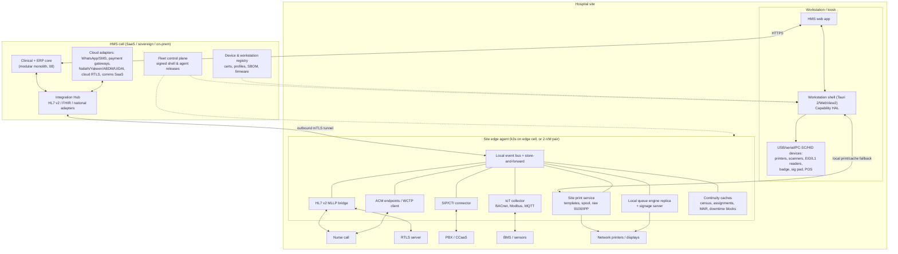

# 16 — Hospital Facility, Peripheral and Edge-Hardware Integrations

*Research date: 16 October 2026. Pure research, no code. Gap-filling report for the HMS research pack (files 01–11).*

**Evidence tags.** `[n]` = numbered source (fetched or read from a primary/authoritative page, or from a search-result extract of that URL where noted). **[K]** = analyst background knowledge, not re-verified in this session. **[E]** = analyst estimate. Vendor marketing figures are reported as vendor claims, not as evidence.

**Builds on (read these first):** 08 §1 #11 and §8 (workstation shell; Epic says `window.print()` is "insufficient"), 08 §6.2–6.4 (edge cell, offline matrix, continuity copies), 07 §5.9 EN-1..EN-4 and §6 (endpoints, segmented device gateway, downtime printing), 04 §6 (medical device integration, alarm management, device cybersecurity), 05 §2.5 (deposits and cashiering), §3.7 (time and attendance), §4.6–4.7 (queues, RTLS), 09 §7.5–7.7 and §8 (kiosks, national rails, clinical communication, paging replacement), 03 §3.1–3.3 (EMPI, ADT feeds to nurse call/RTLS, check-in), and 11 §2 and §14 (Location hierarchy, domain-event catalogue).

**Scope boundary.** This report covers non-diagnostic edge hardware and facility systems. Physiological monitors, pumps, ventilators and analysers are covered in 04 §6. The two overlap at alarm communication (IHE ACM) and smart beds, and both are handled here from the facility side.

---

## 1. Executive summary

1. **Three integration planes, not one.** Edge integrations split cleanly into (a) **user-attached peripherals** behind the workstation shell's hardware abstraction layer (HAL): printers, scanners, badge and ID readers, signature pads and payment terminals; (b) **facility systems** behind a **site edge agent**: nurse call, RTLS, telephony, BMS/IoT, pneumatic tube, queue displays and the site print service; and (c) **cloud services** behind the Integration Hub: secure messaging SaaS, WhatsApp/SMS, payment gateways, and national ID and eKYC rails. Design all three as products in the first year. Hospitals cannot go live without plane (a), and India/GCC tenders list items from all three planes [25][26].
2. **We are never in the primary alarm path.** Secondary alarm delivery to phones is regulated: Stryker's Vocera Engage contains "Engage Medical Device Alarm Notification (EMDAN), FDA 510(k)-cleared middleware" [4]. Nurse call is a standalone life-safety system certified to UL 1069 (North America) or DIN VDE 0834 (Europe and many Gulf specs) [14][15]. The HMS **feeds** these systems (ADT, staff assignments, risk flags) and **consumes** their events for documentation and analytics. It does not route alarms.
3. **IHE ACM is the standards hook for alerts.** ACM (normative in DEV TF Rev 10.0, 2024-11-04) moves alerts from Alert Reporters (devices, nurse call, RTLS, CMMS) to an Alert Manager, then over WCTP to an Alert Communicator. The Alert Manager takes "HL7 ADT or SCH message feeds" to map patients and locations to staff [1][2]. Our roles: **ADT/assignment source**, optional **Alert Reporter** for EHR-originated alerts (critical results, deterioration scores), and **Alert Consumer** for analytics.
4. **Staff assignment is the integration everyone needs.** Nurse call, Vocera/Engage, Voalte, TigerConnect and RTLS all need "who is assigned to which bed/patient right now" [4][7][10][12][13]. Make care-team assignment a first-class, event-sourced HMS domain with HL7 v2 and FHIR outputs. The alternative is a hand-typed assignment board in every vendor system.
5. **RTLS evidence is useful but modest; hand-hygiene automation is not proven.** A JAMIA systematic review (42 articles) calls RTLS "a useful and effective adjunct" in process improvement, but notes few studies developed quantitative analysis methods [20]. A 2024 *J Hosp Infect* review of automated hand-hygiene monitoring found "too little is known about the longer-term advantages... to recommend uptake in routine patient care" [21]. Integrate RTLS through a generic location-event model (IHE MEMLS `[PCD-16]`, `ORU^R45`, plus vendor webhooks) [3]. Use it first for automated journey timestamps, bed and room status, assets and infant protection, not hand hygiene.
6. **In India, queueing and QR registration are core MVP.** ABDM "Scan and Register" passed **25 crore OPD registrations** by August 2026, across about 30,800 facilities (24,323 public, 6,481 private), at about 4 lakh patients per day [24]. Rajasthan's iHMS 2.0 RFP spells out token-queue requirements: auto-token at check-in, display integration, recall queue, multi-service token reuse, and turnaround analytics [25]. Build the queue engine natively. Treat displays and kiosks as thin clients.
7. **Payments: keep card data out of scope by design.** Use semi-integrated terminals (the HMS sends an amount and receives a result and token; it never sees the PAN), PCI-listed P2PE solutions [27], MPoC-validated SoftPOS [28], dynamic UPI QR with webhook confirmation, and hosted payment pages. Market specifics: Indian hospitals can take UPI up to ₹5 lakh per transaction as verified merchants (compliance date 10 Jan 2024) [29]. Pine Labs offers cloud, app-to-app and wired integration modes [32]. SAMA-approved SoftPOS takes mada Atheer cards [33]. Network International's N-Genius supports refunds, tokenisation, AANI and Jaywan [35].
8. **National ID is a per-country adapter with very different mechanics.**
   - **UAE:** read the Emirates ID chip through the ICP toolkit on PC/SC readers. Functions include public data, PIN verification and signing [36].
   - **KSA:** look up identity in Yakeen (Elm) and authenticate through Nafath, which reports more than 3 billion verifications and links to over 530 platforms [37][38].
   - **India:** Aadhaar biometric authentication needs UIDAI **L1 registered devices**, mandatory from 1 Jan 2025 [39][40]. Most hospitals should rely on ABHA/Scan-and-Register and Aadhaar offline QR verification instead [24][K].
   - **International patients:** passport MRZ/eMRTD per ICAO Doc 9303 [51].
9. **Wristband printing is harder than it looks in Arabic and Indic scripts.** Zebra needs firmware V60.14/V50.14 or later for `^PA` (bidirectional layout, character shaping, OpenType) [41], plus UTF-8 (`^CI28`) and a font that has the glyphs [K]. Render wristbands and labels server-side from versioned templates. Send raw ZPL through the shell or the site print service. Pre-render bitmaps for scripts the printer cannot shape.
10. **Copy Epic's shell boundary, not its implementation.** Epic's Hyperdrive specs cover the integration points our HAL must expose: Enterprise Browser Printing (silent, tray selection, raw passthrough, enumeration), Scan Acquisition, E-Signature, **Desktop Generic Authentication** (badge and biometric devices), **Kiosk Generic Authentication**, and **mTLS client recognition** that binds a browser to a logical workstation [42]. Browser-only APIs such as WebHID are experimental and Chromium-only [43], so they are a fallback, not the foundation.
11. **Badge tap-and-go is a usability feature that sells deals.** Imprivata claims "80% less time accessing devices and apps" and "88% faster log-in" on shared mobiles (vendor claims) [44][45]. Support Imprivata where the customer has it. Ship our own tap-to-switch-user (PC/SC or HID reader → Keycloak step-up → session swap) for customers who do not.
12. **BMS/IoT value lies in linking to inventory and safety state, not in dashboards.**
    - Temperature excursion in a blood or vaccine fridge → automatic quarantine of the affected units or lots [48][K].
    - Isolation-room pressure loss → bed-assignment block.
    - Pneumatic-tube transaction → specimen chain of custody.
    - Biometric attendance → rostering and payroll. In India, NMC moved medical-college faculty attendance to **face-based Aadhaar AEBAS from 1 May 2025** [49][50].
13. **Downtime behaviour decides the edge design.** Nurse call, card terminals (standalone mode), static UPI QR, wristband printing from local caches, and token issuing must all keep working when the cloud core or the WAN is down. Online lookups (Yakeen, Nafath, Aadhaar, NPHIES) degrade to "verify later" queues. The site edge agent carries the caches and spools that make this possible (§12).
14. **Hardware certification is a go-to-market asset.** Publish a certified-hardware list per market, run a conformance lab, and require partners to provide firmware notices, SBOMs and vulnerability disclosure (aligned with 07 and 04 §6.7). This turns "will your system work with our Zebra/Mantra/Ingenico/Austco estate?" from a pre-sales risk into a checkbox.

---

## 2. Cross-cutting model

### 2.1 Integration planes

| Plane | Where it runs | What it integrates | Transport | Owner of reliability |
|---|---|---|---|---|
| **A. Workstation shell HAL** | On each Windows PC, kiosk or thin client (Tauri 2 / WebView2, per 08 §12.5) | Wristband, label, receipt and report printers; 1D/2D scanners; document scanners; badge, smartcard and national-ID readers; biometric sensors; signature pads; semi-integrated payment terminals; cameras | USB/HID, serial, PC/SC, TWAIN/WIA, vendor SDKs, local HTTP services (e.g., UIDAI RD service [K]), raw TCP 9100 to network printers | Our shell plus the partner device certification |
| **B. Site edge agent / device gateway** | Edge cell (08 §6.2) or a 2-VM/appliance pair at cloud-hosted sites | Nurse call, RTLS servers, PBX/CTI, IVR, PA/paging, BMS (BACnet/Modbus), IoT gateways (MQTT), pneumatic tube, queue displays and signage, site print service, downtime report push | HL7 v2 MLLP, WCTP, SIP/CTI, BACnet/IP, Modbus TCP, MQTT, vendor REST/webhooks, IPP/raw 9100 | Our agent plus the facility vendor |
| **C. Cloud adapters (Integration Hub)** | Our SaaS cells | Cloud RTLS (e.g., Kontakt.io [K]), secure messaging SaaS, WhatsApp Business Platform, SMS aggregators, payment gateways and acquirer clouds, Nafath/Yakeen/UIDAI/ABDM, cloud contact centres | HTTPS REST/webhooks, FHIR, OAuth2/mTLS | Our hub plus the vendor SLA |

**Rule:** an integration lives in the lowest plane that can satisfy its downtime requirement. Wristband printing must work when the WAN is down, so it belongs in A or B, never cloud-only.

### 2.2 Canonical edge events (extend 11 §14)

| New domain event | Typical source | Standard mapping | HMS consumers |
|---|---|---|---|
| `StaffAssignmentChanged` | HMS assignment board, roster | HL7 v2 ADT A08 (PV1-7/ROL segments [K]) or custom; FHIR `CareTeam`/`PractitionerRole` | Nurse call, clinical comms, RTLS, ACM Alert Manager |
| `LocationObserved` / `PresenceDetected` / `BoundaryCrossed` | RTLS | IHE MEMLS `[PCD-16]` `ORU^R45` [3]; vendor webhooks | Journey timestamps, bed/room status, assets, infant protection |
| `AlertRaised` / `AlertDisseminated` / `AlertAcknowledged` | Nurse call, devices, RTLS, HMS CDS | IHE ACM `[PCD-04..07]` [2] | Analytics, documentation prompts, escalation audit |
| `DeviceStatusChanged` / `EnvironmentExcursion` | IoT sensors, BMS, fridges | ACM or MEMLS environment observations [3]; MQTT | Blood bank, pharmacy, IPC, facilities |
| `TokenIssued` / `TokenCalled` / `TokenServed` / `TokenRecalled` | Queue engine | Internal; `Appointment`/`Encounter` status | Displays, app/WhatsApp notifications, TAT analytics |
| `IdentityVerified` | ID adapters | `Patient.identifier` + `Provenance`/`VerificationResult` [K] | EMPI, registration, claims eligibility |
| `PaymentCaptured` / `PaymentRefunded` / `PaymentFailed` | Terminal/gateway adapters | Internal; `PaymentReconciliation` [K] | Cashiering, deposits, GL |
| `PrintJobCompleted` / `PrintJobFailed` | Shell/site print service | Internal | Wristband audit, label reprint workflows |

### 2.3 Safety classification (our stance)

| Function | Regulatory reality | Our design stance |
|---|---|---|
| Secondary alarm notification to phones | Regulated device middleware (e.g., Vocera EMDAN 510(k) [4]; 04 §6.5) | Integrate with cleared platforms. Do not build alarm routing. |
| Nurse call | Life-safety system certified to UL 1069 / DIN VDE 0834 [14][15] | Feed ADT/assignments, consume events. Never a dependency for call delivery. |
| RTLS infant protection, wander management, duress | Safety-critical, vendor-certified | Consume events for the record. The vendor's door lock and alarm path stays independent. |
| Fridge/med-gas monitoring | Facility/QA systems (CDC DDL guidance for vaccines [48]; NFPA 99 for med gas [K]) | Consume excursions and alarms, then act on inventory. Do not replace the monitoring. |
| Wristband and label printing | Patient-identification safety (SAFER; 03 §3.1) | MVP-critical. Templates under change control, scan-verification of the printed barcode. |

---

## 3. Nurse call and clinical communications

### 3.1 What a nurse call system is and how it is certified
A nurse call system covers patient call points (pillow speaker, cord, bathroom pull), corridor dome lights, staff and code-blue stations, master stations, and increasingly IP voice and mobile delivery.
- **UL 1069** (Hospital Signaling and Nurse Call Equipment) "was written to deal with the noise and electrical interferences common in hospital and healthcare facilities." It is "a performance based Standard to ensure minimum system configurations are met." Facilities seeking NFPA 99 compliance look for it [14].
- **DIN VDE 0834** (Parts 1 and 2) covers the full call path, monitoring, fault reporting and installation. It is technology-neutral (wired, wireless, hybrid) [15].
- **UK HTM 08-03** is the British guidance; vendors claim VDE 0834 is stricter (vendor claim) [15].

Gulf specifications reference UL 1069 or VDE 0834 depending on the consultant's origin [K]. Treat the certification as the nurse call vendor's obligation and list it in our partner matrix.

### 3.2 Vendor landscape

| Vendor | Products relevant to us | Integration surface (what we confirmed) | Markets |
|---|---|---|---|
| **Stryker (Vocera, care.ai)** | Vocera Engage middleware, Vocera Edge, badges; ProCuity/iBed smart beds | Engage: "more than 150 integrations" incl. nurse call, monitors, bed alarms, EHR; care-team assignments "drawn from a variety of staff assignment systems"; EMDAN 510(k) [4]. Assignment sync via a "Vocera Assignment Group Sync Adapter" [7]. ProCuity sends bed exit, brake, rail, head-of-bed, height and occupancy data to Engage, EHR and nurse call (search-result extract) [5][6] | US-led; global via distributors [K] |
| **Baxter (Hillrom)** | Voalte Nurse Call, Voalte Mobile, Voalte Linq badge (HIMSS25), Centrella/Progressa+ beds, Hillrom RTLS | Integrates with "your EHR, using industry-standard protocols". With connected beds it automates bed-data sharing to the EHR. Badges/RTLS can cancel calls and suppress bed-exit alerts when a caregiver is present (search-result extract) [12] | US, expanding [K] |
| **Rauland (AMETEK [K])** | Responder 5 / Responder Enterprise | EMR via **ADT feed** (Epic/Cerner common), RTLS auto-clear when a badge enters the room, HL7 engines (Cloverleaf), SIP voice. Integrator warns NACK/ACK errors "are frequently a load-balancer issue" [13] | US-led |
| **Ascom** | Telligence (hospital nurse call), teleCARE IP (care homes), Unite, Digistat, Myco 4 phones, DECT/VoWiFi handsets, pagers | Nurse call, medical device integration, alarm management, staff safety. The page gives no protocol detail [8] | Europe, APAC, North America, Middle East [8][K] |
| **Jeron** | Provider series | VoIP touchscreen nurse call for acute and long-term care [11] | US |
| **TigerConnect** | Clinical collaboration, nurse call, alarm management, scheduling | Role-based messaging that "replaces fragmented pagers, calls, and texts"; Open API; care-team assignment from the EHR [10] | US |
| **Spok** | Spok Care Connect, paging network | Claims "largest U.S. paging provider", 99.92% reliability, EHR interoperability, on-call directory [9] | US |
| Regional (verify per tender) | Austco, Schrack Seconet, Ackermann/Honeywell, local Indian makers | [K] | GCC, India, Europe |

### 3.3 Integration patterns

**Typical flows (vendor-specific encodings vary):**

| Flow | Direction | Standard / typical encoding | Notes |
|---|---|---|---|
| Patient identity and location on the nurse call console and dome lights | HMS → nurse call | HL7 v2 ADT A01/A02/A03/A08/A11/A12/A13/A17 (swap) [13][K] | The bed is the anchor; names are display-only. Mask names in shared corridors where privacy rules require it [K]. |
| Staff assignments (nurse/aide/RT per bed) | HMS → nurse call, comms, RTLS | HL7 v2 (ADT with ROL, or vendor-specific), CSV/API sync, FHIR `CareTeam` [4][7][K] | **Biggest gap in the market.** Expose a single assignment service with change events. |
| Risk flags (fall risk, isolation, DNR) | HMS → nurse call, bed | HL7 v2 ADT/ORU or vendor API [12][K] | Voalte arms bed exit when fall risk is assigned [12]. |
| Call events (type, time placed, answered, cleared, presence) | Nurse call → HMS | Vendor HL7 ORU/REST, or IHE ACM `[PCD-04]` [2] | Use for rounding documentation, fall bundles, response-time KPIs and complaints review. |
| Smart-bed data (HOB angle, bed exit armed/alarmed, weight) | Bed → middleware → HMS | Vendor adapters (e.g., Engage iBed EHR adapter [6]) | Chart as *unvalidated* device data, per 04 §6.4. |
| Alerts from HMS (critical lab, sepsis/NEWS2 escalation) | HMS → Alert Manager → phones | IHE ACM `[PCD-04]` (`ORU^R40` [K]) to Engage/Unite | Do not deliver alarms directly. Report alerts. |
| Dissemination status | Alert Manager → HMS | `[PCD-05]` status (sent/delivered/read/accepted) [2] | Closed-loop evidence for critical-result policies (03, 11). |

**IHE ACM in brief.** ACM covers "physiologic alarms, technical alarms, and advisories" from Alert Reporters (patient care devices, "location service systems (LS/RTLS/RFID)", CMMS) to an Alert Manager. The Manager handles escalation, sequencing, staff-to-endpoint mapping and caching, and may receive "HL7 ADT or SCH message feeds" to identify patients and assign staff. The protocol from Alert Manager to Alert Communicator "shall be WCTP" [2]. The ACM worked example is literally a nurse call: "Patient wants a pillow... Nurse call system, operating as an Alert Reporter (AR) sends Report Alert [PCD-04] to Alert Manager" [2].

### 3.4 What the HMS must build
1. **Care-team assignment domain** (MVP): unit charge-nurse board, patient-level and bed-level assignments, breaks and handoffs ("covering for"), and rostering import (05 §3.6). It emits `StaffAssignmentChanged` to HL7 v2 and FHIR outputs.
2. **Nurse-call ADT profile** (MVP): a filtered ADT feed per vendor with bed-level location normalisation (11 §2 Location codes) and replay.
3. **ACM Alert Reporter and Consumer adapters** (P2): send HMS alerts to Engage/Unite/Voalte-class Alert Managers, and consume dissemination status and nurse-call events.
4. **Bed-data ingestion** (P2) through the communication platform or bed middleware, landing in flowsheets as unvalidated values.
5. **Secure messaging integration** (P2) with one or two platforms (TigerConnect, Vocera, Teams), with patient-context deep links. Native secure chat is in 09 §8.

### 3.5 Downtime and safety
- The nurse call **must** function without the HMS. If the ADT feed stops, consoles show stale names. Mitigations: bed-anchored operation, a heartbeat monitor on the interface with a visible alarm in the Integration Hub (08 §4.3 "no silent failures"), and replay on recovery.
- Use separate, out-of-band channels for code blue (nurse call code stations, PA, DECT) [K]. 07 §4.3 records Lurie Children's losing phones and paging for weeks: "Telephony, paging and secure messaging belong in the downtime plan."

### 3.6 Typical RFP language and cost
- **Typical clauses [K]:** HL7 ADT interface to nurse call; staff assignment interface; integration with the hospital's wireless phones/DECT; RTLS-based presence and auto-cancel; reports on call response time; UL 1069 or VDE 0834 compliance; bed-exit integration.
- **Cost [E]:** IP nurse call installed at about US$1,500–5,000 per bed for premium US/European brands, and about US$300–1,500 per bed for regional brands in India and the GCC. This is facility capex, usually in the MEP package, not the HMS contract. The HMS interface fee is typically US$5k–25k per interface per site [E].

---

## 4. Telephony, contact centre, messaging and paging

### 4.1 SIP/CTI and the contact centre
The contact centre is the booking engine for many Indian and Gulf hospital groups [K]. Integration patterns, in rising order of effort [K]:

| Pattern | How | Use |
|---|---|---|
| URL screen pop | The CTI/agent desktop opens `https://hms/.../callpop?ani=+9715...&dnis=...` on ring | Patient lookup by phone (EMPI phonetic plus phone index), open appointment-booking context |
| Embedded softphone | WebRTC softphone or the CCaaS widget (Amazon Connect, Genesys Cloud, Twilio Flex, Cisco/Avaya) inside the HMS frame | Call controls without window switching |
| CTI API events | Ring/answer/hang-up events into the HMS; click-to-dial from the HMS | Log calls as `Communication` against the patient and appointment; transfer-centre recording (05 §4.4) |
| Disposition sync | Call outcome codes → HMS tasks (callback, reschedule) | Outbound campaigns: no-show recovery, results callback |

**Standards:** SIP (RFC 3261, June 2002) [52] for trunks and PBX integration; WCTP for messaging to devices [2]. India uses cloud telephony providers (Exotel, Ozonetel, Knowlarity and others). GCC uses licensed operators, and VoIP rules (e.g., UAE TDRA) constrain architectures [K].

### 4.2 IVR and voice agents
IVR handles appointment confirmation and cancellation, report-ready notification, deposit and payment links, and pharmacy refills. These are FHIR `Appointment` and `Task` operations through our scheduling API. AI voice agents (09 §1.6) call the same scoped APIs. Every IVR action is audited with ANI and authentication level. Use knowledge-based verification (DOB plus MRN), plus OTP to the registered mobile for anything that releases PHI [K].

### 4.3 SMS and WhatsApp
- **WhatsApp Business Platform:** since **1 July 2025** Meta charges **per delivered template message**. The categories are marketing, utility and authentication, and rates vary by recipient country. Free-form messages, and utility templates sent inside the 24-hour customer-service window, are free [46]. Meta lists rate changes for India (marketing up 1 Jan 2026), Saudi Arabia (utility/authentication down 1 Oct 2025) and the UAE (AED billing from 1 Apr 2026) [46].
- **Tenders push messaging cost onto the vendor.** The Shirdi tender requires SMS/WhatsApp and states that "All the charges corresponding to SMS or WhatsApp will be bared by the bidder for the tenure of the contract" [26]. Rajasthan routes messaging through the state's "eSanchar Gateway"/RAJ Digital Stack [25]. Price messaging as pass-through with caps, and support government gateways as a channel adapter.
- **India SMS:** DLT registration of headers and templates under TRAI rules is required for commercial SMS [K]. Template governance belongs in the engagement engine (09 §7.7).

### 4.4 Paging replacement
Spok (claimed 99.92% reliability [9]) and TigerConnect [10] show that US hospitals still run paging and are replacing it with role-based messaging. In India and the GCC the norm is overhead PA, DECT and personal mobiles [K]. What we build: a **code-event orchestrator** (code blue/red/pink) that records the activation, triggers PA/nurse call/comms through adapters, and logs responders. It always sits beside the life-safety path and never in it (§2.3).

---

## 5. Real-time location systems (RTLS)

### 5.1 Technology choices

| Technology | Location certainty | Typical accuracy | Infrastructure | Strengths / weaknesses |
|---|---|---|---|---|
| Infrared (IR) | Room-level certainty (walls block IR) | Room/bay | Ceiling IR emitters plus RF/BLE backhaul | Clinical-grade room certainty; needs install in every room [K]. Midmark pairs BLE with "room-level IR precision" [18] |
| Ultrasound | Room/bay/bed-level certainty | Sub-room | Room units | Sonitor's ULE ("most accurate... in healthcare", vendor claim) [17] |
| BLE (RSSI) | Zone-level; room with dense beacons | 1–5 m [K] | Battery beacons or gateways | Cheap tags; good for assets; weaker for "who is in room 412-B" [K] |
| UWB (IEEE 802.15.4z) | Precise ranging | "Centimeter accuracy" via ~2 ns pulses, 500 MHz channels [19] | Anchors | Precise, secure ranging [19]; higher infrastructure cost [K] |
| Wi-Fi | Zone | 3–10 m [K] | Existing WLAN | No new infrastructure; poor certainty [K] |
| Passive RFID (UHF) | Chokepoint | Portal/read zone | Readers at doors and stores | Linen, instruments, supplies [K]. Rajasthan RFP asks for RFID linen and library tracking [25] |
| LF exciters | Doorway | Door | Exciters at exits | Infant protection and wander exits [K] |

**Opinion:** for clinical workflow automation (journey timestamps, auto-clear of nurse calls, bed status), require **room- or bay-level certainty** (IR, ultrasound or UWB). For asset tracking, BLE is enough. Hybrid deployments are the norm [17][18].

### 5.2 Vendors

| Vendor | Positioning (from vendor pages) |
|---|---|
| **CenTrak** | "Bluetooth asset tracking to clinical-grade location services"; integrations with "EHR, nurse call, CMMS"; environment monitoring (temperature, humidity, differential air pressure); "over 2,000" facilities (vendor claim) [16] |
| **Sonitor** | ULE ultrasound; SonitorONE cloud; "phones as RTLS tags"; nurse call automation, specimen tracking, hand hygiene; 300+ deployments (vendor claim) [17] |
| **Midmark** | CareFlow RTLS; IR+BLE hybrid "Wireless IR Sensory Network 3.0"; patient-flow focus, strong in ambulatory; 1,000+ facilities (vendor claim) [18] |
| **Kontakt.io** | BLE, cloud-first, healthcare workflow apps [K] (developer portal not readable this session) |
| **Baxter/Hillrom RTLS**, **Securitas Healthcare (ex-Stanley/AeroScout, Hugs infant protection)** | Integrated with own nurse call or safety lines [12][K] |

### 5.3 Standards and APIs
- **IHE MEMLS** (Trial Implementation, Rev 1.5, 2024-09-19): a Location Observation Reporter (LOR) sends Report Location Observation `[PCD-16]` as `ORU^R45^ORU_R45` to a Location Observation Consumer (LOC) [3]. MEMLS lists application purposes and their triggers: mother–baby mismatch (colocation), infant abduction (boundary or colocation), patient–equipment binding, "clinician entering room... affecting equipment", specimen tracking, staff needing assistance, refrigerator/freezer monitoring, infection prevention, and "Human resources log in/out for payroll" [3]. It explicitly leaves the inference algorithms out of scope [3].
- **IHE ACM** carries RTLS-originated alerts such as duress and tamper [2].
- **In practice:** vendor REST APIs, webhooks or streaming. Our adapter normalises everything to `LocationObserved`, `BoundaryCrossed` and `Colocated` [K].

### 5.4 Use cases → HMS automations

| Use case | RTLS event | HMS automation | Guardrail |
|---|---|---|---|
| OPD journey timestamps | Patient tag enters exam room; clinician tag colocates | Encounter "roomed", "provider-in", "provider-out" proposed timestamps; TAT analytics | Store as **operational facts with Provenance**. Never overwrite clinician-attested times. |
| OR milestones | Patient in OR / out of OR | Periop case-time capture (03 §12) | Nurse confirms; discrepancy report |
| Bed/room status | Patient leaves bed space after discharge; EVS tag dwell | Bed state `dirty` → `cleaning in progress` → `clean` (05 §4.1) | Supervisor override |
| Asset tracking | Pump located; PAR breach | CMMS location (05 §3.4), PM due finder, PAR replenishment task | Device ↔ patient binding only by scan (04 §6.4) |
| Nurse-call auto-clear and presence | Caregiver badge in room | Handled by the nurse call vendor [12][13]; HMS logs rounding | No HMS dependency |
| Infant protection | Strap tamper, exit boundary, mother–baby mismatch [3] | Link infant tag to the newborn record created at delivery (03 §3.1 #6); show alerts on the maternity board | Door lockdown stays in the vendor system |
| Hand hygiene | Staff colocation with dispenser [3] | Unit-level analytics only | Evidence is weak [21]; works-council and union sensitivities [K] |
| Duress | Staff button | Security response in the vendor system; HMS incident record | — |

### 5.5 Privacy and labour
Staff tracking creates employment-law and works-council issues in the EU and union issues elsewhere. Purposes, retention and individual-level access need governance [K]. Default: individual-level staff location data is retained for at most 30 days, with aggregated analytics kept longer. Access to individual tracks requires a case reason and is audited (07 §5.4) [E].

### 5.6 Cost [E]
- **BLE asset-only:** about US$5–30 per tag plus gateways. A 300-bed asset programme runs about US$50k–300k.
- **Clinical-grade room-level RTLS** (IR or ultrasound, enterprise, 500 beds): about US$1–5M capex plus 10–20% annual support.
- These figures have low confidence. Validate them against KLAS and local quotes.

---

## 6. Queue and token management, kiosks and digital signage

### 6.1 Why this is core in India and the Gulf
- **India:** ABDM Scan and Register lets patients scan a facility QR code with an ABDM PHR app and share their ABHA profile with consent, so the facility registers the OPD visit without paperwork. Usage passed 25 crore registrations by August 2026 at about 4 lakh per day [24]. Rajasthan's RFP requirements QMS/01–12 are a ready-made functional spec [25]:
  - auto-token on check-in;
  - integration with a token display "if installed";
  - masked token numbers on worklists;
  - call-next that updates the display and the patient app;
  - a recall queue for no-shows;
  - token expiry at the end of the day;
  - the same token reused across multiple service queues;
  - timestamps at generation, call and consumption;
  - turnaround dashboards.
- **Blood bank and pharmacy queues:** the same RFP adds a blood-bank waiting display and pharmacy queue displays (BBM/07–08, PHR/23) [25].
- **Hardware is listed explicitly.** The Shirdi tender requires "Integration of barcode reader, barcode printer and displays for Electronic Queue Management System and all other devices" and lists "Kiosk Management (optional but preferable)" [26].

### 6.2 Typical OPD configurations [K/E]

| Setting | Arrival and ID | Queue steps | Hardware per OPD block | Payment checkpoint |
|---|---|---|---|---|
| **Indian government tertiary** | Scan-and-Register QR standees, ABHA, counter registration; UHID slip with barcode | Registration → department token → doctor → lab collection → radiology → pharmacy | Token printers at counters, 1 display per department and per doctor-room cluster, doctor call buttons or in-software call, pharmacy and lab displays | Often free or nominal; UPI QR at cash counters [25] |
| **Indian private multispecialty** | App/WhatsApp/call-centre booking; ABHA or Aadhaar QR verify; front-desk photo | Check-in → vitals station → doctor → billing → lab/pharmacy | Check-in kiosk (QR/ABHA scan, UPI/card), display outside each consult room, billing POS plus UPI soundbox, receipt printers | **Before consult** (pay-first) or at billing; insurer/TPA desk |
| **KSA government/cluster** | Sehhaty appointments; national ID/Iqama at kiosk or desk; Nafath for digital channels [37] | Check-in → triage/vitals → clinic → pharmacy (Wasfaty) | Bilingual Arabic/English displays; kiosks; some facilities still configure gender-separated waiting [K] | Rare for citizens |
| **KSA/UAE private** | Insurance card and national ID; UAE: Emirates ID read at the desk, since EID is the primary HIE key (06 §4.6) [K] | Check-in + eligibility (NPHIES / eClaimLink-Shafafiya) → vitals → clinic → co-pay → pharmacy | Emirates ID reader per desk, kiosks with ID reader and card terminal, multilingual displays (Arabic/English/Hindi/Urdu/Tagalog, 09 §7.7) | Co-pay at check-in via mada/card/Apple Pay [33][35] |

### 6.3 Vendors and build stance
- **Qmatic** (Orchestra on-premises, Experience Cloud SaaS): mobile ticket, smartphone check-in, "can be integrated with... HIS/EHR systems" [22].
- **Wavetec** (Dubai and Riyadh offices): ticket kiosks, digital signage, WhatsApp queueing, "Spectra" dashboards [23]. Many local Indian vendors also exist [K].

**Build stance:** build the **queue engine natively**, because queues are workflow state tied to encounters, orders and billing. Displays are browser-based signage players (HTML over WebSocket from the edge agent). Token printers are standard ESC/POS receipt printers on the shell or network [K]. Provide a **QMS adapter** (P2) for hospitals with an installed Qmatic or Wavetec that want to keep it: arrival → ticket mapping, call events back.

### 6.4 Kiosks
- **Functions:** check-in (appointment lookup by QR/phone/ID), identity capture (Emirates ID chip [36], Aadhaar or ABHA QR, MRZ passport [51]), photo capture, insurance card OCR, eligibility, consent e-signature, co-pay or deposit, token issue, wayfinding, and report or receipt printing.
- **Authentication hook:** Epic exposes a "Kiosk Generic Authentication" spec so external devices can identify or enroll patients at its self-arrival kiosk [42]. Our kiosk mode in the shell must expose the same device classes.
- **Hardware stack:** 21–32" touch display, industrial PC, 2D imager, receipt printer (80 mm), PC/SC contact and contactless reader, semi-integrated card terminal or UPI QR display, camera, optional L1 fingerprint or face module, UPS.
- **Operations:** OS lockdown (assigned access), remote fleet management, accessibility (height, audio, high contrast).
- **Cost [E]:** India token kiosk ₹60k–1.5 lakh; full payment-and-ID kiosk in the GCC US$5k–12k.

### 6.5 Digital signage and wayfinding
Queue boards, department directories and corridor signage run from one signage service: HTML layouts, schedule-driven content, emergency override (code alerts, evacuation) and multilingual right-to-left support. Blue-dot wayfinding (09 §7.5) is a partner integration. Static QR-code maps are an MVP substitute [K].

---

## 7. Payments

### 7.1 PCI scope-reduction architecture
- **Semi-integrated terminals.** The HMS sends `amount, reference, type` to the terminal (locally or through an acquirer cloud) and receives `approved/declined, auth code, masked PAN, token, scheme`. Card data never touches HMS memory, logs or networks, which keeps us and the hospital out of most PCI DSS scope [K].
- **P2PE.** PCI says merchants using PCI-listed P2PE solutions have fewer applicable PCI DSS requirements. P2PE "cryptographically protects account data" from acceptance to a secure decryption point [27].
- **SoftPOS on phones and tablets.** Use **MPoC**-validated solutions; MPoC builds on SPoC and CPoC and allows PIN and contactless on the same commercial off-the-shelf (COTS) device [28].
- **E-commerce and pay-by-link.** Use hosted payment pages or hosted fields with tokenisation (N-Genius offers a "PCI DSS-compliant" hosted page, saved-card tokens and refunds API [35]). India's RBI card-on-file tokenisation rules prohibit merchants from storing card numbers [K].

### 7.2 Market matrix

| Market | Instruments | Terminal/gateway partners (examples) | Integration modes (confirmed) | Notes |
|---|---|---|---|---|
| **India** | UPI (dynamic QR, intent/collect), cards, EMI, wallets | Pine Labs, Razorpay POS, Paytm, PhonePe [31][32][K] | Pine Labs: **Cloud Integration (API)**, **App-to-App** on Android POS, **Wired (PAD controller)**; server-to-server "coming soon" [32]. Razorpay: Android POS, Tap & Scan soundbox "for pharmacies and hospitals", 150+ billing integrations [31] | UPI limit for hospitals and education raised to **₹5 lakh per transaction**; acquirers add merchants to a "verified list" after due diligence; compliance by 10 Jan 2024 [29]. Sept 2025 circular raised other categories [30] |
| **KSA** | mada (debit), Visa/MC, Apple Pay/mada Pay, STC Pay/STC Bank [K] | Bank acquirers (e.g., Alinma, SNB [K]), Geidea [K], SoftPOS | SoftPOS apps "approved by the Saudi Central Bank", supporting "Saudi TMS", EMVCo L2/L3; accepts "mada Atheer" cards [33] | Secondary sources report a SAMA rule since 2018 against refusing e-payments [34] and mada fees capped at 0.80% / SAR 40 [34]. Verify both with SAMA before quoting |
| **UAE** | Cards, Apple/Google/Samsung Pay, AANI (instant), Jaywan (domestic scheme) | Network International (N-Genius), Magnati [K] | N-Genius: REST orders, captures, voids, refunds, pay-by-link, recurring, tokenisation, Tap to Pay on iPhone SDK, AANI and Jaywan listed [35] | Multi-currency for medical tourism |

### 7.3 Integration patterns we must support
1. **Local semi-integrated** (USB/serial/LAN terminal through the shell HAL): lowest latency, works on a LAN when the WAN is down (terminal-dependent) [K].
2. **Acquirer-cloud push** (HMS → acquirer API → terminal by ID → webhook result): no local drivers. This is the default for multi-site groups [32].
3. **Dynamic UPI QR**: HMS generates a QR with an amount and order ID, shows it on the counter display or soundbox, and confirms via PSP webhook plus a status poll. A **static QR** fallback needs manual reconciliation [K].
4. **Payment links** over WhatsApp/SMS for deposits and top-ups (05 §2.5) [35].
5. **Kiosk payments** through patterns 1–3.

### 7.4 Cashiering, refunds and deposits (extends 05 §2.5)
- **Cashier shift lifecycle:** open with float → transactions by tender type (cash, card, UPI, wallet, cheque, credit) → close with a denomination count → variance approval → handover to the main cash office.
- **Three-way reconciliation:** HMS receipts ↔ terminal batch/settlement reports ↔ acquirer settlement and bank credit files (MDR, chargebacks). Unmatched items go to a work queue [K].
- **Refunds:** return to the original instrument where possible (gateway refund APIs [35]). Cash refunds need approval thresholds. Deposit refunds on discharge are reconciled against the final bill.
- **Receipts and tax:** KSA simplified (B2C) tax invoices come under ZATCA e-invoicing. Phase 1 started 4 Dec 2021 and Phase 2 integration rolls out in waves from 1 Jan 2023 [47]. Printed B2C receipts carry a QR code [K]. India: GST invoices, plus an e-invoice IRN/QR for B2B such as corporate and TPA billing [K].

### 7.5 Downtime
- **Card terminals in standalone mode:** staff key the amount on the terminal, and the receipt reference is back-entered later [K].
- **UPI:** static QR with a reference.
- **All downtime payments** go to a reconciliation queue on recovery. Never block clinical care on payment capture (05 §2.5 #10).

### 7.6 Costs [E]
- **India:** Android POS rental about ₹300–1,000 per month; soundbox about ₹100–300 per month. UPI P2M MDR is zero by policy [K]. Card MDR is about 1–2%.
- **KSA:** mada fee cap as above [34].
- **UAE:** card MDR about 1.5–2.5% for card-present [E].

---

## 8. National ID and eKYC

### 8.1 Comparison

| Market | Mechanism | How it works | Who may use it | HMS build |
|---|---|---|---|---|
| **UAE** | Emirates ID smart card | ICP **ID Card Toolkit**: libraries that read the card through "any PC/SC compatible smart card reader". Functions include reading public data, digital signing and PIN verification [36]. Legacy Java/C# APIs; contactless V2 cards use BAC with MRZ-derived keys; an "ICA Agent" desktop component is current (search-result extracts) [36] | Toolkit registration with ICP [K] | Shell plugin wrapping the toolkit; parse into `Patient` plus the EID identifier (primary HIE key, 06 §4.6); photo from chip; expiry warnings |
| **UAE** | UAE PASS | National digital identity for portals [K] (09 §7.7) | Relying-party onboarding [K] | OIDC federation in the portal/app |
| **KSA** | **Yakeen** (Elm) | Real-time lookup by National ID, Iqama or visa number; returns names (Arabic/English), gender, DOB and nationality; used across banking, insurance and healthcare (secondary source) [38] | Commercial subscription through Elm or licensed aggregators [38][K] | Registration-time verification; Hijri/Gregorian DOB handling |
| **KSA** | **Nafath** | National SSO/MFA app using Absher credentials; "more than 3 billion verification operations" (Nov 2024); "interconnected with over 530 government and private platforms" [37] | Onboarding with NIC/SDAIA [K] | Portal/app login; high-assurance consent; remote identity proofing for telehealth |
| **India** | **ABHA / Scan and Register** | QR scan with a PHR app, then consented ABHA profile share [24] | Any ABDM-registered facility (HFR) | MVP: ABDM M1 plus Scan-and-Register token flow |
| **India** | **Aadhaar authentication / eKYC** | Biometric (fingerprint/iris/face) or OTP. Biometrics only via **L1 registered devices** from 1 Jan 2025; signing and encryption in a TEE; STQC "5000 FRR" testing [39][40] | AUA/KUA (or sub-AUA) authorisation only [K] | P2 and optional. Wrap the RD service in the shell; never store raw biometrics; Aadhaar Data Vault if the number is stored (07 DP-7) |
| **India** | Aadhaar offline verification | Signed Secure QR / paperless offline eKYC [K] | Broad (no AUA needed) [K] | Shell QR decode plus UIDAI signature check; keep only the last 4 digits |
| **International** | Passport / eMRTD | ICAO Doc 9303 (MRZ and chip; Parts 10–12 cover chip data structure, security mechanisms and PKI) [51] | — | Full-page document scanner with MRZ OCR and optional RFID; visa capture for medical tourism |

### 8.2 Design rules
1. **The verification record is not the identity record.** Store `IdentityVerified {method, assurance level, source, timestamp, operator, evidence hash, result}` as Provenance. Store national identifiers encrypted or tokenised (07 DP-7).
2. **Never persist raw biometric templates or images.** The Aadhaar RD flow returns an encrypted PID block that goes straight to the authentication service [39][K].
3. **Online lookups fail open to "verify later".** Registration proceeds with a flagged identity. A reconciliation queue completes verification on recovery (07 §6.3 #6).
4. **Arabic/English name pairs and Hijri DOB** from Yakeen or the EID chip populate distinct name-use fields (official Arabic, transliterated English) in the EMPI (03 §3.1) [K].

### 8.3 Device certification
- **India:** buy only UIDAI/STQC-listed **L1** fingerprint (and iris) devices with a valid RD service. Renewals of device certificates and RD services are recurring costs. Expired L0 certificates were ordered phased out [40].
- **UAE:** buy only readers on ICP's compatible list (HID OMNIKEY and Gemalto models are reported) [36].

**Cost [E]:** Indian L1 fingerprint scanner about ₹2.5k–5k plus an annual RD renewal; UAE PC/SC reader about US$30–120; passport scanner with MRZ and RFID about US$800–3,000.

---

## 9. Printing, capture and authentication peripherals

### 9.1 Wristbands and labels
- **Why native.** Epic's Enterprise Browser Printing spec states that web printing "lacks silent printing, tray selection, raw data passthrough, and programmatic printer enumeration" [42]. 08 §8 adopted the same conclusion.
- **Printers:** thermal wristband and label printers with healthcare-grade plastics (Zebra HC series, Honeywell, SATO, TSC, Brady) [K].
- **Languages:** ZPL is the de facto lingua franca [K]. For Arabic and Indic text, Zebra's `^PA` controls default glyph, **bidirectional layout**, **character shaping** and **OpenType** tables, on firmware **V60.14.x/V50.14.x or later** [41]. This needs UTF-8 input and a downloaded TrueType/OpenType font with the glyphs [K].
- **Our stance:**
  - Render templates server-side per printer DPI and firmware capability.
  - Where a printer cannot shape a script, rasterise the text into a `^GF` graphic.
  - Keep both paths under regression tests that compare printed output to golden images [E].
- **Content rules:** at least 2 identifiers plus a 1D/2D barcode (03 §3.1 #4). Prefer a 2D DataMatrix carrying MRN plus encounter, with a GS1-compliant option (GSRN for patients and caregivers, GLN for locations, GTIN/DataMatrix for medication) where the customer adopts GS1 (05 §3.3) [K]. Newborn naming conventions must not be truncated (03 §3.1 #6). The template must also cover an allergy/alert colour band if local policy uses one [K].
- **Verification:** scan-to-verify the first band printed after template or printer changes. Log `PrintJobCompleted` with template version for audit.

### 9.2 Report, prescription and receipt printers
- A4/A5 laser printers with tray selection (letterhead, prescription stationery) and secure "follow-me" printing for sensitive reports [K].
- 80 mm receipt printers (ESC/POS) for tokens and cash receipts [K].
- Prescription and receipt layouts are country packs: ZATCA QR on KSA receipts [47][K]; Indian prescription formats with registration numbers [K].
- Print jobs carry a PHI classification for DLP and audit (07 §5.5).

### 9.3 Barcode, 2D and RFID scanners and BCMA mobiles
- **Scanner interfaces:**
  - keyboard-wedge HID: simplest, but loses control characters [K];
  - HID-POS or serial (USB-CDC) mode: needed to preserve the **GS1 group separator** (FNC1/GS) when parsing DataMatrix GTIN/lot/expiry for medications and implants [K].
- **Shell behaviour:** the shell normalises all modes into a `BarcodeScanned{symbology, raw, parsedGS1}` event.
- **BCMA mobiles:** healthcare-grade Android mobile computers with disinfectant-ready housings and integrated imagers (Zebra TC-HC, Honeywell CT-HC) are standard [K]. MDM, shared-device checkout and badge unlock follow (Imprivata Mobile Device Access [45]).
- **Offline BCMA** follows 08 §6.3.
- **RFID:** UHF for assets, linen and supplies; HF/NFC for badges [K]. Rajasthan's RFP requires RFID label printing and linen tracking [25].

### 9.4 Document scanners
Registration and HIM capture ID cards, insurance cards, consents and outside records (03 module 43).
- **Interfaces:** TWAIN (TWAIN Working Group), ISIS (OpenText-owned), WIA, and driverless eSCL [K].
- **Precedent:** Epic separates "Scan Acquisition" (desktop scanning that files metadata) from "Scan Viewing" [42].
- **Build:** a shell TWAIN/WIA bridge, an upload-to-`DocumentReference` pipeline with barcode cover sheets for batch scanning, and OCR/AI indexing (09).

### 9.5 Signature pads
Consent, financial agreements and pharmacy collection need captured signatures. Epic's "E-Signature" spec stores signatures for document collection [42]. Support HID/vendor-SDK pads (Wacom, Topaz, signotec) and on-glass signatures on tablets [K]. Store the image plus biometric stroke data where lawful, bound to a document hash (07 §8.3) [K].

### 9.6 Badge tap-and-go and smartcards
- **Market:** Imprivata Enterprise Access Management offers SSO, fast user switching, VDI/thin-client integration and badge tap ("80% less time accessing devices and apps", vendor claim) [44]. Its Mobile Device Access "assign[s] and unlock[s] devices with mobile badge tap or facial authentication" [45]. Epic's "Desktop Generic Authentication" lets external software implement authentication devices to log in, re-authenticate or identify patients [42].
- **Our stance:**
  1. Integrate with Imprivata where present (it profiles our shell like any app) [K].
  2. Ship native tap-to-switch-user: PC/SC/HID badge reader (HID Prox/iCLASS/SEOS, MIFARE DESFire) → shell → Keycloak step-up authentication bound to the workstation certificate → the session swaps in under 2 s [E]. Re-authentication for co-signature, controlled drugs and break-the-glass uses tap plus PIN.
  3. Smartcard PKI: UAE EID signing [36], Indian Class 3 DSC USB tokens for e-sign [K].

---

## 10. BMS, IoT and facility systems

### 10.1 Cold chain (blood, vaccines, pharmacy)
- **Requirements:** blood components and vaccines have narrow storage ranges and documented monitoring requirements (blood bank workflows in 04 §3). CDC guidance calls for **digital data loggers** for routine storage, transport and temporary clinics, at least one backup DDL or monitoring device, calibration certificates, and excursion handling that forbids using vaccines stored out of range unless confirmed safe [48].
- **Sensor sources:** RTLS vendors also sell environmental sensors (CenTrak Environment [16], Sonitor [17], Midmark [18]). MEMLS lists refrigerator/freezer monitoring as an application purpose [3].
- **HMS value:** an `EnvironmentExcursion` on storage location X automatically places **quarantine holds** on blood units or vaccine lots in that location (blood bank, pharmacy, ward stock). It opens a task for QA disposition and records the excursion against each affected unit's chain of custody. This closes a gap that standalone monitoring cannot: knowing *which units* to hold [E].

### 10.2 Pneumatic tube systems
Major vendors include Swisslog TransLogic, Aerocom and Sumetzberger [K]. Integration value [K]:
- carrier send and receive events tied to specimen IDs (specimen chain of custody in the LIS, 04 §2.2);
- badge-secured sends for controlled drugs and blood;
- station-level downtime alerts for re-routing.

Integration is via vendor APIs or HL7. Tag P3 unless a tender requires it.

### 10.3 Medical gas alarms and BMS
- **Med gas:** master and area alarms are life-safety systems under NFPA 99 (US) and HTM 02-01 (UK) [K].
- **BMS:** speaks BACnet/IP, Modbus TCP, KNX, OPC UA or MQTT [K].
- **HMS role:** consume selected points for **clinical context only**:
  - isolation room pressure status → bed assignment blocks for airborne isolation;
  - OR temperature/humidity → OR board alerts;
  - med-gas area alarm → unit banner plus incident record.

  Never act as the alarm annunciator.

### 10.4 Bedside terminals and patient entertainment
- **Vendors:** Get Well, Sonifi, pCare, ARC and others, plus EHR-native bedside apps (09 §7.6) [K].
- **Integration:**
  - ADT (A01/A02/A03/A08) to personalise the screen;
  - care team and schedule;
  - education assignment with completion back;
  - meal ordering to dietary (04 §7.3);
  - non-urgent requests as tasks;
  - urgent requests via the nurse call, never via the HMS.
- **Tag:** P3, but VIP and medical-tourism hospitals in the GCC often put it in the tender [K].

### 10.5 Biometric time and attendance
- **Devices:** face and fingerprint terminals (ZKTeco, Suprema, Matrix and others) [K].
- **India specifics:** NMC requires **face-based Aadhaar authentication on AEBAS from 1 May 2025** for medical-college faculty, with geofenced mobile marking within 100 m of declared points or wall-mounted face devices [49]. A 2026 *Indian J Community Med* letter discusses its security weaknesses [50].
- **Tender requirements:** Rajasthan's RFP requires biometric staff attendance capture (R-SM/7) [25].
- **HMS build:**
  - punch import (device SDK/API or file) into rostering and payroll (05 §3.6–3.7);
  - exception workflows;
  - for Indian teaching hospitals, an **AEBAS data import** for faculty compliance reporting rather than a duplicate attendance system.
- **Privacy:** biometric data is sensitive under DPDP and GCC laws (07 §1) [K].

---

## 11. Security, firmware and SBOM

1. **Segmentation.** Device classes sit on dedicated VLANs (nurse call, RTLS, BMS, POS, printers, kiosks). The site edge agent is the **only** bridge to HMS services. All connections from the agent to the cloud are outbound mTLS, and nothing calls inbound from the internet. This is consistent with 07 EN-3, IEC 80001-1 (04 §6.7) and PCI network segmentation for POS [K].
2. **Workstation identity.** Every shell and kiosk holds a device certificate bound to a logical workstation record (location, default printers, kiosk mode, allowed devices). Epic's mTLS client-recognition spec ties a browser to a "Logical Workstation record" the same way [42].
3. **Firmware and SBOM.** Certified partners must supply firmware release notes, an SBOM (SPDX/CycloneDX), a CVE disclosure process and an end-of-support date. Our device registry correlates SBOMs with vulnerability feeds (04 §6.7). Our shell and edge agent ship signed, with SBOMs (08 §1 #14). The EU CRA applies to our edge software as a product with digital elements (07 §2.3).
4. **Least privilege in the shell.** Each capability (print raw, read ID, capture biometric, pay) is granted per workstation profile and per user role. Every invocation is audited (BALP, 07 §5.4). No arbitrary native code execution from the web layer.
5. **Kiosk hardening.** Assigned-access OS, no local admin, auto-logout, privacy screens, tamper sensors, PCI PTS-approved PIN entry devices only [K].

---

## 12. Downtime and offline behaviour matrix

| Integration | Cloud core down (site has WAN) | Site WAN down (cloud-hosted site) | Edge agent down | Design rule |
|---|---|---|---|---|
| Wristband/label printing | Print from edge cache (census, pre-registered patients, downtime MRN blocks) | Same | Shell prints direct to USB printers using templates cached locally | **MUST** (07 EN-4) |
| Barcode scanning / BCMA | Offline MAR cache on mobiles (08 §6.3) | Same | No impact on scanning; sync deferred | Time-bounded caches |
| Badge SSO | Cached credentials on the shell for the downtime viewer only | Same | Shell falls back to local downtime accounts | Break-glass sealed accounts (07 §6.3) |
| Nurse call | **Unaffected**; stale ADT names | Unaffected | Unaffected (ADT feed paused) | Independent life-safety |
| Clinical comms/alarms | Unaffected if on-prem middleware; SaaS needs WAN | SaaS lost; fall back to DECT/PA | Unaffected | Out-of-band channels |
| Telephony/IVR | PBX unaffected; screen pops lost | Cloud CCaaS lost unless SIP survivability [K] | Screen pops lost | Paper call logs; callback queue |
| SMS/WhatsApp | Queued | Queued centrally | Queued | Never time-critical clinical alerts |
| RTLS | Vendor system runs; events buffered by the agent | Buffered | Events lost or replayed from the vendor store | Timestamps marked "late" |
| Queue/tokens | Edge agent issues tokens and drives displays locally | Same | Pre-printed numbered tickets | Local queue state on the agent |
| Kiosks | Token issue only; no payment or eligibility | Same | Out of service; staffed desk | Clear signage |
| Card payments | Terminal standalone mode | Terminal standalone (if it has its own SIM) | Shell or acquirer-cloud path | Reconciliation queue |
| UPI | Static QR plus manual reference | Patient phone still works; confirmation later | Same | Reconcile against PSP report |
| National ID (Yakeen/Nafath/Aadhaar/NPHIES) | Unavailable → "verify later" flag | Same | Same | Never block registration |
| Emirates ID chip read / Aadhaar QR offline check | Works locally (shell) | Works | Works | Local signature validation |
| Fridge monitoring | Vendor system alarms locally | Same | Same | Quarantine applied on reconnect, back-dated |
| BMS/med gas | Unaffected | Unaffected | Context feed lost | Independent life-safety |
| Bedside terminals | Content cached; no updates | Same | Same | Non-critical |
| Time & attendance | Devices store punches | Same | Same | Batch import |

---

## 13. Typical RFP requirements and cost ranges

### 13.1 RFP clauses seen or expected

| Category | Typical clause | Evidence |
|---|---|---|
| Printing and barcodes | "Provision to generate bar coded for wrist bands, labels"; registration slip with barcode and UHID; inventory of "Printer, Barcode Printer, Barcode Scanner" | Rajasthan WMS/01, §4.8.13 [25]; Shirdi 2.16 [26] |
| Queue | QMS/01–12 token lifecycle; displays at pharmacy, blood bank and lab | [25] |
| Kiosk | "Interface with Kiosk, Web, Mobile, email, SMS"; "Kiosk Management (optional but preferable)" | [26] |
| Payments | "The system shall integrate with UPI" (BIL/08); UPI QR on registration and app | [25] |
| Messaging | SMS/WhatsApp; vendor bears messaging charges | [26]; [25] |
| Biometrics | "Biometric framework BioAPI ISO/IEC 19784-1:2005"; biometric donor ID (blood bank); biometric staff attendance | [25] |
| RFID | RFID linen tracking; RFID label printing | [25] |
| Device inventory | Bidder to report the desktops and peripherals needed ("printers, scanners, bar code devices, biometric devices") | [26] |
| GCC (typical) | Emirates ID reader integration; Nafath/Yakeen; mada/Apple Pay; bilingual displays and printouts; ZATCA-compliant invoices; HL7 nurse call interface | [K]; [36][37][47] |

### 13.2 Cost ranges (per unit, hardware only unless noted) [E]

| Item | India | GCC/International |
|---|---|---|
| Thermal wristband/label printer (healthcare) | ₹35k–70k | US$500–1,000 |
| Wristbands (thermal) | ₹6–20 each | US$0.15–0.50 each |
| 2D healthcare scanner (corded/cordless) | ₹10k–30k | US$150–500 |
| Healthcare mobile computer (BCMA) | ₹70k–1.4 lakh | US$1,000–2,000 |
| Badge reader | ₹4k–10k | US$60–150 |
| Signature pad | ₹10k–35k | US$150–500 |
| Document scanner (departmental) | ₹30k–1 lakh | US$400–1,500 |
| L1 fingerprint / EID reader | ₹2.5k–5k | US$30–120 |
| Passport/ID scanner (MRZ+RFID) | ₹70k–2.5 lakh | US$800–3,000 |
| Token display point (TV + player) | ₹25k–80k | US$400–1,500 |
| Self-service kiosk (full) | ₹1.5–5 lakh | US$5,000–12,000 |
| Android POS terminal | Rental ₹300–1,000/month | US$200–500 or rental |
| Temperature sensor | ₹8k–25k + subscription | US$100–300 + subscription |
| Face attendance terminal | ₹10k–40k | US$200–600 |
| Bedside terminal | — | US$800–2,500 per bed |

A peripheral bill of materials typically adds **5–12% to HMS project cost** in Indian and Gulf tenders when the bidder must supply the hardware [E]. Quote hardware through SI partners rather than on our own paper (§15).

---

## 14. Reference architecture

### 14.1 Overview

### 14.2 Workstation shell: capability HAL
- **Capability contract.** The web app calls a versioned JavaScript bridge (`hal.print.label()`, `hal.print.raw()`, `hal.print.document()`, `hal.scan.onBarcode()`, `hal.scan.document()`, `hal.id.read({type:'EID'|'MRZ'|'AadhaarQR'})`, `hal.bio.capture({rd:'UIDAI'})`, `hal.auth.onBadge()`, `hal.sign.capture()`, `hal.pay.request()`, `hal.camera.photo()`, `hal.kiosk.lock()`). Each call returns typed results and an audit ID.
- **Discovery and policy.** `hal.capabilities()` reports what is attached, healthy and permitted for this workstation profile and user. The UI degrades gracefully, e.g., no shell → print via the site print service; no ID reader → manual entry with an "unverified" flag.
- **Drivers as signed plugins.** Plugin families:
  - ZPL/ESC-POS raw printers;
  - Windows spooler with tray control;
  - PC/SC (EID, badges, DSC tokens);
  - HID/serial scanners with GS1 parsing;
  - TWAIN/WIA;
  - vendor SDK wrappers (ICP toolkit [36], UIDAI RD service [39], signature pads, payment ECR libraries [32]).

  Plugins load only if their signature and the workstation policy allow them.
- **Offline.** The shell caches print templates, the active wristband queue for the unit, and downtime accounts. It can print to USB devices with no network at all.
- **Client cadence decoupled from server**, like Hyperdrive (08 §2.1). The shell supports N and N-1 server versions [E].
- **Not browser APIs first.** WebHID, WebUSB and Web Serial are experimental and Chromium-only [43]. Use them only for zero-install thin clients with narrow device sets.

### 14.3 Site edge agent
- **Packaging:** the same signed container set runs on the edge cell (08 §6.2) or on a 2-VM active/standby pair at cloud-hosted sites (small: 4 vCPU, 16 GB RAM, 200 GB SSD each [E]).
- **Functions:**
  - protocol bridges (MLLP, WCTP, SIP/CTI, BACnet/Modbus/MQTT, vendor REST);
  - site print service;
  - signage and local queue state;
  - continuity caches and BCA-style downtime report push (07 §6.3 #5);
  - device health monitoring (printer out of media, scanner disconnected, reader certificate expiring);
  - **store-and-forward** with idempotency keys and ordered replay.
- **Management:** zero-touch enrolment with a device certificate. Health telemetry goes to the fleet plane. Remote config bundles are signed. No interactive remote shell by default; break-glass support is time-boxed and audited.
- **Failure semantics:** the agent never holds the only copy of clinical state. It is home only for print spools, the queue state of the current day (reconciled to the core), and buffered device events.

---

## 15. Certified-hardware partner program

| Element | Design |
|---|---|
| **Tiers** | **Certified** (tested in our lab, listed, supported end-to-end); **Compatible** (partner self-tested with our conformance kit, listed with a caveat); **Community** (customer-reported, unsupported) |
| **Categories** | Wristband/label printers; report/receipt printers; 2D scanners and BCMA mobiles; document scanners; badge readers and SSO; EID/smartcard readers; UIDAI L1 devices; passport scanners; signature pads; payment terminals/acquirers per market; kiosks; displays/signage players; nurse call; RTLS; comms platforms; temperature monitoring; T&A terminals |
| **Conformance kit** | Test scripts plus golden outputs: ZPL Arabic/Devanagari/Tamil/Bengali wristbands rendered and scanned; GS1 DataMatrix parsing incl. FNC1; PC/SC EID read; RD-service flow; payment approve/decline/void/refund/timeout/duplicate; HL7 ADT and assignment feeds with replay; ACM PCD-04/05 round-trip; MEMLS PCD-16 ingestion; downtime behaviour per §12 |
| **Partner obligations** | Firmware change notice at least 60 days ahead; SBOM; CVE disclosure SLA; 5-year availability or replacement commitment; in-country service in India and each GCC state; regulatory listing proof (UIDAI/STQC L1, ICP compatibility, PCI PTS/P2PE/MPoC, SAMA/acquirer certification, UL 1069/VDE 0834) [E] |
| **Re-certification triggers** | New firmware major version; our shell/agent major version; regulatory changes (e.g., UIDAI spec revisions, scheme mandates) |
| **Commercials** | Free listing for Certified (we bear lab cost; partners provide units); paid co-marketing optional; hardware sold through SI partners, never bundled on our paper [E] |
| **Customer artefact** | Per-market "Supported Hardware List" PDF/portal, versioned with our release train, suitable for attaching to tender responses |

**Launch list (opinion):** one or two models per category per launch market. Examples include a Zebra healthcare desktop wristband printer, a Honeywell or Zebra 2D healthcare imager, two UIDAI L1 fingerprint models, two ICP-compatible PC/SC readers, Pine Labs and Razorpay in India, one mada-capable acquirer plus Network International in the GCC, one nurse call vendor per region, and one RTLS vendor.

---

## 16. MVP tags per integration

Phase key follows 03 §2: **MVP** = first live inpatient + ED + clinic site; **P2** = 12–24 months; **P3** = later or partner-sourced. "-IN" and "-GCC" mark market-gated MVP.

| Integration | Tag | Notes |
|---|---|---|
| Workstation shell HAL (print, barcode, document scan, camera, badge reader) | **MVP** | 08 §14 #5 |
| Site edge agent (print service, MLLP bridge, continuity caches, store-and-forward) | **MVP** | Needed for downtime |
| Wristband/label templates incl. Arabic/Indic shaping path | **MVP** | §9.1 |
| Care-team assignment domain + nurse-call ADT/assignment feeds | **MVP** | §3.4 |
| ACM alert reporter/consumer; bed-data ingestion | P2 | |
| Secure messaging platform integration (1–2 vendors) | P2 | Native chat in 09 |
| CTI screen pop + click-to-dial | P2 (MVP for call-centre-led groups) | |
| IVR self-service | P2 | |
| SMS/WhatsApp engagement engine | **MVP** | 09 §7.7 |
| Code-event orchestrator | P2 | |
| RTLS generic ingestion (MEMLS + vendor webhooks) + journey timestamps + bed status | P2 | |
| Infant protection integration | P2 | With maternity (03 module 26) |
| Hand hygiene analytics | P3 | Weak evidence [21] |
| Native queue engine + token printing + HTML displays | **MVP-IN**, **MVP-GCC** (OPD) | §6 |
| ABDM Scan and Register + ABHA M1 | **MVP-IN** | |
| Kiosks (check-in, token, payment) | P2 (MVP-IN for government tenders) | |
| Third-party QMS adapter | P2 | |
| Semi-integrated card terminals (1–2 partners per market) | **MVP** | |
| Dynamic UPI QR + webhooks; payment links | **MVP-IN** | |
| mada/N-Genius acquirer integrations | **MVP-GCC** | |
| Cashier shift and three-way reconciliation | **MVP** | |
| Emirates ID chip reader | **MVP-GCC (UAE)** | |
| Yakeen lookup; Nafath portal login | **MVP-GCC (KSA)** | Commercial onboarding lead time |
| Aadhaar offline QR verification | **MVP-IN** | |
| Aadhaar biometric (L1 RD) authentication | P2 (optional) | AUA/sub-AUA dependent |
| Passport MRZ/eMRTD scanning | P2 (MVP for medical-tourism sites) | |
| Signature pads / on-glass signatures | **MVP** (on-glass), P2 (pads) | |
| Imprivata integration | P2 (MVP for US/UK targets) | |
| Native tap-to-switch-user | **MVP** | |
| Fridge/cold-chain excursion → quarantine | P2 | |
| BMS context points (isolation pressure, OR environment) | P3 | |
| Pneumatic tube | P3 | |
| Med-gas alarm context | P3 | |
| Bedside terminals | P3 (tender-driven) | |
| Biometric T&A punch import; AEBAS import (India teaching) | **MVP-lite** (file/API import), P2 (device-direct) | |

---

## 17. Implications for our build (opinionated)

1. **Write ADR-011 "Edge integration planes"** now: shell HAL, site edge agent and cloud adapters, with the "lowest plane that meets downtime needs" rule (§2.1). Add it to 08's ADR set before the integration hub design is frozen.
2. **Ship the shell and the edge agent in the first release train, with the same signing, SBOM and fleet management as the core.** Hospitals cannot go live without wristbands, labels and token printers. A slipped shell is a slipped go-live.
3. **Make care-team assignment a core domain.** It is the most reused integration (nurse call, comms, RTLS, ACM) and incumbents handle it poorly. Event-source it and publish HL7 v2 and FHIR outputs.
4. **Refuse to build alarm routing, nurse call or RTLS engines.** Integrate cleared and certified platforms through ACM, MEMLS and vendor APIs. Our differentiation is what we *do* with the events: documentation, timestamps, quarantine, analytics.
5. **Treat RTLS timestamps as proposals with provenance.** Never overwrite attested clinical times. Show discrepancy analytics instead. Defer hand-hygiene features until evidence improves [21].
6. **Build the queue engine natively and make it excellent for Indian OPDs.** Use Rajasthan QMS/01–12 as acceptance tests [25]. Use Scan and Register as the front door [24]. Keep local queue state on the edge agent so tokens survive WAN loss.
7. **Payments: no PAN, ever.** Build a payment abstraction with semi-integrated, acquirer-cloud, dynamic-QR and payment-link drivers. Launch with Pine Labs and Razorpay (India) [31][32] and Network International plus one mada acquirer (GCC) [33][35]. Make three-way reconciliation and deposit refunds first-class, because cashier variance is a top complaint in self-pay markets [K].
8. **Build national ID as country packs with one internal contract** (`IdentityVerified`). Ship EID chip reading (UAE), Yakeen/Nafath (KSA), and ABHA plus Aadhaar offline QR (India) at MVP. Make Aadhaar biometrics optional and P2, because AUA status, L1 device logistics and data-vault obligations are heavy for most hospitals [39][40].
9. **Invest early in multilingual label rendering.** Build a print-template service with DPI- and firmware-aware rendering, a shaping fallback (rasterise), and golden-image tests for Arabic and at least four Indic scripts [41]. This is a visible differentiator in Gulf and Indian demos.
10. **Copy Epic's device-integration taxonomy as our HAL checklist:** printing, scan acquisition, e-signature, desktop and kiosk generic authentication, mTLS workstation recognition [42]. Partners will recognise the categories.
11. **Run a certified-hardware program from day one** (§15), with per-market supported-hardware lists attached to every tender response. Require partner SBOMs and firmware notices to stay consistent with 07 and 04 §6.7.
12. **Price messaging and hardware as pass-through.** Tenders push SMS/WhatsApp charges and hardware onto bidders [26]. Quote messaging at cost plus margin with caps. Supply hardware through SI partners so our software margin is not diluted.
13. **Encode the downtime matrix (§12) into the hazard log and the "Code Dark" drills** (07 §6.3 #12). Test every integration's degraded mode before go-live, including card standalone mode, static QR fallback, verify-later identity, and token issuing from the edge.
14. **Segment by default.** Every device class gets its own VLAN, the edge agent is the only bridge, and every capability call is audited. Publish a network requirements document for customers' IEC 80001-1 files (07 EN-3).
15. **Use teaching-hospital mandates as wedges.** NMC's face-based AEBAS [49] and state RFP biometric and RFID clauses [25] are cheap integrations that tick compliance boxes for Indian medical colleges. Ship them as imports, not as duplicate systems.

---

## 18. Open questions and verification register

| Item | Status | Next step |
|---|---|---|
| ICP toolkit licensing, current SDK version and web components | ICP site unreachable this session; facts from search extracts [36] | Obtain the developer package from ICP; test with current EID cards |
| Yakeen commercial terms; Nafath private-sector onboarding | Secondary sources only [37][38] | Engage Elm/SDAIA; confirm healthcare use cases and pricing |
| SAMA e-payment acceptance rule and mada fee cap | Secondary sources [34] | Verify in the SAMA rulebook and acquirer contracts |
| Aadhaar private-entity authentication rules (2025 good-governance amendment) | [K] only | Read the MeitY notification; decide on AUA/sub-AUA partnering |
| Aadhaar offline QR verification SDK and signature keys | [K] | Read UIDAI developer docs |
| ZATCA QR requirements on printed simplified invoices | [K] beyond [47] | Read the ZATCA e-invoicing detailed guidelines and XML spec |
| IHE ACM message types (`ORU^R40`, `ORA^R41`) | [K]; Vol. 2 not reviewed | Read DEV TF-2 §3.4–3.7 |
| IHE PCMC supplement (listed 2026-10-01) | Not reviewed (04 also flags this) | Review for nurse-call/monitoring relevance |
| Kontakt.io APIs; Rauland official integration docs | Pages not readable or rate-limited this session | Request partner documentation |
| RTLS and nurse call cost ranges | [E] low confidence | Collect 3 local quotes per market |
| HTM 08-03 vs VDE 0834 vs UL 1069 clause comparison | Vendor sources [15] | Buy the standards; consultant review for GCC specs |

---

## Sources

1. IHE International — Devices (DEV) domain profile index (TF Rev 10.0 2024-11-04; MEMLS/MEMDMC 2024-09-19; PCIM/SDPi 2026-05-07; PCMC listed 2026-10-01). https://profiles.ihe.net/DEV/index.html
2. IHE Devices Technical Framework Vol. 1, Rev 10.0, Final Text 2024-11-04 — §6 Alert Communication Management (ACM), actors, WCTP, use case A1. https://www.ihe.net/uploadedFiles/Documents/DEV/IHE_DEV_TF_Vol1.pdf
3. IHE Devices TF Supplement — Medical Equipment Management Location Services (MEMLS), Rev 1.5, 2024-09-19 (LOR/LOC, `[PCD-16]` `ORU^R45`, application-purpose table). https://www.ihe.net/uploadedFiles/Documents/PCD/IHE_Suppl_PCD_MEM-LS.pdf
4. Stryker/Vocera — Vocera Engage solution brief (2023; EMDAN 510(k), 150+ integrations, care-team assignment sources). https://www.stryker.com/content/dam/stryker/acute-care/vocera/resources/solution-briefs/vocera-engage-solution-brief.pdf
5. Stryker — ProCuity and Vocera Engage solution brief (bed exit, iBed data to EHR/nurse call; search-result extract). https://www.stryker.com/content/dam/stryker/acute-care/vocera/resources/solution-briefs/procuity-and-vocera-engage-solution-brief-.pdf
6. Stryker — Vocera Engage product page and Vocera product hub (iBed Wireless notifications; "Vocera Engage iBed EHR Adapter"; search-result extract). https://www.stryker.com/us/en/smart-care/products/vocera-engage.html ; https://vocera.stryker.com/s/product-hub/vocera-engage?language=en_US
7. Vocera Engage Administration Guide v7.0.0 (Staff Assignment facility; Assignment Group Sync Adapter 2.0.0; search-result extract). https://pubs.vocera.com/platform/engage/7.0.0/docs/engage_admin_guide.pdf
8. Ascom — Healthcare solutions (Telligence, teleCARE IP, Unite, Digistat, Myco 4, DECT/VoWiFi). https://www.ascom.com/solutions/healthcare/
9. Spok — Spok Care Connect (paging network, 99.92% reliability claim, EHR interoperability, on-call). https://www.spok.com/solutions/spok-care-connect/
10. TigerConnect — Clinical Collaboration Platform (role-based messaging, nurse call, alarm management, Open API). https://tigerconnect.com/products/clinical-collaboration-platform/
11. Jeron Electronic Systems — home page (VoIP touchscreen nurse call). https://www.jeron.com/
12. Baxter — Voalte Nurse Call product page (EHR integration, Centrella/Progressa+ beds, bed-exit suppression with caregiver presence; search-result extract). https://pro.baxter.com/products/care-communications/voalte-nurse-call
13. Pavion — Rauland Responder Integration Guide for IT & Facilities (ADT feed, RTLS auto-clear, Cloverleaf, SIP, ACK/NACK). https://pavion.com/industries/healthcare-pharmaceutical/rauland-nurse-call-systems/
14. UL — "Nurse Call and Emergency Call Systems" (UL 1069, NFPA 99, UL 2560). https://www.ul.com/news/nurse-call-and-emergency-call-systems
15. Caretronic — "DIN VDE 0834 Nurse Call System: What Certification Proves" (vendor; scope of VDE 0834; HTM 08-03 comparison claims; search-result extract). https://caretronic.com/din-vde-0834-nurse-call-system/
16. CenTrak — home page (clinical-grade location, Safety, Environment, integrations, 2,000+ facilities claim). https://centrak.com/
17. Sonitor — home page (ULE ultrasound, SonitorONE, use cases). https://www.sonitor.com/
18. Midmark — RTLS (CareFlow, Wireless IR Sensory Network 3.0, case-study claims). https://www.midmark.com/rtls
19. FiRa Consortium — "How UWB works" (ToF ranging, 500 MHz channels, ~2 ns pulses, 802.15.4z, Channel 9). https://www.firaconsortium.org/discover/how-uwb-works
20. Overmann KM, Wu DTY, Xu CT, Bindhu SS, Barrick L. Real-time locating systems to improve healthcare delivery: a systematic review. *J Am Med Inform Assoc* 2021;28(6):1308–1317. PMID 33682009. https://europepmc.org/article/MED/33682009
21. Gould D, Hawker C, Drey N, Purssell E. Should automated electronic hand-hygiene monitoring systems be implemented in routine patient care? *J Hosp Infect* 2024;147:180–187. PMID 38554805. https://europepmc.org/article/MED/38554805
22. Qmatic — Healthcare (Mobile Ticket, Orchestra, Experience Cloud, HIS/EHR integration). https://www.qmatic.com/industries/healthcare
23. Wavetec — Healthcare queue management (kiosks, signage, WhatsApp queueing, Spectra). https://www.wavetec.com/industries/healthcare/
24. Medical Buyer — "NHA records 25 crore OPD registrations through ABHA-based scan" (8 Aug 2026; 30,800 facilities; ~4 lakh/day). https://medicalbuyer.co.in/nha-records-25-crore-opd-registrations-through-abha-based-scan/
25. RajCOMP Info Services Ltd (RISL) — RFP for Design, Development, Implementation & Maintenance of IHMS 2.0 (final, Sept 2024; QMS/01–12, WMS/01, BIL/08, §8.11, BioAPI, RFID). https://risl.rajasthan.gov.in/tenders/pdf/Final_RFP_IHMS20_09092024.pdf
26. Shri Saibaba Sansthan Trust, Shirdi — Tender for cloud-based HMIS & PACS (scope items 4, 8, 9; kiosk; SMS/WhatsApp charges). https://sai.org.in/sites/default/files/Publish%20Final%20latest%20Tender%20HMIS%20&%20PACS%20(3)%20(3).pdf
27. PCI Security Standards Council — Point-to-Point Encryption. https://www.pcisecuritystandards.org/solutions/point-to-point-encryption/
28. PCI Security Standards Council — Mobile Payments on COTS (MPoC). https://www.pcisecuritystandards.org/standards/mobile-payments-on-cots/
29. Business Today — "UPI's increased transfer limit for hospitals will be applicable from January 10: NPCI" (5 Jan 2024; quotes NPCI circular). https://www.businesstoday.in/amp/personal-finance/news/story/upis-increased-transfer-limit-for-hospitals-will-be-applicable-from-january-10-npci-411989-2024-01-05
30. News On AIR (Prasar Bharati) — "NPCI raises UPI person-to-merchant transaction limit to ₹5 lakh" (15 Sep 2025). https://www.newsonair.gov.in/npci-raises-upi-person-to-merchant-transaction-limit-to-%E2%82%B95-lakh
31. Razorpay — POS (Android POS, soundboxes incl. "for pharmacies and hospitals", billing integrations). https://razorpay.com/pos/
32. Pine Labs Developer — In-store integration guide (Cloud Integration, App-to-App, Wired/PAD controller, Server-to-Server coming soon). https://developer.pinelabs.com/in/instore/integration-guide
33. Alinma Bank — Soft POS (SAMA-approved apps, Saudi TMS, EMVCo L2/L3, mada Atheer). https://www.alinma.com/en/corporate/cash-management/soft-pos
34. Secondary sources on KSA payments (unverified against SAMA): PaymentBrief, "Saudi Arabia Payments: Mada, SARIE & STC Pay" https://paymentbrief.com/articles/saudi-arabia-mada-sarie-payment-stack/ ; Ijjad, "Small Business Payment Options in Saudi Arabia (2026)" https://www.ijjad.com/small-business-payment-options-saudi-arabia-2026 (search-result extracts)
35. Network International — N-Genius developer documentation (Direct API, refunds, tokenisation, AANI, Jaywan, Tap to Pay). https://docs.ngenius-payments.com/
36. UAE ICP — ID Card Toolkit page and EIDA Toolkit installation guide (PC/SC readers, public data, signing, PIN verification; search-result extracts, site unreachable on direct fetch). https://icp.gov.ae/en/id-card-benefits/sdk-toolkit/toolkit/ ; https://icp.gov.ae/ica_files/documentations/installation_guide_english.pdf
37. Wikipedia — "Unified national access" (Nafath; 3 billion verifications Nov 2024; 530+ platforms; flagged article, use with caution). https://en.wikipedia.org/wiki/Unified_national_access
38. LenderKit — "Yakeen" ecosystem page (secondary description of Elm's Yakeen service; search-result extract); UAPI service listing. https://lenderkit.com/ecosystem/yakeen/ ; https://uapi.sa/UapiServiceProviders/SP014
39. Biometric Update — "L1 biometric device certification now mandatory for Aadhaar authentication" (Jan 2025; TEE, 5000 FRR, STQC). https://www.biometricupdate.com/202501/l1-biometric-device-certification-now-mandatory-for-aadhaar-authentication
40. UIDAI — Upgrade of existing L0 fingerprint authentication registered devices to L1-compliant devices (circular; search-result extract). https://uidai.gov.in/images/resource/Upgrade_of_existing_L0_fingerprint_Authentication_Registered_Device_to_L1_Compliant_Fingerprint_authentication_Registered_Devices_in_Aadhaar_Authentication_Ecosystem.pdf
41. Zebra Technologies — ZPL Programming Guide, `^PA` Advanced Text Properties (bidi, shaping, OpenType; firmware V60.14/V50.14+). https://docs.zebra.com/us/en/printers/software/zpl-pg/c-zpl-zpl-commands/r-zpl-pa.html
42. Epic (open.epic) — Hyperdrive and Enterprise Browser specifications (Printing 40437, Scan Acquisition 5395, E-Signature 5403, Desktop Generic Authentication 5421, Kiosk Generic Authentication 7517, mTLS Client Recognition 40438). https://open.epic.com/Hyperdrive
43. MDN Web Docs — WebHID API (experimental, limited availability). https://developer.mozilla.org/en-US/docs/Web/API/WebHID_API
44. Imprivata — Enterprise Access Management: Single Sign-On (badge tap, fast user switching, VDI; "80% less time" claim). https://www.imprivata.com/products/access-management/enterprise-access-management/single-sign-on
45. Imprivata — Mobile Device Access (badge-tap device assignment; vendor claims). https://www.imprivata.com/products/access-management/mobile-device-access
46. Meta for Developers — WhatsApp Business Platform pricing (per-message pricing from 1 Jul 2025; categories; customer-service window; country rate changes). https://developers.facebook.com/docs/whatsapp/pricing/
47. ZATCA — "What is e-invoicing" (simplified tax invoices; Phase 1 4 Dec 2021; Phase 2 waves from 1 Jan 2023). https://zatca.gov.sa/en/E-Invoicing/Introduction/Pages/What-is-e-invoicing.aspx
48. US CDC — Vaccine Storage and Handling (DDLs, backup TMD, calibration certificates, excursions). https://www.cdc.gov/vaccines/hcp/storage-handling/index.html
49. Medical Dialogues — "NMC implements Face-Based Aadhaar Attendance in Medical Colleges" (NMC notice 16 Apr 2025; face-only from 1 May 2025; 100 m geofence). https://medicaldialogues.in/health-news/nmc/nmc-implements-face-based-aadhaar-attendance-in-medical-colleges-146737
50. Palal D, Johnson S. Facial Authentication in Mobile AEBAS: Advancing Convenience Versus Security Vulnerabilities in Medical Education Institution. *Indian J Community Med* 2026;51(3):600–601 (letter). https://europepmc.org/articles/PMC13289983
51. ICAO — Doc 9303 Machine Readable Travel Documents (13 parts; Parts 10–12 chip LDS, security mechanisms, PKI). https://www.icao.int/publications/doc-series/doc-9303
52. IETF — RFC 3261, SIP: Session Initiation Protocol (June 2002). https://www.rfc-editor.org/rfc/rfc3261

**Cross-references to the pack:** 03-clinical-modules-and-workflows.md (§2 module 5, §3.1–3.3); 04-diagnostics-pharmacy-devices.md (§3, §6.1–6.7, §7.3); 05-revenue-cycle-erp-operations.md (§2.5, §3.3–3.7, §4.1, §4.6–4.7); 06-interoperability-standards.md (§4.5–4.6); 07-security-privacy-regulation.md (§5.4–5.5, §5.9, §6, §8.3, DP-7, EN-3/EN-4); 08-architecture-and-technology.md (§1 #11, §2.1, §6.2–6.4, §8, §12.3–12.5, §14); 09-ai-analytics-digital-front-door.md (§1.6, §7.5–7.7, §8); 11-canonical-domain-model.md (§2, §13, §14).
