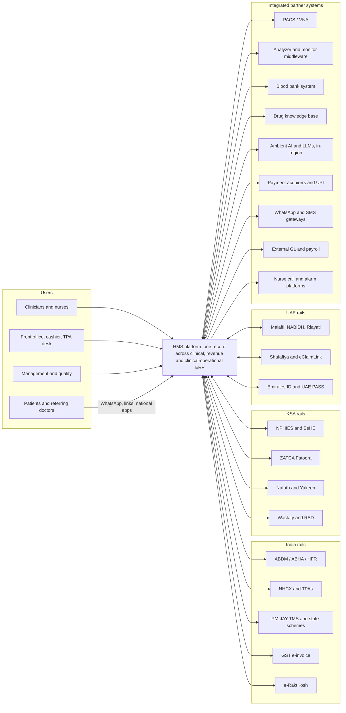
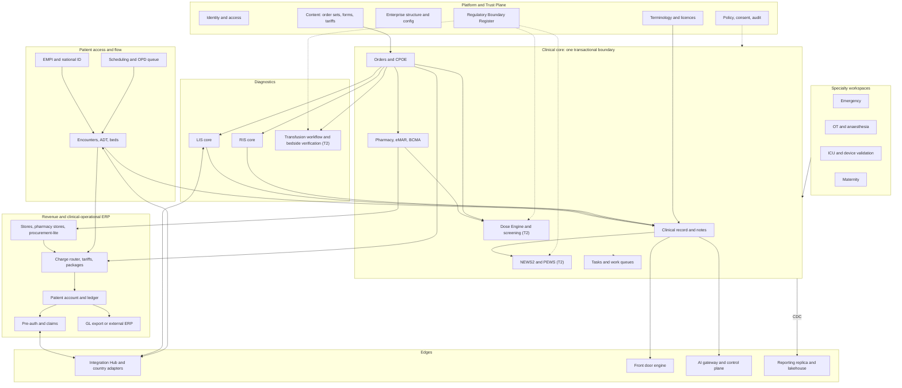
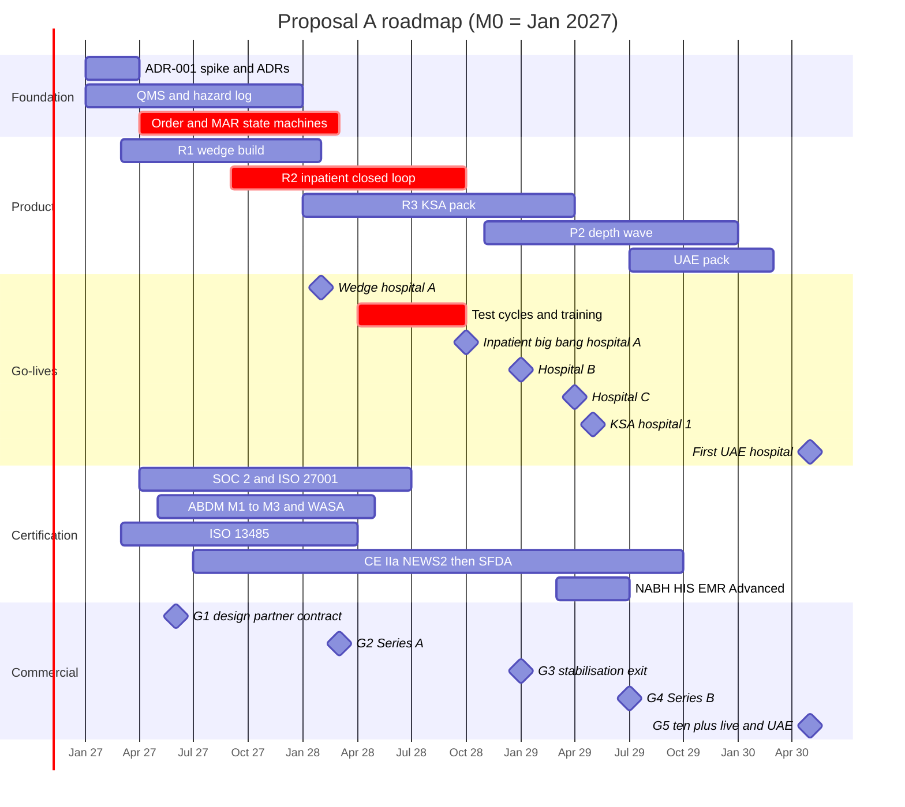

# Proposal A: Market- and Business-First Master Blueprint for a World-Class Hospital Management System

## 0. Document control

| Field | Value |
|---|---|
| Document / version | Proposal A ("market and business first"), v0.9 competition draft |
| Date / status | 16 October 2026. Proposal for the judge panel. Planning only; no code. |
| Lens | Founder-CEO who has built and sold a hospital software company in India and the Gulf, paired with a healthcare go-to-market strategist. Business viability organises every choice. Clinical safety and architecture are covered in full, because in this segment they are what customers buy. |
| Inputs | R01–R16, GLOSSARY, Reconciliation Log (RL). RL wins over individual reports unless §19.2 lists an argued deviation. |
| Calendar anchor | **M0 = 1 January 2027** (seed closes Q4 2026). M13 = Feb 2028, M21 = Oct 2028, M30 = Jul 2029. Regulatory deadlines are absolute dates, so plans must be too. |
| Conventions | US$1 ≈ ₹88 ≈ SAR 3.75 ≈ AED 3.67 (R12). [E] = our estimate; [K]/[U] = unverified items inherited from the pack. |

**How to read this document.**
- §1: the argument.
- §2–4: market and product.
- §5–12: safe build.
- §13–18: delivery, team, money, go-to-market and risk.
- §19: open items and deviations from the Reconciliation Log (RL).
- Appendix: traceability to the research reports.

**Reference key.**
- R01 vendor landscape · R02 open source · R03 clinical workflows · R04 diagnostics/pharmacy/devices
- R05 RCM/ERP/operations · R06 interoperability · R07 security/regulation · R08 architecture
- R09 AI/analytics/front door · R10 implementation/UX · R11 domain model · R12 business plan
- R13 India/KSA/UAE beachhead pack · R14 requirements catalogue/MVP · R15 safety/QMS/migration · R16 facility and peripherals
- "RL #n" = Reconciliation Log item n.

---

## 1. Executive summary

**The bet.** Private multispecialty hospitals of 150–400 beds in India and the Gulf need two things that no vendor sells together:

- **tier-1 closed-loop safety:** CPOE, pharmacist verification, BCMA, bedside transfusion checks;
- **local-HIS rails and billing:** ABDM, NHCX/TPA, NPHIES, ZATCA, Malaffi, pay-first packages and supply chain.

Local suites win on checklists and price, but none shows public BCMA evidence. Epic, Oracle and InterSystems win on depth but are weak on regional billing and price (R14 §8.2; R01 §10.1). We sell **"closed loop at local prices, with the rails built in."**

**Where.**
- **India** builds and proves the product: talent, the NABH certification flywheel, price discipline.
- **Saudi private groups** fund the business. A GCC hospital is worth about **6.4× the ACV** of an Indian one (R12 §11).
- **The UAE** follows as Wave 1b (RL #9).
- **No public tenders** until we have references.

**How we get revenue early without hurting anyone.**
- Design partner #1 (DP#1) is an Indian NABH group with **≥3 hospitals**. NABH HIS/EMR certification needs three live hospitals plus ABDM M3 (R13 §3.3).
- At a **non-flagship** member hospital ("hospital A") we go live twice:
  - an **OPD + revenue + LIS + outpatient-pharmacy wedge at M13**, which carries no inpatient medication hazard;
  - a **full inpatient + ED big bang at M21**, behind contractual readiness gates (R12 §3.3; R15 §10.3; RL #10–#11).
- Two more member hospitals, B and C, follow at M24 and M27.
- NABH HIS/EMR Advanced certification lands at about M30. The first KSA hospital goes live at **M28** through a CST-licensed hosting partner.

**What it costs.**
- About 140 FTE at the first inpatient go-live, rising to about 300 in year 5.
- **US$96M of operating cost over five years** against **US$33M of revenue**, for **about US$64M of cumulative net burn**. That is below R12's US$69M base case, and our year-5 burn is US$12.4M against R12's US$15.1M.
- The savings come from paid design partners, a paid wedge, GCC prime-contracted implementation and a year-5 headcount capped near 300.
- Funding is **US$75M of equity** plus a **US$10M venture-debt facility**:

  | Round | Amount | When |
  |---|---|---|
  | Seed | US$10M | M0 |
  | Series A | US$25M | G2, about M14 |
  | Series B | US$40M | G4, about M30 |

- Operating breakeven comes in **year 7, at about US$30–35M ARR**.

**What we will not do.**
- Build PACS, alarm routing, drug knowledge bases, a blood compatibility engine or speech models.
- Ship unregulated deterioration alarms.
- Fork code per customer.
- Sign penalty-free SLAs above 99.95%.
- Pursue US/ONC certification before a 2030 go/no-go decision.

### The decisions that matter

| ID | Decision | Rationale | Evidence |
|---|---|---|---|
| D-01 | Beachhead: private hospitals and groups of 150–400 beds in India and KSA; UAE in Wave 1b | Underserved on price by Epic and on depth by local vendors; GCC ACV about 6.4× India's | R01 §11–12; R12 §11; RL #9 |
| D-02 | Proposition "closed loop at local prices, rails built in". Every demo opens with CPOE → verify → BCMA → transfusion → NHCX/NPHIES claim from the same encounter | This is the empty cell in the competitive matrix | R14 §8.2, §11 #3 |
| D-03 | DP#1 is an Indian NABH group with ≥3 hospitals; the first go-live is at a non-flagship member | Meets NABH's 3-site rule; complies with RL #11 | R12 §9.1; R13 §3.3; RL #11 |
| D-04 | At hospital A: OPD/revenue/LIS wedge at M13, then inpatient + ED big bang at M21 | Earlier revenue, PHI and SOC 2 evidence without medication hazard | R12 §3.3; R15 §10.3 |
| D-05 | Scope of record is R14 Appendix A (140 MVP features). Capacity is planned at about 1,250 squad person-months | R14 sizes feature coding only; validation does not compress | R14 §3; R12 §4 |
| D-06 | **Native:** LIS core, RIS core, pharmacy, stores. **Always integrated:** PACS, analyzer middleware, drug KB, blood compatibility/BECS, alarm routing | Buyers evaluate one HIS; device and content liability sit with specialists | R14 §4 #1; R04 §8.2; R15 §5.2 |
| D-07 | ADR-001: one PostgreSQL database per tenant, FHIR-shaped JSONB facts, generated FHIR R4 façade, Kotlin modular monolith; gated by a 6–8-week spike | Absorbs R6 churn, enforces invariants, runs on any sovereign cloud | RL #1, #7; R08 §3.11 |
| D-08 | Cloud-portable sovereign cells. KSA hosted via a CST-licensed partner. UAE cells built to ADHICS v2: UAE-only including DR, customer-held keys, UAE-resident support | No Azure or AWS region in KSA; ADHICS is the strictest regime | R13 §8.1, §11 #4 |
| D-09 | One ISO 13485-based management system from M0. Regulated modules: NEWS2/PEWS, Dose Engine plus medication screening, bedside transfusion verification. Sepsis screen moves to P2 | These functions are devices in most of our markets; notified-body queues run 13–18 months | R15 §1, §4–5; RL #5–#6 |
| D-10 | Country packs are owned products with SLAs, each with its own product manager | National-rail gates decide elimination | R13 §11 #2; R14 §8.4 |
| D-11 | India bundle ₹2,100–3,000 per bed-month (list); GCC US$120–170. Fixed-fee implementation with a 10–20% outcome holdback | About 2.5× commodity Indian pricing; TCO-competitive with ~US$5K-per-bed GCC deals | R12 §12; R01 §4 |
| D-12 | SLA per RL #8: T0 write path 99.95%, read and continuity 99.99%. Price the SLA, engineer the SLO | Single-writer Postgres cannot prove 99.999% | RL #8; R14 §9.2 |
| D-13 | Customers #1–#3 in-house; from #4, India uses certified partners. In the GCC we stay prime contractor with a Gulf subcontractor | Keeps the methodology ours; services ≤42% of revenue by year 5 | R12 §10.5; R10 §10.2 |
| D-14 | No public tenders before G5 (about M40). In India, enter only as the IP-owner OEM behind an SI. Decide on a KSA regional HQ at M24 | Turnover/CMMI eligibility walls, L1 pricing and the RHQ rule | R14 §6; R12 §10.4 |
| D-15 | AI runs in the workflow, governed, on partner models. MVP: gateway and control plane, multilingual OPD ambient (≥2 partners), discharge drafts. Priced at ≥30% margin. GenAI off in KSA/UAE unless in-region | AI is a tiebreaker, not a gate; residency rules | R09 §9; R14 §4 #11; R13 §11 #12 |
| D-16 | Front door = WhatsApp/SMS, links and national apps. Full patient app in P2 | National apps own the patient relationship | R13 §11 #11; R14 §4 #5 |
| D-17 | Native clinical-operational ERP. GL export in the MVP, lite GL in P2, payroll always integrated | The supply-to-charge join is our edge over bolt-ons | RL #3; R14 §4 #7 |
| D-18 | US$75M equity plus a US$10M debt facility; operate to the Lean plan until G3 | ~US$64M burn plus buffer | R12 §6, §13 |
| D-19 | Wave 2 = Oman, Bahrain, Qatar and Kuwait from M42; Indonesia decided at G6; US go/no-go no earlier than 2030 | Highest ACV per incremental dollar (deviation from RL #9) | R13 §7; R12 §11 |
| D-20 | One GCC and one Indian strategic investor at A or B, each ≤10–15%, with no exclusivity and no data rights | Counters vendor-viability doubts | R12 §13.3; R01 §12.4 |

---

## 2. Vision, product thesis, positioning and differentiation

**Vision.** Be the default system of record for private hospital groups across the India–Gulf corridor by 2032: 50+ hospitals, about 12,000 beds and two EMRAM Stage 6/7 references. That platform then funds the next markets.

**Thesis.**
1. **Safety by construction sells.** Server-side invariants, closed loops and a per-release safety case are demonstrable and auditable, and no incumbent in our segment offers them (R03 §1; R15 §11 #9).
2. **Rails are product, not projects.** National integrations ship as owned, versioned country packs on one code base (R05 §9.2; R13 §11).
3. **One record joins clinical, revenue and supply.** Charges flow from clinical events and consumption becomes a charge. This is the CFO's reason to buy (R01 §10.1; R05 §8.1).
4. **Implementation is a product.** Foundation content, a migration workbench, readiness scoring and cutover orchestration make go-lives repeatable (R10 §10; R15 §9.8).
5. **Open by default.** Free FHIR APIs, free bulk and database export, and escrow answer the first objection every buyer raises: will this vendor survive? (R12 §12.3)

### 2.1 Competitive positioning

| Competitor | Strength | Weakness in our segment | Our play |
|---|---|---|---|
| **Epic** | Single record, Foundation content, network effects, AI inside the EHR | Price (Charité ≈ €65K per bed); "not always localized"; no regional billing; no ERP (R14 §8.1; R01 §10.1) | Avoid academic and tertiary sites. At private groups, win on a 7-year TCO about 50–70% lower [E], native NPHIES/NHCX, Arabic-first UX and the ERP join |
| **Oracle Health** | GCC installed base; EHR+ERP bundle | The new EHR has no acute GA; platform discontinuity; VGR exit (R01 §2.3) | "No rewrite, ever" (evergreen); Millennium migration pack |
| **InterSystems** | NPHIES interoperability; MDR IIa | Weak end-user experience and billing (R14 §8.1) | Win on UX and billing; match on QMS credibility |
| **IQVIA HIS** | Saudi public clusters; KLAS ME 82.0 | Implementation complaints | Avoid public deals until G5; compete on implementation tooling |
| **ezCaretech** | About US$5K per bed one-time | Brand, scale | 7-year TCO; rails; Arabic UX |
| **MEDITECH, Dedalus** | US community hospitals; DACH | No India/GCC presence | Not regional competitors |
| **Indian locals** (KareXpert, Insta, Akhil, Suvarna, Athma) | Module checklists, ABDM, NABH Advanced, ₹800–1,000 per bed per month | No public BCMA evidence; 20–40% renewal hikes (R12 §12.1) | Closed loop and NABH Core OEs; capped price uplift; ABDM-bundle importer (R15 §1 #12) |
| **GCC locals** (Balsam, ATS CareWare) | Price, Arabic, NPHIES | Tertiary depth | Closed loop, ZATCA, denial analytics |
| **Open source** (OpenMRS/Bahmni, CARE, Medplum) | Free; LMIC public sector | No closed loop; shallow RCM; steward risk (R02 §6) | Reuse ancillary OSS as separate services |

### 2.2 Why buyers switch

| Trigger | What we sell into it |
|---|---|
| **India:** NABH 6th edition (639 OEs; KPIs computed by the HIS) and Digital Health Standards (17 Core OEs) | Accreditation-pack engine; Core OEs met by configuration (R13 §3.1–3.2) |
| **India:** IRDAI 1-hour cashless and 3-hour discharge rules; NHCX pushed through Aarogya Setu 2.0 | TPA state machine with SLA timers; NHCX native (R13 §3.5–3.8) |
| **KSA:** NPHIES elimination gates and ZATCA Phase 2 · **UAE:** Malaffi linked to licence renewal and ADHICS v2 | NPHIES-native billing and a ZATCA-compliant, CST-hosted cell; UAE cell built to ADHICS (R14 §1 #7; R13 §1) |
| Renewal shocks, vendor-viability fear, chain M&A and PE roll-ups | 3–5% uplift cap, escrow, free export, group tenants and Group Connect (R12 §12.3; R01 §11 #7) |

---

## 3. Target market, ICP, beachhead and market-entry sequencing

### 3.1 Ideal customer profile

| Attribute | India | KSA (Wave 1) | UAE (Wave 1b) |
|---|---|---|---|
| Entity | NABH-accredited private hospital or chain (3–15 sites); PE platforms | Private group of 2–10 hospitals | Abu Dhabi private hospital, then Dubai |
| Beds per site | 150–400 (design point "MVH-200") | 200–500 | 150–400 |
| Payer mix | Cash 35–50%; TPA 30–45%; government schemes 10–25% (R14 §2) | NPHIES insurance 55–70%; cash 15–30% | Daman/Thiqa and private insurance |
| Buying committee | Promoter/MD, CFO, medical director, nursing head, TPA desk, NABH coordinator (R12 §10.2) | CEO, CFO, CIO, CMIO, revenue-cycle head, DPO; Big Four advisers | Same as KSA, plus DoH/DHA compliance |
| Sales cycle | 4–9 months (single site); 9–15 months (chain) | 9–18 months | 9–18 months |
| Avoid in Y1–3 | State tenders; sites under 100 beds; clinics (eSushrut is free) | HHC tenders without a regional HQ | Government mega-deals |

The ICP band is 150–400 beds rather than RL #4's 100–300. Below 150 beds, ACV falls under US$45K, which cannot yet pay for a closed-loop implementation (DEV-5).

**India builds and proves; the GCC pays.**
- India gives us loaded engineers at US$45–60K, NABH certification and high-volume test beds (800–1,500 OPD visits a day).
- The GCC gives us ACVs of about US$504K, against about US$79K in India (R12 §11).
- **Covenant:** at least 60% of ARR comes from the GCC by year 5. If it is below 50% at G5, we cut costs or re-price.

### 3.2 Entry waves and gates

| Wave | Market | Entry criteria | Go-live / gate | Kill or redirect trigger |
|---|---|---|---|---|
| 1a | India | Seed closed; DP#1 contract; India cell; ABDM sandbox | Wedge M13; inpatient M21 | If G2 slips past M18, narrow to an India "HIS core + LIS + RCM" product (R12 §15) |
| 1 (KSA) | KSA private | Indian wedge live; KSA entity (M9–M12); hosting/integration partner; DP#2 LOI by M12, contract by M15 | NPHIES production M27; go-live M28 | If there is no DP#2 by M18, the UAE becomes the first Gulf market |
| 1b | UAE | A signed customer (target M30–M34; no speculative build); cell to ADHICS v2; Malaffi onboarding started ≥2 months ahead | Pack build M30–M38; go-live M40–M42 | If there is no contract by M36, defer the pack |
| 2 | Oman, Bahrain, Qatar, Kuwait (DEV-7) | ≥2 GCC references; Arabic content mature (R13 §7) | Selling from M42 | If deals are lost on local rails, resell through partners only |
| 2b / 3 | Indonesia or Kenya; EU/UK/AU/CA; DACH via partner; US | Funded anchor; no-regret engineering only (IPS, EHDS-shaped logging, DCB0129); no certification spend before M36 | G6 (≈M60); US review ≥M48 | — |

---

## 4. Product scope: module catalogue and release packaging

### 4.1 Every release is sellable

**Scope of record.** R14 Appendix A is the scope of record: 214 features, of which 140 are MVP, 54 are P2 and 20 are P3. We load it into the tracker unchanged (R14 §11 #1). We add one thing: a mapping of features to releases, where each release is a tier a hospital can buy.

| Release | GA | What the hospital can run | Sold as | R14 features | R14 effort (eng-weeks) |
|---|---|---|---|---|---|
| **R1 "Wedge"** | M13 | EMPI/registration, OPD queue, OPD chart and orders, outpatient pharmacy POS, LIS core, RIS core with PACS launch, self-pay/package/TPA/NHCX billing, GST, stores, procurement-lite, ABDM M1–M2 (M3 by M16), WhatsApp front door, MIS. Includes the whole platform and Trust Plane | Core HIS tier | **98** (34 platform/trust + 64 functional) | ≈1,447 (77%) |
| **R2 "Inpatient closed loop"** | M21 | ADT/beds, inpatient CPOE, pharmacist verification, eMAR/mobile BCMA, nursing, ED, OT + anaesthesia record + WHO checklist, ICU flowsheet with monitor feed, bedside transfusion, NEWS2/PEWS (regulated; India first), discharge, coding, AI discharge draft | Clinical Safety tier | **38** | ≈372 (20%) |
| **R3 "KSA activation"** | M27 | NPHIES, SeHE, ZATCA, Nafath/Yakeen, SBS/ICD-10-AM, CBAHI pack, Arabic/Hijri hardening | KSA pack (bundled) | 2 market-gated + 8 multi-market activations | 28 + activation (R12: 40–60 PM) |
| **UAE pack** | M38 | Malaffi/NABIDH/Riayati, Shafafiya/eClaimLink, EID reader, ADHICS controls, CPT/DDC | UAE pack (bundled) | 2 market-gated + activations | 28 + activation (R12: 35–50 PM) |
| P2 / P3 | M24–M40 / M36+ | See §4.2 | Add-ons | 54 / 20 | ≈611 / ≈400 |

The four releases total 98 + 38 + 2 + 2 = 140 features. The mapping is ours, applied to the R14 CSV.

**What the split shows.**
- **The wedge is not a shortcut.** It carries 77% of MVP feature effort, because it includes the platform.
- **Inpatient is small in code but heavy in risk.** It is 20% of the code but holds most of the hazards and validation work. It therefore gets eight months of hardening and three test cycles (R15 §7).

**Effort reconciliation.**
- R14's 1,875 engineer-weeks equal about 433 engineer-months of feature coding.
- R12 sizes the MVP at 1,055–1,645 squad person-months (PM). That figure includes QA, design, integration and rework.
- We plan about **1,250 squad PM**. About 1,050 PM must be done by M21, which matches R12.
- AI tools save 10–15%, on coding-heavy epics only.

### 4.2 Module catalogue

**Phase key:**
- **R1 / R2:** MVP releases (M13 / M21).
- **P2:** M24–M40.
- **P3:** M36 or later.
- **Stance:** B = build, I = integrate, P = partner.

| Domain | R1 | R2 | P2 | P3 | Stance |
|---|---|---|---|---|---|
| **Access / ADT** | EMPI with reversible merge; national IDs (ABHA, Nafath/Iqama, EID); aliases; registration with sponsor | ADT; bed state machine with housekeeping (EVS) and isolation status; non-blocking discharge clearance | Transfer centre | — | Build; card readers via the shell's hardware layer (R16) |
| **Scheduling / OPD** | Scheduling; token queue and displays; ABDM Scan-and-Share | — | Referral tracking; kiosks | — | Build; Rajasthan QMS/01–12 as acceptance tests |
| **Clinical core** | Banner standard; coded problems and allergies; CPOE (OPD); drug-KB checks; CDS telemetry and Leapfrog harness; notes | Inpatient CPOE; VTE; discharge with bilingual after-visit summary (AVS); HIM; med reconciliation; I-PASS; results inbox; restraint timers; code status | Copy-forward provenance; CDS Hooks/CQL; **sepsis screen (regulated)**; HAI surveillance; stewardship | Specialty kits | Build; drug KB from a partner ("license, never build") |
| **ED** | — | Configurable triage; tracking board; stroke/STEMI/sepsis clocks; boarding view | MCI mode | Triage AI (partner) | Build; nurse-assigned triage is non-device |
| **Nursing** | — | Flowsheets; risk scores; care plans; worklists; **NEWS2/PEWS/MEOWS (Regulated Module #1)** | Nursing ambient documentation | Acuity staffing | Build; chart by exception |
| **Pharmacy** | Formulary with LASA and high-alert flags; outpatient POS; controlled-drug registers | Verification; dispensing; eMAR; **mobile BCMA with offline mode**; infusion data model | Pump autoprogramming (one vendor, once BCMA ≥95%); ADC; chemotherapy; national e-Rx | IV compounding | Build; **Dose Engine and drug screening are Tier 2** |
| **Diagnostics** | Shared order lifecycle; closed-loop critical results; LIS core; RIS core; PACS launch plus a bundled OSS PACS tier | **Bedside transfusion verification (T2)**; blood-bank interface | Microbiology; POCT; dose capture; blood-centre operations without compatibility logic | Anatomic pathology; ISO 15189 document control; imaging AI | LIS/RIS built; middleware integrated; **PACS never built** |
| **Periop / ICU** | — | OT booking; WHO checklist; intra-op record with implant charging; anaesthesia record; ICU flowsheet with validated monitor feed | Full AIMS; OR analytics; severity scores | Tele-ICU | Build; **alarm forwarding never built** |
| **Maternity and allied** | Statutory registers (MLC, Form F, NDPS, BMW, CRS) | Labour and delivery; newborn record; diet; death certificate; statutory returns | Partograph; NICU with human-milk tracking; rehab; CSSD; oncology | Dialysis | Build |
| **Revenue cycle** | Patient ledger; charge router; tariffs and packages; deposits/UPI; GST/ZATCA engine; pre-authorisation and claims; **NHCX + PM-JAY + TPA**; schemes; denial queues | Coding and CDI | NPHIES (R3); UAE e-claims; grouper SPI; AI coding and claim scrubbing | Costing; US RCM | Build; groupers integrated |
| **ERP** | Stores; FEFO; consumption-to-charge; procurement-lite; GL export; staff privileging | — | Lite GL; ERP connectors; UDI; CMMS; rostering | — | Native; **payroll always integrated** |
| **Quality / analytics** | Incident reporting; KPI capture; accreditation-pack engine; reporting replica; MIS | Go-live safety dashboard | Lakehouse with OMOP; command-centre data; EMRAM packs | Predictive discharge | Build on OSS |
| **Patient / referrer** | WhatsApp/SMS; booking, payment and report links; national PHR push | — | **Full patient app**; teleconsultation; CRM; **referrer portal with consent, no commission features** | RPM; in-basket AI | Build; integrate national apps |
| **AI** | Gateway; control plane; OPD ambient (≥2 partners) | Discharge draft | Chart summary; patient explanations | — | Platform built; models from partners |
| **Admin / implementation** | Configuration as a product; country packs; forms; foundation content; migration workbench; readiness and cutover tools; telemetry | — | Plugin SDK; governance portal; partner academy; on-prem install | Edge cell | Build |

---

## 5. Clinical safety, quality and regulatory classification

### 5.1 Safety invariants

These are enforced server-side on every channel. Each one has a hazard-log ID and a property-based test (R11 §15; R15 §11 #11).

1. **Two identifiers** at every specimen collection, administration, transfusion and procedure. The banner always shows a photo. One patient context per session.
2. **Merges are reversible links.** A known overlay is never loaded during migration.
3. **Every administration references an active, verified order** or a documented override. A scan mismatch triggers a stop. High-alert drugs require an independent double-check.
4. **No dose arithmetic outside the versioned Dose Engine.** Weights are metric only, dated and sourced. Every dose has a UCUM unit.
5. **No orphaned work.** Every order, result, message, referral and letter has an owner and an SLA timer. Unroutable items alarm. An orphan count of zero is a go-live gate (the VA "unknown queue" lesson, R10 §5.1).
6. **Critical results go to a named recipient** with read-back and escalation, never to free text.
7. **Records are immutable.** Signed notes change only by addendum or amendment. AI content stays labelled until a human signs it. Deletion means "entered-in-error".
8. **Location history is the only source** for census, bed-days and bed charges.
9. **Back-entry keeps the original clinical times.**
10. **Bill clearance never blocks clinical discharge.**

### 5.2 Closed loops

Each loop has a nightly end-to-end scenario suite.

| Loop | Path | Release | Target |
|---|---|---|---|
| Medication | CPOE → Dose Engine and screening → verify → dispense → BCMA → MAR → PRN reassessment | R2 | Scans ≥95%; 100% unit coverage (Leapfrog as an internal test) |
| Transfusion | Order/consent → bedside-labelled sample → blood-bank interface → issue → **T2 bedside verification with two-person electronic witness** → reaction capture | R2 | Bedside scan ≥98% |
| Specimen / critical result | Order → label → collect → receive → result → named-recipient acknowledgement | R1 | Rejection <1%; critical results ≥95% within policy |
| Transitions | Pending-at-discharge and post-discharge result queues | R2 | Abnormal results unacknowledged >7 days → 0 |
| Revenue | Clinical event → charge → bill/package → pre-auth/claim → remittance → denial queue | R1 | Charge lag ≤2 days; DNFB ≤4 days |

### 5.3 QMS and clinical safety case

**Management system.**
- One ISO 13485-based management system for the whole company, integrated with ISO 27001. There is no "13485 island", because shared services would otherwise need SOUP qualification every release (R15 §2.1).
- ISO 13485 certification by **M15**.
- Build to IEC 62304:2006+A1, structured so it maps onto Edition 2 (forecast 26 Oct 2028).

**Rigour tiers.**

| Tier | Scope | Controls |
|---|---|---|
| Tier 0 | Billing, ERP | Standard process |
| Tier 1 | ADT/EMPI, CPOE, eMAR/BCMA, results routing, downtime | DCB0129 hazard log, a safety case per release, CSO sign-off |
| Tier 2 | NEWS2/PEWS, Dose Engine, screening, transfusion verification | Full design controls, ISO 14971, IEC 62366-1, post-market surveillance |

**Safety tooling.**
- A hazard-log service is wired to the backlog. CI blocks any unverified control.
- Every release generates an evidence pack and a deployment-safety kit for the customer. We sell both as differentiators (R15 §11 #9).

**People and budget.**
- A Head of QA/RA and a Chief CSO are in post by M3.
- One product CSO per 2–3 clinical squads.
- Regulatory budget: US$0.5–1.0M over 30 months (R15 §11 #18).

### 5.4 Device/SaMD posture per market

A **Regulatory Boundary Register** (function × market × intended purpose × class × status) switches Tier 2 features on per tenant. Feature toggles cannot (R15 §11 #2).

| Function | India / KSA / UAE | EU-GB / US (later) | Posture and dates |
|---|---|---|---|
| **NEWS2/PEWS + escalation tasks** | Device (likely B) / device under MDS-G27 (B/C) / [U] | MDR IIa, GB Class I / alerting = device | **Regulated Module #1.** Intended purpose written for the minimum class. India registration via the state route by **M20**. CE IIa by **M30** (notified-body process starts at M6), then SFDA by reliance (~M33). Until registered, a market runs observation charting with frequency scheduling and nurse-assigned escalation (R15 §5.1) |
| Sepsis screen (rules) | Device (C) / device (C) / [U] | IIb / device | P2, Regulated Module #2; non-interruptive; ML from cleared partners only (DEV-2) |
| Dose Engine | Device (B/C) / device | Device / plausibly non-device | Tier 2, Class C, from the first commit |
| DDI/allergy/dose-range screening | Likely device (B) / likely device | MDSW IIa / non-device CDS | Tier 2. The knowledge-base vendor carries the content's status; our layer is "presentation and local tiering" |
| BCMA/eMAR | Likely excluded / not a device | Non-device | Tier 1 |
| Bedside transfusion verification | [U] | Borderline / BECS | Tier 2, Class C. Written opinion per market before first use, as RL #5 requires in v1 everywhere. No US sale without a cleared partner |
| Blood compatibility engine | IVD-like | IVD / BECS | **Not in v1.** P2 blood-centre operations carry no interpretation logic. Compatibility only as a P3 IVD-grade product (R15 §5.2; RL #5) |
| Pump autoprogramming | Inherits the pump's class | IIb risk | P2: one vendor, a vendor intended-use letter, orders not commands |
| Alarm forwarding | Device (C) | IIb / Class II (MSX) | **Never build.** Integrate Vocera, Ascom or Spok |
| AI documentation | Non-device unless it suggests a diagnosis (a device in KSA) | Speech-to-text non-device | Non-device SKU; output classifiers block diagnosis and treatment suggestions (R15 §4.2j) |

### 5.5 Accreditation traceability

The **accreditation-pack engine** follows one chain: chapter → standard → objective element (OE) → evidence query or attestation → KPI (numerator, denominator, sampling) → manual fallback (R13 §11 #3). The primary trace is NABH/JCI/CBAHI/DoH (RL #9).

| Pack | Coverage | When |
|---|---|---|
| NABH 6th edition | 639 OEs, including 105 Core: AAC.2.b UHID, COP.1.b two identifiers, MOM.3/4, IPC.2.f, nine IMS Core OEs, AAC.5.a EWS effectiveness. Plus 32 general and 18 department KPIs | R1/R2 |
| NABH Digital Health Standards | 17 Core OEs met by configuration | R1 |
| NABH HIS/EMR V12.1 | 171 HIS and 166 EMR OEs; Advanced level | ≈M30 |
| CBAHI (current manual bought) | — | R3 |
| JAWDA | — | UAE pack |
| JCI 8th edition | Configuration only | P2 |
| Leapfrog CPOE/BCMA, EMRAM 6/7, China L6 | Internal nightly acceptance suites from M9: ≥60% catch rate and zero alerts on the "should not alert" set | Nightly from M9 |

---

## 6. UX and clinician-experience strategy

**Why UX is a business lever.**
- Physicians rate EHRs at a SUS of 45.9 and nurses at 57.6. Each SUS point lowers burnout odds by 2–3% (R10 §2).
- KLAS scores are driven by implementation, training and promises kept (R14 §7.1).
- In India the decisive moment is the OPD consultant seeing 60–100 patients a day. **Speed is the product.**

### 6.1 Role-based workspaces (one design system)

| Workspace | Signature capabilities |
|---|---|
| OPD consultant | Token-driven queue; one-screen visit; favourites and order chips; multilingual ambient draft (EN/HI/AR + regional); brand→generic e-Rx. **Median documentation ≤90 s per follow-up visit** [E] |
| Inpatient physician | Team list, I-PASS handoff, order sets, results inbox, cited AI discharge draft |
| Nurse | Charting by exception; mobile BCMA; NEWS2 tasks. Fields tagged regulatory, measure or local, and retired through governance (R10 §10.1) |
| Pharmacist / lab / radiology | Tiered screening with STAT ≤15 min timers; autoverification; QC; critical-call log; RIS protocoling |
| Front office / cashier / TPA desk | Deposits, running bill, package-overrun alerts, 1 h / 3 h pre-auth timers, document packs, deduction reasons |
| OT / ICU / ED / management | Live boards ≤2 s fresh; checklists; MIS including NABH KPIs |

### 6.2 Design rules

- **Speed and safety in the UI.** Keyboard-first, with a command palette. No stacked modals. Defaults never pick a dose, route or patient (R10 §3.3).
- **Documentation is synthesis, not accumulation.**
  - Notes are built from structured data first.
  - Every text span carries its provenance.
  - Copy-forward text is marked.
  - Changes since the last note are shown.
  - Documentation profiles are set per jurisdiction (R10 §10.1).
- **Alerting:**
  - Interruptive alerts only for Level-1 DDIs, true severe allergies, high-alert dose limits and fatal routes. Everything else is passive or goes to a queue.
  - Every rule has an owner, an expected firing rate and a retire-by date.
  - A rule runs silent for 2–4 weeks, then is replayed against 90 days of data, before it may interrupt (R03 §3; R15 §5).
- **Mobile:** one React Native clinician app with BCMA, specimen collection, ambient capture and an encrypted read-only offline cache.
- **Accessibility:** WCAG 2.2 AA with a VPAT.
- **Language:**
  - full Arabic RTL with bidi isolation;
  - Umm al-Qura Hijri shown beside Gregorian;
  - Arabic four-part names with transliteration search;
  - bilingual PDF/A documents from one source;
  - Hindi plus at least four Indic scripts on labels and wristbands, with golden-image print tests (R13 §6; R16 §9.1).
  - **Professional clinical translation is reviewed by clinicians; partially translated clinical paths never ship** (the Sundhedsplatformen lesson).
- **Gulf workflows:** same-gender clinician preference, Ramadan mode with suhoor/iftar eMAR templates, tenant weekends. These are L1: delivered within six months of the first KSA go-live.

### 6.3 Usability targets

| Metric | Target | Anchor |
|---|---|---|
| SUS, physicians / nurses at 12 months | ≥68 / ≥72 | Industry 45.9 / 57.6 |
| NEES, physicians / nurses at 12 months | ≥35 / ≥55 (stretch 60 / 75) | Averages 23.4 / 47.3 |
| Summative usability | 15–20 users per group; Arabic-first and English-first are separate groups | R15 §5 |
| Release blocker | Task time worsens by more than 10%, or a new critical use error appears | R10 §5 |
| Login / badge tap-to-switch | ≤5 s / ≤2 s | R14 §9.1 |
| Training | 6–11 h per clinician; ≥95% complete, ≥85% proficient | R10 §5 |

---

## 7. Architecture and technology

The architecture has four commercial jobs:
- Run on any sovereign cloud that a Gulf regulator allows.
- Make each new hospital a configuration task, not a code branch.
- Keep hosting at or below 12% of subscription revenue.
- Pass a CIO security questionnaire on first read.

These positions are the reconciled pack positions unless §19.2 lists a deviation.

### 7.1 ADR register

| ADR | Decision | Evidence |
|---|---|---|
| 001 | Domain-owned PostgreSQL with **one database per tenant**. Clinical facts are stored as FHIR-shaped JSONB. ADT, orders, MAR, charges and inventory are domain tables with state machines. A generated R4 façade serves reads; writes go through domain commands. Uses HAPI libraries; Medplum is a reference only. **Gated by a spike** (6–8 weeks, M1–M3, 1,000-bed workload) | RL #1; R08 §3.11 |
| 002 | Kotlin/JVM, Spring Boot + Modulith. Switch to C#/.NET only if the founding team is .NET-native (decided at M1). | R08 §12.5 |
| 003 | Modular monolith plus satellites. Orders and Meds share one transactional boundary. Ship as containers on Kubernetes, which satisfies tender "microservices" wording. | R08 §4.1; R14 §4 #9 |
| 004 | **Event sourcing lite.** Current-state tables and a bitemporal journal are written in one transaction. The outbox feeds Debezium → Kafka (keyed by patient), using CloudEvents. Full event sourcing only for order/MAR, by a later ADR. No hidden dead-letter topics. | RL #7 |
| 005 | Tenant = contracting enterprise. One database per tenant, in cells of 10–20 hospitals. A pooled RLS tier for hospitals under 100 beds (P2). | R08 §5; R12 §7.3 |
| 006 | Configuration chain: foundation → country pack → tenant → legal entity → facility → unit, with `locked` settings. Signed bundles are promoted BUILD→TEST→TRAIN→PROD. **No customer branches.** | R08 §5, §9 |
| 007 | A native Integration Hub owns MLLP/v2, FHIR, DICOM and national adapters, with ack state and replay. OIE or the customer's engine is optional, for site transforms only, under a patch-lag policy. | RL #12 |
| 008 | **Trust Plane:** identity, policy, audit, keys, residency, retention and de-identification. No data access is possible without the Policy and Audit SDKs. | R07 §9.1 |
| 009 | The same signed artifacts run in SaaS, sovereign, on-prem (P2) and edge (P3) deployments, on Kubernetes + CloudNativePG. No proprietary managed health APIs on the critical path. | R08 §6; R13 §8.1 |
| 010 | Offline rules: facts are append-only and commands are revalidated by the server. No last-writer-wins merging. Never offline: new prescribing, bed or OT allocation, controlled-drug stock | R08 §6.3; R14 §9.3 |
| 011 | Edge planes: (A) shell HAL, (B) site edge agent, (C) cloud adapters. Each integration uses the lowest plane that meets its downtime need | R16 §17 #1 |
| 012 | AI gateway (region pinning, zero retention, PHI minimisation, version pinning) plus a grounding service and a control plane. Agents use public APIs only. | R09 §9.1 |
| 013 | Regulated Tier 2 modules are separately versioned, with documented separation and their own release train. | R15 §2; R13 §11 #6 |
| 014 | Finance runs on internal aggregates. The external API exposes R6-core resources only (Account, Claim/ClaimResponse, Coverage, eligibility, EOB, PaymentNotice/Reconciliation) plus national IGs. | RL #2 |
| 015 | Temporal (MIT) for discharge, prior auth, claims and cutover. Never for order/MAR state. | R08 §4.4 |
| 016 | React/TypeScript SPA; Tauri 2 shell (silent ZPL printing, scanners, badges); React Native mobile. | R08 §8 |
| 017 | Per-tenant envelope keys. In KSA and the UAE, keys are customer-held in an external KMS/HSM that we cannot access. | R13 §11 #4 |
| 018 | Code sets and groupers are versioned by date of service, stored as data (system, version, from, to, payer). Version switches are tested in CI. | R13 §11 #5 |

### 7.2 System context

### 7.3 Bounded-context map

Derived from R08 §12.4 and R11. "(T2)" marks a regulated module.

### 7.4 Event model

- Each domain event maps to an HL7 v2 trigger and a FHIR Subscription (R11 §14). Events leave through the outbox, inside the same transaction that changed the data.
- The main event families:

  | Area | Events |
  |---|---|
  | Patient | Registered, Merged |
  | Encounter | Started, Moved, Discharged |
  | Orders | Signed, Verified, Held |
  | Medication | MedicationAdministered |
  | Lab | SpecimenCollected, ResultFinalised, ResultCorrected, CriticalResultAcknowledged |
  | Charges | ChargeCreated, ChargeReversed |
  | Insurance | PreAuthRequested, PreAuthApproved, ClaimSubmitted, ClaimAdjudicated |
  | Operations | StockMoved, StaffAssignmentChanged, IdentityVerified, BarcodeScanned, PaymentReconciled |

- Consumers are idempotent, and events are ordered per patient.
- A failed message goes to an owned queue and raises an alarm after 5 minutes. **No message is ever dropped silently.**

### 7.5 Technology stack and licences

| Layer | Choice (licence) |
|---|---|
| Core and FHIR/v2 | Kotlin, Spring Boot/Modulith, HAPI structures/validator/v2 (Apache-2.0) |
| Data and events | PostgreSQL 17/18 + CloudNativePG (PostgreSQL/Apache); Kafka 4 KRaft + Debezium (Apache). Redpanda rejected (BSL) |
| Workflow and rules | Temporal (MIT); CQL + CDS Hooks (P2); DMN. Camunda 8.6+ rejected (paid production licence) |
| Terminology, search, cache | Snowstorm, OpenSearch (Apache); Valkey (BSD). SNOMED is free in IN/SA/AE |
| Identity | Keycloak + OpenFGA (Apache), federating customer IdPs |
| Analytics | Iceberg, Trino, dbt (Apache); OMOP views in P2 |
| Bundled imaging tier | dcm4chee (MPL) or **unmodified** Orthanc in a separate container (GPL/AGPL, source offer); OHIF (MIT) |
| Front end and infrastructure | React/TypeScript, Tauri 2, React Native (MIT/Apache); Kubernetes, OpenTofu, Helm, Argo CD, OpenTelemetry (Apache/MPL); signed images with SBOM |
| Licence policy | **Allow:** Apache, MIT, BSD, ISC, MPL-2.0, LGPL, EPL. **Deny:** BSL, competing-use clauses, AI-ingestion clauses. Enforced by CI scanning (R02 §8.2) |

### 7.6 Deployment topologies

| Topology | Design | Live |
|---|---|---|
| **India SaaS cell** | AWS or Azure India, chosen by the cost spike. Multi-AZ with a synchronous standby. Mumbai↔Hyderabad DR. CERT-In logs kept in India for 180 days. | M10 |
| **KSA sovereign cell** | CST-licensed provider through our partner: Google `me-central2`/CNTXT, Oracle, or stc/center3. In-Kingdom primary, backup and DR. Customer-held keys. No non-Saudi telemetry. | M22 |
| **UAE sovereign cell** | Azure UAE North, AWS `me-central-1` or Core42. **ADHICS v2:** primary, backup and DR in the UAE; customer-held keys; UAE-resident support; no PHI-derived telemetry leaves the cell | M34 |
| **Site edge agent** | Active/standby pair of VMs (4 vCPU, 16 GB each). Runs printing, the queue, analyzer and monitor bridging, and continuity snapshots no more than 15 minutes stale. | R1 |
| **On-prem / state data centre** | Same artifacts on a 2–3-node cluster; N-2 versions supported. | P2 (M30) |
| **Edge cell** | 3 nodes; the site is the single writer for its own encounters. | P3 |

**Gulf cross-region DR.** RL #8 requires cross-region RPO ≤5 min and RTO ≤60 min, and this must be met inside each Gulf country (R13 panel note).
- **Default:** two in-country availability zones, plus a second in-country provider for DR.
- **Trigger:** if no second KSA region qualifies by M18, offer in-region RTO ≤15 min plus cross-site RTO ≤4 h, disclosed and priced.

### 7.7 Downtime and business continuity

Ships in v1:
- A read-only continuity viewer, refreshed at least every 15 minutes, plus printable packets every 1–4 hours.
- Offline BCMA.
- Downtime blocks of MRN and accession numbers, with offline label printing.
- Back-entry that keeps the original clinical times.
- Immutable, isolated backups.

Drills:
- quarterly restore tests;
- DR failover twice a year;
- an annual cyber-recovery exercise with a customer;
- an annual "Code Dark" drill on every unit.

We design for **4–6 weeks of degraded operation** (R07 §6; R14 §9.3).

### 7.8 NFR/SLO table

Canonical per RL #8 and R08 §12.6, with the R14 §9.2 tiers.

| Category | Engineering SLO | Contractual SLA |
|---|---|---|
| T0 write (ADT, CPOE, eMAR/BCMA, results) | 99.99% | **99.95% per month** |
| T0 read and continuity paths | 99.99% | 99.99% |
| T1 ancillary / T2 business / T3 analytics | 99.95% / 99.9% / 99.5% | 99.9% / 99.9% / 99.5% |
| RPO / RTO in-region | 0 / ≤5 min | 0 / ≤15 min |
| RPO / RTO cross-region | ≤5 min / ≤60 min | Same (see the KSA caveat in §7.6) |
| Cyber-recovery | Tenant restore ≤24 h | T0 ≤72 h |
| Planned downtime | 0 (major DB upgrade ≤30 min/yr) | 0 |
| Latency (p95) | BFF ≤300 ms; warm screen ≤1.0 s; cold chart ≤1.5 s; search ≤200 ms; order sign with CDS ≤1.5 s; BCMA ≤500 ms; boards ≤2 s | Published |
| Integration and network | ADT ≤5 s; alarm if unacknowledged >5 min; usable at 1 Mbps / 300 ms RTT | — |
| Patching | Critical: ≤7 days SaaS, ≤14 days on-prem | Contractual |

**Service credits.** These are re-based to RL #8 and replace R12's 99.9% bands.

| Monthly availability | Credit |
|---|---|
| Below 99.95% | 5% of the monthly fee |
| Below 99.9% | 10% |
| Below 99.5% | 25% |

- **Termination right:** after 3 breaches in any 6 months.
- **Measurement:** at the application monitor, excluding customer power and network.

### 7.9 Scalability and cost targets

| Dimension | Target |
|---|---|
| Sessions | 20K per cell; 8K per tenant database. MVH-200 needs 350–500 concurrent sessions |
| Throughput | 3K transactions/s sustained, 10K burst; 2K HL7 messages/s per cell; 50M patients per tenant |
| Performance gate | "1,000-bed day" in CI from M6: 20K orders, 25K administrations, ~300K messages, with a 3× peak at 7–9 am. Any p95 regression blocks release. Load tests at 3× the largest customer |
| **Hosting cost** | **≤US$3.5 per bed-month in India; ≤US$15 in the GCC; ≤12% of subscription revenue** (R12 §7.3). Validated by the M2–M3 cost spike |
| State scale | A Citus/sharding spike before any bid above 100K encounters per day |

---

## 8. Data model

R11's model is **patient-centric, encounter-anchored and order-driven**. FHIR is the vocabulary; internal aggregates are the system of record.

| Area | Key rules | Why it pays |
|---|---|---|
| Enterprise tree | Tenant → legal entity → facility → bed | Supports hospital groups and Group Connect from day one |
| People | A user is never the same thing as a practitioner. Privileges are held per facility | Ordering and OT booking can be gated by privilege |
| EMPI | National IDs are typed and checked in a fixed order (EID, Iqama, ABHA, passport). Aadhaar keeps the last 4 digits only. Names are held in Arabic and English parts, with transliteration and Hijri DOB. Merges are reversible | Abu Dhabi's capture-from-the-card rule. Duplicates under 1%, zero overlays (R13 §11 #7) |
| Encounter | Location history is the single source of truth. Diagnosis rank is kept | Bed charges are correct and DRG-ready |
| Orders and meds | One Order aggregate with its Tasks. Medication orders add a verification state. The dose model is independent of FHIR Dosage | No orphaned work. Insulated from R6 changes |
| Diagnostics and notes | Result corrections notify everyone who acknowledged the result. Signed renderings are hashed. Provenance is kept per text segment | CAP/NABL evidence. Medico-legal defence |
| Finance (RL #2) | The ledger is internal, append-only and effective-dated. Each charge is split into payer, patient and non-payable shares | TPA deductions, and re-pricing replay |
| Supply | Item → batch → location. Each consumption links to an encounter and a charge | Closes consumable leakage |

**Bitemporal record.**
- Every fact carries `valid_period`, `recorded_at`, author, attester, source (including `ai-draft` and `migrated`) and supersedes-id.
- Identifiers are UUIDv7. Times are stored in UTC with the original offset.
- Every row carries `tenant_id` and `facility_id` (R08 §3.11).

**Terminology.**
- **Code systems:** Snowstorm for SNOMED CT, plus LOINC (seeded via LIVD), UCUM, ATC, ICD-10, ICD-10-AM/SBS and ICD-10-CM.
- **Licensed sets:** ICD-10-AM/SBS under an IHACPA ECL licence; CPT/CDT under AMA/ADA licences for the UAE.
- **National drug codes:** SFDA, the Dubai Drug Code and DoH codes.
- **Coded elements** store local code, standard code, display text, original text and version.
- A **licence-entitlement service** gates content by tenant.
- **ICD-11 dual coding** is P3.

**FHIR projection policy.**
- R4 (4.0.1) now, matching ABDM NRCeS, NPHIES FS IG 1.0.0 and the UAE HIEs.
- **Nothing canonical on resources leaving R6 core.**
- R5 only through backports.
- R6 runs side by side from 2027–28 through the mapping layer (RL #13).
- National dialects, such as NPHIES deviations and NHCX encrypted envelopes, are country-pack projections only.

---

## 9. Interoperability and integration plan

**The Integration Hub (ADR-007) owns:**
- HL7 v2 (2.3–2.8): per-interface profiles, MSH-10 idempotency, per-patient ordering;
- FHIR R4: IPA, SMART 2.2 with PKCE, Bulk, Subscriptions;
- DICOM: MWL/MPPS, DICOMweb, IID;
- analyzer protocols: ASTM/LIS2-A2, LAW/AUTO16;
- national plug-ins;
- X12 (P3).

Every channel has ack state, replay and an owned dead-letter queue. Channel templates for Rhapsody, InterSystems and Cloverleaf let customers keep their existing engine (R06 §3).

### 9.1 National platforms

| Platform | Market | When | Lead time / note |
|---|---|---|---|
| ABDM M1–M3 + WASA + HFR bridge | IN | M1–M2 M13; M3 M16 | 3–6 months; NABH prerequisite |
| NHCX | IN | R1 | 1–3 months after M1; reuses M1 credentials |
| PM-JAY; CGHS/ECHS/ESIC; state schemes | IN | R1; others M19 | One scheme abstraction |
| GST e-invoice; Tally; e-RaktKosh | IN | R1 / R2 | Daily room-rent GST test |
| NPHIES + SBS/ICD-10-AM | SA | R3; production round-trip M27 | 2–4 months certification via partner [E]; PKI |
| ZATCA Phase 2; Nafath/Yakeen; Wasfaty/RSD | SA | R3; Wasfaty/RSD M33 | VAT by nationality; Hijri DOB |
| Malaffi; NABIDH (EMRAM 2); Riayati (L2) | AE | UAE pack | Malaffi onboarding about 2 months before go-live; licence-renewal gate |
| Shafafiya; eClaimLink; IR-DRG; PBM | AE | UAE pack | Dubai stays on 2021 code sets with v3.5 staged (R13 §1 #8) |

### 9.2 Devices and peripherals (R16)

| Plane | MVP | P2 | P3 / never |
|---|---|---|---|
| **A. Shell HAL** | Silent ZPL bands and labels with Arabic/Indic raster fallback; HID-POS scanners (GS1 FNC1 kept); document scan; camera; badge tap-to-switch ≤2 s; on-glass signature; EID and Aadhaar offline-QR readers | Signature pads; passport MRZ | — |
| **B. Edge agent** | Analyzer and monitor bridging via middleware; queue state, token printers, HTML signage; continuity snapshots; semi-integrated card terminals | ACM consumer; RTLS ingestion; cold-chain quarantine | Pneumatic tube; BMS points |
| **C. Cloud adapters** | WhatsApp/SMS; dynamic UPI QR; Pine Labs/Razorpay; Network International + mada; Nafath/Yakeen | CTI/IVR; secure messaging | **Never** an alarm, nurse-call or RTLS engine |

Four further rules (R16 §17):
- We never handle card numbers.
- Care-team assignment is a core domain and feeds nurse call.
- Each market has a Supported Hardware List, fulfilled by SI partners.
- Messaging is passed through at cost plus a capped margin.

### 9.3 Certification roadmap by market

| Certification | Market | Target |
|---|---|---|
| SOC 2 Type I → Type II; ISO 27001 (+27701/27017/27018) | All | M9 → M18; M12 |
| ISO 13485 | All | M15 |
| ABDM M1–M3 + WASA | IN | M13 / M16 |
| CDSCO registration of NEWS2 (Class B) | IN | M20 |
| NABH HIS + EMR **Advanced** | IN | M30 |
| CST-hosted cell; NCA ECC/CCC mapping; NPHIES certification | SA | M22; M24; M27 |
| CE IIa (NEWS2), then SFDA MDMA by reliance | EU → SA | M30 → M33 |
| ADHICS Service Provider controls; Malaffi/NABIDH conformance | AE | M38 |
| HITRUST, ONC (19 retained + 7 revised HTI-5 criteria), DCB0129 registration, whole-EHR CE | US/UK/EU | Only after a go decision (≥M48) |

---

## 10. Security, privacy and compliance roadmap

**Controls baseline.** R07 §5 lists 70 requirements. MUST items block general availability (GA); SHOULD items land within 12 months of GA. The key MUSTs:
- phishing-resistant MFA;
- a hash-chained audit log that admins cannot switch off;
- every PHI access audited, and streamed free of charge to the customer's SIEM;
- break-the-glass access, reviewed afterwards;
- consent enforced at the policy layer;
- per-tenant keys with crypto-shredding;
- no PHI outside production;
- SBOM/VEX for every release, plus a public vulnerability disclosure policy;
- AI never places orders;
- no PHI sent to an outside LLM without a DPA (R07 §5, §9.1).

**Access.**
- Sign-on is federated to the customer's identity provider through Keycloak.
- Badge tap logs a user in. Badge tap plus PIN is required to co-sign, to handle controlled drugs and for break-the-glass.
- Privileged access is granted just in time, and sessions are recorded.
- Vendor staff can reach customer data only after the customer approves (a "lockbox"). Every vendor access is written to a log the customer can see.

**Consent and residency.**
- Consent: ABDM consent artefacts, DPDP consent managers, and a PDPL data protection officer.
- Residency: each region runs its own cells. The global control plane holds no PHI.
- Insurance: cyber cover of US$5–10M by M18.

### 10.1 Obligations timeline

| Date | Obligation | Market | Action |
|---|---|---|---|
| In force | IRDAI 1 h/3 h; CERT-In 6 h, 180-day logs | IN | R1 timers; runbook M10 |
| 13 Nov 2026 (pre-M0) / 13 May 2027 (M4) | DPDP consent-manager registration / substantive duties | IN | Integration plan by M6; DPA templates by M4 |
| In force (14 Sep 2024) | PDPL: 72 h breach notice, DPO, transfer limits | SA | DPO at entity set-up (M9–M12) |
| In force | 30% Saudization (engineering, from 30 Jun 2026); ZATCA Phase 2; SFDA MDS-G27 | SA | Hiring plan; R3; Boundary Register |
| Aug 2024; revision May 2027 | ADHICS v2 Service Provider controls | AE | Review the revision before cell design (M30) |
| In force | Federal Law 2/2019: localisation, 25-year retention, AED 500–700K fines | AE | UAE cell |
| 21 Jul 2026 | CDSCO software-as-device guidance (classification per function) | IN | NEWS2 registration |
| Dec 2027 → 2031 | AI Act Annex III, CRA, EHDS | EU | Only on EU entry; SSDF/SBOM, logging and IPS are no-regret |
| 26 Oct 2028 (forecast) | IEC 62304 Ed. 2 | All | Gap analysis at M22 |

---

## 11. Data, analytics and AI strategy

**Our commercial stance on AI.** In our segment AI breaks ties; it does not win deals. Rajasthan awarded it 5 of 100 marks (R14 §8.4), and the technology commoditises fast (R09 §2). We sell it three ways:
- **OPD goodwill** with clinicians;
- **revenue protection** for the CFO;
- **a priced add-on with ≥30% margin**.

We never sell on "time saved" alone (R09 §9.3).

**Data platform.**
- Reporting replica ≤60 s (R1). CDC lakehouse ≤15 min with OMOP and SQL-on-FHIR views (P2). No nightly ETL.
- One indicator catalogue drives MIS, NABH/JAWDA KPIs and statutory returns.
- Text-to-SQL runs only over a governed semantic layer.
- In the UAE and KSA, no PHI-derived data leaves the cell, even de-identified (R13 §11 #4).
- Benchmarking is opt-in and co-owned. We never sell identifiable data (R01 §12.3).

### 11.1 AI features phased by risk

| Phase | Feature | Class | Build / partner | Price |
|---|---|---|---|---|
| MVP | AI gateway (region pinning, zero retention, PHI redaction, version pinning, fallback) and control plane (registry, model cards, evaluation harness, monitoring, kill switch, AI safety-event reporting, G1–G16) | Platform | Build | Included |
| R1 | Multilingual OPD ambient drafts (EN/HI/AR + regional); the clinician signs | Non-device SKU | **Partner** (≥2 engines) | India ₹2,500–4,000 per clinician-month (below the US$60 ceiling); GCC US$150–250 |
| R2 | Source-cited discharge-summary draft | Non-device | Build | In Clinical Safety tier |
| P2 | Pre-auth/claim document-pack assembly, pre-submission scrubbing, denial prediction (NHCX/TPA, NPHIES) | Operational | Build | **AI-RCM add-on** or gain-share (§16) |
| P2 | Chart summary; patient result explanations; nursing ambient; coding suggestions with confidence routing | Non-device | Build / partner | Add-on |
| P2 | Predictive deterioration/sepsis | **Device** | **Cleared partner only**, after local silent-mode validation | Pass-through + margin |
| P3 | In-basket AI; imaging-AI orchestration; customer low-code agents | Mixed | Partner models | Add-on |
| Never | Own speech model or foundation LLM; black-box alerts; AI that auto-signs, auto-orders or auto-messages | — | — | — |

### 11.2 Governance and guardrails

- **Human-in-the-loop UX kit:** citations, confidence, AI badge, accept/edit/reject with reasons. Drafts stay in `draft-ai` status, with Provenance, until signed (R09 §9.1).
- **Monitoring:** usage, edit distance, time-in-note, safety events, coding-distribution shift (coding-intensity risk), and cost per encounter (budget US$0.05–0.30) (R12 §7.4).
- **Guardrails:**
  - Classifiers block diagnostic suggestions in the documentation SKU. A scribe that suggests diagnoses counts as a device in KSA (R15 §4.2j).
  - GenAI stays off in KSA and the UAE unless both the model and its logging are in-region (R13 §11 #12).
  - Model cards are kept whatever happens to HTI-5.
- **Evidence:** 8-week stepped evaluation at the first site. Claims stay within published effects: about −10% time-in-note (R09 §5).

---

## 12. Revenue cycle and ERP strategy

**The model.** One patient financial account. Charges are derived from clinical events. Rules are effective-dated and versioned per country, on one code base (R05 §0).

In India, the CFO buys three things: **fewer TPA deductions, no consumable leakage, and faster cashless discharge.**

### 12.1 Per-market billing packs

| Capability | India (R1) | KSA (R3) | UAE (M38) |
|---|---|---|---|
| Billing model | **Pay-first, package-first:** deposits, running bill, room-class multipliers, packages with exclusions/overruns, discount approvals, refunds, cashier shifts | Insurance-first plus self-pay deposits | Insurance-first; federal co-pays |
| Payer flow | **TPA cashless state machine:** pre-auth → queries (clock pauses) → approval ≤1 h → enhancements → discharge ≤3 h → settlement → appeal; per-line payer/patient/non-payable splits (R13 §3.8) | NPHIES eligibility, prior auth, claims, communication, payment reconciliation (R13 §4.1) | Shafafiya XML, eClaimLink, PBM fields |
| Schemes | One scheme abstraction covering PM-JAY (~1,900 HBP packages), CGHS/ECHS/ESIC and state schemes | Government and corporate credit | Thiqa; corporate |
| Coding | ICD-10; scheme package codes | ICD-10-AM + SBS; AR-DRG shadow billing via a Grouper SPI (P2, ahead of the ~2028 rollout) | ICD-10-CM, CPT (licensed), IR-DRG (licensed); Dubai 2021 code sets with v3.5 staged |
| Tax | Line-level GST (SAC/HSN, room rent >₹5,000/day, ITC flag), e-invoice, GSTR-1/3B, Tally XML | ZATCA Phase 2; 15% VAT, borne by the State for citizens | 5% VAT |
| Payments | UPI dynamic QR, cards, payment links | mada, cards, SoftPOS | N-Genius, AANI |
| Ethics | Doctor revenue share on net collections (TDS 194J). **No referral-commission feature** (R13 §11 #8) | — | — |

**Applies to every pack:**
- Claims run on multiple channel routes, with offline queueing for national platforms.
- Submissions are idempotent and every message is archived.
- Denial root causes feed back into registration, pre-auth rules and documentation (R05 §9.2).
- One contract engine produces estimates, expected-reimbursement variance and a re-pricing replay before any tariff goes live (R05 §1.8; R15 §5).

### 12.2 ERP boundary

This follows RL #3, phased as in R14.

| Function | Stance | When |
|---|---|---|
| Item master, FEFO, indents, ward stock, **consumption-to-charge**, OT implants to charge and stock; pharmacy stores and controlled-drug registers | Native | R1/R2 |
| Procurement-lite (PR→PO→GRN→3-way match); AP/AR; daily summarised GL journals with drill-back, exported to Tally, Zoho, SAP B1, Odoo or Dynamics | Native / export | R1 |
| Staff master, credentialing and privileging (gates ordering and OT booking) | Native | R1 |
| Lite GL (multi-entity, multi-currency) and fixed assets; CMMS; basic rostering with acuity | Native | P2 |
| Enterprise ERP connectors (SAP S/4, Oracle Fusion, Workday) | Integrate | P2 |
| **Payroll/HCM, time and attendance** (including AEBAS import) | **Always integrate** | P2 |
| Patient-level costing. Resource IDs, timestamps and consumed lots are captured from day 1 | Native | P3 |

---

## 13. Implementation methodology and services model

**Principle: "Gates not dates; pilot the product, big-bang the hospital"** (R10 §10.2; R15 §10.3).

Implementation is our second product. Epic's moat is its Foundation System plus certified analysts (R01 §10.1 #2), and we rebuild that for partners.

### 13.1 Playbook

| Phase | Customer #1 (site A) | Customers #4–#10 | Gate / artefacts |
|---|---|---|---|
| Contract and mobilise | M3–M8 | 2–3 months | Benefits baseline; backfill budget; 10–25 customer analysts certified |
| Design (validate foundation) | M7–M11 | 2–3 months | **≥80% foundation content adopted**. The deviation log alarms above 20% |
| Build and integrate | Wedge M8–M12; inpatient M13–M18 | 3–4 months | Analyzer parallel run (MediMind pattern); PACS/IID |
| Test | 3 integrated cycles, M15–M19 | 2–3 months | Zero Sev-1; 1,000-bed-day test at customer sizing; pen test; downtime drill |
| Train and get ready | M17–M20 | 2 months | ≥95% completion, ≥85% proficiency; readiness reviews at T-120/90/60/30; **1–2-week model ward** |
| Go-live and stabilise | Wedge M13; inpatient M21; stabilise to M24 | 2–3 months | 24/7 command centre for 2–4 weeks; safety officer for 90 days; revenue KPIs back to baseline within 90 days |
| Optimise | Sprints at 3–6 and 12 months | Same | NEES at 6/12/24 months |
| **Total** | **About 18 months from contract** (wedge + inpatient) | **12–15 months**, falling to **9–12 months from customer #10 (~M48)** | Per RL #10, 6–12 months applies only to <150-bed sites on mature content |

**Contractual readiness gates (R15 §10.1):**

| Gate | Timing | Must be true |
|---|---|---|
| G1 | T-90 | Content ≥80% adopted; Boundary Register statuses confirmed |
| G2 | T-45 | Mock 3 passed; scenario suites green |
| G3 | T-14 | Dress rehearsal done; training thresholds met; drill passed; zero Sev-1 |
| G4 | T-1 | Production connectivity verified to NPHIES, ABDM and the HIE |

**Rollback levels:**
1. Turn off a feature flag.
2. Revert a workflow to downtime mode.
3. Fall back to the legacy system. Allowed **within 72 hours only**, with legacy kept warm.

Level-3 triggers: orphans above 0 for 2 hours with patient impact; BCMA down for more than 4 hours; or p95 latency above 5× SLO for 4 hours.

### 13.2 Data migration and cutover

**The Migration Workbench is a product** (R15 §9.8). Its components:
- source connectors, including an **ABDM FHIR-bundle importer**. NABH-certified incumbents must emit M3 bundles, so this works almost everywhere in India;
- a mapping studio;
- EMPI pre-match: duplicates <1%, overlays 0, precision ≥99.9% on a gold set of 1,000–2,000 pairs;
- loaders that go through domain APIs and record `migrated` provenance;
- reconciliation dashboards;
- a Temporal cutover orchestrator;
- a **Legacy Data Viewer** as the default archive.

Migration packs are built in this order: ABDM + SQL (India) → Millennium → TrakCare.

**Mock conversions:**

| Mock | Timing | Pass bar |
|---|---|---|
| Mock 1 | T-120 | ≥95% loaded |
| Mock 2 | T-75 | ≥99.5% loaded, with reason codes |
| Mock 3 | T-45 | 100% reconciled |
| Dress rehearsal | T-14 | Full run |

**The four dangerous cutover items** (R15 §9.4) are each scripted, owned and signed off:
1. **Active inpatient medications.** Pharmacists pre-build them as "pending prescriber signature". A "last given" banner shows for 24 hours.
2. **Deposits and packages**, reconciled to the paisa or halala.
3. **Pharmacy opening balances**, with witnessed controlled-drug counts.
4. **ABDM care contexts.** These are loaded as legacy contexts and the bridge is re-pointed. They are **never re-linked**.

Data-return rights are fixed at T-6 months. Migration is sold as a fixed-scope service.

### 13.3 Training, support, customer success and partners

**Training**
- 6–11 h per clinician, on the customer's own build.
- 1 trainer per 75–150 users.
- 1 superuser per 8–15 users on each unit and shift.

**Go-live support**
- At-the-elbow staff in week 1: 1 per 3–5 nurses and 1 per 2–4 providers.
- A revenue-cycle lead from design until 6 months after go-live (R10 §5).

**Customer success**
- A named executive sponsor for each customer.
- A quarterly value review.
- In-product NEES/SUS surveys.
- A public roadmap and status page.

**Delivery model**
- Customers #1–#3: our staff, 6–10 FTE per project.
- From customer #4: one certified system integrator (SI) per country in India.
- GCC: we act as prime contractor, with local subcontractors.
- Partner academy live by M30.

### 13.4 Lessons built in

| Programme | What failed | Countermeasure |
|---|---|---|
| VA EHRM | "Unknown queue": 11,000+ orders undelivered, 149 adverse events | Orphan gate = 0; owned queues; independent operational assessment at G4 |
| Helseplattformen | NOK 4.1B budget grew to about 6.7B; 16,000 letters unsent; consultant spend 8× framework | Hospital-only scope; fixed fees; outbound letters as owned tasks |
| Västra Götaland (VGR) / Skåne | Halted after 3 days; SEK 657M exit; Skåne declined | Real dress rehearsals; 72-hour rollback; hospital termination right if G3 is missed |
| Sundhedsplatformen | Untranslated content | Clinician-reviewed translation; no partial clinical paths |
| CUH / Pittsburgh | Lab result-matching failure; workflow-blind CPOE | Lab parallel run; time-critical pathway scenario suites |

---

## 14. Organisation, team and budget

### 14.1 Team composition by phase

Headcount at the end of each period.

| Function | M4 | M18 | M30 | M48 | M60 |
|---|---|---|---|---|---|
| Leadership (CEO, CTO, CPO, COO/CFO, CMIO) | 5 | 6 | 7 | 8 | 9 |
| Architecture / staff engineers | 4 | 6 | 6 | 7 | 8 |
| Domain squads (6-person squads; squad count in brackets) | 12 (2) | 60 (10) | 72 (12) | 90 (15) | 102 (17) |
| Platform / SRE | 3 | 8 | 11 | 14 | 16 |
| Security and privacy (CISO by M9) | 1 | 5 | 7 | 10 | 12 |
| Central QA, performance, safety regression | 1 | 4 | 6 | 8 | 9 |
| Clinical informatics (incl. 2 pharmacists in Meds) | 3 | 9 | 11 | 14 | 15 |
| Content factory | 0 | 5 | 8 | 12 | 14 |
| Localisation (clinical Arabic, Indic) | 0 | 2 | 3 | 5 | 5 |
| QA/RA and clinical safety (Head and Chief CSO by M3) | 2 | 4 | 5 | 7 | 8 |
| Product and UX research | 2 | 6 | 8 | 10 | 11 |
| Implementation and migration | 0 | 8 | 18 | 28 | 32 |
| Support (24×7 from M13) and customer success | 0 | 3 | 12 | 22 | 28 |
| Sales, partners, marketing | 2 | 7 | 10 | 16 | 20 |
| G&A | 2 | 6 | 9 | 12 | 14 |
| **Total** | **37** | **139** | **193** | **263** | **303** |

**Ratios we hold** (from R12 §5.2; cutting informatics is a false economy):
- informatics 1 : 1–2 squads;
- QA 1 : 5 engineers;
- SRE 1 : 8–10 engineers;
- security about 4% of headcount;
- R&D at least 60% during the build.

**Locations:**
- India hub: 70% of headcount, falling to 62%.
- Riyadh from M9: 8% rising to 15%, with 30–40% Saudi nationals by Y3.
- UAE from M30, sized to meet ADHICS resident-support requirements.
- A small EU cell for security, regulatory and safety work.

**Hiring sequence:**

| When | Hires |
|---|---|
| M0–M3 | CTO, CMIO, chief architect, Head QA/RA, Chief CSO, CNIO, Meds lead plus 2 pharmacists; 2 squads |
| M4–M9 | 8 more squads, content factory, CISO, India implementation lead |
| M9–M15 | KSA GM, Arabic informatics, NPHIES specialists, 24×7 support, VP Sales India |
| M18–M30 | Squads 11–12, partner academy, VP Sales GCC |
| M30+ | UAE GM, P2 squads, customer success |

### 14.2 Annual budget (base plan, US$M)

| | Y1 2027 | Y2 2028 | Y3 2029 | Y4 2030 | Y5 2031 | 5-yr |
|---|---|---|---|---|---|---|
| Headcount, end / average | 100 / 62 | 165 / 135 | 215 / 190 | 263 / 238 | 303 / 283 | — |
| Loaded cost per FTE (US$K) | 84 | 80 | 77 | 75 | 75 | — |
| Labour | 5.2 | 10.8 | 14.6 | 17.9 | 21.2 | 69.7 |
| Non-labour | 1.6 | 3.7 | 5.3 | 7.0 | 9.0 | 26.6 |
| **Operating cost** | **6.8** | **14.5** | **19.9** | **24.9** | **30.2** | **96.3** |
| Hospitals live, end of year (India / GCC) | 0 | 3 / 0 | 8 / 3 | 16 / 11 | 28 / 22 | — |
| ARR, end of year | 0 | 0.15 | 1.8 | 6.7 | 14.1 | — |
| Subscription revenue | 0 | 0.05 | 0.9 | 4.2 | 10.4 | 15.6 |
| Services revenue | 0.1 | 0.65 | 3.1 | 5.9 | 7.4 | 17.2 |
| **Total revenue** | **0.1** | **0.7** | **4.0** | **10.1** | **17.8** | **32.7** |
| **Net burn** | 6.7 | 13.8 | 15.9 | 14.8 | 12.4 | **63.6** |

**Assumptions:**
- **Realised prices:** India about US$25 per bed-month; GCC about US$470K per hospital-year.
- **Discounts and add-ons:** design partners pay 50% of list in years 1–3; add-ons contribute +10–15%.
- **GCC share of ARR:** about 80% by year 5.
- **Implementation fees:** about US$110–150K per India hospital; US$1.5–3K per bed in the GCC.
- **Non-labour line:** covers cloud (≤12% of subscription revenue), compliance, the drug knowledge base (US$50–150K a year), regulatory work (US$0.5–1.0M over 30 months), insurance, travel and sales and marketing programmes.

### 14.3 Funding plan

| Round | Gate | Size | Proof points |
|---|---|---|---|
| Seed | G0, M0 | US$10M | Team in place; DP#1 LOI; ADR-001 spike plan |
| Series A | G2, M14 | US$25M, sized to reach G4 + 6 months | Wedge live with PHI for ≥30 days; SOC 2 Type I; ISO 27001; KSA LOI; ≥8 qualified accounts |
| Venture debt | Facility, drawn only between G3 and G4 | US$10M | Recurring revenue (ARR) in place |
| Series B | G4, M30 | US$40M | 4 hospitals live including KSA; contracted ARR ≥US$2.5M; NABH Advanced; independent operational assessment |
| Growth / strategic | G6, M60 | US$30–50M, or skip | Path to breakeven in Y7 |

**Strategic investors.** One GCC and one Indian strategic, each ≤10–15%, with no exclusivity and no data rights (R12 §13.3).

**Lean fallback.** If the seed raises less than US$8M, go India-first with partner-led delivery from customer #3 and enter KSA in Y3. That path needs US$45–50M in total (R12 §6.2).

### 14.4 Unit economics

| Metric | India (220 beds) | GCC (300 beds) | Target |
|---|---|---|---|
| Subscription ACV (list) | ≈US$74K (₹2,500/bed-month) | ≈US$504K (US$140/bed-month) | — |
| Implementation fee | US$110–150K | US$450–900K | Services gross margin 15–25%, rising to 30% from customer #10 |
| Hosting and licences as % of ACV | ≤20%, falling to ≤12% | ≤16%, falling to ≤12% | ≤12% at scale |
| CAC | US$40–80K | US$150–300K | CAC ratio ≤1.0 by Y5; payback ≤24 months |
| Subscription gross margin | — | — | 55–60% (Y3) → ≥70% (Y5) → ≥78% steady state |
| NRR / churn | — | — | ≥115% / <3% |
| Services share of revenue | — | — | ≈75% (Y3) → ≤42% (Y5) → ≤25% (Y7) |
| Breakeven | — | — | Y7, at about US$30–35M ARR |

---

## 15. Roadmap and critical path

### 15.1 Milestones (M0 = January 2027)

| Month | Milestone |
|---|---|
| M0 (Jan 2027) | **G0:** seed US$10M; CTO, CMIO and chief architect in post; DP#1 LOI (signed Q4 2026); ADR-001 spike starts |
| M1–M3 | ADRs decided (spike at M3); hosting-cost spike; Head QA/RA and Chief CSO hired; hazard log live; order/MAR state machines specified with pharmacists and nurses before any UI; regulatory memos |
| M5 | **G1:** DP#1 contract (≥3 hospitals); drug KB selected; 6 squads; ABDM sandbox |
| M6 | 1,000-bed-day test in CI; notified-body agreement for NEWS2 |
| M8 | R1 alpha: OPD end-to-end in sandbox |
| M9 | SOC 2 Type I; CISO; KSA entity formation starts; 10 squads |
| M10–M11 | India production cell; WASA audit; pen test; wedge dress rehearsal; India foundation content v1 |
| M12 | ISO 27001; ABDM M1–M2 in production; NHCX certified; KSA hosting partner chosen; KSA DP#2 LOI |
| **M13 (Feb 2028)** | **Wedge go-live, hospital A** |
| M14 | **G2:** wedge stable for 30 days → **Series A US$25M** |
| M15–M19 | ISO 13485 (M15); KSA DP#2 contract (M15); ABDM M3 (M16); 3 integrated test cycles; downtime drill; pen test |
| M18 | SOC 2 Type II; cyber/E&O insurance; KSA cell build. **Kill gate:** G2 later than M18 → narrow the product |
| M19–M20 | Model ward; training thresholds; CDSCO registration of NEWS2; readiness gates G1–G4 |
| **M21 (Oct 2028)** | **Inpatient + ED big bang, hospital A**, followed by 90-day stabilisation |
| M22 | KSA sovereign cell live |
| **M24 (Jan 2029)** | **G3:** stabilisation exit; hospital B live; base hiring released; KSA RHQ decision; NCA mapping |
| M27 | Hospital C live; NPHIES production round-trip; NABH HIS/EMR testing |
| **M28 (May 2029)** | **First KSA go-live** |
| **M30 (Jul 2029)** | **G4:** 4 live; NABH Advanced; CE IIa; independent assessment; contracted ARR ≥US$2.5M → **Series B US$40M**; UAE contract target |
| M33–M36 | SFDA MDMA for NEWS2 (by reliance); about 11 live; **P2 GA**: pumps, AIMS, maternity/NICU, microbiology, patient app, CMMS, lite GL |
| **M40–M42** | **G5:** 12–15 live; first UAE go-live; services ≤60% of revenue; Wave 2 selling from M42 |
| M48 | About 27 live; first EMRAM Stage 6 validated (M44–M48); US go/no-go review |
| **M60 (Jan 2032)** | **G6:** about 50 live; ARR ≥US$13M; subscription GM ≥70%; 2 Stage 6/7 references; Indonesia decision |

**Critical path.** The binding chain is:

ADR-001 → order/MAR state machines (M3–M14) → test cycles (M15–M19) → training (M17–M20) → inpatient go-live (M21).

Three parallel chains must also hold:
- **Revenue:** ledger → charge router → TPA/NHCX → ABDM.
- **Content:** India foundation pack. This is XL and usually slips, so it has a dedicated team.
- **Hosting/security:** cell → WASA → SOC 2.

### 15.2 Gantt

### 15.3 Spikes before commitment

| Spike | When | Decides |
|---|---|---|
| ADR-001 data core (Option A vs B, 1,000-bed load) | M1–M3 | Core store (RL #1) |
| Hosting cost per bed in India, KSA and UAE | M2–M3 | Cloud choice; the ≤12% cap |
| PG18 temporal features with ORM/migration tooling | M2 | How bitemporal storage is implemented |
| Arabic/Indic label rendering on target printers | M4 | Supported Hardware List |
| NPHIES certification walk-through with the partner | M10–M12 | R3 plan |
| CDSCO/SFDA pre-submission for NEWS2 | M6–M9 | Registration routes |
| Pricing interviews with 15 ICP buyers (10 India, 5 GCC) | M2–M6 | Price sheet v1.0 |

---

## 16. Go-to-market, pricing, packaging and partnerships

### 16.1 Motion

**Expansion path:**
1. **Anchor:** DP#1.
2. **Reference:** hospitals A–C plus NABH Advanced.
3. **Groups:** chains of 3–15 hospitals.
4. **Group Connect:** spokes on the anchor's tenant at 60–70% of list. The host gets a 10–20% revenue share (R01 §11 #7).

**Land** with Core HIS or the full bundle. **Expand** through beds, the Clinical Safety tier, AI and spokes. Target NRR ≥115%.

**Scripted demo** (R14 §5), in this order:
1. CPOE → verify → BCMA → transfusion check.
2. The same encounter's NHCX/NPHIES pre-auth and claim.
3. Analyzer → critical-result read-back.
4. OPD token → consult → bill → pharmacy in under 4 minutes.

**Bookings targets:**
- Contracts per year: Y2 4; Y3 9; Y4 16; Y5 24.
- Pipeline coverage: 3×.
- Win rate against local vendors: ≥30%.

**Marketing:** NABH Advanced, a published safety-case summary, KLAS from 3 live sites, quantified case studies.

### 16.2 Price sheet v0.9

To be validated in the M2–M6 pricing spike.

| Item | India (per operational bed per month; 5-year term) | GCC (US$) |
|---|---|---|
| **Core HIS:** access, OPD/queue, ADT, billing/packages/TPA/NHCX/schemes, pharmacy, LIS, RIS, stores, MIS, ABDM, front door | ₹1,100–1,500 | US$80–110 |
| **Clinical Safety:** CPOE, eMAR/BCMA, nursing, ED, OT/anaesthesia, ICU, transfusion, NEWS2, HIM | +₹700–1,000 | +US$30–45 |
| **Enterprise:** Group Connect, lakehouse, ERP connectors, costing | +₹300–500 | +US$10–15 |
| **Bundle list price** | **₹2,100–3,000 (≈US$24–34)** | **US$120–170** (KSA US$140; UAE US$160 for the ADHICS premium) |
| Minimum per hospital | ₹1.25 lakh/month | US$15K/month |
| AI ambient | ₹2,500–4,000 per clinician-month | US$150–250 |
| AI-RCM | ₹150–250 per bed-month, **or gain-share:** 15% of the verified reduction in TPA deductions/denials against a 6-month baseline, capped at 1× subscription | US$8–12 per bed-month, or gain-share |
| Ambulatory-only facility | ₹8,000–12,000 per provider-month | US$250–400 |
| Implementation (fixed fee) | ₹60 lakh–1.3 crore for 100–400 beds; migration priced separately | US$1.5–3K per bed |
| Outcome holdback | 10–20% of the implementation fee, released at M12 against agreed KPIs | Same |

**Discount governance.**
- Design partners: 50% off list in years 1–3, then list −20%, locked for 7 years.
- Customers #2–#10: up to 15% off.
- Anything deeper needs CEO approval.
- Design partners **pay a discounted implementation fee**: DP#1 about ₹40 lakh, DP#2 about US$350K (DEV-4). We fund a backfill stipend of US$100–300K for their named SMEs (R12 §9.2).

**Standard contract terms.**
- 5–7-year term; uplift tied to CPI, capped at 3–5%.
- Payment milestones 30/30/30/10, tied to readiness gates.
- SLA and service credits as in §7.8.
- Liability capped at 12 months of fees, with a 2–3× super-cap for data breaches.
- Tri-party source-code escrow.
- Free FHIR Bulk export and a full database extract.
- In-country subprocessors and a shared hazard log.
- The hospital may terminate with a refund if G3 is missed by M26.

### 16.3 Partnerships

| Category | Partner type ([K] shortlists; check conflicts) | Model |
|---|---|---|
| Cloud | AWS/Azure India; Google via CNTXT, Oracle or stc in KSA; Azure UAE North or Core42 | Co-sell, credits, 3–5% marketplace fee |
| KSA integration and hosting | NPHIES-certified integrator with CST hosting (e.g., Elm, solutions by stc, MIS, Lean, Waseel) for the first 2–3 deals | 20–30% of first-term subscription, or subcontract |
| Indian SI (one in years 1–3) | Tier-1 or mid-tier SI: implementations from customer #4; the OEM route into state tenders after G5 | SI keeps the services revenue; certified by our academy |
| Gulf integrator | One per country, as our subcontractor | Rate card |
| Payers and TPAs | Top-25 Indian payers, KSA insurers: pre-auth and denial pilots | Joint case studies |
| Content and AI | Drug KB with Arabic and Indian brand coverage; ≥2 ambient engines; in-region LLM hosting | Pass-through at ≥30% margin |
| Diagnostics and devices | Analyzer and monitor middleware; PACS (bundled OSS plus a commercial partner); one pump vendor (P2); Vocera, Ascom or Spok for alarms | Customer-paid or referral |
| Payments, identity, hardware | Pine Labs, Razorpay, Network International, mada; UIDAI L1; EID toolkit; hardware SIs | Pass-through; hardware on partner paper (R16 §13) |
| Accreditation consultants | Certified NABH/CBAHI consultants | Referral fee disclosed to the hospital; no exclusivity |

### 16.4 Displacement playbook

| Target | Wedge | Switching kit |
|---|---|---|
| Indian local HIS | Closed loop, NABH Core OEs, IRDAI timers, capped uplift | ABDM-bundle importer, fixed-price migration, analyzer parallel run, Legacy Data Viewer |
| GCC local vendors | NPHIES denial analytics, ZATCA, Arabic UX, in-Kingdom operations | DB extract packs; NPHIES archive replay |
| Millennium/TrakCare renewals at private groups | 7-year TCO, ERP join, no "new EHR" discontinuity | Millennium and TrakCare migration packs (R15 §9.1) |

---

## 17. KPIs and success metrics

| Area | KPI → target |
|---|---|
| Product | **T0 write availability:** SLA ≥99.95%, SLO 99.99% **p95 latency:** chart open ≤1.5 s; order sign ≤1.5 s; BCMA ≤0.5 s **Zero:** planned downtime per release; silent interface drops |
| Clinical safety | **Zero:** orphaned work items (rollback trigger if >2 h) **BCMA scan rate:** ≥95% by go-live + 90 days **Bedside transfusion scan:** ≥98% **Critical results within policy:** ≥95% **Wrong-patient retract-and-reorder:** baseline at M24, then −20% a year **Alert rules with >90% override:** retired within a quarter **Leapfrog-style harness:** ≥60% of errors caught, and 0 alerts on the "should not alert" set **CSO triage:** ≤2 working days **EMPI at data load:** <1% duplicates, 0 overlays |
| Adoption | **SUS:** physicians ≥68, nurses ≥72 **NEES:** physicians ≥35, nurses ≥55 (both at 12 months) **Foundation content adopted:** ≥80% **Ambient documentation:** used in ≥40% of OPD visits at 6 months |
| Customer operations | **IRDAI decision deadlines met:** 1 h cashless ≥95%; 3 h discharge ≥90% **NPHIES first-pass acceptance:** ≥95% **TPA deductions:** −25% at 12 months **DNFB:** ≤4 days **Charge lag:** ≤2 days **OPD wait:** −30% **ED door-to-provider:** <30 min **Lab STAT p90:** ≤60 min **Revenue KPIs:** back to baseline ≤90 days after go-live |
| Commercial | **Live hospitals:** 3 / 11 / 27 / 50 (Y2–Y5) **ARR:** US$1.8M / 6.7M / 14.1M (Y3–Y5) **GCC share of ARR:** ≥60% **NRR:** ≥115%; **churn:** <3% **Subscription gross margin:** ≥70% (Y5) **Hosting:** ≤12% of subscription revenue **CAC payback:** ≤24 months **Services share of revenue:** ≤42% (Y5) **DSO:** <90 days **Referenceable sites:** 100% |

---

## 18. Risk register

L/I = likelihood / impact (H = high, M = medium, L = low, C = critical).

| # | Risk | L/I | Mitigation | Owner | Trigger |
|---|---|---|---|---|---|
| 1 | Reference-site failure at hospital A | M/C | Wedge first; readiness gates; model ward; 72 h rollback | COO/CMIO | Gate miss; open Sev-1 at T-14 |
| 2 | Funding gap G3→G4 | M/C | Series A sized to G4+6 months; debt facility; run Lean until G3 | CFO | Runway <15 months at G3 |
| 3 | Clinical safety incident | L-M/C | Safety invariants; Dose Engine; hazard log; CSO sign-off | Chief CSO | Sentinel event; orphaned items >0 |
| 4 | Ransomware or cyber attack | M/C | Trust Plane; FIDO2; immutable backups; 72 h recovery drill | CISO | Failed restore test |
| 5 | Doubts about vendor viability | H/H | Code escrow; free data export; strategic investors | CEO | ≥2 losses citing size |
| 6 | Scope creep and customisation | H/H | Single code base; deviation log | CPO | Deviations >20% |
| 7 | KSA partner dependency | M/H | Two-partner shortlist; our own entity from M9 | KSA GM | Two SLA misses |
| 8 | No KSA design partner #2 | M/H | Make the UAE the first Gulf market | CRO | M18 passes without DP#2 |
| 9 | NEWS2 registration slips | M/M | Fall back to observation charting; engage the notified body at M6 | Head QA/RA | No CDSCO licence by M19 |
| 10 | Notified-body queues | H/M | Early engagement; SFDA direct-route pre-submission | Head QA/RA | No NB agreement by M8 |
| 11 | NABH needs three live sites | M/H | Three-hospital design partner | CPO | Hospital C live later than M28 |
| 12 | Foundation content slips | H/H | Dedicated content team; content readiness in the gates | CMIO | <60% ready at T-120 |
| 13 | National-rail spec churn | H/M | Owned country packs; effective dating; CI tests | Rails PMs | Change notice <90 days |
| 14 | Indian price compression | H/M | Sell outcomes; contract minimums | CRO | Average discount >25% |
| 15 | Incumbent catch-up (BCMA, AI, EHR+ERP bundles) | M/M | Safety case; TCO; reference velocity | CEO | Two losses on parity |
| 16 | Saudization and hiring | H/M | Early entity; graduate programme | COO | Time to fill >90 days |
| 17 | Key-person loss | M/H | Named deputies; ADRs; vesting | CEO | Any resignation |
| 18 | Sovereign hosting cost overrun | M/M | Cost spike; pooled cells; UAE price premium | CTO | Hosting >15% of revenue |
| 19 | No in-country DR region | M/M | Second in-country provider; tiered SLA | CTO | None qualified by M18 |
| 20 | Drug-KB regional coverage | M/M | Dual-source evaluation; adapter layer | CMIO | No Arabic/Indian brands by M6 |
| 21 | AI regulatory creep; coding-intensity scrutiny | M/M | SKU classifiers; audit sampling | CPO | Classifier leak rate >0.1% |
| 22 | Implementation-partner quality | M/H | Academy certification; our QA and safety staff on every project | COO | Partner gate miss |
| 23 | FX and collections | M/M | Price in USD/SAR; bill in advance | CFO | DSO >90 days |
| 24 | Core-only deals distract | M/M | Core-only deals ≤30% of bookings | CRO | Cap breached |

---

## 19. Open questions, spikes and decisions still required

### 19.1 Open items

1. ADR-001 spike outcome; Kotlin vs C#.
2. Price sheet and gain-share acceptance among promoters and insurers.
3. Does NABH count an OPD-first wedge as "operational"? Ask NABH by M6.
4. CDSCO state-route timing for NEWS2. Is a direct SFDA MDMA route open without CE?
5. Current CBAHI edition; NPHIES vendor certification steps and SBS version (R13 §12).
6. Choice of KSA partner; the RHQ decision (M24); Saudization rules for software roles.
7. ADHICS May-2027 revision; cost of CPT/CDT/IR-DRG licences; which UAE body registers devices.
8. DHIS status after March 2026; timing of an NHCX mandate.
9. Wave 2 confirmation at G5; choice of Indian SI and IP-vesting terms for state tenders after G5.

### 19.2 Deviations from RL and pack positions

| ID | Pack position | Our position | Argument |
|---|---|---|---|
| DEV-1 | RL #4: basic patient app in the MVP | App moves to P2. MVP uses WhatsApp/SMS, links and national PHR push | National apps own the relationship (R13 §11 #11); saves XL effort; R14 §4 #5 agrees |
| DEV-2 | RL #6: rule-based sepsis screen in v1 | P2, as Regulated Module #2 | It is a Class C device in KSA and India. QMS capacity goes to NEWS2 and the Dose Engine. It is not a purchase gate (R14 §4 #4; R15 §4.2b) |
| DEV-3 | RL #11: big bang per site | Outpatient/revenue wedge 8 months before the inpatient big bang, at the same non-flagship site | R15 §10.3 allows outpatients before inpatients where medication records do not interleave. Inpatient clinical and revenue modules still go big bang. Brings revenue and PHI evidence earlier (R12 §3.3) |
| DEV-4 | R12 §9.2: vendor funds go-live #1 | Design partners pay a discounted fixed fee | Partners who pay commit their staff; we still pay the backfill stipend |
| DEV-5 | RL #4: MVH of 100–300 beds | ICP of 150–400 beds (design point 200) | Sites under 150 beds cannot fund a closed-loop implementation in years 1–3; consistent with R12 §10.1 |
| DEV-6 | R12 §12.2: India bundle ₹2,400–3,700 | ₹2,100–3,000 list | Keeps us within about 2.5× commodity pricing; R12's own wedge says "≤2× local price" |
| DEV-7 | RL #9: Wave 2 = Indonesia, Kenya or SE Asia | Wave 2 = Oman, Bahrain, Qatar, Kuwait from M42; Indonesia decided at G6 | About 6× the ACV; reuses Arabic content and Gulf teams (R13 §7). Flip trigger: a funded Indonesian anchor with ≥5 hospitals |
| DEV-8 | R12 §12.3: 99.9% SLA and its credit bands | RL #8 SLA with re-based credits | RL wins; R12 was not reconciled |
| DEV-9 | R12 §7.1: ISO 13485 in Y4+ | ISO 13485 by M15; CE IIa for NEWS2 by M30 | RL #5 and R15 require a QMS for regulated modules, and CE is the reliance route into SFDA. Drop CE if SFDA confirms a direct route of ≤9 months |

---

## Appendix A. Traceability matrix

| Section | Primary sources |
|---|---|
| §1–2 Thesis and positioning | R01 §4, §10–12; R14 §8; R12 §2; RL #9, #16–20 |
| §3 Market and waves | R01 §11–12; R12 §10–11; R13 §1, §7, §10; RL #9 |
| §4 Module catalogue | R14 §4–5 and App. A; R03 §2, §21; R04 §8, §11; R05 §9; R16 §16; RL #3–4 |
| §5 Safety and regulation | R15 §2–5, §10; R11 §15; R03 §19; R04 §3; R07 §2, §9; R13 §3, §4.7; RL #5–6 |
| §6 UX | R10 §2–3, §10; R03 §8; R13 §6; R14 §7, §9.4–9.5; R16 §9 |
| §7 Architecture | R08 §3–6, §12; R02 §8–10; R16 §2, §14; R13 §8, §11; RL #1, #7, #8, #12 |
| §8 Data model | R11 §0–16; R06 §3; R13 §8.4; RL #2, #13 |
| §9 Interoperability | R06 §3–8; R13 §3–5, §8.2; R16; RL #12 |
| §10 Security | R07 §1, §5–6, §9; R13 §5; RL #8, #14 |
| §11 AI | R09 §1–9; R15 §4.2j; R13 §11 #12 |
| §12 RCM and ERP | R05 §2, §7–9; R13 §3.7–3.9, §4.1–4.4; R14 §4 #7; RL #2–3 |
| §13 Implementation | R10 §4–6, §10; R15 §9–10; RL #10–11 |
| §14 Team and budget | R12 §4–7, §11, §13; R15 §11 #18 |
| §15 Roadmap | R12 §3, §8; R14 §10; R13 §8.2 |
| §16 GTM and pricing | R12 §9–12; R14 §6, §8.4; R16 §13, §17; R01 §9, §12.3 |
| §17–18 KPIs and risks | R03 §20; R04 §10; R05 §6; R10 §10.3; R12 §11, §14; R08 §13; R15 §6 |
