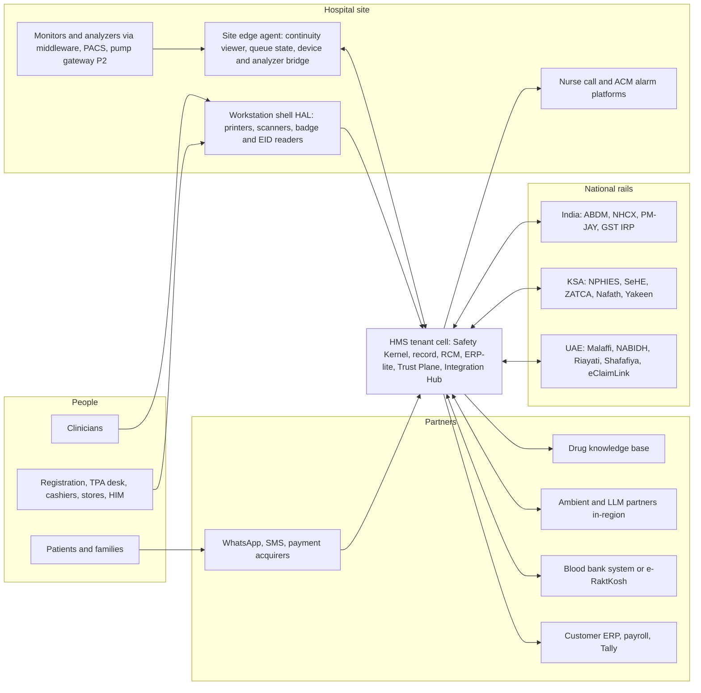
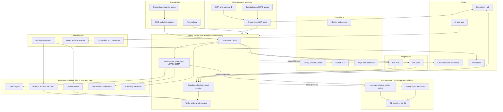
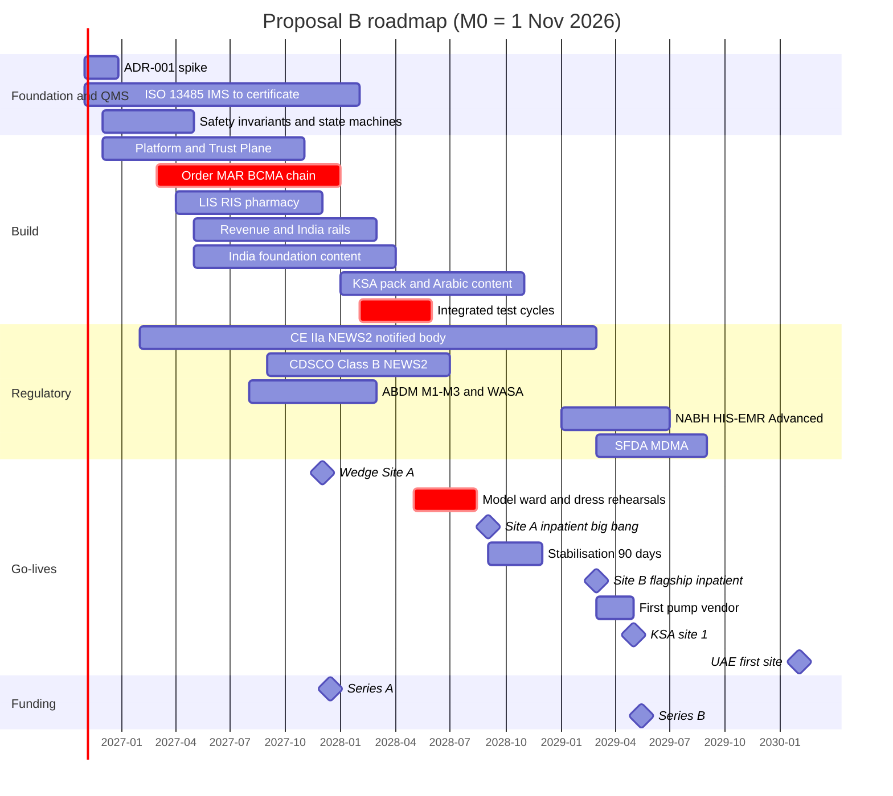

# Proposal B — "The System Clinicians Trust": A Clinical-Safety, Product-First Master Blueprint for a World-Class Hospital Management System

## 0. Document control

| Field | Value |
|---|---|
| Document | Proposal B: master-blueprint proposal, clinical-safety and product-first lens (CMIO + CNIO + head of product) |
| Version / date / status | 0.9, 16 October 2026. A competition draft for the judge panel, not an approved plan. |
| Calendar anchor | **M0 = 1 November 2026.** §10 maps external regulatory dates to M-numbers. |
| Evidence | R01–R16 and the Reconciliation Log (RL). No web searches were used because the pack is current to 16 Oct 2026. RL wins over the reports unless Appendix B lists a deviation. |
| How to read | §1 is the one-page answer. §5–6 are where this proposal differs most. §14–15 hold the money and the dates. Appendix B argues each deviation. |
| Tags | [E] = our estimate; [I] = our inference. "R08 §12.6" = report 8, section 12.6. "RL #8" = reconciliation item 8. |

**Report key:**
- R01 vendor landscape · R02 open source · R03 clinical modules · R04 diagnostics, pharmacy, devices
- R05 RCM, ERP, operations · R06 interoperability · R07 security and regulation · R08 architecture
- R09 AI and front door · R10 implementation and UX · R11 domain model · R12 business plan
- R13 India/GCC requirements · R14 requirements catalogue · R15 safety, QMS, migration · R16 peripherals
- RL Reconciliation Log

---

## 1. Executive summary

**Thesis.** Hospitals fail on the same things whatever the vendor: wrong patient, wrong dose, results nobody owns, alerts nobody reads, notes nobody can use, and systems that go dark. Clinicians score their EHRs at SUS 45.9 (physicians) and 57.6 (nurses), and every SUS point is worth about 2–3% lower odds of burnout (R10 §2). The public failures failed on safety, ownership of work and readiness, not on feature count (R10 §5.1):
- the VA's unowned queue, with 149 adverse events;
- Helseplattformen's 16,000 unsent letters;
- VGR's three-day halt and SEK 657M exit.

**We therefore build around 20 server-side safety invariants, and ship a clinician-signed safety case with every release.**

**The commercial wedge is the gap R14 §8.2 found.** No Indian or GCC vendor shows public evidence of closed-loop BCMA, and the global vendors are weak on regional billing and on price. We sell **"closed loop at local prices"**: CPOE → pharmacist verification → BCMA → bedside transfusion check → NPHIES/NHCX claim, all from one encounter. National rails, self-pay billing and a native supply chain are table stakes, and we build them natively (R13; R05).

**Scope.** **147 MVP features** (R14's 140 plus seven safety and implementation items), about 1,960 engineer-weeks. We plan against **≈1,450 squad person-months**, which includes validation. Five regulated functions run under one company-wide ISO 13485 system from M0:
- NEWS2/PEWS/MEOWS;
- a rule-based sepsis screen;
- the Dose Engine;
- medication-screening presentation;
- bedside transfusion verification.

**Dates.**

| Milestone | Month |
|---|---|
| Outpatient and diagnostics wedge at the non-flagship site of an Indian 3+-hospital group | **M13** (Dec 2027) |
| First inpatient big-bang go-live | **M20–M24**, target M22 |
| Three live sites, including KSA | **M28–M32** |
| Ten live sites | **M38–M44** |
| NABH HIS/EMR Advanced | **M30–M32** |

**Money.**
- Headcount: 39 → 160 → 230 → 352.
- Five-year opex US$109.6M, revenue US$31.5M, net burn **US$78.1M**.
- Raise **US$90–95M** (seed US$10M, Series A US$25M, Series B US$50M, plus US$5–10M venture debt), operating Lean until G3.
- Net burn is about US$9M above R12's base case (US$69M). That buys the clinical-safety and usability capability we believe is the only durable differentiator.

### The decisions that matter

| ID | Decision | Rationale | Evidence |
|---|---|---|---|
| D-01 | 20 server-side **safety invariants** (§5.1); no release ships without a CSO-signed safety case | Safety failures sink programmes | R03 §19; R11 §15; R15 §6 |
| D-02 | MVP = R14 catalogue re-baselined to **147 / 50 / 21** (MVP / P2 / P3); plan on ≈1,450 squad PM | One backlog; validation is the binding constraint | R14 §3–5; R12 §3.2 |
| D-03 | Minimum viable hospital: 150–300-bed private multispecialty; India, then KSA, then UAE (Wave 1b) | R14 supersedes RL #4's interim scope | R14 §2; RL #4, #9 |
| D-04 | Wedge (OPD, LIS, OP pharmacy, billing) at M13, then **inpatient big bang at M20–24**, both at the **non-flagship** hospital | Production evidence early; no partial medication loop | R12 §3.3; RL #10–11; R15 §10.3 |
| D-05 | **Company-wide tiered ISO 13485 from M0** (certificate M15); CNIO and Chief CSO are founding hires | Avoids SOUP burden; CE takes 24–30 months | R15 §2.1, §2.6 |
| D-06 | NEWS2/PEWS = Regulated Module #1; sepsis rules = #2; a shared Class C **Dose Engine**; all activated per tenant **only via the Regulatory Boundary Register** | Devices in most launch markets | R15 §4–5; RL #6 |
| D-07 | Transfusion workflow and bedside verification in the MVP; **no compatibility engine before Phase 3** | Harm sits at the bedside; the compatibility engine is the highest class | R15 §5.2; RL #5 (timing) |
| D-08 | Pumps: one vendor, **orders never commands**, at go-live +6 months, once BCMA ≥95% | Regulated boundary; 53.4% baseline use | R15 §5.3 |
| D-09 | **Never build** alarm routing, nurse call, RTLS, PACS, the drug knowledge base, or speech/LLM models | Device class; network effects | R15 §4.2; R16; R09 |
| D-10 | **Quiet-by-default CDS:** an alert budget, silent mode first, and an Excessive-Alerts harness in CI | 49–96% override rates | R03 §21.3; R15 §7.3 |
| D-11 | **Zero orphaned work:** every work item has an owner and an SLA; an orphan raises an alarm within 5 min | VA and Helseplattformen | R10 §3.3 #13 |
| D-12 | IEC 62366-1 testing with 15–20 users per group, Arabic-first and English-first counted separately; a >10% task-time regression blocks release | Usability is safety | R10 §3.3; R15 §7.6 |
| D-13 | ADR-001 Option A (Kotlin, Postgres per tenant, FHIR-shaped JSONB, R4 façade); the spike gains safety criteria | Pack position | RL #1; R08 §3.11 |
| D-14 | ES-lite as standard; **full event sourcing for medication order and administration aggregates** | The MAR is an event log | RL #7; R08 §3.5 |
| D-15 | Sovereign cells: India; KSA in-Kingdom through a partner; UAE to ADHICS v2 (UAE-only DR, customer-held keys) | Residency is a gate | R13 §5.1, §11 #4 |
| D-16 | **Downtime-first:** continuity viewer ≤15 min stale on the site edge agent; offline BCMA; drill tooling in the MVP | ECRI 2026 hazard #2 | R07 §9.1; R16 |
| D-17 | AI control plane in the MVP; non-device "documentation assistant" only; ambient **switched on after 90-day stabilisation** | Training drives benefit | R09 §5.4; R10 §4.10 |
| D-18 | **Accreditation-pack engine** (NABH, DHS, CBAHI, JAWDA, JCI); NABH HIS/EMR Advanced by M30–32 | How our buyers judge safety | R13 §3, §11 #3 |
| D-19 | **Closed loop is never an upsell:** India ₹2,600–3,700, GCC US$120–170 per bed per month; 15% of implementation fees held back against safety and usability outcomes | A partial loop is a hazard | R12 §12.2 (deviation) |
| D-20 | **Readiness gates, not dates;** model ward; three-level rollback (full fallback only ≤72 h); independent assessment before scaling | Lessons from VA and VGR | R10 §10.2; R15 §10 |
| D-21 | Raise US$90–95M; operate Lean until G3; Lean fallback US$50–55M | Validation cannot be compressed | R12 §6, §13 |
| D-22 | Wave 1 India + KSA, Wave 1b UAE (M36–42), Wave 2 decided at M36, US go/no-go **not before M48** | Pack sequence | RL #9 |

---

## 2. Vision, product thesis, positioning and differentiation

**Vision:** *the hospital system nurses and doctors would choose for themselves, because it is fast and quiet and catches the errors that hurt patients, at the price of a local HIS.*

**Product thesis: three pillars on a table-stakes base.**
1. **Closed loop by construction.** Identity → order → verify → dispense → administer → monitor → result → acknowledge, with no transcription step and no unowned hand-off (R03 §21.4).
2. **Clinician time respected.** High-PPV interruptions only; notes composed from structured data; nursing charting by exception; p95 screen transitions ≤1.0 s (R10 §3.3; R08 §12.6).
3. **Safety you can audit.** A per-release safety case, a hazard log the customer can see, accreditation evidence generated from use, and safety telemetry on by default (R15 §6).

**Table stakes**, delivered natively (R14 §8.4): national rails, self-pay and package billing, native LIS/RIS/pharmacy, supply chain, in-country cells, Arabic RTL.

| Competitor | Strong where | Weak in our segment | How we win |
|---|---|---|---|
| Epic | Single record, closed loop, AI | Price; regional billing not implemented; "not always localized" (R14 §8.1) | Comparable closed loop at about a tenth of the price; native NPHIES/NHCX |
| Oracle Health | GCC installed base; EHR+ERP bundles | New EHR still ambulatory-only; US losses; sale rumours (R01 §2.3) | Evergreen single code base; in-Kingdom team |
| MEDITECH Expanse | Cloud, community hospitals | Absent in India/GCC | Local rails |
| InterSystems TrakCare/IntelliCare | NPHIES interoperability; CE IIa | KLAS ME: "subpar end-user experience"; billing (R14 §8.1) | SUS/NEES evidence; our own CE IIa modules |
| IQVIA HIS | KSA clusters; Best in KLAS ME 2026 | Implementation and training difficulties; weak CDS | Certification academy; CDS governance |
| ezCaretech | Stage 7 heritage; ≈US$5K/bed | Brand, scale | Local team, national rails, similar price |
| KareXpert, Insta, Akhil, Athma, CareWare | Breadth, rails, NABH Advanced, price | **No public closed-loop BCMA evidence** | Closed loop at ≤2× their price |
| OpenMRS/Bahmni, CARE | Free, LMIC public sector | No inpatient closed loop at scale | Not a direct rival; Wave 2 interoperability |
| Avelios, MediMind | QMS-first; fast lab cutover | Single market | We copy both practices |

**Why buyers switch now:**
- NABH 6th edition makes EWS effectiveness (AAC.5.a), two identifiers (COP.1.b) and reconciliation (MOM.4.e) assessable (R13 §3.1).
- 98% of Saudi IT leaders make NPHIES/SeHE capability an elimination gate (R14 §6).
- Oracle's platform uncertainty and TrakCare's usability scores open doors.
- Indian incumbents' 20–40% renewal hikes (R12 §12.1).

**We remove the fear of switching** with fixed-fee implementation, free FHIR Bulk and full database export, escrow, and an ABDM-bundle migration importer (R12 §12.3; R15 §9.8). **Every demo is the same scripted loop on live telemetry**, ending in a payer claim (R14 §11 #3).

---

## 3. Target market, ideal customer profile, beachhead and entry sequencing

**ICP.**
- **Hospital:** a 150–300-bed private multispecialty hospital (design point 200 beds) with an ED, 6–8 OTs, a 20-bed ICU, in-house lab and imaging, pharmacy and blood storage (R14 §2).
- **Group:** 3–15 hospitals in India or 2–10 in the GCC. Groups multiply beds per contract and satisfy NABH's three-site rule (R12 §9.1; R13 §3.3).
- **Leadership:** a named CMIO and CNO with protected time.
- **Years 1–3, we avoid:** state tenders (L1 pricing, ₹120 Cr turnover wall), KSA public clusters without an RHQ, and academic go-live sites (R14 §6.3; R12 §10.4).

| Wave | Market and route | Entry criteria | Go/no-go |
|---|---|---|---|
| 1 | **India.** Design partner #1: an NABH group of 3+ hospitals; Site A is a non-flagship hospital of 100–200 beds | LOI M3; contract M6; SMEs named (CMIO 0.5, CNIO 1.0, pharmacist 1.0, nurses 2.0 FTE) | G1 (M6). If missed, narrow to an India HIS + LIS + RCM product (R12 §15) |
| 1 | **KSA private.** Design partner #2 (2–6 hospitals) via a Saudi partner with NPHIES certification and CST hosting | KSA entity M9–12; partner MoU M12 | DP#2 signed by M15, else slip one year |
| 1b | **UAE.** Abu Dhabi private first, then Dubai | G4 passed; UAE cell meets ADHICS v2 Service Provider controls | G5 (M36–42) |
| 2 | Indonesia or Kenya | Series B; ≥10 live sites | Decided at M36 |
| Opportunistic | DACH via a German partner | CE IIa held; the partner owns §301/ISiK | No engineering before M36 |
| 3 | UK, EU, AU, CA | No-regret IPS, EHDS logging and DCB0129 only | No certification spend before M24 |
| US | Phase 3 | ≥2 Stage 6/7 references; ONC limited to the 19 HTI-5-retained criteria | Not before M48 (RL #9) |

**India before the UAE (contrary to R13 §1 #15).** RL #9 wins, and the economics agree: a GCC hospital pays about 6.4× an Indian one (R12 §11). R13's evidence changes **how** we enter KSA (through a partner), not whether.

---

## 4. Product scope

### 4.1 Re-baselined catalogue

R14 Appendix A is the backlog of record (R14 §11 #1). We make these changes:

| Change | Items | Eng-weeks | Why |
|---|---|---|---|
| P2 → MVP | CLN-DOC-02 copy-forward provenance; IMP-GOV-01 governance intake; TRU-BCP-05 Code-Dark drill tooling | 14 | Note trust, visible loop closure, and the downtime-drill gate |
| P2 → MVP (built; activated after silent mode) | CLN-CDS-06 rule-based sepsis screen | 3 | RL #6 v1, with R15 §8.2 silent validation |
| New MVP | TRU-REG-03 hazard-log service and Release Evidence Pack; TRU-REG-04 Regulatory Boundary Register; IMP-SIM-01 model-ward, UAT and deployment-safety kits | 36 | R15 §6.2, §8.3–8.4 build list |
| Upsize | IMP-MIG-01 → 12-part Migration Workbench | +30 | R15 §9.8 |
| Split | DX-BB-03 → 03a blood-centre inventory and ISBT 128 labelling (P2); 03b compatibility engine (P3, IVD-grade) | — | R15 §5.2 |

**Result:** **147 MVP / 50 P2 / 21 P3** features; **≈1,960 MVP engineer-weeks**.

**Reconciliation with R12.** R14's sizes count feature coding only. R12's 1,055–1,645 PM add embedded QA, design, and validation-heavy epics that do not compress. We plan at **1,450 PM**: R12's midpoint plus 100 PM for the regulated-modules squad, safety tooling and the migration workbench. About 1,200 PM gates go-live #1; the KSA pack and the remainder finish by M26.

### 4.2 Module catalogue

B = build, I = integrate, P = partner. MVP = needed for the minimum viable hospital to sign and go live; P2 = M24–36; P3 = after M36 or partner-led.

| Domain | MVP | P2 | P3 | Source |
|---|---|---|---|---|
| Access and ADT | EMPI with reversible merge; ABHA, Nafath/Yakeen and EID plug-ins; alias and newborn naming; photo; ADT including LOA; bed board and EVS; scheduling; OPD tokens; ABDM Scan-and-Share | Referrals; transfer centre; kiosks | RTLS | B |
| Clinical core | Chart and banner; coded problems and allergies; CPOE (all timing types, verbal read-back); order sets; results inbox with discharge queues; notes with **copy-forward provenance**; discharge and bilingual AVS; med rec; I-PASS; HIM; incidents; accreditation KPIs; suicide and restraint content | CDS Hooks/CQL client; MCI mode; HAI surveillance; stewardship | — | B |
| CDS | Drug-KB adapter with re-tiering; Leapfrog-category checks; telemetry and harness; VTE; **NEWS2/PEWS/MEOWS**; **sepsis rules (silent first)** | Predictive deterioration via a cleared partner | — | P (KB) + B |
| Nursing | Flowsheets; charting by exception; Braden/Morse/delirium; care plans; worklists; wound photos; field governance | — | Acuity staffing | B |
| Medication | Verification; formulary, LASA and high-alert; IP and OP pharmacy; eMAR; **mobile offline BCMA**; infusion model; controlled drugs; **Dose Engine** | Pumps (one vendor); ADC; chemotherapy; national e-Rx | IV compounding | B; pumps I |
| Diagnostics | Shared order lifecycle; critical-result service; native LIS core; native RIS core; PACS integration with an OSS tier | Microbiology; POCT; dose capture; ECG | Anatomic pathology; ISO 15189 document control | B; PACS I |
| Transfusion | Workflow and haemovigilance; **bedside verification**; blood-bank / e-RaktKosh interface | Inventory and ISBT 128 labelling | Compatibility engine | B + I |
| Devices | Middleware gateway; nurse validation of vitals | — | Alarm analytics (ACM); SDC | B+I |
| Periop, ICU, ED, maternity | OT booking; WHO checklist; intra-op record with implant charging; anaesthesia record; ICU q1h with monitor feed; ED triage, board and pathway clocks; L&D and newborn registration; diet; death certificate | Full AIMS; OR analytics; severity scores; partograph; NICU and human milk; oncology; rehab | Tele-ICU; dialysis; specialty kits | B |
| Revenue cycle | Patient account and ledger; charge router; tariffs and packages; deposits; GST/ZATCA; pre-auth and claims; NPHIES, NHCX/PM-JAY/TPA, Shafafiya/eClaimLink; coding; denials; schemes | Grouper SPI; AI coding | Costing; US RCM | B; groupers I |
| ERP | Stores, FEFO, consumption-to-charge; procurement-lite; GL export; staff privileges | Lite GL and assets; CMMS; rostering; ERP connectors; UDI; CSSD | — | B; payroll I |
| Interop and data | HL7 v2 engine; FHIR R4 façade; documents; ABDM M1–M3; SeHE; UAE HIEs (gated); reporting replica | IPS; public health; lakehouse/OMOP | openEHR; EHDS; ONC | B |
| AI and front door | Gateway and control plane; ambient OPD and discharge drafts (**activated after stabilisation**); WhatsApp/SMS, booking, payment links, PHR push | Chart summary; nursing ambient; claim scrubbing; portal app; telehealth | In-basket AI; imaging AI; RPM | B; models P |
| Trust and implementation | Trust Plane; audit; consent; downtime suite; QMS and hazard log; Boundary Register; cells and DR; foundation content; migration workbench; readiness, training and telemetry tooling | On-prem/state DC; BYOK; privacy monitoring; partner academy | Edge cell | B |

**Excluded from the MVP:** pump autoprogramming, the compatibility engine, the full AIMS device feed, the patient app, kiosks, microbiology, anatomic pathology, native GL, predictive sepsis, and US/EU certification.

---

## 5. Clinical safety, quality and regulatory classification

### 5.1 The twenty safety invariants

The invariants are enforced **in the domain layer for every channel**: UI, API, mobile, interfaces, migration loaders and AI agents (R11 P11; R03 §19). Each one has a hazard-log ID, property-based tests on its state machine, and a scenario suite (R15 §7.2–7.3). Tenants may tighten an invariant but never loosen it.

| SI | Invariant | Enforced in |
|---|---|---|
| 01 | ≥2 identifiers on every patient-affecting action, label, wristband, MAR entry and print; never room or bed | Identity service; templates |
| 02 | No administration without an active verified order or a documented override. Override reasons are never defaulted, and all overrides are reportable. | MAR aggregate |
| 03 | Every order reaches a terminal state. Every task, result, message, letter and referral has an owner and an SLA. Unowned work raises an alarm within 5 min. | Task engine |
| 04 | Critical results go to a **named** recipient (picker, not free text), with read-back and a timed escalation chain | Critical-result service |
| 05 | One dated, sourced dosing weight; UCUM units; no unit-less doses; dose arithmetic **only** in the Dose Engine; hard stop at 10×/100× | Dose Engine |
| 06 | Signed notes are immutable. Amendments are versions and addenda are links. Entered-in-error replaces delete. The signed rendering is hashed. | Clinical journal |
| 07 | AI output stays `draft-ai` until a human signs it. AI never signs orders, files results or messages patients. | AI control plane |
| 08 | Merges are reversible. Overlays are safety incidents. Auto-merge precision ≥99.9%. | EMPI |
| 09 | Med rec cannot complete while any item is undecided | Med-rec aggregate |
| 10 | Clinical time is distinct from system time. Back-dating is privileged and audited. Back-entry keeps original times. | Bitemporal journal |
| 11 | Transfusion requires wristband ↔ unit ↔ order ↔ sample match plus a two-person electronic witness; a mismatch is a hard stop | Transfusion verification |
| 12 | Bill clearance, deposits and pre-auth never block discharge or emergency care | RCM ↔ ADT layer |
| 13 | High-alert medications require a documented independent double check | MAR; formulary |
| 14 | Hard stops come only from a governed list. Every interruptive rule has an owner, evidence, a measured PPV and a retire-by date, and runs silent first. | CDS registry |
| 15 | Offline, there is no new prescribing without full CDS, no bed or OT allocation, no identifiers outside pre-allocated blocks, and no controlled-drug stock moves | Offline matrix |
| 16 | The banner (photo, two identifiers, allergies, code status, isolation, dated weight) appears on every clinical screen, mobile view and print | Design-system shell |
| 17 | Results pending at discharge, and results for discharged patients, go to owned queues | Results routing |
| 18 | A regulated function activates only where the Boundary Register says "cleared" or "not required" | Feature-flag service |
| 19 | Every CDS rule and clinical flag has a kill switch. Safety-relevant changes default to off. | Flag service |
| 20 | No PHI or PHI-derived data (telemetry, prompts, de-identified analytics in UAE/KSA, support sessions) leaves the residency cell | Trust Plane; AI gateway |

### 5.2 Closed loops and their live KPIs

| Loop | Steps (each a first-class timed event) | Live KPI |
|---|---|---|
| Medication | Prescribe (Dose Engine, screening) → verify → dispense → BCMA (pump channel in P2) → monitor and PRN reassessment | Scan compliance; overrides by user and unit; STAT verification time; late doses |
| Transfusion | Consent → bedside-labelled sample (WBIT detection) → issue → two-person verification → vitals timers → reaction → haemovigilance | Bedside scan rate; WBIT per 1,000 samples |
| Diagnostics | Order → specimen or exam → result → autoverify or validate → critical read-back → acknowledgement → amended-result notice | Critical results inside policy; unacknowledged >7 days |
| Identity | Captured from the card → probabilistic match → steward queue → reversible merge | Duplicates; overlays; retract-and-reorder per 100K orders |
| Deterioration and handoff | Validated observations → score with components → frequency → escalation task; I-PASS each shift | Escalation compliance at NEWS2 ≥5; I-PASS coverage |

### 5.3 Clinical safety case and safety organisation

- **DCB0129 is our operating model for Tier 1, globally.** One hazard log feeds DCB0129, the ISO 14971 files for Tier 2, and each customer's DCB0160-style deployment case (R15 §6.1).
- **The hazard log is a product service** (TRU-REG-03):
  - every story carries a safety-impact field;
  - "possible" or "yes" routes to CSO triage within 2 working days;
  - CI blocks promotion while any hazard control lacks verification;
  - the Clinical Safety Case Report is generated per release (R15 §6.2).
- **Seeded hazards** (R15 §2.4): wrong patient; wrong drug, dose, route or time; missed or late result; delayed escalation; orphaned work; data loss; unavailability; wrong blood; alarm not delivered; AI error accepted; cutover double dose; identity overlay.
- **People:**
  - a **Chief CSO at G0**;
  - one product CSO per two clinical squads, including pharmacist and laboratory/transfusion CSOs;
  - market CSOs for India and the GCC;
  - a safety champion in each squad;
  - an annual external audit (R15 §6.3).
- **Safety Board.** It meets weekly, is chaired by the Chief CSO, and holds release veto for Tiers 1 and 2. **Any engineer can pull the andon to stop a release on safety grounds.**
- **Contractual commitments** (R15 §6.4):
  - a safety notice in FSN format within **24 h** of confirmation;
  - a public known-anomalies list;
  - a kill switch;
  - an annual **Safety Performance Report** per customer.
- **One Safety Event pipeline** carries safety tickets, telemetry anomalies, one-click AI-issue reports (with model, prompt and sources) and security incidents (R15 §6.6).

### 5.4 Quality management system

- **Scope.** One integrated management system (ISO 13485 backbone with ISO 27001/27701) covering the whole company. **No "13485 island"**, because shared services would otherwise become SOUP to be re-qualified on every release (R15 §2.1).
- **Tiers** (R15 §2.3):
  - **Tier 0:** billing, ERP, BI.
  - **Tier 1:** ADT, CPOE, eMAR/BCMA, results, downtime. DCB0129, IEC 62304 Class B-equivalent process, IEC 82304-1.
  - **Tier 2:** NEWS2, sepsis rules, Dose Engine, screening presentation, transfusion verification. Full design controls, ISO 14971, IEC 62366-1, post-market surveillance, Class B/C.
- **Change classes** (R15 §8.3):
  - **C0:** continuous delivery.
  - **C1:** flags default off, CSO review, scenario suites.
  - **C2:** quarterly regulated releases with a regulatory impact assessment.
- **Content is a regulated artefact.** It ships as signed bundles. CDS rules run silent for 2–4 weeks and are replayed against 90 days of orders. Tariffs re-price 3–6 months of encounters before activation (R15 §8.2).
- **Standard:** IEC 62304:2006+A1:2015, mapped to Edition 2 Levels I/II (forecast Oct 2028, about M23).
- **Certification and cost:** ISO 13485 by **M15**; about **US$0.9M over 30 months**.

### 5.5 Device classification and activation per market

Every cell is a hypothesis to confirm by written opinion by **M6** (R15 §4.1). A fallback is what a tenant runs until the function is cleared.

| Function | EU | KSA | India | US | Plan and fallback |
|---|---|---|---|---|---|
| NEWS2/PEWS/MEOWS | IIa | Device B | Likely B | Alerting is a device | **CDSCO B licence by M20** (live at go-live #1). CE IIa started M0, certificate M24–28. SFDA via CE, M30–34. **Fallback:** observation charting with frequency scheduling, nurse-calculated score, nurse-assigned escalation. US deferred. |
| Sepsis rules | IIb | C | C [I] | Device | Silent at go-live; activated at G3+90 days where cleared; ML only from cleared partners |
| Dose Engine | IIa/IIb | B–C | B/C [I] | Plausibly non-device | Class C rigour. If no CDSCO licence by M20: pharmacist-verified dosing with knowledge-base ranges as presentation only; calculators switch on later. Decision at M6. |
| DDI/allergy screening | IIa | Likely B | Likely B | Non-device | "Presentation and local tiering of vendor results"; the KB vendor carries its own status |
| BCMA/eMAR | Non-device | Non-device | Likely excluded | Health IT | Tier 1; dose arithmetic is delegated |
| Bedside transfusion verification | Borderline | [U] | [U] | BECS accessory | Tier 2 Class C; written opinion per market (M6 India, M14 KSA); US partner only |
| Compatibility engine | IVD | IVD [K] | IVD [I] | BECS 510(k) | Not built before Phase 3; integrate e-RaktKosh or a BECS |
| Pump autoprogramming | IIb (drives a device) | Pump's class | Hardware class | Vendor gateway | One vendor; orders, not commands; vendor letter; memo per market |
| Alarm forwarding | Device | C | C | MSX II | **Never built**; integrate via ACM |
| AI documentation assistant | Non-device | Device if it suggests a diagnosis | Non-device | Outside CDS | Classifiers block diagnosis and treatment suggestions |

UAE (EDE) has no SaMD guidance [U], so we plan on CE reliance.

**Why the strictest reading for NEWS2.** MDCG 2019-11 rev.1 qualifies a near-identical score as medical device software, and SFDA names real-time alerting CDSS as a device (R15 §1). A looser build drags the whole product into MDMA (R13 §4.7). The intended purpose is "calculates and displays the score and components … and creates escalation tasks per the hospital's policy". It never "detects" or "predicts".

### 5.6 Accreditation traceability

The accreditation-pack engine models chapter → standard → objective element (OE) → evidence query → KPI → manual fallback (R13 §11 #3). Packs ship in this order:
- NABH 6th edition (639 OEs) and NABH DHS (182 OEs);
- NABH HIS/EMR V12.1 (171/166 OEs) as our own certification suite;
- CBAHI and JAWDA;
- JCI 8th edition;
- Joint Commission NPGs as a secondary pack (RL #9).

| Requirement | Feature | SI | Evidence produced |
|---|---|---|---|
| NABH AAC.2.b UHID; JCI IPSG.1; DoH EID read at every visit | EMPI; ID plug-ins | 01, 08 | Duplicate/overlay and EID-read reports |
| NABH COP.1.b two identifiers | Wristbands; BCMA | 01, 16 | Scan compliance by unit |
| NABH AAC.5.a EWS effectiveness | Reg #1; escalation tasks | 03, 18 | Escalation response times |
| NABH AAC.6.f/g, AAC.7.f; JCI IPSG.2 critical results | Critical-result service | 04 | Timeliness and read-back log |
| NABH MOM.3/4/9; JCI MMU | High-alert/LASA flags; med rec; verbal-order timers; controlled-drug registers | 09, 13 | Med-rec completion; co-sign aging |
| NABH PRE.4/PRE.6 consent and estimates | eConsent by performer; estimate engine | 12 | Consent audit; estimate variance |
| NABH IMS.3/5/6/7; CBAHI MOI/MR | Append-only record; retention; record-review sampler (~5% quarterly) | 06, 10 | Record-review reports |
| NABH IMS.1.e; JCI MOI contingency | Continuity viewer; drills | 15 | Drill reports with measured RTO |
| NABH PSQ.3 (32 + 18 KPIs); JAWDA | Measure engine | — | Monthly/quarterly submissions |

---

## 6. UX and clinician-experience strategy

**Principle: slow is unsafe, and noisy is unsafe.** Only 38% of implementations "hit the mark", and 75% of clinicians who are dissatisfied at go-live are still dissatisfied two years later (R10 §2). We get one chance, so experience targets are release blockers.

### 6.1 Role-based workspaces

Each workspace opens on a "what needs me now" queue fed by the task engine. No queue is unowned.

| Workspace | Owned home queue | Signature tools |
|---|---|---|
| Physician | Results, co-signs, orders to sign, consults, discharges due | Command palette; order sets; I-PASS; "changes since last note" |
| Nurse | Shift brain-sheet: due, overdue, PRN-eligible, changed, escalations | Mobile BCMA; charting by exception; validated vitals; NEWS2 tasks |
| Pharmacist | Verification queue ranked by STAT and high-alert | Dose Engine view; screening tiers; controlled-drug register |
| Lab / radiology | Accession worklists, QC, critical calls | Analyzer status; autoverification review; read-back logger |
| Bed manager / EVS | Bed board; pending admissions; cleaning jobs | Bed state machine with isolation-aware cleaning |
| Cashier / TPA desk | Deposits; pre-auth clocks (IRDAI 1 h / 3 h); rejections | Package tracker; NPHIES/NHCX status |
| HIM / quality / CSO | Deficiencies; merge steward queue; incidents; accreditation KPIs | Hazard log; safety dashboard; OE evidence |

### 6.2 Clinical design system

- **Foundations:** one system on accessible primitives (React Aria); keyboard-first; a command palette; typo-tolerant brand ↔ generic search; density modes; no stacked modals; identical sign and co-sign patterns everywhere (R10 §3.3 #4–6).
- **Defaults:** never select a dose, route or patient. Weight-based vs direct dosing mode is always visible. Clinical numerals are always Western digits (R15 §7.7).
- **Context switching:** the banner changes on a context switch, and identity is re-verified at signing if the context changed within 60 s [E]. We do not impose one-chart-at-a-time, because the RCT showed no benefit (R10 §2).

### 6.3 Alert-fatigue strategy

| Tier | What | Governance | Budget [E] |
|---|---|---|---|
| A: hard stop | Absolute contraindications only (intrathecal vincristine, MAOI + triptan, 10× dose) | Governed list | ≤20 rules |
| B: interruptive with reason | Level 1 DDI, severe allergy, high-alert dose limits | Owner, PPV, retire-by date; silent 2–4 weeks first | **≤8 per 100 medication orders at go-live; ≤5 by M12** |
| C: inline passive | Guidance inside order sets and the composer | Content committee | Must stay visible (Leapfrog 2027 scrutiny) |
| D: pharmacist queue | Minor DDI, duplicates, renal adjustment | Pharmacy | Verification TAT |

**Portfolio rules:**
- Rules with >90% override are auto-flagged for retirement (R03 §20).
- A quarterly alert-burden review.
- The Leapfrog-category harness must catch ≥60% of serious-error scenarios (target 80%), with **zero interruptions on the should-not-alert set**, on every content release (R15 §7.3).

### 6.4 Documentation burden

- **Notes are synthesis, not accumulation:**
  - composed from structured data;
  - span-level provenance (typed, template, copied, imported, AI, migrated);
  - copy-forward visibly marked;
  - a "changes since last note" diff;
  - a soft length budget with a bloat indicator (R10 §3.3 #10).
- **Jurisdiction documentation profiles,** so that US billing norms do not shape Indian or GCC notes. On the same vendor, US clinicians spend 90.2 EHR min/day vs 59.1 elsewhere (R10 §2).
- **Team-based inbox** with pools and routing. In-basket AI is P3 (R14 §4 #11).
- **Ambient AI** (≥2 partners; EN/AR/HI and regional) switches on per specialty at the first optimisation sprint, after 2 h of training, with mandatory edit-distance telemetry (R10 §4.10).

### 6.5 Nursing first

- **Design around the shift:** brain-sheet, worklists, and I-PASS/SBAR generated from the chart.
- **Charting by exception** against unit norms.
- **Flowsheet field governance as product:** every field is tagged regulatory, quality or local preference, with "who reads this field" lineage and one-click retirement. Mercy saved 32 min per nurse per day, and Wooster removed 96 fields (R10 §3.4).
- **Device vitals are validated, not transcribed.** Only validated values feed NEWS2 and CDS (R04 §6).
- **Annual nursing-documentation rationalisation** is in every contract.

### 6.6 Mobile

- **One React Native app:**
  - nurse mode: BCMA, bedside specimen labels, vitals, photos;
  - physician mode: result acknowledgement, critical read-back, patient-context secure chat.
- **Offline:** the cache is encrypted, and administration is allowed only against verified orders (SI-15).
- **Notifications** carry no PHI.

### 6.7 Accessibility, multilingual and Arabic RTL

- **Accessibility:** WCAG 2.2 AA with a published VPAT. Redundant Entry and Accessible Authentication (badge or passkey) matter clinically (R14 §9.5).
- **Arabic RTL** (R14 §9.4; R15 §7.7):
  - CSS logical properties;
  - bidi tests for mixed strings (Arabic name + English drug + dose + unit);
  - Hijri displayed alongside Gregorian, stored as UTC;
  - four-part names with transliteration search;
  - AR/EN PDF/A from one source;
  - wristbands rasterised where printer firmware cannot shape the script (R16 §3).
- **Localisation is a gate:** clinician-reviewed translation, and **zero untranslated strings in clinical paths** (the Sundhedsplatformen lesson; R10 §3.3 #19). India uses an English clinical UI with Hindi and regional languages for patient-facing outputs.

### 6.8 Usability measurement and targets

- **Telemetry:** the seven Sinsky metrics per 8 scheduled hours, clicks per top-50 task, latency per screen and site. It is **always paired with micro-surveys**, because telemetry explains only r² = 0.03 of NEES (R10 §3.6).
- **Formative testing** every sprint with a standing clinician panel.
- **Summative testing** to IEC 62366-1 / NISTIR 7804, with 15–20 participants per group:
  - when: before every Tier 2 function and Tier 1 critical task (R15 §7.6);
  - tasks: patient selection; weight-based and high-alert ordering; BCMA override; transfusion check; NEWS2 escalation; critical-result acknowledgement; discharge med rec.

| Metric | Baseline | Target [E] |
|---|---|---|
| SUS physicians / nurses | 45.9 / 57.6 (R10 §2) | ≥68 / ≥70 at 6 months; **≥72 / ≥75 at 12 months** |
| NEES-style score | KLAS averages 23.4 physicians / 47.3 nurses; Pinnacle 60 / 75 | Above average at 12 months; **Pinnacle at the reference site by M42** |
| Login / tap-to-switch | KLAS calls 60 s "unacceptable" | ≤5 s / ≤2 s p95 |
| Screen / chart open p95 | 47% find their EHR slower than expected | ≤1.0 s / ≤1.5 s, as a release blocker |
| Nurse documentation minutes per shift | Time-motion at T-120 | **−25% at 12 months** |
| Physician after-hours EHR time | Go-live +30 days | −20% at 12 months |
| Task-time regression | — | A release is blocked at >10% or on any new critical use error |
| Training | ≥11 h for the most satisfied users (R10 §4.7) | 6–11 h; ≥95% completion; ≥85% proficiency |

---

## 7. Architecture and technology

**Principles:**
1. **Safety-critical state is transactional.** Orders, medications, MAR, results routing and tasks share one deployable and one database, in separate modules. A saga cannot "un-administer" a dose (R08 §13).
2. **Regulated code is separable.** Tier 2 functions are separately versioned, in-process modules on their own release train. They are never called over the network from the bedside path.
3. **The same signed artefacts ship everywhere:** SaaS, sovereign, on-prem and edge.
4. **No silent failures:** every queue, interface and work item is owned and alarmed.

### 7.1 ADR register

| ADR | Decision | Gate |
|---|---|---|
| 001 | Domain-owned PostgreSQL per tenant; FHIR-shaped JSONB facts; generated R4 façade; HAPI libraries; **Kotlin/JVM**. The spike adds order/MAR invariant tests under shift-change load. **Revisit if** Option B (Medplum or HAPI JPA) wins on both p95 write latency and invariant enforcement. | Spike M0–M2 (RL #1) |
| 002 | Modular monolith (Spring Modulith), with RCM, Integration Hub, AI gateway and analytics as satellites; boundaries checked in CI | M1 |
| 003 | DB per tenant in shared cells; pooled RLS only for a <100-bed tier (P2) | M1 |
| 004 | ES-lite: a bitemporal journal-as-outbox in the same transaction; Debezium → Kafka; CDC to the lakehouse | M2 (RL #7) |
| 005 | Generated R4 façade; bounded FHIR writes become commands; R6 side by side in 2027–28; finance API on R6-core resources only | M2 (RL #2, #13) |
| 006 | Kafka 4.x, CloudEvents, schema registry; keyed by patient; **no hidden dead-letter topics** | M2 |
| 007 | **Full event sourcing for the MedicationOrder and Administration aggregates.** Revert to ES-lite if schema-evolution or erasure tooling costs more than 8 engineer-weeks, or BCMA p95 exceeds 500 ms. | M3 |
| 008 | Temporal for discharge, pre-auth, claims and cutover; never order or MAR state | M2 |
| 009 | Keycloak + OpenFGA; the Trust Plane SDK is mandatory for all data access | M2 |
| 010 | React/TypeScript web; Tauri 2/WebView2 shell with a HAL; React Native mobile | M2 |
| 011 | Edge planes: A shell HAL, B site edge agent, C cloud adapters (R16 §3) | M3 |
| 012 | Regulated-module segregation; quarterly C2 train; Boundary Register gating | M2 |
| 013 | One Dose Engine (UCUM, weight provenance, Class C) for every consumer | M3 |
| 014 | CDS: CQL + DMN + drug-KB adapter; tiers A–D; mandatory silent mode; kill switch | M3 |
| 015 | AI gateway: in-region inference, zero retention, `draft-ai` state, no database access for models | M4 |
| 016 | Offline/downtime matrix and the never-offline list (SI-15) | M3 |
| 017 | PHI-free global control plane; UAE/KSA keys customer-held in an external KMS/HSM | M4 |
| 018 | Content-as-code: signed bundles BUILD→TEST→TRAIN→PROD; no customer branches | M2 |

### 7.2 System context

### 7.3 Bounded contexts

### 7.4 Core data decision and event model

**Storage shapes per tenant DB** (R08 §3.11):
- **A:** relational aggregates with constraints;
- **B:** immutable facts with `valid_period`, `recorded_at`, author and source (`ai-draft`, `device`, `migrated`);
- **C:** the bitemporal journal-as-outbox;
- **D:** rebuildable read models over SSE.

Identifiers are UUIDv7, and every row carries `tenant_id` and `facility_id`.

**Domain events** map 1:1 to v2/FHIR triggers (R11 §14), for example `PatientMerged/Unmerged`, `EncounterMoved`, `OrderVerified`, `MedicationAdministered/Overridden`, `SpecimenRejected`, `ResultAmended/Acknowledged`, `CriticalResultEscalated`, `ChargeGenerated`, `StaffAssignmentChanged` and `IdentityVerified`. **`TaskOrphaned` is a first-class alarm.**

### 7.5 Stack and licences

| Layer | Choice (licence) |
|---|---|
| Core | Kotlin, JVM 21/25, Spring Boot + Modulith (Apache-2.0) |
| Data and events | PostgreSQL 17/18 on CloudNativePG; Kafka 4.x + Debezium; Temporal (PostgreSQL, Apache-2.0, MIT) |
| Health standards | HAPI FHIR and v2; cqframework CQL; Snowstorm (Apache-2.0; SNOMED free in IN/SA/AE) |
| Search, cache, IAM | OpenSearch; Valkey; Keycloak + OpenFGA (Apache-2.0, BSD-3) |
| Clients | React + React Aria; Tauri 2; React Native/Expo (MIT/Apache-2.0) |
| Analytics | Iceberg, Trino, dbt Core, SQL-on-FHIR, OMOP (Apache-2.0) |
| Operations | OpenTelemetry, Prometheus, Kubernetes, OpenTofu, Helm, Argo CD (Apache-2.0/MPL-2.0). Grafana/Loki (AGPL) run **only in our SaaS operations, unmodified, never shipped on-prem**. |
| Imaging tier | dcm4chee (MPL-1.1) or an unmodified Orthanc container (GPLv3); OHIF (MIT) |
| Optional | Eclipse OIE (MPL-2.0) for site transforms under a patch-lag policy (RL #12) |

**Policy** (R02 §8.2):
- Allowlist: Apache, MIT, BSD, MPL, LGPL, EPL.
- GPL/AGPL only as unmodified separate containers.
- Denylist: BSL, competing-use and AI-ingestion clauses.
- Licence scanning runs in CI. Camunda 8.6+, Redpanda and Mirth ≥4.6 are excluded.

### 7.6 Multi-tenancy

- **Tenant = the contracting enterprise,** with one EMPI per group (which enables Group Connect).
- **Configuration chain:** vendor → country pack → tenant → legal entity → facility → department → unit → user. The most specific setting wins unless a parent has `locked` it.
- **Safety invariants are locked at vendor level** (R08 §5).

### 7.7 Deployment topologies

| Topology | Hosting and rules | Phase |
|---|---|---|
| India cell | AWS Mumbai + Hyderabad DR; CERT-In 6 h reporting; logs kept in India for 180 days | MVP |
| KSA cell | In-Kingdom CST provider through the Saudi partner (Google via CNTXT, Oracle or STC); DR in a second in-Kingdom data centre; NCA ECC/CCC. There is no Azure region and AWS is only announced (R13 §4.5). | M24 |
| UAE cell | UAE-only primary, backup and DR; customer-held keys; UAE-resident support with JIT access and recording; ADHICS v2 | M33 |
| On-prem / state DC | Same artefacts; 3-node Kubernetes + CloudNativePG; N-2 support | P2 |
| **Site edge agent** | 2 VMs (4 vCPU / 16 GB each); continuity viewer, queue state, print spool, device bridge; **never the only copy of clinical state** (R16) | **MVP** |
| Edge cell | 3 nodes; local primary for encounters, beds, stock | P3 |

### 7.8 Downtime and business continuity

- **Continuity viewer** on the edge agent: MAR, allergies, orders, census and the last 72 h of notes, **≤15 min stale**, with printable unit packets.
- **Offline operation:** BCMA against verified orders; downtime ID and accession blocks; back-entry keeping original times (R07 §6; R14 TRU-BCP).
- **Cyber-recovery:** immutable isolated backups; clean-room rebuild; designed for 4–6 weeks of degraded operation.
- **Drills:**
  - monthly game days;
  - quarterly DR and restore tests;
  - twice-yearly Code-Dark drills per customer;
  - an annual cyber-recovery exercise with a customer (R15 §7.5).

### 7.9 NFR/SLO table (RL #8 canonical, plus clinical SLOs)

| Metric | Engineering | Contract |
|---|---|---|
| T0 write availability (ADT, CPOE, eMAR/BCMA, results) | 99.99% | **99.95%/month** |
| Read and continuity paths | 99.99% | 99.99% |
| T1 / T2 / T3 tiers | 99.95 / 99.9 / 99.5% | 99.9 / 99.9 / 99.5% (R14 §9.2) |
| RPO / RTO in-region; cross-region (inside the residency boundary) | 0 / ≤5 min; ≤5 / ≤60 min | 0 / ≤15 min; same |
| Cyber-recovery | Tenant restore ≤24 h | ≤72 h |
| Planned downtime | 0 | 0 |
| BFF p95 / p99; warm screen / cold chart p95 | 300 / 800 ms; 1.0 / 1.5 s | Reported |
| Patient search; order sign with CDS; BCMA (p95) | 200 ms; 1.5 s (CDS ≤500 ms; fail open except hard stops); 500 ms, including WAN loss | — |
| Boards / replica / lakehouse | ≤2 s / ≤60 s / ≤15 min | — |
| HL7 end-to-end | p95 ≤5 s; zero silent drops; alarm at >5 min unacknowledged | Reported |
| **Orphaned work** | **0; alarm ≤5 min** | >2 h with patient impact is a rollback trigger |
| Patching | ≤7 days SaaS; ≤14 days on-prem | Same |

**Contract rule:** we do not sign penalty-free bands above 99.95% without pricing the risk (R14 §9.2).

### 7.10 Scalability targets

- 20K sessions per cell and 8K per tenant DB.
- 3K tx/s sustained, 10K burst; 2K HL7 msg/s per cell.
- 50M patients per tenant, with a Citus evaluation above 100M.
- The **1,000-bed day runs in CI from M6** (20K orders, 25K administrations, 15K results, 300K messages, 3× shift peak); any p95 regression blocks release (R15 §7.4).
- 10–20 hospitals of about 250 beds per cell.

---

## 8. Data model

R11 is the specification: **patient-centric, encounter-anchored, order-driven.** FHIR is vocabulary and external contract, never the storage schema.

| Aggregate | Key rules |
|---|---|
| Patient (EMPI) | Identifier lists with typed national IDs and deterministic precedence: EID, Saudi ID/Iqama, passport, ABHA, Aadhaar (vaulted, last 4 digits shown). Arabic/English name parts. Reversible merges with the algorithm version (R11 §3; R13 §11 #7). |
| Encounter + LocationHistory | Location history is the **single source of truth** for census and bed charges; "discharged-not-closed" state (R11 §5) |
| Order + Tasks | One aggregate; every fulfilment step is a Task; medications add pending-verification → verified |
| MedicationOrder / Administration | Event-sourced (ADR-007); own dose model; Dose Engine calculation ID |
| Specimen / Result | Logistics states; amended results notify everyone who acknowledged the earlier version |
| Note / Observation | Hashed signed rendering; segment provenance. Device streams are summarised, never one row per datapoint. Scores store components and version. |
| Account / Ledger / Charge / Package / PreAuth / Claim | Internal aggregates; append-only ledger; effective-dated tariffs; diagnosis rank kept (RL #2) |
| Item / Lot / Stock; Consent; AuditEvent | FEFO and controlled drugs; ABDM consent artefacts; BALP |

**EMPI.**
- Fellegi–Sunter matching with a national-ID shortcut, Arabic normalisation, and DOB plus father's-name weighting (R13 §6).
- Capture from the card (EID chip, Yakeen, ABHA QR), not the keyboard.
- Cutover targets: duplicates <1%, **overlays 0**, a 1,000–2,000-pair gold set, auto-merge precision ≥99.9% (R15 §9.3).

**Terminology.**
- Snowstorm for SNOMED CT; HAPI for LOINC, UCUM, ICD-10/10-AM/SBS, ATC and national drug files.
- A licence-entitlement service for CPT/CDT (UAE) and IHACPA (KSA).
- National servers are mirrored locally; ICD-10/ICD-11 dual coding.
- Every code keeps the local code, standard code, original text and version.

**Bitemporal record.** Effective, recorded and transaction times are kept separately. Entered-in-error replaces delete. An "as-was" view supports medico-legal and CDS replay. Migrated data carries `migrated` provenance with the original times.

**FHIR projection policy.**
- R4 is the contract now; every launch-market IG is R4 (R06 §2).
- R5 through backports only.
- **R6** (expected 2027) is added as a second projection by **M30**, without changing the internal model (RL #13).
- Nothing canonical is built on resources leaving R6 core. The finance API uses Account, Claim, ClaimResponse, Coverage, eligibility, EOB, PaymentNotice and PaymentReconciliation, plus the NPHIES, NHCX and PAS IGs (RL #2).

---

## 9. Interoperability and integration plan

- **The native Integration Hub owns every interface** (RL #12):
  - HL7 v2 2.3–2.8 with per-interface conformance profiles;
  - per-patient ordering, so A08 never overtakes A01;
  - MSH-10 idempotency; store-and-forward with replay; MLLP/TLS;
  - **visible acknowledgement state for every message**;
  - FHIR R4 (IPA, SMART 2.2 + PKCE, Bulk, Subscriptions);
  - DICOM MWL/MPPS, DICOMweb and IID; AUTO16/LAW for analyzers; national plug-ins.
- **Every channel has an owner, an alarm and a replay console.** Templates ship for Rhapsody, InterSystems and Cloverleaf, and OIE is optional (R06 §7.2).

| Market | MVP integrations | Lead time |
|---|---|---|
| India | ABDM V3 M1–M3 and Scan-and-Share; NHCX; PM-JAY TMS; TPA portals; GST IRP | ABDM 3–6 months plus WASA; NHCX 1–3 months after M1 (R13 §8.2) |
| KSA | NPHIES (eligibility to payment reconciliation; Saudi FHIR deviations); SeHE; ZATCA Phase 2; Nafath/Yakeen; Wasfaty (L1) | NPHIES certification 2–4 months via the partner |
| UAE | Malaffi; NABIDH (v2/CDA/FHIR/IHE); Shafafiya; eClaimLink; EID reader at every visit; Riayati (L2) | Malaffi about 2 months before licence |

**Devices and peripherals (R16).**
- **Plane A, shell HAL:** print, scan, ID read, badge, signature and payment bridges; server-rendered ZPL with Arabic/Indic golden-image tests; GS1 scanning in HID-POS mode; tap-to-switch ≤2 s.
- **Plane B, edge agent:** continuity viewer, OPD queue and ESC/POS tokens, and an analyzer/device bridge through middleware; outbound mTLS only; one VLAN per device class.
- **Plane C, cloud adapters:** WhatsApp/SMS, acquirers and national ID rails. **No card PAN ever touches the HMS.**
- **Life-safety boundary:** the HMS feeds ADT and staff assignment to nurse call and ACM platforms and consumes their acknowledgements, but is **never in the primary alarm path**.

**Certification roadmap.**

| Certification | Month |
|---|---|
| SOC 2 Type I → Type II | M9 → M18 |
| ISO 27001 family; ISO 13485 | M12–M15; M15 |
| ABDM M1–M3 + WASA | M10–M16 |
| CDSCO Class B (NEWS2; Dose Engine if required) | Filed M12; licence M20 |
| NPHIES/SBS production; NCA ECC | M22–M28 |
| CE IIa (NEWS2) | Started M0; certificate M24–M28 |
| SFDA MDMA | M30–M34 |
| NABH HIS/EMR Advanced | M30–M32 |
| ADHICS Service Provider; Malaffi/NABIDH | M33–M39 |
| ISO/IEC 42001 | M36 |
| DCB0129/DTAC, ONC (19 retained criteria), HITRUST | Market decision only (UK ≥M36; US ≥M48) |

---

## 10. Security, privacy and compliance roadmap

**Controls baseline (MVP)** (R07 §9.1):
- **Trust Plane:** identity; policy (RBAC + ABAC + care relationship + sensitivity labels + consent at the enforcement point); audit; keys; residency; retention; de-identification. **No module touches data without the Policy and Audit SDKs.**
- **Identity:** phishing-resistant MFA (no SMS OTP for privileged users); badge plus PIN; JIT privileged access with session recording; **a customer-visible support-access log and lockbox**.
- **Audit and keys:** BALP audit of 100% of PHI access in a hash-chained WORM log; free SIEM streaming; per-tenant envelope keys with crypto-shredding.
- **Break-the-glass** with review, including Malaffi's "break the seal".
- **Secure SDLC:** IEC 81001-5-1 + SSDF; SBOM/VEX; signed artefacts; public VDP; critical patches ≤7 days.
- **Never:** trackers on authenticated pages, PHI in logs or push notifications, or claims of "HIPAA certified".

**Obligations timeline (M0 = 1 Nov 2026).**

| Date | M | Obligation | Action |
|---|---|---|---|
| In force | — | KSA PDPL (72 h); UAE Law 2/2019 Art. 13; CERT-In 6 h and 180-day logs; NABH 6th edition | Built into cells and playbooks before the first PHI (M13) |
| 13 Nov 2026 | M0 | DPDP Rule 4 (consent managers) | Integrate with consent managers; we do not become one |
| 13 May 2027 | M6 | **DPDP substantive duties** (₹250 crore penalty) | Complete before the wedge |
| May 2027 | M6 | ADHICS v2 revision | Re-map before the UAE cell build |
| 2027 (expected) | M12–14 | FHIR R6 published | R6 projection by M30 |
| Dec 2027 | M13 | EU AI Act Annex III; CRA full obligations | EU entry only; SBOM/VDP already in place |
| ~2028 | M14–26 | KSA private AR-DRG (estimate) | Grouper SPI with shadow billing by M28 |
| Oct 2028 (forecast) | M23 | IEC 62304 Edition 2 | Already mapped to Levels I/II |
| 26 Mar 2029 | M28 | EHDS Group 1 | Wave 3 only; IPS and logging ready |
| 30 Jun 2030 | M43 | MHRA stops accepting CE marks for MDR devices | UK decision at M36 |

US dates (HIPAA final ~Jul 2027; SCRIPT 1 Jan 2028) matter only after the M48 decision.

**Consent and residency.**
- India: ABDM consent artefacts and DPDP purposes.
- KSA: PDPL with in-Kingdom processing.
- UAE: DoH-mandated Malaffi sharing with the consent wording; access removed within 24 h on request.
- **No PHI-derived telemetry, analytics or prompt leaves a UAE or KSA cell.** GenAI runs there only on in-region inference, or stays off (R13 §11 #12; SI-20).

---

## 11. Data, analytics and AI strategy

**Data platform.**

| Phase | Components |
|---|---|
| MVP | Operational read models (≤2 s) and a reporting replica (≤60 s) carrying MIS, the NABH/CBAHI/JAWDA measure engine and safety telemetry. CDC from the journal into Iceberg storage, so the history needed for AI context, replay and silent-mode validation exists from day one (R08 §14). |
| P2 | Semantic layer, SQL-on-FHIR and OMOP. Text-to-SQL runs only over the governed layer (R09 §3). |
| P3 | Opt-in federated benchmarking with health systems as co-owners. **We never sell identifiable data** (R01 §12.3). |

**AI features by risk.**

| Tier | Features | Phase | Rule |
|---|---|---|---|
| AI-0 operational | Claim scrubbing; denial prediction; capacity and LOS forecasts; no-show outreach (equity-audited, never overbooking-first) | P2 | Drift and equity monitoring |
| AI-1 documentation assistant (non-device) | Ambient OPD (≥2 partners; EN/AR/HI and regional); cited discharge drafts. Later: chart summary, nursing ambient, templated result explanations. | **Built in MVP, activated after 90-day stabilisation**; rest P2 | `draft-ai` until signed; classifiers block diagnosis and treatment suggestions; edit and omission telemetry; recording consent |
| AI-2 revenue suggestion | AI coding with confidence routing and a coding-integrity monitor (R09 G21) | P2 | Human coder signs; audit sampling |
| AI-3 device-grade | Predictive deterioration and sepsis (cleared partners, silent first, local calibration, alerts per nurse per shift); imaging orchestration; ED triage | P2–P3, partners only | Classification record per feature; PCCP for changes |
| Deferred | In-basket drafts (P3; no draft for chest pain, suicidality or critical results); order suggestions; customer agents | P3 | Only once governance is enforced in the product |

**Why ambient waits for stabilisation.** Among KLAS ambient users, NEES ranges from 46.7 to 89.7 depending on optimisation skill, and fewer than 25% feel trained (R10 §2). Adding AI in the same week clinicians learn a new MAR multiplies cognitive load and automation bias.

**Governance and guardrails.**
- **Control-plane items G1–G16 are MUST at GA:** registry, model cards, provenance, human-in-the-loop, local validation, monitoring, AI safety events, kill switch, disclosure, consent, privacy, agent security, classification record, regression evaluation and equity reporting (R09 §5.4).
- G17–G26 by M30; ISO/IEC 42001 by M36.
- **The gateway** is region-pinned, keeps zero retention, pins versions, applies per-encounter cost budgets of US$0.05–0.30 (R12 §7.4), and is **never tied to one LLM vendor**.
- **Evaluation sets in Arabic and Hindi** gate releases on omission rate, hallucination rate and edit distance.
- **The CSO chairs a monthly AI safety review.**

**Build vs partner.**
- **We build:** the grounding service, gateway, control plane, human-in-the-loop UX kit, evaluation harness and telemetry.
- **We partner for:** speech, LLMs, ambient engines, deterioration models and imaging models (R09 §9.3).

---

## 12. Revenue cycle and ERP strategy

**Principles** (R05 §0, §8):
- **One patient account** with effective-dated rules delivered as signed country packs on one code base.
- **Charges come from clinical events via the charge router.** Clinicians never type charges.
- An append-only ledger, with diagnosis rank kept for DRG.
- **SI-12: money never blocks discharge or emergency care.** Pre-auth clocks escalate to the TPA desk, not to clinicians.

| Pack | MVP | P2 |
|---|---|---|
| India | TPA cashless state machine (IRDAI 1 h / 3 h clocks; document packs; deduction reasons); NHCX; PM-JAY TMS; CGHS/ECHS/ESIC; **pay-first, package-first** billing (deposits, running bill, room-class multipliers, packages with exclusions and overruns, revisit window); line-level GST including the >₹5,000/day room-rent rule; UPI; Tally export; doctor revenue share net of TPA deductions (TDS s.194J); **no referral-commission feature** (R13 §11 #8) | DHIS reporting; B2B e-invoice; state schemes |
| KSA | NPHIES end to end; ICD-10-AM/ACHI/SBS; ZATCA Phase 2 (UBL 2.1, CSID, QR, hash chain); 15% VAT with nationality rule; mada | Licensed AR-DRG shadow billing via the Grouper SPI; Wasfaty |
| UAE | Shafafiya and eClaimLink XML; DoH PBM dose/frequency; licensed CPT/CDT; IR-DRG (licensed) | Code-set version switches tested in CI (R13 §6) |

**Claims.**
- Pre-authorisation is a first-class entity linked to orders, coverage and validity, and checked at claim build.
- Denial queues have SLA timers, with root causes fed back to registration and pre-auth rules.
- Submissions are idempotent, platform outages are queued offline, every message is archived, and there is no single-clearinghouse dependency (R05 §9.2).

**ERP scope (RL #3).**
- **Native MVP:**
  - item master, stores, FEFO, ward stock, consumption-to-charge;
  - pharmacy stores and controlled drugs;
  - procurement-lite (PR→PO→GRN→3-way match);
  - AP/AR with a **daily summarised** GL export (Tally, Zoho, SAP B1, Odoo, Dynamics);
  - staff master with **privileges that gate order entry and OT booking**.
- **P2:** lite GL and fixed assets; CMMS; rostering with acuity; UDI/consignment; CSSD and linen; enterprise ERP connectors.
- **Always integrated:** payroll/HCM, enterprise GL and full procure-to-pay. Attendance (including AEBAS) is imported (R16 §3).

---

## 13. Implementation methodology and services model

| Phase | Customers #1–3 (vendor-led) | #4+ (certified partner leads; our QA and safety staff embedded) | Gates and artefacts |
|---|---|---|---|
| 0–1 Contract and mobilise | 4–5 months | 2–4 | Baselines at T-120 (time-motion, SUS/NEES, KPIs); backfill budget; **customer analysts certified before build**; clinician-led governance charter |
| 2 Validate foundation | 3–4 | 2–3 | ≥80% content adoption; deviations ≤20% |
| 3–4 Build and test | 6–8 | 4–6 | 3 integrated cycles; Leapfrog/ISMP suites on **customer content**; 1,000-bed day at customer sizing; mocks 1–3 |
| 5 Train and ready | Overlaps test | Same | 6–11 h role-based training; **model ward 1–2 weeks**; 2–3 dress rehearsals |
| 6–7 Go-live and stabilise | Weekend plus 90 days | 60–90 days | 24×7 command centre; ATE ratios (R10 §4.3); safety dashboard from hour 0; daily safety huddle |
| 8 Optimise | Sprints at 3–6 and 12 months; ambient activation; NEES/SUS at 6/12/24 months; annual nursing rationalisation | Same | 30-day governance loop closure |
| **Total** | **12–18 months** | **9–12 months** for <150 beds from about customer #10 (R12 §3.1) | Readiness gates G1–G4 |

**Contractual readiness gates** (R15 §10.1):

| Gate | Timing | Must be true |
|---|---|---|
| G1 | T-90 | Content adoption; Boundary Register status confirmed |
| G2 | T-45 | Mock 3; scenario suites green; deployment hazard log signed by the customer's CSO |
| G3 | T-14 | Training ≥95% / proficiency ≥85%; dress rehearsal and downtime drill passed; zero Sev-1 |
| G4 | T-1 | Payer and HIE connectivity verified in production |

**Rollback has three levels:** a feature flag; workflow fallback to downtime procedures; full fallback to legacy, **only within 72 h**. Level-3 triggers:
- orphans for more than 2 h with patient impact;
- BCMA down for more than 4 h;
- order-sign p95 above 5× SLO for 4 h;
- a system-attributable sentinel event;
- payer connectivity blocking admissions for 24 h.

**Migration and cutover** (R15 §9):
- **The Migration Workbench** includes an ABDM-bundle importer, EMPI pre-match, domain-API loaders, reconciliation dashboards, a pharmacy count app, active-order conversion, a Temporal cutover orchestrator, and the Legacy Data Viewer as the default archive.
- **Mocks:** T-120 ≥95% loaded; T-75 ≥99.5% with a reason code on every reject; T-45 100% reconciled; zero critical-field defects.
- **Cutover controls:**
  - pharmacists **pre-build active orders 24–48 h ahead**;
  - a "last given" banner for 24 h;
  - ED in-flight results reconciled every 30 min for 6 h;
  - deposits and packages reconciled to the paisa or halala;
  - ABDM care contexts loaded as legacy and **never re-linked**;
  - accounts receivable run out on legacy for 6–12 months.

| Programme | Failure | Our structural answer |
|---|---|---|
| VA EHRM | Unknown queue: >11,000 orders undelivered, 149 adverse events | SI-03; orphan alarm; orphans as a rollback trigger |
| Helseplattformen | 16,000 unsent letters; combined scope; NOK 6.7B vs a 4.1B frame | Letters are owned tasks; single-site scope; fixed fees |
| Västra Götaland / Skåne | Halted after 3 days and SEK 657M exit; Skåne declined to implement | Readiness gates; model ward; planned 72 h fallback; independent assessment before scaling |
| Sundhedsplatformen | Untranslated content; 62% of physicians dissatisfied | Zero untranslated clinical strings as a gate |
| Apotti | Wrong chemotherapy from an unclear menu | Pick-lists are IEC 62366 critical tasks |
| CUH / Pittsburgh | Lab result matching; mortality 2.80% → 6.57% after a 6-day CPOE rollout | Results-closure suites; time-critical pathway scenarios |

**Customer success.** An executive sponsor per account; a public roadmap and status page; quarterly safety and usability reviews; an annual Safety Performance Report; an optimisation allowance in every contract (R10 §10.2).

---

## 14. Organisation, team and budget

### 14.1 Team by phase (headcount at phase end) [E]

| Function | M0–M4 | M4–M18 | M18–M30 | M30–M48 |
|---|---|---|---|---|
| Leadership (CEO, CTO, CPO, CFO/COO, CMIO) | 6 | 7 | 8 | 10 |
| Architecture | 4 | 6 | 6 | 8 |
| Domain squads (12 at peak, including **Regulated Modules and Safety Tooling**) | 10 | 72 | 84 | 120 |
| Platform/SRE; security; central QA | 5 | 18 | 25 | 38 |
| Clinical informatics (CNIO, pharmacists, nurses, lab, RCM) | 4 | 12 | 16 | 22 |
| **Clinical safety and QA/RA** | 3 | 7 | 9 | 12 |
| **Usability research** | 1 | 4 | 5 | 7 |
| Content factory; localisation | 1 | 10 | 15 | 21 |
| Product management | 2 | 6 | 8 | 11 |
| Implementation; support | 0 | 7 | 34 | 68 |
| Sales and partners; G&A | 3 | 11 | 20 | 35 |
| **Total** | **39** | **160** | **230** | **352** |

**Ratios** (R12 §5.2, uplifted):
- one informaticist per 1.5 squads;
- pharmacists in the Medications squad;
- QA 1:5; SRE 1:8–10; security about 4%;
- R&D ≥60% during the build.

**Hiring sequence.**

| Period | Hires |
|---|---|
| **G0** | CEO, CTO, **CMIO, CNIO, Chief CSO**, chief architect, head of QA/RA |
| M1–M3 | Lead pharmacist; platform lead; usability lead; two seed squads |
| M4–M9 | Twelve squads; product CSOs; content factory; KSA entity |
| M9–M15 | CISO; India implementation; Arabic informaticists (30–40% Saudi nationals in the KSA entity by Y3) |
| M18–M30 | 24×7 support; market CSOs; partner academy |

**Locations:** India 68% → 60%; KSA 8% → 15%; UAE 2% → 6%; EU about 5% (security, regulatory, CE).

### 14.2 Annual budget (Base case) [E]

| US$M | Y1 | Y2 | Y3 | Y4 | Y5 | Total |
|---|---|---|---|---|---|---|
| Headcount end / average | 110 / 60 | 175 / 148 | 232 / 200 | 292 / 262 | 352 / 322 | — |
| Labour (US$85K → 75K loaded) | 5.10 | 11.84 | 15.40 | 19.65 | 24.15 | 76.1 |
| Non-labour (R12 §7.6 + QMS, CE, usability lab) | 2.10 | 4.40 | 6.30 | 8.80 | 11.80 | 33.4 |
| **Opex** | **7.2** | **16.2** | **21.7** | **28.5** | **36.0** | **109.6** |
| Hospitals live (year end) | 0 | 1 | 8 | 24 | 48 | — |
| ARR (year end) | 0 | 0.1 | 1.7 | 5.9 | 12.0 | — |
| Revenue | 0 | 0.3 | 3.4 | 9.8 | 18.0 | 31.5 |
| **Net burn** (cumulative) | 7.2 (7.2) | 15.9 (23.1) | 18.3 (41.4) | 18.7 (60.1) | 18.0 (78.1) | **78.1** |

**Revenue assumptions** (R12 §6.1):
- 55% India / 45% GCC beds.
- US$33 (India) and US$140 (GCC) per bed per month, plus 15% add-ons.
- Design partners pay 40–50% of list in Y1–3.
- Implementation fees: US$150K per Indian hospital, US$700K per GCC hospital.

**Versus R12** (2/10/28/55 hospitals; US$69M burn): we are slower and about US$9M more expensive, because no go-live skips its gates and because of the safety, QMS and usability capability. **One failed reference site costs more than that.** Breakeven comes in Y7 at about US$40M ARR.

### 14.3 Funding plan

| Round | Gate | Size | Proof points |
|---|---|---|---|
| Seed | G0 | US$10M | Clinical-safety founding team; DP#1 LOI; spike plan |
| Series A | G2 (M12–M14) | US$25M, sized to G4 + 6 months | Wedge live with PHI; SOC 2 Type I; ISO 13485 stage 1 |
| Venture debt | G3 (M24) | US$5–10M | Stabilised inpatient site |
| Series B | G4 (M28–M32) | US$50M | 3 live sites including KSA; ARR ≥US$1.5M; independent assessment; SUS/NEES evidence |
| Growth or strategic | G5–G6 | US$30–50M | Path to Y7 breakeven |

- **Strategic investors:** one GCC and one Indian at ≤10–15%, with no exclusivity or data rights (R12 §13.3).
- **Lean fallback (US$50–55M):** India-first, partner-led from customer #3. It triggers if the seed closes below US$8M or G2 slips past M18.

### 14.4 Unit economics [E]

| Metric | India (220 beds) | GCC (300 beds) | Target |
|---|---|---|---|
| ACV at list | ≈US$87K | ≈US$504K | GCC ≥60% of ARR by Y5 |
| Implementation fee | US$100–250K | US$450–900K | Services gross margin 15–25% |
| Hosting + licences | 15–22% of ACV early | 11–16% | ≤12% at scale |
| CAC payback | 9–19 months | 5–11 months | ≤24 months blended |
| Subscription gross margin | — | — | 70–75% Y5; ≥78% steady state |
| NRR / logo churn | — | — | ≥115% / <3% |

---

## 15. Roadmap and critical path

### 15.1 Gates (each is a go/no-go and a funding trigger)

Safety and usability criteria are in **bold**.

| Gate | Target | Exit criteria | Unlocks |
|---|---|---|---|
| G0 | M0 | Seed; CMIO, CNIO and **Chief CSO hired**; **hazard log seeded** | Phase 0 |
| G1 | M6 | DP#1 contract; ADRs frozen; drug KB signed; **written regulatory opinions**; **state machines approved by the pharmacist and nurse panel** | 12-squad ramp |
| G2 | M12–14 | Wedge live with PHI (M13); SOC 2 Type I; ISO 13485 stage 1; ≥5 qualified accounts incl. 1 GCC LOI; **first 30 days: zero system-attributable harm, orphans = 0, critical results ≥95% in policy** | Series A |
| G3 | M20–24 | Site A inpatient go-live passes readiness gates G1–G4; **90-day exit with BCMA ≥95%, orphans = 0 for 30 consecutive days, no system-attributable sentinel event, SUS ≥ baseline**; revenue KPIs back to baseline | Base hiring; debt; AI activation |
| G4 | M28–32 | 3 live sites including KSA; NPHIES live; ARR ≥US$1.5M; **independent operational assessment**; **SUS ≥70 nurses / ≥68 physicians**; ISO 13485 and CE IIa held | Series B; partner-led delivery |
| G5 | M38–44 | 10 live; NABH Advanced; UAE live; services ≤60% of revenue; **EMRAM Stage 6 validation scheduled** | Wave 2; P2 GA |
| G6 | M54–66 | 2–3 Stage 6/7 sites; ARR ≥US$12M; gross margin ≥70%; **NEES at Pinnacle level at the reference site** | Growth round; Wave 3 or US decision |

**Kill and pivot rules:**
- If G2 slips past M18, narrow to India HIS + LIS + RCM.
- If G3 slips past M28, stop GCC expansion (R12 §15).
- **Added:** two system-attributable sentinel events in 12 months freeze new go-lives until the Safety Board closes the CAPA.

### 15.2 Month-by-month milestones

| Month | Milestones |
|---|---|
| M0 (Nov 2026) | Seed; founding team; QMS kick-off; ADR-001 spike; notified-body selection |
| M2 | ADR-001 and ADR-007 decided; safety-invariant specification v1 |
| M3 | DP#1 LOI; order/MAR/specimen state machines co-designed with clinicians; NB agreement for NEWS2 |
| M4–M6 | Ramp to 12 squads; drug KB signed; regulatory opinions; DPDP controls; **G1** |
| M6–M9 | 1,000-bed day in CI; OPD sandbox and ABDM M1; SOC 2 Type I and first penetration test (M9) |
| M10–M12 | Wedge dress rehearsal; WASA; CDSCO application filed; KSA entity |
| **M13 (Dec 2027)** | **Wedge go-live at Site A** (OPD, LIS also serving inpatient orders from the legacy system, OP pharmacy, TPA/NHCX billing, ABDM M1–M2) |
| M14–M15 | Series A; **ISO 13485** and ISO 27001; DP#2 (KSA) and Saudi partner signed |
| M15–M19 | Three inpatient integrated test cycles; 1,000-bed day at Site A sizing; downtime drill; ABDM M3 |
| M18 | Site B wedge; SOC 2 Type II; Site A model ward; training starts |
| M20 | CDSCO Reg #1 licence; Site A G3 readiness (T-14) |
| **M22 (Sep 2028)** | **Site A inpatient + ED big bang** (window M20–M24) |
| M24 | Stabilisation exit (G3); KSA cell live; venture debt |
| M25 | Optimisation sprint: ambient and discharge drafts switched on; sepsis screen activated after silent replay |
| M24–M28 | CE IIa certificate; NABH HIS/EMR testing |
| M28 | Site B (flagship) inpatient; **first pump vendor at Site A**; SFDA filing |
| **M30 (May 2029)** | **KSA site 1** (regulated modules in fallback); independent assessment; **G4**; Series B; R6 projection |
| M32–M34 | NABH Advanced; Site C inpatient; SFDA MDMA → NEWS2 live in KSA |
| M33–M36 | UAE cell to ADHICS; partner academy; P2 GA (microbiology, AIMS, maternity/NICU, lite GL, CMMS, app); Wave 2 decision |
| M39 | UAE first go-live |
| M38–M44 | **G5** |
| M48 | Earliest US / UK decision |
| M54–M66 | **G6** |

### 15.3 Gantt

### 15.4 Critical path and spikes

**Critical path:** medication state machines (M3–M14) → integrated test cycles (M15–M19) → model ward and training (M18–M21) → go-live (M22).

**Near-critical:** the CDSCO licence (fallback defined), India content (R14 §10: content usually slips), rails/WASA, and hosting/security gates.

| Spike | When | Question |
|---|---|---|
| S1 | M0–M2 | ADR-001 A vs B at 1,000 beds, including invariants and R4→R6 cost |
| S2 | M1–M3 | ADR-007 medication event sourcing |
| S3 | M2–M6 | CDSCO class of NEWS2, Dose Engine and transfusion verification; SFDA route |
| S4 | M2–M4 | Hosting cost per bed (India US$2.5–4, GCC US$10–18; R12 §7.3) |
| S5 | M3–M4 | Arabic/Indic wristbands and bidi rendering |
| S6 | M4–M6 | Offline BCMA conflict model on the edge agent |
| S7 | M6–M8 | Parallel-run analyzer cutover |
| S8 | M8–M11 | Ambient partners on Hindi/Arabic audio: omission, hallucination, edits |
| S9 | M9–M11 | ABDM-bundle import from an NABH-certified incumbent |
| S10 | M9–M12 | Saudi partner diligence: CST hosting, in-Kingdom DR, NPHIES |

---

## 16. Go-to-market, pricing, packaging and partnerships

| Package | India (per bed per month, 5-year term) | GCC |
|---|---|---|
| **Inpatient Safety Bundle.** Mandatory for any tenant with beds. ADT, OPD/IPD, CPOE + CDS, **eMAR/BCMA**, nursing, ED, OT/ICU (MVP), LIS, RIS, pharmacy, stores, claims, rails, accreditation packs, continuity viewer, regulated modules where cleared. | **₹2,600–3,700** (≈US$30–43); minimum ₹1.75 lakh/month | **US$120–170** |
| Clinic & Diagnostics (no beds) | ₹1,200–1,800 per bed-equivalent | US$250–400 per provider |
| Enterprise add-on (Group Connect hub, lakehouse, ERP connectors) | +₹400–700 | +US$15–25 |
| Ambient AI | ₹2,500–5,000 per clinician (under US$60) | US$150–300 per clinician |
| Implementation (fixed) | ₹15–60 lakh per hospital | US$1.5–3K per bed |
| Group Connect spokes | 60–70% of list; host gets a 10–20% share | Same |

**Why closed loop is never an upsell.** R12 §12.2 sells CPOE, eMAR and BCMA as a "Clinical Plus" add-on. That allows electronic orders with a paper MAR, which is the partial-loop hazard (R03 §21.2; R15 §10.3). The bundle keeps R12's blended price band and makes our headline true at every site.

**Contract terms.**
- 5–7 years; uplift capped at 3–5%.
- RL #8 SLA with credits; liability capped at 12 months of fees, with a 2–3× super-cap for data breach; escrow; **free FHIR Bulk and database export**.
- A clinical-safety schedule: shared hazard log, vendor safety case per release, named customer CSO, 24 h notices, kill switch, annual Safety Performance Report.
- **A 15% implementation holdback**, released at M12 against: SLOs met, orphans = 0, BCMA ≥95%, SUS ≥ baseline +10, revenue KPIs back to baseline within 90 days.

**Motion and channels.**
- **Clinician-to-clinician selling.** The CMIO or CNIO joins every qualified deal; the scripted safety demo runs on live telemetry; Site A takes reference visits from M26.
- **Tenders:** Indian state tenders only after M36, as the IP-owner OEM behind an SI. KSA public bids only after an RHQ decision at M18 (default: no).
- **Channels:**
  - a Saudi integration and hosting partner (20–30% first-term margin);
  - one Indian SI from customer #4;
  - a Gulf integrator for the UAE;
  - **at most one deeply integrated SI per country in Y1–3** (R12 §10.5).
- **Product partners:**
  - drug knowledge base: dual-source evaluation with SFDA/DDC coverage;
  - ambient: ≥2;
  - pumps: 1 vendor;
  - Vocera, Ascom or Spok for ACM and nurse call;
  - analyzer middleware;
  - an OSS PACS tier;
  - Pine Labs/Razorpay and Network International/mada for payments;
  - a WhatsApp BSP, with messaging passed through at a capped margin (R16).

---

## 17. KPIs and success metrics

| Area | KPI | Target |
|---|---|---|
| Clinical safety | Orphaned work items | **0**; alarm ≤5 min |
| | BCMA scan compliance | ≥95% at 90 days; ≥98% at 12 months; 100% unit coverage |
| | Bedside transfusion verification; WBIT | ≥98%; trending to 0 |
| | Critical results within policy (named recipient) | ≥95% |
| | NEWS2 ≥5 reviewed within policy | ≥90% |
| | Retract-and-reorder per 100K orders | Falling from the 90-day baseline |
| | EMPI duplicates / overlays | <1% / 0 |
| | Leapfrog-category harness on customer content | ≥60% (target 80%); 0 on should-not-alert |
| | Interruptive medication alerts per 100 orders | ≤8 at go-live; ≤5 at 12 months |
| | System-attributable sentinel events | 0 |
| UX and adoption | SUS physicians / nurses | ≥72 / ≥75 at 12 months |
| | NEES at reference site | Above KLAS average at 12 months; Pinnacle by M42 |
| | Nurse documentation time; physician after-hours time | −25%; −20% at 12 months |
| | Personalisation uptake; training | ≥60% at 90 days; ≥95% completion / ≥85% proficiency |
| Operational | T0 availability; chart p95; BCMA p95 | 99.95% SLA; ≤1.5 s; ≤500 ms |
| | Continuity freshness; Code-Dark drills | ≤15 min; 2 per customer per year |
| | Go-lives passing G1–G4 | 100%; zero date-forced go-lives |
| | Revenue after go-live | DNFB and charge lag at baseline by 90 days; clean claims >85% |
| Delivery | Releases with a complete evidence pack; CSO triage time | 100%; ≤2 working days |
| Commercial | Hospitals live Y2–Y5; ARR Y5 | 1 / 8 / 24 / 48; US$12.0M |
| | GCC share of ARR | ≥60% by Y5 (re-price if <50% at G5) |
| | NRR; churn; services share; subscription gross margin | ≥115%; <3%; ≤40% in Y5; ≥70% in Y5 |

---

## 18. Risk register

L = likelihood, I = impact (C = critical).

| # | Risk | L | I | Mitigation | Owner | Trigger |
|---|---|---|---|---|---|---|
| 1 | First inpatient reference site fails | M | C | Non-flagship site; wedge first; model ward; readiness gates; 72 h fallback | COO + CMIO | Any G3 item red at T-14 |
| 2 | System-attributable harm | L–M | C | 20 invariants; scenario suites; CSO veto; kill switches | Chief CSO | Sentinel event; orphan >2 h |
| 3 | No CDSCO licence by M20 | M | H | Opinions at M6; file at M12; non-device fallbacks pre-built | QA/RA | Not granted by M19 |
| 4 | CE IIa slips past M28, blocking the SFDA route | M | H | Start at M0; KSA goes live in fallback | QA/RA | NB review not started by M18 |
| 5 | Funding gap between G3 and G4 | M | C | Series A sized to G4 + 6 months; debt; Lean until G3 | CFO | Runway <15 months at G3 |
| 6 | Content or validation slips the go-live | H | H | Content factory; scope freeze at G1 | CPO | Content <70% at T-120 |
| 7 | Alert fatigue recreated by local configuration | M | H | Budget; silent mode; harness on customer content | CMIO | >8 per 100 orders at 30 days |
| 8 | BCMA workarounds | M | H | Reliable hardware; no default reasons; named dashboards | CNIO | Unit <90% for 2 weeks |
| 9 | Nurses reject the system | M | H | Charting by exception; field governance; validated vitals | CNIO | Nurse SUS <60 at 90 days |
| 10 | Wedge seam (inpatient lab from legacy; med rec across systems) | M | H | HL7 reconciliation; critical calls through our service; hazard entries | Product CSO | Unmatched results >0 for 1 h |
| 11 | Cutover double dose or lost deposits | M | H | Pharmacist pre-build; "last given" banner; reconciliation | Implementation | Mock 3 <100% |
| 12 | Ransomware | M | C | Trust Plane; immutable backups; continuity viewer; drills | CISO | KEV unpatched >7 days |
| 13 | Residency breach (ADHICS/PDPL) | L | H | Resident support; PHI-free control plane; egress tests | DPO | Any egress-test failure |
| 14 | Saudi partner under-delivers | M | H | Diligence; step-in rights; build in-house NPHIES skill | KSA GM | Certification >2 months late |
| 15 | Indian price compression | H | M | Sell outcomes; minimum fees; GCC margin | CRO | Discount >30% |
| 16 | Doubts about vendor viability | H | H | Escrow; free export; strategic investors; safety reports | CEO | Deals lost on size |
| 17 | Loss of a key person (CMIO, CNIO, CSO, medication lead) | M | H | Deputies; ADRs; vesting; two pharmacists | CEO | Resignation |
| 18 | Design-partner scope creep | H | H | One code base; governed deviations | CPO | Deviation log >20% |
| 19 | AI error accepted into the record | M | H | Activation after stabilisation; citations; telemetry | CMIO | Omission rate over threshold |
| 20 | Drug KB lacks regional coverage | M | H | Dual sourcing; local mapping | Lead pharmacist | Unmapped formulary >5% at T-90 |
| 21 | Device-boundary creep | M | H | ADR-012/013; static checks; classifiers | QA/RA | Dose maths found outside the engine |
| 22 | Postgres write ceiling at scale | L–M | H | Cells; 1,000-bed day; Citus evaluation | CTO | p95 write >50% of budget at 3× load |
| 23 | National spec churn (NPHIES, ABDM, Dubai codes) | H | M | Effective-dated packs; version tests in CI | CPO | <90 days' notice |
| 24 | Arabic informatics hiring and Saudization | H | M | Early entity; graduate programme; partner staff | COO | Time-to-fill >90 days |

---

## 19. Open questions, spikes and decisions still required

| # | Question | By | Default |
|---|---|---|---|
| Q1 | ADR-001 outcome | M2 | Option A, Kotlin |
| Q2 | ADR-007 medication event sourcing | M3 | Revert to ES-lite on the trigger |
| Q3 | CDSCO class of Dose Engine and transfusion verification | M6 | Treat both as devices; fallbacks at go-live |
| Q4 | SFDA route without a reference approval; UAE EDE route | M12 / M30 | CE IIa, then MDMA; UAE same |
| Q5 | Design partner #1 and the identity of Site A | M3–M6 | A 100–200-bed non-flagship hospital in a 3+-hospital NABH group |
| Q6 | Drug KB vendor | M6 | Best SFDA/DDC/CDSCO coverage, with its own regulatory status |
| Q7 | Saudi hosting and integration partner | M12 | CST cloud plus an NPHIES-certified integrator, with step-in rights |
| Q8 | Hindi/Arabic ambient partners | M11 | Two that pass S8; otherwise English only |
| Q9 | RHQ for the KSA public sector | M18 | No |
| Q10 | Whether NABH counts wedge-only sites among its three | M18 | Assume full deployments; Site C inpatient by M32 |
| Q11 | KFSHRC current platform (RL #18); CBAHI edition | M12 | Unknown in plans |
| Q12 | Wave 2: Indonesia or Kenya; US entry after HTI-5 is final | M36 / ≥M48 | Indonesia [I]; no US entry |

---

## Appendix A — Traceability matrix

| Blueprint section | Research sources |
|---|---|
| 1–2 Summary, positioning | R01 §2–§12; R10 §2, §5; R12 §0; R14 §1, §8; R15 §1; RL #1–#11 |
| 3 Market | R01 §12.1; R12 §9–10; R13 §1, §3–5; R14 §2, §6; RL #9 |
| 4 Scope | R14 §3–5, App. A; R03 §2, §21; R04 §11; R05 §9; R12 §4; RL #3, #4 |
| 5 Safety and regulatory | R15 §2–8, §10; R03 §19–21; R04 §3, §6; R07 §2, §9; R11 §15; R13 §3.1, §4.7; RL #5, #6 |
| 6 UX | R10 §2–3, §10; R14 §7.1, §9.4–9.5; R15 §7.6–7.7; R16 §9 |
| 7–8 Architecture and data | R08 §3–12; R11; R02 §8–10; R06 §3, §7; R16 §2, §14; RL #1, #2, #7, #8, #12, #13 |
| 9–10 Interoperability and security | R06 §2–8; R07 §1, §5–6, §9; R13 §3.5–5.4, §8; R16 §3–16 |
| 11 AI | R09 §1–9; R15 §4.2, §6.6; R10 §2 |
| 12 RCM and ERP | R05 §0–9; R13 §3.6–3.9, §4.1–4.4, §5.1–5.2; R11 §11–12; RL #2, #3 |
| 13 Implementation | R10 §4–6, §10.2; R15 §9–10; R12 §9; RL #10, #11 |
| 14–16 Team, roadmap, GTM | R12 §3–13; R14 §6, §10–11; R15 §2.6, §6.3; R13 §8.2 |
| 17–18 KPIs and risks | R03 §20; R05 §6; R10 §10.3; R12 §11, §14; R08 §13 |

## Appendix B — Deviation register

| # | Pack position | Ours | Argument |
|---|---|---|---|
| B1 | R12: ~1,350 PM, 11 squads, US$69M burn | 1,450 PM, 12 squads, US$78.1M | R12 does not size R15's build list (hazard log, evidence packs, Boundary Register, Dose Engine, workbench); validation binds |
| B2 | R14: CLN-DOC-02, IMP-GOV-01, TRU-BCP-05 in P2 | MVP | Note provenance, visible governance and downtime drills decide trust and go-live gates |
| B3 | R14: sepsis screen P2 | Built in MVP; activated at G3+90 days after silent mode, where cleared | Honours RL #6 v1 with R15 §8.2 validation |
| B4 | RL #5 native ISBT 128 later; R14 DX-BB-03 at M19–21 | Inventory and labelling in P2; **compatibility engine in P3, IVD-grade** | R15 §5.2: the highest-class function in every framework |
| B5 | R14: ambient and discharge drafts live at go-live | Built in MVP; switched on after stabilisation | R10 §2, §4.10: training drives benefit; go-live load |
| B6 | R12 §12.2: closed loop as a "Clinical Plus" add-on | One mandatory inpatient bundle | Partial loop is a hazard (R03 §21.2) |
| B7 | R12 §15 #10: ISO 13485 and MDR in Y4+ | ISO 13485 at M15; CE IIa at M24–28 | SFDA relies on CE; CDSCO needs a QMS (R15 §2.6); consistent with RL #5 |
| B8 | R12 G0: CTO + CMIO; R15: CSO by M3 | CNIO and Chief CSO at G0 | The safety case and state machines start at M0 |
| B9 | R12 informaticists 1:2 | 1:1.5 plus a usability team of 4 by M18 | Usability and nursing drive outcomes (R10 §3) |
| B10 | RL #6 "non-US first" for NEWS2 | Per-market activation; **KSA waits for MDMA (~M34)** with a fallback | SFDA names real-time alerting CDSS a device (R13 §4.7) |
| B11 | RL #11 big bang vs R12 wedge | Wedge only at the non-flagship site; inpatient always big bang; seams logged | R15 §10.3 allows outpatient first; no partial medication loop |
| B12 | R12: 2/10/28/55 hospitals live | 1/8/24/48 | No date-driven go-lives |
| B13 | R14: India go-live M12, KSA M15 | M22 and M30 | RL #10; R12 §3 |
| B14 | RL #7: full ES optional | Exercised for medication aggregates, with a revert trigger | The MAR is an event log; replay is safety evidence |
| B15 | RL #4: basic patient app in MVP | R14 position: links, WhatsApp, PHR push; app in P2 | RL #4 was interim pending R14 |
| B16 | R12 §12.3: 99.9% SLA | RL #8: 99.95% write / 99.99% read | R12 was not reconciled; RL wins |
