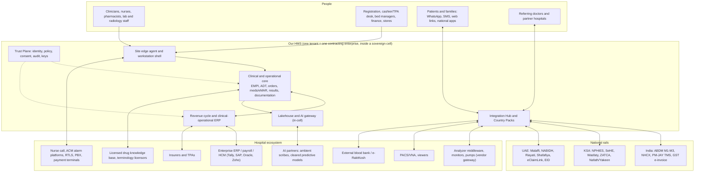
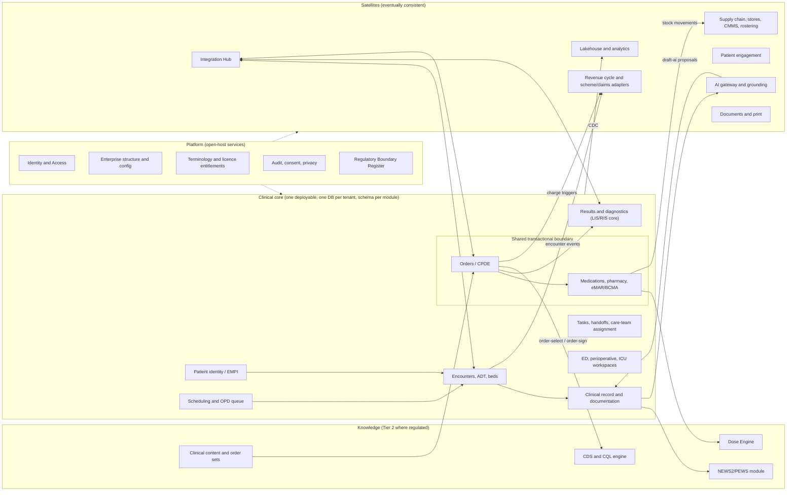
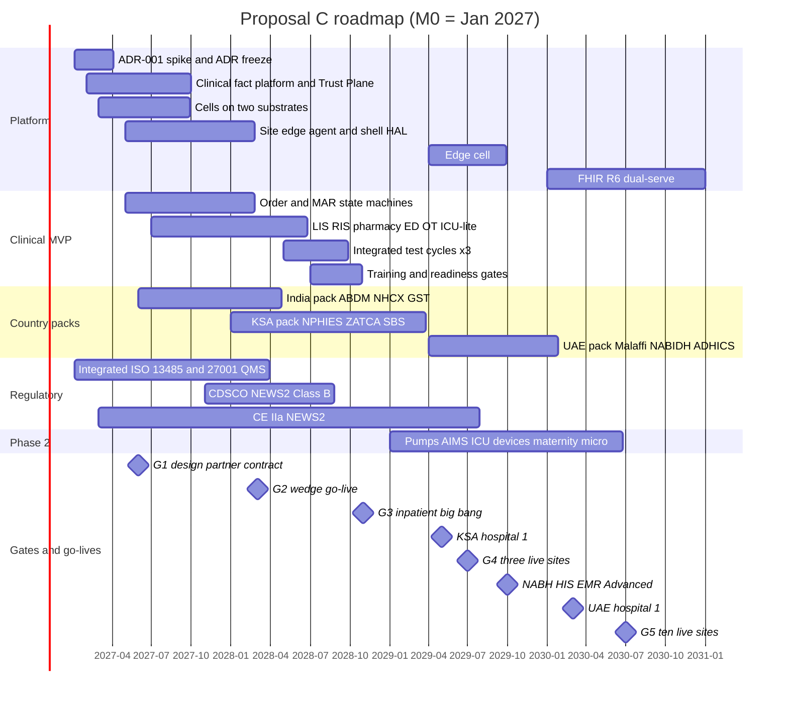

# Proposal C: A Platform Built to Last 20 Years
## Master blueprint for a world-class Hospital Management System, written from the platform-architecture lens

---

## 0. Document control

| Field | Value |
|---|---|
| Document | Proposal C, the platform-architecture-first master blueprint (one of three competing proposals) |
| Version | 1.0 (submitted for panel scoring) |
| Date | 16 October 2026 |
| Status | Proposal. It changes nothing until the panel adopts it. All ADRs below are "proposed" until the gates in §15 pass. |
| Authors | Principal architect / CTO, with the interoperability and security lead |
| Calendar anchor | **M0 = 4 January 2027.** This assumes the seed round closes by December 2026. Absolute regulatory dates are mapped to M-numbers in §10 and §15. |
| Evidence base | The 16-report research pack (R01–R16), the Reconciliation Log (RL #1–#20) and the Glossary. No web searches were used: the pack is dated today, and nothing in this plan depended on fresher facts. |

**How to read this.** §1 is the one-page argument plus the decisions that matter. §7–§11 are the platform core and the most detailed part. §4–§6 and §12–§13 cover clinical and business scope with the same rigour, because a platform that hospitals cannot go live on is worthless. §14–§19 cover money, time, metrics, risk and open questions. Every deviation from a reconciled pack position is flagged **[DEV-n]** where it occurs and argued in Appendix B.

**Reference key.**

| Ref | Report | Ref | Report |
|---|---|---|---|
| R01 | Global vendor landscape | R09 | AI, analytics, digital front door |
| R02 | Open source and platforms | R10 | Implementation and UX lessons |
| R03 | Clinical modules and workflows | R11 | Canonical domain model |
| R04 | Diagnostics, pharmacy, devices | R12 | Build programme and business plan |
| R05 | Revenue cycle, ERP, operations | R13 | Beachhead pack: India, KSA, UAE |
| R06 | Interoperability standards | R14 | Requirements catalogue, MVP, RFP crosswalk |
| R07 | Security, privacy, regulation | R15 | Clinical safety, QMS, validation, migration |
| R08 | Architecture and technology | R16 | Facility, peripheral and hardware integrations |
| RL | Reconciliation Log (where a report conflicts with RL, RL wins unless we flag a DEV) | | |

---

## 1. Executive summary

**The bet.** Hospital systems live 15–25 years: KFSHRC has run Cerner since 2002 (R13 §4), and the VA's replacement will cost about US$37B (RL #15). Winners are decided less by launch-day features than by whether the record, configuration and integrations survive a decade of regulatory churn, standards changes, mergers and cyberattacks without rewrites, forks or migrations. Our thesis: **build the durable core first, put safety invariants and sovereignty inside it, and win the first market on "closed loop at local prices"** (R14 §1).

**What we build.** One longitudinal record and one transactional model across clinical care, revenue cycle and clinical-operational ERP (R01 §12.2; RL #3). It rests on:
- a **domain-owned PostgreSQL database per tenant** with FHIR-shaped, bitemporal clinical facts (RL #1, #7);
- a **generated FHIR projection**, so R4 now and R6 later are mappings, not migrations (R06 §7.1; R11 §0);
- **sovereign cells** that meet Abu Dhabi's ADHICS v2 by design (R13 §5.1);
- a **native Integration Hub** for HL7 v2, FHIR, DICOM and national rails (RL #12).

The same signed artifacts run in SaaS, sovereign, on-prem and edge deployments.

**Where and when.** India builds and proves; KSA, through an in-Kingdom sovereign cell, pays; the UAE follows (RL #9). The first buyer is R14's 150–300-bed private multispecialty "minimum viable hospital". Milestones on R12's three clocks:
- **M14 (Mar 2028):** wedge go-live at design partner #1's satellite OPD/diagnostic site.
- **M22 (Nov 2028; window M20–M24):** inpatient + ED big bang at a non-flagship group hospital.
- **M28:** first KSA hospital. **M30:** three sites (G4). **M33–M34:** NABH HIS/EMR Advanced. **M38:** first UAE hospital. **M36–M42:** ten sites.

**What it costs.** About **US$109M of five-year opex** against US$36M of revenue, so we raise **US$90–92M**: seed US$12M, Series A US$25M (G2), Series B US$45M (G4) and US$8–10M of venture debt. We operate Lean until G3. That is about US$4.5M above R12's Base; it pays for an early platform, security and SRE team instead of a Year-4 rewrite.

**Why we win.** Depth-first incumbents (Epic, Oracle, InterSystems) are expensive and weak on regional billing. Breadth-first local suites (KareXpert, Insta, ezCaretech) show no public evidence of closed-loop BCMA (R14 §8.2). Nobody holds the intersection on a core that is sovereign, version-proof and free to exit.

### The decisions that matter

| ID | Decision | Rationale | Evidence |
|---|---|---|---|
| D1 | **ADR-001: Option A.** Domain-owned Postgres, one DB per tenant; FHIR-shaped JSONB facts; generated FHIR projection; HAPI libraries embedded. Gated by an 8-week spike with numeric pass/fail criteria (§7.3) | Transactional invariants, R6 churn, country projections | RL #1; R06 §7.1; R08 §4.6; R11 §0 |
| D2 | **Kotlin/JVM modular monolith plus satellites.** Orders + Medications + eMAR share one transactional boundary | No sagas around doses; JVM hosts the HL7 tooling | R08 §4.1, §12.5; R14 §4 #9 |
| D3 | **Journal-lite everywhere; in-database full event sourcing for Order and MAR aggregates only** (ADR-004) | Their lifecycle *is* the logic, and offline BCMA syncs as commands | RL #7; R08 §3.5; R11 §10 |
| D4 | **Canonical Model Versioning (CMV) independent of FHIR.** A projection compiler serves R4 now and R6 alongside it from M48. No resource that leaves R6 core becomes canonical | Version-proof interoperability for 20 years | RL #2, #13; R06 §3.2.1; R11 §0 |
| D5 | **Sovereign cell architecture.** PHI-free global control plane; substrate-portable (vanilla Kubernetes + CloudNativePG + Strimzi), proven on two substrates by M9 | KSA has no AWS or Azure region; ADHICS forbids offshore copies | R07 §9.1 #3; R13 §8.1; R12 §7.3 |
| D6 | **Customer-held keys, in-country support rosters and zero standing access in every cell from day one** | ADHICS is the strictest regime; designing for it once costs less than retrofitting | R13 §11 #4; R07 §5 |
| D7 | **RL #8 NFR table adopted.** Single writer per tenant. KSA cross-site DR exception until a second in-Kingdom region exists **[DEV-1]** | Engineering SLOs we can prove; contracts we can honour | RL #8; R14 §9.2; R13 §8.1 |
| D8 | **Layered downtime resilience.** Site edge agent with a local continuity replica in the MVP; edge cell (local primary) brought forward to P2 at M33 **[DEV-2]** | Ransomware outages last weeks; ECRI's #2 hazard is "digital darkness" | R07 §6; R16 §2.1; R04 §2 |
| D9 | **Native Integration Hub plus signed, effective-dated Country Packs, with national conformance suites in CI** | National rails decide elimination | RL #12; R06 §7.4; R14 §8.4 |
| D10 | **Trust Plane.** No module touches a data store without the Policy and Audit SDKs. Sensitivity labels from day one. 100% BALP audit | The most expensive retrofit in the industry | R07 §9.1 #1–#2; R08 §10 |
| D11 | **One integrated ISO 13485 + ISO 27001 management system from M0**, with a Regulatory Boundary Register and tiered modules | Notified-body queues; the SOUP burden of a separate "13485 island" | R15 §2.1, §5; R14 §11 #5 |
| D12 | **Configuration as product.** Foundation content plus governed deviations, three-way merge at upgrade, no forks, no customer code branches | Japan's per-hospital customization destroyed interoperability; forks killed VistA's coherence | R08 §9; R10 §10.1; R01 §12.4 |
| D13 | **CQL is the single logic substrate in the MVP** for CDS, NEWS2/PEWS, NABH/JAWDA KPIs and quality measures **[DEV-3]** | Write the logic once; avoid a second rules language | R03 §3; R08 §4.5; R13 §11 #3 |
| D14 | **CDC to an Iceberg lakehouse in the MVP (bronze/silver layers)** **[DEV-4]**; OMOP and SQL-on-FHIR are outputs; no PHI-derived data leaves a cell | AI, KPI engines and migration staging all need it; nightly ETL is the incumbents' weak point | R08 §14 #15; R09 §9.1; R13 §11 #4 |
| D15 | **AI gateway, grounding service and AI Control Plane in the MVP.** Only a non-device "documentation assistant" SKU. Partner models; humans sign | Provenance cannot be retrofitted; classifiers keep us out of device scope | R09 §9.1; R15 §4.2j; R08 §11 |
| D16 | **MVP = R14's 140 features with three re-tags (DEV-2/3/4), planned at about 1,450 squad PM (R12 basis, not R14's 433)** | R14's T-shirt sizes exclude hardening, validation and NFR work | R12 §4.2; R14 §3 |
| D17 | **Rollout: wedge at a satellite site (M14), inpatient big bang at a non-flagship hospital (M22).** Never unit-by-unit BCMA **[DEV-6]** | Reconciles R12's wedge with RL #11 | RL #11; R12 §3.3; R15 §10.3 |
| D18 | **Markets per RL #9:** India + KSA, then UAE; Wave 2 decided at G5; US go/no-go no earlier than Year 4 | Mandates are explicit and buyers pay for compliance | RL #9; R13; R12 §10 |
| D19 | **Funding US$90–92M; operate Lean until G3; kill/pivot triggers as R12** | The G3–G4 funding gap is the critical business risk | R12 §6, §14 |
| D20 | **Transparent price sheet (R12 v0.1) [DEV-8]; free FHIR Bulk and full database export; tri-party escrow; no fee for basic FHIR APIs** | Vendor-viability fear is the first objection buyers raise | R12 §12; R01 §12.3 |

---

## 2. Vision, product thesis, positioning and differentiation

**Vision.** Every hospital, at any price point and in any jurisdiction, runs on a record it can trust, keep, move and extend for decades.

**Product thesis (platform view).** R08 §1 concludes that the incumbents' moat is **content, configuration and integration breadth, not database technology**. So we compete on four things the incumbents structurally cannot match cheaply:
1. **Speed and cost of localization.** A country pack is data on one codebase, not a fork. Dedalus, CGM and others carry estates of acquired code bases (R01 §3.4).
2. **Speed of configuration and upgrade.** Evergreen weekly delivery, quarterly feature activation, zero planned downtime (R08 §10). Epic's AI features reach community sites 6–18 months late (R01 §2).
3. **Speed of integration.** National rails ship as owned products with SLAs and live references (R14 §11 #4).
4. **Trust.** Sovereignty, safety evidence and exit rights are built into the product, not promised in a contract.

**Positioning statement.** "An Epic-grade single-record HIS with a natively joined clinical-operational ERP, at emerging-market prices, sovereign by construction and open by default" (adapted from R01 §12.1).

| Competitor | Strength | Structural weakness in our segment → why buyers switch |
|---|---|---|
| **Epic** | One database and codebase; Foundation content; Cosmos; 16 years Best in KLAS (R01 §10.1) | Licences US$10–30M+ (R12 §12.1); billing not implemented in the Gulf (R14 §6.1); no ERP → comparable closed loop at about a tenth of the TCO, with regional billing and ERP joined |
| **Oracle Health** | Gulf base (KFSHRC, HMC); Fusion ERP | New EHR ambulatory-only, no acute GA (R01 §2); VGR termination (R08 §2.2) → platform-discontinuity fear; KSA buyers want in-Kingdom teams |
| **MEDITECH, Dedalus, CGM, Nexus** | Cloud Expanse; DACH incumbency | Little India/GCC presence; DACH Best in KLAS 73.5 → relevant only in Wave 2 DACH via a partner (R01 §3.4) |
| **InterSystems, IQVIA** | 600+ hospitals in 29 countries (vendor claim, RL #20); Best in KLAS ME/Africa 82.0 | Implementation and training complaints in the Middle East (R14 §6.1) → we match localization and beat delivery |
| **KareXpert, Insta, Akhil (India); ezCaretech (KSA)** | Checklist breadth, rails, ₹800–1,000/bed/month; ~US$5K/bed | No public BCMA evidence; dated stacks; 20–40% renewal hikes (R12 §12.1) → closed loop plus capped uplifts at ≤2× local price |
| **OSS (OpenMRS/Bahmni, CARE)** | Free; Digital Public Goods | Not hospital-scale; EAV models; framework churn (R02 §7) → we interoperate as an OpenHIE point-of-service system |

**Our differentiation (three things no competitor offers together):**
1. **Closed loop at local prices:** CPOE → pharmacist verification → BCMA → bedside transfusion check, then an NPHIES or NHCX claim from the same encounter (R14 §11 #3).
2. **Sovereign by construction:** every cell meets ADHICS-grade residency, key custody and support isolation. That opens Abu Dhabi, KSA and Indian state data centres without re-architecture.
3. **A version-proof, exit-proof record:** FHIR R4 now, R6 without migration, free Bulk and database export, escrow, and an open event catalogue.

**Switch triggers** (R12 §10.1): NABH 6th edition and DHS, ABDM/NHCX, NPHIES/SBS, ZATCA, Malaffi licensing, renewal hikes, M&A. Our answer to each is a live reference and a product feature, not a project.

---

## 3. Target market, ideal customer profile, beachhead and entry sequencing

**ICP (R12 §10.1, R14 §2).**
- **India:** NABH-accredited private multispecialty hospitals of 150–500 beds and regional chains of 3–15 hospitals. Payer mix: cash 35–50%, TPA 30–45%, schemes 10–25%.
- **GCC:** private groups of 2–10 hospitals with 200–600-bed flagships, under NPHIES/SBS, ZATCA, CBAHI/JCI (KSA) or Malaffi/NABIDH and ADHICS (UAE) pressure.
- **Design point:** the MVH-200 (R14 §2): 200 beds, 20 ICU, 6–8 OTs, 800–1,500 OPD visits a day in India, 350–500 peak concurrent sessions.

**Beachhead logic.** India gives scale, an engineering cost base and NABH certification. The GCC gives margin: one GCC hospital earns about 6.4× the subscription of a comparable Indian hospital (R12 §11). Platform reason: together they exercise every hard abstraction: LTR and RTL scripts, Gregorian and Hijri calendars, pay-first and insurance-first billing, ABDM consent artefacts, ADHICS key custody and a KSA market with no AWS or Azure region (R08 §14 #14; R13 §8.1). Pass India + KSA + UAE, and Indonesia, Kenya or DACH-via-partner become country packs, not rebuilds.

| Wave | Markets | Entry criteria (all must hold) | Go/no-go gate |
|---|---|---|---|
| **1** | **India** (design partner #1, a 3+-hospital NABH group) | ABDM M1–M3 + WASA; NHCX/TPA live; India cell (AWS Mumbai + Hyderabad); CERT-In controls | G2 (M12–M15) wedge live; G3 (M20–M24) inpatient live |
| **1** | **KSA** (design partner #2, private group of 2–6 hospitals, via an in-Kingdom hosting and integration partner) | KSA entity (M9–M12); sovereign cell on a CST-licensed provider; NPHIES certification; ZATCA Phase 2; NCA ECC mapping; Arabic clinical content | G4 (M26–M30): KSA hospital live with NPHIES in production |
| **1b** | **UAE** (Abu Dhabi private hospital, then Dubai) | ADHICS Service Provider controls; UAE-only cell including DR; customer-held keys; UAE-resident support roster; Malaffi/NABIDH; CPT/CDT licences | Selling opens M24 (after G3 evidence); first go-live M38 |
| **2** | **One of** Indonesia (SATUSEHAT), Kenya (SHA/Taifa Care adjacency) or another SE Asian market; **DACH only through a German partner** (IS-H exit) | ≥10 live sites; services ≤60% of revenue; country pack ≤120 PM | Decision at G5 (M40); entry ~M48 |
| **3** | EU, UK, Australia, Canada candidates | EHDS-shaped logging, IPS and a DCB0129-style safety case already built (no-regret work, RL #9) | Decision at G6 (M54–M66) |
| **US** | Phase 3 go/no-go only | ONC retargeted to HTI-5's 19 retained + 7 revised criteria; HITRUST; Da Vinci | Not before Year 4 (RL #9) |

**Explicitly avoided in Years 1–3:** Indian state HMIS tenders (₹120 Cr turnover walls, CMMI L3, L1 pricing, IP vesting in the state; R14 §6), KSA public clusters without an RHQ (R12 §10.4), China, and academic medical centres as go-live sites (R12 §9.1). After M24 we may bid state tenders as the IP-owner OEM behind an SI, once PLT-OPS-02 (state data-centre install) is ready (R14 §11 #6).

---

## 4. Product scope: module catalogue, phasing and build/integrate/partner

**Backlog of record.** R14 Appendix A has 214 features: 140 MVP, 54 P2, 20 P3. We adopt it unchanged except for the re-tags marked DEV below. Any change to an MVP tag needs product-council sign-off (R14 §11 #1).

**Phase key:**
- **MVP:** what the MVH-200 needs to sign and go live. Wedge subset at M14; full inpatient at M22.
- **P2:** M24–M36.
- **P3:** M36+.
- **B / I / P:** build / integrate / partner or license.

| Domain | MVP | P2 | P3 | B / I / P |
|---|---|---|---|---|
| **Patient access & ADT** | EMPI with reversible merge; national-ID plug-ins (ABHA, Nafath/Yakeen; EID in 1b); registration with sponsor/payer; ADT incl. pending/LOA; bed and EVS state machine; scheduling; **OPD token/queue journey**; ABDM Scan-and-Share | Referral tracking; transfer centre; kiosks | Predictive discharge | B |
| **Clinical core** | Chart with banner standard; coded problems and allergies; CPOE (all timing types, versioned order sets); CDS v1 (Leapfrog 8 categories, telemetry, kill switches); notes, med rec, I-PASS, discharge summary; results inbox and critical-result loop; HIM basics; incident reporting | Third-party CDS Hooks; copy-forward controls; MCI mode; HAI surveillance; stewardship | Specialty kits (cardiology, dialysis, oncology depth) | B; drug KB **P** |
| **Nursing** | Flowsheets, care plans, worklists, handoff; **NEWS2/PEWS/MEOWS as Regulated Module #1** (activation per §5.3) | Nursing ambient to flowsheets; rule-based sepsis screen (**Regulated Module #2**) **[DEV-5]** | Acuity-based staffing | B; ambient **P** |
| **Medication** | Formulary; pharmacist verification; IP and OP/retail pharmacy; eMAR/BCMA on web and mobile with offline-safe administration; independent double checks; **shared Dose Engine (Tier 2)**; infusion data model with pump-channel association | Pump autoprogramming with one vendor (M28–M30, once BCMA scanning ≥95%); chemotherapy; ADC/robot interfaces; Wasfaty/national e-Rx | IV compounding | B; pump gateway **I** |
| **Diagnostics** | **Native LIS core** (accessioning, middleware analyzers, autoverification v1, QC, send-outs); **native RIS core** (MWL/MPPS, templates, actionable findings); PACS via DICOMweb/IID; **transfusion T1 workflow + T2 bedside verification** + external blood bank / e-RaktKosh interface | Microbiology (hierarchical model); POCT; dose capture; native blood-centre inventory (non-US) | Anatomic pathology with SDC; ISO 15189 document control; compatibility engine as an IVD-grade product (R15 T3) | B; PACS, middleware **I** |
| **Periop, ICU, ED, maternity** | ED triage (ESI/MTS/ATS configurable), tracking board, pathway timers, ECAT-ready time stamps; OT booking, WHO checklist, intra-op record with implant and consumable charging; anaesthesia pre-assessment and intra-op/PACU record; ICU q1h flowsheet with monitor feed via middleware plus nurse validation; basic maternity | Full AIMS; OR analytics; severity scores; NICU with human-milk tracking; Labour Care Guide | Tele-ICU | B; device middleware **I** |
| **Revenue cycle** | Patient account; CDM, tariffs, packages, price lists; deposits, interim bills, discounts, cashiering; TPA cashless state machine; NHCX/PM-JAY; NPHIES; GST and ZATCA engines; scheme abstraction; claims and denials; doctor revenue share | Grouper SPI (AR-DRG shadow for KSA, IR-DRG for UAE); coding workbench and CDI; AI claim scrubbing | Patient-level costing; US RCM (Phase 3) | B; groupers **I** |
| **ERP & supply chain** | Item master; stores; FEFO; indents; consumption-to-charge; procurement-lite (PR→PO→GRN); AP/AR and GL journal export (Tally/Zoho/SAP B1/Odoo/Dynamics); staff master and privileges | Native lite GL and fixed assets; CMMS; basic rostering; enterprise ERP connectors; UDI/consignment | — | B; **payroll/HCM always I** (RL #3) |
| **Quality & safety** | Accreditation-pack engine with NABH 6th edition and DHS KPIs; CBAHI pack (KSA) | JAWDA; EMRAM readiness reports | Federated benchmarking | B |
| **Analytics & AI** | Reporting replica (≤60 s) and report builder; **CDC lakehouse, bronze/silver layers [DEV-4]**; AI gateway and Control Plane; ambient OPD documentation (≥2 partners); discharge-summary drafts | Chart summary; OMOP and SQL-on-FHIR; capacity forecasting; partner-cleared predictive scores (silent mode first) | In-basket AI; imaging-AI orchestration | B; models **P** |
| **Patient & referrer front door** | WhatsApp/SMS engagement; booking and payment links; report download; national PHR push (ABHA, Sehhaty, UAE PASS) | Full app/portal; teleconsultation; CRM; referrer portal | RPM; hospital-at-home | B; channels **I** |
| **Interoperability** | HL7 v2 engine; FHIR R4 façade (IPA, SMART 2.2, Bulk, Subscriptions); PDF/A + CDA/FHIR documents from one source; ABDM M1–M3; SeHE; Malaffi/NABIDH/Riayati (1b) | IPS `$summary`; public-health reporting | openEHR adapter; EHDS components; ONC via partner | B |
| **Facility & peripherals (R16)** | Workstation shell HAL (print, scan, badge, camera); **site edge agent**; wristband and label templates incl. Arabic/Indic; care-team assignment + nurse-call ADT/assignment feeds; payment terminals, UPI QR, three-way reconciliation | IHE ACM reporter/consumer; secure messaging; CTI/IVR; code-event orchestrator; RTLS ingestion | BMS context; pneumatic tube | B; nurse call, RTLS, alarms **I** (never build) |
| **Platform, config & implementation** | Clinical fact platform; Trust Plane; config-as-product; country packs; forms engine (SDC); **CQL logic substrate [DEV-3]**; downtime tooling; migration workbench; readiness and training tooling; telemetry and micro-surveys | On-prem/state data-centre install (PLT-OPS-02); external plugin SDK and SMART launch; BYOK/HYOK productised; **edge cell (local primary) at M33 [DEV-2]** | App marketplace | B |

**MVP sizing, reconciled.**
- R14 sizes the 140 MVP features at about 1,875 engineer-weeks, or about 433 engineer-months of feature code (R14 §3).
- R12 sizes a comparable MVP at 1,055–1,645 squad person-months, including embedded QA and design (R12 §4.2).

The 3× gap is real. R14's T-shirt sizes cover happy-path feature construction. They exclude hardening to NFR budgets, three integrated test cycles, clinical validation iterations, regulated-module documentation and integration rework. We therefore plan **about 1,450 squad PM for the MVP**:

| Block | PM |
|---|---|
| Platform & Trust | 540 (R12 upper range; adds the CQL substrate, lakehouse bronze layer and two-substrate conformance) |
| Clinical core & diagnostics | 660 |
| Revenue & ERP | 160 |
| India and KSA country packs | 90 |

P2 adds about 450 PM (R12 §4.2 Phase 2 plus the edge cell). AI coding tools are planned at a 15–20% saving on coding-heavy epics and **0%** on validation-heavy epics: orders, MAR, LIS and country packs (R12 §4.3).

---

## 5. Clinical safety, quality and regulatory classification

### 5.1 Safety invariants enforced in the domain layer

Safety rules live server-side, so UI, API, mobile, interface, plugin and AI channels hit the same checks (R11 P11). The twelve R11 §15 invariants each get a traceability ID, a property-based test and a hazard-log entry: two-identifier positive identification; banner integrity; dosing-weight provenance; order–result closure; critical-value read-back; one patient context per window; reversible, notified merges; UCUM-only units with ISMP display; effective vs recorded time; labelled downtime back-entry; AI content labelled until signed; sensitivity labels on every channel. We add four from R03/R10: **no orphaned work** (every order, result, message, referral and letter owned, timed and alarmed); no default selects a dose, route or patient; hard stops on 10×/100× dose deviations; med rec blocks completion until every item is decided.

### 5.2 Closed loops by construction

| Loop | Steps that the platform makes timestamped events | MVP KPI target |
|---|---|---|
| Medication | Order → verification → dispense → scan patient → scan drug → administer → document | BCMA patient *and* drug scans ≥95%; 100% unit coverage (Leapfrog BCMA) |
| Transfusion | Order → consent → sample (2 IDs) → issue → bedside wristband ↔ unit ↔ order match → reaction watch | Bedside scan ≥98% |
| Specimen | Order → label at bedside → collect → receive → result | Rejection <1%; WBIT tracked |
| Diagnostic | Order → result → acknowledgement; pending-at-discharge queue | Unacknowledged abnormal results >7 days → 0 |
| Critical result | Result → named-recipient call log → read-back → escalation | ≥95% within policy time; 100% CAP-complete documentation |
| Work items | Every task owned, timed and alarmed | Orphaned items = 0 (Level-3 rollback trigger if >2 h) |

### 5.3 QMS, safety case and classification

**Management system.** One company-wide ISO 13485 + ISO 27001 system from M0; a separate "13485 island" would turn shared services into SOUP requalified every release (R15 §2.1). Tiers (R15 §3): **Tier 0** billing, ERP, HR; **Tier 1** safety-relevant non-device (ADT/EMPI, CPOE, eMAR/BCMA, results routing, downtime) with a DCB0129-style safety case and CSO sign-off per release; **Tier 2** device (NEWS2/PEWS, Dose Engine, medication screening, bedside transfusion verification; later sepsis and pumps) under full IEC 62304 / ISO 14971 / IEC 62366-1. IEC 62304 Ed. 1 + A1 is structured to map onto Ed. 2 (forecast Oct 2028, M21). ISO 13485 at M15; CE IIa for NEWS2 about M30. A **Hazard Log API** puts a safety-impact field on every story; CI blocks unverified hazard controls; a Release Evidence Pack generator assembles safety case, SBOM/VEX, tests and regulatory impact per release (R15 §6.2).

**Classification and activation.** A **Regulatory Boundary Register** is a platform service. A Tier 2 module activates for a tenant only when its market status is "cleared" or "not required". The fallback for NEWS2 is electronic observation charting with frequency scheduling (R15 §5.1).

| Function | India (CDSCO) | KSA (SFDA) | EU (MDR) | Our posture |
|---|---|---|---|---|
| NEWS2/PEWS score + escalation tasks | Device, likely B | Device, B | IIa | Regulated Module #1. Activate in India after CDSCO Class B (target M20, before the inpatient go-live); KSA via the CE route (~M32) |
| Sepsis screening (rules) | Device, C | Device, C | IIb | Regulated Module #2 in P2, non-interruptive with inputs shown. ML only from cleared partners |
| Dose Engine | Device, B/C | Device | IIa/IIb | One shared Tier 2 Class C engine. No dose arithmetic in CPOE, BCMA or pump code |
| DDI/allergy/dose-range screening | Likely device | Likely device | IIa | Tier 2 from day one. Intended purpose: "presentation and local tiering of vendor screening results"; the KB vendor carries its own status |
| BCMA/eMAR | Likely excluded | Not a device | Likely non-device | Tier 1 |
| Bedside transfusion verification | Unknown | Unknown | Borderline | Tier 2 Class C. Written opinion per market before activation (RL #5 scope, R15 gating) |
| Pump autoprogramming | Inherits pump class | Inherits pump class | May be IIb | "Orders, never commands" (IHE PCD PIV to the vendor gateway); vendor intended-use letter |
| Alarm forwarding | Device | Device, C | IIb | **Never build.** Integrate ACM platforms (Vocera, Ascom, Spok) |
| AI documentation assistant | Non-device if documentation only | Non-device; **a device if it suggests diagnoses** | Not a device | Output classifiers block diagnosis and treatment suggestions |

*Source: R15 §4.1. The UAE column is omitted because R15 marks every UAE cell [U]; we assume reliance on reference approvals. "Unknown" = R15 [U]. All cells are hypotheses to confirm by written opinion.*

### 5.4 Accreditation traceability

An **accreditation-pack engine** maps chapter → standard → objective element → evidence query or attestation → KPI (numerator, denominator, sampling) → manual fallback (R13 §11 #3). Launch packs: NABH 6th edition (639 OEs, all 105 Core OEs ≥4, e.g. AAC.2.b UHID, COP.1.b two identifiers, MOM.4.e/f reconciliation, AAC.5.a EWS effectiveness); NABH DHS 2nd edition (182 OEs); NABH HIS/EMR V12.1 (HIS 171, EMR 166 OEs); CBAHI 3rd; JCI 8th; DoH JAWDA and ADHICS. Joint Commission NPGs are a secondary pack (RL #9). A Leapfrog-style CPOE harness (≥60% of serious errors alerted; zero interruptive alerts on the "should not alert" set) runs after every content release (R15 §5).

---

## 6. UX and clinician-experience strategy

**Evidence.** Physicians rate their EHRs at a SUS of 45.9 and nurses at 57.6. Each SUS point is associated with 2–3% lower odds of burnout (R10 §2). US and non-US clinicians on the *same* vendor spend 90.2 vs 59.1 minutes a day in the EHR, so documentation norms matter as much as software (R10 §2).

**Strategy:**
1. **Role-based workspaces** (physician, nurse, pharmacist, lab, radiology, OT, ED, cashier/TPA desk, bed manager) composed from one design system. Our own modules use the extension slots partners will later use, dogfooding the plugin model before the external SDK (P2).
2. **Speed is a safety feature.** R14 §9.1 budgets are release blockers (warm screen ≤1.0 s, cold chart ≤1.5 s, order sign ≤1.5 s, BCMA ≤500 ms, badge tap ≤2 s, usable at 1 Mbps / 300 ms RTT), with real-user monitoring per screen and site.
3. **Documentation as synthesis:** notes built from structured data with per-span provenance (typed, template, copied, imported, AI); visible copy-forward with "changes since last note"; **jurisdiction-specific documentation profiles** so US billing norms do not shape Indian or Gulf notes (R10 §10.1).
4. **Alert fatigue governed as a portfolio:** a minimal interruptive set (Level-1 DDIs, true severe allergies, high-alert dose limits, fatal routes); every rule has an owner, evidence, expected firing rate and retire-by date; 2–4 weeks silent plus a 90-day replay before any rule may interrupt (R03 §3; R15 §5).
5. **Mobile and language:** one React Native clinician app (BCMA, specimen collection, rounding, results, secure chat; encrypted offline cache; badge login). WCAG 2.2 AA with a VPAT. **Arabic RTL** via CSS logical properties with bidi isolation for Latin drug names, Hijri beside Gregorian, Arabic four-part names with transliteration and phonetic search, bilingual PDF/A from one source; Hindi and regional-language templates; clinician-reviewed translation, never a partially translated clinical path (R10 §10.1; R14 §9.4).

**Usability engineering.** NISTIR 7804 protocol with 15–20 participants per user group. Arabic-first and English-first clinicians are separate groups (R15 §7.6). Usability regression runs every release: block if task time worsens >10% or a new critical use error appears (R10 §5).

| Metric | Baseline (R10) | Target at 12 months post go-live |
|---|---|---|
| SUS, physicians / nurses | 45.9 / 57.6 | ≥68 / ≥72 |
| NEES, physicians / nurses (KLAS scale) | 23.4 / 47.3 | ≥40 / ≥55 |
| Nurse documentation minutes per shift | Measured at go-live | −20% by month 12 |
| Interruptive alerts per 100 orders | — | ≤5, with PPV reported per rule |
| Duplicate-text fraction in notes | 50.1% (Penn) | ≤30% |
| Training: initial hours, completion, proficiency | — | 6–11 h; ≥95%; ≥85% |

---

## 7. Architecture and technology

### 7.1 Architectural constitution

Ten rules extending R08 §12.1, each enforced by a CI check or fitness test:
1. One system of record per tenant; everything else is derived and rebuildable.
2. Clinical facts are immutable and bitemporal; corrections are new versions.
3. Strong consistency in the clinical core; eventual consistency at the edges.
4. The domain model is the truth; FHIR, HL7 v2 and national formats are generated projections.
5. Same signed artifacts in every topology; no cloud-only health API as a hard dependency.
6. Nothing fails silently: every message, task and order has an owner, timer and alarm.
7. Safety invariants, policy and audit sit below the API, so every channel is equal.
8. Configuration over code, promoted like code; extend through events and effects, never forks.
9. Sovereignty is a property of the cell: PHI and anything derived from it never leave it.
10. AI proposes, humans dispose; agents use public APIs, never the database.

### 7.2 System context

### 7.3 ADR-001 resolved: the core data architecture

**Options.**
- **A:** domain-owned PostgreSQL, one database per tenant. Domain tables hold the state machines (ADT, beds, orders, MAR, charges, stock). Clinical facts are typed FHIR-shaped JSONB. A generated FHIR projection serves reads. HAPI structures, validator and v2 libraries are embedded.
- **B:** a FHIR-native core (self-hosted Medplum or HAPI JPA) with a repository abstraction.
- **A′ (sub-option of A):** the same as A, but HAPI JPA serves as the projection store rather than generated projection tables inside the tenant database.

The decision is RL #1's posture. Our contribution is to make the gate falsifiable.

**Spike (M0–M2, eight weeks, two teams of four).**
- **Workload:** the R15 §7.4 "1,000-bed day": 1,000 inpatients, 3,000 OPD visits, 300 ED arrivals; 20,000 orders, 25,000 administrations, 15,000 results and about 300,000 messages; a 3× peak between 07:00 and 09:00.
- **Weighted criteria:**

| # | Criterion | Weight | Pass threshold |
|---|---|---|---|
| C1 | Atomic order-sign (order + CDS override record + verification task + MAR schedule + charge event) | 15 | p95 ≤300 ms server time at 3× peak |
| C2 | Safety invariants under 10⁶ randomized property-based command sequences (e.g., no administration without an active verified order or a documented override) | 25 | **Zero violations (hard gate)** |
| C3 | Bitemporal "what did the clinician see at 09:12" reconstruction of a 30-day inpatient chart | 10 | p95 ≤1.5 s |
| C4 | FHIR R4 read/search over the projection; projection lag | 10 | p95 ≤300 ms; lag p99 ≤5 s |
| C5 | R4→R6 cost: project R6 Encounter and the reorganised MedicationRequest/Dosage from unchanged storage | 15 | ≤15 engineer-days; zero storage migration |
| C6 | Country projections: NPHIES messaging bundle and ABDM HI bundle from the same facts | 10 | 100% validator conformance |
| C7 | Restore and key isolation: single-tenant point-in-time restore of a 5-year, 300-bed tenant | 5 | ≤4 h; per-tenant keys |
| C8 | Developer throughput: add a new clinical fact type end to end (storage, API, projection, audit, tests) | 10 | ≤3 days |

**Decision rule.**
- Option A is the default.
- B replaces A only if it passes C2 with zero violations **and** beats A by ≥15 weighted points.
- A′ is adopted only if generated projection tables miss C4 or C8.
- Whatever wins, the repository/port abstraction stays, and ADR-001 is frozen at **M3**.

**Why we expect A to win.** R6 moves the finance and supply resources out of core and reorganises dosage (RL #2, #13), so an R4-native store would need a data migration within five years. FHIR has no workflow states such as a pharmacist verification queue (R08 §6). Medplum's single-database Projects conflict with database-per-tenant (RL #1). R02's valid "translation smell" warning is met by storing stable facts (Observation, Condition, AllergyIntolerance, QuestionnaireResponse, Composition) FHIR-shaped, so their projection is near-identity; translation is concentrated where FHIR is weakest (orders, medications, encounters, finance).

### 7.4 Canonical Model Versioning and FHIR projection (ADR-005)

- **Fact schema registry.** Each fact type has a versioned JSON Schema in the **Canonical Model Version (CMV)**, versioned independently of FHIR, declaring its R4 base profile, extensions and per-projection mappings. Evolution is additive within a major CMV; a major bump is a background re-projection, never a rewrite of stored facts.
- **Projection compiler.** Declarative mapping specs (FHIR Mapping Language-compatible, generated to Kotlin) produce the R4 façade, national profiles (NPHIES, `ndhm.in`, later SATUSEHAT and EU/UK IGs) and v2 segments, with round-trip and validator tests against pinned IGs in CI (R06 §7.4).
- **Version policy.** R4 4.0.1 is the baseline; R5 only via backports (Subscriptions); **R6 dual-serving GA at M48**, accelerated if any launch-market IG or the EEHRxF requires R6 earlier (RL #13).
- **FHIR writes** are limited to Appointment, QuestionnaireResponse, DocumentReference, device/patient Observation, Consent and Task, and become domain commands (R06 §7.1).

### 7.5 Bounded contexts and decomposition (ADR-003)

Per R08 §12.4, RCM is a downstream conformist behind per-country anti-corruption layers, and the Hub is the anti-corruption layer to every external dialect. Spring Modulith and Packwerk-style rules fail the build on cross-schema access. The core stays a **modular monolith** because a dose split across services becomes an uncompensatable saga (R08 §4.1); tender demands for "microservices" are met by containerised modules and satellites on Kubernetes with Kafka (R14 §4 #9).

### 7.6 Event model (ADR-004, ADR-009)

| Layer | What it is | Guarantees |
|---|---|---|
| **1. Clinical journal** | One bitemporal append-only row per state change (aggregate, patient, valid time, recorded time, actor, on-behalf-of, device, reason, payload, previous version), written in the **same transaction** as the state change | It is the outbox and the write-audit trail. Never updated (R08 §3.11 C) |
| **2. Domain events** | The public contract: CloudEvents 1.0 envelopes, schemas in an Apicurio registry, backward-compatible evolution only, a 12-month deprecation window | Published via Debezium to Kafka; keyed by patient ID, so each patient's events stay ordered; at-least-once delivery; consumers must be idempotent |
| **3. Integration messages** | HL7 v2, FHIR, NPHIES, ABDM, X12 and others, generated by the Hub from domain events | Per-patient ordering (an A08 never overtakes its A01); MSH-10 idempotency; ack-state for every message; replay |

- **Order and MAR are event-sourced inside the tenant database** (the ADR RL #7 allows): an append-only event table per aggregate, a snapshot updated in the same transaction, and upcasters. Reasons: offline BCMA syncs as revalidated commands (R08 §6.3); deterministic replay is the safety-case test oracle (R11 §17 #2); the lifecycle *is* the logic. **Revert trigger:** upcasting cost >20% of medication-squad capacity, or a C1 miss.
- **Care-team assignment (R16) stays journal-lite** (ADR-024), resolving R16's RL #7 flag.
- **The event catalogue is a product surface:** R11 §14 plus R16 §2.2 edge events, published as topic-based FHIR Subscriptions and webhooks.
- **No silent failures:** undeliverable messages land in owned queues that alarm after 5 minutes; no hidden dead-letter topics (R08 §4.3).

### 7.7 ADR register

| ADR | Decision | Freeze |
|---|---|---|
| 001 | Core data architecture, Option A (§7.3) | M3 (spike M0–M2) |
| 002 | Kotlin on JVM 21→25 LTS, Spring Boot + Modulith; C#/.NET rejected because HL7 v2, FHIR validator, CQL and SNOMED tooling are JVM-native (R08 §12.5) | M0 |
| 003 | Modular monolith + satellites; Orders/Meds/MAR one transactional boundary | M1 |
| 004 | Journal-lite everywhere; in-DB event sourcing for Order and MAR | M3 |
| 005 | CMV + projection compiler; R6 dual-serve at M48 | M3 |
| 006 | Database per tenant in shared cells; pooled tier (<100 beds) with FORCE RLS, no BYPASSRLS roles | M2 |
| 007/008 | Sovereign cells, PHI-free control plane, substrate portability; per-tenant envelope keys with customer-held external KMS/HSM mandatory in UAE/KSA | M2 / M4 |
| 009/010 | Kafka 4.x (Strimzi) + Debezium + CloudEvents + Apicurio; Temporal for long-running work, never order/MAR state | M2 / M3 |
| 011/012 | Edge integration planes (R16 §2.1); offline and downtime safety matrix in the hazard log (R08 §6.3) | M4 / M6 |
| 013/014/015 | Keycloak + OpenFGA with mandatory Policy and Audit SDKs; native Integration Hub, OIE optional under patch-lag policy; Snowstorm + own terminology + licence entitlements | M2–M3 |
| 016/018/019 | CQL as the single clinical logic language (DMN for operational rules); in-cell Iceberg lakehouse; AI gateway with in-region routing | M4–M6 |
| 017/020/021/022 | React monorepo + federated slots, Tauri 2, React Native; four extension tiers with WASM plugins returning effects; config as product with three-way merge; weekly CD, quarterly activation, N-2 on-prem | M2–M9 |
| 023/024 | Licence policy (R02 §8.2 allow/deny lists, dependency scorecard); assignment uses journal-lite | M1 / M6 |

### 7.8 Technology stack and licences

| Layer | Choice | Licence |
|---|---|---|
| Core | Kotlin, OpenJDK 21/25, Spring Boot, Spring Modulith | Apache-2.0; GPLv2+CE (JDK) |
| OLTP | PostgreSQL 18 (temporal constraints, `uuidv7()`; spike-tested before reliance), CloudNativePG, PgBouncer | PostgreSQL; Apache-2.0 |
| Events | Apache Kafka 4.x (KRaft), Strimzi, Debezium, Apicurio Registry | Apache-2.0 |
| Workflow | Temporal | MIT |
| HL7 tooling | HAPI FHIR structures, validator, HAPI v2; cqframework CQL engine | Apache-2.0 |
| Terminology | Snowstorm (SNOMED content licensed per country; free in IN/SA/AE) | Apache-2.0 |
| IAM | Keycloak, OpenFGA | Apache-2.0 |
| Search / cache | OpenSearch; Valkey (cache only) | Apache-2.0; BSD-3 |
| Data | Apache Iceberg, Trino, dbt-core, object storage | Apache-2.0 |
| Frontend | React, TypeScript, Vite, TanStack; Tauri 2 shell; React Native (Expo) | MIT; Apache-2.0/MIT |
| Imaging tier | dcm4chee (MPL) or unmodified Orthanc container; OHIF viewer | MPL-1.1; GPL/AGPL; MIT |
| Ops | Kubernetes, Helm, Argo CD, OpenTofu, OpenTelemetry, Prometheus; Grafana/Loki/Tempo shipped as unmodified separate containers | Apache-2.0; MPL-2.0; AGPL-3.0 |
| Optional | Eclipse OIE for site transforms | MPL-2.0 |

**Excluded:** Camunda 8.6+ (production licence), Redpanda (BSL), Mirth 4.6+ (closed), any cloud-only FHIR service (Azure API for FHIR retired 30 Sep 2026), and **Medplum components in the product [DEV-9]**: Medplum is the spike comparator and a reference design only.

### 7.9 Multi-tenancy and sovereign cells (ADR-006/007/008)

- **Tenant** = contracting enterprise: one EMPI, one record, one database, its own keys. Group Connect spokes live inside the host tenant, separated by legal entity, policy and consent. Every row also carries `tenant_id` and `facility_id`.
- **Configuration chain:** vendor foundation → country pack → tenant → legal entity → facility → department → unit → user; most-specific wins unless locked; every change is a signed change set promoted BUILD → TEST → TRAIN → PROD (R08 §9).
- **Cell:** a self-contained, region-pinned deployment (Kubernetes, Postgres fleet, Kafka, KMS integration, observability, lakehouse, AI gateway) for 10–20 hospitals of ~250 beds (R12 §7.3). **The global control plane carries only code, signed configuration, licence data and PHI-free telemetry** (R13 §11 #4).
- **ADHICS-grade controls in every cell from the first one:** in-country primary, backup and DR; no offshore copies, even encrypted or anonymised; customer-held keys neither we nor the CSP can access; in-country support roster; JIT access with session recording and zero standing access from abroad; customer lockbox approval and a visible support-access log; in-region LLM routing. Designing once for the strictest regime is cheaper than three variants (R13 §5.1).
- **Substrate portability:** from M9 CI runs conformance and the 1,000-bed day on managed (EKS) and vanilla (RKE2 + CloudNativePG + Strimzi) Kubernetes, because KSA has no AWS or Azure region (R13 §8.1).

### 7.10 Deployment topologies

| Topology | Location / substrate | Purpose | Live |
|---|---|---|---|
| India shared cell | AWS Mumbai (primary) + Hyderabad (DR); EKS | India SaaS | M10 (wedge M14) |
| KSA sovereign cell | CST-licensed provider (Google `me-central2` via CNTXT, or Oracle/stc through our in-Kingdom partner); vanilla Kubernetes; DR on a second in-Kingdom facility | KSA SaaS, NCA ECC-aligned | M18 |
| UAE sovereign cell | Azure UAE North or Core42/Khazna; DR inside the UAE; customer-held keys | ADHICS Service Provider | M33 |
| Dedicated cell | Any of the above | Large groups, residency contracts | P2 |
| Customer / state data centre | RKE2 or OpenShift; same artifacts, co-managed, N-2 versions | Public tenders, mandated on-prem | M30 |
| **Site edge agent** | 2-VM active/standby pair or appliance at each hospital (4 vCPU / 16 GB / 200 GB each, R16 §5) | Continuity replica, printing, device and facility bridges, queue state | **MVP (M14)** |
| **Edge cell** | 3-node k3s/RKE2; site is single writer for its encounters, beds, local scheduling and stock | Low-connectivity hospitals, Group Connect spokes | **M33 [DEV-2]** |

**Cost guardrail (R12 §7.3):** hosting per bed per month ≤US$2.5–4 in India and ≤US$10–18 in the GCC, and ≤12% of subscription revenue.

### 7.11 Downtime and business continuity

| Layer | Failure | Mechanism | Objective |
|---|---|---|---|
| L0 | Node or AZ loss | Synchronous quorum standby; multi-AZ Kubernetes and Kafka | RPO 0; RTO ≤5 min (engineering), ≤15 min (contract) |
| L1 | Region loss | Async replicas, WAL archive, Kafka mirroring, warm standby | ≤5 min / ≤60 min. **KSA: ≤15 min / ≤4 h until a second in-Kingdom region exists [DEV-1]** |
| L2 | Hospital WAN loss | **Site edge agent** holds an encrypted, streamed read-only replica of census, active orders, MAR, allergies, the last 72 h of notes and results; local wristband, label and MAR-packet printing; downtime MRN/encounter/accession blocks; queue engine state. Mobile BCMA works against orders verified before the outage | Continuity data ≤2 min stale (engineering), ≤15 min (contract) |
| L3 | Ransomware or logical corruption | PITR from immutable object-lock storage in an isolated account; clean-room rebuild; continuity mode throughout | Tenant restore ≤24 h (engineering); **T0 ≤72 h (contract)** |
| L4 | Prolonged outage of 4–6 weeks | Paper packets every 1–4 h; downtime forms; **back-entry with valid time = paper time and recorded time = now, labelled** | SAFER Contingency Planning guide |

**Never offline:**
- bed or OT-slot allocation;
- identifiers outside pre-allocated blocks;
- controlled-drug stock;
- new prescribing without full CDS (R14 §9.3).

**Drills:** a monthly game day, quarterly restore tests, two downtime ("Code Dark") drills a year per unit, and an annual full cyber-recovery exercise with at least one customer (R15 §5; R07 §5).

### 7.12 NFRs, SLOs and scalability

RL #8 / R08 §12.6 is adopted as the single table. Our additions are in bold.

| Metric | Engineering SLO | Contractual SLA |
|---|---|---|
| T0 write paths (ADT, CPOE, eMAR/BCMA, results filing) | 99.99% | 99.95% / month |
| Read and continuity paths | 99.99% | 99.99% |
| T1 ancillary (LIS, pharmacy, RIS, OT) / T2 business / T3 analytics | 99.95% / 99.9% / 99.5% | 99.9% / 99.9% / 99.5% |
| Planned downtime for releases | 0 | 0 |
| Warm screen / cold chart / BFF p95 | ≤1.0 s / ≤1.5 s / ≤300 ms | Reported |
| Order sign incl. CDS / BCMA scan-to-verify | ≤1.5 s / ≤500 ms | Reported |
| HL7 end-to-end p95; silent drops | ≤5 s; 0 | Unacknowledged >5 min alarms |
| **FHIR projection lag p99 / domain-event lag p99** | **≤5 s / ≤2 s** | — |
| Boards / reporting replica / lakehouse freshness | ≤2 s / ≤60 s / ≤15 min | — |
| PHI access audited (BALP); 1-year patient access report | 100%; ≤5 s | 100% |
| Critical patches | SaaS ≤7 days; on-prem ≤14 days | Same |

**Scale targets:**
- 20K sessions per cell and 8K per tenant database;
- 3K tx/s sustained per tenant with 10K bursts;
- 2K HL7 messages/s per cell;
- 50M patients per tenant;
- load tests at 3× the largest customer;
- the 1,000-bed day runs in CI from **M6**, and any p95 regression blocks the release.

**Citus sharding by patient (never sharding one patient's record) is evaluated before any bid that crosses either threshold:**
- more than 100M patients in one tenant;
- a state tender above 100K encounters a day (R14 §9.7).

---

## 8. Data model

R11 is adopted as the canonical model: patient-centric, encounter-anchored, order-driven, with FHIR as vocabulary and contract, not schema. These are the key aggregates and their storage shapes (R08 §3.11):

| Aggregate | Storage shape | Invariants the domain enforces | External projection |
|---|---|---|---|
| Patient / Person, Identifier, Link | Relational + journal | Identifiers are `{system, value, type, period, assigner}`; merges are links, reversible and journaled | Patient, `Patient.link`; ADT A04/A08/A40 |
| Encounter + location history | Relational, event-journaled | **Location history is the single source of truth** for census, patient-days and bed-day charges; R4-style rich statuses plus "discharged-not-closed" | Encounter R4/R6 (mapping is our convention); A01–A62 |
| Bed, Room, Unit | Relational state machine | One authority per bed; PG exclusion constraints prevent double occupancy | Location; A20 |
| Order (request + tasks) | **Event-sourced in-DB** | Draft → active ⇄ on-hold → completed / revoked / entered-in-error; medication orders add pending-verification → verified | ServiceRequest / MedicationRequest; OML/ORM/RDE |
| Medication administration | **Event-sourced in-DB** | Links to an active verified order or a documented override; two identifiers; repeat checks via the Dose Engine | MedicationAdministration; RAS |
| Clinical facts (vitals, conditions, allergies, assessments, scores) | Immutable FHIR-shaped JSONB with `valid_period`, `recorded_at`, author, attester, source (incl. AI draft), supersedes-id | Never updated in place; entered-in-error replaces delete | Observation, Condition, AllergyIntolerance (near-identity) |
| Note / Composition | Hashed signed rendering + structured sections | Amendment = new version; addendum = linked note; per-segment copy-forward provenance | Composition, DocumentReference; MDM |
| Specimen, Result, DiagnosticReport | Relational + facts | Every correction notifies the orderer and everyone who acknowledged | Specimen, DiagnosticReport; ORU |
| Patient account, charge, package, deposit, invoice, claim | Relational, **append-only double-entry ledger with reversals**, effective-dated | Charges derived from clinical events by the charge router; liability transfers explicit | Account, Claim, ClaimResponse, Coverage, EOB, PaymentReconciliation (R6-core only); NPHIES/NHCX bundles |
| Item, stock, lot, PO, GRN | Relational; stock reservations strongly consistent locally | FEFO; lot/UDI on consumption-to-charge | Internal API (no R6-incubator resource is canonical) |
| Consent, sensitivity label, AuditEvent | Append-only | Consent enforced at the policy enforcement point; audit cannot be disabled by tenant admins | Consent, AuditEvent (BALP), ABDM artefacts |

**Identity / EMPI.** One EMPI per tenant: Fellegi–Sunter matching with deterministic national-ID precedence (EID, Saudi ID/Iqama, ABHA, vaulted Aadhaar reference, passport). The Gulf-ready name model has Arabic/English name parts, Arabic normalisation, transliteration dictionaries, Hijri DOB read from the card, and DOB/father's-name weighting against common-first-name false matches (R13 §11 #7). Candidates store score and algorithm version; alias pools cover trauma, MCI and downtime; newborn names are distinct. Targets: duplicates <1%, **zero overlays**, auto-merge precision ≥99.9% on a 2,000-pair gold set (R15 §5).

**Terminology.** A FHIR terminology service: Snowstorm for SNOMED editions plus our own for LOINC, ICD-10 (WHO/AM/CM), ICD-11, ATC, UCUM, SBS, CPT/CDT and DDC. Coded elements keep local code, standard codes, display, original text and code-system version. A **licence-entitlement service** tracks IHACPA, AMA, ADA and SNOMED rights per tenant (R06 §7.3). Code sets and groupers are versioned by date of service as data; switches are tested in CI, because Dubai cancelled a code-set switch two weeks before go-live (R13 §6).

**Bitemporality.** Effective, recorded and transaction time are kept separately; instants are stored in UTC plus original offset; DOB is a date. Hijri and Thai calendars are rendering only (R11 P2, P10). This is what makes downtime back-entry, late charting and the "what did the clinician see" question answerable.

**FHIR projection policy.** R4 now; R6 dual-serving at M48 (§7.4). **No resource that leaves R6 core is ever canonical** (RL #2); the external financial API uses R6-core payer resources plus national IGs. openEHR is a P3, tender-triggered export adapter.

**Master data before go-live.** The 13 R11 §16 sets ship as importable, validated templates in the migration workbench, each with an owner.

---

## 9. Interoperability and integration plan

**Integration Hub (RL #12).** First-party transports: HL7 v2.3–2.8 over MLLP/TLS with per-interface conformance profiles; FHIR REST and NPHIES messaging; DICOM MWL/MPPS and DICOMweb/IID; CLSI AUTO16/IHE LAW via analyzer middleware; national plug-ins; X12 only in a US phase. Per-patient ordering, MSH-10 idempotency, store-and-forward, replay and an ack-state console. Certified channel templates for Rhapsody, InterSystems and Cloverleaf; OIE optional for site transforms under a patch-lag policy; v2-to-FHIR IG mappings only (R06 §8).

**Standards baseline (MVP):** v2 ADT, OML/ORM, ORU, SIU, DFT, MDM, RDE/RDS/RAS and MFN; FHIR R4 IPA, SMART 2.2 with PKCE, Bulk `$export` and topic Subscriptions; PDF/A + CDA/FHIR documents; LOINC/UCUM with LIVD; ATNA/BALP. **P2:** IPS 2.0.1 and third-party CDS Hooks. **P3:** EHDS, openEHR, US (g)(10)/(b)(10).

**National platforms.**

| Market | Platform | Phase | Lead time / gate |
|---|---|---|---|
| India | ABDM M1–M3 (V3 APIs, NRCeS bundles) → functional test → WASA → HTC demo | Wedge: M1–M2 at M14; M3 by M16 | 3–6 months; M3 is a NABH prerequisite |
| India | NHCX (eligibility, pre-auth, claim, payment notice), PM-JAY TMS, TPA portals, GST e-invoice | MVP | 1–3 months after M1 |
| India | NABH HIS/EMR V12.1 product certification | M33–M34 | Needs 3 live sites + M3 + WASA |
| KSA | NPHIES FS IG 1.0.0 (FHIR R4 messaging; proprietary deviations isolated in the pack); SBS/ICD-10-AM (IHACPA licence); ZATCA Phase 2 (CSID, UBL 2.1, QR); Nafath/Yakeen; SeHE; Wasfaty (P2) | Pack at M24; first KSA go-live M28 | NPHIES certification 2–4 months via partner; a non-conformant SBS version loses access |
| UAE | Malaffi (EID chip read at every visit, legal-name capture); NABIDH (v2/CDA/FHIR/IHE XDS-PIX-PDQ, EMRAM ≥ stage 2); Riayati; Shafafiya / eClaimLink; DDC and DoH drug codes | Pack at M33; first go-live M38 | Malaffi onboarding ~2 months before licence; ADHICS Service Provider controls within 6 months |
| Wave 2 | SATUSEHAT (Indonesia) or Kenya SHA/HIE (OpenHIE point-of-service) | M48 | Country pack ≤120 PM |

**Devices and facility systems (R16 planes, ADR-011).** Plane A, the shell HAL (`hal.print/scan/id/auth/sign/pay`), with ZPL wristbands golden-image-tested in Arabic and four Indic scripts and GS1-preserving scanners. Plane B, the site edge agent: nurse-call ADT and assignment feeds, queue displays, print service, continuity replica, device middleware bridges. Plane C, cloud adapters: WhatsApp/SMS, acquirers (Pine Labs, Razorpay; Network International + a mada acquirer), national ID rails. The HMS is never in the primary alarm path: alarm routing, nurse call and RTLS are integrated through IHE ACM/MEMLS (P2), never built.

**Certification roadmap.** No US, EU or UK certification spend before M36 (RL #9). No-regret engineering (IPS, EHDS-shaped logging, DCB0129-style safety case) proceeds from M0.

---

## 10. Security, privacy and compliance roadmap

**Controls baseline (MUST at GA; R07 §5, R14 §9.6).**
- **Identity:** phishing-resistant MFA (no SMS OTP for privileged users); badge tap plus PIN for co-signature, controlled drugs and break-glass; SSO/SCIM.
- **Authorization:** RBAC + ABAC + care relationship (OpenFGA) + sensitivity labels + purpose-of-use + consent at the policy enforcement point; break-the-glass with review queue.
- **Audit:** 100% of PHI reads and writes as BALP AuditEvents in a hash-chained WORM store; free SIEM streaming; patient-facing access log (P2).
- **Data protection:** AES-256, TLS 1.2+, per-tenant envelope keys, customer-held keys (§7.9), print watermarking, bulk-export anomaly detection, no PHI outside production.
- **Secure development:** IEC 81001-5-1 + NIST SSDF; SBOM/VEX and signed artifacts per release; public VDP; CVE Numbering Authority by M30; critical patches ≤7 days. Cyber and E&O insurance US$5–10M by M18.

| Date (M) | Obligation | Our response |
|---|---|---|
| 13 Nov 2026 (pre-M0) | India DPDP Rule 4 (consent managers) | Integrate consent-manager artefacts; we are not a consent manager |
| 13 May 2027 (M4) | India DPDP substantive duties; ₹250 Cr maximum penalty | DPA templates, notices, rights workflows ready before first PHI (M14) |
| May 2027 (M4) | ADHICS v2 revision due | Track; UAE controls frozen by M30 |
| Jul 2027 (M6, target) | US HIPAA Security Rule final | Designed to the NPRM anyway (MFA, 72 h restore); US is out of scope |
| Dec 2027 (M11) | EU CRA full obligations | Applies only on EU market entry; IEC 81001-5-1 already met |
| M9 / M18 | SOC 2 Type I / Type II | Type II window M12–M18 |
| M11 | First CREST penetration test | Before any production PHI |
| M12–M15 | ISO 27001 (+27701/27017/27018); ISO 13485 at M15 | Integrated management system |
| M12–M16 | CERT-In: 6 h incident reporting; 180-day logs in India; NIC/NPL NTP sync; WASA audit | India cell |
| M24–M26 | KSA PDPL: DPO, registration, 72 h breach notice; NCA ECC/CCC alignment; CST-licensed hosting | Before KSA PHI (M28) |
| Oct 2028 (M21) | IEC 62304 Ed. 2 (forecast) | Mapping already structured |
| M30–M36 | UAE Federal Law 2/2019 (Art. 13 localisation; ≥25-year retention); ADHICS Service Provider audit | UAE cell |
| 26 Mar 2029 (M26) | EHDS Group 1 | EHDS-shaped logging is no-regret work; no EU sale before Wave 3 |
| 2 Aug 2028 (M19) | EU AI Act Annex I (AI inside medical devices) | NEWS2 is a deterministic score, not AI. Applies only to EU deployments of partner ML models (Wave 3+) |

**Never** claim "HIPAA/GDPR certified", put trackers on authenticated pages, send PHI to an external LLM without a DPA and residency compliance, or put PHI in push notifications (R07 §9.4).

---

## 11. Data, analytics and AI strategy

**Data platform.** MVP: Debezium CDC from the journal into an in-cell Iceberg lakehouse (bronze raw, silver conformed) **[DEV-4]**, plus the ≤60 s reporting replica and a semantic-layer report builder. It feeds NABH/CBAHI/JAWDA KPIs (via CQL), MIS and DHIS2 returns, migration staging (R08 §10) and AI grounding. P2: gold marts, OMOP 5.4/5.5 and SQL-on-FHIR as outputs, never the operational model. P3: consented, opt-in federated benchmarking with health systems as co-owners; identifiable data is never sold (R01 §12.3).

**AI architecture (MVP).**
- **Grounding service:** returns a permission-filtered, source-cited bundle and enforces segmentation and break-the-glass. No model queries the database.
- **Multi-vendor model gateway:** in-cell or in-region routing (KSA and UAE in-Kingdom/in-country, otherwise GenAI is off there), zero retention, PHI minimisation, version pinning, cost and latency budgets, fallback, kill switch.
- **AI Control Plane:** registry, model cards (kept even if HTI-5 removes the mandate), evaluation harness, drift monitoring, provenance, `draft-ai` states, AI safety-event reporting.
- **One human-in-the-loop UX kit.**

| Risk tier | Features | Phase | Build / partner |
|---|---|---|---|
| A1 Documentation (non-device SKU) | Multilingual OPD ambient (EN/AR/HI, ≥2 partners); discharge-summary drafts with per-sentence citations | MVP | Partner speech and LLM; we build provenance, templates, edit telemetry and concordance checks |
| A2 Operational | Claim scrubbing, denial prediction, capacity/LOS forecasting, no-show outreach (equity-audited, never overbooking first) | P2 | Build on our data |
| A3 Clinician summaries | Source-cited chart summary; nursing ambient to flowsheets; patient-friendly result explanations (templated first) | P2 | Build + partner |
| A4 Regulated (Tier 2) | Partner-cleared deterioration and sepsis models, silent mode first, local validation (PPV, alerts per nurse per shift) | P2–P3 | **Partner only** |
| Never | Auto-signed orders, auto-messages to patients, AI diagnosis in the documentation SKU, our own speech or foundation models | — | — |

**Economics.** LLM/ASR cost US$0.05–0.30 per encounter. Ambient priced at ≥30% margin; India below US$60 per clinician per month (R12 §7.4).

**Claims discipline.** We promise burden reduction, not time alone. Anchors: about 10% less time-in-note; 16 minutes per 8 scheduled hours (R09 §5). Every deployment instruments its own ROI.

---

## 12. Revenue cycle and ERP strategy

**Principles (R05 §9.2).**
- One patient account and one ledger across clinical and financial domains.
- Charges are derived from clinical events by a rules-driven **charge router**, traceable to the source event; clinicians never type charges.
- Effective-dated tariffs, contracts, groupers, edits and taxes, so claims can be re-graded as of the date of service.
- Multi-entity, multi-currency, multi-tax from day one.
- Multiple submission channels, offline queueing for national platforms, idempotent submissions and full message archives.

**Per-market billing packs.**
- **India (pay-first, package-first):** deposits and running bills; room-class tariff multipliers; packages with exclusions and overrun rules; free revisit windows; UPI QR; the **TPA cashless state machine** with IRDAI's 1 h/3 h SLA timers, document-pack objects and deduction-reason codes; NHCX and PM-JAY; CGHS/ECHS credit billing; a line-level GST engine (including the per-day room-rent test) with Tally XML.
  - Doctor revenue share on collected revenue net of TPA deductions.
  - **No referral-commission feature** (R13 §11 #8).
- **KSA:** NPHIES eligibility through payment reconciliation; SBS/ICD-10-AM; ZATCA clearance and reporting; nationality-driven VAT; AR-DRG shadow billing via the Grouper SPI in P2, ahead of the ~2028 private-sector rollout (an estimate).
- **UAE:** Shafafiya Post Office and eClaimLink XML; PBM dose and frequency fields; IR-DRG grouper licence (P2); CPT/CDT licences.
- **One "scheme" abstraction** covers package master, eligibility, pre-auth, document checklist, claim format and rate master. A new scheme is configuration.
- **One contract engine with three uses:** estimates, expected reimbursement / underpayment variance, and price transparency.
- **Bill clearance is configurable and never blocks clinical discharge.**

**ERP boundary (RL #3, R14 §4 #7).** Native: clinical supply chain with point-of-use charging, pharmacy stores, FEFO; UDI/consignment, CMMS, basic rostering and lite GL in P2 (MVP exports journals); lite procurement and AP/AR for emerging-market tenants. Integrate: payroll/HCM always; enterprise GL and full P2P where SAP, Oracle or Workday exists. Daily summarised journals with drill-back, never line-level posting; source of truth decided per master-data object. RCM KPIs are in §17.

---

## 13. Implementation methodology and services model

**Playbook.** Readiness gates, not dates, are written into contracts (R10 §10.2; R15 §10).
- **Mobilise:** design partner names SMEs (CMIO 0.5, CNIO 1.0, pharmacist 1.0, nurses 2.0, lab 0.5, RCM 1.0 FTE), with a US$100–300K backfill stipend (R12 §9.2).
- **Adopt foundation content:** gate G1 at T-90 requires ≥80% foundation adoption. Deviations become governed, versioned artifacts that survive upgrades.
- **Build and test:** three integrated test cycles, the 1,000-bed-day performance test, a downtime drill and a penetration test.
- **Model unit:** a 1–2-week pre-production dress rehearsal. **There is never a live unit-by-unit BCMA rollout** (RL #11).
- **Go/no-go at T-14:** training ≥95% complete; proficiency ≥85%; zero open Sev-1; SLOs met in dress rehearsal; analyzers, PACS and monitors interfaced; production NHCX/TPA or NPHIES credentials; a first claims round-trip tested.
- **Big-bang cutover, then stabilisation.** Rollback works at three levels: feature, workflow and full fallback to legacy (only within 72 h).
  - **Level-3 triggers:** orphaned items >2 h; BCMA down >4 h; p95 >5× SLO for >4 h.

**Migration and cutover (R15 §9).** A Temporal-orchestrated Migration Workbench loads through domain APIs with `migrated` provenance after EMPI pre-match. Mock conversions: T-120 ≥95% load; T-75 ≥99.5% with reason codes for every reject; T-45 100% reconciled; T-14 dress rehearsal. Home medications are reconciliation input only; pharmacists pre-build orders 24–48 h ahead; a "last given" banner runs for 24 h; AR stays on legacy 6–12 months; **ABDM care contexts are re-pointed, never re-linked**; the Legacy Data Viewer is the default archive.

**Delivery and support.** Customers #1–#3 in-house (6–10 FTE each); certified partners lead from #4, with at most one deeply integrated SI per country in Years 1–3. Our academy certifies customer analysts and superusers before build. 24×7 support from go-live #1 (~1 FTE per 2–3 hospitals in Year 1), an independent status page, optimisation sprints at months 3–6 and 12, NEES at 6/12/24 months, and 10–20% of implementation fees held back against month-12 outcomes.

| Lesson | What failed | What our product does |
|---|---|---|
| VA "unknown queue" | More than 11,000 orders undelivered; 149 patient-harm events | Owned queues with alarms; orphaned work items = 0 is a Level-3 rollback trigger |
| Helseplattformen | Two years late; NOK 6.7B against a NOK 4.1B frame; 16,000 letters unsent; 78% of doctors unhappy | Readiness gates; letter and work-queue ownership; no open-ended consultant frameworks |
| Västra Götaland | Halted after 3 days; SEK 657M exit fee | Real dress rehearsals; a 72 h rollback window; gated scale-out |
| Region Skåne | Decided in March 2026 not to implement after watching VGR | Independent operational assessment before scaling past site #1; a published reference-site scorecard |

---

## 14. Organisation, team and budget

**Shape.** Ten domain squads of six plus a **Platform Group** of about four squads: Clinical Fact Platform; Trust Plane; Cells/SRE/DevEx; Integration Hub and Country-Pack tooling; Data and AI platform. R12 buried Hub and AI work inside its eleven domain squads; we run the platform as an explicit product with its own roadmap, internal SLAs and golden-path tooling, because it is what must last 20 years. Ratios follow R12 §5.2: one informaticist per two squads plus an embedded pharmacist, QA 1:5, SRE 1:8–10, security ~4%, 3–4 content FTE per market, one product CSO per 2–3 clinical squads.

| Function | Phase 0 (M0–M4) | MVP build (M4–M18) | Go-live, first 3 (M18–M30) | Scale (M30–M48) |
|---|---|---|---|---|
| Leadership (CEO, CTO, CPO, COO/CFO, CMIO) | 5 | 6 | 7 | 9 |
| Architecture and staff engineers | 5 | 7 | 7 | 9 |
| Platform Group | 8 | 26 | 32 | 42 |
| Domain squads (engineers + embedded QA + design) | 10 | 60 | 78 | 108 |
| Security (CISO from M6) | 2 | 5 | 7 | 11 |
| Central QA, performance, safety regression | 1 | 5 | 7 | 10 |
| Clinical informatics, content factory, localisation | 3 | 16 | 24 | 37 |
| QA/RA, Clinical Safety Officers, DPO | 2 | 4 | 5 | 8 |
| Product management and UX research | 2 | 7 | 9 | 12 |
| Implementation | 0 | 5 | 22 | 42 |
| Support (24×7 from go-live #1) | 0 | 2 | 12 | 28 |
| Sales, partners, marketing | 0 | 4 | 10 | 20 |
| G&A | 2 | 7 | 10 | 16 |
| **Total** | **40** | **154** | **230** | **352** |

**Hiring sequence.** M0: CTO/chief architect, CMIO, five staff engineers, Head of QA/RA (Chief CSO by M3). M1–M3: Platform Group leads, pharmacist and nurse informaticists. M4–M9: ramp to ten squads, KSA entity, NPHIES lead, CISO by M6. M12: India implementation team. M15: Riyadh delivery team (≥30% Saudi nationals by Year 3, R12 §5.3). M24: UAE-resident support roster. Locations: India ~68%, KSA rising to 15%, UAE 5% from Year 3, EU ~5% (security, regulatory, clinical safety).

**Annual budget (US$M, Base case) [DEV-7].**

| | Year 1 | Year 2 | Year 3 | Year 4 | Year 5 |
|---|---|---|---|---|---|
| Headcount, end of year / average | 105 / 62 | 175 / 145 | 230 / 205 | 295 / 262 | 350 / 322 |
| Labour (loaded US$85K → 75K) | 5.3 | 11.6 | 15.8 | 19.7 | 24.2 |
| Non-labour (cloud, compliance, licences, insurance, sales) | 2.0 | 4.3 | 6.2 | 8.6 | 11.6 |
| **Operating cost** | **7.3** | **15.9** | **22.0** | **28.3** | **35.8** |
| Revenue (R12 Base: 55% India / 45% GCC beds) | 0 | 0.5 | 4.1 | 11.1 | 20.0 |
| Hospitals live / ARR | 0 / 0 | 2 / 0.2 | 10 / 2.0 | 28 / 6.8 | 55 / 13.3 |

Five-year opex is about **US$109M**; cumulative burn about **US$73.5M**. **Funding (US$90–92M):** seed US$12M (G0, Dec 2026); Series A US$25M at G2 (M14), sized to G4 + 4 months; Series B US$45M at G4 (M30); US$8–10M venture debt after G3. One GCC and one Indian strategic minority investor (≤10–15%, no exclusivity, no data rights) join at A or B (R12 §13.3). If the seed is below US$10M, run Lean (India-first, ~US$45–50M).

**Unit economics (R12 §11).** ACV ≈ US$79K for a 220-bed Indian hospital and ≈ US$504K for a 300-bed GCC hospital; implementation fees US$100–250K and US$450–900K. Subscription gross margin 70–75% in Year 5 (≥78% steady state); hosting ≤12% of subscription; services ≤40% of revenue by Year 5; NRR ≥115%; churn <3%; breakeven in Years 6–7 at US$35–45M ARR if GCC delivers ≥60% of ARR. Platform levers: 10–20 hospitals per cell, support falling to 1 FTE per 5 hospitals, and foundation content cutting implementation from 9–15 months to 6–9 by customer #10.

---

## 15. Roadmap and critical path

**Critical path (R12 §8.1):** ADR-001 spike → clinical fact platform → **order/MAR state machines (M4–M14, the longest chain)** → three integrated test cycles (M16–M20) → training to gate thresholds → inpatient big bang at M22. Foundation content and the India pack run in parallel and are the usual slippers (R14 §10).

| Month (date) | Milestone | Gate |
|---|---|---|
| M0–M2 (Jan–Mar 2027) | ADR-001 spike; QMS and ISMS scoped; Chief CSO; hazard log live | G0 |
| M3 | ADR-001…010 frozen; design partner #1 (3+-hospital Indian NABH group) LOI; EWS and transfusion regulatory memos | — |
| M4–M6 | Fact platform v1; Trust Plane; drug KB chosen; co-development agreement; 1,000-bed day in CI | **G1 (M5)** |
| M9 | SOC 2 Type I; cells proven on two substrates; ABDM sandbox; KSA entity | — |
| M10–M12 | India cell live; first pen test; WASA audit starts | — |
| **M14 (Mar 2028)** | **Wedge go-live** at the partner's satellite OPD and diagnostic centre (OPD, billing/TPA, pharmacy, LIS, ABDM M1–M2) | **G2**; Series A |
| M13–M15 | Design partner #2 (KSA private group); ISO 27001 and ISO 13485 | — |
| M16–M20 | ABDM M3; three integrated test cycles; downtime drill; CDSCO NEWS2 Class B (target M20); SOC 2 Type II at M18 | — |
| **M22 (Nov 2028)** | **Inpatient + ED big bang** at a non-flagship 150–250-bed group hospital | **G3** at M25 after 90-day stabilisation |
| M18–M26 | KSA sovereign cell; NPHIES and ZATCA certification; Arabic content | — |
| **M28 (May 2029)** | First KSA hospital live; pump autoprogramming (one vendor) | — |
| **M30** | Three live sites; ARR ≥US$1.5M; independent operational assessment; CE IIa NEWS2 | **G4**; Series B |
| M33–M34 | NABH HIS/EMR Advanced; edge cell GA; UAE pack and ADHICS controls | — |
| M36 | Phase 2 GA: AIMS, ICU devices, maternity/NICU, microbiology, sepsis module, Grouper SPI, lite GL | — |
| **M38 (Mar 2030)** | First UAE hospital | — |
| M36–M42 | Ten live sites; services ≤60%; Wave 2 decision (M40) | **G5** |
| M48 (Jan 2031) | FHIR R6 dual-serve GA; Wave 2 entry; first EMRAM Stage 6 validation (M40–M48) | — |
| M54–M66 | 2–3 Stage 6/7 references; ARR ≥US$12M; Wave 3 and US go/no-go | **G6** |

**Kill and pivot triggers (R12 §15):**
- G2 later than M18 → narrow to an India "HIS core + LIS + RCM" product.
- G3 later than M28 → stop GCC expansion and fix the reference site.
- Spike criterion C2 fails for both options → stop and redesign the order/MAR boundary before hiring squads.

---

## 16. Go-to-market, pricing, packaging and partnerships

**Pricing [DEV-8].** R12 §12.2 v0.1 is adopted. R01/R14's US$1.5–6K per bed per year is 4–16× what Indian hospitals pay.

| Package | India (per operational bed per month) | GCC |
|---|---|---|
| Core HIS (ADT, OPD/IPD, billing/TPA/schemes, pharmacy, LIS, RIS, stores, MIS, national rails) | ₹1,200–1,800 | Included in the bundle |
| Clinical Plus (CPOE/CDS, nursing, eMAR/BCMA, ED, OT, HIM, NEWS2 where cleared) | +₹800–1,200 | Included |
| Enterprise (ERP connectors, lakehouse analytics, Group Connect) | +₹400–700 | Included |
| **Bundle** | **₹2,400–3,700 (US$28–43); minimum ₹1.5 lakh/month** | **US$110–170 per bed per month**, sovereign cell included |
| On-prem / state data centre (from M30) | 85% of SaaS list + 15% co-managed operations fee; customer infrastructure | Same |
| Group Connect spokes | 60–70% of list; host receives a 10–20% revenue share | Same |
| AI add-ons (ambient) | ₹2,500–5,000 per clinician per month | US$150–300 |
| Implementation (fixed fee, milestones 30/30/30/10, 10–20% outcome holdback) | ₹15–60 lakh | US$1.5–3K per bed |
| Platform / API | **No fee for basic FHIR read, Bulk export or Subscriptions**; marketplace revenue share 15% on paid apps (P3) | Same |

**Contract terms.** 5–7 years; uplift capped at CPI +3–5%; SLA 99.95% T0 writes and 99.99% reads/continuity (RL #8), with service credits re-based to 5/10/25% at 99.95/99.9/99.5% breach bands and no penalty-free bands above 99.95% (R14 §11 #7); liability 12 months of fees, 2–3× super-cap for breaches; tri-party escrow; **free FHIR Bulk and full database export**; shared hazard log and per-release safety case. Design partners: 50–60% off list in Years 1–3, 7-year price lock, 0.5–2% warrants vesting at G3/G4, refund right if G3 slips past M26 (R12 §9.2).

**Sales motion.** Demo: CPOE → verification → BCMA → transfusion check → NHCX/NPHIES claim from the same encounter, then a "sovereignty tour" (key custody, support-access log, continuity viewer during a simulated WAN cut). Cycles: India 4–15 months, GCC private 9–18.

**Partnerships (non-exclusive).** An in-Kingdom hosting and integration partner for the first 2–3 KSA deals (R13 §11 #10); one Indian SI from customer #4; one drug-KB vendor with regional content; at least two ambient partners; device middleware; payment acquirers; AWS, Google via CNTXT and Azure UAE/Core42 marketplaces.

---

## 17. KPIs and success metrics

| Area | KPI | Target |
|---|---|---|
| Platform | T0 write availability / read and continuity availability | ≥99.95% contract (99.99% SLO) / ≥99.99% |
| Platform | Interface silent drops; messages unacknowledged >5 min | 0; alarmed within 5 min |
| Platform | Custom code branches per tenant; tenants on current SaaS release | 0; 100% within 7 days |
| Platform | Foundation-content adoption; deviation log | ≥80% at G1; deviations <20% |
| Platform | Country-pack cost for a new market | ≤120 PM |
| Engineering | Deploy frequency / lead time / change-failure rate / MTTR (DORA) | Weekly / <7 days / <10% / <60 min |
| Safety | Orphaned work items | 0 (alarm >15 min; rollback >2 h) |
| Safety | BCMA patient and drug scan; transfusion bedside scan | ≥95%; ≥98% |
| Safety | Duplicate records; overlays; retract-and-reorder rate | <1%; 0; trending down per 100K orders |
| Safety | Critical results within policy time; Leapfrog-style test | ≥95%; ≥60% caught, 0 false interruptive |
| Safety | Interruptive alert override rate; CSO triage time | Rules with >90% override retired; ≤2 working days |
| Adoption | SUS physicians / nurses; NEES; training completion / proficiency | ≥68 / ≥72; §6 targets; ≥95% / ≥85% |
| Operational | ED door-to-provider; LWBS; OPD wait (NABH PSQ) | <30 min; <2%; tracked monthly |
| Revenue cycle | DNFB; charge lag; clean-claim rate; TPA cashless decision; A/R days | ≤4 days; <2–3 days; >85% → 95%; ≤1 h (IRDAI); <45 |
| Commercial | Live hospitals; ARR; GCC share of ARR | 10 by M42; US$13.3M Year 5; ≥60% |
| Commercial | NRR; logo churn; services share; subscription gross margin | ≥115%; <3%; ≤40% (Year 5); 70–75% |
| Compliance | Releases shipped with a complete evidence pack | 100% |

---

## 18. Risk register

L/I = likelihood/impact (H, M, L; C = critical).

| # | Risk | L/I | Mitigation | Owner | Trigger |
|---|---|---|---|---|---|
| 1 | Reference-site failure at go-live #1 | M/C | Readiness gates, model unit, 72 h rollback, funded at-the-elbow support | COO/CMIO | Any T-30 gate red |
| 2 | Funding gap G3→G4 | M/C | Series A sized to G4+4 months; venture debt; Lean until G3 | CFO | Runway <15 months at G3 |
| 3 | Clinical safety incident | L-M/C | Domain invariants, property tests, CSO sign-off, kill switches | CSO | Any Sev-1 safety event |
| 4 | Ransomware (us or a customer) | M/C | Trust Plane, phishing-resistant MFA, isolated immutable backups, 72 h drills | CISO | Failed quarterly restore |
| 5 | Option A misses spike thresholds | L/H | Falsifiable criteria; port abstraction; A′ fallback | CTO | C1/C4/C8 miss |
| 6 | Order/MAR event-sourcing complexity | M/M | Spike-gated ADR-004; revert path | Chief architect | Upcasting >20% of squad capacity |
| 7 | Modular monolith decays | M/H | Modulith/Packwerk CI checks | Chief architect | Violations rising 2 sprints |
| 8 | Silent integration failure (VA pattern) | M/C | Owned queues, ack-state, 5-min alarms, replay | Hub lead | Any unowned message |
| 9 | Unsafe offline/edge conflict | M/C | Single writer, append-only facts, command revalidation | CSO | Reconciliation queue >24 h |
| 10 | KSA hosting partner fails or exits | M/H | Substrate portability; second provider qualified by M30 | CTO | Two SLA breaches |
| 11 | ADHICS/DPDP interpretation tightens | M/H | Strictest-regime design; quarterly watch | DPO | New circular |
| 12 | NPHIES/SBS or ABDM spec churn | H/M | Effective-dated packs; conformance in CI | CPO | Spec bulletin |
| 13 | NEWS2 registration delay | M/M | Observation-charting fallback; filed early | Head QA/RA | No CDSCO licence by M20 |
| 14 | Scope creep at design partners | H/H | Backlog of record; council sign-off | CPO | Deviations >20% |
| 15 | Foundation content slips | H/H | 10–15-person content team | CMIO | G1 adoption <80% |
| 16 | Vendor-viability doubts | H/H | Escrow, free export, strategics, references | CEO | Deals lost on size |
| 17 | Saudization and Arabic informatics hiring | H/M | Early entity; partner staffing; graduates | COO | Time to fill >90 days |
| 18 | Indian price compression | H/M | Sell closed loop; minimums; GCC margin | CRO | Discounts >30% |
| 19 | Incumbent EHR+ERP bundles (Oracle, IQVIA) | M/M | Single record; in-Kingdom team; faster go-lives | CEO | Two bundle losses |
| 20 | OSS licence rug-pull or steward collapse | M/M | ADR-023 allowlist; dependency scorecard | CTO | Upstream licence change |
| 21 | Postgres ceiling for a mega-tenant | L/H | Cells; Citus spike before national bids | CTO | >100M patients or >100K encounters/day |
| 22 | AI error or device-boundary creep | M/H | Classifiers, `draft-ai`, edit telemetry | CMIO | Edit-rate spike; diagnosis leakage |
| 23 | Key-person loss | M/H | Deputies; ADRs; vesting | CEO | Bus factor of 1 |
| 24 | FHIR R6 / EHDS divergence | M/M | CMV + projection compiler | Interop lead | National IG adopts R6 |

---

## 19. Open questions, spikes and decisions still required

| # | Item | Method | Owner | Due |
|---|---|---|---|---|
| S1 | ADR-001 Option A vs B (and A′) | 8-week spike, §7.3 criteria | CTO | M2 |
| S2 | ADR-004 event sourcing for Order/MAR | Within S1; upcasting cost and C1 | Chief architect | M3 |
| S3 | PostgreSQL 18 temporal constraints: ORM and migration tooling support | Spike | Platform lead | M3 |
| S4 | KSA hosting provider (CNTXT/Google vs Oracle vs stc) and a second in-Kingdom DR site | RFP + conformance run | CTO + KSA GM | M12 |
| S5 | UAE key custody: external HSM vendor; whether Azure UAE Central can be used for DR | Vendor PoC; DoH clarification | CISO | M24 |
| S6 | Drug-KB vendor with Arabic/Gulf and Indian brand content and its own regulatory status | Quotes + dual evaluation | CMIO | M5 |
| S7 | CDSCO route for NEWS2; written opinions on bedside transfusion per market | Pre-submissions | Head QA/RA | M6 |
| S8 | CQL engine performance at order-sign (ELM precompilation) | Benchmark inside S1 | CDS lead | M4 |
| S9 | Arabic and Indic EMPI matching accuracy | Gold set of 2,000 pairs | EMPI lead | M8 |
| S10 | Hosting cost per bed under load | Cost model from S1 | SRE lead | M3 |
| D1 | Design partner #1 identity and which group site is the wedge | Commercial | CEO | M3 |
| D2 | HTI-5 final rule; RHQ need for KSA public work | Watch; counsel | CPO | M18 |

---

## Appendix A. Traceability matrix

| Blueprint section | Primary evidence |
|---|---|
| §1–§2 Thesis, positioning | R01 §10–§12; R12 §0; R14 §1, §8; R08 §1 |
| §3 Markets | RL #9; R12 §10; R13 §1, §11; R14 §6 |
| §4 Scope | R14 App. A, §4, §5; R12 §4; RL #3–#5; R03 §2; R04 §11; R05 §9; R16 §16 |
| §5 Safety, QMS | R15 §2–§6, §10; R11 §15; R03 §19; R13 §3.1; RL #5–#6 |
| §6 UX | R10 §2–§3, §10; R14 §9.1, §9.4; R08 §8 |
| §7 Architecture | RL #1, #7, #8, #12, #13; R08 §3–§12; R06 §7; R02 §4.7, §8; R13 §5.1, §8.1; R16 §2 |
| §8 Data model | R11 §1–§17; RL #2; R06 §7.3; R13 §11 #5, #7 |
| §9 Interoperability | R06 §3–§8; R13 §3–§5, §8.2; R16 §2–§9 |
| §10 Security | R07 §1, §5, §9; R13 §5.1; R14 §9.6 |
| §11 Data and AI | R09 §5–§9; R08 §11; R15 §4.2j |
| §12 RCM and ERP | R05 §1–§9; R13 §3.8–§3.9, §4; RL #2, #3 |
| §13 Implementation | R10 §4–§6; R15 §9–§10; R12 §9; RL #11 |
| §14–§16 Team, budget, roadmap, GTM | R12 §3–§13; R14 §10; RL #10 |
| §17–§19 KPIs, risks, spikes | R03 §20; R05 §6; R10 §10.3; R12 §14; R08 §13; R15 §12 |

## Appendix B. Deviations from pack positions

| ID | Pack position | Our position | Argument |
|---|---|---|---|
| DEV-1 | RL #8: cross-region ≤5 min / ≤60 min contractual | KSA: ≤15 min / ≤4 h until a second in-Kingdom region exists | Only one hyperscaler path (Google via CNTXT); AWS merely "announced" (R13 §8.1). Never contract an SLA we cannot prove (R14 §11 #7) |
| DEV-2 | R14: edge cell P3 | Edge cell GA at M33; site edge agent in MVP | Downtime resilience is a 20-year property; R08 §14 #7 says prove edge in Year 1; Group Connect spokes need a local primary. About 40 PM |
| DEV-3 | R14: CQL engine P2 | CQL as internal logic substrate in MVP; third-party CDS Hooks P2 | Otherwise NEWS2, NABH/JAWDA KPIs and CDS are written in an interim language and rewritten (R03 §3; R13 §11 #3) |
| DEV-4 | R14: lakehouse P2 | Bronze/silver CDC lakehouse in MVP; OMOP P2 | Migration staging, KPI engines and AI grounding need it on day one; CDC contracts are costly to retrofit (R08 §14 #15) |
| DEV-5 | RL #6: rule-based sepsis screen in v1 | P2, as Regulated Module #2 | A device in every market R15 examined (FDA ex. 11; EU IIb; SFDA C); R14 §4 #4 agrees. NEWS2 follows R15's per-market activation |
| DEV-6 | R12 §3.3: wedge phases modules at the inpatient hospital | Wedge at a satellite OPD/diagnostic site; inpatient big bang elsewhere | Keeps R12's early production PHI while honouring RL #11 |
| DEV-7 | R12 Base: Y1 US$6.5M, ~US$105M total | Y1 US$7.3M, ~US$109M; Platform Group of 8 at M4 | Avoids the retrofits R07/R08 call the most expensive (segmentation, audit, provenance) |
| DEV-8 | R01/R14: US$1.5–6K per bed per year | R12 sheet: India US$0.3–0.5K, GCC US$1.3–2.0K | R12 §12.1: R01's band is 4–16× Indian willingness to pay |
| DEV-9 | RL #1: Medplum optional component source | Spike comparator and reference only | Single-company steward risk (R02 §6); owned UI and agent |
